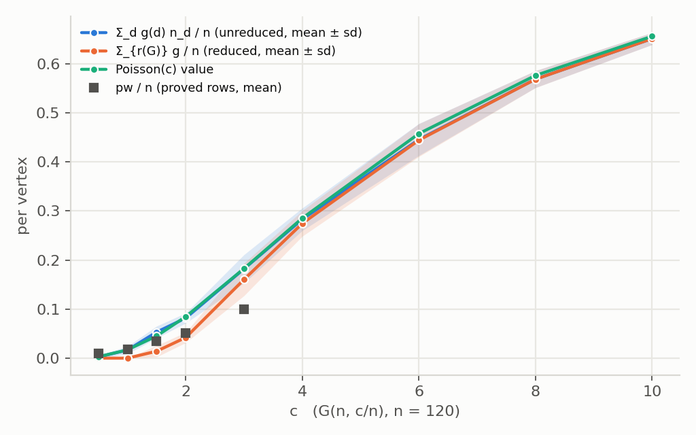

# The Edwards–McDermid degree-sequence bound on pathwidth: verified on the record, formalised conditional on the cubic base case

*Ralph loop0012, 2026-11-02 onward. The plan is `reports/edwards_mcdermid_plan.md`
(its §0.2 quotes every statement used, verbatim; §0.3 names the two hypotheses;
§0.5 fixes the Lean design). One section per item; §0 (the summary) is written
by item 10. Nothing here changes a solver default; nothing re-solves an
instance that is already proved.*

## What this document is about

**The source.** Keith Edwards and Eric McDermid, *A general reduction theorem
with applications to pathwidth and the complexity of MAX 2-CSP*, Algorithmica
72(4):940–968, 2015, DOI 10.1007/s00453-014-9883-7. The accepted manuscript
(dated April 29, 2014, 29 pages) is at
`reports/scratch/edwards_mcdermid/em2015.pdf`, text `em2015.txt`, fetched on
2026-11-02 00:26 UTC from the University of Dundee's Discovery portal
(`SHA256` beside it: `f94e8c08…8665`; the file is 31 pages, two portal cover
sheets carrying the download date and then the manuscript, which is why its
hash differs from the copy of 2026-11-01). Page numbers are the manuscript's.

**The statement** (Corollary 5.2, p. 20; Lemma 5.1 and the base case, p. 19):

> Let `G` be a graph, and `r(G)` be the reduced graph of `G`. Then
> `pw(G) ≤ Σ_{v ∈ V(r(G))} g_{1/6}(d_{r(G)}(v)) + τ(|V(G)|) + O(log |V(G)|) = Σ_{d ≥ 3} g_{1/6}(d) n_d + o(|V(G)|)`.

Here `g = g_{1/6}` is the weight function of their Section 3.1 (p. 6),
`r(G)` the series-parallel reduction of Section 3.2 (p. 8), and `τ(n) = o(n)`
is the error term of Fomin & Høie's cubic bound, "a function `τ`, with
`τ(n) = o(n)`, such that `pw(G) ≤ n/6 − 1/6 + τ(n) + O(log n)`" (p. 19), for
which **the paper gives no constants**. The displayed `=` is a `≤` (plan §0.4
item 6), both forms are computed below.

**This is a verification and a formalisation of a published theorem**,
conditional on two cited results that are taken as named hypotheses and never
asserted (plan §0.3):

- **(H1) `CubicPathwidthBound τ`** — every connected cubic graph on `N`
  vertices has `pw ≤ N/6 − 1/6 + τ(N)`; the source is Fomin & Høie (2006)
  Theorem 5, which gives `pw ≤ (1/6 + ε) N` for `N > n_ε = (8/ε) ln(1/ε)(1 + 1/ε²)`,
  so its explicit budget is `τ_FH(N) = min{εN : N > n_ε} + 1/6`;
- **(H3) `ReductionPathwidthBound ρ`** — `pw(H) ≤ pw(r(H)) + ρ(|V(H)|)` for
  every `H`, with `ρ = O(log n)`; the source is Kneis, Mölle, Richter &
  Rossmanith (2009), not held.

The theorem the loop proves in Lean (items 03–09) is
`pw G ≤ fminus G + τ n + 2ρ n + 1` for graphs with every degree 0 or ≥ 3, and
`pw G ≤ Σ_v g(degree_{r G} v) + τ n + 3ρ n + 1` for every `G`, with both
budgets explicit. The paper's `τ(n) + O(log n)` is this with `ρ = O(log n)`.

**Notation.** `g(0) = g(1) = g(2) = 0`, `g(3) = 1/6`,
`n g(n) = (n − 2) g(n − 1) + g(n − 2) + 1` for `n ≥ 4`
(`1/6, 1/3, 13/30, 23/45, 359/630, 1553/2520, 14827/22680` at `d = 3..9`;
the paper's table p. 7 to `d = 8`, reproduced exactly); `g'(d) = g(d) − g(d − 1)`
(`1/6, 1/6, 1/10, 7/90, 37/630, 13/280` at `d = 3..8`; zero for `d ≤ 2`);
`f(G) = Σ_v g(d(v))`; `f⁻(G) = f(G) − Σ_{components C} g'(δ(C))` (p. 7, per
component); `r(G)` the reduced graph, kept on the same vertex set with the
removed vertices isolated (plan §0.5). The **main term** is
`Σ_{v ∈ V(r(G))} g(d_{r(G)}(v))`; the **histogram term** is `Σ_{d ≥ 3} g(d) n_d(G)`
over `G`'s own degrees; the **deficit** of a graph is `pw − main term`, the
part of the bound the lower-order terms must cover. Code:
`learning/edwards_mcdermid.py` (tests `tests/test_edwards_mcdermid.py`).

---

## 1. Corollary 5.2 and Theorem 5.3 on every graph with a proved pathwidth (item 01, 2026-11-02)

**Regenerate.** `nice -n 19 python3 reports/scratch/edwards_mcdermid/01_verify/run.py --workers 8`
(stages `pilot, dataset, ensemble, cubic, tables`; 75 s on 8 workers at load
0.1; outputs `pilot.csv`, `dataset.csv`, `ensemble.csv`, `cubic.csv`,
`tables.md` with every table below in full, `poisson_n120.png`, `run.log`).

**The manuscript against the plan's quotations.** Sections 1, 3, 5 and the
Appendix were read against plan §0.2: the weights and their six properties,
the table of values, the four operations, the definition of basic graphs,
Lemma 3.1 with its appeal to Kneis et al., Theorem 3.2 with its full case
analysis and Algorithm X, the base case paragraph, Lemma 5.1 and its proof,
Corollary 5.2, Theorem 5.3 and the Golovnev–Kutzkov remark, Lemmas 8.1–8.5
with their proofs, all agree with the quotations word for word. Two trivia:
Corollary 5.2 and Theorem 5.3 sit on p. 20 (the plan says "Section 5, p. 19",
which is where the section and Lemma 5.1 begin); and the portal's citation
sheet gives the year 2015, the manuscript's own cover sheet 2014. **No
discrepancy of substance.**

**Size range.** Every graph on record with a proved pathwidth, 63,330 in all:
the pilot's 6,542 proved `G(n, c/n)` graphs (`n = 20–120`, `c = 0.5–10`,
regenerated from their seeds and checked against the `m` column); the
dataset's 16,635 certified non-empty classes (`n = 1–2,916`; the 16,636th is
the empty graph); the ensembles' 50,701 certified random covers (`n = 10–100`,
four frames), of which 40,153 are distinct within their cell by the stored
nauty certificate — the 10,548 isomorphic repeats are evaluated and dropped
from every statistic below. The 173 unproved pilot rows and the 336 dataset
`solution` rows are carried separately. Pathwidths are the record's; the only
new solves are the 4,681 connected cubic graphs on 4–16 vertices (`nauty-geng
-c -d3 -D3`, subset DP, 43 s), which the item allows.

### 1.1 Kill checks: none fired

| check | result |
|---|---|
| a proved graph with `pw > main term + τ_FH(n)` | **0** of 63,330 |
| a graph with `main term > histogram term` | **0** of 63,330 (and 0 of the 509 unproved) |
| `reduce` raising a surviving vertex's degree | **0** (every surviving degree `≥ 3` and `≤` its original on all 63,839 graphs; the module's tests check it on 200 random graphs and the four named cases) |

So the reading of Section 3.2 and Corollary 5.2 stands, and the corollary
with Fomin–Høie's explicit budget holds on every graph on record. That is
no information: `τ_FH(n)` exceeds `0.17 n` at every size on record (next
table), and the informative column is what the record actually needs.

### 1.2 The deficit `pw − main term`, per source (d)

| source | graphs | `n` | max deficit | p99 | median | share `≤ 0` | max `pw − histogram` | share `≤ 0` (histogram) | mean (histogram − main) | max |
|---|---|---|---|---|---|---|---|---|---|---|
| dataset | 16,635 | 1–2,916 | 5.000 | 3.000 | 0.657 | 38.1% | 4.333 | 63.6% | 1.349 | 70.0 |
| ensemble (distinct) | 40,153 | 10–100 | 4.000 | 2.667 | −2.716 | 74.1% | 2.667 | 77.7% | 0.283 | 7.99 |
| pilot | 6,542 | 20–120 | 3.333 | 3.000 | 0.647 | 46.3% | 2.500 | 58.5% | 0.681 | 6.10 |
| **all** | **63,330** | 1–2,916 | **5.000** | — | — | **61.8%** | **4.333** | 72.0% | — | — |

The main term alone bounds the pathwidth on 61.8% of the record; the
histogram term alone on 72.0%. Only 122 graphs have deficit above 3, and 17
above 4. Where the deficit sits is structural, and the split says which
lower-order term it belongs to:

| source | kind | graphs | `n` | max deficit | attained by | p99 | median | share `≤ 0` |
|---|---|---|---|---|---|---|---|---|
| dataset | reduces to empty | 2,263 | 1–637 | **5.000** | VSPLIB `TREE_202_5` (|V| = 202, pw 5) | 4.000 | 2.000 | 0.1% |
| dataset | `r(G)` cubic | 803 | 4–261 | **4.333** | Coxeter graph (|V| = 28, pw 9) | 3.667 | 2.333 | 1.1% |
| dataset | `r(G)` non-cubic | 13,569 | 6–2,916 | 3.333 | pwc-09237 (|V| = 38, pw 5) | 2.667 | 0.178 | 46.7% |
| ensemble | reduces to empty | 2,166 | 10–60 | 4.000 | `f_n30_m30_d2` #23 (pw 4) | 3.000 | 2.000 | 0.1% |
| ensemble | `r(G)` cubic | 1,432 | 10–75 | 3.333 | `f_n40_m40_d2` #8 (pw 4) | 3.333 | 2.333 | 0.1% |
| ensemble | `r(G)` non-cubic | 36,555 | 10–100 | 3.667 | `f_n100_m100_d2` #22 (pw 5) | 2.333 | −3.428 | 81.4% |
| pilot | reduces to empty | 2,356 | 20–120 | 3.000 | `n50_c2` #0 (pw 3) | 3.000 | 2.000 | 0.1% |
| pilot | `r(G)` cubic | 199 | 20–120 | 3.333 | `n60_c1.5` #54 (pw 4) | 3.333 | 2.333 | 0.0% |
| pilot | `r(G)` non-cubic | 3,987 | 20–120 | 3.000 | `n50_c2` #2 (pw 4) | 2.667 | −2.485 | 75.9% |

- **Where `r(G)` is empty** (10.7% of the record: trees, cycles, every
  series-parallel graph), the main term is 0 and the deficit *is* the
  pathwidth: this is the paper's `O(log n)` term, (H3) with `r(G) = ∅`. On
  the 6,785 such graphs the maximum of `pw − log₃ n` is 0.904 and the
  maximum pathwidth 5 (the seven VSPLIB trees on 202 vertices, the extremal
  trees of `TreeBound.lean`). That is the measured *shape* of the reduction
  lemma's term at these sizes, not its constant.
- **Where `r(G)` is cubic** (3.8%), the deficit is the cubic base case's:
  `pw(r(G)) − |V(r(G))|/6`, and the record's maximum, 4.333, is the Coxeter
  graph. The 70 of the 122 deficits above 3 that are not series-parallel
  graphs are all here but three.
- **Where `r(G)` is neither** (85.5%), the main term already bounds on
  47–81% and the maximum deficit is 3.667.

The twelve largest deficits on record are the 202-vertex VSPLIB trees at
pathwidth 5 (main term 0; histogram term 8.7–11.0, which the reduction gives
back).

### 1.3 The budget the record needs, `B(n) = max{deficit : |V| ≤ n}`, beside Fomin–Høie's explicit `τ_FH(n)` (d)

| `n` | graphs with `|V| ≤ n` | `B(n)` | attained by | `B(n)` over `r(G) ≠ ∅` | `B(n)/n` | `τ_FH(n)` | `τ_FH(n)/n` |
|---|---|---|---|---|---|---|---|
| 10 | 3,045 | 3.333 | Petersen graph (|V| = 10, pw 5) | 3.333 | 0.333 | 7.46 | 0.746 |
| 20 | 14,492 | 4.000 | Pappus graph (|V| = 18, pw 7) | 4.000 | 0.200 | 12.85 | 0.643 |
| 40 | 39,934 | 4.333 | Coxeter graph (|V| = 28, pw 9) | 4.333 | 0.108 | 21.82 | 0.546 |
| 60 | 53,489 | 4.333 | Coxeter graph | 4.333 | 0.072 | 29.59 | 0.493 |
| 100 | 62,718 | 4.333 | Coxeter graph | 4.333 | 0.043 | 43.24 | 0.432 |
| 200 | 63,103 | 4.333 | Coxeter graph | 4.333 | 0.022 | 71.96 | 0.360 |
| 500 | 63,281 | 5.000 | VSPLIB `TREE_202_5` (|V| = 202, pw 5) | 4.333 | 0.010 | 140.19 | 0.280 |
| 1,000 | 63,307 | 5.000 | the same | 4.333 | 0.005 | 231.28 | 0.231 |
| 2,916 | 63,330 | 5.000 | the same | 4.333 | 0.002 | 498.43 | 0.171 |

`τ_FH` exceeds every deficit by a factor of 2.2 at `n = 10` and 100 at
`n = 2,916`: the corollary with that budget is satisfied everywhere on record
and says nothing a graph could violate. **`B(n)` is the informative column**:
a constant 5 covers every proved graph on record, 4.333 every graph whose
reduction is non-empty, and both are attained by graphs that are small and
famous (cages, extremal trees), not by the large ones. The unproved rows
cannot raise it: the 173 `upper` pilot rows (`n = 80–120`) have
`lower − main term ≤ −3.06` (median −20.4), and the 336 dataset `solution`
rows (`n = 90–1,024`) have `upper − main term ≤ 5.33` (median −57.8), the
5.33 being a cubic graph on 112 vertices whose witness has width 24 and whose
optimum is unknown.

### 1.4 The base case measured (e)

`pw − (N/6 − 1/6)` on every connected cubic graph to 16 vertices (exhaustive)
and on the dataset's certified cubic graphs:

| `N` | connected cubic graphs | pw min | pw max | max excess | `N/6 − 1/6` | graphs at the max |
|---|---|---|---|---|---|---|
| 4 | 1 | 3 | 3 | 2.500 | 0.500 | 1 (`K_4`) |
| 6 | 2 | 3 | 3 | 2.167 | 0.833 | 2 |
| 8 | 5 | 3 | 4 | 2.833 | 1.167 | 2 |
| 10 | 19 | 3 | 5 | 3.500 | 1.500 | 1 (Petersen) |
| 12 | 85 | 3 | 5 | 3.167 | 1.833 | 7 |
| 14 | 509 | 3 | 6 | **3.833** | 2.167 | 1 (Heawood) |
| 16 | 4,060 | 3 | 6 | 3.500 | 2.500 | 23 |

The dataset holds 47 cubic classes (42 certified, 5 `solution`; all
connected; `N = 4–126`). The 13 at `N ≤ 16` were matched by isomorphism to
the exhaustive sweep: all 13 matched and **all 13 pathwidths agree** (a free
consistency check of the record, no new solve). Above 16 the certified
excesses are: Pappus (18) 4.167, McGee (24) 4.167, Coxeter (28) **4.500**,
pwc-16065 (30) 4.167, Gray (54) 4.167, three graphs on 70 vertices at 3.500,
and negative values down to −7.83 on the structured cubic graphs at 78–120
vertices (prisms and the like, whose pathwidth stays small).

**The smallest `c` with `pw ≤ N/6 − 1/6 + c` is 3.833 on every connected
cubic graph to 16 vertices (exhaustive, 4,681 graphs) and 4.500 on the 42
certified connected cubic graphs to `N = 120`**, attained by the Coxeter
graph. The sequence of record-holders, `K_4`, Petersen, Heawood, Pappus,
McGee, Coxeter, is the small cages: high girth is what makes `pw/N` large.
Measured to `N = 16` exhaustively and on 42 certified graphs to 120; a
constant budget is not claimed beyond that, and the `solution` row for the
112-vertex cubic graph (excess 5.5 as an upper bound) shows where the record
stops.

### 1.5 The Poisson evaluation on the pilot (f)

On `G(n, c/n)` the degree law is Poisson(`c`) in the limit, so the histogram
term per vertex should be `Σ_d P_c(d) g(d)` (`poisson_value(c)`: 0.1826,
0.2853, 0.4575, 0.5761, 0.6558 at `c = 3, 4, 6, 8, 10`). All rows of the
cells, proved or not (the terms need no pathwidth); the full table for
`n = 60, 70, 80, 90, 100, 120` is in `tables.md`, two sizes here:

| `n` | `c` | rows | proved | Poisson | histogram/n (mean ± sd) | main/n (mean ± sd) | gain (hist − main)/n | pw/n (proved) | pw/main (proved) |
|---|---|---|---|---|---|---|---|---|---|
| 60 | 3 | 136 | 136 | 0.1826 | 0.1767 ± 0.034 | 0.1532 ± 0.038 | 0.0235 | 0.1355 | 0.906 |
| 60 | 4 | 136 | 136 | 0.2853 | 0.2827 ± 0.035 | 0.2734 ± 0.038 | 0.0093 | 0.2045 | 0.751 |
| 60 | 6 | 134 | 134 | 0.4575 | 0.4539 ± 0.032 | 0.4526 ± 0.032 | 0.0013 | 0.3129 | 0.692 |
| 60 | 8 | 132 | 132 | 0.5761 | 0.5768 ± 0.025 | 0.5766 ± 0.025 | 0.0002 | 0.4005 | 0.694 |
| 60 | 10 | 133 | 133 | 0.6558 | 0.6547 ± 0.017 | 0.6547 ± 0.017 | 0.0000 | 0.4634 | 0.708 |
| 120 | 3 | 13 | 3 | 0.1826 | 0.1820 ± 0.029 | 0.1604 ± 0.033 | 0.0216 | 0.1000 | 0.819 |
| 120 | 4 | 13 | 0 | 0.2853 | 0.2830 ± 0.023 | 0.2745 ± 0.026 | 0.0085 | — | — |
| 120 | 6 | 13 | 0 | 0.4575 | 0.4454 ± 0.033 | 0.4442 ± 0.033 | 0.0012 | — | — |
| 120 | 8 | 13 | 0 | 0.5761 | 0.5685 ± 0.017 | 0.5684 ± 0.017 | 0.0001 | — | — |
| 120 | 10 | 13 | 0 | 0.6558 | 0.6511 ± 0.012 | 0.6511 ± 0.012 | 0.0000 | — | — |

The histogram term matches the Poisson value to within 0.012 per vertex at
every cell (the sample sd is 0.012–0.041, and the finite-`n` degree law is
Binomial(`n − 1`, `c/n`)). **The reduction's gain** on `G(n, c/n)` is 0.021–0.025
per vertex at `c = 3` (vertices of degree ≤ 2 and pendant trees), 0.009 at
`c = 4`, 0.001 at `c = 6` and nothing from `c = 8`: the two forms of
Corollary 5.2 are the same bound above `c ≈ 6` and differ by 12% of the bound
at `c = 3`. Against the proved pathwidths the bound is 1.1–1.2× the truth at
`c = 3` and 1.4–1.5× at `c = 6–10` (`n = 60`); the survey's §7(d) put the
same factor at 1.6–1.85 against the *fitted slopes*, which sit below the
finite-size `pw/n` by the fit's positive intercept (0.268 against 0.313 at
`c = 6`), so the two numbers agree.

The survey §7(e)-style column (per pilot cell: `pw/n` over proved rows,
`main/n` over all rows, their ratio and the cell's maximum deficit) is the
second table of `tables.md` §(f), 81 cells. Its shape: at `c ≤ 1` the main
term is 0 (every graph reduces to empty) and the deficit is the pathwidth,
2–3; at `c = 1.5–2` the ratio `pw/main` is 1.2–4 and the deficit's maximum
3–3.3 at every `n`; from `c = 3` at `n ≥ 50` and from `c = 4` at `n = 30` the
main term alone bounds every proved graph in the cell (maximum deficit
negative, down to −13 at `n = 70, c = 10`).

### 1.6 Theorem 5.3's average-degree form (g)

`g(d̄) n` with the paper's linear interpolation, where the theorem applies
(connected, or `d̄ ≥ 5`):

| source | graphs where it applies | connected | `d̄ ≥ 5` | max `pw − g(d̄)n` | median | share `≤ 0` | `main term > g(d̄) n` | median (`g(d̄)n` − main) |
|---|---|---|---|---|---|---|---|---|
| dataset | 16,499 | 16,446 | 3,659 | 4.333 | 0.000 | 53.4% | **0** | 0.667 |
| ensemble | 33,652 | 31,764 | 31,053 | 2.667 | −4.622 | 85.9% | **0** | 0.627 |
| pilot | 2,596 | 2,527 | 2,075 | 2.667 | −6.254 | 97.2% | **0** | 1.217 |

The Edwards–Farr averaging lemma (`f(r(G)) ≤ g(d̄) n` for connected `G` or
`d̄ ≥ 5`, attributed to [8] and not proved in the paper) holds on all 52,747
graphs where it applies, with a median slack of 0.6–1.2. **Its hypothesis is
needed**: among the 5,487 proved graphs that are disconnected with
`2 ≤ d̄ < 5`, `main term > g(d̄) n` on 1,431 (a component of high degree
beside a sparse one; Jensen runs the other way across components). The
maximum of `pw − g(d̄) n` where the theorem applies is again the Coxeter
graph (cubic, so `g(d̄) n = N/6` is the main term).

**Kill verdict: not met** (no violation of any deterministic statement; no
graph with `main term > histogram term`; no degree raised). The brief's
"violation of Corollary 5.2" is unfalsifiable at these sizes, as the plan said
(§0.4 item 4), and the table of §1.3 is what the item exists to measure.

**What this does not claim.** Anything about the constants in the paper's
`o(n) + O(log n)` beyond what the record shows at these sizes (`n ≤ 2,916`;
cubic graphs to 16 exhaustively and 42 certified to 120); that `B(n) = 5` or
`c = 4.5` bounds any graph not on record (the record-holders are cages and
the record's cages stop at 28 and 54 vertices; nothing on it says how the
excess grows with `N`); that the paper's bound is tight
anywhere (it is 1.1–1.5× the truth on the pilot); anything about Theorem 5.3
beyond the numerical check of its averaging lemma (not formalised); that
`τ_FH` is the paper's `τ` (the paper leaves `τ` unspecified; `τ_FH` is read
off Fomin & Høie's Theorem 5).

---

## 2. The exact statements, every intermediate lemma checked on every graph to 9 vertices (item 02, 2026-11-02)

**Regenerate.** `nice -n 19 python3 reports/scratch/edwards_mcdermid/02_lemmas/check.py --max-n 9 --workers 8`
(284–335 s on 8 workers at load < 7 on the owner's 9950X; outputs `check.log`,
`violations.txt`, `summary.json`). The helpers the script uses (`sp_step`,
`reduce_random`, `is_basic`, `paper_choice`, `algorithm_x`, `F_global`,
`pathwidth_induced`) are in `learning/edwards_mcdermid.py`, tested in
`tests/test_edwards_mcdermid.py` (30 tests, 9 new).

**Size range.** Every graph on 1–9 vertices from `nauty-geng` (288,266 graphs;
1, 2, 4, 11, 34, 156, 1,044, 12,346, 274,668), pathwidth by the subset DP;
weights to `n = 40` in exact rationals. Nothing was sampled: the item allowed
2,000 random partitions per graph at 8–9 and a sweep to 8 for S1′, but the
machine computes `pw(G[S])` for every `S` of a 9-vertex graph in 20 ms, so the
cut lemma was checked on **every partition of every graph** (71,967,757
partitions), the commutation lemma on every (graph, step, `w`) to 9
(3,115,987), the reduct's uniqueness on 200 random orders per graph
(39,657,000 maximal reduction sequences), and S1′ on every maximum-degree
vertex of every connected non-basic graph of minimum degree 3 to 9.

**Kill checks: none fired.** 0 violations of W1–W5, C1, C2, P1, P2, R1, R2,
R3, R5, R6, S0, S1, SJ, T1, B1 (the per-statement counts are in §2.3). The
loop's premise for items 03–09 stands. Two measurements came out as the item
said they might, and both are findings rather than kills: **S1′ is false**
(§2.4; item 07 keeps the paper's tie-break), and the reduct is **unique on
every graph to 9 vertices** (the Lean design does not need it).

### 2.1 Where the check corrects the design (plan §0.5) and the item's wording

Six points, each the smallest sound change; none touches the two hypotheses
or the theorem's form.

1. **The step relation is defined at degrees 1 and 2 only.** In the
   one-vertex-type design a removed vertex is isolated, so operation 1
   ("delete an isolated vertex") is `isolate` at a vertex of degree 0, which
   is the identity on `SimpleGraph V`. A step relation including it would not
   lower any measure (R1 would be false) and would make "no step applies"
   unprovable. `SPStep G v H` is therefore operation 2 at degree 1 and
   operations 3–4 at degree 2; operation 1 is absorbed by the reflexive
   closure, and "`r(G)` is empty" is `SPReduces G ⊥`.
2. **The cut lemma has a stronger and simpler form, and it rests on two
   existing lemmas.** The item's C1,
   `pw(G) ≤ max(pw(G[V₁]) + |∂₁|, pw(G[V₂]) + |∂₂|, |∂₁| + |∂₂| − 1)`, is
   implied by the *separator form*
   **C1s: `pw(G) ≤ max(pw(G[V₁]), pw(G[V₂])) + min(|∂₁|, |∂₂|)`**, because
   `∂₁` separates `V₁ ∖ ∂₁` from `V₂` (and symmetrically): delete `∂₁`
   (`pathwidth_le_pathwidth_induce_add_card_compl`), the rest is a disjoint
   union with no edge between (`pathwidth_induce_union_le_max`), and
   `pw(G[V₁ ∖ ∂₁]) ≤ pw(G[V₁])` (`pathwidth_le_of_injective`). The three-term
   bound follows from `max(a, b) + min(c, d) ≤ max(a + c, b + d)`. Checked:
   C1s holds on all 71,967,757 partitions and is never above C1; it is tight
   (`= pw`) on 9.5% of them. The iterated form C2 then carries the factor 1,
   not 2: **C2s: `pw(G) ≤ Σ_i b_i + max_leaf pw`** with `b_i` bounding the
   *smaller* boundary of each level-`i` split (checked on 2,306,072 random
   depth-2 trees, with the item's factor-2 form beside it). Item 04 proves
   C1s and derives C1 and both C2 forms; the note that Fomin–Høie's `n/6`
   comes from one level and their Lemma 4, not from iterating, stands.
3. **The floor on a non-cubic basic component is `5/6`, not on "a
   second-kind component".** `K₄` is cubic *and* of the second kind
   (`K₄ − v = K₃` reduces to empty) with `f⁻ = 1/2 < 5/6`. The true
   statement is B1: *connected, every degree ≥ 3, not cubic ⇒ `f⁻ ≥ 5/6`*
   (a vertex of degree ≥ 4 has four neighbours of degree ≥ 3, so
   `f ≥ g(4) + 4 g(3) = 1`, and `g'(δ) ≤ 1/6`), basic or not; checked on all
   89,943 such graphs. The assembly A1 does not need it: it needs only
   `f⁻(C) ≥ 0` per component (checked on all 290,103 components), since the
   `+1` of the second kind is carried explicitly in the budget.
4. **P2's regular case is an equality and needs `Δ ≥ 4`.** Property 6 is
   stated for `n ≥ 4` and fails at `n = 3` (`1 − g(3) = 5/6` against
   `2 g'(3) + g'(2) = 1/3`), so for a `Δ`-regular reduced graph with `Δ ≥ 4`,
   `f(G − w) = f(G) − 1 + g'(Δ − 1) − g'(Δ)` exactly (checked on all 501
   such (graph, `w`) pairs); cubic graphs never reach the step (they are
   basic), and there `f(G − w) = f(G) − 2/3`.
5. **The step inequality is proved in the global-minimum form and the
   per-component form follows.** The paper's equation (1) writes
   `f⁻(G*) = f(G*) − g'(δ(G*))` with one global `δ`; with the design's
   per-component `f⁻`, that is an inequality in the favourable direction,
   `f⁻(G*) ≤ f(G*) − g'(δ(G*)) =: F(G*)` (every component's `g'(δ(C)) ≥ 0`
   and one of them is `g'(δ(G*))`), and `f⁻(G) = F(G)` for `G` connected on
   its support. So item 07 proves **S1: `1 + F(G*) ≤ F(G)`** and gets
   `1 + f⁻(G*) ≤ f⁻(G)` as a corollary. Both were checked (137,573 pairs).
6. **Theorem 3.2 needs `G ≠ ⊥`** in the Lean form, since "every degree 0 or
   ≥ 3" admits the edgeless graph, for which no non-empty basic reduct
   exists. And **no confluence fact is needed anywhere**: "not basic" is
   `∀ v, ¬ SPReduces (G − v) ⊥` (the second-kind clause is existential over
   reduction sequences), so `G* ≠ ⊥` for *the* reduct the induction supplies
   is immediate; the commutation lemma R3/R4 does the rest, as the plan
   said.

### 2.2 The statements

Numbered as items 03–09 will prove them; `G − w` is `isolate`, `δ(H)` the
minimum degree over the support (0 if empty), `F(H) = f(H) − g'(δ(H))`,
`supp` the vertices of positive degree. The paper's location and the check
count are given; the Lean name, file and the existing lemma each rests on are
in §2.6.

| # | statement | hypotheses | paper | checked on |
|---|---|---|---|---|
| W1 | `n g(n) = (n − 2) g(n − 1) + g(n − 2) + 1` | `n ≥ 4` | p. 6 | `n ≤ 40` exact |
| W2 | `g(n) ≤ g(n + 1)` (`g` non-decreasing) | all `n` | Lemma 8.3 | `n ≤ 40` |
| W3 | `g'(n + 1) ≤ g'(n)` | `n ≥ 3` | Lemma 8.4 | `n ≤ 40` |
| W4 | `1 − g(n) = (n − 1) g'(n) + g'(n − 1)` | `n ≥ 4` | property 6 | `n ≤ 40` |
| W5 | `0 ≤ g(n) < 1`; `0 ≤ g'(n) ≤ 1/6`; `g'(n) ≤ g(n)` | all `n` | p. 7 | `n ≤ 40` |
| W5c | closed form `g(n) = (7/2) A(n)/n! + (3/2)(−1)ⁿ/n! − 5/2` (optional) | `n ≥ 2` | Lemma 8.1 | `n ≤ 40` |
| C1s | `pw(G) ≤ max(pw(G[V₁]), pw(G[V₂])) + min(|∂₁|, |∂₂|)` | any partition | — (ours; §2.1 (2)) | 71,967,757 partitions, every graph to 9 |
| C1 | `pw(G) ≤ max(pw(G[V₁]) + |∂₁|, pw(G[V₂]) + |∂₂|, |∂₁| + |∂₂| − 1)` | any partition | — (the item's form; Fomin–Høie's `P₁, P₂, P₃` shape) | the same |
| C2s / C2 | depth-`h` bisection with per-level budgets `b_i` on the smaller (C2s) or larger (C2) boundary: `pw(G) ≤ Σ b_i + max_leaf pw`, resp. `≤ 2 Σ b_i + max_leaf pw` | — | — | 2,306,072 random depth-2 trees |
| P1 | `f(G − w) = f(G) − g(d(w)) − Σ_{v ∈ N(w)} g'(d(v))` | none | (2)–(3) | 2,579,255 (graph, `w`) |
| P2 | `f(G − w) ≤ f(G) − 1` | every degree 0 or ≥ 3; `d(w) = Δ ≥ 4`; some neighbour of degree `≤ Δ − 1` | p. 10 | 163,265 |
| P2r | `f(G − w) = f(G) − 1 + g'(Δ − 1) − g'(Δ)` | `Δ`-regular on the support, `Δ ≥ 4` | p. 11 | 501 |
| R1 | one step removes at least one edge (so `SPReduces` terminates and a reduced reduct exists) | step at degree 1 or 2 | p. 8 | 393,156 steps |
| R2 | one step raises no degree: `d_{H'}(u) ≤ d_H(u)` for every `u`; hence `f(H') ≤ f(H)`, and a vertex of degree `d` isolated by the step costs `f(H) − f(H') ≥ g(d)` | — | p. 10 ("`v` is reduced away") | 393,156 |
| R3 | `SPStep H H'` at `v`, `w ≠ v` ⇒ `H' − w = H − w`, or `SPStep (H − w) (H' − w)` at `v` | — | replaces Lemma 3.1 | 3,115,987 (graph, step, `w`): 95,300 zero-step, 3,020,687 one-step |
| R4 | lift of R3 to `SPReduces` and to a finset `X` disjoint from the acted vertices | — | Lemma 3.1 | by induction from R3 (R3 is the whole content; not separately swept) |
| R5 | a step at `v` acts inside the component of `v`: `step(G|C ⊔ G|Cᶜ, v) = step(G|C, v) ⊔ G|Cᶜ` | `v ∈ C` | p. 9 (disconnected case) | 8,350 |
| R6 | `pw(H) ≤ pw(H') + 1` for one step (optional; not what A1 needs) | — | plan §0.3 | 393,156; the drop is 0 or 1 |
| S0 | `G*` a reduced reduct of `G' = G − w`, `d_{G'}(v) = d ≥ 3` ⇒ `f(G') − f(G*) + g'(δ(G*)) ≥ g'(d)` | none beyond those | p. 10, the `j₄` lemma | 1,093,524 |
| SJ | `1 + f(G') = f(G) − j₁ − j₂ − j₃` | every degree 0 or ≥ 3, `d(w) = Δ ≥ 4` | (2)–(4) | 157,324 |
| S1 | `1 + F(G*) ≤ F(G)` (hence `1 + f⁻(G*) ≤ f⁻(G)`) | `G` connected on its support, every degree 0 or ≥ 3, not basic; `w` of maximum degree whose lowest-degree neighbour has the smallest degree; `G*` any reduced reduct of `G − w` | p. 9–12, equation (1) | 137,573 (graph, `w`, reduct), reducts canonical and random |
| S1′ | the same for *every* maximum-degree `w` | — | — | **false**: 663 of 157,324 fail (§2.4) |
| T1 | `∃ X ⊆ supp G, B`: `SPReduces (G − X) B`, `B ≠ ⊥`, `B` reduced and basic, `|X| + f⁻(B) ≤ f⁻(G)` | every degree 0 or ≥ 3, `G ≠ ⊥` | Theorem 3.2, Algorithm X | 89,972 reduced non-empty graphs; also `r(G − X) = B` on all |
| B1 | `f⁻(C) ≥ 0` for every component; additivity `f⁻(G) = Σ_C f⁻(G|C)`; connected cubic ⇒ `f⁻ = N/6 − 1/6`; connected, every degree ≥ 3, not cubic ⇒ `f⁻ ≥ 5/6` | — | p. 7, p. 19 | 290,103 components; 288,266 graphs; 24 cubic; 89,943 non-cubic |
| A1 | `pw(G) ≤ f⁻(G) + τ(n) + 2ρ(n) + 1` under `CubicPathwidthBound τ`, `ReductionPathwidthBound ρ`, `τ, ρ` monotone | every degree 0 or ≥ 3 | Lemma 5.1 | the budget it needs at `n ≤ 9`: §2.5 |
| A2 | `pw(G) ≤ Σ_v g(d_{r(G)}(v)) + τ(n) + 3ρ(n) + 1 ≤ Σ_v g(d_G(v)) + …` | any `G` | Corollary 5.2 | §2.5 |

### 2.3 The counts

| `n` | graphs | C1/C1s partitions | C1s tight | R3 triples | reduction orders | S1 pairs | S1′ pairs (fail) | non-basic | T1 graphs | `pw − f⁻` max (reduced) | `pw − main` max | `pw(G) − pw(r(G))` max (count at max) |
|---|---|---|---|---|---|---|---|---|---|---|---|---|
| 1–3 | 7 | 21 | 19 | 18 | 800 | 0 | 0 | 0 | 0 | 0 | 2 | 2 (1) |
| 4 | 11 | 88 | 55 | 84 | 1,800 | 0 | 0 | 0 | 1 | 5/2 (`K₄`) | 7/3 | 2 (4) |
| 5 | 34 | 544 | 247 | 376 | 5,800 | 5 | 5 (0) | 1 | 4 | 5/2 | 7/3 | 2 (17) |
| 6 | 156 | 4,992 | 1,503 | 2,075 | 26,400 | 31 | 31 (0) | 8 | 23 | 5/2 | 3 | 3 (1) |
| 7 | 1,044 | 66,816 | 13,235 | 14,514 | 174,000 | 242 | 261 (2) | 100 | 173 | 5/2 | 3 | 3 (8) |
| 8 | 12,346 | 1,580,288 | 207,427 | 158,200 | 1,916,400 | 4,240 | 4,718 (42) | 2,234 | 2,763 | 17/6 (the two cubic graphs of pw 4) | 3 | 3 (114) |
| 9 | 274,668 | 70,315,008 | 6,617,710 | 2,940,720 | 37,531,800 | 133,055 | 152,309 (619) | 82,419 | 87,008 | 17/6 | 3 | 3 (1,258) |
| all | 288,266 | 71,967,757 | 6,840,196 | 3,115,987 | 39,657,000 | 137,573 | 157,324 (663) | 84,762 | 89,972 | 17/6 | 3 | 3 (1,381) |

Every other statement's count is in §2.2; every check printed its count and
no violation line was written (`violations.txt` holds only the 350 S1′
measurement lines, one per failing graph).

### 2.4 The two measurements

**S1′ is false; the paper's tie-break is necessary.** Among the 157,324
(connected non-basic graph, maximum-degree `w`, reduct) triples, 663 — on 350
graphs, the first at 7 vertices — violate `1 + F(G*) ≤ F(G)`; none of the
137,573 with the paper's `w` does. **Every one of the 350 has all neighbours
of `w` at the maximum degree `Δ` while `G` is not regular** (`Δ = 5` on 298,
6 on 50, 7 on 2), and the violation is exactly `g'(Δ − 1) − g'(Δ)`
(`1/15`, `1/45`, `2/105`): the paper's term `j₁ = g'(d(v₁)) − g'(Δ − 1)` is
negative for such a `w`, the regular-case rescue (`G'` has a vertex of degree
`Δ − 1`, so `j₄ ≥ g'(Δ − 1)`) is what the proof uses when *every* vertex has
degree `Δ`, and for a non-regular `G` the paper's rule picks a `w` with a
lower-degree neighbour instead, which makes `j₁ ≥ 0`. The smallest example
is `F]~vo` (7 vertices, degrees 5,5,5,5,5,4,5: `K₇` minus two disjoint edges
and a path of two edges): vertices 4 and 6 have five neighbours of degree 5, and deleting
either leaves a 4-regular graph with `1 + F(G*) = 17/6 > F(G) = 83/30`; the
four vertices adjacent to the degree-4 vertex satisfy the inequality with
equality. So **item 07 must choose `w` by the two-key rule** — maximum
degree, then the smallest lowest-neighbour degree — and the simple
`Finset.exists_max_image` over the degree alone does not suffice;
`tests/test_edwards_mcdermid.py::test_paper_choice_tie_break_is_needed`
pins the example.

**The reduct is unique on every graph to 9 vertices.** 200 maximal
reduction sequences in uniformly random order on each of the 198,285 graphs
with a step (39,657,000 sequences) all reached the canonical reduct, and on
all 89,972 Theorem 3.2 instances the direct `r(G − X)` equals the graph
Algorithm X ends with. This is the paper's "(the resulting graph `r(G)` is in
fact unique)" measured, not proved; the Lean design does not use it (§2.1 (6)).

### 2.5 The budgets the record needs at `n ≤ 9`, and the shape of (H3)

`pw − f⁻` over reduced graphs has maximum `5/2` at `n = 4–7` (`K₄`: pw 3,
`f⁻ = 1/2`) and `17/6` at `n = 8–9` (the two cubic graphs on 8 vertices of
pathwidth 4, `f⁻ = 7/6`); `pw − Σ_{r(G)} g` over all graphs has maximum 3
from `n = 6` on, attained first by the series-parallel graph `EElw` (a
triangle with each edge subdivided once, pathwidth 3, main term 0) and at
`n = 8` by 114 graphs, all reducing to empty. These are the values
`τ(n) + 2ρ(n) + 1` and `τ(n) + 3ρ(n) + 1` must reach at these sizes, nothing
more; they match §1.3's `B(n)` (3.333 at `n ≤ 10`, the Petersen graph).

`pw(G) − pw(r(G))` is 0 on 273,776 graphs, 1 on 3,210, 2 on 9,899 and
**3 on 1,381** (first at `n = 6`, `EElw` again: series-parallel with
pathwidth 3). The item expected at most 2; the shape of (H3) at these sizes
is 3, consistent with `O(log n)` (the complete ternary tree of height 3 has 40
vertices and pathwidth 3, but subdivided triangles get there at 6) and
nothing about its constant. The gap is never negative (`r(G)` is a minor of
`G`), and one step never costs more than one (R6, drop 0 or 1 on all 393,156
steps).

**Kill verdict: not met** for every deterministic statement (W1–W5, C1–C2,
P1–P2, R1–R6, S0–S1, SJ, T1, B1); the two measurements are findings (S1′
false; reduct unique to 9), as the item provided for.

**What this does not claim.** Anything for `n > 9` (the checks are
exhaustive to 9 and nothing else); that the reduct is unique in general
(measured to 9; the design does not need it); that (H1) or (H3) hold or what
their constants are (only the shape `pw(H) − pw(r(H)) ≤ 3` to 9 vertices is
measured); that C1s is new (it is the standard separator argument; "we found
no prior statement" of the item's three-term form is not claimed either,
since Fomin–Høie's proof has that shape); that S1′ fails beyond the pattern
seen (every failure to 9 has all neighbours at degree `Δ`; no other pattern
was looked for).

### 2.6 The Lean-ready list for items 03–09

Every graph is a `SimpleGraph V` on one finite vertex type with decidable
equality and adjacency; `G − w` is `G.isolate w` (`Minor.lean`), `G − X` the
fold of `isolate` over `X : Finset V`; `supp G` is the finset of vertices of
positive degree; "`G` is reduced" (`IsSPReduced G`) is `∀ v, G.degree v = 0 ∨ 3 ≤ G.degree v`.
Hypotheses are written as they should appear in the Lean statement; the last
column is the existing lemma or the earlier item each rests on.

**`DegreeBound/Weights.lean` (item 03)** — `g : ℕ → ℚ`, `g' n = g n − g (n − 1)`.

| name | statement | rests on |
|---|---|---|
| `g_zero, g_one, g_two, g_three` | `g 0 = g 1 = g 2 = 0`, `g 3 = 1/6` | definition |
| `g_recurrence` (W1) | `4 ≤ n → n * g n = (n − 2) * g (n − 1) + g (n − 2) + 1` | definition (well-founded recursion) |
| `g_table` | `g 4 = 1/3`, `g 5 = 13/30`, `g 6 = 23/45`, `g 7 = 359/630`, `g 8 = 1553/2520`; `g' 3 = g' 4 = 1/6`, `g' 5 = 1/10` | `norm_num` on the recurrence |
| `g_monotone` (W2, Lemma 8.3) | `Monotone g` | the coupled invariant `g (n−1) ≤ g n ≤ (1 + g (n−1))/2` by induction |
| `g'_recurrence` | `5 ≤ n → n * g' n = (n − 3) * g' (n − 1) + g' (n − 2)` | W1 twice |
| `g'_antitone_of_three_le` (W3, Lemma 8.4) | `3 ≤ m → m ≤ n → g' n ≤ g' m` | the sandwich `g' (n−1) ≥ g' n ≥ g' (n−1)/3` by induction from `g'_recurrence` |
| `one_sub_g_eq` (W4, property 6) | `4 ≤ n → 1 − g n = (n − 1) * g' n + g' (n − 1)` | W1 rearranged |
| `g_nonneg, g_lt_one, g'_nonneg, g'_le_sixth` (W5) | `0 ≤ g n`, `g n < 1`, `0 ≤ g' n`, `g' n ≤ 1/6` | W2, W3, the coupled invariant |
| `g'_le_g` | `g' n ≤ g n` | `g_nonneg` at `n − 1` (used by S0) |
| `g_closed_form` (Lemma 8.1, optional) | `2 ≤ n → g n = (7/2) A n / n! + (3/2) (−1)^n / n! − 5/2` with `A` the alternating factorial | induction; not needed downstream |

**`DegreeBound/CutLemma.lean` (item 04)** — `boundary G S := S.filter (fun v => ∃ u, u ∉ S ∧ G.Adj v u)`.

| name | statement | rests on |
|---|---|---|
| `pathwidth_le_max_add_min_boundary` (C1s) | `pathwidth G ≤ max (pathwidth (G.induce ↑S)) (pathwidth (G.induce ↑Sᶜ)) + min |∂S| |∂Sᶜ|` | `pathwidth_le_pathwidth_induce_add_card_compl` with the complement `∂S`; `pathwidth_induce_union_le_max` on `S ∖ ∂S` and `Sᶜ` (no edge between them); `pathwidth_le_of_injective` for `G[S ∖ ∂S] ≤ G[S]` |
| `pathwidth_le_cut` (C1) | `pathwidth G ≤ max (max (pathwidth G[S] + |∂S|) (pathwidth G[Sᶜ] + |∂Sᶜ|)) (|∂S| + |∂Sᶜ| − 1)` | C1s and `max a b + min c d ≤ max (a + c) (b + d)` |
| `BisectionTree G S bs k` | `BisectionTree S [] k := pathwidth G[S] ≤ k`; `BisectionTree S (b :: bs) k := ∃ S₁ S₂, S₁ ∪ S₂ = S ∧ Disjoint S₁ S₂ ∧ min |∂_{G[S]} S₁| |∂_{G[S]} S₂| ≤ b ∧ BisectionTree S₁ bs k ∧ BisectionTree S₂ bs k` | definition (`Prop` by recursion on the list) |
| `pathwidth_le_of_bisectionTree` (C2s) | `BisectionTree G univ bs k → pathwidth G ≤ k + bs.sum` | C1s by induction on `bs` (within `G[S]`; `induce_induce` or `pathwidth_eq_of_iso`) |
| `pathwidth_le_of_bisectionTree_two_mul` (C2, the item's form) | with `max |∂S₁| |∂S₂| ≤ b` in place of the min: `pathwidth G ≤ k + 2 * bs.sum` | C2s and `min ≤ max ≤ 2 max`; stated so the item's text has its lemma, but C2s is what to use |

A note the file should carry (plan §0.4 (3)): Fomin–Høie reach `n/6` with **one** level and their Lemma 4 (the boundary as the *last* bag of a degree-3 decomposition), not by iterating C2; iterating C2s with Monien–Preis cuts of `(1/6 + ε)` of each piece sums to `n/3`.

**`DegreeBound/Potential.lean` (item 05)** — `f G := ∑ v, g (G.degree v)`; `minDeg G C := (C.supp.toFinset).inf' _ (G.degree ·)` for `C : G.ConnectedComponent`; `fminus G := f G − ∑ C, g' (minDeg G C)`; `F G := f G − g' (δ G)` with `δ G` the minimum degree over `supp G` (`0` if empty).

| name | statement | rests on |
|---|---|---|
| `degree_isolate` | `(G.isolate w).degree v = if v = w then 0 else if G.Adj v w then G.degree v − 1 else G.degree v` | `Minor.lean` `isolate` |
| `f_isolate` (P1) | `f (G.isolate w) = f G − g (G.degree w) − ∑ v ∈ G.neighborFinset w, g' (G.degree v)` | `degree_isolate`, `Finset.sum` split over `{w}`, `N(w)`, the rest |
| `f_isolate_le_sub_one` (P2) | `IsSPReduced G → (∀ v, G.degree v ≤ Δ) → G.degree w = Δ → 4 ≤ Δ → (∃ v ∈ N(w), G.degree v ≤ Δ − 1) → f (G.isolate w) ≤ f G − 1` | P1, W3 (`g' (deg v) ≥ g' Δ` for `v ∈ N(w)` since `3 ≤ deg v ≤ Δ`; `g' (deg v₁) ≥ g' (Δ − 1)`), W4 |
| `f_isolate_regular` (P2, regular) | `IsSPReduced G → (∀ v ∈ supp G, G.degree v = Δ) → 4 ≤ Δ → G.degree w = Δ → f (G.isolate w) = f G − 1 + g' (Δ − 1) − g' Δ` | P1, W4 (an equality; fails at `Δ = 3`, where W4 does not hold) |
| `fminus_le_F` | `fminus G ≤ F G` | each `g' (minDeg C) ≥ 0` and one component attains `δ G` |
| `fminus_eq_F_of_connected` | `supp G` connected (one component) → `fminus G = F G` | definition |
| `fminus_eq_sum_components` (B1 additivity) | `fminus G = ∑ C, fminus (G.restrict C)` | `f` splits over components; `restrict C` has `C` as its only non-trivial component |
| `fminus_component_nonneg` | `0 ≤ fminus (G.restrict C)` | `f ≥ g (δ) ≥ g' (δ)` (`g'_le_g`) |
| `fminus_cubic` (B1) | `supp G` connected, `∀ v ∈ supp G, G.degree v = 3`, `|supp G| = N` → `fminus G = N/6 − 1/6` | `g 3 = g' 3 = 1/6` |
| `fminus_ge_five_sixths_of_not_cubic` (B1 floor, optional) | `supp G` connected, every degree `0 ∨ ≥ 3`, some degree `≥ 4` → `5/6 ≤ fminus G` | `g 4 + 4 g 3 − 1/6`; not needed by A1 (which uses only `fminus_component_nonneg`) |

**`DegreeBound/SPReduction.lean` (item 06)** — `SPStep G v H` ("one operation at `v`"): `G.degree v = 1 ∧ H = G.isolate v`, or `G.degree v = 2` with neighbours `x ≠ y` and `H = (G.isolate v) ⊔ edge x y` when `¬ G.Adj x y`, `H = G.isolate v` when `G.Adj x y`. `SPReduces := Relation.ReflTransGen (fun G H => ∃ v, SPStep G v H)`. `IsSPReduced G := ∀ v, G.degree v = 0 ∨ 3 ≤ G.degree v`. `IsBasic G := ∀ C : G.ConnectedComponent, C nontrivial → (∀ v ∈ C, G.degree v = 3) ∨ ∃ v ∈ C, SPReduces ((G.restrict C).isolate v) ⊥`.

| name | statement | rests on |
|---|---|---|
| `SPStep.edgeFinset_card_lt` (R1) | `SPStep G v H → H.edgeFinset.card < G.edgeFinset.card` | case analysis; operation 3 removes two edges and adds one |
| `exists_reduced_reduct` (R1′) | `∃ H, SPReduces G H ∧ IsSPReduced H` | well-founded induction on the edge count via R1 |
| `SPStep.degree_le` (R2) | `SPStep G v H → ∀ u, H.degree u ≤ G.degree u` | case analysis (operation 3 keeps `x, y`; `v` drops to 0) |
| `SPReduces.degree_le` (R2) | `SPReduces G H → ∀ u, H.degree u ≤ G.degree u` | `ReflTransGen` induction |
| `SPReduces.f_le` (R2) | `SPReduces G H → f H ≤ f G` | R2 and W2 |
| `SPReduces.f_sub_ge_of_isolated` (R2) | `SPReduces G H → H.degree u = 0 → g (G.degree u) ≤ f G − f H` | R2 termwise, W2, `g 0 = 0` |
| `SPStep.isolate_comm` (R3) | `SPStep G v H → w ≠ v → H.isolate w = G.isolate w ∨ SPStep (G.isolate w) v (H.isolate w)` | case analysis on `w ∈ N(v)`, on `w ∈ {x, y}`, and on the operation; `isolate` commutes with `isolate` and absorbs the added edge `xy` when `w ∈ {x, y}` |
| `SPReduces.isolate_comm` (R4, one vertex) | `SPReduces G H → w ∉ acted → SPReduces (G.isolate w) (H.isolate w)` | R3 along the sequence (`acted` = the vertices the steps act on; or the hypothesis `H.degree w ≠ 0 ∨ G.degree w = 0`, since an acted vertex ends isolated) |
| `SPReduces.isolateSet_comm` (R4) | `SPReduces G H → (∀ w ∈ X, w ∉ acted) → SPReduces (G − X) (H − X)` | induction on `X` |
| `SPStep.sup_of_disjoint` (R5, the lift) | `SPStep G v H → Disjoint (supp K) (supp G) → SPStep (G ⊔ K) v (H ⊔ K)`, hence `SPReduces G H → SPReduces (G ⊔ K) (H ⊔ K)` (a step at `v` acts inside the component of `v`; the check verifies the equivalent identity `step (G|C ⊔ G|Cᶜ) v = step (G|C) v ⊔ G|Cᶜ`) | case analysis; `x, y ∈ supp G`, so the added edge lies in `G`'s side |
| `pathwidth_le_SPStep_add_one` (R6, optional) | `SPStep G v H → pathwidth G ≤ pathwidth H + 1` | add `v` to a bag containing `N_G(v)` (`PathDecomposition.exists_bag_of_isClique`-style for the edge `xy`, or `pathwidth_le_pathwidth_erase_add_one` after `pathwidth_mono`); not what A1 needs, which is (H3) |

**`DegreeBound/Step.lean` (item 07)** — `w` is the paper's choice: `(∀ u, G.degree u ≤ G.degree w)` and `(∀ u, G.degree u = G.degree w → minNbrDeg G w ≤ minNbrDeg G u)` with `minNbrDeg G u := (G.neighborFinset u).inf' _ (G.degree ·)`.

| name | statement | rests on |
|---|---|---|
| `j_identity` (SJ, paper (2)–(4)) | `IsSPReduced G → G.degree w = Δ → 4 ≤ Δ → neighbours `v₁, …` sorted by degree → `1 + f (G.isolate w) = f G − j₁ − j₂ − j₃` | P1, W4 |
| `j4_ge` (S0, the hinge) | `SPReduces (G.isolate w) G* → IsSPReduced G* → (G.isolate w).degree v = d → 3 ≤ d → g' d ≤ f (G.isolate w) − f G* + g' (δ G*)` | R2 (`f G* ≤ f (G − w)`), W3 (`δ G* ≤ deg_{G*} v ≤ d` if `v` survives), R2 (`f (G − w) − f G* ≥ g d` if `v` is isolated), `g'_le_g` |
| `step_inequality` (S1) | `supp G` connected, `IsSPReduced G`, `G ≠ ⊥`, `¬ IsBasic G`, `w` the paper's choice, `SPReduces (G.isolate w) G*`, `IsSPReduced G*` → `1 + f G* − g' (δ G*) ≤ f G − g' (δ G)` | SJ, S0, W3, W5, the paper's four cases (regular; a surviving vertex with `3 ≤ d ≤ δ G`; `δ G = 3` with every degree-3 vertex next to `w` and `d(v_Δ) > 3`; all neighbours of degree 3 and reduced away, `G* ≠ ⊥` gives a vertex not adjacent to `w` with `d_{G−w}(v) ≥ 3`) |
| `step_inequality_fminus` (S1, per-component form) | same hypotheses → `1 + fminus G* ≤ fminus G` | S1, `fminus_le_F`, `fminus_eq_F_of_connected` |
| `nonbasic_reduct_ne_bot` | `supp G` connected, `IsSPReduced G`, `¬ IsBasic G`, `SPReduces (G.isolate w) G*` → `G* ≠ ⊥` | the definition of `IsBasic` alone: its second-kind clause is `∃ v, SPReduces (G.isolate v) ⊥` (existential over reduction sequences), so `G* = ⊥` would make `G` basic. No confluence fact is needed anywhere in the chain (§2.1) |

S1′ (every maximum-degree `w`) is **false** (§2.4) and must not be stated; item 07 picks `w` by `Finset.exists_max_image` over the maximum-degree vertices with `minNbrDeg` as the key.

**`DegreeBound/ReductionTheorem.lean` (item 08)**

| name | statement | rests on |
|---|---|---|
| `exists_reduction_set` (T1, Theorem 3.2) | `IsSPReduced G → G ≠ ⊥ → ∃ X B, X ⊆ supp G ∧ SPReduces (G − X) B ∧ B ≠ ⊥ ∧ IsSPReduced B ∧ IsBasic B ∧ (X.card : ℚ) + fminus B ≤ fminus G` | strong induction on `|supp G|`; basic: `X = ∅`; disconnected: the induction hypothesis on one component and on the rest, R5 to lift both reductions, B1 additivity; connected non-basic: `w` by the paper's choice, `exists_reduced_reduct` for `G*`, S1 (per-component form), the induction hypothesis on `G*` giving `X*, B`, R4 for `SPReduces (G − w − X*) (G* − X*)` (`X* ⊆ supp G*` is disjoint from the acted vertices), transitivity, `X = insert w X*` |

**`DegreeBound/Pathwidth.lean` (item 09)**

| name | statement | rests on |
|---|---|---|
| `CubicPathwidthBound τ` | `∀ (W) (G : SimpleGraph W), G.Connected → (∀ v, G.degree v = 3) → (pathwidth G : ℚ) ≤ |W|/6 − 1/6 + τ |W|` | named `Prop`, Fomin & Høie 2006 Theorem 5 |
| `ReductionPathwidthBound ρ` | `∀ (W) (G H : SimpleGraph W), SPReduces G H → (pathwidth G : ℚ) ≤ pathwidth H + ρ |W|` | named `Prop`, Kneis et al. 2009 |
| `pathwidth_le_pathwidth_isolateSet_add_card` | `pathwidth G ≤ pathwidth (G − X) + X.card` | `pathwidth_le_pathwidth_induce_add_card_compl` on `Xᶜ` and `pathwidth_le_of_injective` (`G[Xᶜ] → G − X`) |
| `pathwidth_eq_pathwidth_induce_supp` | `pathwidth G = pathwidth (G.induce ↑(supp G))` | `pathwidth_le_of_injective` both ways (isolated vertices go in any bag) |
| `pathwidth_le_max_components` | `(∀ C, pathwidth (G.restrict C) ≤ k) → pathwidth G ≤ k` | `pathwidth_induce_le_of_forall_connected` |
| `pathwidth_basic_le` | `CubicPathwidthBound τ → ReductionPathwidthBound ρ → Monotone τ → Monotone ρ → IsBasic B → IsSPReduced B → (pathwidth B : ℚ) ≤ fminus B + τ n + ρ n + 1` | per component: cubic by (H1) and `fminus_cubic`; second kind by `pathwidth_le_pathwidth_erase_add_one`, (H3) to `⊥`, `fminus_component_nonneg`; then the max over components and additivity |
| `pathwidth_le_potential_of_hypotheses` (A1) | … `→ IsSPReduced G → (pathwidth G : ℚ) ≤ fminus G + τ n + 2 ρ n + 1` | T1, `pathwidth_le_pathwidth_isolateSet_add_card`, (H3) for `G − X →* B`, `pathwidth_basic_le` |
| `pathwidth_le_degreeSum_of_hypotheses` (A2) | … `→ ∀ G, (pathwidth G : ℚ) ≤ ∑ v, g (H.degree v) + τ n + 3 ρ n + 1` for every reduced reduct `H` of `G`, and `≤ ∑ v, g (G.degree v) + …` | `exists_reduced_reduct`, (H3) for `G →* H`, A1, `fminus ≤ f` (W5), R2 and W2 |

`paper1/axiom_check.lean` gets a `#print axioms` line for every row; `learning/sandwich.py --stage degree_bound` pins `g` to the table and `fminus` to `learning.edwards_mcdermid.fminus` on 500 random graphs.

---

## 3. Lean (i): the weights `g`, `g'` and their lemmas (item 03, 2026-11-02)

**Question.** Can `g_{1/6}` and the five properties the reduction theorem uses
be proved in Lean in `ℚ`? **Yes**: `lean/MOSPFormalization/DegreeBound/Weights.lean`,
two definitions (`g`, `g'`) and one helper (`altFactorial`), **44 theorems, no
`sorry`, no `axiom`**, every one reporting exactly `propext, Classical.choice,
Quot.sound` in `paper1/axiom_check.lean` (44 new lines; the audit is 351 lines,
0 failures). The file compiles in 8.1 s; `lake build` passes
(`reports/scratch/edwards_mcdermid/03_weights/lake_build.log`, `axiom_check.log`).
The arithmetic is in `ℚ` throughout, as plan §0.5 decided. Only `α = 1/6`.

**Checked before it was stated.** Item 02 checked W1–W5 to `n = 40`;
`03_weights/check.py` re-checks every statement in the exact form Lean proves
it — the four-case recursion against the Python `g`, the coupled invariant of
Lemma 8.3, the `g'` recurrence and sandwich of Lemma 8.4, property 6, Lemma 8.1
with `A 0 = 0, A (n+1) = (n+1)! − A n`, Lemma 8.5 and its auxiliary
`g n ≥ 1/2 > n/(2n+1)` for `n ≥ 6` — in exact rationals to **`n = 200`**, zero
failures (`check.log`). The same transcription is now the sandwich stage
`python -m learning.sandwich --stage degree_bound` (`sandwich.log`: 16 rows,
**2,793 checks, 0 violations**; `learning.sandwich.g_lean`, `g_prime_lean`,
`alt_factorial_lean`, `degree_bound_check`, `DEGREE_BOUND_PROVED` ⊆ `ALL_PROVED`,
so `--stage lean` prints the 44 axiom lines too). Three new tests in
`tests/test_edwards_mcdermid.py` (the transcription to 200, the stage, the
names declared / imported / audited).

### 3.1 Definitions

| Lean | statement | note |
|---|---|---|
| `g : ℕ → ℚ` | `g 0 = g 1 = g 2 = 0`, `g 3 = 1/6`, `g (n + 4) = ((n + 2) g (n + 3) + g (n + 2) + 1) / (n + 4)` | the paper's recurrence `n g n = (n − 2) g (n − 1) + g (n − 2) + 1` at `n = m + 4`; the item's `g (n + 2)` form is the same recurrence shifted |
| `g' (n : ℕ) : ℚ := g n − g (n − 1)` | natural subtraction, so `g' 0 = 0` | the plan's literal form; `g'_succ : g' (n + 1) = g (n + 1) − g n` is the rewriting lemma |
| `altFactorial : ℕ → ℚ` | `A 0 = 0`, `A (n + 1) = (n + 1)! − A n` | `A 1 = 1, A 2 = 1, A 3 = 5`; only for Lemma 8.1 |

### 3.2 Theorems (namespace `MOSPFormalization.DegreeBound`)

| # | Lean name | statement | proof |
|---|---|---|---|
| — | `g_zero, g_one, g_two, g_three` | `g 0 = 0, g 1 = 0, g 2 = 0, g 3 = 1/6` | `rfl` |
| — | `g_add_four`, `g_add_four_mul` | the recurrence at `m + 4`, as a quotient and multiplied out | `rw [g]`, `mul_div_cancel₀` |
| W1 | `g_recurrence` | `4 ≤ n → n * g n = (n − 2) * g (n − 1) + g (n − 2) + 1` | `g_add_four_mul`, `omega` on the subtractions, `linear_combination` |
| — | `g_four … g_nine`, `g_table` | `1/3, 13/30, 23/45, 359/630, 1553/2520, 14827/22680` (the paper's table p. 7 to 8, and 9) | `norm_num [g_add_four]` |
| 8.3 | `g_aux` | `0 ≤ g n ∧ g n ≤ g (n + 1) ∧ g (n + 1) ≤ (1 + g n) / 2 ∧ g n < 1`, every `n` | induction; the step at `n = m + 2` multiplies by `m + 4 > 0` and uses `g (m+3) < 1`, `g (m+2) < 1` |
| W5 | `g_nonneg`, `g_lt_one`, `g_le_succ` | `0 ≤ g n`, `g n < 1`, `g n ≤ g (n + 1)` | from `g_aux` |
| W2 | `g_monotone` | `Monotone g` | `monotone_nat_of_le_succ` |
| — | `g'_succ`, `g'_zero, g'_one, g'_two`, `g'_three … g'_eight` | `g' (n+1) = g (n+1) − g n`; `0, 0, 0, 1/6, 1/6, 1/10, 7/90, 37/630, 13/280` | `simp`, the table |
| — | `g'_eq_zero_of_le_two` | `n ≤ 2 → g' n = 0` | `interval_cases` |
| W5 | `g'_nonneg` | `0 ≤ g' n` | `g_monotone (Nat.sub_le n 1)` |
| — | `g'_le_g` | `g' n ≤ g n` | `g_nonneg (n − 1)` (the `j₄` lemma of item 07 uses it) |
| — | `g'_add_five_mul`, `g'_recurrence` | `(m + 5) g' (m + 5) = (m + 2) g' (m + 4) + g' (m + 3)`; `5 ≤ n → n * g' n = (n − 3) * g' (n − 1) + g' (n − 2)` | W1 at `m + 5` minus W1 at `m + 4` |
| 8.4 | `g'_aux` | `3 ≤ n → g' (n + 1) ≤ g' n ∧ g' n / 3 ≤ g' (n + 1)` | `Nat.le_induction` from the base `g' 4 = g' 3 = 1/6`; the step at `n = m + 3` multiplies by `m + 5 > 0`: `(m+5)(g'(m+4) − g'(m+5)) = 3 g'(m+4) − g'(m+3) ≥ 0` and `(m+5)(g'(m+5) − g'(m+4)/3) = (2m+1) g'(m+4)/3 + g'(m+3) ≥ 0` |
| W3 | `g'_succ_le`, `g'_antitone_of_three_le` | `3 ≤ n → g' (n + 1) ≤ g' n`; `3 ≤ m → m ≤ n → g' n ≤ g' m` | `Nat.le_induction` |
| W5 | `g'_le_sixth` | `g' n ≤ 1/6`, every `n` | `n ≤ 2` by `g'_eq_zero_of_le_two`, else `g' n ≤ g' 3` |
| W4 | `one_sub_g_eq` | `4 ≤ n → 1 − g n = (n − 1) * g' n + g' (n − 1)` | W1 at `m + 4`, `linear_combination` |
| 8.1 | `altFactorial_zero`, `altFactorial_succ`, `g_closed_form` | `2 ≤ n → g n = (7/2) A n / n! + (3/2) (−1)^n / n! − 5/2` | strong induction, bases 2 and 3 by `norm_num`, the step by `field_simp; ring` after `n! = n (n−1)(n−2)!` and `A n = (n−1)² (n−2)! + A (n−2)`; the identity holds with `A (n−2)`, `(n−2)!` and `(−1)^(n−2)` as free atoms |
| — | `half_le_g` | `6 ≤ n → 1/2 ≤ g n` | `g_six`, `g_monotone` |
| 8.5 | `g_div_lt_g_div` | `5 ≤ n → g (n + 1) / (n + 1) < g n / n` | `n = 5` by the table (`13/150 > 23/270`); `n ≥ 6`: `(n+1)(g(n+1) n) = n((n−1) g n + g(n−1) + 1)` and `g(n−1) ≤ g n`, `g n ≥ 1/2` give `(n)(g n + 1) ≤ (3n+1) g n`, strict since `n/(2n+1) < 1/2 ≤ g n`. **False at `n = 4`** (`g 4 / 4 = 1/12 < 13/150 = g 5 / 5`): the paper's "from 5" is exact |

Names follow §2.6 (`g_monotone`, `g'_antitone_of_three_le`, `one_sub_g_eq`);
the item's `g_mono` and `g'_antitone` are those two. `g_div_antitone` of the
item is `g_div_lt_g_div` (strict, one step; the chain over `m ≤ n` follows by
`Nat.le_induction` as for `g'`, not stated since nothing downstream uses it).

**The axiom lines.** All 44 are `[propext, Classical.choice, Quot.sound]`,
including the `rfl` table entries: `g` is compiled by Lean's recursion
machinery and its unfolding lemma carries the standard axioms, as every
theorem of this development does (`axiom_check.log`, lines
`MOSPFormalization.DegreeBound.*`). No line reports `sorryAx`.

### 3.3 What items 05–08 get from this file

`g'_nonneg`, `g_nonneg` (P1, the component potential is non-negative);
`g'_le_g` (S0, the `j₄` lemma); `g'_antitone_of_three_le` and `g'_le_sixth`
(P2, S1 — the item's warning that 07 will not start without W3 is moot);
`one_sub_g_eq` (P2, the `j`-accounting at the chosen vertex); `g_monotone`
and `g_lt_one` (the `f(G') ≤ f(G) − 1` step of P2); `g'_eq_zero_of_le_two`
(isolated and reduced-away vertices carry no marginal weight, plan §0.5);
`g_three`, `g'_three`, `g_four` (`K₄`, the cubic case `f⁻ = N/6 − 1/6`:
`g 3 = g' 3 = 1/6`). Lemma 8.1 and Lemma 8.5 are not used downstream and were
proved because time remained.

**Kill verdict.** None (the item had none; the two inductions are the paper's,
checked in item 02 to 40 and here to 200).

**Size range.** Not applicable (every `n`; the exact checks to `n = 200`).

**Regenerate.** `python3 reports/scratch/edwards_mcdermid/03_weights/check.py`;
`cd lean && lake build`; `cd lean && lake env lean ../paper1/axiom_check.lean`
(or `make -C paper1/latex axioms`); `python -m learning.sandwich --stage degree_bound`;
`python -m pytest tests/test_edwards_mcdermid.py -q`.

**What this does not claim.** Anything about `g_α` for `α ≠ 1/6`, about the
real-interpolated `g` (Theorem 5.3's form is not formalised), or about graphs:
this file is arithmetic in `ℚ` and nothing in it mentions a `SimpleGraph`.
The axiom lines certify Lean's kernel check of these 44 statements; they say
nothing about the two cited hypotheses (H1), (H3), which enter at item 09.

## 4. Lean (v): the cut lemma and its iterated form (item 04, 2026-11-02)

**File.** `lean/MOSPFormalization/DegreeBound/CutLemma.lean`, namespace
`MOSPFormalization` (not `DegreeBound`: nothing in it is specific to the
Edwards–McDermid chain), imported by `lean/MOSPFormalization.lean`; 2
definitions (`boundaryTo`, `boundary`), 2 `Prop`-valued recursive
definitions (`BisectionTree`, `BisectionTreeMax`), **20 theorems, no `sorry`,
no `axiom`**, every one `[propext, Classical.choice, Quot.sound]`
(`reports/scratch/edwards_mcdermid/04_cut/axiom_check.log`; `make -C
paper1/latex axioms`: 371 theorems checked, 0 failures). Builds in 0.9 s;
`lake build` passes (`04_cut/lake_build.log`). Independent of both named
hypotheses (H1), (H3): these are tools for every finite graph.

**Regenerate.** `cd lean && lake build`; `make -C paper1/latex axioms`;
`nice -n 19 python3 reports/scratch/edwards_mcdermid/04_cut/check.py --max-n 8 --workers 8`
(33 s on 8 workers at load < 2; `--max-n 7` is the item's range and takes 5 s).

**Size range.** The brute-force check: every graph on 1–8 vertices from
`nauty-geng` (13,598 graphs) for the one-cut statements — the item asked
for 7, and 8 cost 28 s more — and 2,000 random `G(n, p)` graphs at
`n = 10, 11, 12` (`p` uniform in `[0.15, 0.85]`, seed 4) with 10,000 random
balanced bisection trees (four of depth 2 and one of depth 3 per graph) for
the iterated statements. The lemmas are for every graph.

### 4.1 Checked before stated (`04_cut/check.py`, `check.log`, `summary.json`)

Every statement in the form Lean proves it, on bit masks with `pw(G[S])` by
the subset DP memoised over all `2^n` subsets of each graph. **Kill checks:
none fired** — 0 violations in all of:

| statement | Lean name | checked on (every graph to 8) |
|---|---|---|
| M: `T ⊆ U ⇒ pw(G[T]) ≤ pw(G[U])` | `pathwidth_induce_mono` | 83,408,340 pairs `T ⊆ U` |
| L1g: `pw(G[U]) ≤ pw(G[T]) + |U ∖ T|`, **any** `T, U` | `pathwidth_induce_le_induce_add_card_sdiff` | 826,889,252 ordered pairs (all `4^n`) |
| C1r1: `pw(G[S₁ ∪ S₂]) ≤ max(pw G[S₁], pw G[S₂]) + |∂(S₁ → S₂)|`, `S₁ ∩ S₂ = ∅` | `pathwidth_induce_union_le_max_add_boundaryTo` | 83,408,340 ordered disjoint pairs (all `3^n`) |
| C1r: the same with `min(|∂(S₁ → S₂)|, |∂(S₂ → S₁)|)` | `pathwidth_induce_union_le_max_add_min` | the same 83,408,340 |
| C1s: `pw(G) ≤ max(pw G[S], pw G[Sᶜ]) + min(|∂S|, |∂Sᶜ|)` | `pathwidth_le_max_add_min_boundary` | 1,652,749 partitions (each once) |
| C1: `pw(G) ≤ max(pw G[S] + |∂S|, pw G[Sᶜ] + |∂Sᶜ|, |∂S| + |∂Sᶜ| − 1)`, and C1s ≤ C1 | `pathwidth_le_cut` | the same 1,652,749 |
| C2s: `BisectionTree G univ bs k ⇒ pw(G) ≤ k + Σ bs` | `pathwidth_le_of_bisectionTree` | 10,000 trees on 2,000 graphs at 10–12 |
| C2m: `BisectionTreeMax G univ bs k ⇒ pw(G) ≤ k + Σ bs` | `pathwidth_le_of_bisectionTreeMax` | the same 10,000 |
| C2: `… ⇒ pw(G) ≤ k + 2 Σ bs` (the item's form) | `pathwidth_le_of_bisectionTreeMax_two_mul` | the same 10,000 |

Two measurements beside the checks. **C1s is tight** (`= pw`) on 222,486 of
the 1,652,749 partitions (13.5%; 9.5% on the item-02 sweep to 9, where the
denominators are dominated by the 9-vertex graphs); its slack is at most 4 at
`n ≤ 8` (2,502 partitions at `n = 8`, none below 8). The **C2s slack**
`k + Σ b − pw` on the 10,000 random trees runs 0–8 (median 4): a random
balanced bisection of a random graph is a poor separator, which is the
point of Monien–Preis cuts and not of this lemma.

One statement changed between the first run and the file: the deletion lemma
was checked for `T ⊆ U` (as §2.6 listed it) and Lean's linter reported the
inclusion unused in the proof — `U ∩ T` embeds in `G[T]` and `U ∖ (U ∩ T) = U ∖ T`
whatever `T` is — so the hypothesis was dropped, the check extended to every
ordered pair (L1g, 826,889,252 pairs, 0 violations) and the file built again
before the statement was kept. The rule "checked before stated" was honoured
in that order.

### 4.2 The statements and their proofs

`G : SimpleGraph V` on a finite `V` with decidable equality and adjacency;
`G[S]` is `G.induce ↑S` for `S : Finset V`.

| Lean name | statement | proof |
|---|---|---|
| `boundaryTo G A B` | `A.filter (fun a => ∃ b ∈ B, G.Adj a b)` | definition; `boundaryTo_subset`, `mem_boundaryTo` |
| `boundary G A` | `A.filter (fun a => ∃ b, b ∉ A ∧ G.Adj a b)` (the item's `∂A`) | definition; `boundary_subset`, `mem_boundary`; `boundary_eq_boundaryTo_compl`: `boundary G A = boundaryTo G A Aᶜ` |
| `not_adj_of_mem_sdiff_boundaryTo` | `a ∈ A ∖ ∂(A → B)`, `b ∈ B` ⇒ `¬ G.Adj a b` | unfolding |
| `pathwidth_induce_mono` | `T ⊆ U → pw G[T] ≤ pw G[U]` | `pathwidth_le_of_injective` on Mathlib's `induceHomOfLE` |
| `pathwidth_induce_univ` | `pw G[univ] = pw G` | `pathwidth_eq_of_iso (induceUnivIso G)` |
| `pathwidth_induce_le_induce_add_card_sdiff` | `pw G[U] ≤ pw G[T] + |U ∖ T|` for any `T, U` | `pathwidth_le_pathwidth_induce_add_card_compl` inside `G[U]` at `S = {x ∈ U : x ∈ T}`; `G[U][S]` embeds in `G[T]` by `x ↦ x.val.val`; `Sᶜ` injects into `U ∖ T` (`Finset.card_le_card_of_injOn`) |
| `pathwidth_induce_union_le_max_add_boundaryTo` (C1r1) | disjoint `S₁, S₂`: `pw G[S₁ ∪ S₂] ≤ max (pw G[S₁]) (pw G[S₂]) + |∂(S₁ → S₂)|` | delete `B = ∂(S₁ → S₂)`: `T = (S₁ ∖ B) ∪ S₂`, `(S₁ ∪ S₂) ∖ T ⊆ B`; `pathwidth_induce_union_le_max` on `S₁ ∖ B`, `S₂` (no edge between: `not_adj_of_mem_sdiff_boundaryTo`); `pw G[S₁ ∖ B] ≤ pw G[S₁]`; `omega` |
| `pathwidth_induce_union_le_max_add_min` (**C1s, relative**) | `… + min |∂(S₁ → S₂)| |∂(S₂ → S₁)|` | C1r1 both ways (`Finset.union_comm`), `omega` |
| `pathwidth_le_max_add_min_boundary` (**C1s**) | `pw G ≤ max (pw G[S]) (pw G[Sᶜ]) + min |∂S| |∂Sᶜ|` | the relative form at `S, Sᶜ`; `Finset.union_compl`, `pathwidth_induce_univ`, `boundary_eq_boundaryTo_compl`, `compl_compl` |
| `pathwidth_le_cut` (**C1**) | `pw G ≤ max (max (pw G[S] + |∂S|) (pw G[Sᶜ] + |∂Sᶜ|)) (|∂S| + |∂Sᶜ| − 1)` in `ℕ` | C1s and `omega` (`max a b + min c d ≤ max (a + c) (b + d)`); the third term never binds and is kept because Fomin–Høie's `P₁, P₂, P₃` shape has it |
| `BisectionTree G S bs k` | `[]`: `pw G[S] ≤ k`; `b :: bs`: `∃ S₁ S₂, S₁ ∪ S₂ = S ∧ Disjoint S₁ S₂ ∧ min |∂(S₁ → S₂)| |∂(S₂ → S₁)| ≤ b ∧ BisectionTree S₁ bs k ∧ BisectionTree S₂ bs k` | `Prop` by recursion on the budget list (the "C1 applied `h` times" form the item allows); `bisectionTree_nil`, `bisectionTree_cons` |
| `pathwidth_induce_le_of_bisectionTree` | `BisectionTree G S bs k → pw G[S] ≤ k + bs.sum` | induction on `bs` generalising `S`, the step by the relative C1s and `omega` — no nested `induce` anywhere |
| `pathwidth_le_of_bisectionTree` (**C2s**) | `BisectionTree G univ bs k → pw G ≤ k + bs.sum` | the above at `univ` |
| `BisectionTreeMax`, `bisectionTree_of_bisectionTreeMax` | the same with `max … ≤ b`; implies `BisectionTree` | `min_le_max` |
| `pathwidth_le_of_bisectionTreeMax` | `BisectionTreeMax G univ bs k → pw G ≤ k + bs.sum` | composition |
| `pathwidth_le_of_bisectionTreeMax_two_mul` (**C2**, the item's form) | `… → pw G ≤ k + 2 * bs.sum` | the factor 2 is slack |

Three choices beyond §2.6, each the smaller thing. (i) **C1s is proved in
the relative form** (`S₁ ∪ S₂` with `boundaryTo`, no complement), and the
global form is its corollary at `(S, Sᶜ)`: the iterated form then recurses
on `Finset V` with the one graph `G`, and the nested `G[S][S₁]` that §2.6
anticipated ("`induce_induce` or `pathwidth_eq_of_iso`") never appears. The
only nested `induce` in the file is inside the deletion lemma, where
`pathwidth_le_of_injective` takes a hand-written injective homomorphism.
(ii) **The deletion lemma needs no inclusion** (§4.1). (iii)
**`BisectionTreeMax` gives `k + Σ b`, not `k + 2 Σ b`**: budgeting the larger
boundary budgets the smaller, so the item's factor 2 is pure slack; both
forms are in the file so that the item's text has its lemma. Mathlib
supplied `induceHomOfLE` and `induceUnivIso`; the project's `TreeBound.lean`
supplied the two lemmas C1s rests on, as §2.1 (2) said.

### 4.3 What Fomin–Høie's one-level argument adds (stated, not proved)

Iterating C2s with Monien–Preis cuts of `(1/6 + ε)` of each piece sums to
`n/3`, not `n/6` (plan §0.4 (3)). Fomin & Høie (2006, Theorem 5) reach
`(1/6 + ε) n` for maximum degree 3 with **one** level and two ingredients
that are not in `CutLemma.lean`, quoted from the plan's §0.2 (their IPL
paper is held):

> **Lemma 4** (Fomin & Høie 2006). Let `G` be a graph on `n` vertices and with
> maximum vertex degree at most 3. Then for any vertex subset `X ⊆ V(G)` there
> is a path decomposition `P = (X₁, X₂, …, X_r)` of `G` of width at most
> `max{|X|, n/3 + 1} + (2/3) log₃ n + 1` and such that `X = X_r`.

With a bisection `V₁, V₂` of at most `(1/6 + ε/2) n` cut edges (Monien &
Preis, their Theorem 2) they take Lemma 4 on `G[V₁]` with `X = ∂V₁` as the
*last* bag and on `G[V₂]` with `X = ∂V₂` as the *first* bag — each of width
at most `max{(1/6 + ε/2) n, n/6 + 1} + (2/3) log₃ n + 1 ≤ (1/6 + ε) n` — and
join them through a **sweep** `P₂ = (B₁, …, B_r)` of `G[∂V₁ ∪ ∂V₂]` with
`B₁ = ∂V₁`, `B_r = ∂V₂`: at an odd `j` pick `v ∈ B_j ∖ ∂V₂`, put
`B_{j+1} = B_j ∪ (N(v) ∩ ∂V₂)` and `B_{j+2} = B_{j+1} ∖ {v}`; counting the
vertices of `∂V₁` by their number `m` of neighbours in `∂V₂`
(`|D₁| + 2|D₂| + 3|D₃| ≤ (1/6 + ε) n`), every bag stays within
`|D₂| + 2|D₃| + 1` of `|B₁|`, so `|B_j| ≤ (1/6 + ε) n + 1`. In the vocabulary
of this file, the sweep is a path decomposition of `G[∂V₁ ∪ ∂V₂]` whose bags
are at most `|∂V₁| + 1`, i.e. the middle bag `∂V₁ ∪ ∂V₂` of C1's third term
is replaced by a sequence of bags each of size about `|∂V₁|`, and Lemma 4
makes the boundary the end bag of each side so that the three pieces
concatenate. As a lemma in the file's terms:

> **Lemma (Fomin–Høie transfer; stated, not proved).** For `G` of maximum
> degree 3 and a partition `V = V₁ ⊔ V₂` with `c` cut edges,
> `pw(G) ≤ max{c, n/6 + 1} + (2/3) log₃ n + 2`.

Its proof needs Lemma 4 (a decomposition of a degree-3 graph with a
prescribed end bag, whose `n/3 + 1` and `(2/3) log₃ n` come from Theorem 3,
`pw(T) ≤ log₃ n` for trees — `tree_pathwidth_le_log` in `TreeBound.lean` is
that tree case) and the sweep. Neither is attempted here; both are a
candidate for item 11. C1 and C2 are what a general graph gives with no
degree bound; they are not how Fomin–Høie reach `n/6`.

### 4.4 Kill verdict, and what this does not claim

**Kill verdict: not met.** No counterexample in the check (every graph to 8
vertices for the one-cut statements, 10,000 random trees for the iterated
ones); C2 fitted in Lean in the list-indexed form, so the fallback "C1 alone,
C2 stated in the report" was not needed.

**Does not claim.** Fomin–Høie's `n/6` (§4.3: Lemma 4 and the sweep, not
C1–C2); anything about bisection *widths* of random graphs (the C2s slack of
§4.1 is on random balanced partitions, which are not good separators, and
says nothing about the best ones); that the cut lemma is new (it is the
standard separator argument — "we found no prior statement" of the relative
`min` form with `boundaryTo` is not claimed either, since it was not
searched for); anything about the two hypotheses (H1), (H3), which enter at
item 09. The axiom lines certify Lean's kernel check of these 20 statements
on every finite graph; the brute-force counts are the record of what was
checked before they were stated and are not evidence beyond 8 (one-cut) or
12 (iterated) vertices.

## 5. Lean (ii): the potential, the component potential and one-deletion accounting (item 05, 2026-11-02)

**Deliverable.** `lean/MOSPFormalization/DegreeBound/Potential.lean` (namespace
`MOSPFormalization.DegreeBound`, importing `Weights` and `Minor`): the potential
`f`, the component potential `f⁻` of plan §0.5, the one-deletion accounting P1,
P2, P2r, the per-component and per-vertex forms of `f⁻`, its comparison with
the global-minimum variant `F`, **additivity over disjoint supports**
(`potentialMinus_add`, the statement the item names as the one that must fit),
and B1 (connected cubic ⇒ `f⁻ = N/6 − 1/6`; the `5/6` floor). **54 theorems, no
`sorry`, no `axiom`**, every one `[propext, Classical.choice, Quot.sound]`;
imported by `lean/MOSPFormalization.lean`; `lake build` passes
(`reports/scratch/edwards_mcdermid/05_potential/lake_build.log`, 1.4 s for the
file). Size range: not applicable (theorems on every finite graph). Nothing
here is about reductions (item 06) or pathwidth (item 09).

### 5.1 Checked before stated (`05_potential/check.py`, `check.log`, `summary.json`)

Every statement of the file, in the exact form Lean proves it, in exact
rationals on 20,000 random graphs at `n ≤ 12` with up to three vertices left
isolated (the design keeps removed vertices isolated, so every statement has
to hold with them present), 10,000 random disjoint unions and 1,996 random
connected cubic graphs on 4–12 vertices embedded among isolated vertices;
2.5 s, seed 20261102. **Zero violations.**

| tag | statement | (graph, …) checked |
|---|---|---|
| D1 | `degree_isolate` | 1,076,930 (graph, `w`, `v`) |
| P1 | `potential_isolate` | 129,602 (graph, `w`) |
| P2 | `potential_isolate_le_sub_one` | 13,723 |
| P2n | `potential_isolate_regular` with **only the neighbours of `w`** at degree `Δ` | 4,806 |
| V1 | `potentialMinus_eq_sum_vertexTerm` | 20,000 |
| V2 | `potentialMinus_eq_sum_compPotential`; `compPotential_nonneg` | 20,000; 52,969 components |
| M1, M2 | `potentialMinus_le_potential`, `potentialMinus_le_F` | 20,000 each |
| M3 | `potentialMinus_eq_F_of_connected` | 14,418 connected supports |
| A1 | `potentialMinus_add`; `reachable_sup_iff` | 10,000 unions; 70,283 (union, `u`) |
| B1 | `potentialMinus_cubic` | 1,996 |
| B2 | `potentialMinus_ge_five_sixths` | 5,228 |

P2n is the one statement that goes beyond item 02's checks: item 02 had P2r
for `Δ`-regular graphs (501 instances); the Lean statement constrains only the
neighbours of `w`, which is what the proof uses, so it was re-checked in that
form before it was stated. Item 02 had D1, P1 and P2 on every graph to 9
vertices (2,579,255 (graph, `w`) for P1, 163,265 for P2; §2.3).

### 5.2 Definitions

| name | definition |
|---|---|
| `supp G` | `univ.filter (0 < G.degree ·)`, the non-removed vertices |
| `potential G` (`f`) | `∑ v, g (G.degree v)` |
| `compFinset G C` | the vertices with `G.connectedComponentMk v = C` (a classical filter; `C : G.ConnectedComponent`) |
| `minDeg G C` (`δ(C)`) | `(compFinset G C).inf' _ (G.degree ·)`, nonempty by `compFinset_nonempty` |
| `potentialMinus G` (`f⁻`) | `potential G − ∑ C : G.ConnectedComponent, g' (minDeg G C)` — the plan's definition, literally |
| `compPotential G C` | `∑ v ∈ compFinset G C, g (G.degree v) − g' (minDeg G C)`, one component's summand |
| `vertexTerm G v` | `g (G.degree v) − g' (minDeg G C_v) / |C_v|`, the summand spread over the vertices of `C_v` |
| `globalMinDeg G` (`δ G`) | the minimum degree over `supp G`, `0` if the support is empty |
| `F G` | `potential G − g' (globalMinDeg G)`, the global variant rejected for Theorem 3.2 (plan §0.5) |

Isolated vertices are singleton components with `minDeg = 0`, so they
contribute `g 0 = g' 0 = 0` to everything (`vertexTerm_eq_zero_of_degree_eq_zero`).
The decidability instance for `isolate G w` is declared here
(`instDecidableRelIsolateAdj`); `isolate` itself is `Minor.lean`'s.

### 5.3 The statements and their proofs

**Degrees after one deletion.** `neighborFinset_isolate` (`N_{G−w}(v) = ∅` if
`v = w`, else `N_G(v) ∖ {w}`); `degree_isolate_self`, `degree_isolate_of_adj`
(`deg − 1`), `degree_isolate_of_not_adj`; `degree_isolate` (the `if` form of
§2.6); `supp_isolate_subset`.

**P1** `potential_isolate`: `f (G − w) = f G − g (deg w) − ∑_{v ∈ N(w)} g' (deg v)`.
By `g_degree_isolate` (pointwise: `g (deg_{G−w} v) = g (deg v) − [v = w] g (deg w)
− [w ∼ v] g' (deg v)`, from `degree_isolate` and `g' n = g n − g (n − 1)`),
`sum_sub_distrib`, the split of the indicator into two (`w ≁ w`), `sum_ite_eq'`
and `neighborFinset_eq_filter` with `sum_filter`.

**P2** `potential_isolate_le_sub_one`: hypotheses `∀ v, deg v = 0 ∨ 3 ≤ deg v`,
`∀ v, deg v ≤ Δ`, `deg w = Δ`, `4 ≤ Δ`, `∃ v, w ∼ v ∧ deg v ≤ Δ − 1`; conclusion
`f (G − w) ≤ f G − 1`. From P1 and W4 (`1 − g Δ = (Δ − 1) g' Δ + g' (Δ − 1)`):
every neighbour has degree in `[3, Δ]` (`three_le_degree_of_adj`), so
`g' (deg v) ≥ g' Δ` by W3; the low neighbour `v₀` has `g' (deg v₀) ≥ g' (Δ − 1)`;
`add_sum_erase` peels `v₀` off, `card_nsmul_le_sum` bounds the other `Δ − 1`
terms, `linarith` closes.

**P2r** `potential_isolate_regular`: `deg w = Δ ≥ 4` and `∀ v, w ∼ v → deg v = Δ`
⇒ `f (G − w) = f G − 1 + g' (Δ − 1) − g' Δ` (an equality; `sum_const` and W4 by
`linear_combination`). `potential_isolate_le_regular` is its `≤` form, the
item's wording. The hypothesis is weaker than regularity, so the `Δ`-regular
case of §2.6 is a special case.

**Components.** `mem_compFinset`, `mem_compFinset_mk` (`w ∈ C_v ↔ G.Reachable w v`),
`self_mem_compFinset`, `compFinset_nonempty` (by `ConnectedComponent.ind`),
`sum_compFinset` (`∑_C ∑_{v ∈ C} f v = ∑_v f v`, Mathlib's `sum_fiberwise`),
`minDeg_le`, `exists_degree_eq_minDeg`, `le_minDeg_iff`.

**The two forms of `f⁻`.** `potentialMinus_eq_sum_compPotential` (`f⁻ = ∑_C
compPotential C`, from `sum_compFinset`), `compPotential_nonneg` (the sum over
`C` is at least `g (deg v₀)` at a minimum-degree vertex `v₀`, and `g' ≤ g`,
W5), hence `potentialMinus_nonneg`; `potentialMinus_le_potential` (each `g' ≥ 0`);
`potentialMinus_eq_sum_vertexTerm` (`f⁻ = ∑_v vertexTerm v`: inside each fiber
the term is the constant `g' (δ(C)) / |C|`, and `|C| > 0`).

**Isolated vertices and the support.** `pos_degree_of_reachable_of_ne` (a walk
between distinct vertices starts with an edge), `eq_of_reachable_of_degree_eq_zero`,
`compFinset_eq_singleton_of_degree_eq_zero`, `minDeg_eq_zero_of_degree_eq_zero`,
`vertexTerm_eq_zero_of_degree_eq_zero`, `compFinset_subset_supp` (the component
of a support vertex lies in the support).

**`F` and the connected case.** `globalMinDeg_le`, `exists_degree_eq_globalMinDeg`,
`minDeg_eq_globalMinDeg` (a support vertex of global minimum degree has the
global minimum as its component's minimum, because its component lies in the
support), `potentialMinus_le_F` (`g' (δ G)` is one term of the sum over
components, the rest `≥ 0`; empty support: `g' 0 = 0`),
`sum_g'_minDeg_of_connected` (`∑_C g' (δ(C)) = g' (δ G)` when the support is
connected: every other component contains a vertex of degree 0, by
`sum_eq_single`), `potentialMinus_eq_F_of_connected`, `potential_eq_sum_supp`.

**B1.** `potentialMinus_cubic`: support non-empty, connected (`∀ u v ∈ supp G,
G.Reachable u v`) and cubic ⇒ `f⁻ = |supp G| / 6 − 1/6` (`δ G = 3`, `g 3 = g' 3
= 1/6`). `potentialMinus_ge_five_sixths`: support connected, every degree `0` or
`≥ 3`, some degree `≥ 4` ⇒ `5/6 ≤ f⁻` (`f ≥ g 4 + 4 g 3 = 1` over `v₁` and its
neighbours by `sum_le_sum_of_subset_of_nonneg` and `card_nsmul_le_sum`;
`g' (δ G) ≤ 1/6` by W5). The floor was optional in §2.6 and is proved; A1 (item
09) needs only `compPotential_nonneg`.

**Additivity.** `reachable_sup_iff`: for `Disjoint (supp G₁) (supp G₂)`,
`(G₁ ⊔ G₂).Reachable u v ↔ G₁.Reachable u v ∨ G₂.Reachable u v` — by induction
on the walk: an edge of `G₁` followed by a non-trivial `G₂`-reachability would
put its middle vertex in both supports. `degree_sup_of_degree_eq_zero_right`,
`degree_eq_zero_of_disjoint_supp`, `compFinset_sup_eq` (the component of a
`G₁`-support vertex in `G₁ ⊔ G₂` is its `G₁`-component),
`degree_sup_eq_of_mem_comp`, `vertexTerm_sup_left` (`inf'_congr` carries the
minimum across), `vertexTerm_congr` (independence of the decidability
instance, so that `sup_comm` can be used: `vertexTerm_sup_comm`),
`vertexTerm_sup` (`vertexTerm (G₁ ⊔ G₂) v = vertexTerm G₁ v + vertexTerm G₂ v`,
three cases on which support `v` is in), and
**`potentialMinus_add`**: `f⁻ (G₁ ⊔ G₂) = f⁻ G₁ + f⁻ G₂`, by the per-vertex form
three times and `sum_add_distrib`.

### 5.4 Choices beyond §2.6

1. **Additivity goes through the per-vertex form, not through a bijection of
   component types.** `∑_C g' (δ(C))` over `(G₁ ⊔ G₂).ConnectedComponent`
   against the two sums over `G₁.ConnectedComponent` and
   `G₂.ConnectedComponent` would need a bijection between component types;
   spreading each component's term over its vertices (`vertexTerm`) turns
   additivity into a pointwise identity on `V`, where only the reachability
   characterisation is needed. The plan's definition of `f⁻` is kept
   literally; the per-vertex form is a theorem.
2. **`compPotential` in place of `fminus (G.restrict C)`.** §2.6 listed
   `fminus_eq_sum_components` as `f⁻ G = ∑_C f⁻ (G.restrict C)` and
   `fminus_component_nonneg` as `0 ≤ f⁻ (G.restrict C)`. Both are proved for the
   component summand `compPotential G C` directly, which is the quantity the
   per-component pathwidth bound of item 09 adds up; no `restrict` is defined
   here. If item 08's disconnected case wants `G = restrict C ⊔ restrict Cᶜ`,
   it defines `restrict` and uses `potentialMinus_add` (the supports of the two
   restrictions are disjoint by construction); item 08's PROGRESS entry
   should say so if it does.
3. **P2r needs only the neighbours of `w`** (checked in that form, P2n).
4. **`minDeg` is `Finset.inf'` over a classical filter** (Mathlib has
   `Fintype G.ConnectedComponent` under `DecidableRel G.Adj` but no
   `DecidableEq`); `mem_compFinset` hides the instance, and `sum_compFinset`
   is Mathlib's `sum_fiberwise` under `classical`. `vertexTerm_congr` is the
   one place the instance had to be handled by hand (`sup_comm` changes the
   instance term; `Subsingleton.elim` on `DecidableRel`).
5. **Connectedness of the support is stated as `∀ u ∈ supp G, ∀ v ∈ supp G,
   G.Reachable u v`**, with `(supp G).Nonempty` separately where the
   conclusion needs it (`potentialMinus_cubic` would be false on `⊥`:
   `0 ≠ −1/6`).

### 5.5 Axiom lines, the sandwich pin, tests, regenerate

- 54 new `#print axioms` lines in `paper1/axiom_check.lean`
  (`05_potential/axiom_check.log`); `make -C paper1/latex axioms`: 425
  theorems checked, 0 failures.
- `python -m learning.sandwich --stage degree_bound`: `potential_minus_lean`
  (the Lean definition transcribed: every vertex, every component including
  singletons, `g_lean`, `g_prime_lean`) against `learning.edwards_mcdermid.fminus`
  on 500 random graphs with isolated vertices at 1–12 vertices, the per-vertex
  form on the same 500, additivity on 500 random disjoint unions: 19 rows,
  **4,293 checks, 0 violations** (`05_potential/sandwich.log`).
  `POTENTIAL_PROVED` (54 names) is folded into `ALL_PROVED`.
- Tests: 2 new in `tests/test_edwards_mcdermid.py` (38 in all): the
  transcription against `fminus`, the per-vertex form and additivity on 200
  random graphs; the 54 names declared / imported / audited, no `sorry`, no
  `axiom`, the stage's row count.
- Regenerate: `cd lean && lake build`; `make -C paper1/latex axioms`;
  `python -m learning.sandwich --stage degree_bound`;
  `nice -n 19 python3 reports/scratch/edwards_mcdermid/05_potential/check.py`.

### 5.6 Kill verdict, and what this does not claim

**Kill verdict: none** (the item has no kill criterion); `potentialMinus_add`
fitted, so item 08 does not inherit it.

**What items 06–09 get.** `supp`, `potential`, `potentialMinus`,
`compPotential`, `potential_isolate` (P1, the `j`-identity of item 07 is P1
with W4), `potential_isolate_le_sub_one` (P2, the step inequality's regular
and non-regular cases), `potential_isolate_regular` (P2r),
`potentialMinus_le_F` and `potentialMinus_eq_F_of_connected` (the
per-component form of S1 from its global-minimum form, item 07),
`potentialMinus_add` (the disconnected case of Theorem 3.2, item 08),
`compPotential_nonneg` and `potentialMinus_cubic` (the basic graphs, item 09),
`reachable_sup_iff` (any argument about disjoint unions, item 06's R5).

**Does not claim.** Anything about the reduction operations (item 06: the
degree accounting of a suppression is not here), the step inequality (item
07), Theorem 3.2 (item 08) or pathwidth (item 09); that `f⁻` is the right
potential for anything other than the paper's argument; that
`potentialMinus_ge_five_sixths` is used (it is not, by A1). The axiom lines
certify Lean's kernel check of the 54 statements on every finite graph; the
brute-force counts are the record of what was checked before they were
stated and are not evidence beyond 12 vertices.
