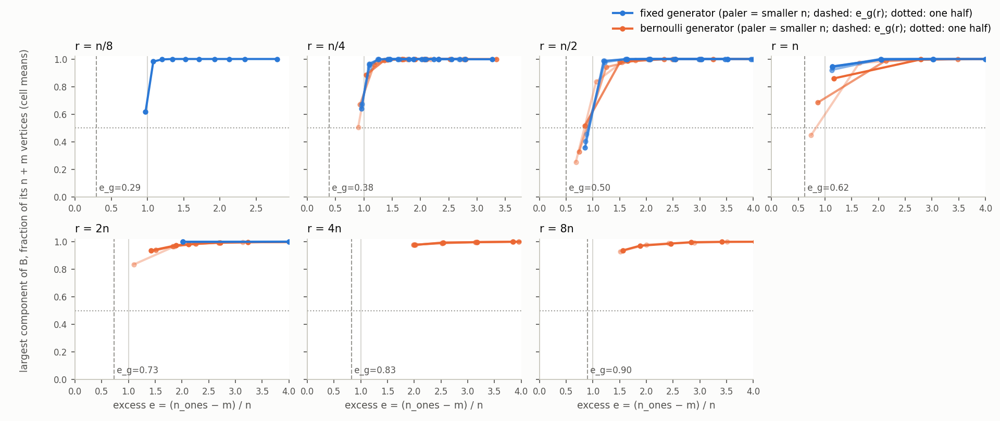
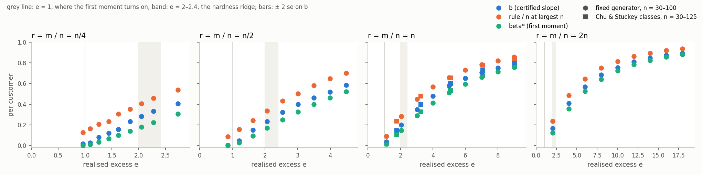

# The excess phase diagram of MOSP

*Ralph loop0010, executing `reports/excess_phase_plan.md`. One section per
item; each states its size range, its regenerate command, its kill verdict
and what it does not claim. The parameter throughout is the excess
`e = (n_ones − m) / n`, the mean number of patterns per customer minus one,
always realised from the matrix and never the generator's nominal value.*

## 1. The map: every instance on record placed by its excess (item 01, 2026-10-31)

**Question.** Where does every instance we hold sit in the excess, how far is
each from an incidence forest, and do the three lines on record — the giant
component of the incidence graph at `e_g(r) = (√(r² + 4r) − r) / 2`, the
first-moment threshold `e = 1`, and the hardness ridge at `e ≈ 2–2.4` —
separate the collections?

**What was done.** `learning/excess.py` computes, for every instance from
its matrix, `n`, `m`, `n_ones`, `e`, `r = m / n`, `c = n_ones / m`, the
customer–pattern incidence graph `B`'s component count `κ`, its cyclomatic
number `γ = n_ones − n − m + κ` and `γ / n`, its largest component as a
fraction of its `n + m` vertices and of its `n` customers, the forest flag
`γ = 0`, and the (2, 2)-core of `B` (`learning.cover_excess.peel`) as a
fraction of the customers, the patterns and the vertices; and joins the
certified optimum where there is one. Three sources, 64,291 rows:

| source | rows | size range | how the matrix was obtained |
|---|---|---|---|
| corpus | 6,376 | 9–134 customers, 10–125 patterns | read from `benchmarks/instances/`, joined to `learning/data/instances.csv` for the certified optimum (all 6,376 certified) |
| ensembles | 50,715 | 10–100 customers, `m / n` from ⅛ to 8 | regenerated from the seed with `learning.ensemble.generate(Cell.parse(...), index)` for every row of `results.csv` (37,800), `results_upward.csv` (6,785, finish file applied), `results_ratio.csv` (2,750), `results_height.csv` (3,380); the regenerated `n_ones` is asserted equal to the recorded one on every row, and was |
| simulations | 7,200 | 30 and 40 customers, `m = n`, `d ∈ {2, 4, 6, 8, 10}` | regenerated from the seed with the scratch generator `bern_padC1_padP2_conn` of `reports/scratch/clique_cover_moment/gen_candidates.py`; the recorded `ones` asserted equal, and was |

Nothing was solved; no file under `solutions/` was read or written. Two
identities are checked on all 64,291 rows: `e = r (c − 1)` to 7 × 10⁻¹⁵ and
`γ / n = e − 1 + κ / n` to 1.4 × 10⁻¹⁴; and on every row the (2, 2)-core is
empty exactly when `γ = 0` (asserted inside `incidence_stats`, two
independent computations of the same fact).

**Regenerate.** `python -m learning.excess` (build, tables and figure; 4 s
wall on 8 workers at nice 19, 23 CPU-seconds) writes
`learning/data/excess.csv` (64,291 rows, 15.1 MB, git-ignored under
`learning/data/*`), prints every table below, and draws
`reports/figures/excess_giant_component.png`. Stages: `--stage build`,
`--stage tables`, `--stage figure`. Tests: `python -m pytest
tests/test_excess.py -q` (8 tests: `e`, `γ`, `κ` by hand on a path, a
4-cycle with a pendant and a two-component graph; `e = r (c − 1)` and
`γ / n = e − 1 + κ / n` on random matrices; the thresholds; the crossing
interpolation on a synthetic series).

### 1.1 Findings

1. **The corpus holds no forest regime.** Of 6,376 corpus instances, 0 sit
   below `e_g(r)`, 12 sit in `[e_g(r), 1)` (9 Faggioli–Bentivoglio, 1 SCOOP,
   2 Simonis), and exactly 2 are incidence forests (`HS problem 5 size 10 10
   density 0.20`, Simonis, and `p1050n3_0`, Faggioli–Bentivoglio). Every
   other instance has `γ ≥ 1`; `e ≥ 1` forces `γ = n (e − 1) + κ ≥ 1`
   outright, which is where 99.8% of the corpus sits. A forest theorem
   (items 03, 06) would describe none of the benchmark instances directly;
   its use is as the base of the sparse flank, not as a description of
   anything we hold.

2. **Industry sits between the threshold and the ridge; the benchmark
   generators mostly do not.** SCOOP: 24 instances, `e` from 0.97 to 2.50,
   median 1.35, 19 of 24 in `[1, 2)`, 3 in `[2, 2.4]`, 1 above; 10 of the 24
   decompose (`κ > 1`), none is a forest, and their median `γ / n` is 0.37.
   Faggioli–Bentivoglio: median 1.98, quartiles 1.38–3.12, 48% in `[1, 2)`
   and 40% above 2.4. Harvey (median 4.5), Simonis (5.15), Shaw (5 exactly),
   Wilson and Challenge (5–6.6 medians, up to 84.7) sit far above the
   ridge: 80% of Harvey, 88% of Simonis and 95–100% of Shaw, Wilson, Miller and Challenge are above 2.4. The corpus as a whole: median 4.87,
   only 9.4% in `[1, 2)` and 7.8% in `[2, 2.4]`.

3. **Chu & Stuckey by class, realised.** With `m = n`: `d = 2` has `e` in
   1.48–2.02 (median 1.76), `d = 4` in 2.83–3.73 (median 3.24), `d = 6` in
   4.33–5.68, `d = 8` in 6.32–8.16, `d = 10` in 7.97–10.2. The ridge at
   2–2.4 falls between the `d = 2` and `d = 4` classes, as §0 of the plan
   says and as the paper's Appendix E does not yet; the 125 × 125 `d = 2`
   class is at 1.66–1.78 and `d = 4` at 2.94–3.38 (full table below). The
   half-ratio classes `Random-n-n/2-d` sit lower in `e` (`Random-100-50-2`: 1.15–1.39, `Random-100-50-4`: 1.73–1.96) and the double-ratio ones higher (`Random-50-100-2`: 3.02–3.44), because
   `e = r (c − 1)` scales with `r`. No Chu & Stuckey instance decomposes
   (their generator discards those), none is a forest, and their 2-core
   holds 93% of the customers on average.

4. **The ensembles cover the sparse flank that the corpus lacks**, but
   thinly at `n ≥ 50`: 3,127 ensemble instances sit below `e_g(r)` (all
   Bernoulli, 2,504 of them at `n ≤ 25`, 6 at `n ≥ 50`), 2,095 in
   `[e_g(r), 1)`, and 3,446 are forests (1,093 at `n = 10` falling to 66 at
   `n = 75`, none at 100). The fixed-size generator never goes below
   `e_g(r)`: its padding of empty customers lifts the realised `e` to at
   least 0.85 even at `d = 2`, `m = n / 2`.

5. **Is `e < e_g(r)` the forest regime?** Across the line the forest share
   falls from 0.92 (`n` 10–25), 0.74 (30–40) and 0.67 (50–75, six
   instances) below `e_g(r)` to 0.23–0.40 in `[e_g(r), 1)`, with median `γ`
   going from 0 to 1–2; at `e ≥ 1` there are no forests at all, as the
   identity forces. So `e_g(r)` separates "mostly forests" from "a few
   cycles", and `e = 1` separates "a few cycles" from "none". At finite `n`
   a random graph below its giant threshold still carries O(1) cycles, so
   a forest share below one there is what the theory expects, not a
   failure of the line. The 355 non-forests below `e_g(r)` are all
   Bernoulli at `r = n` and `2n`, where the plan's fixed-size form of
   `e_g` is not the Bernoulli threshold (Poisson sizes give `√r − r`, zero
   at `r = 1`).

6. **The stated check is not met.** The largest component of `B` reaches
   one half of the vertices on five observable series at `n ≥ 50`, at
   `e` = 0.83–0.93, which is 0.21–0.43 above `e_g(r)` on every one (tolerance
   ±0.15); the other 30 series have every cell above one half and cannot
   test it. The reason is in the criterion, not the line: at the
   branching-factor-one point the giant component is a vanishing fraction
   by definition and grows continuously from there (in `G(n, c/n)` the half
   point is at `c = 1.386`, 39% above the threshold), so a half-crossing
   can never sit *at* `e_g(r)`; and the ensemble grid is coarse there (the
   straddling cells are 0.4–0.9 apart in `e`), so the interpolated
   crossing is itself uncertain by a few tenths. The generators' padded
   degree distributions move the configuration-model threshold down, not
   up (`e_g repaired` in the table: 0.48 at `r = n / 2`, 0.49 at `r = n`,
   against 0.50 and 0.62; values of 0 are the bisection's floor at
   `col_mean = 1`). **Consequence for the loop, as the item prescribes:
   `e_g(r)` is not to be used later as the point where the largest
   component is one half.** What the data do support about it is finding
   5: it is where forests stop being the majority. Items 06 and 11 should
   state the random corollary for `e` below `e_g(r)` with that meaning and
   with the finite-`n` caveat, or avoid the line.

7. **The 338 bound-gap instances of §6 are the sparse ones at their size.**
   Among the 229 with at least five corpus peers at equal `(n, m)`, the
   median gap instance's `e` sits at the 7th percentile of its cell
   (quartiles 1st–17th) and 97.4% are below their cell's median `e`; the
   same for `γ / n`. Their `e` runs 1.44–4.06 (deciles), median 2.05, with
   41% in `[1, 2)` against 7.6% of the rest of the corpus, 18% in `[2, 2.4]`
   and 41% above; none is a forest, none is below 1. In the cells that mix
   collections the contrast is large: `(30, 10)` 2.17 against 4.07, `(30,
   30)` 2.0 against 8.0, `(40, 20)` 1.45 against 8.62, `(100, 100)` 3.85
   against 53.3. Where the gap instances are the whole cell (the
   Faggioli–Bentivoglio `(40–50, 25–40)` cells, three SCOOP instances) the
   comparison is empty. This is consistent with §6's reading, "connected
   and sparse", in one parameter.

8. **The simulations reproduce the corpus classes they imitate.** The
   7,200 `bern_padC1_padP2_conn` instances at `m = n` have `e` medians 1.6
   (`d = 2`), 3.1, 5.0, 7.0, 9.0 against the Chu & Stuckey `m = n` medians
   1.76, 3.24, 5.11, 7.15, 9.04: within 0.1–0.16 at every `d`, all
   connected, none a forest.

### 1.2 Kill verdict

None (descriptive). The one stated check — the largest-component fraction
of `B` crosses one half within ±0.15 in `e` of `e_g(r)` on every ensemble
series at `n ≥ 50` — is **not met** on all five series where it is
observable (deltas +0.21 to +0.43) and unobservable on the other 30.
Finding 6 says why the criterion could not have been met and what `e_g(r)`
does separate.

### 1.3 What this does not claim

Nothing about the optimum, nor about hardness: the map is a description of
the instances we happen to hold and of where they sit against three lines
whose meaning is established elsewhere. The crossing check uses cell means
on a coarse grid at `n = 50–100`, interpolated linearly, and the repaired
thresholds come from a configuration model of the generators, not from the
generators. The percentile statement about the bound-gap instances is a
within-cell comparison with no claim of cause. 24 SCOOP instances are 24
instances.

### 1.4 Figure



*The mean largest-component fraction of `B` per ensemble cell against the
cell's median `e`, one line per `(generator, n)` at `n ≥ 50` (paler =
smaller `n`), one panel per product ratio `r`; dashed vertical `e_g(r)`,
grey vertical `e = 1`, dotted horizontal one half. `python -m
learning.excess --stage figure`.*

### 1.5 Tables, in full

`python -m learning.excess --stage tables`. The per-series table (526
series) is folded; open it to read.

Rows: 64291 (corpus 6376, ensemble 50715, simulation 7200); max |e − r(c − 1)| = 7.1e-15; max |γ/n − (e − 1 + κ/n)| = 1.4e-14.

#### The three lines, by source

| source     |   count |   forest |   e < e_g(r) |   e_g(r) <= e < 1 |   1 <= e < 2 |   2 <= e <= 2.4 |   e > 2.4 |   forests with e >= e_g(r) |   non-forests with e < e_g(r) |
|:-----------|--------:|---------:|-------------:|------------------:|-------------:|----------------:|----------:|---------------------------:|------------------------------:|
| corpus     |    6376 |        2 |            0 |                12 |          599 |             500 |      5265 |                          2 |                             0 |
| ensemble   |   50715 |     3446 |         3127 |              2095 |         6882 |            4634 |     33977 |                        674 |                           355 |
| simulation |    7200 |        0 |            0 |                 0 |         1982 |              33 |      5185 |                          0 |                             0 |

#### Is e < e_g(r) the forest regime? The ensembles by generator and size band

| generator   | n     |   count e < e_g |   forest share e < e_g |   median gamma e < e_g |   count e_g <= e < 1 |   forest share e_g <= e < 1 |   median gamma e_g <= e < 1 |   count e >= 1 |   forest share e >= 1 |
|:------------|:------|----------------:|-----------------------:|-----------------------:|---------------------:|----------------------------:|----------------------------:|---------------:|----------------------:|
| bernoulli   | 10-25 |            2504 |                  0.924 |                      0 |                  973 |                       0.314 |                           1 |           7323 |                     0 |
| bernoulli   | 30-40 |             617 |                  0.736 |                      0 |                  440 |                       0.232 |                           2 |           7393 |                     0 |
| bernoulli   | 50-75 |               6 |                  0.667 |                      0 |                  358 |                       0.38  |                           1 |           5636 |                     0 |
| bernoulli   | 100   |               0 |                nan     |                    nan |                    0 |                     nan     |                         nan |            270 |                     0 |
| fixed       | 10-25 |               0 |                nan     |                    nan |                    0 |                     nan     |                         nan |          10800 |                     0 |
| fixed       | 30-40 |               0 |                nan     |                    nan |                    0 |                     nan     |                         nan |           8100 |                     0 |
| fixed       | 50-75 |               0 |                nan     |                    nan |                  324 |                       0.401 |                           1 |           5576 |                     0 |
| fixed       | 100   |               0 |                nan     |                    nan |                    0 |                     nan     |                         nan |            395 |                     0 |

#### Per collection

| collection           |   count | n range   | m range   |   e min |   e q10 |   e q25 |   e median |   e q75 |   e q90 |   e max |   gamma/n q10 |   gamma/n median |   gamma/n q90 |   forest share |   2-core cust share |   lcc frac |   below e_g |   below 1 |   in [1, 2) |   in [2, 2.4] |   above 2.4 |
|:---------------------|--------:|:----------|:----------|--------:|--------:|--------:|-----------:|--------:|--------:|--------:|--------------:|-----------------:|--------------:|---------------:|--------------------:|-----------:|------------:|----------:|------------:|--------------:|------------:|
| SCOOP                |      24 | 13-134    | 10-49     |   0.968 |    1.13 |    1.21 |       1.35 |    1.83 |    2.05 |    2.5  |         0.164 |            0.373 |         1.11  |       0        |               0.536 |      0.92  |           0 |  0.0417   |      0.792  |        0.125  |      0.0417 |
| Faggioli-Bentivoglio |     300 | 9-50      | 10-40     |   0.94  |    1.1  |    1.38 |       1.98 |    3.12 |    4.9  |    8.7  |         0.133 |            1     |         4     |       0.00333  |               0.68  |      0.982 |           0 |  0.03     |      0.477  |        0.09   |      0.403  |
| Chu & Stuckey        |     200 | 30-125    | 30-125    |   1.15  |    1.75 |    3.04 |       5.02 |    7.28 |    9.24 |   18.6  |         0.766 |            4.04  |         8.24  |       0        |               0.929 |      1     |           0 |  0        |      0.19   |        0.01   |      0.8    |
| Random-30-30-2       |       5 | 30-30     | 30-30     |   1.63  |    1.66 |    1.7  |       1.7  |    1.73 |    1.77 |    1.8  |         0.693 |            0.733 |         0.807 |       0        |               0.753 |      1     |           0 |  0        |      1      |        0      |      0      |
| Random-30-30-4       |       5 | 30-30     | 30-30     |   2.83  |    2.95 |    3.13 |       3.2  |    3.37 |    3.59 |    3.73 |         1.99  |            2.23  |         2.62  |       0        |               0.927 |      1     |           0 |  0        |      0      |        0      |      1      |
| Random-30-30-6       |       5 | 30-30     | 30-30     |   4.33  |    4.37 |    4.43 |       4.97 |    5.07 |    5.39 |    5.6  |         3.41  |            4     |         4.42  |       0        |               0.967 |      1     |           0 |  0        |      0      |        0      |      1      |
| Random-30-30-8       |       5 | 30-30     | 30-30     |   6.37  |    6.47 |    6.63 |       6.83 |    7.07 |    7.17 |    7.23 |         5.51  |            5.87  |         6.2   |       0        |               0.987 |      1     |           0 |  0        |      0      |        0      |      1      |
| Random-30-30-10      |       5 | 30-30     | 30-30     |   7.97  |    8.33 |    8.87 |       8.93 |    8.93 |    9.31 |    9.57 |         7.36  |            7.97  |         8.35  |       0        |               1     |      1     |           0 |  0        |      0      |        0      |      1      |
| Random-40-40-2       |       5 | 40-40     | 40-40     |   1.48  |    1.56 |    1.7  |       1.8  |    1.93 |    1.97 |    2    |         0.59  |            0.825 |         0.995 |       0        |               0.76  |      1     |           0 |  0        |      0.8    |        0.2    |      0      |
| Random-40-40-4       |       5 | 40-40     | 40-40     |   3.1   |    3.11 |    3.12 |       3.25 |    3.27 |    3.32 |    3.35 |         2.13  |            2.27  |         2.34  |       0        |               0.935 |      1     |           0 |  0        |      0      |        0      |      1      |
| Random-40-40-6       |       5 | 40-40     | 40-40     |   4.72  |    4.76 |    4.83 |       4.92 |    5.15 |    5.17 |    5.17 |         3.79  |            3.95  |         4.19  |       0        |               0.995 |      1     |           0 |  0        |      0      |        0      |      1      |
| Random-40-40-8       |       5 | 40-40     | 40-40     |   6.53  |    6.63 |    6.8  |       6.97 |    7.2  |    7.21 |    7.22 |         5.66  |            6     |         6.24  |       0        |               1     |      1     |           0 |  0        |      0      |        0      |      1      |
| Random-40-40-10      |       5 | 40-40     | 40-40     |   8.32  |    8.55 |    8.9  |       8.9  |    8.97 |    8.99 |    9    |         7.58  |            7.92  |         8.02  |       0        |               1     |      1     |           0 |  0        |      0      |        0      |      1      |
| Random-50-50-2       |       5 | 50-50     | 50-50     |   1.66  |    1.71 |    1.78 |       1.78 |    1.98 |    2    |    2.02 |         0.728 |            0.8   |         1.02  |       0        |               0.82  |      1     |           0 |  0        |      0.8    |        0.2    |      0      |
| Random-50-50-4       |       5 | 50-50     | 50-50     |   3.14  |    3.16 |    3.18 |       3.28 |    3.62 |    3.63 |    3.64 |         2.18  |            2.3   |         2.65  |       0        |               0.952 |      1     |           0 |  0        |      0      |        0      |      1      |
| Random-50-50-6       |       5 | 50-50     | 50-50     |   4.9   |    4.94 |    5    |       5.34 |    5.38 |    5.56 |    5.68 |         3.96  |            4.36  |         4.58  |       0        |               0.984 |      1     |           0 |  0        |      0      |        0      |      1      |
| Random-50-50-8       |       5 | 50-50     | 50-50     |   6.8   |    6.82 |    6.86 |       7.2  |    7.36 |    7.84 |    8.16 |         5.84  |            6.22  |         6.86  |       0        |               1     |      1     |           0 |  0        |      0      |        0      |      1      |
| Random-50-50-10      |       5 | 50-50     | 50-50     |   8.66  |    8.81 |    9.04 |       9.08 |    9.18 |    9.79 |   10.2  |         7.83  |            8.1   |         8.81  |       0        |               1     |      1     |           0 |  0        |      0      |        0      |      1      |
| Random-50-100-2      |       5 | 50-50     | 100-100   |   3.02  |    3.02 |    3.02 |       3.14 |    3.34 |    3.4  |    3.44 |         2.04  |            2.16  |         2.42  |       0        |               0.964 |      1     |           0 |  0        |      0      |        0      |      1      |
| Random-50-100-4      |       5 | 50-50     | 100-100   |   6     |    6.06 |    6.16 |       6.36 |    6.52 |    6.59 |    6.64 |         5.08  |            5.38  |         5.61  |       0        |               1     |      1     |           0 |  0        |      0      |        0      |      1      |
| Random-50-100-6      |       5 | 50-50     | 100-100   |   9.18  |    9.61 |   10.3  |      10.3  |   10.3  |   10.5  |   10.6  |         8.63  |            9.34  |         9.53  |       0        |               1     |      1     |           0 |  0        |      0      |        0      |      1      |
| Random-50-100-8      |       5 | 50-50     | 100-100   |  13.4   |   13.6  |   13.8  |      13.8  |   14.2  |   14.5  |   14.7  |        12.6   |           12.9   |        13.5   |       0        |               1     |      1     |           0 |  0        |      0      |        0      |      1      |
| Random-50-100-10     |       5 | 50-50     | 100-100   |  17.5   |   17.5  |   17.6  |      18    |   18.3  |   18.5  |   18.6  |        16.6   |           17     |        17.5   |       0        |               1     |      1     |           0 |  0        |      0      |        0      |      1      |
| Random-75-75-2       |       5 | 75-75     | 75-75     |   1.56  |    1.63 |    1.75 |       1.87 |    1.88 |    1.9  |    1.92 |         0.648 |            0.88  |         0.917 |       0        |               0.803 |      1     |           0 |  0        |      1      |        0      |      0      |
| Random-75-75-4       |       5 | 75-75     | 75-75     |   3.03  |    3.03 |    3.04 |       3.24 |    3.43 |    3.48 |    3.52 |         2.05  |            2.25  |         2.5   |       0        |               0.933 |      1     |           0 |  0        |      0      |        0      |      1      |
| Random-75-75-6       |       5 | 75-75     | 75-75     |   5.04  |    5.05 |    5.07 |       5.12 |    5.19 |    5.37 |    5.49 |         4.06  |            4.13  |         4.38  |       0        |               0.995 |      1     |           0 |  0        |      0      |        0      |      1      |
| Random-75-75-8       |       5 | 75-75     | 75-75     |   7.03  |    7.1  |    7.2  |       7.24 |    7.25 |    7.44 |    7.56 |         6.11  |            6.25  |         6.45  |       0        |               1     |      1     |           0 |  0        |      0      |        0      |      1      |
| Random-75-75-10      |       5 | 75-75     | 75-75     |   8.67  |    8.82 |    9.04 |       9.08 |    9.2  |    9.31 |    9.39 |         7.83  |            8.09  |         8.33  |       0        |               1     |      1     |           0 |  0        |      0      |        0      |      1      |
| Random-100-50-2      |       5 | 100-100   | 50-50     |   1.15  |    1.17 |    1.2  |       1.22 |    1.26 |    1.34 |    1.39 |         0.18  |            0.23  |         0.348 |       0        |               0.444 |      1     |           0 |  0        |      1      |        0      |      0      |
| Random-100-50-4      |       5 | 100-100   | 50-50     |   1.73  |    1.75 |    1.79 |       1.85 |    1.93 |    1.95 |    1.96 |         0.764 |            0.86  |         0.958 |       0        |               0.728 |      1     |           0 |  0        |      1      |        0      |      0      |
| Random-100-50-6      |       5 | 100-100   | 50-50     |   2.44  |    2.52 |    2.64 |       2.82 |    2.88 |    2.92 |    2.95 |         1.53  |            1.83  |         1.93  |       0        |               0.888 |      1     |           0 |  0        |      0      |        0      |      1      |
| Random-100-50-8      |       5 | 100-100   | 50-50     |   3.38  |    3.41 |    3.45 |       3.67 |    3.72 |    3.82 |    3.88 |         2.42  |            2.68  |         2.83  |       0        |               0.944 |      1     |           0 |  0        |      0      |        0      |      1      |
| Random-100-50-10     |       5 | 100-100   | 50-50     |   4.2   |    4.34 |    4.56 |       4.68 |    4.7  |    4.73 |    4.75 |         3.35  |            3.69  |         3.74  |       0        |               0.98  |      1     |           0 |  0        |      0      |        0      |      1      |
| Random-100-100-2     |       5 | 100-100   | 100-100   |   1.57  |    1.61 |    1.67 |       1.75 |    1.82 |    1.87 |    1.91 |         0.62  |            0.76  |         0.884 |       0        |               0.762 |      1     |           0 |  0        |      1      |        0      |      0      |
| Random-100-100-4     |       5 | 100-100   | 100-100   |   3.09  |    3.11 |    3.13 |       3.18 |    3.29 |    3.48 |    3.6  |         2.12  |            2.19  |         2.49  |       0        |               0.936 |      1     |           0 |  0        |      0      |        0      |      1      |
| Random-100-100-6     |       5 | 100-100   | 100-100   |   4.9   |    4.98 |    5.09 |       5.17 |    5.19 |    5.36 |    5.47 |         3.99  |            4.18  |         4.37  |       0        |               0.988 |      1     |           0 |  0        |      0      |        0      |      1      |
| Random-100-100-8     |       5 | 100-100   | 100-100   |   6.88  |    6.92 |    6.97 |       7.13 |    7.17 |    7.29 |    7.37 |         5.93  |            6.14  |         6.3   |       0        |               1     |      1     |           0 |  0        |      0      |        0      |      1      |
| Random-100-100-10    |       5 | 100-100   | 100-100   |   8.54  |    8.72 |    8.99 |       9.18 |    9.35 |    9.41 |    9.45 |         7.73  |            8.19  |         8.42  |       0        |               1     |      1     |           0 |  0        |      0      |        0      |      1      |
| Random-125-125-2     |       5 | 125-125   | 125-125   |   1.66  |    1.66 |    1.66 |       1.73 |    1.77 |    1.78 |    1.78 |         0.664 |            0.736 |         0.786 |       0        |               0.774 |      1     |           0 |  0        |      1      |        0      |      0      |
| Random-125-125-4     |       5 | 125-125   | 125-125   |   2.94  |    3    |    3.09 |       3.29 |    3.32 |    3.36 |    3.38 |         2.01  |            2.3   |         2.37  |       0        |               0.946 |      1     |           0 |  0        |      0      |        0      |      1      |
| Random-125-125-6     |       5 | 125-125   | 125-125   |   4.7   |    4.85 |    5.09 |       5.13 |    5.24 |    5.25 |    5.26 |         3.86  |            4.14  |         4.26  |       0        |               0.992 |      1     |           0 |  0        |      0      |        0      |      1      |
| Random-125-125-8     |       5 | 125-125   | 125-125   |   6.32  |    6.6  |    7.01 |       7.18 |    7.22 |    7.3  |    7.34 |         5.6   |            6.19  |         6.3   |       0        |               1     |      1     |           0 |  0        |      0      |        0      |      1      |
| Random-125-125-10    |       5 | 125-125   | 125-125   |   8.22  |    8.54 |    9.03 |       9.18 |    9.22 |    9.32 |    9.38 |         7.55  |            8.18  |         8.32  |       0        |               1     |      1     |           0 |  0        |      0      |        0      |      1      |
| Harvey               |    2130 | 10-30     | 10-30     |   1     |    2    |    3    |       4.5  |    7    |   10    |   14    |         1.03  |            3.53  |         9.1   |       0        |               0.956 |      0.991 |           0 |  0        |      0.0986 |        0.103  |      0.798  |
| Simonis              |    3630 | 10-40     | 10-30     |   0.7   |    2.3  |    3.4  |       5.15 |    7.63 |   10.8  |   20.8  |         1.4   |            4.2   |         9.8   |       0.000275 |               0.961 |      0.999 |           0 |  0.000551 |      0.0515 |        0.0683 |      0.88   |
| Shaw                 |      25 | 20-20     | 20-20     |   5     |    5    |    5    |       5    |    5    |    5    |    5    |         4.05  |            4.05  |         4.05  |       0        |               0.978 |      1     |           0 |  0        |      0      |        0      |      1      |
| Wilson               |      20 | 10-100    | 20-100    |   1.6   |    2.49 |    3.71 |       6.61 |   33.6  |   66.2  |   84.7  |         1.58  |            5.67  |        65.2   |       0        |               0.968 |      0.999 |           0 |  0        |      0.05   |        0      |      0.95   |
| Miller               |       1 | 20-20     | 40-40     |   6     |    6    |    6    |       6    |    6    |    6    |    6    |         5.05  |            5.05  |         5.05  |       0        |               1     |      1     |           0 |  0        |      0      |        0      |      1      |
| Challenge            |      46 | 10-100    | 20-100    |   1.6   |    3.58 |    5    |       5    |    6.11 |   35.5  |   84.7  |         2.63  |            4.05  |        34.6   |       0        |               0.974 |      1     |           0 |  0        |      0.0217 |        0      |      0.978  |
| corpus, all          |    6376 | 9-134     | 10-125    |   0.7   |    2    |    3    |       4.87 |    7.17 |   10.4  |   84.7  |         1.03  |            3.9   |         9.5   |       0.000314 |               0.944 |      0.995 |           0 |  0.00188  |      0.0939 |        0.0784 |      0.826  |

#### The stated check: where the largest component of B crosses one half, against e_g(r)

| generator   | r   |   n |   cells | e range    | lcc range   |   e_g(r) |   e_g repaired |   crossing |   delta | verdict                              |
|:------------|:----|----:|--------:|:-----------|:------------|---------:|---------------:|-----------:|--------:|:-------------------------------------|
| bernoulli   | n/4 |  50 |       6 | 0.90-2.18  | 0.50-1.00   |    0.384 |          0.241 |    nan     | nan     | not observable (all cells above 1/2) |
| bernoulli   | n/4 |  60 |       6 | 0.93-2.77  | 0.67-1.00   |    0.39  |          0.241 |    nan     | nan     | not observable (all cells above 1/2) |
| bernoulli   | n/4 |  75 |       6 | 1.04-3.34  | 0.89-1.00   |    0.384 |          0.241 |    nan     | nan     | not observable (all cells above 1/2) |
| bernoulli   | n/4 | 100 |       5 | 1.67-2.80  | 1.00-1.00   |    0.39  |          0.241 |    nan     | nan     | not observable (all cells above 1/2) |
| bernoulli   | n/2 |  50 |       6 | 0.68-4.56  | 0.25-1.00   |    0.5   |          0.183 |      0.842 |   0.342 | outside tolerance                    |
| bernoulli   | n/2 |  60 |       6 | 0.74-5.51  | 0.33-1.00   |    0.5   |          0.183 |      0.885 |   0.385 | outside tolerance                    |
| bernoulli   | n/2 |  75 |       6 | 0.85-6.91  | 0.51-1.00   |    0.498 |          0.183 |    nan     | nan     | not observable (all cells above 1/2) |
| bernoulli   | n/2 | 100 |       4 | 1.65-3.00  | 0.99-1.00   |    0.5   |          0.183 |    nan     | nan     | not observable (all cells above 1/2) |
| bernoulli   | n   |  50 |       6 | 0.74-9.06  | 0.45-1.00   |    0.618 |          0     |      0.829 |   0.211 | outside tolerance                    |
| bernoulli   | n   |  60 |       6 | 0.87-10.98 | 0.68-1.00   |    0.618 |          0     |    nan     | nan     | not observable (all cells above 1/2) |
| bernoulli   | n   |  75 |       6 | 1.17-14.16 | 0.86-1.00   |    0.618 |          0     |    nan     | nan     | not observable (all cells above 1/2) |
| bernoulli   | 2n  |  50 |      10 | 1.10-17.98 | 0.83-1.00   |    0.732 |          0     |    nan     | nan     | not observable (all cells above 1/2) |
| bernoulli   | 2n  |  60 |       9 | 1.51-21.84 | 0.94-1.00   |    0.732 |          0     |    nan     | nan     | not observable (all cells above 1/2) |
| bernoulli   | 2n  |  75 |      10 | 1.42-27.92 | 0.93-1.00   |    0.732 |          0     |    nan     | nan     | not observable (all cells above 1/2) |
| bernoulli   | 4n  |  50 |       7 | 2.03-8.09  | 0.98-1.00   |    0.828 |          0     |    nan     | nan     | not observable (all cells above 1/2) |
| bernoulli   | 4n  |  60 |       7 | 1.98-8.19  | 0.98-1.00   |    0.828 |          0     |    nan     | nan     | not observable (all cells above 1/2) |
| bernoulli   | 4n  |  75 |       6 | 2.01-6.03  | 0.98-1.00   |    0.828 |          0     |    nan     | nan     | not observable (all cells above 1/2) |
| bernoulli   | 8n  |  50 |      11 | 1.51-10.40 | 0.93-1.00   |    0.899 |          0     |    nan     | nan     | not observable (all cells above 1/2) |
| bernoulli   | 8n  |  60 |      11 | 1.56-10.34 | 0.94-1.00   |    0.899 |          0     |    nan     | nan     | not observable (all cells above 1/2) |
| fixed       | n/8 |  75 |      10 | 0.97-2.79  | 0.62-1.00   |    0.292 |          0.118 |    nan     | nan     | not observable (all cells above 1/2) |
| fixed       | n/4 |  50 |       9 | 0.96-2.68  | 0.66-1.00   |    0.384 |          0     |    nan     | nan     | not observable (all cells above 1/2) |
| fixed       | n/4 |  60 |       9 | 0.97-2.78  | 0.67-1.00   |    0.39  |          0     |    nan     | nan     | not observable (all cells above 1/2) |
| fixed       | n/4 |  75 |       9 | 0.96-2.69  | 0.64-1.00   |    0.384 |          0     |    nan     | nan     | not observable (all cells above 1/2) |
| fixed       | n/4 | 100 |       7 | 1.46-3.27  | 1.00-1.00   |    0.39  |          0     |    nan     | nan     | not observable (all cells above 1/2) |
| fixed       | n/2 |  50 |       9 | 0.88-4.50  | 0.46-1.00   |    0.5   |          0.475 |      0.908 |   0.408 | outside tolerance                    |
| fixed       | n/2 |  60 |       9 | 0.86-4.50  | 0.40-1.00   |    0.5   |          0.475 |      0.919 |   0.419 | outside tolerance                    |
| fixed       | n/2 |  75 |       9 | 0.85-4.44  | 0.36-1.00   |    0.498 |          0.475 |      0.932 |   0.434 | outside tolerance                    |
| fixed       | n/2 | 100 |       5 | 1.63-3.51  | 1.00-1.00   |    0.5   |          0.475 |    nan     | nan     | not observable (all cells above 1/2) |
| fixed       | n   |  50 |       9 | 1.13-9.00  | 0.94-1.00   |    0.618 |          0.489 |    nan     | nan     | not observable (all cells above 1/2) |
| fixed       | n   |  60 |       9 | 1.12-9.00  | 0.92-1.00   |    0.618 |          0.489 |    nan     | nan     | not observable (all cells above 1/2) |
| fixed       | n   |  75 |       9 | 1.13-9.00  | 0.94-1.00   |    0.618 |          0.489 |    nan     | nan     | not observable (all cells above 1/2) |
| fixed       | n   | 100 |       3 | 1.13-3.02  | 0.95-1.00   |    0.618 |          0.489 |    nan     | nan     | not observable (all cells above 1/2) |
| fixed       | 2n  |  50 |       9 | 2.02-18.00 | 1.00-1.00   |    0.732 |          0.496 |    nan     | nan     | not observable (all cells above 1/2) |
| fixed       | 2n  |  60 |       9 | 2.02-18.00 | 1.00-1.00   |    0.732 |          0.496 |    nan     | nan     | not observable (all cells above 1/2) |
| fixed       | 2n  |  75 |       9 | 2.01-18.00 | 1.00-1.00   |    0.732 |          0.496 |    nan     | nan     | not observable (all cells above 1/2) |

#### Per ensemble series (generator, r, param, n)

<details><summary>526 series: generator, r, param, n (click to open)</summary>

| generator   | r   |   param |   n |   m |   count |   certified |   e median |   e min |   e max |   gamma/n median |   forest share |   2-core cust share |   lcc frac |   lcc cust frac |   e_g(r) |
|:------------|:----|--------:|----:|----:|--------:|------------:|-----------:|--------:|--------:|-----------------:|---------------:|--------------------:|-----------:|----------------:|---------:|
| bernoulli   | n/4 |  0.05   |  50 |  12 |      50 |          50 |      0.9   |  0.78   |   1.02  |           0.01   |        0.5     |            0.0384   |      0.503 |           0.507 |    0.384 |
| bernoulli   | n/4 |  0.075  |  50 |  12 |      50 |          50 |      1.06  |  0.86   |   1.26  |           0.1    |        0.02    |            0.195    |      0.873 |           0.876 |    0.384 |
| bernoulli   | n/4 |  0.1    |  50 |  12 |      50 |          50 |      1.22  |  1      |   1.42  |           0.25   |        0       |            0.326    |      0.975 |           0.977 |    0.384 |
| bernoulli   | n/4 |  0.125  |  50 |  12 |      50 |          50 |      1.42  |  1.16   |   1.84  |           0.44   |        0       |            0.428    |      0.994 |           0.995 |    0.384 |
| bernoulli   | n/4 |  0.15   |  50 |  12 |      50 |          50 |      1.68  |  1.4    |   2     |           0.7    |        0       |            0.554    |      1     |           1     |    0.384 |
| bernoulli   | n/4 |  0.2    |  50 |  12 |      50 |          50 |      2.18  |  1.78   |   2.6   |           1.2    |        0       |            0.723    |      1     |           1     |    0.384 |
| bernoulli   | n/4 |  0.05   |  60 |  15 |      50 |          50 |      0.933 |  0.833  |   1.17  |           0.0333 |        0.18    |            0.0923   |      0.67  |           0.677 |    0.39  |
| bernoulli   | n/4 |  0.075  |  60 |  15 |      50 |          50 |      1.18  |  1      |   1.4   |           0.217  |        0       |            0.297    |      0.961 |           0.962 |    0.39  |
| bernoulli   | n/4 |  0.1    |  60 |  15 |      50 |          50 |      1.42  |  1.2    |   1.85  |           0.433  |        0       |            0.432    |      0.994 |           0.995 |    0.39  |
| bernoulli   | n/4 |  0.125  |  60 |  15 |      50 |          50 |      1.77  |  1.47   |   2.03  |           0.783  |        0       |            0.58     |      0.999 |           0.999 |    0.39  |
| bernoulli   | n/4 |  0.15   |  60 |  15 |      50 |          50 |      2.08  |  1.6    |   2.37  |           1.1    |        0       |            0.672    |      1     |           1     |    0.39  |
| bernoulli   | n/4 |  0.2    |  60 |  15 |      50 |          50 |      2.77  |  2.52   |   3.28  |           1.78   |        0       |            0.835    |      1     |           1     |    0.39  |
| bernoulli   | n/4 |  0.05   |  75 |  18 |      50 |          50 |      1.04  |  0.92   |   1.29  |           0.08   |        0.02    |            0.181    |      0.886 |           0.889 |    0.384 |
| bernoulli   | n/4 |  0.075  |  75 |  18 |      50 |          50 |      1.36  |  1.17   |   1.6   |           0.373  |        0       |            0.387    |      0.989 |           0.991 |    0.384 |
| bernoulli   | n/4 |  0.1    |  75 |  18 |      50 |          50 |      1.71  |  1.43   |   1.96  |           0.72   |        0       |            0.549    |      1     |           1     |    0.384 |
| bernoulli   | n/4 |  0.125  |  75 |  18 |      50 |          50 |      2.11  |  1.73   |   2.48  |           1.12   |        0       |            0.673    |      1     |           1     |    0.384 |
| bernoulli   | n/4 |  0.15   |  75 |  18 |      50 |          50 |      2.53  |  2.24   |   2.81  |           1.54   |        0       |            0.778    |      1     |           1     |    0.384 |
| bernoulli   | n/4 |  0.2    |  75 |  18 |      50 |          50 |      3.34  |  2.93   |   3.68  |           2.35   |        0       |            0.899    |      1     |           1     |    0.384 |
| bernoulli   | n/4 |  0.07   | 100 |  25 |      30 |          30 |      1.67  |  1.5    |   1.86  |           0.69   |        0       |            0.534    |      0.999 |           0.999 |    0.39  |
| bernoulli   | n/4 |  0.08   | 100 |  25 |      30 |          30 |      1.9   |  1.7    |   2.26  |           0.915  |        0       |            0.615    |      0.999 |           1     |    0.39  |
| bernoulli   | n/4 |  0.09   | 100 |  25 |      30 |          30 |      2.06  |  1.86   |   2.37  |           1.08   |        0       |            0.675    |      1     |           1     |    0.39  |
| bernoulli   | n/4 |  0.1    | 100 |  25 |      30 |          30 |      2.33  |  2.07   |   2.47  |           1.33   |        0       |            0.73     |      1     |           1     |    0.39  |
| bernoulli   | n/4 |  0.12   | 100 |  25 |      30 |          30 |      2.8   |  2.47   |   3.22  |           1.81   |        0       |            0.814    |      1     |           1     |    0.39  |
| bernoulli   | n/2 |  0.025  |  50 |  25 |      50 |          50 |      0.68  |  0.6    |   0.8   |           0      |        0.82    |            0.0116   |      0.251 |           0.264 |    0.5   |
| bernoulli   | n/2 |  0.05   |  50 |  25 |      50 |          50 |      1.06  |  0.84   |   1.38  |           0.12   |        0       |            0.262    |      0.835 |           0.843 |    0.5   |
| bernoulli   | n/2 |  0.075  |  50 |  25 |      50 |          50 |      1.54  |  1.2    |   2.02  |           0.56   |        0       |            0.561    |      0.977 |           0.978 |    0.5   |
| bernoulli   | n/2 |  0.1    |  50 |  25 |      50 |          50 |      2.04  |  1.7    |   2.7   |           1.06   |        0       |            0.731    |      0.999 |           1     |    0.5   |
| bernoulli   | n/2 |  0.15   |  50 |  25 |      50 |          50 |      3.26  |  2.94   |   3.76  |           2.28   |        0       |            0.908    |      1     |           1     |    0.5   |
| bernoulli   | n/2 |  0.2    |  50 |  25 |      50 |          50 |      4.56  |  3.92   |   5.16  |           3.58   |        0       |            0.972    |      1     |           1     |    0.5   |
| bernoulli   | n/2 |  0.025  |  60 |  30 |      50 |          50 |      0.742 |  0.583  |   0.9   |           0      |        0.68    |            0.0227   |      0.326 |           0.338 |    0.5   |
| bernoulli   | n/2 |  0.05   |  60 |  30 |      50 |          50 |      1.25  |  0.967  |   1.48  |           0.308  |        0       |            0.405    |      0.941 |           0.945 |    0.5   |
| bernoulli   | n/2 |  0.075  |  60 |  30 |      50 |          50 |      1.79  |  1.57   |   2.23  |           0.817  |        0       |            0.646    |      0.99  |           0.991 |    0.5   |
| bernoulli   | n/2 |  0.1    |  60 |  30 |      50 |          50 |      2.48  |  1.98   |   3.03  |           1.5    |        0       |            0.809    |      1     |           1     |    0.5   |
| bernoulli   | n/2 |  0.15   |  60 |  30 |      50 |          50 |      4.04  |  3.38   |   4.82  |           3.06   |        0       |            0.953    |      1     |           1     |    0.5   |
| bernoulli   | n/2 |  0.2    |  60 |  30 |      50 |          50 |      5.51  |  4.88   |   6.13  |           4.53   |        0       |            0.99     |      1     |           1     |    0.5   |
| bernoulli   | n/2 |  0.025  |  75 |  37 |      50 |          50 |      0.847 |  0.68   |   1.03  |           0.0267 |        0.18    |            0.0837   |      0.514 |           0.523 |    0.498 |
| bernoulli   | n/2 |  0.05   |  75 |  37 |      50 |          50 |      1.51  |  1.27   |   1.88  |           0.54   |        0       |            0.533    |      0.978 |           0.98  |    0.498 |
| bernoulli   | n/2 |  0.075  |  75 |  37 |      50 |          50 |      2.33  |  2.01   |   2.72  |           1.34   |        0       |            0.774    |      0.999 |           0.999 |    0.498 |
| bernoulli   | n/2 |  0.1    |  75 |  37 |      50 |          50 |      3.25  |  2.77   |   3.68  |           2.26   |        0       |            0.896    |      1     |           1     |    0.498 |
| bernoulli   | n/2 |  0.15   |  75 |  37 |      50 |          50 |      4.97  |  4.48   |   5.48  |           3.99   |        0       |            0.981    |      1     |           1     |    0.498 |
| bernoulli   | n/2 |  0.2    |  75 |  37 |      50 |          50 |      6.91  |  6.17   |   7.57  |           5.92   |        0       |            0.997    |      1     |           1     |    0.498 |
| bernoulli   | n/2 |  0.04   | 100 |  50 |      30 |          28 |      1.65  |  1.34   |   1.86  |           0.66   |        0       |            0.577    |      0.988 |           0.989 |    0.5   |
| bernoulli   | n/2 |  0.05   | 100 |  50 |      30 |          30 |      2.06  |  1.73   |   2.36  |           1.08   |        0       |            0.731    |      0.997 |           0.998 |    0.5   |
| bernoulli   | n/2 |  0.06   | 100 |  50 |      30 |          30 |      2.54  |  2.19   |   2.88  |           1.56   |        0       |            0.802    |      0.999 |           0.999 |    0.5   |
| bernoulli   | n/2 |  0.07   | 100 |  50 |      30 |          30 |      3     |  2.69   |   3.27  |           2.01   |        0       |            0.878    |      1     |           1     |    0.5   |
| bernoulli   | n   |  0.025  |  10 |  10 |     150 |         150 |      0.3   |  0.1    |   0.7   |           0      |        1       |            0        |      0.259 |           0.262 |    0.618 |
| bernoulli   | n   |  0.05   |  10 |  10 |     150 |         150 |      0.4   |  0.1    |   0.7   |           0      |        0.98    |            0.004    |      0.328 |           0.335 |    0.618 |
| bernoulli   | n   |  0.075  |  10 |  10 |     150 |         150 |      0.5   |  0.1    |   0.8   |           0      |        0.947   |            0.0127   |      0.371 |           0.371 |    0.618 |
| bernoulli   | n   |  0.1    |  10 |  10 |     150 |         150 |      0.6   |  0.2    |   1.2   |           0      |        0.813   |            0.0573   |      0.497 |           0.497 |    0.618 |
| bernoulli   | n   |  0.15   |  10 |  10 |     150 |         150 |      0.8   |  0.3    |   1.4   |           0.1    |        0.42    |            0.207    |      0.7   |           0.705 |    0.618 |
| bernoulli   | n   |  0.2    |  10 |  10 |     150 |         150 |      1.2   |  0.4    |   2     |           0.3    |        0.1     |            0.463    |      0.903 |           0.901 |    0.618 |
| bernoulli   | n   |  0.3    |  10 |  10 |     150 |         150 |      2     |  1.2    |   3.2   |           1.1    |        0       |            0.81     |      0.995 |           0.995 |    0.618 |
| bernoulli   | n   |  0.4    |  10 |  10 |     150 |         150 |      3     |  2      |   4.1   |           2.1    |        0       |            0.947    |      0.999 |           0.999 |    0.618 |
| bernoulli   | n   |  0.5    |  10 |  10 |     150 |         150 |      4     |  2.8    |   5.3   |           3.1    |        0       |            0.988    |      1     |           1     |    0.618 |
| bernoulli   | n   |  0.025  |  15 |  15 |     150 |         150 |      0.4   |  0.2    |   0.667 |           0      |        0.993   |            0.000889 |      0.207 |           0.213 |    0.618 |
| bernoulli   | n   |  0.05   |  15 |  15 |     150 |         150 |      0.467 |  0.2    |   0.8   |           0      |        0.94    |            0.00889  |      0.3   |           0.307 |    0.618 |
| bernoulli   | n   |  0.075  |  15 |  15 |     150 |         150 |      0.667 |  0.333  |   1.07  |           0      |        0.707   |            0.0609   |      0.479 |           0.478 |    0.618 |
| bernoulli   | n   |  0.1    |  15 |  15 |     150 |         150 |      0.867 |  0.333  |   1.6   |           0.0667 |        0.273   |            0.211    |      0.706 |           0.708 |    0.618 |
| bernoulli   | n   |  0.15   |  15 |  15 |     150 |         150 |      1.4   |  0.733  |   2.4   |           0.533  |        0.02    |            0.589    |      0.938 |           0.936 |    0.618 |
| bernoulli   | n   |  0.2    |  15 |  15 |     150 |         150 |      2.07  |  1.13   |   3.2   |           1.13   |        0       |            0.792    |      0.99  |           0.99  |    0.618 |
| bernoulli   | n   |  0.3    |  15 |  15 |     150 |         150 |      3.47  |  2.6    |   5.13  |           2.53   |        0       |            0.964    |      1     |           1     |    0.618 |
| bernoulli   | n   |  0.4    |  15 |  15 |     150 |         150 |      4.93  |  3.6    |   6.07  |           4      |        0       |            0.995    |      1     |           1     |    0.618 |
| bernoulli   | n   |  0.5    |  15 |  15 |     150 |         150 |      6.47  |  5.27   |   7.8   |           5.53   |        0       |            0.999    |      1     |           1     |    0.618 |
| bernoulli   | n   |  0.025  |  20 |  20 |     150 |         150 |      0.4   |  0.2    |   0.7   |           0      |        0.987   |            0.00133  |      0.204 |           0.208 |    0.618 |
| bernoulli   | n   |  0.05   |  20 |  20 |     150 |         150 |      0.6   |  0.35   |   1.05  |           0      |        0.653   |            0.0517   |      0.383 |           0.389 |    0.618 |
| bernoulli   | n   |  0.075  |  20 |  20 |     150 |         150 |      0.85  |  0.35   |   1.65  |           0.1    |        0.24    |            0.203    |      0.682 |           0.68  |    0.618 |
| bernoulli   | n   |  0.1    |  20 |  20 |     150 |         150 |      1.25  |  0.6    |   2.1   |           0.35   |        0.0267  |            0.476    |      0.888 |           0.888 |    0.618 |
| bernoulli   | n   |  0.15   |  20 |  20 |     150 |         150 |      2.1   |  1.05   |   3.15  |           1.15   |        0       |            0.794    |      0.99  |           0.99  |    0.618 |
| bernoulli   | n   |  0.2    |  20 |  20 |     150 |         150 |      3.05  |  2      |   4.55  |           2.1    |        0       |            0.928    |      0.999 |           0.999 |    0.618 |
| bernoulli   | n   |  0.3    |  20 |  20 |     150 |         150 |      5.05  |  3.75   |   6.05  |           4.1    |        0       |            0.993    |      1     |           1     |    0.618 |
| bernoulli   | n   |  0.4    |  20 |  20 |     150 |         150 |      6.95  |  5.45   |   8.4   |           6      |        0       |            1        |      1     |           1     |    0.618 |
| bernoulli   | n   |  0.5    |  20 |  20 |     150 |         150 |      9     |  7.75   |  10.2   |           8.05   |        0       |            1        |      1     |           1     |    0.618 |
| bernoulli   | n   |  0.025  |  25 |  25 |     150 |         150 |      0.48  |  0.24   |   0.72  |           0      |        0.973   |            0.00267  |      0.187 |           0.186 |    0.618 |
| bernoulli   | n   |  0.05   |  25 |  25 |     150 |         150 |      0.68  |  0.4    |   1.04  |           0      |        0.527   |            0.0763   |      0.464 |           0.466 |    0.618 |
| bernoulli   | n   |  0.075  |  25 |  25 |     150 |         150 |      1.12  |  0.72   |   1.8   |           0.24   |        0.0333  |            0.418    |      0.855 |           0.855 |    0.618 |
| bernoulli   | n   |  0.1    |  25 |  25 |     150 |         150 |      1.56  |  0.96   |   2.48  |           0.64   |        0       |            0.648    |      0.96  |           0.96  |    0.618 |
| bernoulli   | n   |  0.15   |  25 |  25 |     150 |         150 |      2.78  |  1.88   |   3.6   |           1.84   |        0       |            0.904    |      0.998 |           0.998 |    0.618 |
| bernoulli   | n   |  0.2    |  25 |  25 |     150 |         150 |      3.96  |  3.04   |   5.52  |           3      |        0       |            0.968    |      1     |           1     |    0.618 |
| bernoulli   | n   |  0.3    |  25 |  25 |     150 |         150 |      6.52  |  5.36   |   7.44  |           5.56   |        0       |            0.999    |      1     |           1     |    0.618 |
| bernoulli   | n   |  0.4    |  25 |  25 |     150 |         150 |      9.04  |  7.88   |  10.1   |           8.08   |        0       |            1        |      1     |           1     |    0.618 |
| bernoulli   | n   |  0.5    |  25 |  25 |     150 |         150 |     11.5   | 10.3    |  13.2   |          10.5    |        0       |            1        |      1     |           1     |    0.618 |
| bernoulli   | n   |  0.025  |  30 |  30 |     150 |         150 |      0.5   |  0.333  |   0.767 |           0      |        0.94    |            0.00533  |      0.219 |           0.219 |    0.618 |
| bernoulli   | n   |  0.05   |  30 |  30 |     150 |         150 |      0.883 |  0.533  |   1.27  |           0.0833 |        0.12    |            0.213    |      0.682 |           0.68  |    0.618 |
| bernoulli   | n   |  0.075  |  30 |  30 |     150 |         150 |      1.43  |  0.833  |   2     |           0.5    |        0       |            0.587    |      0.944 |           0.944 |    0.618 |
| bernoulli   | n   |  0.1    |  30 |  30 |     150 |         150 |      2.07  |  1.43   |   2.7   |           1.1    |        0       |            0.782    |      0.985 |           0.986 |    0.618 |
| bernoulli   | n   |  0.15   |  30 |  30 |     150 |         150 |      3.57  |  2.73   |   4.7   |           2.6    |        0       |            0.954    |      1     |           1     |    0.618 |
| bernoulli   | n   |  0.2    |  30 |  30 |     150 |         150 |      5     |  3.7    |   6.13  |           4.03   |        0       |            0.988    |      1     |           1     |    0.618 |
| bernoulli   | n   |  0.3    |  30 |  30 |     150 |         150 |      8     |  6.87   |   9.23  |           7.03   |        0       |            1        |      1     |           1     |    0.618 |
| bernoulli   | n   |  0.4    |  30 |  30 |     150 |         150 |     11     |  9.8    |  12.5   |          10      |        0       |            1        |      1     |           1     |    0.618 |
| bernoulli   | n   |  0.5    |  30 |  30 |     150 |         150 |     14     | 12.8    |  15.3   |          13.1    |        0       |            1        |      1     |           1     |    0.618 |
| bernoulli   | n   |  0.025  |  35 |  35 |     150 |         150 |      0.543 |  0.4    |   0.829 |           0      |        0.833   |            0.0133   |      0.24  |           0.241 |    0.618 |
| bernoulli   | n   |  0.05   |  35 |  35 |     150 |         150 |      1.07  |  0.629  |   1.43  |           0.2    |        0.0467  |            0.35     |      0.815 |           0.817 |    0.618 |
| bernoulli   | n   |  0.075  |  35 |  35 |     150 |         150 |      1.77  |  1.14   |   2.43  |           0.829  |        0       |            0.704    |      0.974 |           0.974 |    0.618 |
| bernoulli   | n   |  0.1    |  35 |  35 |     150 |         150 |      2.54  |  1.6    |   3.43  |           1.57   |        0       |            0.859    |      0.995 |           0.994 |    0.618 |
| bernoulli   | n   |  0.15   |  35 |  35 |     150 |         150 |      4.23  |  3.49   |   5.74  |           3.26   |        0       |            0.975    |      1     |           1     |    0.618 |
| bernoulli   | n   |  0.2    |  35 |  35 |     150 |         150 |      6.07  |  4.86   |   7.11  |           5.1    |        0       |            0.996    |      1     |           1     |    0.618 |
| bernoulli   | n   |  0.3    |  35 |  35 |     150 |         150 |      9.49  |  8.31   |  10.4   |           8.51   |        0       |            1        |      1     |           1     |    0.618 |
| bernoulli   | n   |  0.4    |  35 |  35 |     150 |         150 |     13     | 11.5    |  14.2   |          12      |        0       |            1        |      1     |           1     |    0.618 |
| bernoulli   | n   |  0.5    |  35 |  35 |     150 |         150 |     16.6   | 14.9    |  18     |          15.6    |        0       |            1        |      1     |           1     |    0.618 |
| bernoulli   | n   |  0.025  |  40 |  40 |     150 |         150 |      0.625 |  0.425  |   0.875 |           0      |        0.707   |            0.0257   |      0.291 |           0.289 |    0.618 |
| bernoulli   | n   |  0.05   |  40 |  40 |     150 |         150 |      1.25  |  0.775  |   1.68  |           0.325  |        0.00667 |            0.489    |      0.906 |           0.906 |    0.618 |
| bernoulli   | n   |  0.075  |  40 |  40 |     150 |         150 |      2.1   |  1.5    |   2.8   |           1.12   |        0       |            0.796    |      0.988 |           0.989 |    0.618 |
| bernoulli   | n   |  0.1    |  40 |  40 |     150 |         150 |      3.02  |  2.3    |   3.85  |           2.05   |        0       |            0.92     |      0.999 |           0.999 |    0.618 |
| bernoulli   | n   |  0.15   |  40 |  40 |     150 |         150 |      4.92  |  4.05   |   5.9   |           3.95   |        0       |            0.986    |      1     |           1     |    0.618 |
| bernoulli   | n   |  0.2    |  40 |  40 |     150 |         150 |      7     |  6.15   |   7.92  |           6.03   |        0       |            0.999    |      1     |           1     |    0.618 |
| bernoulli   | n   |  0.3    |  40 |  40 |     150 |         150 |     10.9   |  9.82   |  12.3   |           9.95   |        0       |            1        |      1     |           1     |    0.618 |
| bernoulli   | n   |  0.4    |  40 |  40 |     150 |         150 |     15     | 13.8    |  16.4   |          14      |        0       |            1        |      1     |           1     |    0.618 |
| bernoulli   | n   |  0.5    |  40 |  40 |     150 |         150 |     19     | 17.6    |  20.4   |          18      |        0       |            1        |      1     |           1     |    0.618 |
| bernoulli   | n   |  0.025  |  50 |  50 |      50 |          50 |      0.74  |  0.44   |   0.9   |           0.02   |        0.34    |            0.0784   |      0.448 |           0.451 |    0.618 |
| bernoulli   | n   |  0.05   |  50 |  50 |      50 |          50 |      1.64  |  1.32   |   2.28  |           0.68   |        0       |            0.66     |      0.972 |           0.971 |    0.618 |
| bernoulli   | n   |  0.075  |  50 |  50 |      50 |          50 |      2.78  |  2.28   |   3.54  |           1.8    |        0       |            0.888    |      0.998 |           0.998 |    0.618 |
| bernoulli   | n   |  0.1    |  50 |  50 |      50 |          50 |      4.1   |  3.58   |   4.64  |           3.12   |        0       |            0.971    |      1     |           1     |    0.618 |
| bernoulli   | n   |  0.15   |  50 |  50 |      50 |          50 |      6.41  |  5.82   |   7.7   |           5.43   |        0       |            0.996    |      1     |           1     |    0.618 |
| bernoulli   | n   |  0.2    |  50 |  50 |      50 |          50 |      9.06  |  8.06   |   9.84  |           8.08   |        0       |            1        |      1     |           1     |    0.618 |
| bernoulli   | n   |  0.025  |  60 |  60 |      50 |          50 |      0.867 |  0.7    |   1.25  |           0.0667 |        0.06    |            0.193    |      0.684 |           0.681 |    0.618 |
| bernoulli   | n   |  0.05   |  60 |  60 |      50 |          50 |      2.13  |  1.57   |   2.55  |           1.17   |        0       |            0.794    |      0.988 |           0.988 |    0.618 |
| bernoulli   | n   |  0.075  |  60 |  60 |      50 |          50 |      3.48  |  3.05   |   4.07  |           2.5    |        0       |            0.942    |      1     |           1     |    0.618 |
| bernoulli   | n   |  0.1    |  60 |  60 |      50 |          50 |      4.89  |  4.27   |   5.45  |           3.91   |        0       |            0.983    |      1     |           1     |    0.618 |
| bernoulli   | n   |  0.15   |  60 |  60 |      50 |          50 |      7.92  |  7.12   |   9.02  |           6.93   |        0       |            0.999    |      1     |           1     |    0.618 |
| bernoulli   | n   |  0.2    |  60 |  60 |      50 |          50 |     11     |  9.93   |  11.7   |           9.99   |        0       |            1        |      1     |           1     |    0.618 |
| bernoulli   | n   |  0.025  |  75 |  75 |      50 |          50 |      1.17  |  0.813  |   1.45  |           0.273  |        0       |            0.413    |      0.859 |           0.861 |    0.618 |
| bernoulli   | n   |  0.05   |  75 |  75 |      50 |          50 |      2.79  |  2.44   |   3.35  |           1.81   |        0       |            0.886    |      0.997 |           0.996 |    0.618 |
| bernoulli   | n   |  0.075  |  75 |  75 |      50 |          50 |      4.53  |  4.01   |   5.12  |           3.55   |        0       |            0.979    |      1     |           1     |    0.618 |
| bernoulli   | n   |  0.1    |  75 |  75 |      50 |          50 |      6.52  |  6      |   7.13  |           5.53   |        0       |            0.997    |      1     |           1     |    0.618 |
| bernoulli   | n   |  0.15   |  75 |  75 |      50 |          50 |     10.2   |  9.41   |  11     |           9.25   |        0       |            1        |      1     |           1     |    0.618 |
| bernoulli   | n   |  0.2    |  75 |  75 |      50 |          50 |     14.2   | 13.1    |  14.8   |          13.2    |        0       |            1        |      1     |           1     |    0.618 |
| bernoulli   | 2n  |  0.025  |  10 |  20 |     150 |         150 |      0.2   |  0      |   0.6   |           0      |        1       |            0        |      0.255 |           0.229 |    0.732 |
| bernoulli   | 2n  |  0.05   |  10 |  20 |     150 |         150 |      0.3   |  0      |   0.8   |           0      |        0.907   |            0.0233   |      0.336 |           0.314 |    0.732 |
| bernoulli   | 2n  |  0.075  |  10 |  20 |     150 |         150 |      0.55  |  0.2    |   1.3   |           0      |        0.707   |            0.082    |      0.518 |           0.507 |    0.732 |
| bernoulli   | 2n  |  0.1    |  10 |  20 |     150 |         150 |      0.8   |  0.1    |   1.5   |           0.1    |        0.4     |            0.257    |      0.692 |           0.683 |    0.732 |
| bernoulli   | 2n  |  0.15   |  10 |  20 |     150 |         150 |      1.4   |  0.4    |   2.5   |           0.6    |        0.0133  |            0.648    |      0.938 |           0.927 |    0.732 |
| bernoulli   | 2n  |  0.2    |  10 |  20 |     150 |         150 |      2.2   |  1.1    |   4.3   |           1.3    |        0       |            0.879    |      0.987 |           0.985 |    0.732 |
| bernoulli   | 2n  |  0.3    |  10 |  20 |     150 |         150 |      4     |  2.5    |   6.1   |           3.1    |        0       |            0.989    |      0.999 |           0.999 |    0.732 |
| bernoulli   | 2n  |  0.4    |  10 |  20 |     150 |         150 |      6.1   |  4.3    |   7.8   |           5.2    |        0       |            1        |      1     |           1     |    0.732 |
| bernoulli   | 2n  |  0.5    |  10 |  20 |     150 |         150 |      8     |  6.2    |  10     |           7.1    |        0       |            1        |      1     |           1     |    0.732 |
| bernoulli   | 2n  |  0.025  |  15 |  30 |     150 |         150 |      0.267 |  0.0667 |   0.667 |           0      |        0.993   |            0.000889 |      0.22  |           0.208 |    0.732 |
| bernoulli   | 2n  |  0.05   |  15 |  30 |     150 |         150 |      0.533 |  0.0667 |   1.13  |           0      |        0.66    |            0.076    |      0.412 |           0.393 |    0.732 |
| bernoulli   | 2n  |  0.075  |  15 |  30 |     150 |         150 |      0.867 |  0.333  |   1.8   |           0.133  |        0.173   |            0.312    |      0.72  |           0.706 |    0.732 |
| bernoulli   | 2n  |  0.1    |  15 |  30 |     150 |         150 |      1.47  |  0.733  |   2.4   |           0.533  |        0       |            0.646    |      0.919 |           0.912 |    0.732 |
| bernoulli   | 2n  |  0.15   |  15 |  30 |     150 |         150 |      2.67  |  1.73   |   3.93  |           1.73   |        0       |            0.933    |      0.997 |           0.996 |    0.732 |
| bernoulli   | 2n  |  0.2    |  15 |  30 |     150 |         150 |      4.07  |  2.33   |   5.47  |           3.13   |        0       |            0.987    |      0.999 |           0.999 |    0.732 |
| bernoulli   | 2n  |  0.3    |  15 |  30 |     150 |         150 |      6.87  |  5.27   |   8.53  |           5.93   |        0       |            0.999    |      1     |           1     |    0.732 |
| bernoulli   | 2n  |  0.4    |  15 |  30 |     150 |         150 |     10     |  8.27   |  12     |           9.07   |        0       |            1        |      1     |           1     |    0.732 |
| bernoulli   | 2n  |  0.5    |  15 |  30 |     150 |         150 |     12.9   | 10.8    |  14.8   |          12      |        0       |            1        |      1     |           1     |    0.732 |
| bernoulli   | 2n  |  0.025  |  20 |  40 |     150 |         150 |      0.375 |  0.15   |   0.7   |           0      |        0.953   |            0.00533  |      0.226 |           0.212 |    0.732 |
| bernoulli   | 2n  |  0.05   |  20 |  40 |     150 |         150 |      0.8   |  0.35   |   1.45  |           0.1    |        0.18    |            0.25     |      0.664 |           0.654 |    0.732 |
| bernoulli   | 2n  |  0.075  |  20 |  40 |     150 |         150 |      1.45  |  0.65   |   2.05  |           0.55   |        0.00667 |            0.636    |      0.919 |           0.912 |    0.732 |
| bernoulli   | 2n  |  0.1    |  20 |  40 |     150 |         150 |      2.25  |  1.05   |   3.15  |           1.3    |        0       |            0.867    |      0.988 |           0.986 |    0.732 |
| bernoulli   | 2n  |  0.15   |  20 |  40 |     150 |         150 |      4.1   |  2.95   |   5.45  |           3.15   |        0       |            0.985    |      0.999 |           0.999 |    0.732 |
| bernoulli   | 2n  |  0.2    |  20 |  40 |     150 |         150 |      6     |  4.45   |   7.35  |           5.05   |        0       |            0.999    |      1     |           1     |    0.732 |
| bernoulli   | 2n  |  0.3    |  20 |  40 |     150 |         150 |     10     |  7.9    |  12.2   |           9.07   |        0       |            1        |      1     |           1     |    0.732 |
| bernoulli   | 2n  |  0.4    |  20 |  40 |     150 |         150 |     14     | 12.2    |  16.2   |          13      |        0       |            1        |      1     |           1     |    0.732 |
| bernoulli   | 2n  |  0.5    |  20 |  40 |     150 |         150 |     18.1   | 15.9    |  20.3   |          17.1    |        0       |            1        |      1     |           1     |    0.732 |
| bernoulli   | 2n  |  0.025  |  25 |  50 |     150 |         150 |      0.44  |  0.16   |   0.76  |           0      |        0.827   |            0.0192   |      0.26  |           0.25  |    0.732 |
| bernoulli   | 2n  |  0.05   |  25 |  50 |     150 |         150 |      1.08  |  0.56   |   2.08  |           0.24   |        0.0133  |            0.453    |      0.835 |           0.822 |    0.732 |
| bernoulli   | 2n  |  0.075  |  25 |  50 |     150 |         150 |      2.08  |  1.16   |   3.2   |           1.12   |        0       |            0.829    |      0.98  |           0.977 |    0.732 |
| bernoulli   | 2n  |  0.1    |  25 |  50 |     150 |         150 |      3.08  |  2.24   |   4.6   |           2.12   |        0       |            0.947    |      0.998 |           0.997 |    0.732 |
| bernoulli   | 2n  |  0.15   |  25 |  50 |     150 |         150 |      5.56  |  4.4    |   6.76  |           4.6    |        0       |            0.997    |      1     |           1     |    0.732 |
| bernoulli   | 2n  |  0.2    |  25 |  50 |     150 |         150 |      8     |  6.6    |   9.32  |           7.04   |        0       |            1        |      1     |           1     |    0.732 |
| bernoulli   | 2n  |  0.3    |  25 |  50 |     150 |         150 |     13     | 11.2    |  14.9   |          12.1    |        0       |            1        |      1     |           1     |    0.732 |
| bernoulli   | 2n  |  0.4    |  25 |  50 |     150 |         150 |     18     | 16      |  20     |          17      |        0       |            1        |      1     |           1     |    0.732 |
| bernoulli   | 2n  |  0.5    |  25 |  50 |     150 |         150 |     22.9   | 21      |  25.3   |          22      |        0       |            1        |      1     |           1     |    0.732 |
| bernoulli   | 2n  |  0.025  |  30 |  60 |     150 |         150 |      0.533 |  0.167  |   0.967 |           0      |        0.607   |            0.0513   |      0.342 |           0.333 |    0.732 |
| bernoulli   | 2n  |  0.05   |  30 |  60 |     150 |         150 |      1.43  |  0.733  |   2.1   |           0.533  |        0       |            0.642    |      0.925 |           0.918 |    0.732 |
| bernoulli   | 2n  |  0.075  |  30 |  60 |     150 |         150 |      2.7   |  1.77   |   3.4   |           1.73   |        0       |            0.914    |      0.994 |           0.992 |    0.732 |
| bernoulli   | 2n  |  0.1    |  30 |  60 |     150 |         150 |      4.05  |  2.93   |   5.27  |           3.08   |        0       |            0.984    |      1     |           0.999 |    0.732 |
| bernoulli   | 2n  |  0.15   |  30 |  60 |     150 |         150 |      7     |  5.4    |   8.43  |           6.03   |        0       |            1        |      1     |           1     |    0.732 |
| bernoulli   | 2n  |  0.2    |  30 |  60 |     150 |         150 |     10     |  8.7    |  11.3   |           9.07   |        0       |            1        |      1     |           1     |    0.732 |
| bernoulli   | 2n  |  0.3    |  30 |  60 |     150 |         150 |     16     | 14.4    |  17.9   |          15      |        0       |            1        |      1     |           1     |    0.732 |
| bernoulli   | 2n  |  0.4    |  30 |  60 |     150 |         150 |     22.1   | 20.2    |  24.1   |          21.1    |        0       |            1        |      1     |           1     |    0.732 |
| bernoulli   | 2n  |  0.5    |  30 |  60 |     150 |         150 |     28     | 26.3    |  29.7   |          27.1    |        0       |            1        |      1     |           1     |    0.732 |
| bernoulli   | 2n  |  0.025  |  35 |  70 |     150 |         150 |      0.686 |  0.371  |   1.09  |           0.0286 |        0.347   |            0.106    |      0.479 |           0.47  |    0.732 |
| bernoulli   | 2n  |  0.05   |  35 |  70 |     150 |         150 |      1.83  |  1.06   |   2.49  |           0.886  |        0       |            0.774    |      0.965 |           0.962 |    0.732 |
| bernoulli   | 2n  |  0.075  |  35 |  70 |     150 |         150 |      3.31  |  2.57   |   4.37  |           2.34   |        0       |            0.962    |      0.998 |           0.997 |    0.732 |
| bernoulli   | 2n  |  0.1    |  35 |  70 |     150 |         150 |      5.09  |  4      |   6.31  |           4.11   |        0       |            0.994    |      1     |           1     |    0.732 |
| bernoulli   | 2n  |  0.15   |  35 |  70 |     150 |         150 |      8.43  |  7.11   |   9.94  |           7.46   |        0       |            1        |      1     |           1     |    0.732 |
| bernoulli   | 2n  |  0.2    |  35 |  70 |     150 |         150 |     12.1   | 10.5    |  13.6   |          11.1    |        0       |            1        |      1     |           1     |    0.732 |
| bernoulli   | 2n  |  0.3    |  35 |  70 |     150 |         150 |     19     | 17.3    |  20.9   |          18      |        0       |            1        |      1     |           1     |    0.732 |
| bernoulli   | 2n  |  0.4    |  35 |  70 |     150 |         150 |     26.1   | 24.2    |  27.6   |          25.2    |        0       |            1        |      1     |           1     |    0.732 |
| bernoulli   | 2n  |  0.5    |  35 |  70 |     150 |         150 |     32.9   | 31.7    |  34.7   |          32      |        0       |            1        |      1     |           1     |    0.732 |
| bernoulli   | 2n  |  0.025  |  40 |  80 |     150 |         150 |      0.8   |  0.375  |   1.23  |           0.075  |        0.1     |            0.225    |      0.632 |           0.623 |    0.732 |
| bernoulli   | 2n  |  0.05   |  40 |  80 |     150 |         150 |      2.25  |  1.7    |   3     |           1.27   |        0       |            0.863    |      0.986 |           0.983 |    0.732 |
| bernoulli   | 2n  |  0.075  |  40 |  80 |     150 |         150 |      4.05  |  3.2    |   5.08  |           3.08   |        0       |            0.981    |      0.999 |           0.999 |    0.732 |
| bernoulli   | 2n  |  0.1    |  40 |  80 |     150 |         150 |      6.03  |  5.05   |   7.62  |           5.05   |        0       |            0.998    |      1     |           1     |    0.732 |
| bernoulli   | 2n  |  0.15   |  40 |  80 |     150 |         150 |     10     |  8.8    |  11.2   |           9.03   |        0       |            1        |      1     |           1     |    0.732 |
| bernoulli   | 2n  |  0.2    |  40 |  80 |     150 |         150 |     13.9   | 11.2    |  15.9   |          12.9    |        0       |            1        |      1     |           1     |    0.732 |
| bernoulli   | 2n  |  0.3    |  40 |  80 |     150 |         150 |     22     | 20.7    |  23.6   |          21.1    |        0       |            1        |      1     |           1     |    0.732 |
| bernoulli   | 2n  |  0.4    |  40 |  80 |     150 |         150 |     30     | 28.4    |  31.6   |          29      |        0       |            1        |      1     |           1     |    0.732 |
| bernoulli   | 2n  |  0.5    |  40 |  80 |     150 |         150 |     38     | 36      |  40     |          37      |        0       |            1        |      1     |           1     |    0.732 |
| bernoulli   | 2n  |  0.025  |  50 | 100 |      50 |          50 |      1.1   |  0.68   |   1.44  |           0.24   |        0       |            0.463    |      0.835 |           0.823 |    0.732 |
| bernoulli   | 2n  |  0.035  |  50 | 100 |      50 |          50 |      1.86  |  1.44   |   2.52  |           0.9    |        0       |            0.765    |      0.966 |           0.963 |    0.732 |
| bernoulli   | 2n  |  0.04   |  50 | 100 |      50 |          50 |      2.24  |  1.88   |   2.98  |           1.28   |        0       |            0.868    |      0.987 |           0.984 |    0.732 |
| bernoulli   | 2n  |  0.045  |  50 | 100 |      50 |          50 |      2.7   |  2.2    |   3.18  |           1.72   |        0       |            0.907    |      0.994 |           0.992 |    0.732 |
| bernoulli   | 2n  |  0.05   |  50 | 100 |      50 |          50 |      3.14  |  2.3    |   3.8   |           2.16   |        0       |            0.944    |      0.997 |           0.996 |    0.732 |
| bernoulli   | 2n  |  0.06   |  50 | 100 |      50 |          50 |      4.1   |  3.48   |   4.9   |           3.12   |        0       |            0.984    |      1     |           1     |    0.732 |
| bernoulli   | 2n  |  0.075  |  50 | 100 |      50 |          50 |      5.53  |  4.72   |   6.54  |           4.55   |        0       |            0.994    |      1     |           1     |    0.732 |
| bernoulli   | 2n  |  0.1    |  50 | 100 |      50 |          50 |      7.93  |  7.2    |   8.76  |           6.95   |        0       |            1        |      1     |           1     |    0.732 |
| bernoulli   | 2n  |  0.15   |  50 | 100 |      50 |          50 |     13     | 12.3    |  14     |          12      |        0       |            1        |      1     |           1     |    0.732 |
| bernoulli   | 2n  |  0.2    |  50 | 100 |      50 |          50 |     18     | 16.6    |  19.2   |          17      |        0       |            1        |      1     |           1     |    0.732 |
| bernoulli   | 2n  |  0.025  |  60 | 120 |      50 |          50 |      1.51  |  1.1    |   1.87  |           0.575  |        0       |            0.653    |      0.938 |           0.93  |    0.732 |
| bernoulli   | 2n  |  0.0292 |  60 | 120 |      50 |          50 |      1.83  |  1.48   |   2.25  |           0.883  |        0       |            0.768    |      0.966 |           0.96  |    0.732 |
| bernoulli   | 2n  |  0.0333 |  60 | 120 |      50 |          50 |      2.26  |  1.65   |   2.85  |           1.3    |        0       |            0.86     |      0.984 |           0.981 |    0.732 |
| bernoulli   | 2n  |  0.0375 |  60 | 120 |      50 |          50 |      2.68  |  2.23   |   3.28  |           1.72   |        0       |            0.903    |      0.993 |           0.99  |    0.732 |
| bernoulli   | 2n  |  0.05   |  60 | 120 |     100 |         100 |      4.07  |  3.45   |   4.98  |           3.08   |        0       |            0.976    |      0.999 |           0.999 |    0.732 |
| bernoulli   | 2n  |  0.075  |  60 | 120 |      50 |          50 |      6.98  |  6.1    |   7.92  |           6      |        0       |            0.999    |      1     |           1     |    0.732 |
| bernoulli   | 2n  |  0.1    |  60 | 120 |      50 |          50 |     10.2   |  9.1    |  10.8   |           9.2    |        0       |            1        |      1     |           1     |    0.732 |
| bernoulli   | 2n  |  0.15   |  60 | 120 |      50 |          50 |     15.9   | 14.9    |  17     |          14.9    |        0       |            1        |      1     |           1     |    0.732 |
| bernoulli   | 2n  |  0.2    |  60 | 120 |      50 |          50 |     21.8   | 20.5    |  23.1   |          20.9    |        0       |            1        |      1     |           1     |    0.732 |
| bernoulli   | 2n  |  0.02   |  75 | 150 |      20 |          20 |      1.42  |  1.28   |   1.71  |           0.507  |        0       |            0.645    |      0.935 |           0.927 |    0.732 |
| bernoulli   | 2n  |  0.0233 |  75 | 150 |      20 |          20 |      1.89  |  1.61   |   2.28  |           0.92   |        0       |            0.775    |      0.974 |           0.967 |    0.732 |
| bernoulli   | 2n  |  0.025  |  75 | 150 |      50 |          48 |      2.12  |  1.63   |   2.51  |           1.13   |        0       |            0.83     |      0.981 |           0.978 |    0.732 |
| bernoulli   | 2n  |  0.03   |  75 | 150 |      20 |          20 |      2.72  |  2.39   |   3.12  |           1.73   |        0       |            0.911    |      0.993 |           0.991 |    0.732 |
| bernoulli   | 2n  |  0.0333 |  75 | 150 |      20 |          20 |      3.23  |  2.76   |   3.56  |           2.26   |        0       |            0.945    |      0.996 |           0.995 |    0.732 |
| bernoulli   | 2n  |  0.05   |  75 | 150 |      50 |          50 |      5.54  |  4.93   |   6.28  |           4.55   |        0       |            0.996    |      1     |           1     |    0.732 |
| bernoulli   | 2n  |  0.075  |  75 | 150 |      50 |          50 |      9.25  |  8.39   |  10.3   |           8.27   |        0       |            1        |      1     |           1     |    0.732 |
| bernoulli   | 2n  |  0.1    |  75 | 150 |      50 |          50 |     13     | 11.9    |  14     |          12      |        0       |            1        |      1     |           1     |    0.732 |
| bernoulli   | 2n  |  0.15   |  75 | 150 |      50 |          50 |     20.6   | 19.3    |  21.5   |          19.6    |        0       |            1        |      1     |           1     |    0.732 |
| bernoulli   | 2n  |  0.2    |  75 | 150 |      50 |          50 |     27.9   | 26.7    |  29.6   |          26.9    |        0       |            1        |      1     |           1     |    0.732 |
| bernoulli   | 4n  |  0.03   |  40 | 160 |      50 |          50 |      2     |  1.5    |   2.5   |           1.06   |        0       |            0.823    |      0.971 |           0.961 |    0.828 |
| bernoulli   | 4n  |  0.035  |  40 | 160 |      50 |          50 |      2.64  |  1.85   |   3.2   |           1.66   |        0       |            0.936    |      0.991 |           0.989 |    0.828 |
| bernoulli   | 4n  |  0.04   |  40 | 160 |      50 |          50 |      3.21  |  2.6    |   3.8   |           2.25   |        0       |            0.971    |      0.999 |           0.998 |    0.828 |
| bernoulli   | 4n  |  0.045  |  40 | 160 |      50 |          50 |      3.83  |  2.92   |   4.72  |           2.85   |        0       |            0.984    |      0.999 |           0.998 |    0.828 |
| bernoulli   | 4n  |  0.05   |  40 | 160 |      50 |          50 |      4.7   |  3.85   |   5.83  |           3.73   |        0       |            0.993    |      1     |           0.999 |    0.828 |
| bernoulli   | 4n  |  0.06   |  40 | 160 |      50 |          50 |      6.05  |  4.97   |   7.3   |           5.08   |        0       |            0.999    |      1     |           1     |    0.828 |
| bernoulli   | 4n  |  0.075  |  40 | 160 |      50 |          50 |      8.07  |  6.95   |   9.5   |           7.1    |        0       |            1        |      1     |           1     |    0.828 |
| bernoulli   | 4n  |  0.024  |  50 | 200 |      50 |          50 |      2.03  |  1.38   |   2.46  |           1.07   |        0       |            0.854    |      0.978 |           0.973 |    0.828 |
| bernoulli   | 4n  |  0.028  |  50 | 200 |      50 |          50 |      2.52  |  1.98   |   3.3   |           1.57   |        0       |            0.921    |      0.992 |           0.989 |    0.828 |
| bernoulli   | 4n  |  0.032  |  50 | 200 |      50 |          50 |      3.17  |  2.44   |   3.62  |           2.19   |        0       |            0.96     |      0.997 |           0.997 |    0.828 |
| bernoulli   | 4n  |  0.036  |  50 | 200 |      50 |          50 |      3.84  |  3.36   |   4.46  |           2.86   |        0       |            0.982    |      0.999 |           0.998 |    0.828 |
| bernoulli   | 4n  |  0.04   |  50 | 200 |      50 |          50 |      4.48  |  3.72   |   5.3   |           3.5    |        0       |            0.992    |      1     |           1     |    0.828 |
| bernoulli   | 4n  |  0.048  |  50 | 200 |      50 |          50 |      6.11  |  5.14   |   6.9   |           5.13   |        0       |            0.999    |      1     |           1     |    0.828 |
| bernoulli   | 4n  |  0.06   |  50 | 200 |      50 |          50 |      8.09  |  7.3    |   8.94  |           7.11   |        0       |            1        |      1     |           1     |    0.828 |
| bernoulli   | 4n  |  0.02   |  60 | 240 |      50 |          50 |      1.98  |  1.43   |   2.43  |           1.02   |        0       |            0.84     |      0.977 |           0.972 |    0.828 |
| bernoulli   | 4n  |  0.0233 |  60 | 240 |      50 |          50 |      2.52  |  2.12   |   3.15  |           1.55   |        0       |            0.919    |      0.989 |           0.986 |    0.828 |
| bernoulli   | 4n  |  0.0267 |  60 | 240 |      50 |          50 |      3.15  |  2.65   |   3.92  |           2.17   |        0       |            0.965    |      0.997 |           0.996 |    0.828 |
| bernoulli   | 4n  |  0.03   |  60 | 240 |      50 |          50 |      3.96  |  3.43   |   4.48  |           2.98   |        0       |            0.987    |      1     |           0.999 |    0.828 |
| bernoulli   | 4n  |  0.0333 |  60 | 240 |      50 |          50 |      4.54  |  3.63   |   5.12  |           3.56   |        0       |            0.993    |      1     |           1     |    0.828 |
| bernoulli   | 4n  |  0.04   |  60 | 240 |      50 |          50 |      5.77  |  5      |   7.13  |           4.78   |        0       |            0.998    |      1     |           1     |    0.828 |
| bernoulli   | 4n  |  0.05   |  60 | 240 |      50 |          50 |      8.19  |  7.3    |   9.17  |           7.21   |        0       |            1        |      1     |           1     |    0.828 |
| bernoulli   | 4n  |  0.016  |  75 | 300 |      20 |          20 |      2.01  |  1.56   |   2.32  |           1.05   |        0       |            0.831    |      0.976 |           0.971 |    0.828 |
| bernoulli   | 4n  |  0.0187 |  75 | 300 |      20 |          20 |      2.55  |  2.17   |   3.08  |           1.59   |        0       |            0.925    |      0.994 |           0.992 |    0.828 |
| bernoulli   | 4n  |  0.0213 |  75 | 300 |      20 |          20 |      3.18  |  2.64   |   3.69  |           2.19   |        0       |            0.963    |      0.996 |           0.995 |    0.828 |
| bernoulli   | 4n  |  0.024  |  75 | 300 |      20 |          20 |      3.85  |  3.43   |   4.16  |           2.86   |        0       |            0.987    |      1     |           1     |    0.828 |
| bernoulli   | 4n  |  0.0267 |  75 | 300 |      20 |          20 |      4.55  |  3.99   |   5.13  |           3.57   |        0       |            0.993    |      1     |           0.999 |    0.828 |
| bernoulli   | 4n  |  0.032  |  75 | 300 |      20 |          20 |      6.03  |  5.23   |   6.79  |           5.05   |        0       |            0.998    |      1     |           1     |    0.828 |
| bernoulli   | 8n  |  0.014  |  50 | 400 |      50 |          50 |      1.51  |  1.14   |   2.26  |           0.6    |        0       |            0.74     |      0.929 |           0.922 |    0.899 |
| bernoulli   | 8n  |  0.016  |  50 | 400 |      50 |          50 |      2     |  1.66   |   2.6   |           1.04   |        0       |            0.859    |      0.978 |           0.974 |    0.899 |
| bernoulli   | 8n  |  0.018  |  50 | 400 |      50 |          50 |      2.42  |  2.06   |   2.88  |           1.46   |        0       |            0.934    |      0.988 |           0.985 |    0.899 |
| bernoulli   | 8n  |  0.02   |  50 | 400 |      50 |          50 |      2.9   |  2.34   |   3.48  |           1.92   |        0       |            0.957    |      0.992 |           0.99  |    0.899 |
| bernoulli   | 8n  |  0.022  |  50 | 400 |      50 |          50 |      3.51  |  2.68   |   4.14  |           2.53   |        0       |            0.983    |      0.999 |           0.998 |    0.899 |
| bernoulli   | 8n  |  0.024  |  50 | 400 |      50 |          50 |      4.06  |  3.5    |   4.94  |           3.08   |        0       |            0.992    |      1     |           1     |    0.899 |
| bernoulli   | 8n  |  0.026  |  50 | 400 |      50 |          50 |      4.48  |  3.88   |   5.3   |           3.5    |        0       |            0.994    |      1     |           0.999 |    0.899 |
| bernoulli   | 8n  |  0.029  |  50 | 400 |      50 |          50 |      5.42  |  4.68   |   6.34  |           4.45   |        0       |            1        |      1     |           1     |    0.899 |
| bernoulli   | 8n  |  0.032  |  50 | 400 |      50 |          50 |      6.41  |  5.4    |   7.48  |           5.43   |        0       |            1        |      1     |           1     |    0.899 |
| bernoulli   | 8n  |  0.036  |  50 | 400 |      50 |          50 |      7.48  |  6.6    |   8.6   |           6.5    |        0       |            1        |      1     |           1     |    0.899 |
| bernoulli   | 8n  |  0.044  |  50 | 400 |      50 |          50 |     10.4   |  9.52   |  11.5   |           9.42   |        0       |            1        |      1     |           1     |    0.899 |
| bernoulli   | 8n  |  0.0117 |  60 | 480 |      50 |          50 |      1.56  |  1.05   |   1.98  |           0.625  |        0       |            0.73     |      0.936 |           0.927 |    0.899 |
| bernoulli   | 8n  |  0.0133 |  60 | 480 |      50 |          50 |      1.88  |  1.55   |   2.4   |           0.942  |        0       |            0.85     |      0.971 |           0.965 |    0.899 |
| bernoulli   | 8n  |  0.015  |  60 | 480 |      50 |          50 |      2.46  |  1.88   |   3.12  |           1.5    |        0       |            0.921    |      0.986 |           0.984 |    0.899 |
| bernoulli   | 8n  |  0.0167 |  60 | 480 |      50 |          50 |      2.83  |  2.2    |   3.3   |           1.86   |        0       |            0.958    |      0.996 |           0.995 |    0.899 |
| bernoulli   | 8n  |  0.0183 |  60 | 480 |      50 |          50 |      3.41  |  2.78   |   4     |           2.42   |        0       |            0.983    |      0.999 |           0.998 |    0.899 |
| bernoulli   | 8n  |  0.02   |  60 | 480 |      50 |          50 |      4.03  |  3.5    |   4.52  |           3.05   |        0       |            0.992    |      0.999 |           0.999 |    0.899 |
| bernoulli   | 8n  |  0.0217 |  60 | 480 |      50 |          50 |      4.6   |  4.1    |   5.22  |           3.62   |        0       |            0.995    |      0.999 |           0.999 |    0.899 |
| bernoulli   | 8n  |  0.0242 |  60 | 480 |      50 |          50 |      5.48  |  4.93   |   6.23  |           4.5    |        0       |            0.999    |      1     |           1     |    0.899 |
| bernoulli   | 8n  |  0.0267 |  60 | 480 |      50 |          50 |      6.39  |  5.25   |   7.38  |           5.41   |        0       |            1        |      1     |           1     |    0.899 |
| bernoulli   | 8n  |  0.03   |  60 | 480 |      50 |          50 |      7.62  |  6.53   |   8.7   |           6.64   |        0       |            1        |      1     |           1     |    0.899 |
| bernoulli   | 8n  |  0.0367 |  60 | 480 |      50 |          50 |     10.3   |  9.53   |  11.6   |           9.36   |        0       |            1        |      1     |           1     |    0.899 |
| fixed       | n/8 |  4      |  75 |   9 |      50 |          50 |      0.973 |  0.92   |   1.03  |           0.0133 |        0.38    |            0.0304   |      0.617 |           0.615 |    0.292 |
| fixed       | n/8 |  6      |  75 |   9 |      50 |          50 |      1.08  |  1.01   |   1.15  |           0.0933 |        0       |            0.154    |      0.981 |           0.981 |    0.292 |
| fixed       | n/8 |  8      |  75 |   9 |      50 |          50 |      1.2   |  1.13   |   1.27  |           0.213  |        0       |            0.246    |      0.997 |           0.997 |    0.292 |
| fixed       | n/8 | 10      |  75 |   9 |      50 |          50 |      1.35  |  1.29   |   1.41  |           0.36   |        0       |            0.34     |      1     |           1     |    0.292 |
| fixed       | n/8 | 12      |  75 |   9 |      50 |          50 |      1.53  |  1.47   |   1.6   |           0.54   |        0       |            0.432    |      1     |           1     |    0.292 |
| fixed       | n/8 | 14      |  75 |   9 |      50 |          50 |      1.71  |  1.67   |   1.79  |           0.727  |        0       |            0.523    |      1     |           1     |    0.292 |
| fixed       | n/8 | 16      |  75 |   9 |      50 |          50 |      1.93  |  1.85   |   1.99  |           0.94   |        0       |            0.605    |      1     |           1     |    0.292 |
| fixed       | n/8 | 18      |  75 |   9 |      50 |          50 |      2.13  |  2.08   |   2.17  |           1.14   |        0       |            0.678    |      1     |           1     |    0.292 |
| fixed       | n/8 | 20      |  75 |   9 |      50 |          50 |      2.35  |  2.29   |   2.4   |           1.36   |        0       |            0.738    |      1     |           1     |    0.292 |
| fixed       | n/8 | 24      |  75 |   9 |      50 |          50 |      2.79  |  2.76   |   2.85  |           1.8    |        0       |            0.845    |      1     |           1     |    0.292 |
| fixed       | n/4 |  3      |  50 |  12 |      50 |          50 |      0.96  |  0.88   |   1.04  |           0.02   |        0.18    |            0.0612   |      0.663 |           0.657 |    0.384 |
| fixed       | n/4 |  4      |  50 |  12 |      50 |          50 |      1.1   |  0.94   |   1.2   |           0.12   |        0.02    |            0.223    |      0.936 |           0.935 |    0.384 |
| fixed       | n/4 |  5      |  50 |  12 |      50 |          50 |      1.24  |  1.18   |   1.32  |           0.26   |        0       |            0.338    |      0.998 |           0.998 |    0.384 |
| fixed       | n/4 |  6      |  50 |  12 |      50 |          50 |      1.42  |  1.34   |   1.5   |           0.44   |        0       |            0.425    |      1     |           1     |    0.384 |
| fixed       | n/4 |  7      |  50 |  12 |      50 |          50 |      1.6   |  1.52   |   1.7   |           0.62   |        0       |            0.515    |      1     |           1     |    0.384 |
| fixed       | n/4 |  8      |  50 |  12 |      50 |          50 |      1.8   |  1.7    |   1.9   |           0.82   |        0       |            0.582    |      1     |           1     |    0.384 |
| fixed       | n/4 |  9      |  50 |  12 |      50 |          50 |      2.02  |  1.94   |   2.08  |           1.04   |        0       |            0.654    |      1     |           1     |    0.384 |
| fixed       | n/4 | 10      |  50 |  12 |      50 |          50 |      2.24  |  2.18   |   2.32  |           1.26   |        0       |            0.733    |      1     |           1     |    0.384 |
| fixed       | n/4 | 12      |  50 |  12 |      50 |          50 |      2.68  |  2.64   |   2.74  |           1.7    |        0       |            0.813    |      1     |           1     |    0.384 |
| fixed       | n/4 |  3      |  60 |  15 |      50 |          50 |      0.967 |  0.9    |   1.03  |           0.0167 |        0.22    |            0.0687   |      0.673 |           0.668 |    0.39  |
| fixed       | n/4 |  4      |  60 |  15 |      50 |          50 |      1.1   |  1.02   |   1.18  |           0.133  |        0       |            0.231    |      0.955 |           0.953 |    0.39  |
| fixed       | n/4 |  5      |  60 |  15 |      50 |          50 |      1.25  |  1.17   |   1.35  |           0.275  |        0       |            0.357    |      0.996 |           0.996 |    0.39  |
| fixed       | n/4 |  6      |  60 |  15 |      50 |          50 |      1.47  |  1.4    |   1.55  |           0.483  |        0       |            0.449    |      1     |           1     |    0.39  |
| fixed       | n/4 |  7      |  60 |  15 |      50 |          50 |      1.63  |  1.58   |   1.72  |           0.65   |        0       |            0.535    |      1     |           1     |    0.39  |
| fixed       | n/4 |  8      |  60 |  15 |      50 |          50 |      1.88  |  1.8    |   1.95  |           0.892  |        0       |            0.612    |      1     |           1     |    0.39  |
| fixed       | n/4 |  9      |  60 |  15 |      50 |          50 |      2.1   |  2.02   |   2.17  |           1.12   |        0       |            0.688    |      1     |           1     |    0.39  |
| fixed       | n/4 | 10      |  60 |  15 |      50 |          50 |      2.32  |  2.27   |   2.4   |           1.33   |        0       |            0.73     |      1     |           1     |    0.39  |
| fixed       | n/4 | 12      |  60 |  15 |      50 |          50 |      2.78  |  2.75   |   2.83  |           1.8    |        0       |            0.831    |      1     |           1     |    0.39  |
| fixed       | n/4 |  3      |  75 |  18 |      50 |          50 |      0.96  |  0.893  |   1.04  |           0.0133 |        0.22    |            0.0595   |      0.64  |           0.635 |    0.384 |
| fixed       | n/4 |  4      |  75 |  18 |      50 |          50 |      1.09  |  1.01   |   1.16  |           0.12   |        0       |            0.223    |      0.965 |           0.963 |    0.384 |
| fixed       | n/4 |  5      |  75 |  18 |      50 |          50 |      1.26  |  1.16   |   1.32  |           0.273  |        0       |            0.338    |      0.997 |           0.997 |    0.384 |
| fixed       | n/4 |  6      |  75 |  18 |      50 |          50 |      1.43  |  1.35   |   1.53  |           0.44   |        0       |            0.419    |      1     |           1     |    0.384 |
| fixed       | n/4 |  7      |  75 |  18 |      50 |          50 |      1.61  |  1.52   |   1.68  |           0.62   |        0       |            0.507    |      1     |           1     |    0.384 |
| fixed       | n/4 |  8      |  75 |  18 |      50 |          50 |      1.8   |  1.76   |   1.88  |           0.813  |        0       |            0.584    |      1     |           1     |    0.384 |
| fixed       | n/4 |  9      |  75 |  18 |      50 |          50 |      2.03  |  1.97   |   2.08  |           1.04   |        0       |            0.649    |      1     |           1     |    0.384 |
| fixed       | n/4 | 10      |  75 |  18 |      50 |          50 |      2.24  |  2.19   |   2.28  |           1.25   |        0       |            0.711    |      1     |           1     |    0.384 |
| fixed       | n/4 | 12      |  75 |  18 |      50 |          50 |      2.69  |  2.64   |   2.72  |           1.71   |        0       |            0.81     |      1     |           1     |    0.384 |
| fixed       | n/4 |  6      | 100 |  25 |      30 |          30 |      1.46  |  1.4    |   1.51  |           0.465  |        0       |            0.453    |      1     |           1     |    0.39  |
| fixed       | n/4 |  8      | 100 |  25 |      30 |          30 |      1.88  |  1.82   |   1.94  |           0.885  |        0       |            0.611    |      1     |           1     |    0.39  |
| fixed       | n/4 |  9      | 100 |  25 |      30 |          30 |      2.08  |  2.05   |   2.14  |           1.1    |        0       |            0.67     |      1     |           1     |    0.39  |
| fixed       | n/4 | 10      | 100 |  25 |      30 |          30 |      2.32  |  2.29   |   2.37  |           1.33   |        0       |            0.716    |      1     |           1     |    0.39  |
| fixed       | n/4 | 11      | 100 |  25 |      30 |          30 |      2.55  |  2.53   |   2.61  |           1.56   |        0       |            0.776    |      1     |           1     |    0.39  |
| fixed       | n/4 | 12      | 100 |  25 |      30 |          30 |      2.79  |  2.76   |   2.83  |           1.8    |        0       |            0.81     |      1     |           1     |    0.39  |
| fixed       | n/4 | 14      | 100 |  25 |      30 |          30 |      3.27  |  3.25   |   3.31  |           2.28   |        0       |            0.89     |      1     |           1     |    0.39  |
| fixed       | n/2 |  2      |  50 |  25 |      50 |          50 |      0.88  |  0.8    |   1     |           0.02   |        0.48    |            0.0448   |      0.456 |           0.44  |    0.5   |
| fixed       | n/2 |  3      |  50 |  25 |      50 |          50 |      1.22  |  1.1    |   1.28  |           0.24   |        0       |            0.417    |      0.986 |           0.984 |    0.5   |
| fixed       | n/2 |  4      |  50 |  25 |      50 |          50 |      1.63  |  1.52   |   1.74  |           0.65   |        0       |            0.601    |      0.999 |           0.998 |    0.5   |
| fixed       | n/2 |  5      |  50 |  25 |      50 |          50 |      2.08  |  2      |   2.14  |           1.1    |        0       |            0.726    |      1     |           1     |    0.5   |
| fixed       | n/2 |  6      |  50 |  25 |      50 |          50 |      2.54  |  2.5    |   2.68  |           1.56   |        0       |            0.821    |      1     |           1     |    0.5   |
| fixed       | n/2 |  7      |  50 |  25 |      50 |          50 |      3.02  |  3      |   3.08  |           2.04   |        0       |            0.877    |      1     |           1     |    0.5   |
| fixed       | n/2 |  8      |  50 |  25 |      50 |          50 |      3.5   |  3.5    |   3.56  |           2.52   |        0       |            0.924    |      1     |           1     |    0.5   |
| fixed       | n/2 |  9      |  50 |  25 |      50 |          50 |      4     |  4      |   4.04  |           3.02   |        0       |            0.954    |      1     |           1     |    0.5   |
| fixed       | n/2 | 10      |  50 |  25 |      50 |          50 |      4.5   |  4.5    |   4.54  |           3.52   |        0       |            0.974    |      1     |           1     |    0.5   |
| fixed       | n/2 |  2      |  60 |  30 |      50 |          50 |      0.858 |  0.817  |   0.95  |           0      |        0.58    |            0.029    |      0.402 |           0.386 |    0.5   |
| fixed       | n/2 |  3      |  60 |  30 |      50 |          50 |      1.22  |  1.12   |   1.32  |           0.242  |        0       |            0.421    |      0.976 |           0.973 |    0.5   |
| fixed       | n/2 |  4      |  60 |  30 |      50 |          50 |      1.63  |  1.57   |   1.72  |           0.65   |        0       |            0.592    |      1     |           1     |    0.5   |
| fixed       | n/2 |  5      |  60 |  30 |      50 |          50 |      2.07  |  2      |   2.15  |           1.08   |        0       |            0.735    |      1     |           1     |    0.5   |
| fixed       | n/2 |  6      |  60 |  30 |      50 |          50 |      2.54  |  2.5    |   2.58  |           1.56   |        0       |            0.811    |      1     |           1     |    0.5   |
| fixed       | n/2 |  7      |  60 |  30 |      50 |          50 |      3.02  |  3      |   3.05  |           2.03   |        0       |            0.885    |      1     |           1     |    0.5   |
| fixed       | n/2 |  8      |  60 |  30 |      50 |          50 |      3.52  |  3.5    |   3.57  |           2.53   |        0       |            0.924    |      1     |           1     |    0.5   |
| fixed       | n/2 |  9      |  60 |  30 |      50 |          50 |      4     |  4      |   4.05  |           3.02   |        0       |            0.951    |      1     |           1     |    0.5   |
| fixed       | n/2 | 10      |  60 |  30 |      50 |          50 |      4.5   |  4.5    |   4.53  |           3.52   |        0       |            0.972    |      1     |           1     |    0.5   |
| fixed       | n/2 |  2      |  75 |  37 |      50 |          50 |      0.853 |  0.787  |   0.92  |           0      |        0.52    |            0.024    |      0.359 |           0.342 |    0.498 |
| fixed       | n/2 |  3      |  75 |  37 |      50 |          50 |      1.2   |  1.15   |   1.28  |           0.227  |        0       |            0.407    |      0.986 |           0.983 |    0.498 |
| fixed       | n/2 |  4      |  75 |  37 |      50 |          50 |      1.61  |  1.55   |   1.69  |           0.633  |        0       |            0.586    |      0.999 |           0.999 |    0.498 |
| fixed       | n/2 |  5      |  75 |  37 |      50 |          50 |      2.04  |  1.99   |   2.11  |           1.05   |        0       |            0.715    |      1     |           1     |    0.498 |
| fixed       | n/2 |  6      |  75 |  37 |      50 |          50 |      2.51  |  2.47   |   2.55  |           1.52   |        0       |            0.812    |      1     |           1     |    0.498 |
| fixed       | n/2 |  7      |  75 |  37 |      50 |          50 |      2.99  |  2.96   |   3.04  |           2      |        0       |            0.862    |      1     |           1     |    0.498 |
| fixed       | n/2 |  8      |  75 |  37 |      50 |          50 |      3.47  |  3.45   |   3.49  |           2.48   |        0       |            0.91     |      1     |           1     |    0.498 |
| fixed       | n/2 |  9      |  75 |  37 |      50 |          50 |      3.96  |  3.95   |   3.99  |           2.97   |        0       |            0.94     |      1     |           1     |    0.498 |
| fixed       | n/2 | 10      |  75 |  37 |      50 |          50 |      4.44  |  4.44   |   4.47  |           3.45   |        0       |            0.971    |      1     |           1     |    0.498 |
| fixed       | n/2 |  4      | 100 |  50 |      30 |          30 |      1.63  |  1.59   |   1.7   |           0.645  |        0       |            0.593    |      0.998 |           0.997 |    0.5   |
| fixed       | n/2 |  5      | 100 |  50 |      30 |          30 |      2.07  |  2.04   |   2.13  |           1.08   |        0       |            0.717    |      1     |           1     |    0.5   |
| fixed       | n/2 |  6      | 100 |  50 |      30 |          30 |      2.54  |  2.5    |   2.58  |           1.55   |        0       |            0.8      |      1     |           1     |    0.5   |
| fixed       | n/2 |  7      | 100 |  50 |      30 |          30 |      3.03  |  3.01   |   3.06  |           2.04   |        0       |            0.872    |      1     |           1     |    0.5   |
| fixed       | n/2 |  8      | 100 |  50 |      30 |          30 |      3.51  |  3.5    |   3.56  |           2.52   |        0       |            0.913    |      1     |           1     |    0.5   |
| fixed       | n   |  2      |  10 |  10 |     150 |         150 |      1.1   |  1      |   1.3   |           0.2    |        0       |            0.499    |      0.943 |           0.934 |    0.618 |
| fixed       | n   |  3      |  10 |  10 |     150 |         150 |      2     |  2      |   2.2   |           1.1    |        0       |            0.848    |      1     |           1     |    0.618 |
| fixed       | n   |  4      |  10 |  10 |     150 |         150 |      3     |  3      |   3.1   |           2.1    |        0       |            0.949    |      1     |           1     |    0.618 |
| fixed       | n   |  5      |  10 |  10 |     150 |         150 |      4     |  4      |   4     |           3.1    |        0       |            0.991    |      1     |           1     |    0.618 |
| fixed       | n   |  6      |  10 |  10 |     150 |         150 |      5     |  5      |   5.1   |           4.1    |        0       |            0.998    |      1     |           1     |    0.618 |
| fixed       | n   |  7      |  10 |  10 |     150 |         150 |      6     |  6      |   6     |           5.1    |        0       |            0.999    |      1     |           1     |    0.618 |
| fixed       | n   |  8      |  10 |  10 |     150 |         150 |      7     |  7      |   7     |           6.1    |        0       |            1        |      1     |           1     |    0.618 |
| fixed       | n   |  9      |  10 |  10 |     150 |         150 |      8     |  8      |   8     |           7.1    |        0       |            1        |      1     |           1     |    0.618 |
| fixed       | n   | 10      |  10 |  10 |     150 |         150 |      9     |  9      |   9     |           8.1    |        0       |            1        |      1     |           1     |    0.618 |
| fixed       | n   |  2      |  15 |  15 |     150 |         150 |      1.13  |  1      |   1.33  |           0.2    |        0       |            0.482    |      0.916 |           0.901 |    0.618 |
| fixed       | n   |  3      |  15 |  15 |     150 |         150 |      2     |  2      |   2.2   |           1.07   |        0       |            0.83     |      1     |           1     |    0.618 |
| fixed       | n   |  4      |  15 |  15 |     150 |         150 |      3     |  3      |   3.07  |           2.07   |        0       |            0.942    |      1     |           1     |    0.618 |
| fixed       | n   |  5      |  15 |  15 |     150 |         150 |      4     |  4      |   4.07  |           3.07   |        0       |            0.98     |      1     |           1     |    0.618 |
| fixed       | n   |  6      |  15 |  15 |     150 |         150 |      5     |  5      |   5.07  |           4.07   |        0       |            0.993    |      1     |           1     |    0.618 |
| fixed       | n   |  7      |  15 |  15 |     150 |         150 |      6     |  6      |   6     |           5.07   |        0       |            0.998    |      1     |           1     |    0.618 |
| fixed       | n   |  8      |  15 |  15 |     150 |         150 |      7     |  7      |   7     |           6.07   |        0       |            1        |      1     |           1     |    0.618 |
| fixed       | n   |  9      |  15 |  15 |     150 |         150 |      8     |  8      |   8     |           7.07   |        0       |            1        |      1     |           1     |    0.618 |
| fixed       | n   | 10      |  15 |  15 |     150 |         150 |      9     |  9      |   9     |           8.07   |        0       |            1        |      1     |           1     |    0.618 |
| fixed       | n   |  2      |  20 |  20 |     150 |         150 |      1.1   |  1      |   1.3   |           0.2    |        0       |            0.487    |      0.931 |           0.916 |    0.618 |
| fixed       | n   |  3      |  20 |  20 |     150 |         150 |      2.05  |  2      |   2.15  |           1.1    |        0       |            0.819    |      1     |           1     |    0.618 |
| fixed       | n   |  4      |  20 |  20 |     150 |         150 |      3     |  3      |   3.1   |           2.05   |        0       |            0.936    |      1     |           1     |    0.618 |
| fixed       | n   |  5      |  20 |  20 |     150 |         150 |      4     |  4      |   4.05  |           3.05   |        0       |            0.978    |      1     |           1     |    0.618 |
| fixed       | n   |  6      |  20 |  20 |     150 |         150 |      5     |  5      |   5.05  |           4.05   |        0       |            0.993    |      1     |           1     |    0.618 |
| fixed       | n   |  7      |  20 |  20 |     150 |         150 |      6     |  6      |   6     |           5.05   |        0       |            0.998    |      1     |           1     |    0.618 |
| fixed       | n   |  8      |  20 |  20 |     150 |         150 |      7     |  7      |   7     |           6.05   |        0       |            1        |      1     |           1     |    0.618 |
| fixed       | n   |  9      |  20 |  20 |     150 |         150 |      8     |  8      |   8     |           7.05   |        0       |            1        |      1     |           1     |    0.618 |
| fixed       | n   | 10      |  20 |  20 |     150 |         150 |      9     |  9      |   9     |           8.05   |        0       |            1        |      1     |           1     |    0.618 |
| fixed       | n   |  2      |  25 |  25 |     150 |         150 |      1.12  |  1      |   1.32  |           0.2    |        0       |            0.496    |      0.93  |           0.915 |    0.618 |
| fixed       | n   |  3      |  25 |  25 |     150 |         150 |      2.04  |  2      |   2.16  |           1.08   |        0       |            0.818    |      0.999 |           0.999 |    0.618 |
| fixed       | n   |  4      |  25 |  25 |     150 |         150 |      3     |  3      |   3.08  |           2.04   |        0       |            0.931    |      1     |           1     |    0.618 |
| fixed       | n   |  5      |  25 |  25 |     150 |         150 |      4     |  4      |   4.08  |           3.04   |        0       |            0.968    |      1     |           1     |    0.618 |
| fixed       | n   |  6      |  25 |  25 |     150 |         150 |      5     |  5      |   5.04  |           4.04   |        0       |            0.994    |      1     |           1     |    0.618 |
| fixed       | n   |  7      |  25 |  25 |     150 |         150 |      6     |  6      |   6.04  |           5.04   |        0       |            0.996    |      1     |           1     |    0.618 |
| fixed       | n   |  8      |  25 |  25 |     150 |         150 |      7     |  7      |   7.04  |           6.04   |        0       |            0.999    |      1     |           1     |    0.618 |
| fixed       | n   |  9      |  25 |  25 |     150 |         150 |      8     |  8      |   8     |           7.04   |        0       |            1        |      1     |           1     |    0.618 |
| fixed       | n   | 10      |  25 |  25 |     150 |         150 |      9     |  9      |   9     |           8.04   |        0       |            1        |      1     |           1     |    0.618 |
| fixed       | n   |  2      |  30 |  30 |     150 |         150 |      1.13  |  1      |   1.27  |           0.2    |        0       |            0.491    |      0.934 |           0.921 |    0.618 |
| fixed       | n   |  3      |  30 |  30 |     150 |         150 |      2.03  |  2      |   2.13  |           1.07   |        0       |            0.821    |      1     |           0.999 |    0.618 |
| fixed       | n   |  4      |  30 |  30 |     150 |         150 |      3     |  3      |   3.1   |           2.03   |        0       |            0.923    |      1     |           1     |    0.618 |
| fixed       | n   |  5      |  30 |  30 |     150 |         150 |      4     |  4      |   4.03  |           3.03   |        0       |            0.97     |      1     |           1     |    0.618 |
| fixed       | n   |  6      |  30 |  30 |     150 |         150 |      5     |  5      |   5.07  |           4.03   |        0       |            0.989    |      1     |           1     |    0.618 |
| fixed       | n   |  7      |  30 |  30 |     150 |         150 |      6     |  6      |   6.03  |           5.03   |        0       |            0.994    |      1     |           1     |    0.618 |
| fixed       | n   |  8      |  30 |  30 |     150 |         150 |      7     |  7      |   7.03  |           6.03   |        0       |            0.999    |      1     |           1     |    0.618 |
| fixed       | n   |  9      |  30 |  30 |     150 |         150 |      8     |  8      |   8     |           7.03   |        0       |            1        |      1     |           1     |    0.618 |
| fixed       | n   | 10      |  30 |  30 |     150 |         150 |      9     |  9      |   9     |           8.03   |        0       |            1        |      1     |           1     |    0.618 |
| fixed       | n   |  2      |  35 |  35 |     150 |         150 |      1.14  |  1.03   |   1.26  |           0.2    |        0       |            0.487    |      0.934 |           0.918 |    0.618 |
| fixed       | n   |  3      |  35 |  35 |     150 |         150 |      2.06  |  2      |   2.14  |           1.09   |        0       |            0.804    |      1     |           1     |    0.618 |
| fixed       | n   |  4      |  35 |  35 |     150 |         150 |      3     |  3      |   3.06  |           2.03   |        0       |            0.918    |      1     |           1     |    0.618 |
| fixed       | n   |  5      |  35 |  35 |     150 |         150 |      4     |  4      |   4.03  |           3.03   |        0       |            0.97     |      1     |           1     |    0.618 |
| fixed       | n   |  6      |  35 |  35 |     150 |         150 |      5     |  5      |   5.03  |           4.03   |        0       |            0.991    |      1     |           1     |    0.618 |
| fixed       | n   |  7      |  35 |  35 |     150 |         150 |      6     |  6      |   6     |           5.03   |        0       |            0.997    |      1     |           1     |    0.618 |
| fixed       | n   |  8      |  35 |  35 |     150 |         150 |      7     |  7      |   7     |           6.03   |        0       |            0.998    |      1     |           1     |    0.618 |
| fixed       | n   |  9      |  35 |  35 |     150 |         150 |      8     |  8      |   8.03  |           7.03   |        0       |            1        |      1     |           1     |    0.618 |
| fixed       | n   | 10      |  35 |  35 |     150 |         150 |      9     |  9      |   9     |           8.03   |        0       |            1        |      1     |           1     |    0.618 |
| fixed       | n   |  2      |  40 |  40 |     150 |         150 |      1.12  |  1.02   |   1.23  |           0.175  |        0       |            0.477    |      0.943 |           0.928 |    0.618 |
| fixed       | n   |  3      |  40 |  40 |     150 |         150 |      2.05  |  2      |   2.15  |           1.07   |        0       |            0.813    |      1     |           1     |    0.618 |
| fixed       | n   |  4      |  40 |  40 |     150 |         150 |      3     |  3      |   3.05  |           2.02   |        0       |            0.919    |      1     |           1     |    0.618 |
| fixed       | n   |  5      |  40 |  40 |     150 |         150 |      4     |  4      |   4.05  |           3.02   |        0       |            0.97     |      1     |           1     |    0.618 |
| fixed       | n   |  6      |  40 |  40 |     150 |         150 |      5     |  5      |   5.03  |           4.03   |        0       |            0.987    |      1     |           1     |    0.618 |
| fixed       | n   |  7      |  40 |  40 |     150 |         150 |      6     |  6      |   6.03  |           5.03   |        0       |            0.996    |      1     |           1     |    0.618 |
| fixed       | n   |  8      |  40 |  40 |     150 |         150 |      7     |  7      |   7.03  |           6.03   |        0       |            0.998    |      1     |           1     |    0.618 |
| fixed       | n   |  9      |  40 |  40 |     150 |         150 |      8     |  8      |   8     |           7.03   |        0       |            0.999    |      1     |           1     |    0.618 |
| fixed       | n   | 10      |  40 |  40 |     150 |         150 |      9     |  9      |   9     |           8.03   |        0       |            1        |      1     |           1     |    0.618 |
| fixed       | n   |  2      |  50 |  50 |      50 |          50 |      1.13  |  1.06   |   1.22  |           0.18   |        0       |            0.478    |      0.944 |           0.928 |    0.618 |
| fixed       | n   |  3      |  50 |  50 |      50 |          50 |      2.04  |  2      |   2.12  |           1.06   |        0       |            0.809    |      1     |           1     |    0.618 |
| fixed       | n   |  4      |  50 |  50 |      50 |          50 |      3.02  |  3      |   3.08  |           2.04   |        0       |            0.908    |      1     |           1     |    0.618 |
| fixed       | n   |  5      |  50 |  50 |      50 |          50 |      4     |  4      |   4.04  |           3.02   |        0       |            0.961    |      1     |           1     |    0.618 |
| fixed       | n   |  6      |  50 |  50 |      50 |          50 |      5     |  5      |   5.02  |           4.02   |        0       |            0.986    |      1     |           1     |    0.618 |
| fixed       | n   |  7      |  50 |  50 |      50 |          50 |      6     |  6      |   6     |           5.02   |        0       |            0.998    |      1     |           1     |    0.618 |
| fixed       | n   |  8      |  50 |  50 |      50 |          50 |      7     |  7      |   7.02  |           6.02   |        0       |            0.998    |      1     |           1     |    0.618 |
| fixed       | n   |  9      |  50 |  50 |      50 |          50 |      8     |  8      |   8.02  |           7.02   |        0       |            0.999    |      1     |           1     |    0.618 |
| fixed       | n   | 10      |  50 |  50 |      50 |          50 |      9     |  9      |   9     |           8.02   |        0       |            1        |      1     |           1     |    0.618 |
| fixed       | n   |  2      |  60 |  60 |      50 |          50 |      1.12  |  1.03   |   1.18  |           0.183  |        0       |            0.467    |      0.921 |           0.902 |    0.618 |
| fixed       | n   |  3      |  60 |  60 |      50 |          50 |      2.05  |  2      |   2.12  |           1.07   |        0       |            0.802    |      0.999 |           0.999 |    0.618 |
| fixed       | n   |  4      |  60 |  60 |      50 |          50 |      3.02  |  3      |   3.07  |           2.03   |        0       |            0.908    |      1     |           1     |    0.618 |
| fixed       | n   |  5      |  60 |  60 |      50 |          50 |      4     |  4      |   4.03  |           3.02   |        0       |            0.963    |      1     |           1     |    0.618 |
| fixed       | n   |  6      |  60 |  60 |      50 |          50 |      5     |  5      |   5.02  |           4.02   |        0       |            0.987    |      1     |           1     |    0.618 |
| fixed       | n   |  7      |  60 |  60 |      50 |          50 |      6     |  6      |   6.02  |           5.02   |        0       |            0.993    |      1     |           1     |    0.618 |
| fixed       | n   |  8      |  60 |  60 |      50 |          50 |      7     |  7      |   7     |           6.02   |        0       |            0.998    |      1     |           1     |    0.618 |
| fixed       | n   |  9      |  60 |  60 |      50 |          50 |      8     |  8      |   8     |           7.02   |        0       |            0.999    |      1     |           1     |    0.618 |
| fixed       | n   | 10      |  60 |  60 |      50 |          50 |      9     |  9      |   9     |           8.02   |        0       |            1        |      1     |           1     |    0.618 |
| fixed       | n   |  2      |  75 |  75 |      50 |          50 |      1.13  |  1.05   |   1.2   |           0.16   |        0       |            0.469    |      0.941 |           0.926 |    0.618 |
| fixed       | n   |  3      |  75 |  75 |      50 |          50 |      2.04  |  2.01   |   2.11  |           1.05   |        0       |            0.812    |      0.999 |           0.999 |    0.618 |
| fixed       | n   |  4      |  75 |  75 |      50 |          50 |      3.01  |  3      |   3.05  |           2.03   |        0       |            0.917    |      1     |           1     |    0.618 |
| fixed       | n   |  5      |  75 |  75 |      50 |          50 |      4     |  4      |   4.03  |           3.01   |        0       |            0.962    |      1     |           1     |    0.618 |
| fixed       | n   |  6      |  75 |  75 |      50 |          50 |      5     |  5      |   5.01  |           4.01   |        0       |            0.987    |      1     |           1     |    0.618 |
| fixed       | n   |  7      |  75 |  75 |      50 |          50 |      6     |  6      |   6.01  |           5.01   |        0       |            0.995    |      1     |           1     |    0.618 |
| fixed       | n   |  8      |  75 |  75 |      50 |          50 |      7     |  7      |   7.01  |           6.01   |        0       |            0.997    |      1     |           1     |    0.618 |
| fixed       | n   |  9      |  75 |  75 |      50 |          50 |      8     |  8      |   8     |           7.01   |        0       |            0.998    |      1     |           1     |    0.618 |
| fixed       | n   | 10      |  75 |  75 |      50 |          50 |      9     |  9      |   9     |           8.01   |        0       |            0.999    |      1     |           1     |    0.618 |
| fixed       | n   |  2      | 100 | 100 |      25 |          25 |      1.13  |  1.08   |   1.19  |           0.17   |        0       |            0.486    |      0.946 |           0.931 |    0.618 |
| fixed       | n   |  3      | 100 | 100 |       5 |           0 |      2.05  |  2.04   |   2.08  |           1.07   |        0       |            0.792    |      0.996 |           0.994 |    0.618 |
| fixed       | n   |  4      | 100 | 100 |       5 |           1 |      3.02  |  3      |   3.03  |           2.03   |        0       |            0.908    |      1     |           1     |    0.618 |
| fixed       | 2n  |  2      |  10 |  20 |     150 |         150 |      2     |  2      |   2.2   |           1.1    |        0       |            0.924    |      1     |           1     |    0.732 |
| fixed       | 2n  |  3      |  10 |  20 |     150 |         150 |      4     |  4      |   4.1   |           3.1    |        0       |            0.993    |      1     |           1     |    0.732 |
| fixed       | 2n  |  4      |  10 |  20 |     150 |         150 |      6     |  6      |   6     |           5.1    |        0       |            1        |      1     |           1     |    0.732 |
| fixed       | 2n  |  5      |  10 |  20 |     150 |         150 |      8     |  8      |   8     |           7.1    |        0       |            1        |      1     |           1     |    0.732 |
| fixed       | 2n  |  6      |  10 |  20 |     150 |         150 |     10     | 10      |  10     |           9.1    |        0       |            1        |      1     |           1     |    0.732 |
| fixed       | 2n  |  7      |  10 |  20 |     150 |         150 |     12     | 12      |  12     |          11.1    |        0       |            1        |      1     |           1     |    0.732 |
| fixed       | 2n  |  8      |  10 |  20 |     150 |         150 |     14     | 14      |  14     |          13.1    |        0       |            1        |      1     |           1     |    0.732 |
| fixed       | 2n  |  9      |  10 |  20 |     150 |         150 |     16     | 16      |  16     |          15.1    |        0       |            1        |      1     |           1     |    0.732 |
| fixed       | 2n  | 10      |  10 |  20 |     150 |         150 |     18     | 18      |  18     |          17.1    |        0       |            1        |      1     |           1     |    0.732 |
| fixed       | 2n  |  2      |  15 |  30 |     150 |         150 |      2     |  2      |   2.13  |           1.07   |        0       |            0.925    |      0.999 |           0.998 |    0.732 |
| fixed       | 2n  |  3      |  15 |  30 |     150 |         150 |      4     |  4      |   4.07  |           3.07   |        0       |            0.986    |      1     |           1     |    0.732 |
| fixed       | 2n  |  4      |  15 |  30 |     150 |         150 |      6     |  6      |   6     |           5.07   |        0       |            0.999    |      1     |           1     |    0.732 |
| fixed       | 2n  |  5      |  15 |  30 |     150 |         150 |      8     |  8      |   8     |           7.07   |        0       |            1        |      1     |           1     |    0.732 |
| fixed       | 2n  |  6      |  15 |  30 |     150 |         150 |     10     | 10      |  10     |           9.07   |        0       |            1        |      1     |           1     |    0.732 |
| fixed       | 2n  |  7      |  15 |  30 |     150 |         150 |     12     | 12      |  12     |          11.1    |        0       |            1        |      1     |           1     |    0.732 |
| fixed       | 2n  |  8      |  15 |  30 |     150 |         150 |     14     | 14      |  14     |          13.1    |        0       |            1        |      1     |           1     |    0.732 |
| fixed       | 2n  |  9      |  15 |  30 |     150 |         150 |     16     | 16      |  16     |          15.1    |        0       |            1        |      1     |           1     |    0.732 |
| fixed       | 2n  | 10      |  15 |  30 |     150 |         150 |     18     | 18      |  18     |          17.1    |        0       |            1        |      1     |           1     |    0.732 |
| fixed       | 2n  |  2      |  20 |  40 |     150 |         150 |      2     |  2      |   2.15  |           1.05   |        0       |            0.915    |      1     |           1     |    0.732 |
| fixed       | 2n  |  3      |  20 |  40 |     150 |         150 |      4     |  4      |   4.05  |           3.05   |        0       |            0.987    |      1     |           1     |    0.732 |
| fixed       | 2n  |  4      |  20 |  40 |     150 |         150 |      6     |  6      |   6.05  |           5.05   |        0       |            0.998    |      1     |           1     |    0.732 |
| fixed       | 2n  |  5      |  20 |  40 |     150 |         150 |      8     |  8      |   8     |           7.05   |        0       |            1        |      1     |           1     |    0.732 |
| fixed       | 2n  |  6      |  20 |  40 |     150 |         150 |     10     | 10      |  10     |           9.05   |        0       |            1        |      1     |           1     |    0.732 |
| fixed       | 2n  |  7      |  20 |  40 |     150 |         150 |     12     | 12      |  12     |          11.1    |        0       |            1        |      1     |           1     |    0.732 |
| fixed       | 2n  |  8      |  20 |  40 |     150 |         150 |     14     | 14      |  14     |          13.1    |        0       |            1        |      1     |           1     |    0.732 |
| fixed       | 2n  |  9      |  20 |  40 |     150 |         150 |     16     | 16      |  16     |          15.1    |        0       |            1        |      1     |           1     |    0.732 |
| fixed       | 2n  | 10      |  20 |  40 |     150 |         150 |     18     | 18      |  18     |          17.1    |        0       |            1        |      1     |           1     |    0.732 |
| fixed       | 2n  |  2      |  25 |  50 |     150 |         150 |      2     |  2      |   2.08  |           1.04   |        0       |            0.906    |      0.999 |           0.999 |    0.732 |
| fixed       | 2n  |  3      |  25 |  50 |     150 |         150 |      4     |  4      |   4.04  |           3.04   |        0       |            0.988    |      1     |           1     |    0.732 |
| fixed       | 2n  |  4      |  25 |  50 |     150 |         150 |      6     |  6      |   6     |           5.04   |        0       |            0.999    |      1     |           1     |    0.732 |
| fixed       | 2n  |  5      |  25 |  50 |     150 |         150 |      8     |  8      |   8     |           7.04   |        0       |            1        |      1     |           1     |    0.732 |
| fixed       | 2n  |  6      |  25 |  50 |     150 |         150 |     10     | 10      |  10     |           9.04   |        0       |            1        |      1     |           1     |    0.732 |
| fixed       | 2n  |  7      |  25 |  50 |     150 |         150 |     12     | 12      |  12     |          11      |        0       |            1        |      1     |           1     |    0.732 |
| fixed       | 2n  |  8      |  25 |  50 |     150 |         150 |     14     | 14      |  14     |          13      |        0       |            1        |      1     |           1     |    0.732 |
| fixed       | 2n  |  9      |  25 |  50 |     150 |         150 |     16     | 16      |  16     |          15      |        0       |            1        |      1     |           1     |    0.732 |
| fixed       | 2n  | 10      |  25 |  50 |     150 |         150 |     18     | 18      |  18     |          17      |        0       |            1        |      1     |           1     |    0.732 |
| fixed       | 2n  |  2      |  30 |  60 |     150 |         150 |      2     |  2      |   2.07  |           1.03   |        0       |            0.914    |      1     |           0.999 |    0.732 |
| fixed       | 2n  |  3      |  30 |  60 |     150 |         150 |      4     |  4      |   4.03  |           3.03   |        0       |            0.985    |      1     |           1     |    0.732 |
| fixed       | 2n  |  4      |  30 |  60 |     150 |         150 |      6     |  6      |   6     |           5.03   |        0       |            0.999    |      1     |           1     |    0.732 |
| fixed       | 2n  |  5      |  30 |  60 |     150 |         150 |      8     |  8      |   8     |           7.03   |        0       |            1        |      1     |           1     |    0.732 |
| fixed       | 2n  |  6      |  30 |  60 |     150 |         150 |     10     | 10      |  10     |           9.03   |        0       |            1        |      1     |           1     |    0.732 |
| fixed       | 2n  |  7      |  30 |  60 |     150 |         150 |     12     | 12      |  12     |          11      |        0       |            1        |      1     |           1     |    0.732 |
| fixed       | 2n  |  8      |  30 |  60 |     150 |         150 |     14     | 14      |  14     |          13      |        0       |            1        |      1     |           1     |    0.732 |
| fixed       | 2n  |  9      |  30 |  60 |     150 |         150 |     16     | 16      |  16     |          15      |        0       |            1        |      1     |           1     |    0.732 |
| fixed       | 2n  | 10      |  30 |  60 |     150 |         150 |     18     | 18      |  18     |          17      |        0       |            1        |      1     |           1     |    0.732 |
| fixed       | 2n  |  2      |  35 |  70 |     150 |         150 |      2     |  2      |   2.11  |           1.03   |        0       |            0.905    |      1     |           0.999 |    0.732 |
| fixed       | 2n  |  3      |  35 |  70 |     150 |         150 |      4     |  4      |   4.03  |           3.03   |        0       |            0.987    |      1     |           1     |    0.732 |
| fixed       | 2n  |  4      |  35 |  70 |     150 |         150 |      6     |  6      |   6     |           5.03   |        0       |            0.998    |      1     |           1     |    0.732 |
| fixed       | 2n  |  5      |  35 |  70 |     150 |         150 |      8     |  8      |   8     |           7.03   |        0       |            1        |      1     |           1     |    0.732 |
| fixed       | 2n  |  6      |  35 |  70 |     150 |         150 |     10     | 10      |  10     |           9.03   |        0       |            1        |      1     |           1     |    0.732 |
| fixed       | 2n  |  7      |  35 |  70 |     150 |         150 |     12     | 12      |  12     |          11      |        0       |            1        |      1     |           1     |    0.732 |
| fixed       | 2n  |  8      |  35 |  70 |     150 |         150 |     14     | 14      |  14     |          13      |        0       |            1        |      1     |           1     |    0.732 |
| fixed       | 2n  |  9      |  35 |  70 |     150 |         150 |     16     | 16      |  16     |          15      |        0       |            1        |      1     |           1     |    0.732 |
| fixed       | 2n  | 10      |  35 |  70 |     150 |         150 |     18     | 18      |  18     |          17      |        0       |            1        |      1     |           1     |    0.732 |
| fixed       | 2n  |  2      |  40 |  80 |     150 |         150 |      2     |  2      |   2.08  |           1.04   |        0       |            0.911    |      0.999 |           0.998 |    0.732 |
| fixed       | 2n  |  3      |  40 |  80 |     150 |         150 |      4     |  4      |   4.03  |           3.02   |        0       |            0.987    |      1     |           1     |    0.732 |
| fixed       | 2n  |  4      |  40 |  80 |     150 |         150 |      6     |  6      |   6.03  |           5.03   |        0       |            0.999    |      1     |           1     |    0.732 |
| fixed       | 2n  |  5      |  40 |  80 |     150 |         150 |      8     |  8      |   8     |           7.03   |        0       |            1        |      1     |           1     |    0.732 |
| fixed       | 2n  |  6      |  40 |  80 |     150 |         150 |     10     | 10      |  10     |           9.03   |        0       |            1        |      1     |           1     |    0.732 |
| fixed       | 2n  |  7      |  40 |  80 |     150 |         150 |     12     | 12      |  12     |          11      |        0       |            1        |      1     |           1     |    0.732 |
| fixed       | 2n  |  8      |  40 |  80 |     150 |         150 |     14     | 14      |  14     |          13      |        0       |            1        |      1     |           1     |    0.732 |
| fixed       | 2n  |  9      |  40 |  80 |     150 |         150 |     16     | 16      |  16     |          15      |        0       |            1        |      1     |           1     |    0.732 |
| fixed       | 2n  | 10      |  40 |  80 |     150 |         150 |     18     | 18      |  18     |          17      |        0       |            1        |      1     |           1     |    0.732 |
| fixed       | 2n  |  2      |  50 | 100 |      50 |          50 |      2.02  |  2      |   2.04  |           1.04   |        0       |            0.906    |      1     |           1     |    0.732 |
| fixed       | 2n  |  3      |  50 | 100 |      50 |          50 |      4     |  4      |   4.02  |           3.02   |        0       |            0.984    |      1     |           1     |    0.732 |
| fixed       | 2n  |  4      |  50 | 100 |      50 |          50 |      6     |  6      |   6     |           5.02   |        0       |            0.998    |      1     |           1     |    0.732 |
| fixed       | 2n  |  5      |  50 | 100 |      50 |          50 |      8     |  8      |   8     |           7.02   |        0       |            0.999    |      1     |           1     |    0.732 |
| fixed       | 2n  |  6      |  50 | 100 |      50 |          50 |     10     | 10      |  10     |           9.02   |        0       |            1        |      1     |           1     |    0.732 |
| fixed       | 2n  |  7      |  50 | 100 |      50 |          50 |     12     | 12      |  12     |          11      |        0       |            1        |      1     |           1     |    0.732 |
| fixed       | 2n  |  8      |  50 | 100 |      50 |          50 |     14     | 14      |  14     |          13      |        0       |            1        |      1     |           1     |    0.732 |
| fixed       | 2n  |  9      |  50 | 100 |      50 |          50 |     16     | 16      |  16     |          15      |        0       |            1        |      1     |           1     |    0.732 |
| fixed       | 2n  | 10      |  50 | 100 |      50 |          50 |     18     | 18      |  18     |          17      |        0       |            1        |      1     |           1     |    0.732 |
| fixed       | 2n  |  2      |  60 | 120 |      50 |          50 |      2.02  |  2      |   2.07  |           1.03   |        0       |            0.907    |      0.999 |           0.999 |    0.732 |
| fixed       | 2n  |  3      |  60 | 120 |      50 |          50 |      4     |  4      |   4.03  |           3.02   |        0       |            0.982    |      1     |           1     |    0.732 |
| fixed       | 2n  |  4      |  60 | 120 |      50 |          50 |      6     |  6      |   6.02  |           5.02   |        0       |            0.998    |      1     |           1     |    0.732 |
| fixed       | 2n  |  5      |  60 | 120 |      50 |          50 |      8     |  8      |   8     |           7.02   |        0       |            1        |      1     |           1     |    0.732 |
| fixed       | 2n  |  6      |  60 | 120 |      50 |          50 |     10     | 10      |  10     |           9.02   |        0       |            1        |      1     |           1     |    0.732 |
| fixed       | 2n  |  7      |  60 | 120 |      50 |          50 |     12     | 12      |  12     |          11      |        0       |            1        |      1     |           1     |    0.732 |
| fixed       | 2n  |  8      |  60 | 120 |      50 |          50 |     14     | 14      |  14     |          13      |        0       |            1        |      1     |           1     |    0.732 |
| fixed       | 2n  |  9      |  60 | 120 |      50 |          50 |     16     | 16      |  16     |          15      |        0       |            1        |      1     |           1     |    0.732 |
| fixed       | 2n  | 10      |  60 | 120 |      50 |          50 |     18     | 18      |  18     |          17      |        0       |            1        |      1     |           1     |    0.732 |
| fixed       | 2n  |  2      |  75 | 150 |      50 |          49 |      2.01  |  2      |   2.05  |           1.03   |        0       |            0.906    |      0.999 |           0.998 |    0.732 |
| fixed       | 2n  |  3      |  75 | 150 |      50 |          50 |      4     |  4      |   4.01  |           3.01   |        0       |            0.984    |      1     |           1     |    0.732 |
| fixed       | 2n  |  4      |  75 | 150 |      50 |          50 |      6     |  6      |   6     |           5.01   |        0       |            0.997    |      1     |           1     |    0.732 |
| fixed       | 2n  |  5      |  75 | 150 |      50 |          50 |      8     |  8      |   8     |           7.01   |        0       |            1        |      1     |           1     |    0.732 |
| fixed       | 2n  |  6      |  75 | 150 |      50 |          50 |     10     | 10      |  10     |           9.01   |        0       |            1        |      1     |           1     |    0.732 |
| fixed       | 2n  |  7      |  75 | 150 |      50 |          50 |     12     | 12      |  12     |          11      |        0       |            1        |      1     |           1     |    0.732 |
| fixed       | 2n  |  8      |  75 | 150 |      50 |          50 |     14     | 14      |  14     |          13      |        0       |            1        |      1     |           1     |    0.732 |
| fixed       | 2n  |  9      |  75 | 150 |      50 |          50 |     16     | 16      |  16     |          15      |        0       |            1        |      1     |           1     |    0.732 |
| fixed       | 2n  | 10      |  75 | 150 |      50 |          50 |     18     | 18      |  18     |          17      |        0       |            1        |      1     |           1     |    0.732 |


</details>

#### Per simulation cell

| generator             | r   |   param |   n |   m |   count |   certified |   e median |   e min |   e max |   gamma/n median |   forest share |   2-core cust share |   lcc frac |   lcc cust frac |   e_g(r) |
|:----------------------|:----|--------:|----:|----:|--------:|------------:|-----------:|--------:|--------:|-----------------:|---------------:|--------------------:|-----------:|----------------:|---------:|
| bern_padC1_padP2_conn | n   |       2 |  30 |  30 |    1000 |        1000 |       1.6  |    1.2  |    2.13 |            0.633 |              0 |               0.741 |          1 |               1 |    0.618 |
| bern_padC1_padP2_conn | n   |       4 |  30 |  30 |    1000 |        1000 |       3.1  |    2.2  |    4.17 |            2.13  |              0 |               0.931 |          1 |               1 |    0.618 |
| bern_padC1_padP2_conn | n   |       6 |  30 |  30 |    1000 |        1000 |       5    |    3.9  |    6.17 |            4.03  |              0 |               0.989 |          1 |               1 |    0.618 |
| bern_padC1_padP2_conn | n   |       8 |  30 |  30 |     300 |         300 |       7    |    5.7  |    8.03 |            6.03  |              0 |               0.998 |          1 |               1 |    0.618 |
| bern_padC1_padP2_conn | n   |      10 |  30 |  30 |     300 |         300 |       8.97 |    7.8  |   10.1  |            8     |              0 |               1     |          1 |               1 |    0.618 |
| bern_padC1_padP2_conn | n   |       2 |  40 |  40 |    1000 |        1000 |       1.6  |    1.27 |    2.17 |            0.625 |              0 |               0.736 |          1 |               1 |    0.618 |
| bern_padC1_padP2_conn | n   |       4 |  40 |  40 |    1000 |        1000 |       3.1  |    2.38 |    4.03 |            2.12  |              0 |               0.926 |          1 |               1 |    0.618 |
| bern_padC1_padP2_conn | n   |       6 |  40 |  40 |    1000 |        1000 |       5    |    4.03 |    6.38 |            4.03  |              0 |               0.987 |          1 |               1 |    0.618 |
| bern_padC1_padP2_conn | n   |       8 |  40 |  40 |     300 |         300 |       7    |    5.9  |    8.05 |            6.03  |              0 |               0.999 |          1 |               1 |    0.618 |
| bern_padC1_padP2_conn | n   |      10 |  40 |  40 |     300 |         300 |       9    |    7.95 |   10.3  |            8.03  |              0 |               1     |          1 |               1 |    0.618 |

#### The 338 bound-gap instances against the rest of the corpus at equal (n, m)

| quantity   |   gap instances with >= 5 peers |   percentile q25 |   percentile median |   percentile q75 |   share below cell median |
|:-----------|--------------------------------:|-----------------:|--------------------:|-----------------:|--------------------------:|
| e          |                             229 |          0.00805 |              0.0742 |            0.172 |                     0.974 |
| gamma/n    |                             229 |          0.00805 |              0.0742 |            0.175 |                     0.974 |

|   n |   m |   gap |   rest |   e gap median |   e rest median |   gamma/n gap median |   gamma/n rest median |   forest share gap |   forest share rest | collections                           |
|----:|----:|------:|-------:|---------------:|----------------:|---------------------:|----------------------:|-------------------:|--------------------:|:--------------------------------------|
|  20 |  10 |    13 |    697 |           1.95 |            3.7  |                1     |                 2.75  |                  0 |                   0 | Harvey, Simonis                       |
|  20 |  20 |     4 |    536 |           2.67 |            6    |                1.73  |                 5.05  |                  0 |                   0 | Harvey, Simonis                       |
|  30 |  10 |    86 |    654 |           2.17 |            4.07 |                1.2   |                 3.1   |                  0 |                   0 | Harvey, Simonis                       |
|  30 |  15 |    35 |    435 |           2.13 |            5.27 |                1.17  |                 4.3   |                  0 |                   0 | Faggioli-Bentivoglio, Harvey, Simonis |
|  30 |  20 |     1 |      9 |           1.7  |            1.77 |                0.733 |                 0.8   |                  0 |                   0 | Faggioli-Bentivoglio                  |
|  30 |  25 |     3 |      7 |           2.1  |            2.13 |                1.13  |                 1.17  |                  0 |                   0 | Faggioli-Bentivoglio                  |
|  30 |  30 |     8 |    547 |           2    |            8    |                1.03  |                 7.03  |                  0 |                   0 | Chu & Stuckey, Harvey                 |
|  37 |  40 |     1 |      1 |           2.59 |            2.62 |                1.62  |                 1.65  |                  0 |                   0 | Faggioli-Bentivoglio                  |
|  38 |  40 |     2 |      4 |           2.57 |            2.58 |                1.59  |                 1.61  |                  0 |                   0 | Faggioli-Bentivoglio                  |
|  39 |  40 |     2 |      0 |           2.55 |          nan    |                1.58  |               nan     |                  0 |                 nan | Faggioli-Bentivoglio                  |
|  40 |  15 |     5 |      5 |           1.2  |            1.15 |                0.225 |                 0.2   |                  0 |                   0 | Faggioli-Bentivoglio                  |
|  40 |  20 |    11 |    109 |           1.45 |            8.62 |                0.475 |                 7.65  |                  0 |                   0 | Faggioli-Bentivoglio, Simonis         |
|  40 |  25 |    10 |      0 |           1.66 |          nan    |                0.688 |               nan     |                  0 |                 nan | Faggioli-Bentivoglio                  |
|  40 |  30 |    10 |      0 |           1.9  |          nan    |                0.925 |               nan     |                  0 |                 nan | Faggioli-Bentivoglio                  |
|  40 |  40 |     6 |     19 |           1.96 |            6.53 |                0.987 |                 5.55  |                  0 |                   0 | Chu & Stuckey                         |
|  50 |  15 |     2 |      8 |           1.1  |            1.08 |                0.14  |                 0.12  |                  0 |                   0 | Faggioli-Bentivoglio                  |
|  50 |  20 |     6 |      4 |           1.23 |            1.19 |                0.25  |                 0.23  |                  0 |                   0 | Faggioli-Bentivoglio                  |
|  50 |  25 |    10 |      0 |           1.43 |          nan    |                0.45  |               nan     |                  0 |                 nan | Faggioli-Bentivoglio                  |
|  50 |  30 |     9 |      1 |           1.62 |            1.44 |                0.64  |                 0.46  |                  0 |                   0 | Faggioli-Bentivoglio                  |
|  50 |  40 |    10 |      0 |           2.03 |          nan    |                1.05  |               nan     |                  0 |                 nan | Faggioli-Bentivoglio                  |
|  50 |  50 |    12 |     23 |           2.42 |            9.04 |                1.44  |                 8.06  |                  0 |                   0 | Challenge, Chu & Stuckey, Wilson      |
|  50 | 100 |     5 |     20 |           3.14 |           12    |                2.16  |                11     |                  0 |                   0 | Chu & Stuckey                         |
|  75 |  75 |    17 |     10 |           3.19 |            8.11 |                2.2   |                 7.13  |                  0 |                   0 | Challenge, Chu & Stuckey, Wilson      |
|  79 |  21 |     1 |      0 |           1.34 |          nan    |                0.354 |               nan     |                  0 |                 nan | SCOOP                                 |
| 100 |  50 |    23 |      2 |           2.88 |            1.17 |                1.89  |                 0.185 |                  0 |                   0 | Chu & Stuckey                         |
| 100 | 100 |    21 |     14 |           3.85 |           53.3  |                2.86  |                52.3   |                  0 |                   0 | Challenge, Chu & Stuckey, Wilson      |
| 105 |  37 |     1 |      0 |           1.37 |          nan    |                0.39  |               nan     |                  0 |                 nan | SCOOP                                 |
| 125 | 125 |    23 |      2 |           5.09 |            9.3  |                4.1   |                 8.31  |                  0 |                   0 | Chu & Stuckey                         |
| 134 |  37 |     1 |      0 |           1.34 |          nan    |                0.343 |               nan     |                  0 |                 nan | SCOOP                                 |

## 2. `opt / n` against the excess: one parameter, or two? (item 02, 2026-11-01)

**Question.** B(i) and B(iii) of the plan. On random clique covers, is
`lim opt / n` a function of the excess `e` alone, or of `(d, μ)` separately?
And how far is the two-key closing rule from the exact optimum as a function
of `e`?

**What was done.** No instance was solved. Two computations on what is on
record:

1. **The two-key rule on every instance** (`satisfiability.heuristics.two_key_rule`,
   registered 2026-09-27, after the ensemble campaign ran, so the four frames
   lacked it): the 50,715 ensemble instances regenerated from their seeds and
   the 6,376 corpus instances, one call each, 30 s of rule time in all and 7 s
   wall on 8 workers, written with the certified optimum and the pattern-size
   histogram to `learning/data/excess_rule.csv` (57,091 rows; git-ignored
   under `learning/data/*`; never the compute ledger).
2. **Per series `(generator, r, d or p)` with three or more sizes at `n ≥ 30`**,
   the fit `opt = a + b n` by least squares over the certified instances (one
   point per instance, so the standard error of `b` carries the within-cell
   spread), the same fit for the rule's value, the realised `e` (mean over the
   fitted instances), `β*(d, μ)` of `learning/first_moment.py` at the series'
   pooled size histogram and `μ = m / n`, and the rule's exactness and gap.
   72 series: 36 fixed-`d`, 31 Bernoulli, and the 5 Chu & Stuckey `m = n`
   classes across `n = 30, 40, 50, 75, 100, 125`.

`learning/first_moment.py` is the asymptotic constant of
`reports/scratch/clique_cover_moment/asymptotic_cs.py` and the finite floor of
`bound_lib.py` / `finite_bound_cs.py`, moved with the same formulas;
`tests/test_first_moment.py` reproduces `asymptotic_cs.log` (the `β*(d, μ)`
table at every entry, the threshold `d > 2.0031`, five classes at empirical
sizes) and `finite_bound_cs.log` (five classes' mean floors) to the printed
digits, and checks that the histogram interface agrees with the list one to
10⁻¹².

**Size range.** `n = 10–100` for the rule (30–125 with the Chu & Stuckey
classes); slopes fitted on `n ≥ 30` (30–100 ensemble, 30–125 Chu & Stuckey).

**Regenerate.**

```
python -m learning.excess --stage rule          # -> learning/data/excess_rule.csv, 7 s on 8 workers
python -m learning.excess --stage slopes        # the tables below
python -m learning.excess --stage figure-opt    # reports/figures/excess_opt.png
python -m learning.first_moment                 # the two scratch tables from the benchmark files
python -m pytest tests/test_first_moment.py tests/test_excess.py -q
```

### 2.1 Findings

1. **Which series test the hypothesis.** A fixed-`d` series has `e = r (d − 1)`
   up to the generator's padding and is constant in `n` (range over `n` at most
   0.01 of its mean); the Chu & Stuckey classes vary by 5–8% of their mean
   across `n` (the `n = 100` cell sits 0.3–1.7 below the others at every `d`).
   A **Bernoulli series at fixed `p` is not a constant-excess series**: `e = r (n p − 1)`
   grows with `n`, by 0.16 to 17.9 across the fitted sizes, its intercepts
   `a` run to −26 and its "slopes" exceed 1 (the optimum cannot exceed `n`), so
   those fits are the local slope along a path of rising density and say
   nothing about `opt / n` at fixed `e`. The kill count is therefore taken on
   the pairs of two constant-`e` series (fixed `d` or Chu & Stuckey, `e`
   constant to within 10% of its mean), with the all-pairs count beside it.

2. **The one-parameter hypothesis is dead.** Of the 16 constant-`e` pairs
   with realised `e` within ±0.05 and different `(generator, d, μ)`, **13 differ
   by more than twice the larger standard error** (26 of all 30 pairs). The
   item's own groups, all on record at `n = 50–100`:

   | nominal `e` | `(d, μ)` | realised `e` | `b` | `β*` | `b − β*` |
   |---|---|---|---|---|---|
   | 2 | (9, ¼) | 2.05 | 0.282 ± 0.006 | 0.180 | 0.10 |
   | 2 | (5, ½) | 2.06 | 0.232 ± 0.005 | 0.169 | 0.06 |
   | 2 | (3, 1) | 2.04 | 0.200 ± 0.003 | 0.147 | 0.05 |
   | 2 | (2, 2) | 2.02 | 0.167 ± 0.002 | 0.123 | 0.04 |
   | 3 | (7, ½) | 3.01 | 0.400 ± 0.005 | 0.327 | 0.07 |
   | 3 | (4, 1) | 3.02 | 0.348 ± 0.003 | 0.288 | 0.06 |
   | 3 | (12, ¼) | 2.73 (outside ±0.05) | 0.405 ± 0.006 | 0.306 | 0.10 |
   | 4 | (9, ½) | 3.99 | 0.517 ± 0.011 | 0.463 | 0.05 |
   | 4 | (5, 1) | 4.00 | 0.479 ± 0.003 | 0.411 | 0.07 |
   | 4 | (3, 2) | 4.00 | 0.409 ± 0.003 | 0.356 | 0.05 |
   | 6 | (7, 1) | 6.00 | 0.651 ± 0.003 | 0.595 | 0.06 |
   | 6 | (4, 2) | 6.00 | 0.568 ± 0.003 | 0.525 | 0.04 |
   | 8 | (9, 1) | 8.00 | 0.752 ± 0.002 | 0.714 | 0.04 |
   | 8 | (5, 2) | 8.00 | 0.685 ± 0.002 | 0.642 | 0.04 |

   (`±` is one standard error.) At every excess, **the slope falls with `μ`
   at fixed `e`**: at `e = 2` from 0.282 (few, large patterns, `μ = ¼`) to
   0.167 (many small ones, `μ = 2`), a spread of 0.115 against a standard
   error of 0.006 — twenty times the noise. The three pairs that do not
   differ are `(4, ¼)` against `(2, 1)` at `e ≈ 1.1` (both near the
   threshold, slopes 0.03–0.04), `(7, ¼)` against `(4, ½)` at `e ≈ 1.62`, and
   the fixed `(10, 1)` series against the Chu & Stuckey `d = 10` class, which
   is the same model with padding. `e` sets the scale of `opt / n`
   (correlation of `b` with `log e` 0.988 over the 41 constant-`e` series) and
   `μ` moves it by up to 0.1 at fixed `e`; so **`lim opt / n`, if it exists,
   is a function of `(d, μ)` and not of `e` alone.**

3. **The first moment has the two-parameter dependence in the right
   direction.** `β*(d, μ)` falls with `μ` at fixed `e` exactly as `b` does
   (at `e = 2`: 0.180, 0.169, 0.147, 0.123 against 0.282, 0.232, 0.200,
   0.167), and over the 41 constant-`e` series `b = 0.057 + 0.984 β*` with
   residual standard deviation **0.024** (0.015 with a quadratic), against
   0.042 for the best line in `log e` (0.033 for a cubic). The slack
   `b − β*` is 0.005–0.108, median 0.053, and **peaks on the ridge**: mean
   0.026 at `e ≤ 1.5`, 0.069–0.071 at `e = 1.5–4`, 0.036 at `e > 6`, largest
   on the `μ = ¼` series at `e = 1.8–2.7` (0.09–0.11). `β*` is not the
   constant either: of 30 pairs matched in `β*` to ±0.02, 14 differ in `b`.
   But the first moment is a far better one-parameter coordinate for
   `opt / n` than the excess is, which is what item 08's structured count has
   to improve on and item 09's ridge hypothesis stands on.

4. **The rule.** Over all 57,077 certified instances the bare two-key rule
   (no DFS behind it) is exact on 83.3% of the corpus and 62.2% of the
   ensembles; on the 200 Chu & Stuckey instances it is exact on 27%, mean
   gap 2.35, worst 10 (the `125 × 125` `d = 2` and `d = 4` classes, mean
   gaps 6.8). **Its gap peaks on the ridge** in every source: on the
   ensembles the exact share falls from 98% at `e < 0.62` to 22% at
   `e ∈ [1.5, 2)` and 27% at `[2.4, 3)`, then climbs to 91% at `e ≥ 10`; the
   mean gap per customer is 0.03–0.04 at `e = 1.5–3` and below 0.002 at the
   ends. The worst gap is 14 (`n = 100`, `m = 50`, `e = 2.5`, optimum 37,
   rule 51), and every one of the ten worst cases is at `n = 100` with
   `m ≤ n / 2`. Per constant-`e` series, the rule's `width / n` at the largest
   `n` sits 0.04–0.15 above `b` (median 0.08), by more at small `μ`; and on
   the ridge the rule's excess per customer grows with `n` (0.03 at `n = 30`,
   0.046 at 75, 0.058 at 100), so the rule's `width / n` is not an estimate
   of the slope at the largest sizes, and item 05 should expect it to drift
   upward at `n = 1,000–5,000`.

5. **A stale table, corrected in passing.** `learning/data/instances.csv`
   (2026-09-25) carries `provenance = solution` for four `125 × 125`
   instances certified in October 2026 (`Random-125-125-2-2_0`, `2-3_0`,
   `2-5_0`, `4-4_0`); item 01's build took its corpus optima from it, so
   `learning/data/excess.csv` had 6,372 certified corpus rows. `corpus_rows`
   now reads the value and provenance from the solution file (read only), the
   map is rebuilt with 6,376 of 6,376 certified, and no number in §1 changes
   (none of its tables uses the optimum). The four values are right in
   `solutions/`; nothing was re-solved.

### 2.2 Kill verdict

**Met: the hypothesis "a function of `e` alone" is dead.** 13 of the 16
constant-`e` matched pairs (26 of all 30) have slopes that differ by more
than twice the larger standard error; the dependence on `μ` at fixed `e` is
monotone, twenty standard errors wide at `e = 2`, and the first moment has
it in the same direction. The finding recorded for items 05, 07, 08 and 09:
**the parameter of the constant is `(d, μ)`, or, to a residual of 0.024,
`β*(d, μ)`; the excess sets the threshold, the ridge and the scale, not the
value.**

### 2.3 What this does not claim

- **A limit.** `b` is a finite-range slope on `n = 30–100` (30–125 for the
  Chu & Stuckey classes). `opt / n` at the largest `n` is above `b` on every
  series (the intercepts `a` are 3–9), `pw / n` falls with `n` at every fixed
  density to 75, and §14 showed that constants fitted at `n ≤ 40` fail at
  125. Whether the two slopes of a differing pair converge as `n → ∞` is not
  tested here; what is shown is that at `n = 30–100` they differ by twenty
  standard errors, and that the first-moment constants, which are limits,
  differ in the same direction.
- **That `β*` is the constant.** `b = 0.057 + 0.984 β*` is a description of
  41 series, not a theorem; 14 of 30 `β*`-matched pairs still differ, and the
  slack peaks on the ridge where the solver also struggles.
- **Anything about the Bernoulli generator at fixed `p`.** Its series are not
  constant-excess series and were excluded from the kill count; its 31 fits
  are tabulated for completeness only.
- **That the rule is a bound.** It is a heuristic, exact on 83% of the corpus
  and worst on the ridge; `rule / n` is an upper envelope that drifts up with
  `n` there.

### 2.4 Figure

`reports/figures/excess_opt.png`: one panel per product ratio `r = m / n`,
the 41 constant-`e` series only (circles the fixed generator at `n = 30–100`,
squares the Chu & Stuckey classes at `n = 30–125`); against the realised `e`,
the certified slope `b` with its ±2 se bar (the bars are smaller than the
markers), the rule's `width / n` at the largest `n`, and `β*` at the realised
sizes. The grey line is `e = 1`, the band `e = 2–2.4`. Three quantities on
three categorical slots; the Bernoulli series are left out for the reason in
finding 1.



### 2.5 Tables, in full

Scored: 57077 certified instances (corpus 6376, ensemble 50701), rule time 30.1 s in all; series with >= 3 sizes at n >= 30: 72 (41 with e constant in n to within 10% of its mean; the Bernoulli series at fixed p have e growing with n and are not constant-e series). e-matched pairs (|Δe| <= 0.05, different (generator, d or p, mu)): 30, of which 26 differ by more than twice the larger standard error; among the 16 pairs of two constant-e series, 13 differ. Verdict: the one-parameter hypothesis is DEAD (slopes differ on at least half of the constant-e matched pairs).


#### Per series: opt = a + b n on n >= 30, the rule, beta*

| generator   | r   |   param |      e |   e range over n |    mu |   mean size | n sizes                     |   instances |        a |       b |     se b |   b rule |   opt/n at max n |   rule/n at max n |   beta* (sizes) |   beta* (fixed d) |   rule exact |   rule gap mean |   rule gap max |
|:------------|:----|--------:|-------:|-----------------:|------:|------------:|:----------------------------|------------:|---------:|--------:|---------:|---------:|-----------------:|------------------:|----------------:|------------------:|-------------:|----------------:|---------------:|
| fixed       | n/4 |   3     |  0.96  |         0.00433  | 0.243 |        4.95 | 50, 60, 75                  |         150 |   6.62   | 0.0166  | 0.00685  |   0.0501 |           0.106  |            0.128  |          0      |            0      |      0.313   |          1.2    |              5 |
| fixed       | n/4 |   4     |  1.09  |         0.0044   | 0.243 |        5.5  | 50, 60, 75                  |         150 |   6.97   | 0.0282  | 0.00634  |   0.072  |           0.122  |            0.164  |          0.0106 |            0      |      0.06    |          2.53   |              7 |
| fixed       | n/4 |   5     |  1.25  |         0.0172   | 0.243 |        6.16 | 50, 60, 75                  |         150 |   6.1    | 0.0787  | 0.00774  |   0.122  |           0.16   |            0.206  |          0.0344 |            0      |      0.02    |          2.93   |              7 |
| fixed       | n/4 |   6     |  1.44  |         0.0453   | 0.244 |        6.89 | 50, 60, 75, 100             |         180 |   6.6    | 0.12    | 0.00463  |   0.171  |           0.186  |            0.233  |          0.0658 |            0.0292 |      0.0222  |          3.32   |              8 |
| fixed       | n/4 |   7     |  1.62  |         0.0349   | 0.243 |        7.65 | 50, 60, 75                  |         150 |   7.53   | 0.156   | 0.00972  |   0.197  |           0.255  |            0.305  |          0.0986 |            0.0694 |      0.02    |          3.17   |              8 |
| fixed       | n/4 |   8     |  1.84  |         0.0702   | 0.244 |        8.51 | 50, 60, 75, 100             |         180 |   6.41   | 0.232   | 0.00549  |   0.282  |           0.301  |            0.351  |          0.139  |            0.116  |      0.0278  |          3.33   |              9 |
| fixed       | n/4 |   9     |  2.05  |         0.0803   | 0.244 |        9.38 | 50, 60, 75, 100             |         180 |   6.86   | 0.282   | 0.00577  |   0.334  |           0.352  |            0.404  |          0.18   |            0.162  |      0.0667  |          3.42   |             10 |
| fixed       | n/4 |  10     |  2.27  |         0.0954   | 0.244 |       10.3  | 50, 60, 75, 100             |         180 |   7.1    | 0.332   | 0.00597  |   0.398  |           0.406  |            0.457  |          0.223  |            0.209  |      0.0778  |          3.14   |              8 |
| fixed       | n/4 |  12     |  2.73  |         0.111    | 0.244 |       12.2  | 50, 60, 75, 100             |         180 |   8.72   | 0.405   | 0.00632  |   0.465  |           0.492  |            0.54   |          0.306  |            0.299  |      0.0944  |          2.69   |             11 |
| fixed       | n/2 |   2     |  0.864 |         0.0119   | 0.498 |        2.74 | 50, 60, 75                  |         150 |   4.72   | 0.00516 | 0.00586  |   0.0364 |           0.0677 |            0.0875 |          0      |            0      |      0.393   |          1.02   |              4 |
| fixed       | n/2 |   3     |  1.21  |         0.0082   | 0.498 |        3.44 | 50, 60, 75                  |         150 |   4.74   | 0.0483  | 0.00624  |   0.0966 |           0.112  |            0.158  |          0.0262 |            0      |      0.00667 |          2.8    |              7 |
| fixed       | n/2 |   4     |  1.63  |         0.0123   | 0.498 |        4.27 | 50, 60, 75, 100             |         180 |   4.19   | 0.151   | 0.00431  |   0.2    |           0.193  |            0.242  |          0.0932 |            0.0706 |      0.0222  |          3.14   |              8 |
| fixed       | n/2 |   5     |  2.06  |         0.0333   | 0.498 |        5.14 | 50, 60, 75, 100             |         180 |   5.3    | 0.232   | 0.00531  |   0.291  |           0.285  |            0.334  |          0.169  |            0.157  |      0.0389  |          3.16   |              8 |
| fixed       | n/2 |   6     |  2.53  |         0.0412   | 0.498 |        6.09 | 50, 60, 75, 100             |         180 |   5.48   | 0.323   | 0.00525  |   0.391  |           0.379  |            0.432  |          0.249  |            0.242  |      0.05    |          2.84   |              9 |
| fixed       | n/2 |   7     |  3.01  |         0.0451   | 0.498 |        7.05 | 50, 60, 75, 100             |         180 |   6.01   | 0.4     | 0.00509  |   0.452  |           0.459  |            0.501  |          0.327  |            0.323  |      0.0667  |          2.58   |              7 |
| fixed       | n/2 |   8     |  3.5   |         0.0497   | 0.498 |        8.03 | 50, 60, 75, 100             |         180 |   6.7    | 0.463   | 0.00586  |   0.524  |           0.532  |            0.581  |          0.398  |            0.396  |      0.0833  |          2.54   |              8 |
| fixed       | n/2 |   9     |  3.99  |         0.0514   | 0.498 |        9.02 | 50, 60, 75                  |         150 |   7.29   | 0.517   | 0.0108   |   0.56   |           0.613  |            0.647  |          0.463  |            0.462  |      0.147   |          1.85   |              5 |
| fixed       | n/2 |  10     |  4.48  |         0.0611   | 0.498 |       10    | 50, 60, 75                  |         150 |   6.55   | 0.585   | 0.00965  |   0.622  |           0.673  |            0.701  |          0.521  |            0.521  |      0.133   |          1.61   |              5 |
| fixed       | n   |   2     |  1.13  |         0.0131   | 1     |        2.13 | 30, 35, 40, 50, 60, 75, 100 |         625 |   3.11   | 0.0378  | 0.00141  |   0.0637 |           0.0692 |            0.0904 |          0.0134 |            0      |      0.362   |          0.885  |              4 |
| fixed       | n   |   3     |  2.04  |         0.009    | 1     |        3.04 | 30, 35, 40, 50, 60, 75      |         600 |   3.54   | 0.2     | 0.00267  |   0.245  |           0.245  |            0.284  |          0.147  |            0.14   |      0.203   |          1.43   |              6 |
| fixed       | n   |   4     |  3.02  |         0.00547  | 1     |        4.02 | 30, 35, 40, 50, 60, 75, 100 |         601 |   4.17   | 0.348   | 0.00288  |   0.399  |           0.38   |            0.45   |          0.288  |            0.286  |      0.253   |          1.37   |              9 |
| fixed       | n   |   5     |  4     |         0.00378  | 1     |        5    | 30, 35, 40, 50, 60, 75      |         600 |   4.11   | 0.479   | 0.00324  |   0.525  |           0.534  |            0.569  |          0.411  |            0.411  |      0.332   |          1.08   |              6 |
| fixed       | n   |   6     |  5     |         0.00183  | 1     |        6    | 30, 35, 40, 50, 60, 75      |         600 |   4.11   | 0.577   | 0.00299  |   0.615  |           0.632  |            0.658  |          0.513  |            0.513  |      0.437   |          0.857  |              5 |
| fixed       | n   |   7     |  6     |         0.00107  | 1     |        7    | 30, 35, 40, 50, 60, 75      |         600 |   4.12   | 0.651   | 0.00289  |   0.686  |           0.706  |            0.731  |          0.595  |            0.595  |      0.48    |          0.733  |              5 |
| fixed       | n   |   8     |  7     |         0.0004   | 1     |        8    | 30, 35, 40, 50, 60, 75      |         600 |   4.19   | 0.706   | 0.00246  |   0.737  |           0.762  |            0.783  |          0.661  |            0.661  |      0.638   |          0.487  |              4 |
| fixed       | n   |   9     |  8     |         0.0004   | 1     |        9    | 30, 35, 40, 50, 60, 75      |         600 |   4.12   | 0.752   | 0.00231  |   0.777  |           0.805  |            0.821  |          0.714  |            0.714  |      0.71    |          0.365  |              3 |
| fixed       | n   |  10     |  9     |         0        | 1     |       10    | 30, 35, 40, 50, 60, 75      |         600 |   3.71   | 0.795   | 0.00218  |   0.817  |           0.843  |            0.858  |          0.757  |            0.757  |      0.75    |          0.298  |              3 |
| fixed       | 2n  |   2     |  2.02  |         0.00473  | 2     |        2.01 | 30, 35, 40, 50, 60, 75      |         599 |   2.88   | 0.167   | 0.00231  |   0.2    |           0.204  |            0.236  |          0.123  |            0.121  |      0.282   |          1.12   |              5 |
| fixed       | 2n  |   3     |  4     |         0.00137  | 2     |        3    | 30, 35, 40, 50, 60, 75      |         600 |   3.35   | 0.409   | 0.00275  |   0.447  |           0.454  |            0.484  |          0.356  |            0.355  |      0.272   |          1.23   |              5 |
| fixed       | 2n  |   4     |  6     |         0.000333 | 2     |        4    | 30, 35, 40, 50, 60, 75      |         600 |   3.66   | 0.568   | 0.00274  |   0.601  |           0.617  |            0.643  |          0.525  |            0.525  |      0.4     |          0.88   |              5 |
| fixed       | 2n  |   5     |  8     |         0        | 2     |        5    | 30, 35, 40, 50, 60, 75      |         600 |   3.25   | 0.685   | 0.00243  |   0.712  |           0.728  |            0.75   |          0.642  |            0.642  |      0.485   |          0.667  |              3 |
| fixed       | 2n  |   6     | 10     |         0        | 2     |        6    | 30, 35, 40, 50, 60, 75      |         600 |   3.24   | 0.755   | 0.00219  |   0.776  |           0.799  |            0.814  |          0.724  |            0.724  |      0.635   |          0.433  |              3 |
| fixed       | 2n  |   7     | 12     |         0        | 2     |        7    | 30, 35, 40, 50, 60, 75      |         600 |   2.96   | 0.811   | 0.0019   |   0.832  |           0.851  |            0.864  |          0.782  |            0.782  |      0.712   |          0.318  |              3 |
| fixed       | 2n  |   8     | 14     |         0        | 2     |        8    | 30, 35, 40, 50, 60, 75      |         600 |   2.92   | 0.847   | 0.00179  |   0.861  |           0.885  |            0.894  |          0.825  |            0.825  |      0.818   |          0.19   |              2 |
| fixed       | 2n  |   9     | 16     |         0        | 2     |        9    | 30, 35, 40, 50, 60, 75      |         600 |   2.82   | 0.873   | 0.00153  |   0.886  |           0.91   |            0.919  |          0.856  |            0.856  |      0.867   |          0.143  |              2 |
| fixed       | 2n  |  10     | 18     |         0        | 2     |       10    | 30, 35, 40, 50, 60, 75      |         600 |   2.72   | 0.894   | 0.00159  |   0.905  |           0.93   |            0.937  |          0.88   |            0.88   |      0.92    |          0.085  |              2 |
| bernoulli   | n/4 |   0.05  |  0.976 |         0.165    | 0.243 |        5.06 | 50, 60, 75                  |         150 |   3.97   | 0.0848  | 0.01     |   0.18   |           0.138  |            0.177  |          0      |          nan      |      0.32    |          1.61   |              7 |
| bernoulli   | n/4 |   0.075 |  1.21  |         0.306    | 0.243 |        6.06 | 50, 60, 75                  |         150 |  -2.21   | 0.234   | 0.0128   |   0.376  |           0.206  |            0.274  |          0.0306 |          nan      |      0.0733  |          3.33   |              9 |
| bernoulli   | n/4 |   0.1   |  1.6   |         1.08     | 0.244 |        7.91 | 50, 60, 75, 100             |         180 | -19.4    | 0.584   | 0.0122   |   0.668  |           0.411  |            0.477  |          0.112  |          nan      |      0.0333  |          4.29   |             12 |
| bernoulli   | n/4 |   0.125 |  1.77  |         0.686    | 0.243 |        8.45 | 50, 60, 75                  |         150 | -18      | 0.636   | 0.0191   |   0.743  |           0.397  |            0.463  |          0.135  |          nan      |      0.06    |          3.72   |              9 |
| bernoulli   | n/4 |   0.15  |  2.11  |         0.823    | 0.243 |        9.89 | 50, 60, 75                  |         150 | -21.1    | 0.77    | 0.0192   |   0.829  |           0.491  |            0.548  |          0.202  |          nan      |      0.0467  |          3.66   |              8 |
| bernoulli   | n/4 |   0.2   |  2.78  |         1.15     | 0.243 |       12.7  | 50, 60, 75                  |         150 | -23.9    | 0.962   | 0.021    |   0.974  |           0.641  |            0.679  |          0.329  |          nan      |      0.0867  |          2.75   |              7 |
| bernoulli   | n/2 |   0.025 |  0.765 |         0.164    | 0.498 |        2.56 | 50, 60, 75                  |         150 |   3.63   | 0.0414  | 0.00803  |   0.11   |           0.0896 |            0.116  |          0      |          nan      |      0.487   |          0.967  |              7 |
| bernoulli   | n/2 |   0.05  |  1.41  |         1.03     | 0.498 |        4.01 | 50, 60, 75, 100             |         180 | -17      | 0.462   | 0.0114   |   0.552  |           0.31   |            0.377  |          0.0728 |          nan      |      0.0333  |          3.93   |             11 |
| bernoulli   | n/2 |   0.075 |  1.9   |         0.801    | 0.498 |        4.94 | 50, 60, 75                  |         150 | -20.3    | 0.644   | 0.0186   |   0.69   |           0.378  |            0.433  |          0.153  |          nan      |      0       |          3.46   |              9 |
| bernoulli   | n/2 |   0.1   |  2.61  |         1.14     | 0.498 |        6.41 | 50, 60, 75                  |         150 | -25.7    | 0.87    | 0.0217   |   0.887  |           0.532  |            0.575  |          0.277  |          nan      |      0.0467  |          3.11   |              7 |
| bernoulli   | n/2 |   0.15  |  4.11  |         1.71     | 0.498 |        9.49 | 50, 60, 75                  |         150 | -23.4    | 1.04    | 0.0166   |   1.05   |           0.73   |            0.758  |          0.494  |          nan      |      0.113   |          1.97   |              5 |
| bernoulli   | n/2 |   0.2   |  5.66  |         2.34     | 0.498 |       12.7  | 50, 60, 75                  |         150 | -19.2    | 1.11    | 0.0136   |   1.09   |           0.849  |            0.86   |          0.65   |          nan      |      0.307   |          1.07   |              3 |
| bernoulli   | n   |   0.025 |  0.651 |         0.649    | 1     |        1.71 | 30, 35, 40, 50, 60, 75      |         600 |   0.506  | 0.101   | 0.00331  |   0.178  |           0.121  |            0.169  |          0      |          nan      |      0.685   |          0.667  |              7 |
| bernoulli   | n   |   0.05  |  1.36  |         1.91     | 1     |        2.53 | 30, 35, 40, 50, 60, 75      |         600 | -12.7    | 0.539   | 0.00658  |   0.604  |           0.402  |            0.446  |          0.074  |          nan      |      0.238   |          1.57   |              7 |
| bernoulli   | n   |   0.075 |  2.23  |         3.09     | 1     |        3.52 | 30, 35, 40, 50, 60, 75      |         600 | -18.7    | 0.835   | 0.00692  |   0.867  |           0.611  |            0.646  |          0.23   |          nan      |      0.16    |          1.61   |              7 |
| bernoulli   | n   |   0.1   |  3.2   |         4.48     | 1     |        4.61 | 30, 35, 40, 50, 60, 75      |         600 | -19.7    | 0.998   | 0.00602  |   1.01   |           0.752  |            0.775  |          0.38   |          nan      |      0.223   |          1.35   |              6 |
| bernoulli   | n   |   0.15  |  5.26  |         6.69     | 1     |        6.88 | 30, 35, 40, 50, 60, 75      |         600 | -15.1    | 1.08    | 0.00485  |   1.08   |           0.886  |            0.895  |          0.6    |          nan      |      0.397   |          0.812  |              4 |
| bernoulli   | n   |   0.2   |  7.36  |         9.12     | 1     |        9.19 | 30, 35, 40, 50, 60, 75      |         600 | -10.4    | 1.08    | 0.00362  |   1.08   |           0.944  |            0.947  |          0.734  |          nan      |      0.675   |          0.362  |              2 |
| bernoulli   | n   |   0.3   |  9.48  |         2.96     | 1     |       10.6  | 30, 35, 40                  |         450 |  -5.41   | 1.08    | 0.00843  |   1.07   |           0.941  |            0.942  |          0.783  |          nan      |      0.924   |          0.0778 |              2 |
| bernoulli   | n   |   0.4   | 13     |         3.97     | 1     |       14.2  | 30, 35, 40                  |         450 |  -2.49   | 1.05    | 0.00664  |   1.05   |           0.989  |            0.989  |          0.867  |          nan      |      1       |          0      |              0 |
| bernoulli   | n   |   0.5   | 16.5   |         4.94     | 1     |       17.8  | 30, 35, 40                  |         450 |  -0.18   | 1       | 0.00226  |   1      |           1      |            1      |          0.911  |          nan      |      1       |          0      |              0 |
| bernoulli   | 2n  |   0.025 |  0.899 |         1.55     | 2     |        1.52 | 30, 35, 40, 50, 60, 75      |         598 |  -7.71   | 0.334   | 0.00575  |   0.412  |           0.267  |            0.314  |          0.003  |          nan      |      0.503   |          0.962  |              8 |
| bernoulli   | 2n  |   0.05  |  2.57  |         4.07     | 2     |        2.47 | 30, 35, 40, 50, 60, 75      |         650 | -20.1    | 0.86    | 0.00598  |   0.892  |           0.621  |            0.651  |          0.27   |          nan      |      0.2     |          1.51   |              6 |
| bernoulli   | 2n  |   0.075 |  4.34  |         6.53     | 2     |        3.47 | 30, 35, 40, 50, 60, 75      |         600 | -19      | 1.04    | 0.00536  |   1.05   |           0.791  |            0.812  |          0.478  |          nan      |      0.26    |          1.16   |              4 |
| bernoulli   | 2n  |   0.1   |  6.38  |         8.91     | 2     |        4.6  | 30, 35, 40, 50, 60, 75      |         600 | -15      | 1.08    | 0.00432  |   1.08   |           0.877  |            0.887  |          0.629  |          nan      |      0.425   |          0.752  |              4 |
| bernoulli   | 2n  |   0.15  | 10.5   |        13.6      | 2     |        6.87 | 30, 35, 40, 50, 60, 75      |         600 |  -8.97   | 1.08    | 0.00289  |   1.07   |           0.954  |            0.957  |          0.793  |          nan      |      0.692   |          0.332  |              2 |
| bernoulli   | 2n  |   0.2   | 14.7   |        17.9      | 2     |        9.15 | 30, 35, 40, 50, 60, 75      |         600 |  -4.96   | 1.05    | 0.00204  |   1.05   |           0.982  |            0.982  |          0.871  |          nan      |      0.873   |          0.127  |              1 |
| bernoulli   | 2n  |   0.3   | 19     |         6.08     | 2     |       10.7  | 30, 35, 40                  |         450 |  -2.1    | 1.04    | 0.00623  |   1.04   |           0.991  |            0.991  |          0.896  |          nan      |      1       |          0      |              0 |
| bernoulli   | 2n  |   0.4   | 26.1   |         7.93     | 2     |       14.2  | 30, 35, 40                  |         450 |  -0.0767 | 1       | 0.000937 |   1      |           1      |            1      |          0.937  |          nan      |      1       |          0      |              0 |
| bernoulli   | 2n  |   0.5   | 33     |         9.94     | 2     |       17.7  | 30, 35, 40                  |         450 |   0      | 1       | 0        |   1      |           1      |            1      |          0.958  |          nan      |      1       |          0      |              0 |
| bernoulli   | 4n  |   0.04  |  4.53  |         2.61     | 4     |        2.17 | 40, 50, 60                  |         150 | -22.2    | 0.972   | 0.0168   |   1      |           0.603  |            0.635  |          0.419  |          nan      |      0.167   |          1.55   |              5 |
| chu_stuckey | n   |   2     |  1.77  |         0.131    | 1     |        2.76 | 30, 40, 50, 75, 100, 125    |          30 |   5.04   | 0.146   | 0.0117   |   0.206  |           0.182  |            0.237  |          0.105  |            0      |      0.1     |          3.57   |             10 |
| chu_stuckey | n   |   4     |  3.26  |         0.167    | 1     |        4.25 | 30, 40, 50, 75, 100, 125    |          30 |   4.3    | 0.396   | 0.0142   |   0.453  |           0.424  |            0.478  |          0.327  |            0.286  |      0.0667  |          3.17   |             10 |
| chu_stuckey | n   |   6     |  5.09  |         0.38     | 1     |        6.11 | 30, 40, 50, 75, 100, 125    |          30 |   4.35   | 0.599   | 0.0112   |   0.626  |           0.627  |            0.653  |          0.532  |            0.513  |      0.2     |          1.57   |              7 |
| chu_stuckey | n   |   8     |  7.07  |         0.449    | 1     |        8.09 | 30, 40, 50, 75, 100, 125    |          30 |   4.06   | 0.722   | 0.00785  |   0.76   |           0.749  |            0.778  |          0.673  |            0.661  |      0.367   |          1.43   |              5 |
| chu_stuckey | n   |  10     |  9.01  |         0.412    | 1     |       10    | 30, 40, 50, 75, 100, 125    |          30 |   3.61   | 0.804   | 0.00818  |   0.824  |           0.826  |            0.843  |          0.763  |            0.757  |      0.567   |          0.7    |              4 |

#### The e-matched groups named by the item (fixed generator)

| group   |   d |    mu |    e | within tolerance   |      b |    se b |   beta* |   b - beta* |   rule/n at max n |   rule/n - b |
|:--------|----:|------:|-----:|:-------------------|-------:|--------:|--------:|------------:|------------------:|-------------:|
| e = 1   |   2 | 1     | 1.13 | True               | 0.0378 | 0.00141 |  0.0134 |      0.0244 |            0.0904 |       0.0526 |
| e = 1   |   3 | 0.498 | 1.21 | False              | 0.0483 | 0.00624 |  0.0262 |      0.0221 |            0.158  |       0.11   |
| e = 1   |   4 | 0.243 | 1.09 | True               | 0.0282 | 0.00634 |  0.0106 |      0.0176 |            0.164  |       0.136  |
| e = 2   |   3 | 1     | 2.04 | True               | 0.2    | 0.00267 |  0.147  |      0.0532 |            0.284  |       0.0842 |
| e = 2   |   5 | 0.498 | 2.06 | True               | 0.232  | 0.00531 |  0.169  |      0.0629 |            0.334  |       0.102  |
| e = 2   |   2 | 2     | 2.02 | True               | 0.167  | 0.00231 |  0.123  |      0.0442 |            0.236  |       0.0692 |
| e = 2   |   9 | 0.244 | 2.05 | True               | 0.282  | 0.00577 |  0.18   |      0.101  |            0.404  |       0.122  |
| e = 3   |   4 | 1     | 3.02 | True               | 0.348  | 0.00288 |  0.288  |      0.0604 |            0.45   |       0.102  |
| e = 3   |   7 | 0.498 | 3.01 | True               | 0.4    | 0.00509 |  0.327  |      0.0733 |            0.501  |       0.101  |
| e = 3   |  12 | 0.244 | 2.73 | False              | 0.405  | 0.00632 |  0.306  |      0.0991 |            0.54   |       0.134  |
| e = 4   |   5 | 1     | 4    | True               | 0.479  | 0.00324 |  0.411  |      0.0678 |            0.569  |       0.0899 |
| e = 4   |   9 | 0.498 | 3.99 | True               | 0.517  | 0.0108  |  0.463  |      0.0546 |            0.647  |       0.129  |
| e = 4   |   3 | 2     | 4    | True               | 0.409  | 0.00275 |  0.356  |      0.0533 |            0.484  |       0.0754 |
| e = 6   |   7 | 1     | 6    | True               | 0.651  | 0.00289 |  0.595  |      0.0555 |            0.731  |       0.08   |
| e = 6   |   4 | 2     | 6    | True               | 0.568  | 0.00274 |  0.525  |      0.0433 |            0.643  |       0.0749 |
| e = 8   |   9 | 1     | 8    | True               | 0.752  | 0.00231 |  0.714  |      0.0378 |            0.821  |       0.0685 |
| e = 8   |   5 | 2     | 8    | True               | 0.685  | 0.00243 |  0.642  |      0.0424 |            0.75   |       0.0654 |

#### The e-matched pairs

| series 1              | series 2              |   e 1 |   e 2 |     b 1 |    b 2 |     diff |   2 max se |   |diff| / 2 max se | differ   | both constant e   |   beta* 1 |   beta* 2 |   rule/n 1 |   rule/n 2 |
|:----------------------|:----------------------|------:|------:|--------:|-------:|---------:|-----------:|--------------------:|:---------|:------------------|----------:|----------:|-----------:|-----------:|
| fixed r=n/2 2         | bernoulli r=2n 0.025  | 0.864 | 0.899 | 0.00516 | 0.334  | -0.328   |    0.0117  |              28     | True     | False             |    0      |    0.003  |     0.0875 |     0.314  |
| fixed r=n/4 3         | bernoulli r=n/4 0.05  | 0.96  | 0.976 | 0.0166  | 0.0848 | -0.0682  |    0.0201  |               3.39  | True     | False             |    0      |    0      |     0.128  |     0.177  |
| fixed r=n/4 4         | fixed r=n 2           | 1.09  | 1.13  | 0.0282  | 0.0378 | -0.00955 |    0.0127  |               0.753 | False    | True              |    0.0106 |    0.0134 |     0.164  |     0.0904 |
| fixed r=n/2 3         | bernoulli r=n/4 0.075 | 1.21  | 1.21  | 0.0483  | 0.234  | -0.186   |    0.0256  |               7.25  | True     | False             |    0.0262 |    0.0306 |     0.158  |     0.274  |
| fixed r=n/4 5         | fixed r=n/2 3         | 1.25  | 1.21  | 0.0787  | 0.0483 |  0.0304  |    0.0155  |               1.96  | True     | True              |    0.0344 |    0.0262 |     0.206  |     0.158  |
| fixed r=n/4 5         | bernoulli r=n/4 0.075 | 1.25  | 1.21  | 0.0787  | 0.234  | -0.155   |    0.0256  |               6.06  | True     | False             |    0.0344 |    0.0306 |     0.206  |     0.274  |
| fixed r=n/4 6         | bernoulli r=n/2 0.05  | 1.44  | 1.41  | 0.12    | 0.462  | -0.342   |    0.0229  |              14.9   | True     | False             |    0.0658 |    0.0728 |     0.233  |     0.377  |
| fixed r=n/4 7         | fixed r=n/2 4         | 1.62  | 1.63  | 0.156   | 0.151  |  0.00457 |    0.0194  |               0.235 | False    | True              |    0.0986 |    0.0932 |     0.305  |     0.242  |
| fixed r=n/4 7         | bernoulli r=n/4 0.1   | 1.62  | 1.6   | 0.156   | 0.584  | -0.429   |    0.0243  |              17.6   | True     | False             |    0.0986 |    0.112  |     0.305  |     0.477  |
| fixed r=n/2 4         | bernoulli r=n/4 0.1   | 1.63  | 1.6   | 0.151   | 0.584  | -0.433   |    0.0243  |              17.8   | True     | False             |    0.0932 |    0.112  |     0.242  |     0.477  |
| bernoulli r=n/4 0.125 | chu_stuckey r=n 2     | 1.77  | 1.77  | 0.636   | 0.146  |  0.49    |    0.0383  |              12.8   | True     | False             |    0.135  |    0.105  |     0.463  |     0.237  |
| fixed r=n 3           | fixed r=2n 2          | 2.04  | 2.02  | 0.2     | 0.167  |  0.0329  |    0.00533 |               6.16  | True     | True              |    0.147  |    0.123  |     0.284  |     0.236  |
| fixed r=n/4 9         | fixed r=n/2 5         | 2.05  | 2.06  | 0.282   | 0.232  |  0.05    |    0.0115  |               4.33  | True     | True              |    0.18   |    0.169  |     0.404  |     0.334  |
| fixed r=n/4 9         | fixed r=n 3           | 2.05  | 2.04  | 0.282   | 0.2    |  0.0818  |    0.0115  |               7.09  | True     | True              |    0.18   |    0.147  |     0.404  |     0.284  |
| fixed r=n/4 9         | fixed r=2n 2          | 2.05  | 2.02  | 0.282   | 0.167  |  0.115   |    0.0115  |               9.94  | True     | True              |    0.18   |    0.123  |     0.404  |     0.236  |
| fixed r=n/2 5         | fixed r=n 3           | 2.06  | 2.04  | 0.232   | 0.2    |  0.0318  |    0.0106  |               3     | True     | True              |    0.169  |    0.147  |     0.334  |     0.284  |
| fixed r=n/2 5         | fixed r=2n 2          | 2.06  | 2.02  | 0.232   | 0.167  |  0.0647  |    0.0106  |               6.09  | True     | True              |    0.169  |    0.123  |     0.334  |     0.236  |
| fixed r=n/2 5         | bernoulli r=n/4 0.15  | 2.06  | 2.11  | 0.232   | 0.77   | -0.539   |    0.0385  |              14     | True     | False             |    0.169  |    0.202  |     0.334  |     0.548  |
| fixed r=n/4 10        | bernoulli r=n 0.075   | 2.27  | 2.23  | 0.332   | 0.835  | -0.504   |    0.0138  |              36.4   | True     | False             |    0.223  |    0.23   |     0.457  |     0.646  |
| fixed r=n/2 6         | bernoulli r=2n 0.05   | 2.53  | 2.57  | 0.323   | 0.86   | -0.538   |    0.012   |              45     | True     | False             |    0.249  |    0.27   |     0.432  |     0.651  |
| bernoulli r=n/2 0.1   | bernoulli r=2n 0.05   | 2.61  | 2.57  | 0.87    | 0.86   |  0.00996 |    0.0434  |               0.23  | False    | False             |    0.277  |    0.27   |     0.575  |     0.651  |
| fixed r=n/4 12        | bernoulli r=n/4 0.2   | 2.73  | 2.78  | 0.405   | 0.962  | -0.557   |    0.042   |              13.2   | True     | False             |    0.306  |    0.329  |     0.54   |     0.679  |
| fixed r=n/2 7         | fixed r=n 4           | 3.01  | 3.02  | 0.4     | 0.348  |  0.0515  |    0.0102  |               5.07  | True     | True              |    0.327  |    0.288  |     0.501  |     0.45   |
| fixed r=n/2 9         | fixed r=n 5           | 3.99  | 4     | 0.517   | 0.479  |  0.0382  |    0.0217  |               1.76  | True     | True              |    0.463  |    0.411  |     0.647  |     0.569  |
| fixed r=n/2 9         | fixed r=2n 3          | 3.99  | 4     | 0.517   | 0.409  |  0.109   |    0.0217  |               5.01  | True     | True              |    0.463  |    0.356  |     0.647  |     0.484  |
| fixed r=n 5           | fixed r=2n 3          | 4     | 4     | 0.479   | 0.409  |  0.0703  |    0.00647 |              10.9   | True     | True              |    0.411  |    0.356  |     0.569  |     0.484  |
| fixed r=n/2 10        | bernoulli r=4n 0.04   | 4.48  | 4.53  | 0.585   | 0.972  | -0.387   |    0.0336  |              11.5   | True     | False             |    0.521  |    0.419  |     0.701  |     0.635  |
| fixed r=n 7           | fixed r=2n 4          | 6     | 6     | 0.651   | 0.568  |  0.0825  |    0.00577 |              14.3   | True     | True              |    0.595  |    0.525  |     0.731  |     0.643  |
| fixed r=n 9           | fixed r=2n 5          | 8     | 8     | 0.752   | 0.685  |  0.0673  |    0.00485 |              13.9   | True     | True              |    0.714  |    0.642  |     0.821  |     0.75   |
| fixed r=n 10          | chu_stuckey r=n 10    | 9     | 9.01  | 0.795   | 0.804  | -0.00946 |    0.0164  |               0.578 | False    | True              |    0.757  |    0.763  |     0.858  |     0.843  |

#### Is b a function of beta* alone? Residuals of b about beta* on the constant-e series

| series 1       | series 2           |   beta* 1 |   beta* 2 |    e 1 |    e 2 |     b 1 |     b 2 |     diff |   2 max se | differ   |
|:---------------|:-------------------|----------:|----------:|-------:|-------:|--------:|--------:|---------:|-----------:|:---------|
| fixed r=n/4 3  | fixed r=n/4 4      |    0      |    0.0106 |  0.96  |  1.09  | 0.0166  | 0.0282  | -0.0116  |    0.0137  | False    |
| fixed r=n/4 3  | fixed r=n/2 2      |    0      |    0      |  0.96  |  0.864 | 0.0166  | 0.00516 |  0.0115  |    0.0137  | False    |
| fixed r=n/4 3  | fixed r=n 2        |    0      |    0.0134 |  0.96  |  1.13  | 0.0166  | 0.0378  | -0.0211  |    0.0137  | True     |
| fixed r=n/2 2  | fixed r=n 2        |    0      |    0.0134 |  0.864 |  1.13  | 0.00516 | 0.0378  | -0.0326  |    0.0117  | True     |
| fixed r=n/4 4  | fixed r=n/2 3      |    0.0106 |    0.0262 |  1.09  |  1.21  | 0.0282  | 0.0483  | -0.0201  |    0.0127  | True     |
| fixed r=n/4 4  | fixed r=n 2        |    0.0106 |    0.0134 |  1.09  |  1.13  | 0.0282  | 0.0378  | -0.00955 |    0.0127  | False    |
| fixed r=n/4 4  | fixed r=n/2 2      |    0.0106 |    0      |  1.09  |  0.864 | 0.0282  | 0.00516 |  0.0231  |    0.0127  | True     |
| fixed r=n/2 3  | fixed r=n 2        |    0.0262 |    0.0134 |  1.21  |  1.13  | 0.0483  | 0.0378  |  0.0106  |    0.0125  | False    |
| fixed r=n/4 5  | fixed r=n/2 3      |    0.0344 |    0.0262 |  1.25  |  1.21  | 0.0787  | 0.0483  |  0.0304  |    0.0155  | True     |
| fixed r=n/2 4  | chu_stuckey r=n 2  |    0.0932 |    0.105  |  1.63  |  1.77  | 0.151   | 0.146   |  0.00488 |    0.0233  | False    |
| fixed r=n/4 7  | fixed r=n/2 4      |    0.0986 |    0.0932 |  1.62  |  1.63  | 0.156   | 0.151   |  0.00457 |    0.0194  | False    |
| fixed r=n/4 7  | chu_stuckey r=n 2  |    0.0986 |    0.105  |  1.62  |  1.77  | 0.156   | 0.146   |  0.00945 |    0.0233  | False    |
| fixed r=2n 2   | chu_stuckey r=n 2  |    0.123  |    0.105  |  2.02  |  1.77  | 0.167   | 0.146   |  0.0209  |    0.0233  | False    |
| fixed r=n/4 8  | fixed r=n 3        |    0.139  |    0.147  |  1.84  |  2.04  | 0.232   | 0.2     |  0.0325  |    0.011   | True     |
| fixed r=n/4 8  | fixed r=2n 2       |    0.139  |    0.123  |  1.84  |  2.02  | 0.232   | 0.167   |  0.0654  |    0.011   | True     |
| fixed r=n/4 9  | fixed r=n/2 5      |    0.18   |    0.169  |  2.05  |  2.06  | 0.282   | 0.232   |  0.05    |    0.0115  | True     |
| fixed r=n/4 12 | fixed r=n 4        |    0.306  |    0.288  |  2.73  |  3.02  | 0.405   | 0.348   |  0.0569  |    0.0126  | True     |
| fixed r=n/2 7  | chu_stuckey r=n 4  |    0.327  |    0.327  |  3.01  |  3.26  | 0.4     | 0.396   |  0.0037  |    0.0283  | False    |
| fixed r=n/2 8  | fixed r=n 5        |    0.398  |    0.411  |  3.5   |  4     | 0.463   | 0.479   | -0.0164  |    0.0117  | True     |
| fixed r=n 6    | chu_stuckey r=n 6  |    0.513  |    0.532  |  5     |  5.09  | 0.577   | 0.599   | -0.0216  |    0.0224  | False    |
| fixed r=n 6    | fixed r=2n 4       |    0.513  |    0.525  |  5     |  6     | 0.577   | 0.568   |  0.00894 |    0.00598 | True     |
| fixed r=n/2 10 | fixed r=2n 4       |    0.521  |    0.525  |  4.48  |  6     | 0.585   | 0.568   |  0.0164  |    0.0193  | False    |
| fixed r=n/2 10 | chu_stuckey r=n 6  |    0.521  |    0.532  |  4.48  |  5.09  | 0.585   | 0.599   | -0.0141  |    0.0224  | False    |
| fixed r=n/2 10 | fixed r=n 6        |    0.521  |    0.513  |  4.48  |  5     | 0.585   | 0.577   |  0.00746 |    0.0193  | False    |
| fixed r=2n 4   | chu_stuckey r=n 6  |    0.525  |    0.532  |  6     |  5.09  | 0.568   | 0.599   | -0.0305  |    0.0224  | True     |
| fixed r=n 8    | fixed r=2n 5       |    0.661  |    0.642  |  7     |  8     | 0.706   | 0.685   |  0.0215  |    0.00493 | True     |
| fixed r=n 8    | chu_stuckey r=n 8  |    0.661  |    0.673  |  7     |  7.07  | 0.706   | 0.722   | -0.0162  |    0.0157  | True     |
| fixed r=n 9    | fixed r=2n 6       |    0.714  |    0.724  |  8     | 10     | 0.752   | 0.755   | -0.00342 |    0.00462 | False    |
| fixed r=n 10   | chu_stuckey r=n 10 |    0.757  |    0.763  |  9     |  9.01  | 0.795   | 0.804   | -0.00946 |    0.0164  | False    |
| fixed r=2n 7   | chu_stuckey r=n 10 |    0.782  |    0.763  | 12     |  9.01  | 0.811   | 0.804   |  0.00725 |    0.0164  | False    |

#### The rule against the optimum, per excess bin

| source   | e bin     |   count | n range   |   exact |   gap mean |   gap q90 |   gap max |   gap/n mean |   opt/n mean |   rule/n mean |
|:---------|:----------|--------:|:----------|--------:|-----------:|----------:|----------:|-------------:|-------------:|--------------:|
| corpus   | [0.62, 1) |      12 | 10-50     |   0.667 |     0.333  |       1   |         1 |     0.00769  |        0.195 |         0.203 |
| corpus   | [1, 1.5)  |     273 | 10-134    |   0.568 |     0.857  |       2.8 |         8 |     0.0219   |        0.238 |         0.26  |
| corpus   | [1.5, 2)  |     326 | 10-125    |   0.414 |     1.21   |       3   |        10 |     0.0341   |        0.396 |         0.43  |
| corpus   | [2, 2.4)  |     458 | 9-50      |   0.624 |     0.546  |       2   |         4 |     0.0224   |        0.501 |         0.523 |
| corpus   | [2.4, 3)  |     434 | 9-125     |   0.682 |     0.502  |       2   |         7 |     0.0173   |        0.622 |         0.64  |
| corpus   | [3, 4)    |     877 | 10-125    |   0.774 |     0.392  |       1   |        10 |     0.011    |        0.719 |         0.73  |
| corpus   | [4, 6)    |    1627 | 10-125    |   0.897 |     0.136  |       1   |         7 |     0.00455  |        0.86  |         0.864 |
| corpus   | [6, 10)   |    1602 | 10-125    |   0.958 |     0.0655 |       0   |         5 |     0.00132  |        0.948 |         0.95  |
| corpus   | >= 10     |     767 | 10-100    |   0.993 |     0.0117 |       0   |         3 |     0.000209 |        0.989 |         0.989 |
| ensemble | [0, 0.62) |    2899 | 10-60     |   0.982 |     0.0183 |       0   |         2 |     0.000578 |        0.199 |         0.199 |
| ensemble | [0.62, 1) |    2323 | 10-75     |   0.663 |     0.483  |       2   |         7 |     0.0116   |        0.181 |         0.193 |
| ensemble | [1, 1.5)  |    4258 | 10-100    |   0.369 |     1.38   |       4   |         9 |     0.0295   |        0.212 |         0.241 |
| ensemble | [1.5, 2)  |    2621 | 10-100    |   0.225 |     2.22   |       5   |        12 |     0.0407   |        0.313 |         0.354 |
| ensemble | [2, 2.4)  |    4525 | 10-100    |   0.352 |     1.51   |       4   |        12 |     0.0317   |        0.355 |         0.386 |
| ensemble | [2.4, 3)  |    2181 | 10-100    |   0.267 |     1.93   |       4   |        14 |     0.0346   |        0.465 |         0.499 |
| ensemble | [3, 4)    |    3738 | 10-100    |   0.403 |     1.21   |       3   |        10 |     0.0256   |        0.55  |         0.576 |
| ensemble | [4, 6)    |    6854 | 10-75     |   0.53  |     0.767  |       2   |         6 |     0.0178   |        0.668 |         0.686 |
| ensemble | [6, 10)   |   10602 | 10-75     |   0.747 |     0.344  |       1   |         5 |     0.00783  |        0.847 |         0.855 |
| ensemble | >= 10     |   10700 | 10-75     |   0.913 |     0.0982 |       0   |         3 |     0.00202  |        0.955 |         0.957 |

#### The rule's worst cases

| source   | instance_name             |   n |   m |    e |   optimum |   rule |   rule_gap |
|:---------|:--------------------------|----:|----:|-----:|----------:|-------:|-----------:|
| ensemble | ens_b_n100_m50_p0.06_i018 | 100 |  50 | 2.48 |        37 |     51 |         14 |
| ensemble | ens_b_n100_m25_p0.07_i022 | 100 |  25 | 1.71 |        25 |     37 |         12 |
| ensemble | ens_b_n100_m25_p0.08_i004 | 100 |  25 | 1.92 |        32 |     44 |         12 |
| ensemble | ens_b_n100_m25_p0.1_i019  | 100 |  25 | 2.37 |        43 |     55 |         12 |
| ensemble | ens_b_n100_m50_p0.04_i011 | 100 |  50 | 1.56 |        18 |     30 |         12 |
| ensemble | ens_f_n100_m25_d12_i005   | 100 |  25 | 2.79 |        49 |     60 |         11 |
| ensemble | ens_b_n100_m25_p0.09_i012 | 100 |  25 | 2.2  |        37 |     48 |         11 |
| ensemble | ens_b_n100_m25_p0.09_i010 | 100 |  25 | 2.04 |        35 |     46 |         11 |
| ensemble | ens_b_n100_m25_p0.1_i006  | 100 |  25 | 2.43 |        42 |     53 |         11 |
| ensemble | ens_b_n100_m25_p0.12_i008 | 100 |  25 | 2.64 |        46 |     57 |         11 |


## 3. The forest regime, by brute force (item 03, 2026-11-01)

**Question.** A, first half. When the incidence graph `B` is a forest the
MOSP graph is a block graph whose blocks are the pattern cliques. What is its
pathwidth as a function of the largest pattern `ω` and the shape of the
forest: additive in `ω` and a depth, or multiplicative?

**What was done.** Exact pathwidths by the C program
`pathwidth_solver/cli/pathwidth` (graph6 on stdin, `-t 600 -l -v`, `nice -n
19`, 6 workers while the one-minute load was below 24), every layout checked
against the printed width by an independent vertex-separation routine
(`learning.block_trees.vertex_separation`) and kept as the witness of the
upper bound; nothing through the Python solvers, nothing written to
`solutions/`. Four families:

1. **Clique trees `CT(s, h, b)`** (`learning.block_trees.clique_tree`): one
   root clique `K_s`; every customer at depth `d < h` is the hub of `b` new
   cliques of size `s`, each adding `s − 1` customers at depth `d + 1`;
   `n = s · Σ_{d ≤ h} (b (s − 1))^d`. `CT(2, h, b)` is a tree in which every
   customer has `b` children (the root pair adjacent): `CT(2, h, 1)` a path,
   `CT(2, h, 3)` two complete ternary trees of height `h` joined at their
   roots, the tree `branch_lemma` bites on at every level. The item's grid is
   `s ∈ {2, 3, 4, 5}`, `h ∈ {1, 2, 3}`, `b ∈ {1, 2, 3}`, `n ≤ 400`: 29 of the
   36 cells. An **extension beyond the item's range** was added because the
   grid proved in seconds: `s ≤ 8`, `h ≤ 4`, `400 < n ≤ 1000` (or `s > 5`,
   `n ≤ 400`), 18 more cells; it is reported apart and the kill verdict is
   decided on the grid alone.
2. **The caterpillar of cliques** (`caterpillar_of_cliques`): a chain of
   `L` cliques `K_s`, consecutive ones sharing one customer, with a pendant
   `K_s` at every non-shared customer; `s ∈ {2, 3, 4, 5}`,
   `L ∈ {1, 2, 3, 5, 8, 12}`, 24 graphs, `n ≤ 201`.
3. **Random block trees** (`random_block_tree`): one pattern, then patterns
   of random size — Chu & Stuckey's size law, `Binomial(n, d / n)` with 0 and
   1 moved up to 2 (`REPORT_generator.md` §1.2) — attached at a uniformly
   random existing customer until `n` customers; `d ∈ {2, 3, 4}`,
   `n ∈ {20, 40, 60, 80, 100, 120}`, 50 per cell, 900 instances, every one
   regenerable from `(n, d, seed)` with `seed = 100000 d + 100 n + i`. For a
   connected incidence forest `e = 1 − 1/n` by the identity `γ / n = e − 1 +
   κ / n`, so these sit at `e = 0.95–0.99`.
4. **The forest instances on record** (item 01's map, `γ = 0`): 2 corpus and
   3,446 ensemble instances with certified optima, `pw = optimum − 1`, nothing
   solved; `n = 10–75`, `e = 0–0.98`, `κ` median 9 (they are mostly small
   components).

For every instance: `ω`, the block height `h` (the radius of the pattern
adjacency forest in pattern steps, `h` for `CT(s, h, b)`), `pw(B)` by the C
program on the incidence forest, and the candidates of the item, each a
function of the forest: `ω − 1`, `ω − 1 + pw(B)`, `ω − 1 + h`,
`ω (pw(B) + 1) − 1` (the blow-up of a path decomposition of `B`),
`ω (tb(n + m) + 1) − 1` with `tb(N)` the least `k` with `N ≤ (5·3^k − 3)/2`
(`TreeBound.lean`), and one of ours, `max(ω − 1, ω − 2 + pw(B))`, exact on
the caterpillars of cliques with `s ≤ 4`. A would-be upper bound is scored by
its violations (candidate below the exact value), its exact share and its
slack.

**Two independent checks of the C program.** (i) `learning/chou_block.py`
implements the characterisation of Chou, Ko, Ho & Chen (2008; finding 1
below) as a recursion memoised on vertex sets — exact, but exponential in
the number of modified blocks as written, so usable to about 30 vertices;
on every clique tree and caterpillar with `n ≤ 30` and 300 random block
trees at `n = 8–24`, `d ∈ {2, 3, 4, 6}`, **328 of 328 agree with the C
program** (`cross_check.log`). (ii) The one incidence tree of the grid the
C program left censored (`B` of `CT(4, 2, 3)`, 485 vertices, upper bound 5
at 600 s) is settled by the complete-ternary-subtree lower bound
(`ternary_subtree_height`; `pathwidth_ternaryTree` of `TreeBound.lean` plus
monotonicity under subgraphs): it contains the complete ternary tree of
height 5, so `pw(B) = 5` exactly. The same bound settles one of the four
censored incidence trees of the extension; the three left are excluded from
the candidate scores, where a censored `pw(B)` would only inflate a
candidate. (iii) Induced-subgraph monotonicity between neighbouring cells of
the family (finding 3) settles two censored extension cells and bounds the
other five from below; the inclusions `CT(s − 1, h, b)`, `CT(s, h − 1, b)`,
`CT(s, h, b − 1) ⊆ CT(s, h, b)` are checked by VF2 on 30 small cells and
the ternary subtree of `CT(2, h, 3)` to `h = 4` (`monotone_check.log`).

**Size range.** Clique trees `n = 4–365` (grid), `36–936` (extension);
caterpillars `n = 4–201`; random block trees `n = 20–120`; forests on record
`n = 10–75`.

**Regenerate** (`reports/scratch/forest_regime/`, ≈ 1.3 core-hours for the
grid, caterpillars, random trees and the record; the extension and the
reruns below are priced where they are reported):

```
nice -n 19 python3 reports/scratch/forest_regime/run_ct.py 6            # ct_values.csv, ct/*.g6, ct_layouts.txt (29 graphs, < 1 min)
nice -n 19 python3 reports/scratch/forest_regime/run_caterpillar.py     # caterpillar_values.csv (24 graphs, seconds)
nice -n 19 python3 reports/scratch/forest_regime/run_random.py 6        # random_block_trees.csv, random_layouts.txt (900, 10 min wall)
nice -n 19 python3 reports/scratch/forest_regime/score_record.py 6      # record_forests.csv (3,448, 8 s)
nice -n 19 python3 reports/scratch/forest_regime/run_ct_ext.py 6        # ct_ext_values.csv, the extension (18 graphs, up to 20 min each)
nice -n 19 python3 reports/scratch/forest_regime/rerun_censored.py      # random_censored_rerun.csv (2 graphs, 1 h each)
nice -n 19 python3 reports/scratch/forest_regime/cross_check.py         # cross_check.log (328 graphs, 10 s)
python3 reports/scratch/forest_regime/monotone_check.py                 # monotone_check.log (the induced-subgraph claims)
python3 reports/scratch/forest_regime/fit.py > reports/scratch/forest_regime/fit.log   # every table below
python -m pytest tests/test_block_trees.py tests/test_chou_block.py -q
```

### 3.1 Findings

1. **The literature has the exact answer, and it is polynomial.** Neither
   held survey (`reports/random_graph_pathwidth_survey.md`,
   `paper1/ijoc_literature.md`) mentions block graphs. OpenAlex and a web
   search do: Chou, Ko, Ho & Chen, *Node-searching problem on block graphs*,
   Discrete Applied Mathematics 156 (2008) 55–75,
   doi:10.1016/j.dam.2007.08.007, answer the question of Peng et al. (whether
   node searching on block graphs is polynomial) with an
   `O(c² + b c + n)` algorithm (`c` cut vertices, `b` blocks; their Theorem
   26) built on **Theorem 4**: for a block graph and `k ≥ 2`, `ns(G) ≤ k` iff
   (`VC_k`) every vertex has at most two branches with `ns ≥ k` and (`BC_k`)
   every block `K` has an edge `(x, y)` whose *enclosure subgraph*
   `{G}_{x,y}` — `K − x` together with the non-block branches at the vertices
   of `K` other than `x` and `y` — has `ns < k`. `VC_k` alone is the tree
   rule of Ellis, Sudborough & Turner (1994); `BC_k` is what the cliques
   add, and `ns = pathwidth + 1`. Pathwidth is NP-hard on chordal graphs
   (Gustedt 1993), of which block graphs are a subclass. **We found no prior
   statement** of a closed form on clique trees; what finding 3 states is a
   description of the values solved, not a conjecture.
2. **The kill criterion is met: no `α (ω − 1) + β h + γ` fits the grid.** Of
   the 325 forms with `α, β ∈ {0..4}`, `γ ∈ {−6..6}`, none is exact on the 29
   values; the best (`2 (ω − 1) + h − 2`) misses 14. Even one form per `b`
   misses 2–3 of its 8–11 values. The reason is in the differences: at
   fixed `(h, b)` the value grows in `s` by `2, 1, 2` at `h = 1`, `2, 2, 2`
   at `h = 2` and `3, 2` at `h = 3` — the slope in `ω` **rises with the
   depth** (3/2, 2, 5/2), which no form linear in `ω` and `h` can do.
3. **The values are multiplicative in `ω` and the depth: each level costs
   `(ω − 2) / 2`.** After the grid a closed form was stated,
   `C1(s, h, b) = ⌈(h + 2)(s − 2) / 2⌉ + pw(CT(2, h, b))` (the clique part
   plus the underlying tree's own pathwidth, read from the `s = 2` row), and
   it fits all 29 grid values. **The extension refutes it**: `CT(3, 3, 3)`
   (777 vertices) has a verified layout of width 5 where `C1` says 6, and 5
   is exact because `CT(3, 3, 2)`, of pathwidth 5 by refutation, is an
   induced subgraph (`CT(s − 1, h, b)`, `CT(s, h − 1, b)` and `CT(s, h, b − 1)`
   are induced subgraphs of `CT(s, h, b)`, which settles two censored cells
   and bounds the rest, the censored table in 3.4). What fits every exact value with
   `s ≥ 3` — 33 of 33, grid and extension, `h ≤ 3`, `s ≤ 8` — is

       C2(s, h, b) = ⌈(h + 2)(s − 2) / 2⌉ + 1 + [b ≥ 2][h ≥ 2]:

   the clique floor `ω − 1` at `h = 0`, `(ω − 2) / 2` per level of depth,
   and the branching `b` worth a single stack, once. The trees (`s = 2`)
   follow their own law (measured: 1, 2, 3 for `CT(2, h, 3)`, 1, 2, 2 for
   `CT(2, h, 2)`, 1, 1, 1 for `CT(2, h, 1)` at `h = 1, 2, 3`; and
   `CT(2, h, 3)` contains the complete ternary tree of height `h`, so its
   pathwidth is at least `h` for every `h`), and that shows `C2` cannot be
   the rule for `s = 3` at large `h` either: `CT(2, h, 3)` is an induced
   subgraph of `CT(3, h, 3)`, so `pw(CT(3, h, 3)) ≥ h`, while `C2` grows
   like `h / 2` and falls below `h` from `h = 8`. The honest reading is two mechanisms —
   the clique condition `BC_k` of finding 1, worth `(ω − 2) / 2` per level,
   and the branching condition `VC_k`, worth one per level at branching
   three — of which the clique one dominates on the whole range solved, and
   whose combination is not a sum. At `h = 1` both forms give `⌈3ω/2⌉ − 2`
   for every `b`, the value the caterpillar of cliques takes at every length
   (1, 3, 4, 6 for `s = 2..5`): a clique whose `s − 2` other vertices each
   carry a clique of the same size forces half of those cliques through its
   own bag. The censored extension cells are consistent with `C2` where it
   is defined (their intervals contain it: `CT(4, 4, 1) ∈ [6, 7]` against 7,
   `CT(5, 3, 1) ∈ [7, 9]` against 9, `CT(6, 3, 1) ∈ [9, 13]` against 11,
   `CT(8, 2, 1) ∈ [11, 13]` against 13, `CT(6, 2, 2) ∈ [9, 10]` against 10).

4. **The additive candidates are not upper bounds; only the multiplicative
   ones are, and they are loose.** On the grid, `ω − 1 + pw(B)` is violated
   once (`CT(5, 2, 2)`: 7 against 8), `ω − 2 + pw(B)` five times (worst by
   2), `ω − 1 + h` seven times (worst by 2); the blow-up bound
   `ω (pw(B) + 1) − 1` and the TreeBound form are never violated and never
   exact, with mean slack 7.4 and 9.9 on the grid, 14.5 and 24.8 on the
   extension, 5.5 and 10.3 on the caterpillars, 17 and 25 on the random
   block trees. The ratio of the blow-up bound to the exact value on the
   grid is 1.9–5. On the extension the additive candidates fail outright:
   `ω − 1 + pw(B)` is below the truth on 6 of 12 cells (by up to 2),
   `ω − 2 + pw(B)` on 10, `ω − 1 + h` on all 12. The caterpillar is
   the case the item named as discriminating, and there `ω − 2 + pw(B)` is
   exact on the 18 with `s ≤ 4` and one below on the six with `s = 5`
   (`⌈3s/2⌉ − 2 = 6` against `s = 5`), while `ω − 1 + pw(B)` is exact at
   `s = 5` and one above below it; it is the clique trees with `h ≥ 2`, not
   the caterpillars, that separate additive from multiplicative.
5. **Off the structured family the pathwidth is the largest pattern.** On
   the 3,448 forests on record `pw = ω − 1` on 3,442 (99.8%; the six
   exceptions are one above, all Bernoulli instances with `ω ≤ 5` and
   `pw(B) ≤ 3`); on the 898 random block trees solved `pw ∈ {ω − 1, ω}`,
   `ω − 1` on 833 (92.8%) and `ω` on 65, never more, at `ω` means 4.6–8.8
   and `pw(B) ≤ 3`. The random size law never builds the nested structure
   of finding 3: a block tree needs `s − 2` loaded vertices on one clique,
   repeated down a path of cliques, to climb above `ω − 1`, and random
   attachment at a uniform customer spreads the load. So in the forest
   regime of the map (`e < e_g(r)`, where 74–92% of the ensemble instances
   are forests), the MOSP optimum is the largest pattern on all but a few
   per thousand instances, and `max(ω − 1, ω − 2 + pw(B))` is never below
   the truth there (0 violations on 4,346 random and record instances).
6. **The search is the wrong tool for block graphs, and the record's forest
   values were free.** Two random block trees at `n = 120` (`d = 2`, index
   8, and `d = 3`, index 13) were censored at 600 s after `2.2 × 10⁹` and
   `2.3 × 10⁹` nodes with intervals `[6, 7]` and `[7, 8]` (floor `ω − 1`,
   upper bound the layout); the median refutation at `n = 120` is `10⁴–10⁵`
   nodes and the 99th percentile `1.7 × 10⁶`. Chou et al.'s algorithm is
   quadratic. The 3,448 record values cost nothing here because the
   customer search had certified them at `n ≤ 75` in the ensemble campaign.
   In the extension 7 of 18 cells were censored at 600 s (wall-clock, under
   a one-minute load of 40–60 from work that is not ours) after
   `0.5–2.0 × 10⁸` nodes; two of them are settled by induced-subgraph
   monotonicity (`CT(3, 3, 3) = 5`, `CT(5, 2, 3) = 8`) and the other five
   are the intervals of finding 3. The reruns of the two random block trees
   are in 3.5.

### 3.2 Kill verdict

**Met: the additive theorem is dropped; item 06 proves the blow-up bound
only.** No `α (ω − 1) + β h + γ` with small integer constants fits the
clique trees (0 of 325 forms; the best misses 14 of 29), because the slope
in `ω` grows with the depth. What item 06 should carry instead of an
additive theorem: (i) the blow-up bound `pw ≤ ω (pw(B) + 1) − 1 ≤ ω (tb(n +
m) + 1) − 1`, never violated here and loose by a factor 2–5; (ii) the
citation of Chou, Ko, Ho & Chen (2008) for the exact polynomial
characterisation, which makes an exact theorem of ours on block graphs
unnecessary; (iii) if a sharper statement is wanted, the lower bound behind
finding 3 — a clique `K_s` whose `s − 2` other vertices each carry a
pendant `K_s` has pathwidth `≥ ⌈3s/2⌉ − 2` — is the `h = 1` case and is
checkable by the bag argument (the pendant cliques' bags lie on two sides of
`K`'s bag, and the nearer bag on the fuller side holds its own `s` vertices
and one vertex or hub of every farther one). No closed form is proposed as
a conjecture: the one stated after the grid was refuted by the extension
within the hour, and the description `C2` that replaced it is provably not
the law at `s = 3` beyond `h = 7`.

### 3.3 What this does not claim

- **A theorem, or a closed form.** `C2` describes 33 values with `s ≥ 3`,
  `h ≤ 3`, `s ≤ 8` on one family and is known not to extend; `C1` fitted
  29 values and was false at the 30th. The exact theory of block graphs is
  Chou et al. (2008); item 06 proves the blow-up bound.
- **Anything about non-forest instances.** Every graph here is a block
  graph. The corpus has two incidence forests and SCOOP none (§1), so the
  forest regime is a regime of the random model below `e_g(r)` and of the
  structured family, not of the benchmarks.
- **That `pw = ω − 1` in the forest regime.** It holds on 99.8% of the record
  forests and 92.8% of the random block trees, both at `n ≤ 120` and
  `ω ≤ 15`; the clique trees show the exceptions are unbounded in `ω` and
  `h`.
- **A value for a censored run.** The two random block trees and the
  extension's censored cells are intervals; the reruns below report nodes
  with seconds beside them, under a one-minute load of 40–60 from work that
  is not ours, so the seconds are not comparable with the first pass.
- **That the oracle is a second solver.** `learning/chou_block.py` is a
  faithful transcription of Theorem 4 as far as 328 agreements show, and
  exponential as written; it is a check at `n ≤ 30`, not an algorithm.

### 3.4 Tables, in full

`reports/scratch/forest_regime/fit.log`, regenerated by `python3
reports/scratch/forest_regime/fit.py`. Statuses are the C program's
(`refutation`, `minor`, `bound` are proofs; `upper` is censored) with two
resolutions of ours named in the table (`upper = ternary subtree lower
bound`, `upper = induced-subgraph lower bound`). `nodes` and `seconds` are
the C program's own counts; seconds under a one-minute load of 10–60.

incidence trees censored: 3 left after the ternary-subtree bound resolved 2

#### Clique trees: 47 solved (29 in the item's grid, 18 in the extension), 7 censored

#### CT(s, h, b = 1): exact pathwidth (rows s, columns h)

|   s | h=1       | h=2                                | h=3                               | h=4                             |
|----:|:----------|:-----------------------------------|:----------------------------------|:--------------------------------|
|   2 | 1 [n=4]   | 1 [n=6]                            | 1 [n=8]                           |                                 |
|   3 | 3 [n=9]   | 3 [n=21]                           | 4 [n=45]                          |                                 |
|   4 | 4 [n=16]  | 5 [n=52]                           | 6 [n=160]                         | 7 (censored: in [6, 7]) [n=484] |
|   5 | 6 [n=25]  | 7 [n=105]                          | 9 (censored: in [7, 9]) [n=425]   |                                 |
|   6 | 7 [n=36]  | 9 [n=186]                          | 13 (censored: in [5, 13]) [n=936] |                                 |
|   7 | 9 [n=49]  | 11 [n=301]                         |                                   |                                 |
|   8 | 10 [n=64] | 13 (censored: in [11, 13]) [n=456] |                                   |                                 |

#### CT(s, h, b = 2): exact pathwidth (rows s, columns h)

|   s | h=1        | h=2                               | h=3       |
|----:|:-----------|:----------------------------------|:----------|
|   2 | 1 [n=6]    | 2 [n=14]                          | 2 [n=30]  |
|   3 | 3 [n=15]   | 4 [n=63]                          | 5 [n=255] |
|   4 | 4 [n=28]   | 6 [n=172]                         |           |
|   5 | 6 [n=45]   | 8 [n=365]                         |           |
|   6 | 7 [n=66]   | 10 (censored: in [9, 10]) [n=666] |           |
|   7 | 9 [n=91]   |                                   |           |
|   8 | 10 [n=120] |                                   |           |

#### CT(s, h, b = 3): exact pathwidth (rows s, columns h)

|   s | h=1        | h=2                             | h=3                             |
|----:|:-----------|:--------------------------------|:--------------------------------|
|   2 | 1 [n=8]    | 2 [n=26]                        | 3 [n=80]                        |
|   3 | 3 [n=21]   | 4 [n=129]                       | 5 (censored: in [4, 5]) [n=777] |
|   4 | 4 [n=40]   | 6 [n=364]                       |                                 |
|   5 | 6 [n=65]   | 8 (censored: in [7, 8]) [n=785] |                                 |
|   6 | 7 [n=96]   |                                 |                                 |
|   7 | 9 [n=133]  |                                 |                                 |
|   8 | 10 [n=176] |                                 |                                 |

#### Every clique tree solved

| grid      |   s |   h |   b |   n |   m |   pw | status     |     nodes |   seconds |   pw_B | status_B                            |   ternary_lb_B |   omega-1 |   omega-1+pw(B) |   omega-2+pw(B) |   omega-1+h |   omega(pw(B)+1)-1 |   omega(tb+1)-1 |
|:----------|----:|----:|----:|----:|----:|-----:|:-----------|----------:|----------:|-------:|:------------------------------------|---------------:|----------:|----------------:|----------------:|------------:|-------------------:|----------------:|
| item      |   2 |   1 |   1 |   4 |   3 |    1 | bound      |         0 |     0     |      1 | bound                               |              0 |         1 |               2 |               1 |           2 |                  3 |               5 |
| item      |   2 |   2 |   1 |   6 |   5 |    1 | bound      |         0 |     0     |      1 | bound                               |              0 |         1 |               2 |               1 |           3 |                  3 |               5 |
| item      |   2 |   3 |   1 |   8 |   7 |    1 | bound      |         0 |     0     |      1 | bound                               |              0 |         1 |               2 |               1 |           4 |                  3 |               5 |
| item      |   3 |   1 |   1 |   9 |   4 |    3 | refutation |         6 |     0     |      2 | refutation                          |              1 |         2 |               4 |               3 |           3 |                  8 |               8 |
| item      |   3 |   2 |   1 |  21 |  10 |    3 | refutation |        25 |     0     |      2 | refutation                          |              1 |         2 |               4 |               3 |           4 |                  8 |              11 |
| item      |   3 |   3 |   1 |  45 |  22 |    4 | refutation |       644 |     0.001 |      3 | refutation                          |              1 |         2 |               5 |               4 |           5 |                 11 |              14 |
| item      |   4 |   1 |   1 |  16 |   5 |    4 | refutation |        14 |     0     |      2 | refutation                          |              1 |         3 |               5 |               4 |           4 |                 11 |              11 |
| item      |   4 |   2 |   1 |  52 |  17 |    5 | refutation |       447 |     0.001 |      3 | refutation                          |              1 |         3 |               6 |               5 |           5 |                 15 |              19 |
| item      |   4 |   3 |   1 | 160 |  53 |    6 | refutation |     95116 |     0.125 |      4 | minor                               |              1 |         3 |               7 |               6 |           6 |                 19 |              23 |
| extension |   4 |   4 |   1 | 484 | 161 |    7 | upper      | 110229014 |   600     |      5 | upper                               |              1 |         3 |               8 |               7 |           7 |                 23 |              27 |
| item      |   5 |   1 |   1 |  25 |   6 |    6 | refutation |        47 |     0     |      2 | refutation                          |              1 |         4 |               6 |               5 |           5 |                 14 |              19 |
| item      |   5 |   2 |   1 | 105 |  26 |    7 | refutation |     10621 |     0.012 |      3 | refutation                          |              1 |         4 |               7 |               6 |           6 |                 19 |              24 |
| extension |   5 |   3 |   1 | 425 | 106 |    9 | upper      | 137849794 |   600     |      4 | minor                               |              1 |         4 |               8 |               7 |           7 |                 24 |              29 |
| extension |   6 |   1 |   1 |  36 |   7 |    7 | refutation |        74 |     0     |      2 | refutation                          |              1 |         5 |               7 |               6 |           6 |                 17 |              23 |
| extension |   6 |   2 |   1 | 186 |  37 |    9 | minor      |    373145 |     0.491 |      3 | minor                               |              1 |         5 |               8 |               7 |           7 |                 23 |              35 |
| extension |   6 |   3 |   1 | 936 | 187 |   13 | upper      |  94522248 |   600     |     31 | upper                               |              1 |         5 |              36 |              35 |           8 |                191 |              41 |
| extension |   7 |   1 |   1 |  49 |   8 |    9 | refutation |       236 |     0     |      2 | refutation                          |              1 |         6 |               8 |               7 |           7 |                 20 |              27 |
| extension |   7 |   2 |   1 | 301 |  50 |   11 | minor      |   4358202 |     4.93  |      3 | minor                               |              1 |         6 |               9 |               8 |           8 |                 27 |              41 |
| extension |   8 |   1 |   1 |  64 |   9 |   10 | refutation |       357 |     0.001 |      2 | refutation                          |              1 |         7 |               9 |               8 |           8 |                 23 |              39 |
| extension |   8 |   2 |   1 | 456 |  65 |   13 | upper      | 204801466 |   600     |      3 | minor                               |              1 |         7 |              10 |               9 |           9 |                 31 |              47 |
| item      |   2 |   1 |   2 |   6 |   5 |    1 | bound      |         0 |     0     |      2 | refutation                          |              1 |         1 |               3 |               2 |           2 |                  5 |               5 |
| item      |   2 |   2 |   2 |  14 |  13 |    2 | refutation |        16 |     0     |      2 | refutation                          |              1 |         1 |               3 |               2 |           3 |                  5 |               7 |
| item      |   2 |   3 |   2 |  30 |  29 |    2 | refutation |        75 |     0     |      3 | refutation                          |              1 |         1 |               4 |               3 |           4 |                  7 |               7 |
| item      |   3 |   1 |   2 |  15 |   7 |    3 | refutation |        15 |     0     |      2 | refutation                          |              1 |         2 |               4 |               3 |           3 |                  8 |              11 |
| item      |   3 |   2 |   2 |  63 |  31 |    4 | refutation |      1273 |     0.001 |      3 | refutation                          |              1 |         2 |               5 |               4 |           4 |                 11 |              14 |
| item      |   3 |   3 |   2 | 255 | 127 |    5 | refutation |   1278878 |     1.57  |      4 | minor                               |              1 |         2 |               6 |               5 |           5 |                 14 |              17 |
| item      |   4 |   1 |   2 |  28 |   9 |    4 | refutation |        30 |     0     |      2 | refutation                          |              2 |         3 |               5 |               4 |           4 |                 11 |              15 |
| item      |   4 |   2 |   2 | 172 |  57 |    6 | refutation |     61495 |     0.093 |      3 | refutation                          |              2 |         3 |               6 |               5 |           5 |                 15 |              23 |
| item      |   5 |   1 |   2 |  45 |  11 |    6 | refutation |       127 |     0     |      2 | refutation                          |              2 |         4 |               6 |               5 |           5 |                 14 |              19 |
| item      |   5 |   2 |   2 | 365 |  91 |    8 | refutation |   4524896 |    13.9   |      3 | minor                               |              2 |         4 |               7 |               6 |           6 |                 19 |              29 |
| extension |   6 |   1 |   2 |  66 |  13 |    7 | refutation |       194 |     0     |      2 | refutation                          |              2 |         5 |               7 |               6 |           6 |                 17 |              29 |
| extension |   6 |   2 |   2 | 666 | 133 |   10 | upper      | 137186572 |   600     |      3 | minor                               |              2 |         5 |               8 |               7 |           7 |                 23 |              41 |
| extension |   7 |   1 |   2 |  91 |  15 |    9 | refutation |       712 |     0.001 |      2 | refutation                          |              2 |         6 |               8 |               7 |           7 |                 20 |              34 |
| extension |   8 |   1 |   2 | 120 |  17 |   10 | refutation |      1077 |     0.002 |      2 | refutation                          |              2 |         7 |               9 |               8 |           8 |                 23 |              39 |
| item      |   2 |   1 |   3 |   8 |   7 |    1 | bound      |         0 |     0     |      2 | refutation                          |              1 |         1 |               3 |               2 |           2 |                  5 |               5 |
| item      |   2 |   2 |   3 |  26 |  25 |    2 | refutation |        42 |     0     |      3 | refutation                          |              1 |         1 |               4 |               3 |           3 |                  7 |               7 |
| item      |   2 |   3 |   3 |  80 |  79 |    3 | refutation |      6740 |     0.009 |      4 | refutation                          |              1 |         1 |               5 |               4 |           4 |                  9 |               9 |
| item      |   3 |   1 |   3 |  21 |  10 |    3 | refutation |        27 |     0     |      3 | refutation                          |              2 |         2 |               5 |               4 |           3 |                 11 |              11 |
| item      |   3 |   2 |   3 | 129 |  64 |    4 | refutation |      6047 |     0.008 |      4 | refutation                          |              2 |         2 |               6 |               5 |           4 |                 14 |              14 |
| extension |   3 |   3 |   3 | 777 | 388 |    5 | upper      | 101764247 |   600     |      7 | upper                               |              2 |         2 |               9 |               8 |           5 |                 23 |              20 |
| item      |   4 |   1 |   3 |  40 |  13 |    4 | refutation |        50 |     0     |      3 | refutation                          |              3 |         3 |               6 |               5 |           4 |                 15 |              15 |
| item      |   4 |   2 |   3 | 364 | 121 |    6 | minor      |    472319 |     1.23  |      5 | upper = ternary subtree lower bound |              5 |         3 |               8 |               7 |           5 |                 23 |              23 |
| item      |   5 |   1 |   3 |  65 |  16 |    6 | refutation |       232 |     0     |      3 | refutation                          |              3 |         4 |               7 |               6 |           5 |                 19 |              24 |
| extension |   5 |   2 |   3 | 785 | 196 |    8 | upper      |  53784818 |   600     |      5 | upper = ternary subtree lower bound |              5 |         4 |               9 |               8 |           6 |                 29 |              34 |
| extension |   6 |   1 |   3 |  96 |  19 |    7 | refutation |       350 |     0.001 |      3 | refutation                          |              3 |         5 |               8 |               7 |           6 |                 23 |              29 |
| extension |   7 |   1 |   3 | 133 |  22 |    9 | refutation |      1342 |     0.003 |      3 | refutation                          |              3 |         6 |               9 |               8 |           7 |                 27 |              34 |
| extension |   8 |   1 |   3 | 176 |  25 |   10 | refutation |      2029 |     0.005 |      3 | refutation                          |              3 |         7 |              10 |               9 |           8 |                 31 |              39 |

#### Kill criterion: alpha (omega - 1) + beta h + gamma on the item's grid

forms tried: 325; forms exact on every value: 0 of 325; best form misses 14 of 29 values

|   alpha |   beta |   gamma |   misses |   max |err| |
|--------:|-------:|--------:|---------:|------------:|
|       2 |      1 |      -2 |       14 |           2 |
|       2 |      1 |      -3 |       16 |           1 |
|       2 |      2 |      -4 |       16 |           3 |
|       2 |      0 |      -1 |       18 |           2 |
|       1 |      1 |       0 |       18 |           3 |
|       2 |      0 |       0 |       19 |           2 |
|       1 |      0 |       1 |       19 |           3 |
|       1 |      2 |      -1 |       20 |           5 |

##### The same per b (an alpha, beta, gamma of its own for each b)

|   b |   values |   best alpha |   best beta |   best gamma |   misses |
|----:|---------:|-------------:|------------:|-------------:|---------:|
|   1 |       11 |            2 |           1 |           -3 |        3 |
|   2 |       10 |            2 |           1 |           -2 |        3 |
|   3 |        8 |            2 |           1 |           -2 |        2 |

##### Growth in s at fixed (h, b), and in h at fixed (s, b)

|   h |   b | s values   | pw      | differences in s   |
|----:|----:|:-----------|:--------|:-------------------|
|   1 |   1 | 2 3 4 5    | 1 3 4 6 | 2 1 2              |
|   1 |   2 | 2 3 4 5    | 1 3 4 6 | 2 1 2              |
|   1 |   3 | 2 3 4 5    | 1 3 4 6 | 2 1 2              |
|   2 |   1 | 2 3 4 5    | 1 3 5 7 | 2 2 2              |
|   2 |   2 | 2 3 4 5    | 2 4 6 8 | 2 2 2              |
|   2 |   3 | 2 3 4      | 2 4 6   | 2 2                |
|   3 |   1 | 2 3 4      | 1 4 6   | 3 2                |
|   3 |   2 | 2 3        | 2 5     | 3                  |
|   3 |   3 | 2          | 3       |                    |

|   s |   b | h values   | pw    | differences in h   |
|----:|----:|:-----------|:------|:-------------------|
|   2 |   1 | 1 2 3      | 1 1 1 | 0 0                |
|   2 |   2 | 1 2 3      | 1 2 2 | 1 0                |
|   2 |   3 | 1 2 3      | 1 2 3 | 1 1                |
|   3 |   1 | 1 2 3      | 3 3 4 | 0 1                |
|   3 |   2 | 1 2 3      | 3 4 5 | 1 1                |
|   3 |   3 | 1 2        | 3 4   | 1                  |
|   4 |   1 | 1 2 3      | 4 5 6 | 1 1                |
|   4 |   2 | 1 2        | 4 6   | 2                  |
|   4 |   3 | 1 2        | 4 6   | 2                  |
|   5 |   1 | 1 2        | 6 7   | 1                  |
|   5 |   2 | 1 2        | 6 8   | 2                  |
|   5 |   3 | 1          | 6     |                    |

#### Censored clique trees settled by induced-subgraph monotonicity: 2

| grid      |   s |   h |   b |   n |   lower |   monotone_lb |   pw | status                               |
|:----------|----:|----:|----:|----:|--------:|--------------:|-----:|:-------------------------------------|
| extension |   3 |   3 |   3 | 777 |       4 |             5 |    5 | upper = induced-subgraph lower bound |
| extension |   5 |   2 |   3 | 785 |       7 |             8 |    8 | upper = induced-subgraph lower bound |

#### Two closed forms against every exact clique tree (grid and extension)

C1(s, h, b) = ceil((h + 2)(s - 2) / 2) + pw(CT(2, h, b)), stated after the grid; C2(s, h, b) = ceil((h + 2)(s - 2) / 2) + 1 + [b >= 2][h >= 2], stated after the extension.

pw(CT(2, h, b)) from the s = 2 row: {(1, 1): 1, (1, 2): 1, (1, 3): 1, (2, 1): 1, (2, 2): 2, (2, 3): 2, (3, 1): 1, (3, 2): 2, (3, 3): 3}

C1: checked on 42 exact values: 41 exact, 1 misses; C2: checked on 42: 41 exact, 1 misses, of which 0 with s >= 3

| grid      |   s |   h |   b |   n |   pw | status                               |   C1 |   C2 |   tree_lb |
|:----------|----:|----:|----:|----:|-----:|:-------------------------------------|-----:|-----:|----------:|
| item      |   2 |   1 |   1 |   4 |    1 | bound                                |    1 |    1 |         1 |
| item      |   2 |   2 |   1 |   6 |    1 | bound                                |    1 |    1 |         1 |
| item      |   2 |   3 |   1 |   8 |    1 | bound                                |    1 |    1 |         1 |
| item      |   3 |   1 |   1 |   9 |    3 | refutation                           |    3 |    3 |         1 |
| item      |   3 |   2 |   1 |  21 |    3 | refutation                           |    3 |    3 |         1 |
| item      |   3 |   3 |   1 |  45 |    4 | refutation                           |    4 |    4 |         1 |
| item      |   4 |   1 |   1 |  16 |    4 | refutation                           |    4 |    4 |         1 |
| item      |   4 |   2 |   1 |  52 |    5 | refutation                           |    5 |    5 |         1 |
| item      |   4 |   3 |   1 | 160 |    6 | refutation                           |    6 |    6 |         1 |
| item      |   5 |   1 |   1 |  25 |    6 | refutation                           |    6 |    6 |         1 |
| item      |   5 |   2 |   1 | 105 |    7 | refutation                           |    7 |    7 |         1 |
| extension |   6 |   1 |   1 |  36 |    7 | refutation                           |    7 |    7 |         1 |
| extension |   6 |   2 |   1 | 186 |    9 | minor                                |    9 |    9 |         1 |
| extension |   7 |   1 |   1 |  49 |    9 | refutation                           |    9 |    9 |         1 |
| extension |   7 |   2 |   1 | 301 |   11 | minor                                |   11 |   11 |         1 |
| extension |   8 |   1 |   1 |  64 |   10 | refutation                           |   10 |   10 |         1 |
| item      |   2 |   1 |   2 |   6 |    1 | bound                                |    1 |    1 |         1 |
| item      |   2 |   2 |   2 |  14 |    2 | refutation                           |    2 |    2 |         2 |
| item      |   2 |   3 |   2 |  30 |    2 | refutation                           |    2 |    2 |         2 |
| item      |   3 |   1 |   2 |  15 |    3 | refutation                           |    3 |    3 |         1 |
| item      |   3 |   2 |   2 |  63 |    4 | refutation                           |    4 |    4 |         2 |
| item      |   3 |   3 |   2 | 255 |    5 | refutation                           |    5 |    5 |         2 |
| item      |   4 |   1 |   2 |  28 |    4 | refutation                           |    4 |    4 |         1 |
| item      |   4 |   2 |   2 | 172 |    6 | refutation                           |    6 |    6 |         2 |
| item      |   5 |   1 |   2 |  45 |    6 | refutation                           |    6 |    6 |         1 |
| item      |   5 |   2 |   2 | 365 |    8 | refutation                           |    8 |    8 |         2 |
| extension |   6 |   1 |   2 |  66 |    7 | refutation                           |    7 |    7 |         1 |
| extension |   7 |   1 |   2 |  91 |    9 | refutation                           |    9 |    9 |         1 |
| extension |   8 |   1 |   2 | 120 |   10 | refutation                           |   10 |   10 |         1 |
| item      |   2 |   1 |   3 |   8 |    1 | bound                                |    1 |    1 |         1 |
| item      |   2 |   2 |   3 |  26 |    2 | refutation                           |    2 |    2 |         2 |
| item      |   2 |   3 |   3 |  80 |    3 | refutation                           |    3 |    2 |         3 |
| item      |   3 |   1 |   3 |  21 |    3 | refutation                           |    3 |    3 |         1 |
| item      |   3 |   2 |   3 | 129 |    4 | refutation                           |    4 |    4 |         2 |
| extension |   3 |   3 |   3 | 777 |    5 | upper = induced-subgraph lower bound |    6 |    5 |         3 |
| item      |   4 |   1 |   3 |  40 |    4 | refutation                           |    4 |    4 |         1 |
| item      |   4 |   2 |   3 | 364 |    6 | minor                                |    6 |    6 |         2 |
| item      |   5 |   1 |   3 |  65 |    6 | refutation                           |    6 |    6 |         1 |
| extension |   5 |   2 |   3 | 785 |    8 | upper = induced-subgraph lower bound |    8 |    8 |         2 |
| extension |   6 |   1 |   3 |  96 |    7 | refutation                           |    7 |    7 |         1 |
| extension |   7 |   1 |   3 | 133 |    9 | refutation                           |    9 |    9 |         1 |
| extension |   8 |   1 |   3 | 176 |   10 | refutation                           |   10 |   10 |         1 |

##### Censored clique trees: the interval [monotone lower bound, upper bound] against the forms

| grid      |   s |   h |   b |   n |   lower |   monotone_lb |   pw |   C1 |   C2 |     nodes |   seconds |
|:----------|----:|----:|----:|----:|--------:|--------------:|-----:|-----:|-----:|----------:|----------:|
| extension |   4 |   4 |   1 | 484 |       6 |             6 |    7 |  nan |    7 | 110229014 |       600 |
| extension |   5 |   3 |   1 | 425 |       7 |             7 |    9 |    9 |    9 | 137849794 |       600 |
| extension |   6 |   3 |   1 | 936 |       5 |             9 |   13 |   11 |   11 |  94522248 |       600 |
| extension |   8 |   2 |   1 | 456 |      11 |            11 |   13 |   13 |   13 | 204801466 |       600 |
| extension |   6 |   2 |   2 | 666 |       9 |             9 |   10 |   10 |   10 | 137186572 |       600 |

#### Candidates: clique-tree rows excluded because pw(B) is censored: 1

#### Candidates as would-be upper bounds: violations (candidate < exact), exact share, slack

| family                               |   count | candidate        |   violations |   worst violation |   exact |   mean slack |   max slack |
|:-------------------------------------|--------:|:-----------------|-------------:|------------------:|--------:|-------------:|------------:|
| clique trees (item grid)             |      29 | omega-1          |           24 |                 4 | 0.172   |     -1.55    |           0 |
| clique trees (item grid)             |      29 | omega-1+pw(B)    |            1 |                 1 | 0.138   |      1.1     |           2 |
| clique trees (item grid)             |      29 | omega-2+pw(B)    |            5 |                 2 | 0.517   |      0.103   |           1 |
| clique trees (item grid)             |      29 | omega-1+h        |            7 |                 2 | 0.379   |      0.241   |           3 |
| clique trees (item grid)             |      29 | omega(pw(B)+1)-1 |            0 |                 0 | 0       |      7.41    |          17 |
| clique trees (item grid)             |      29 | omega(tb+1)-1    |            0 |                 0 | 0       |      9.93    |          21 |
| clique trees (extension)             |      12 | omega-1          |           12 |                 5 | 0       |     -3.08    |          -2 |
| clique trees (extension)             |      12 | omega-1+pw(B)    |            6 |                 2 | 0.333   |     -0.417   |           1 |
| clique trees (extension)             |      12 | omega-2+pw(B)    |           10 |                 3 | 0.167   |     -1.42    |           0 |
| clique trees (extension)             |      12 | omega-1+h        |           12 |                 3 | 0       |     -1.83    |          -1 |
| clique trees (extension)             |      12 | omega(pw(B)+1)-1 |            0 |                 0 | 0       |     14.5     |          21 |
| clique trees (extension)             |      12 | omega(tb+1)-1    |            0 |                 0 | 0       |     24.8     |          30 |
| caterpillars of cliques              |      24 | omega-1          |           18 |                 2 | 0.25    |     -1       |           0 |
| caterpillars of cliques              |      24 | omega-1+pw(B)    |            0 |                 0 | 0.25    |      0.75    |           1 |
| caterpillars of cliques              |      24 | omega-2+pw(B)    |            6 |                 1 | 0.75    |     -0.25    |           0 |
| caterpillars of cliques              |      24 | omega-1+h        |            1 |                 1 | 0.167   |      2.33    |           7 |
| caterpillars of cliques              |      24 | omega(pw(B)+1)-1 |            0 |                 0 | 0       |      5.5     |           8 |
| caterpillars of cliques              |      24 | omega(tb+1)-1    |            0 |                 0 | 0       |     10.3     |          23 |
| random block trees                   |     898 | omega-1          |           65 |                 1 | 0.928   |     -0.0724  |           0 |
| random block trees                   |     898 | omega-1+pw(B)    |            0 |                 0 | 0       |      2.52    |           3 |
| random block trees                   |     898 | omega-2+pw(B)    |            0 |                 0 | 0.0167  |      1.52    |           2 |
| random block trees                   |     898 | omega-1+h        |            0 |                 0 | 0       |      4.38    |           8 |
| random block trees                   |     898 | omega(pw(B)+1)-1 |            0 |                 0 | 0       |     17.2     |          36 |
| random block trees                   |     898 | omega(tb+1)-1    |            0 |                 0 | 0       |     24.9     |          48 |
| random block trees d = 2             |     299 | omega-1          |           34 |                 1 | 0.886   |     -0.114   |           0 |
| random block trees d = 2             |     299 | omega-1+pw(B)    |            0 |                 0 | 0       |      2.65    |           3 |
| random block trees d = 2             |     299 | omega-2+pw(B)    |            0 |                 0 | 0.00669 |      1.65    |           2 |
| random block trees d = 2             |     299 | omega-1+h        |            0 |                 0 | 0       |      4.9     |           8 |
| random block trees d = 2             |     299 | omega(pw(B)+1)-1 |            0 |                 0 | 0       |     15.1     |          27 |
| random block trees d = 2             |     299 | omega(tb+1)-1    |            0 |                 0 | 0       |     20.7     |          36 |
| random block trees d = 3             |     299 | omega-1          |           22 |                 1 | 0.926   |     -0.0736  |           0 |
| random block trees d = 3             |     299 | omega-1+pw(B)    |            0 |                 0 | 0       |      2.55    |           3 |
| random block trees d = 3             |     299 | omega-2+pw(B)    |            0 |                 0 | 0.0134  |      1.55    |           2 |
| random block trees d = 3             |     299 | omega-1+h        |            0 |                 0 | 0       |      4.31    |           8 |
| random block trees d = 3             |     299 | omega(pw(B)+1)-1 |            0 |                 0 | 0       |     17.7     |          33 |
| random block trees d = 3             |     299 | omega(tb+1)-1    |            0 |                 0 | 0       |     24.8     |          44 |
| random block trees d = 4             |     300 | omega-1          |            9 |                 1 | 0.97    |     -0.03    |           0 |
| random block trees d = 4             |     300 | omega-1+pw(B)    |            0 |                 0 | 0       |      2.35    |           3 |
| random block trees d = 4             |     300 | omega-2+pw(B)    |            0 |                 0 | 0.03    |      1.35    |           2 |
| random block trees d = 4             |     300 | omega-1+h        |            0 |                 0 | 0       |      3.93    |           7 |
| random block trees d = 4             |     300 | omega(pw(B)+1)-1 |            0 |                 0 | 0       |     18.9     |          36 |
| random block trees d = 4             |     300 | omega(tb+1)-1    |            0 |                 0 | 0       |     29.2     |          48 |
| forests on record (certified optima) |    3448 | omega-1          |            6 |                 1 | 0.998   |     -0.00174 |           0 |
| forests on record (certified optima) |    3448 | omega-1+pw(B)    |            0 |                 0 | 0       |      1.5     |           3 |
| forests on record (certified optima) |    3448 | omega-2+pw(B)    |            0 |                 0 | 0.501   |      0.503   |           2 |
| forests on record (certified optima) |    3448 | omega-1+h        |            0 |                 0 | 0       |      1.74    |           7 |
| forests on record (certified optima) |    3448 | omega(pw(B)+1)-1 |            0 |                 0 | 0       |      5.5     |          30 |
| forests on record (certified optima) |    3448 | omega(tb+1)-1    |            0 |                 0 | 0       |     10.9     |          60 |

#### Random block trees: by (d, n)

|   d |   n |   count |   censored |   omega_mean |   h_mean |   pwB_mean |   pw_mean |   pw_min |   pw_max |   nodes_max |   seconds_max |
|----:|----:|--------:|-----------:|-------------:|---------:|-----------:|----------:|---------:|---------:|------------:|--------------:|
|   2 |  20 |      50 |          0 |         4.6  |     2.86 |       2.02 |      3.62 |        2 |        7 |   87        |         0     |
|   2 |  40 |      50 |          0 |         4.98 |     4.26 |       2.6  |      4.04 |        3 |        7 |    2.43e+03 |         0.003 |
|   2 |  60 |      50 |          0 |         5.54 |     4.92 |       2.98 |      4.68 |        3 |        8 |    4.65e+04 |         0.038 |
|   2 |  80 |      50 |          0 |         5.64 |     5.6  |       3    |      4.74 |        4 |        8 |    4.93e+05 |         0.325 |
|   2 | 100 |      50 |          0 |         5.8  |     6.14 |       3    |      5.04 |        4 |        7 |    5.29e+06 |         2.61  |
|   2 | 120 |      50 |          1 |         6.14 |     6.32 |       3    |      5.28 |        4 |        8 |    2.16e+09 |       600     |
|   3 |  20 |      50 |          0 |         5.52 |     2.4  |       1.98 |      4.54 |        3 |        7 |   65        |         0     |
|   3 |  40 |      50 |          0 |         6.48 |     3.64 |       2.24 |      5.5  |        3 |        7 |  419        |         0.001 |
|   3 |  60 |      50 |          0 |         6.82 |     4.24 |       2.52 |      5.86 |        4 |        9 |    1.6e+04  |         0.019 |
|   3 |  80 |      50 |          0 |         6.8  |     4.98 |       2.98 |      5.94 |        4 |        8 |    2.65e+05 |         0.173 |
|   3 | 100 |      50 |          0 |         7.24 |     5.24 |       3    |      6.36 |        5 |        9 |    8.8e+05  |         0.483 |
|   3 | 120 |      50 |          1 |         7.48 |     5.82 |       3    |      6.6  |        5 |       10 |    2.32e+09 |       600     |
|   4 |  20 |      50 |          0 |         6.2  |     2.24 |       1.92 |      5.2  |        3 |        9 |   24        |         0     |
|   4 |  40 |      50 |          0 |         7.24 |     3.12 |       2    |      6.24 |        4 |       11 |  336        |         0.002 |
|   4 |  60 |      50 |          0 |         8.18 |     3.9  |       2.26 |      7.26 |        5 |       11 |    7.34e+03 |         0.008 |
|   4 |  80 |      50 |          0 |         8.38 |     4.32 |       2.52 |      7.4  |        6 |       11 |    4.29e+04 |         0.042 |
|   4 | 100 |      50 |          0 |         8.38 |     5.08 |       2.74 |      7.4  |        5 |       10 |    4.03e+05 |         0.272 |
|   4 | 120 |      50 |          0 |         8.76 |     5.1  |       2.86 |      7.82 |        6 |       11 |    1.72e+06 |         0.791 |

##### pw - (omega - 1) against pw(B) and h on the random block trees

|   pw_B |   count |   mean_excess |   max_excess |   omega_mean |
|-------:|--------:|--------------:|-------------:|-------------:|
|      1 |       5 |        0      |            0 |         6.8  |
|      2 |     359 |        0.0279 |            1 |         6.59 |
|      3 |     534 |        0.103  |            1 |         6.73 |

#### Forests on record: by n

|   n |      count |   omega_mean |   h_mean |   pwB_mean |   pw_mean |   pw_max |
|----:|-----------:|-------------:|---------:|-----------:|----------:|---------:|
|  10 |   1.09e+03 |         2.77 |     1.31 |       1.26 |      1.77 |        5 |
|  15 | 714        |         3.09 |     1.53 |       1.38 |      2.09 |        6 |
|  20 | 457        |         3.37 |     1.71 |       1.55 |      2.37 |        5 |
|  25 | 356        |         3.59 |     1.88 |       1.63 |      2.59 |        6 |
|  30 | 250        |         3.74 |     2.15 |       1.79 |      2.74 |        5 |
|  35 | 184        |         3.98 |     2.43 |       1.84 |      2.99 |        6 |
|  40 | 122        |         4.11 |     2.66 |       1.98 |      3.12 |        6 |
|  50 | 119        |         6.02 |     2.39 |       1.83 |      5.02 |        9 |
|  60 |  86        |         6    |     2.88 |       1.95 |      5    |        9 |
|  75 |  66        |         7.76 |     3.06 |       1.95 |      6.77 |       14 |

#### The caterpillar of cliques: exact against the forms

|   s |   length |   n |   m |   h |   pw | status     |   pw_B |   omega-1+pw(B) |   omega-2+pw(B) |   omega-1+h |   omega(pw(B)+1)-1 |   omega(tb+1)-1 |   ceil(3s/2)-2 |
|----:|---------:|----:|----:|----:|-----:|:-----------|-------:|----------------:|----------------:|------------:|-------------------:|----------------:|---------------:|
|   2 |        1 |   4 |   3 |   1 |    1 | bound      |      1 |               2 |               1 |           2 |                  3 |               5 |              1 |
|   2 |        2 |   5 |   4 |   2 |    1 | bound      |      1 |               2 |               1 |           3 |                  3 |               5 |              1 |
|   2 |        3 |   6 |   5 |   2 |    1 | bound      |      1 |               2 |               1 |           3 |                  3 |               5 |              1 |
|   2 |        5 |   8 |   7 |   3 |    1 | bound      |      1 |               2 |               1 |           4 |                  3 |               5 |              1 |
|   2 |        8 |  11 |  10 |   5 |    1 | bound      |      1 |               2 |               1 |           6 |                  3 |               5 |              1 |
|   2 |       12 |  15 |  14 |   7 |    1 | bound      |      1 |               2 |               1 |           8 |                  3 |               7 |              1 |
|   3 |        1 |   9 |   4 |   1 |    3 | refutation |      2 |               4 |               3 |           3 |                  8 |               8 |              3 |
|   3 |        2 |  13 |   6 |   2 |    3 | refutation |      2 |               4 |               3 |           4 |                  8 |               8 |              3 |
|   3 |        3 |  17 |   8 |   2 |    3 | refutation |      2 |               4 |               3 |           4 |                  8 |              11 |              3 |
|   3 |        5 |  25 |  12 |   3 |    3 | refutation |      2 |               4 |               3 |           5 |                  8 |              11 |              3 |
|   3 |        8 |  37 |  18 |   5 |    3 | refutation |      2 |               4 |               3 |           7 |                  8 |              11 |              3 |
|   3 |       12 |  53 |  26 |   7 |    3 | refutation |      2 |               4 |               3 |           9 |                  8 |              14 |              3 |
|   4 |        1 |  16 |   5 |   1 |    4 | refutation |      2 |               5 |               4 |           4 |                 11 |              11 |              4 |
|   4 |        2 |  25 |   8 |   2 |    4 | refutation |      2 |               5 |               4 |           5 |                 11 |              15 |              4 |
|   4 |        3 |  34 |  11 |   2 |    4 | refutation |      2 |               5 |               4 |           5 |                 11 |              15 |              4 |
|   4 |        5 |  52 |  17 |   3 |    4 | refutation |      2 |               5 |               4 |           6 |                 11 |              19 |              4 |
|   4 |        8 |  79 |  26 |   5 |    4 | refutation |      2 |               5 |               4 |           8 |                 11 |              19 |              4 |
|   4 |       12 | 115 |  38 |   7 |    4 | refutation |      2 |               5 |               4 |          10 |                 11 |              19 |              4 |
|   5 |        1 |  25 |   6 |   1 |    6 | refutation |      2 |               6 |               5 |           5 |                 14 |              19 |              6 |
|   5 |        2 |  41 |  10 |   2 |    6 | refutation |      2 |               6 |               5 |           6 |                 14 |              19 |              6 |
|   5 |        3 |  57 |  14 |   2 |    6 | refutation |      2 |               6 |               5 |           6 |                 14 |              24 |              6 |
|   5 |        5 |  89 |  22 |   3 |    6 | refutation |      2 |               6 |               5 |           7 |                 14 |              24 |              6 |
|   5 |        8 | 137 |  34 |   5 |    6 | refutation |      2 |               6 |               5 |           9 |                 14 |              24 |              6 |
|   5 |       12 | 201 |  50 |   7 |    6 | refutation |      2 |               6 |               5 |          11 |                 14 |              29 |              6 |


### 3.5 The two censored random block trees, rerun for an hour each

`rerun_censored.py`: restarted from the stored width-7 and width-8 layouts
(`-u`, the closing order) and the clique floor `ω − 1` (`-L`), 3600 s of
wall-clock each under `nice -n 19` at a one-minute load of 45–55 from work
that is not ours (the C program's budget is wall-clock, so the node counts
are the measure). **Both are still censored**; the intervals stand and are
not values.

| instance | n | d | seed | ω | interval after 600 s | nodes at 600 s | interval after 3600 s | nodes at 3600 s |
|---|---|---|---|---|---|---|---|---|
| `RBT_n120_d2_i08` | 120 | 2 | 212008 | 7 | [6, 7] | 2.16 × 10⁹ | [6, 7] | 1.255 × 10¹⁰ |
| `RBT_n120_d3_i13` | 120 | 3 | 312013 | 8 | [7, 8] | 2.32 × 10⁹ | [7, 8] | 1.245 × 10¹⁰ |

The open question on each is whether `pw = ω − 1`, as on 833 of the other
898, or `ω`, as on 65. At `1.2 × 10¹⁰` nodes these two refutations of
`k = ω − 1` are three decades above the 99th percentile of their cell and
four above its median; the search has no rule for the clique condition of
Chou et al.'s Theorem 4, which is what decides these instances. Layouts in
`RBT_*.layout_rerun`, closing orders in `RBT_*.closing`,
`random_censored_rerun.csv` for the counts. 2 core-hours.

## 4. Industrial instances: the 24 SCOOP instances in the excess (item 04, 2026-11-01)

**Question.** F of the plan, the measurement half. For each industrial
instance: its excess, cyclomatic number, certified optimum, the deterministic
lower bound, the first-moment floor it would have as a random cover of its own
size law, the two-key rule's value, and what the certification cost. Then the
statement a planner could use, drafted.

**What was done.** Nothing was solved and nothing re-run; `solutions/` was
read by item 01's map and not touched here. `learning/excess_scoop.py` joins,
for the 24 SCOOP instances and the 300 Faggioli–Bentivoglio instances, what is
already on record:

| column | source |
|---|---|
| `n`, `m`, `n_ones`, `e`, `r`, `e_g(r)`, `κ`, `γ`, forest, 2-core share | `learning/data/excess.csv` (item 01, from the matrix) |
| optimum, provenance | item 01's map, read from the solution file (all 324 are `certified:refutation`) |
| `lb_trivial`, `lb_contraction`, `lb_best`, `ub_mcn`, `ub_cs_dfs`, `ub_best`, `tw_min_fill`, degeneracy | `learning/data/instances.csv` (2026-09-25) |
| the two-key rule's value, the pattern-size histogram | `learning/data/excess_rule.csv` (item 02) |
| floor at bound < 1 and < 0.01, `β*`, `β* n` | `learning/first_moment.py` on the instance's own size histogram and `μ = m / n` |
| SAT-path seconds | `benchmarks/results/sweep_full.csv` (2026-09-16, 60 s budget), `sweep_long.csv` (900 s), `overnight_20260917_0033_round1.csv`: the whole binary search through the SAT encoding, which was the default procedure until 2026-09-22. The first file whose row says `solved` is the certification; a later file's row for the same instance is a cache verification (0.1–0.3 s) and is not counted |
| compute ledger | `benchmarks/results/compute_ledger.csv`: **no row for any of the 324** (it records `csearch` and `reheuristic` runs on the Chu & Stuckey classes only) |
| nodes and seconds to refute `optimum − 1`, both configurations | `learning/data/node_counts.csv` (§3, n ≤ 40) where present, else the identity labelling of `learning/data/ensemble/differential_scale.csv` (§33, 50–100), with the min and max over its five labellings |
| search certificate | `learning/data/ensemble/search_certificate.csv` (§32, ≤ 75 customers): nodes and the checker's verdict |
| DRAT proof | `learning/data/proofs.csv` (§17, n ≤ 40): verdict, solve seconds, conflicts |
| cost model | `learning.cost_model`'s chosen variant (`linear + drift + gbm [row]`), refitted per configuration on its training rows at n ≤ 75, predicting `log₁₀ nodes`; `in_training` says whether the instance's own count was among those rows |

**The two collections, as their READMEs describe them.** SCOOP
(`benchmarks/instances/MOSP_Instances/SCOOP/Dataset_Description - SCOOP.txt`):
"The instances are collected by the industrial partners of SCOOP Project. This
set, provided by the Sheet Cutting and Process Optimization for Furniture
Industry (SCOOP) Consortium, contains 187 realworld MOSP instances from two
European woodcutting companies. However, most of these instances are too
small, implying trivial solutions. Therefore, 24 instances with significant
dimensions, ranging from 10 pieces and patterns to 49 pieces and 134 patterns,
were selected for the experiments." Faggioli–Bentivoglio
(`.../Faggioli_Bentivoglio/Dataset_Description - Faggioli_Bentivoglio.txt`):
"Set of 300 instances created by a pseudorandom instance generator with
m = 10, 15, 20, 25, 30, 40 and n = 10, 20, 30, 40, 50. Each m x n combination
has 10 instances." with "the matrix orientation changed to patterns x pieces
and values changed to contain only 0s and 1s. Empty rows and columns removed"
(so 40 of the 300 have fewer pieces than nominal: the `n = 10` cells have 9 or
10, `20` has 18–20, `30` 29–30, `40` 38–40). Both descriptions say the file's
first line is "number of patterns (m) and number of pieces (n)" and the matrix
is `m × n`; `MOSPInstance.from_benchmark_file` transposes every
`MOSP_Instances/` file, so our customers are the file's pieces and our patterns
its patterns: `scoop-B_REVAL_145` (first line `49 60`) is 60 customers × 49
patterns here, `scoop-A_FA+AA-_13` 134 × 37. The SCOOP prose ("49 pieces and
134 patterns") has the two words the other way round from its own format line;
Frinhani et al. (2018) report the SCOOP results as a figure (their Fig. 6),
not a table, so there is no per-instance published optimum to settle which
orientation their solver used. Every number below is for the instances as
loaded, which is the orientation the whole corpus and the paper use; item 12
should state it in the paper's instance paragraph.

**Size range.** SCOOP: 13–134 customers, 10–49 patterns. Faggioli–Bentivoglio:
9–50 customers, 10–40 patterns. Refutation counts on record: SCOOP at 13–99
(22 of 24), Faggioli–Bentivoglio at 9–50 (300 of 300). The cost model is
in-sample at n ≤ 40 where a `node_counts` row exists (15 SCOOP, 230
Faggioli–Bentivoglio) and out of sample elsewhere.

**Regenerate.**

```
python -m learning.excess_scoop                   # build + tables, 5 s (the cost model refits in < 2 s)
python -m learning.excess_scoop --stage build     # -> learning/data/excess_scoop.csv (324 rows, git-ignored)
python -m learning.excess_scoop --stage tables    # every table below
python -m pytest tests/test_excess_scoop.py -q    # 8 tests
```

Prerequisites: `learning/data/excess.csv` (item 01) and `excess_rule.csv`
(item 02), both regenerable in seconds. Tests: the regimes in order; the
Faggioli–Bentivoglio cell parser; the floor flags against an exact-rational
recomputation of the union bound written independently of
`learning.first_moment` (REVAL's size law gives 9 at 0.01 and 11 at 1 both
ways); the trivial floor below the threshold; the sweep join taking the first
`solved` row and not the cache hit; the node-count join preferring
`node_counts` over the differential harness, flagging a censored status and
saying `not recorded`; the ledger, certificate and DRAT joins; the
per-collection floor table on a synthetic frame.

### 4.1 Findings

1. **Where the 24 sit.** `e` from 0.97 to 2.50, median 1.35: 19 in `[1, 2)`,
   3 on the ridge `[2, 2.4]` (`B_CARLET_137`, `B_39Q18_82`, `B_12M18_12`, all
   at 13–28 customers), 1 above (`B_22X18_50`, `e = 2.5`, 14 customers), and 1
   in `[e_g(r), 1)` (`A_AP-9.d_6`, `e = 0.97`, three components). None is an
   incidence forest and none is below `e_g(r)` (0.39–0.61 for their product
   ratios 0.25–0.95). Ten of the 24 decompose (`κ` up to 5), the median
   cyclomatic number per customer is 0.37 and the median 2-core holds 47% of
   the customers. The eight `A_FA+AA-` instances, which are all the SCOOP
   instances above 40 customers, have `r = 0.25–0.35` (three to four customers
   per pattern, 1.1–1.4 patterns per customer) and sit at `e = 1.13–1.37`: the
   sparse flank, 0.6–1.3 below the ridge, where Chu & Stuckey's `d = 2` classes
   also sit (§1). `opt / n` runs from 0.11 (`A_FA+AA-_11`) to 0.71
   (`B_22X18_50`), median 0.20.

2. **The bounds and the rule.** `lb_best` is tight on 6 of 24 and misses by
   up to 6 (`A_FA+AA-_13`: 11 against 17); `tw_min_fill + 1` equals the optimum
   on 6 and `degeneracy + 1` on 4. `ub_best` (the better of MCN and `cs-dfs`)
   is tight on 12, off by up to 4. The bare two-key rule is exact on 12 of 24,
   mean gap 1.21, worst +7 (`A_FA+AA-_13`: 24 against 17, `gap / n = 0.052`;
   the largest `gap / n` is 0.061 on `A_FA+AA-_8`, 16 against 11 at 82
   customers). Against `cs-dfs` alone the rule is better on 4, equal on 13 and
   worse on 7. In the `[1, 2)` regime the rule is exact on 47% of the SCOOP
   instances against 13% of the 143 Faggioli–Bentivoglio instances in the same
   regime, and its `gap / n` never exceeds 0.061 on SCOOP against 0.10 there:
   the industrial instances are easier for the rule than generated instances
   of the same excess, which is the sign of structure the floor check below
   also finds. This is within item 02's measured margin (gap/n 0.03–0.06 on
   the ridge at 30–100 customers).

3. **The floor check: one of 24 below its 0.01 floor, and it is reported.**
   The item's check is that every optimum sit at or above the floor a random
   clique cover with the same pattern sizes would have with probability 0.99.
   `scoop-B_REVAL_145` (60 customers, 49 patterns of sizes 1–6, `e = 1.88`,
   connected, optimum **7**) has floor **9** at 0.01 and 11 at 1: the union
   bound on `P(pw ≤ 6)` for a random cover of its size law is 6.8 × 10⁻⁵, so
   fewer than one random cover in ten thousand has an optimum of 7 or less
   (recomputed with exact rationals in `tests/test_excess_scoop.py`,
   independently of `learning.first_moment.floors`, and agreeing with it). Two more sit below the floor at bound < 1
   but not at 0.01 (`B_CARLET_137`: 5 against 6; `B_12M18_12`: 6 against 7).
   This is not a contradiction — the floor is a statement about the random
   model — and it is the item's most useful measurement: **the floor measures
   distance from random**, and REVAL is the one SCOOP instance whose
   customers are visibly arranged (its optimum 7 is `0.12 n`, the lowest of
   the collection at that size). The context table (§4.5) runs the same check
   over every certified corpus instance: zero of 200 Chu & Stuckey, 300
   Faggioli–Bentivoglio, 3,630 Simonis and 2,130 Harvey instances sit below
   their 0.01 floor; the Challenge, Wilson and Shaw instances — the designed
   "low / medium / high path width" GP and NWRS instances — sit below it by up
   to **39 stacks** (GP5: optimum 95 against a floor of 99, and GP8: 60
   against 99). Harper's bound cannot see designed structure, and the
   industrial set has one instance with some. The floor is tight (equal to
   the optimum) on exactly one SCOOP instance (`B_CUC28A_138`, 6) and sits a
   median of 4 stacks below the optimum; `β* n` is 0.26 of the optimum at the
   median, so at these sizes the asymptotic constant says much less than the
   finite floor does.

4. **What the certification cost.** Every SCOOP refutation on record is
   small: the 22 counts at 13–99 customers total 44,379 nodes and 0.07 s
   under `default` (max 22,433 nodes on `A_FA+AA-_8`, 82 customers; `csearch`
   max 19,261), and the five relabellings of the differential harness spread
   each count by at most 9%. The SAT path's binary search, which certified
   them in September, took 1,662 s for the 24, of which 1,459 s is one
   instance (`A_FA+AA-_13`, 134 customers, solved in the overnight round after
   two timeouts at 60 and 900 s) and 116 s another (`A_FA+AA-_1`, 105
   customers); the other 22 took 0.2–19 s each. **Those two largest instances
   have no node count on record** — the compute ledger has no SCOOP row, the
   differential harness stops at 100 and `node_counts` at 40 — and they are
   not re-run here. 15 of the 24 have a checked DRAT refutation (every SCOOP
   instance at n ≤ 40), 19 a verified search certificate (every one at ≤ 75,
   both configurations). Faggioli–Bentivoglio: 300 of 300 counts on record,
   max 39,230 nodes (`p4050n7`, 50 customers, `e = 1.98`), 0.75 s in all
   under `default`; the SAT sweeps spent 58,560 s (16.3 h) on them, 224
   solved at the 60 s budget, 35 at 900 s and 41 in the overnight round (max
   2,565 s, `p4050n9`); 192 DRAT proofs verified, 48 over the conflict budget
   at n ≤ 40, 300 certificates checked. The search's refutations cost three
   to five orders of magnitude less than the SAT path's September seconds
   on the same instances, in line with §3 of `reports/learned_search.md`.

5. **The cost model, where it can be checked and where it is used.** On the
   22 SCOOP counts the chosen `default` model is within a decade on all 22:
   in-sample (15 at 13–31) MAE 0.11 decades; out of sample (7 at 60–99) MAE
   0.33, bias +0.18, worst 0.47 (ratios predicted / actual from 0.41 to
   2.9). `csearch`: 0.11 and 0.18, worst 0.45. On Faggioli–Bentivoglio, 300 of
   300 within a decade, worst 0.41. For the two instances with no count it
   predicts, under `default`, 10^5.6 nodes for `A_FA+AA-_1` (105 customers)
   and 10^7.5 for `A_FA+AA-_13` (134), i.e. about 0.3 s and 20 s at 0.65 µs
   per node (`csearch`: 10^5.2 and 10^6.9, 0.1 s and 5 s). These are
   predictions with the model's stated error (§19: 88–89% of the 100–125
   counts within a decade, biased upward ×2.5) and are labelled so; nothing
   here says they are right.

6. **Faggioli–Bentivoglio as the structured comparison.** The generator
   spans `e` from 0.94 to 8.7 (median 1.98): 143 in `[1, 2)`, 27 on the
   ridge, 121 above, 8 in `[e_g, 1)` and one incidence forest (`p1050n3`);
   29 decompose. Its refutation cost peaks exactly where the excess map says
   it should: the `40 × 50` cell (40 patterns, 50 pieces, `e = 1.92–2.08`,
   on the ridge) has median 24,000 nodes against 1–3 in the `m ≥ 25, n = 10`
   cells (`e ≥ 5`) and 28–130 in the `n = 20–30` cells of `[1, 2)`; the cost
   model's median prediction follows the same order (10^4.2 against 10^0.3
   and 10^1.4–10^2.2). The rule is exact on 44% overall and on 13% in
   `[1, 2)`, `lb_best` tight on 42%, `ub_best` on 45%; four `40 × 10`
   instances (`e = 8.1–8.7`, optimum 8 of 10 customers) sit below their
   floor at bound < 1, none below 0.01.

### 4.2 The planner's statement (a draft of the paper's paragraph)

From an order book with `n` piece types, `m` cutting patterns and `n_ones`
pattern–piece incidences, read the excess `e = (n_ones − m) / n`, the mean
number of patterns per piece type minus one, and the ratio `r = m / n`. The
open-stacks optimum is the pathwidth of the piece-type graph plus one
(`MOSPGraph.lean`), and `e` says which tool applies.

- **If the incidence graph has no cycle** (`γ = n_ones − n − m + κ = 0`; in a
  random order book, the usual case below `e_g(r) = (√(r² + 4r) − r) / 2`,
  0.62 at `r = 1` — item 01 finding 5), the optimum is at most
  `ω (⌊log₃((6(n + m) + 3) / 5)⌋ + 1)` with `ω` the largest pattern (item 06,
  from `TreeBound.lean`), and in practice `ω` or `ω − 1`: on 3,448 random
  forests on record, `pw = ω − 1` on 99.8% (item 03). No SCOOP instance is in
  this regime.
- **Between `e_g(r)` and 1** the first moment says nothing (`β* = 0`) and the
  deterministic bounds are what there is: `lb_best` (the best of the trivial,
  clique and contraction-degeneracy bounds) from below, the two-key rule or
  `rule+cs-dfs` from above. One SCOOP instance (`A_AP-9.d_6`, `e = 0.97`) is
  here; its bounds bracket the optimum 5 as [4, 5] and the rule says 6.
- **Above 1** the floor is positive: a random cover of the same size law has
  optimum at least the 0.01 floor with probability 0.99, and the two-key rule
  gives a value within the measured margin — exact on 12 of the 23 SCOOP
  instances here, never more than 0.061 `n` above the optimum, and within
  0.03–0.06 `n` on the ridge at 30–100 customers (item 02). The floor is
  not a bound on *this* order book: the one SCOOP instance below it,
  `B_REVAL_145`, is two stacks below, and designed instances sit 39 below;
  a reading below the floor says the order book is structured, not that
  the floor is wrong. Twenty-three of the 24 SCOOP instances are here, 19 of
  them in `[1, 2)`, the sparse flank below the ridge at 2–2.4.
- **The certification cost** comes from the cost model
  (`learning.cost_model`, `log₁₀ nodes` from label-free graph features,
  88–89% of counts within a decade at 100–125 customers, biased upward
  ×2.5), at 0.65 µs per node. On the 22 SCOOP counts it is within a decade on
  all, within 0.5 decades out of sample. For the SCOOP sizes (13–134
  customers at `e = 1–2.5`) the predicted refutations are 10^0.5–10^7.5 nodes,
  i.e. under a minute on one core at the largest, which the September SAT
  path's 1,459 s on the largest instance is consistent with. The dense
  benchmark classes that take thousands of core-hours are at 125 customers
  and `e = 1.7–3.4` with no decomposition; no SCOOP instance is of that kind.

Every number: `learning/data/excess_scoop.csv` and the tables below; the
thresholds and lines from §0 of `reports/excess_phase_plan.md`.

### 4.3 Kill verdict

**None** (the item is descriptive). **The stated check — every optimum at or
above its 0.01 floor — is not met on one of 24** (`scoop-B_REVAL_145_0`, 7
against 9), reported in finding 3 with its exact-rational recomputation. The
check is a random-model statement, so the violation is a finding about the
instance, not about the floor; it is the only certified corpus instance
outside the designed Challenge, Wilson and Shaw sets that sits below its 0.01
floor, and the only one in the two collections of this item.

### 4.4 What this does not claim

- Not that 24 instances from one source are "industry": they are 24
  instances from the SCOOP set, all under excess 2.5, from two woodcutting
  companies, selected by the dataset's authors from 187 for being large
  enough to be non-trivial.
- No new certification: the two largest SCOOP instances keep "not recorded"
  for their refutation count, and the cost model's numbers for them are
  predictions, not measurements.
- Not that the floor is a bound on an industrial instance: REVAL shows it is
  not, and the Challenge instances show it can be off by 39.
- Not that the rule's margin on SCOOP transfers: it is measured on 24
  instances at 13–134 customers; item 02's margin is the one with a size
  range.
- The orientation of the SCOOP files (pieces as customers) is the loader's
  convention, stated above; the certified values are for that orientation
  and no published per-instance value exists to compare.
- The `instances.csv` bounds are from 2026-09-25; `lb_best` there predates
  nothing that changes it (the expansion bound is off by default and exact
  treewidth is not applied).

### 4.5 Tables, in full

`python -m learning.excess_scoop --stage tables`. Instance names drop the
`scoop-` prefix and `_0` suffix. `nodes` are to refute `optimum − 1`;
`SAT sweep s` is the whole binary search's wall time in the first sweep file
that solved the instance; `pred log₁₀ nodes` is the `default` cost model;
`in-sample` says its own count was in the model's training rows.

#### SCOOP, per instance

| instance     |   n |   m |   ones |    e |   e_g(r) |   κ |   γ |   2-core | regime         |   opt |   lb |   ub |   rule |   floor<1 |   floor<.01 |   β*n | nodes (default)   | nodes (csearch)   | nodes from         |   SAT sweep s | DRAT     |   pred log₁₀ nodes | in-sample   |
|:-------------|----:|----:|-------:|-----:|---------:|----:|----:|---------:|:---------------|------:|-----:|-----:|-------:|----------:|------------:|------:|:------------------|:------------------|:-------------------|--------------:|:---------|-------------------:|:------------|
| B_CARLET_137 |  13 |  12 |     41 | 2.23 |     0.6  |   1 |  17 |     1    | ridge [2, 2.4] |     5 |    5 |    5 |      5 |         6 |           4 |   2.3 | 1                 | 1                 | node_counts        |      0.2      | verified |                0.5 | yes         |
| B_18AB1_32   |  14 |  11 |     38 | 1.93 |     0.58 |   1 |  14 |     0.79 | [1, 2)         |     6 |    6 |    8 |      6 |         5 |           3 |   2   | 8                 | 6                 | node_counts        |      0.21     | verified |                1   | yes         |
| B_22X18_50   |  14 |  10 |     45 | 2.5  |     0.56 |   1 |  22 |     1    | > 2.4          |    10 |    9 |   10 |     10 |         7 |           5 |   3.2 | 11                | 11                | node_counts        |      0.25     | verified |                1.1 | yes         |
| B_39Q18_82   |  14 |  10 |     39 | 2.07 |     0.56 |   1 |  16 |     0.86 | ridge [2, 2.4] |     5 |    5 |    6 |      5 |         5 |           3 |   2.3 | 7                 | 7                 | node_counts        |      0.18     | verified |                0.7 | yes         |
| B_42F22_93   |  17 |  10 |     31 | 1.24 |     0.53 |   2 |   6 |     0.53 | [1, 2)         |     5 |    4 |    5 |      5 |         2 |           2 |   0.5 | 22                | 16                | node_counts        |      0.18     | verified |                1.2 | yes         |
| B_18CR1_33   |  19 |  18 |     39 | 1.11 |     0.61 |   5 |   7 |     0.42 | [1, 2)         |     4 |    3 |    4 |      4 |         2 |           2 |   0.2 | 25                | 18                | node_counts        |      1.03     | verified |                1.3 | yes         |
| A_AP-9.d_10  |  20 |  13 |     38 | 1.25 |     0.54 |   1 |   6 |     0.45 | [1, 2)         |     6 |    5 |    6 |      6 |         3 |           1 |   0.6 | 82                | 61                | node_counts        |      0.23     | verified |                1.8 | yes         |
| A_AP-9.d_3   |  20 |  16 |     44 | 1.4  |     0.58 |   1 |   9 |     0.7  | [1, 2)         |     6 |    5 |    6 |      6 |         3 |           3 |   1   | 44                | 34                | node_counts        |      0.96     | verified |                1.7 | yes         |
| B_12F18_11   |  21 |  15 |     47 | 1.52 |     0.56 |   1 |  12 |     0.81 | [1, 2)         |     6 |    5 |    6 |      7 |         4 |           2 |   1.5 | 65                | 41                | node_counts        |      0.54     | verified |                1.8 | yes         |
| B_GTM18A_139 |  24 |  20 |     54 | 1.42 |     0.59 |   2 |  12 |     0.71 | [1, 2)         |     5 |    4 |    5 |      5 |         3 |           3 |   1.3 | 47                | 42                | node_counts        |      1.67     | verified |                1.6 | yes         |
| A_AP-9.d_11  |  27 |  21 |     55 | 1.26 |     0.57 |   1 |   8 |     0.44 | [1, 2)         |     6 |    5 |    6 |      6 |         4 |           2 |   0.9 | 126               | 73                | node_counts        |      1.99     | verified |                2.2 | yes         |
| B_23B25_52   |  27 |  21 |     55 | 1.26 |     0.57 |   2 |   9 |     0.48 | [1, 2)         |     5 |    4 |    5 |      5 |         4 |           2 |   0.8 | 144               | 123               | node_counts        |      2.16     | verified |                1.9 | yes         |
| B_12M18_12   |  28 |  22 |     78 | 2    |     0.58 |   1 |  29 |     0.68 | ridge [2, 2.4] |     6 |    6 |    9 |      7 |         7 |           5 |   4.1 | 35                | 25                | node_counts        |      2.28     | verified |                1.5 | yes         |
| A_AP-9.d_6   |  31 |  20 |     50 | 0.97 |     0.54 |   3 |   2 |     0.29 | [e_g, 1)       |     5 |    4 |    5 |      6 |         2 |           1 |   0   | 160               | 105               | node_counts        |      2.13     | verified |                2.2 | yes         |
| B_CUC28A_138 |  31 |  26 |     82 | 1.81 |     0.59 |   2 |  27 |     0.61 | [1, 2)         |     6 |    6 |    9 |      6 |         6 |           6 |   3.6 | 52                | 30                | node_counts        |      2.04     | verified |                1.9 | yes         |
| B_REVAL_145  |  60 |  49 |    162 | 1.88 |     0.58 |   1 |  54 |     0.68 | [1, 2)         |     7 |    7 |    8 |     10 |        11 |           9 |   7.7 | 1,881             | 1,593             | differential_scale |     16.2      |          |                2.9 | no          |
| A_FA+AA-_15  |  68 |  18 |     96 | 1.15 |     0.4  |   3 |  13 |     0.22 | [1, 2)         |     9 |    8 |   10 |     11 |         3 |           3 |   1.2 | 370               | 360               | differential_scale |      3.43     |          |                2.8 | no          |
| A_FA+AA-_12  |  75 |  20 |    105 | 1.13 |     0.4  |   2 |  12 |     0.21 | [1, 2)         |     9 |    8 |   10 |     10 |         4 |           2 |   1.2 | 525               | 522               | differential_scale |      5.27     |          |                3.2 | no          |
| A_FA+AA-_2   |  75 |  19 |    104 | 1.13 |     0.39 |   1 |  11 |     0.29 | [1, 2)         |    11 |   10 |   13 |     13 |         4 |           2 |   1.2 | 1,583             | 1,505             | differential_scale |      6.18     |          |                3.4 | no          |
| A_FA+AA-_6   |  79 |  21 |    127 | 1.34 |     0.4  |   1 |  28 |     0.35 | [1, 2)         |    13 |   11 |   13 |     16 |         8 |           6 |   3.8 | 2,357             | 2,160             | differential_scale |      6.72     |          |                3.8 | no          |
| A_FA+AA-_8   |  82 |  28 |    140 | 1.37 |     0.44 |   1 |  31 |     0.37 | [1, 2)         |    11 |   10 |   13 |     16 |         7 |           7 |   4.2 | 22,433            | 19,261            | differential_scale |     18.8      |          |                4.2 | no          |
| A_FA+AA-_11  |  99 |  28 |    141 | 1.14 |     0.41 |   3 |  17 |     0.26 | [1, 2)         |    11 |   10 |   12 |     12 |         4 |           4 |   1.7 | 14,401            | 12,476            | differential_scale |     14.5      |          |                4.6 | no          |
| A_FA+AA-_1   | 105 |  37 |    181 | 1.37 |     0.44 |   2 |  41 |     0.37 | [1, 2)         |    12 |   10 |   14 |     14 |         8 |           8 |   5.5 | not recorded      | not recorded      | not recorded       |    116        |          |                5.6 | no          |
| A_FA+AA-_13  | 134 |  37 |    216 | 1.34 |     0.41 |   1 |  46 |     0.34 | [1, 2)         |    17 |   11 |   21 |     24 |         9 |           9 |   6.4 | not recorded      | not recorded      | not recorded       |      1.46e+03 |          |                7.5 | no          |

#### Per regime and collection

| collection           | regime         |   instances | n range   | e range   |   rule exact |   rule gap mean |   rule gap max |   lb tight |   lb gap max |   ub_best tight |   below floor<1 |   below floor<.01 |   floor<.01 = opt |
|:---------------------|:---------------|------------:|:----------|:----------|-------------:|----------------:|---------------:|-----------:|-------------:|----------------:|----------------:|------------------:|------------------:|
| SCOOP                | [e_g, 1)       |           1 | 31-31     | 0.97-0.97 |         0    |           1     |              1 |       0    |            1 |            1    |               0 |                 0 |                 0 |
| SCOOP                | [1, 2)         |          19 | 14-134    | 1.11-1.93 |         0.47 |           1.42  |              7 |       0.16 |            6 |            0.47 |               1 |                 1 |                 1 |
| SCOOP                | ridge [2, 2.4] |           3 | 13-28     | 2.00-2.23 |         0.67 |           0.333 |              1 |       1    |            0 |            0.33 |               2 |                 0 |                 0 |
| SCOOP                | > 2.4          |           1 | 14-14     | 2.50-2.50 |         1    |           0     |              0 |       0    |            1 |            1    |               0 |                 0 |                 0 |
| Faggioli-Bentivoglio | forest         |           1 | 50-50     | 0.94-0.94 |         0    |           1     |              1 |       1    |            0 |            0    |               0 |                 0 |                 0 |
| Faggioli-Bentivoglio | [e_g, 1)       |           8 | 40-50     | 0.94-0.98 |         0.75 |           0.25  |              1 |       1    |            0 |            0.75 |               0 |                 0 |                 0 |
| Faggioli-Bentivoglio | [1, 2)         |         143 | 20-50     | 1.00-1.98 |         0.13 |           1.59  |              4 |       0.2  |            5 |            0.22 |               0 |                 0 |                 0 |
| Faggioli-Bentivoglio | ridge [2, 2.4] |          27 | 9-50      | 2.00-2.33 |         0.56 |           0.889 |              3 |       0.26 |            5 |            0.48 |               0 |                 0 |                 0 |
| Faggioli-Bentivoglio | > 2.4          |         121 | 9-39      | 2.42-8.70 |         0.75 |           0.289 |              2 |       0.66 |            3 |            0.69 |               4 |                 0 |                 2 |

#### Faggioli–Bentivoglio, per nominal cell (`m` patterns × `n` pieces)

| m nominal | n nominal | instances |  n |  m | e_min | e_med | e_max | forests | decompose | opt_med | rule_exact | rule_gap_max | lb_tight | below_floor_1 | below_floor_001 | nodes_default_med | nodes_default_max | pred_log10_med | regimes |
|---:|---:|---:|---:|---:|---:|---:|---:|---:|---:|---:|---:|---:|---:|---:|---:|---:|---:|---:|:--|
| 10 | 10 | 10 |  9 | 10 | 2     | 2.22 | 2.44 | 0 | 0 |  5.5 | 1   | 0 | 0.8 | 0 | 0 |      3 |      6 | 0.607 | ridge [2, 2.4], > 2.4 |
| 10 | 20 | 10 | 20 | 10 | 1.2   | 1.35 | 1.55 | 0 | 0 |  6   | 0.4 | 2 | 0.3 | 0 | 0 |   27.5 |     41 | 1.43  | [1, 2) |
| 10 | 30 | 10 | 30 | 10 | 1     | 1.12 | 1.2  | 0 | 1 |  6   | 0.4 | 3 | 0.9 | 0 | 0 |   30.5 |    123 | 1.52  | [1, 2) |
| 10 | 40 | 10 | 40 | 10 | 0.975 | 1.04 | 1.12 | 0 | 6 |  8   | 0.3 | 2 | 0.5 | 0 | 0 |   81.5 |    176 | 1.99  | [e_g, 1), [1, 2) |
| 10 | 50 | 10 | 50 | 10 | 0.94  | 0.97 | 1.02 | 1 | 9 |  8   | 0.5 | 1 | 0.9 | 0 | 0 |   67.5 |    167 | 1.82  | forest, [e_g, 1), [1, 2) |
| 15 | 10 | 10 | 10 | 15 | 2.7   | 3.15 | 3.3  | 0 | 0 |  7   | 1   | 0 | 0.9 | 0 | 0 |    2.5 |      5 | 0.577 | > 2.4 |
| 15 | 20 | 10 | 20 | 15 | 1.7   | 1.85 | 1.95 | 0 | 0 |  7   | 0.3 | 2 | 0.3 | 0 | 0 |   28   |     57 | 1.52  | [1, 2) |
| 15 | 30 | 10 | 30 | 15 | 1.33  | 1.4  | 1.47 | 0 | 0 |  8   | 0   | 3 | 0.2 | 0 | 0 |  130   |    399 | 2.17  | [1, 2) |
| 15 | 40 | 10 | 40 | 15 | 1.12  | 1.17 | 1.3  | 0 | 2 |  7   | 0   | 2 | 0.1 | 0 | 0 |  202   |    685 | 2.24  | [1, 2) |
| 15 | 50 | 10 | 50 | 15 | 0.98  | 1.08 | 1.14 | 0 | 5 |  7.5 | 0   | 3 | 0.3 | 0 | 0 |  322   |    605 | 2.38  | [e_g, 1), [1, 2) |
| 20 | 10 | 10 | 10 | 20 | 3.8   | 4.15 | 4.4  | 0 | 0 |  7.5 | 0.9 | 1 | 1   | 0 | 0 |    2   |      3 | 0.42  | > 2.4 |
| 20 | 20 | 10 | 18 | 20 | 2.32  | 2.49 | 2.65 | 0 | 0 |  9   | 0.6 | 2 | 0.6 | 0 | 0 |   33.5 |     55 | 1.46  | ridge [2, 2.4], > 2.4 |
| 20 | 30 | 10 | 30 | 20 | 1.63  | 1.77 | 1.8  | 0 | 0 |  9   | 0.1 | 3 | 0.2 | 0 | 0 |  228   |    978 | 2.37  | [1, 2) |
| 20 | 40 | 10 | 40 | 20 | 1.32  | 1.4  | 1.5  | 0 | 0 |  8.5 | 0   | 3 | 0   | 0 | 0 |  634   |    966 | 2.77  | [1, 2) |
| 20 | 50 | 10 | 50 | 20 | 1.1   | 1.22 | 1.28 | 0 | 4 |  8   | 0   | 4 | 0.1 | 0 | 0 |  544   |  2,580 | 2.71  | [1, 2) |
| 25 | 10 | 10 | 10 | 25 | 4.9   | 5.2  | 5.3  | 0 | 0 |  8   | 1   | 0 | 1   | 0 | 0 |    2   |      2 | 0.386 | > 2.4 |
| 25 | 20 | 10 | 20 | 25 | 2.85  | 2.9  | 3    | 0 | 0 | 10   | 0.7 | 2 | 0.7 | 0 | 0 |   37   |     53 | 1.58  | > 2.4 |
| 25 | 30 | 10 | 30 | 25 | 2.03  | 2.12 | 2.2  | 0 | 0 | 10.5 | 0.4 | 3 | 0   | 0 | 0 |  377   |    998 | 2.55  | ridge [2, 2.4] |
| 25 | 40 | 10 | 40 | 25 | 1.57  | 1.66 | 1.8  | 0 | 0 | 10   | 0.1 | 4 | 0   | 0 | 0 | 1,430  |  1,760 | 3.15  | [1, 2) |
| 25 | 50 | 10 | 50 | 25 | 1.32  | 1.43 | 1.52 | 0 | 2 | 10   | 0.1 | 4 | 0   | 0 | 0 | 2,030  |  9,290 | 3.33  | [1, 2) |
| 30 | 10 | 10 | 10 | 30 | 5.8   | 6.25 | 6.8  | 0 | 0 |  8   | 1   | 0 | 1   | 0 | 0 |    1   |      2 | 0.342 | > 2.4 |
| 30 | 20 | 10 | 20 | 30 | 3.3   | 3.48 | 3.65 | 0 | 0 | 11   | 0.6 | 2 | 0.5 | 0 | 0 |   33.5 |     47 | 1.5   | > 2.4 |
| 30 | 30 | 10 | 29 | 30 | 2.52  | 2.59 | 2.69 | 0 | 0 | 12   | 0.4 | 1 | 0.2 | 0 | 0 |  370   |    654 | 2.47  | > 2.4 |
| 30 | 40 | 10 | 40 | 30 | 1.88  | 1.9  | 2    | 0 | 0 | 12   | 0.1 | 2 | 0   | 0 | 0 | 2,790  |  4,690 | 3.42  | [1, 2), ridge [2, 2.4] |
| 30 | 50 | 10 | 50 | 30 | 1.44  | 1.61 | 1.72 | 0 | 0 | 11.5 | 0.1 | 4 | 0   | 0 | 0 | 4,690  | 13,300 | 3.7   | [1, 2) |
| 40 | 10 | 10 | 10 | 40 | 7.4   | 8.25 | 8.7  | 0 | 0 |  8   | 1   | 0 | 1   | 4 | 0 |    1   |      1 | 0.327 | > 2.4 |
| 40 | 20 | 10 | 20 | 40 | 4.5   | 4.62 | 5.1  | 0 | 0 | 13   | 0.6 | 1 | 0.6 | 0 | 0 |   24   |     57 | 1.37  | > 2.4 |
| 40 | 30 | 10 | 30 | 40 | 3.17  | 3.28 | 3.4  | 0 | 0 | 15   | 0.8 | 1 | 0.4 | 0 | 0 |  286   |    836 | 2.44  | > 2.4 |
| 40 | 40 | 10 | 38 | 40 | 2.51  | 2.58 | 2.62 | 0 | 0 | 15   | 0.4 | 2 | 0   | 0 | 0 | 3,070  |  5,380 | 3.45  | > 2.4 |
| 40 | 50 | 10 | 50 | 40 | 1.92  | 2.03 | 2.08 | 0 | 0 | 15   | 0.3 | 3 | 0   | 0 | 0 | 24,000 | 39,200 | 4.2   | [1, 2), ridge [2, 2.4] |

#### The floor check (bound < 1 and < 0.01), the two collections

| collection           | instance_name        |   n |   m |    e |   kappa |   optimum |   floor_lt1 |   floor_lt001 |   beta_star_n | below_floor_1   | below_floor_001   |
|:---------------------|:---------------------|----:|----:|-----:|--------:|----------:|------------:|--------------:|--------------:|:----------------|:------------------|
| Faggioli-Bentivoglio | p4010n1_0            |  10 |  40 | 8.1  |       1 |         8 |           9 |             7 |          5.85 | True            | False             |
| Faggioli-Bentivoglio | p4010n4_0            |  10 |  40 | 8.3  |       1 |         8 |           9 |             7 |          5.93 | True            | False             |
| Faggioli-Bentivoglio | p4010n6_0            |  10 |  40 | 8.7  |       1 |         8 |           9 |             7 |          6.09 | True            | False             |
| Faggioli-Bentivoglio | p4010n8_0            |  10 |  40 | 8.7  |       1 |         8 |           9 |             7 |          6.11 | True            | False             |
| SCOOP                | scoop-B_CARLET_137_0 |  13 |  12 | 2.23 |       1 |         5 |           6 |             4 |          2.32 | True            | False             |
| SCOOP                | scoop-B_12M18_12_0   |  28 |  22 | 2    |       1 |         6 |           7 |             5 |          4.14 | True            | False             |
| SCOOP                | scoop-B_REVAL_145_0  |  60 |  49 | 1.88 |       1 |         7 |          11 |             9 |          7.72 | True            | True              |

#### The floor check over every certified corpus instance, per collection

| collection           |   instances |   n_min |   n_max |   below_floor_1 |   below_floor_001 |   largest_shortfall_001 |
|:---------------------|------------:|--------:|--------:|----------------:|------------------:|------------------------:|
| Simonis              |        3630 |      10 |      40 |              16 |                 0 |                       0 |
| Harvey               |        2130 |      10 |      30 |               3 |                 0 |                       0 |
| Faggioli-Bentivoglio |         300 |       9 |      50 |               4 |                 0 |                       0 |
| Chu & Stuckey        |         200 |      30 |     125 |               1 |                 0 |                       0 |
| Challenge            |          46 |      10 |     100 |              37 |                16 |                      39 |
| Shaw                 |          25 |      20 |      20 |              21 |                 2 |                       1 |
| SCOOP                |          24 |      13 |     134 |               3 |                 1 |                       2 |
| Wilson               |          20 |      10 |     100 |              16 |                14 |                      39 |
| Miller               |           1 |      20 |      20 |               0 |                 0 |                       0 |

The 16 Challenge instances below the 0.01 floor are the 14 Wilson instances
under their second name (GP1–8, NWRS3–8) and two Shaw instances; the Wilson
GP instances, built to a prescribed pathwidth, sit 39 stacks below a floor
that is `n − 1` for their near-complete pattern sizes.

#### The cost model against the counts on record

| collection           | config   | rows          |   counts | n range   |   MAE (decades) |    bias |   max abs err |   within a decade |
|:---------------------|:---------|:--------------|---------:|:----------|----------------:|--------:|--------------:|------------------:|
| SCOOP                | default  | in-sample     |       15 | 13-31     |          0.105  | -0.0122 |         0.227 |                 1 |
| SCOOP                | default  | out-of-sample |        7 | 60-99     |          0.33   |  0.179  |         0.467 |                 1 |
| SCOOP                | csearch  | in-sample     |       15 | 13-31     |          0.114  |  0.012  |         0.29  |                 1 |
| SCOOP                | csearch  | out-of-sample |        7 | 60-99     |          0.18   | -0.0598 |         0.45  |                 1 |
| Faggioli-Bentivoglio | default  | in-sample     |      230 | 10-40     |          0.0787 | -0.0109 |         0.393 |                 1 |
| Faggioli-Bentivoglio | default  | out-of-sample |        70 | 9-50      |          0.129  | -0.0209 |         0.412 |                 1 |
| Faggioli-Bentivoglio | csearch  | in-sample     |      230 | 10-40     |          0.0921 | -0.0195 |         0.568 |                 1 |
| Faggioli-Bentivoglio | csearch  | out-of-sample |        70 | 9-50      |          0.172  | -0.134  |         0.597 |                 1 |

The seven out-of-sample SCOOP predictions under `default`, predicted / actual
nodes: `B_REVAL_145` 771 / 1,881 (0.41), `A_FA+AA-_15` 576 / 370 (1.6),
`A_FA+AA-_12` 1,492 / 525 (2.8), `A_FA+AA-_2` 2,641 / 1,583 (1.7),
`A_FA+AA-_6` 6,619 / 2,357 (2.8), `A_FA+AA-_8` 16,220 / 22,433 (0.72),
`A_FA+AA-_11` 42,246 / 14,401 (2.9). The two without a count: `A_FA+AA-_1`
10^5.6 (`default`) / 10^5.2 (`csearch`), `A_FA+AA-_13` 10^7.5 / 10^6.9.

## 5. `β⁺` by simulation: the width of explicit constructions at large `n` (item 05, 2026-11-01)

**Question.** B(ii), first half, of the plan. For the random cover model at
fixed `(d, μ)` — `m = μ n` patterns of about `d` customers each — what width
per customer do *explicit* layouts reach as `n` grows past anything the exact
solver certifies? Four constructions, two of them proved bounds: the two-key
closing rule (the default upper-bound seed; a layout of the instance, measured
and not analysed), the BFS-layer layout (a layout of the instance, with the
deterministic layer bound `max_i (|L_i| + |L_{i+1}|) − 1` beside its exact
vertex separation), `n − α_greedy` (`pathwidth_le_card_sub_indepNum` of
`IndependenceBound.lean` with `α ≥ α_greedy`, so a proved upper bound on the
pathwidth of that instance), and the edge-count bound `|E| / 5.769` of Kneis,
Mölle, Richter & Rossmanith (2009), cited as the survey
(`reports/random_graph_pathwidth_survey.md` §1.4) cites it — abstract only,
`pw ≤ |E| / 5.769 + O(log n)`, the `O(log n)` term omitted as the survey's
table omits it. Per construction and cell the fit `width / n = β⁺ + a / n`,
beside item 02's certified slope `b` at `n ≤ 100` and the first-moment
constant `β*(d, μ)`.

**What was done.** `learning/excess_constructions.py` (stages
`constructions`, `constructions-tables`, `figure-constructions` of
`learning.excess`), `tests/test_excess_constructions.py` (10 tests: the
open-stack sweep against `mosp.verify.max_open_stacks` and the vertex
separation against brute force on 200 random instances each, the rule's value
against `two_key_rule`, BFS layers as a partition with every edge within one
layer, the greedy independent set independent and maximal, every proved
construction above the certified optimum minus one on 20 solved instances,
seeds, the fit on a synthetic law, the tables on a synthetic frame).

- **Fresh instances, nothing solved.** Two generators at `d ∈ {2, 3, 4, 6, 8,
  10}`, `μ ∈ {½, 1, 2}`, `n ∈ {100, 200, 500, 1000, 2000, 5000}`, 10 instances
  per cell, seeds deterministic per `(generator, n, μ, d, index)`: the
  fixed-size generator `benchmarks.generator.generate_structured_instance`
  (exactly `d` customers per pattern, empty customers padded to one pattern —
  the generator of the certified ensemble series item 02 fitted), and the
  fitted Chu & Stuckey generator of
  `reports/scratch/clique_cover_moment/gen_candidates.py`
  (`bern_padC1_padP2_conn`: Bernoulli(`d / n`) entries, customers padded to
  ≥ 1 pattern, patterns to ≥ 2 customers, disconnected instances discarded).
  The fitted generator's rejection cannot be honoured at large `n` and small
  `d`: the expected number of isolated pattern pairs grows linearly in `n` at
  fixed density, so the acceptance probability falls like `exp(−c n)`. The
  draw cap is 2,000 at `n = 100`, 1,000 at 200, 500 at 500, 200 at 1,000, 100
  at 2,000 and 20 at 5,000; one probe draw per cell first, and a cell whose
  probe is not accepted within the cap is recorded as not accepted and never
  forced. No instance went through any solver; `solutions/` and the compute
  ledger are untouched.
- **Per instance**: `n`, `m`, `n_ones`, realised `e`, `|E|` and the component
  count of the MOSP graph, the pattern-size histogram; the rule's stacks and
  `rule = stacks − 1`; the BFS layout's exact vertex separation, the layer
  bound and the number of layers (layers of the MOSP graph from a uniformly
  random root, a new random root for every further component, listed layer by
  layer); `α_greedy` (minimum remaining degree) and `n − α_greedy`;
  `|E| / 5.769`; seconds for each. Width is in **pathwidth units** throughout
  (`optimum = pathwidth + 1`, so per-customer values agree with `opt / n` to
  `1 / n`; the fit absorbs the constant).
- **Per cell and construction**: `β⁺` and its standard error from the least
  squares fit of `width / n` on `1 / n` over every instance of the cell (so
  the error carries the within-cell spread); `width / n` at the largest `n`
  reached; `β*(d, μ)` at the nominal `d` and at the realised size histogram of
  the largest `n`; item 02's `b` — the fixed generator's own series at
  `n = 30–100` for the fixed cells, the Chu & Stuckey `m = n` classes at
  `n = 30–125` for the fitted `μ = 1` cells (the generator was fitted to
  them); and the kill flag.

**Size range.** `n = 100–5000`, `m = n / 2` to `2 n`; `e` from 0.5 to 18.
`b` is from `n = 30–100` (30–125 for the Chu & Stuckey classes).

**Regenerate.**

```
python -m learning.excess --stage constructions          # the grid -> learning/data/excess_constructions.csv
python -m learning.excess --stage constructions-tables   # the tables below
python -m learning.excess --stage figure-constructions   # reports/figures/excess_beta_plus.png
python -m learning.excess_constructions --n 1000 --reps 1 --d 10 --mu 2   # one cell, for timing
python -m pytest tests/test_excess_constructions.py -q
```

Run log: `reports/scratch/excess_constructions/run.log`.

### 5.1 Findings

1. **The run.** 2,043 rows, 2,024 accepted instances (1,080 fixed, 944
   fitted), `n = 100–5000`, 36 cells; 1.61 core-hours of instance time, 751 s
   wall on 8 workers at `nice -n 19` (load 1–9), under the item's 8. The rule
   is 98% of the time (`O(n²)` in Python with popcounts: 0.2 s at `n = 1000`,
   1.3 s at 2000, 11–22 s at 5000, by `m`); the BFS layout, the greedy
   independent set and the edge count together are 0.003 core-hours. Every
   instance is fresh; nothing was solved, `solutions/` and the ledger are
   untouched. Within a cell the rule's `width / n` has standard deviation
   0.016–0.022 at `n = 100` and 0.002–0.003 at 5000.

2. **The rule's `width / n` falls with `n` in every cell, and the `1 / n`
   form fits it.** Against item 02's expectation (that the rule's excess per
   customer, which grows with `n` relative to the optimum at `n ≤ 100`, would
   drift `rule / n` *upward*), `rule / n` decreases monotonically from
   `n = 100` to 5000 in all 36 cells — e.g. `(4, 1)`: 0.419, 0.406, 0.404,
   0.400, 0.395, 0.393; `(3, 1)`: 0.276 → 0.237; `(2, 2)`: 0.223 → 0.191 —
   and the residuals of `width / n = β⁺ + a / n` per size are within
   ±0.009 with no sign pattern. Fitting `1 / √n` or `log n / n` instead
   moves `β⁺` by at most 0.010 (0.006–0.010 lower for `1 / √n`, 0.001–0.002
   for `log n / n`) with residual sums of squares within 10% of each other,
   so the extrapolated constant is insensitive to the form at the 0.01
   level. The intercept `a` is 1–8 stacks (largest on the ridge, `(3, 1)`,
   `(4, 1)`, `(6, ½)`), the same order as item 02's certified intercepts
   (3–9), which is why `rule / n` at `n ≤ 100` overstates the slope by
   0.03–0.08 and `rule / n` at 5000 by 0.01–0.06; the standard error of
   `β⁺` is 0.001–0.002 for the rule on the fixed generator (0.001–0.010 on
   the fitted one), 0.001–0.006 for the BFS separation, below 0.002 for
   `n − α`. Both statements are about
   the rule's own width, which is a layout of each instance: how far it is
   from the optimum at `n = 5000` is not known, since nothing there is
   certified.

3. **The rule's `β⁺` sits 0.01–0.06 above the certified slope `b`, and the
   gap is smallest at the two ends of the excess.** Fixed generator,
   `rule β⁺ − b` (standard errors of `β⁺` 0.001–0.010, of `b` 0.002–0.011):

   | `μ` \ `d` | 2 | 3 | 4 | 6 | 8 | 10 |
   |---|---|---|---|---|---|---|
   | ½ | 0.039 | 0.055 | 0.040 | 0.054 | 0.060 | 0.051 |
   | 1 | 0.017 | 0.037 | 0.047 | 0.031 | 0.027 | 0.014 |
   | 2 | 0.024 | 0.037 | 0.037 | 0.020 | 0.010 | 0.007 |

   and for the fitted generator at `μ = 1` against the Chu & Stuckey classes
   it was fitted to: `d = 2` 0.040, 4 0.035, 6 0.024, 8 0.020, 10 0.013. At
   `μ = 1` and `2` the gap peaks at `d = 3–4` (`e = 2–3`, the ridge and its
   dense shoulder) and falls to 0.007–0.017 at the ends; at `μ = ½` it is
   0.04–0.06 everywhere, as item 02 found the rule worst at small `μ`. The
   order `b < rule β⁺` holds in every cell, and `rule β⁺` sits *below* the
   certified `opt / n` at the largest small `n` (75–125) on 17 of the 18
   fixed cells (the exception `(4, 1)`, whose `n = 100` cell holds one
   certified instance) and 3 of the 5 fitted ones: the rule's layouts at
   `n = 5000` are per customer narrower than the exact optimum at
   `n ≤ 125`, consistent with `opt / n` still falling there (item 02 §2.3).

4. **The two proved constructions are far from `β*`, and which one is better
   switches at `e ≈ 2–2.5`.** `n − α_greedy` is flat in `n` to ±0.005 in
   every cell (a law of large numbers; item 07's differential-equation limit
   is what it converges to) and runs from 0.48 (`(2, 1)`) to 0.96
   (`(10, 2)`); the edge-count bound `|E| / 5.769 ≈ μ C(d, 2) / 5.769` per
   customer is below `n − α` only on the sparse side — 0.22 against 0.48 at
   `(2, 1)`, 0.24 against 0.58 at `(2, ½)`, 0.35 against 0.54 at `(2, 2)`,
   0.55 against 0.61 at `(3, 1)`, 0.62 against 0.66 at `(4, ½)` — and above
   1 from `(4, 1)`, `(3, 2)`, `(6, ½)` on. The best proved `β⁺` minus `β*`
   is 0.075 at `(10, 2)`, 0.08–0.33 at `d = 10`, 0.11–0.42 at `d = 8`,
   0.17–0.61 at `d = 4–6` and 0.22–0.56 at `d ≤ 3` (where `β* = 0` and the
   bound is the whole number); item 07's kill (`β⁺ − β* > 0.5` everywhere)
   is therefore **not** met — the gap is below 0.5 on 29 of the 35 fitted
   cells and below 0.2 on 8 — but on no cell is a proved construction
   within 0.07 of the first moment.

5. **The BFS layout is between the rule and `n − α` everywhere but in the
   sparse regime, where it is the only construction whose width is
   sublinear.** Its exact vertex separation per customer is flat in `n`
   (±0.03, noisier than the others since one random root decides it) at
   0.13–0.96, 1.1–2.5× the rule's; the layer bound `max (|L_i| + |L_{i+1}|) − 1`
   is 0.35–1.0 per customer outside the sparse cell and never the binding
   quantity (two consecutive
   layers of a BFS tree on a graph of mean degree `μ d (d − 1) ≥ 4` hold most
   of the vertices). The exception is the fixed `(2, ½)` cell, `e = 0.87`
   (between `e_g(½) = 0.5` and 1, 652 components of mean size 7.7 at
   `n = 5000`): the BFS separation per customer falls 0.073, 0.044, 0.022,
   0.013, 0.010, 0.005 from `n = 100` to 5000 (about `n^{−0.7}`; 25 stacks
   at `n = 5000`), while **the rule stays at 0.043–0.066** (215 stacks at
   `n = 5000`, `β⁺ = 0.044 ± 0.002` against a certified `b = 0.005 ± 0.006`
   at `n = 50–75`). On many-component sparse instances the two-key rule's
   width is linear in `n` where a trivial layout's is not; the mechanism
   is not analysed here (the rule's first key counts newly opened
   neighbours and nothing in it closes a component before starting the
   next). At `(2, 1)` (`e = 1.14`, 128 components) the BFS is 0.13 against
   the rule's 0.054, so the crossover is below `e ≈ 1.1`.

6. **The fitted generator does not exist at large `n` and small `d`.** Its
   rejection step discards disconnected instances, and the expected number
   of isolated pattern pairs is linear in `n` at fixed density, so the
   acceptance probability falls like `exp(−c n)`: no draw of `(2, ½)` was
   accepted from `n = 200` (1,000 tries), of `(3, ½)` from 1,000 (5 of 10 at
   500), of `(4, ½)` and `(2, 1)` from 2,000, of `(3, 1)` at 5,000 (20
   tries, 4 s each); 19 of 2,043 rows, 15 `(n, μ, d)` cells. Where it is
   accepted its realised excess is above the nominal `μ (d − 1)` by the
   padding — `(2, 1)` 1.64 against 1.0, `(4, 1)` 3.14 against 3.0, `(2, 2)`
   3.10 against 2.0 — and its constructions sit 0.00–0.05 above the fixed
   generator's at equal `(d, μ)` (rule `β⁺` fitted − fixed: `(4, 1)` 0.035,
   `(6, 1)` 0.015, `(10, 1)` 0.008, `(10, 2)` 0.005), the difference
   shrinking with `d` as the realised sizes concentrate. The Chu & Stuckey
   `d = 2` classes — the sparse flank, where SCOOP lives — are a finite-size
   object under their own generator: over the 40 Chu & Stuckey classes its
   worst acceptance rate was 0.005 (`REPORT_generator.md`, the candidate
   table, cap 2,000), and at `(2, 1)`, `n = 2000`, it is zero in 100 tries.

7. **What the table says about the constant.** On the 11 trusted cells
   (§5.2) the three numbers are ordered `β* < b < rule β⁺` with
   `rule β⁺ − β*` 0.02–0.11 and `b − β*` 0.01–0.09; the rule's extrapolated
   per-customer width is the best *measured* upper envelope on record for
   `lim opt / n` at `n → ∞`, and the first moment the only lower one. The
   provable sandwich is `β* ≤ lim inf opt / n ≤ lim sup opt / n ≤ min(1 −
   α_greedy / n, μ C(d, 2) / 5.769)` with the right side 0.08–0.6 above the
   left; item 07's job is to prove the limits of `n − α_greedy` and of the
   BFS layer fractions, and the table says in advance that neither will be
   within 0.07 of `β*` anywhere.

### 5.2 Kill verdict

**Met on 12 of the 23 cells with a certified `b`; 11 trusted; 13 untested.**
The rule's `width / n` at the largest `n` reached and item 02's slope `b` at
`n ≤ 100` differ by more than 0.03 on all six `μ = ½` cells (0.038–0.062),
on `(3, 1)` 0.037, `(4, 1)` 0.045, `(3, 2)` 0.035, `(4, 2)` 0.037, and on
the fitted `(2, 1)` 0.040 and `(4, 1)` 0.037: **those twelve extrapolations
are not trusted and later items may not quote them.** Trusted (difference
≤ 0.03): fixed `(2, 1)` 0.016, `(6, 1)` 0.030, `(8, 1)` 0.027, `(10, 1)`
0.014, `(2, 2)` 0.024, `(6, 2)` 0.020, `(8, 2)` 0.010, `(10, 2)` 0.007;
fitted `(6, 1)` 0.024, `(8, 1)` 0.021, `(10, 1)` 0.012. The 13 cells with no
certified series at `n ≤ 100` (the fitted generator at `μ = ½` and `2`, and
`(3, 1)`) are untested and not to be quoted either. The pattern is the one
item 04 predicted: the criterion fails on the sparse flank and the ridge,
where the rule is worst, and at every `μ = ½` cell; it passes at `e ≥ 5` and
at `(2, 1)`, `(2, 2)`.

### 5.3 What this does not claim

- **A limit.** `β⁺` is the intercept of a least-squares line in `1 / n`
  through six sizes, the largest 5,000; the form was checked against two
  alternatives (0.01 agreement), not derived. Nothing at `n > 125` is
  certified, so whether `opt / n` approaches `b`, `rule β⁺` or something
  else is open; the rule's number is the width of one layout per instance.
- **A bound, except two.** Only `n − α_greedy` (`IndependenceBound.lean`,
  `pathwidth_le_card_sub_indepNum`, with `α ≥ α_greedy`) and `|E| / 5.769`
  (Kneis et al. 2009, abstract, `O(log n)` omitted) are proved upper bounds,
  and only on the instances where they were computed; the rule and the BFS
  layout are upper bounds on those instances too, as layouts, but their
  per-customer values at other `n` are not.
- **The rule's quality at large `n`.** Its `width / n` falls with `n`; the
  optimum's may fall faster (it did at `n ≤ 100`), so no statement about the
  rule's gap at `n = 5000` is made.
- **Anything about `(d, μ)` off the grid, `n` off `[100, 5000]`, or the
  fitted generator where it was not accepted.** The 13 untested fitted cells
  and the 12 killed cells are tabulated for the record, not for quotation.
- **The mechanism of finding 5.** That the rule's width is linear and the
  BFS layout's sublinear on the `(2, ½)` cell is measured on 60 instances;
  why is not analysed.

### 5.4 Figure

`reports/figures/excess_beta_plus.png`: one panel per `μ`, against `d`;
filled markers the fixed generator's `β⁺` per construction (bars ± 2 se,
smaller than the markers), hollow markers the fitted generator's, the grey
line `β*(d, μ)` at the nominal `d`, black ticks item 02's certified `b`.
The edge-count bound leaves the frame at `d ≥ 4` (it is above 1 there).
Palette: the dataviz reference order (blue, orange, aqua, yellow),
validated.

### 5.5 Tables, in full

`python -m learning.excess --stage constructions-tables`
(`reports/scratch/excess_constructions/tables.md`).


Instances: 2024 accepted of 2043 rows; {'fixed': 1080, 'fitted': 944}; n = 100-5000; 1.61 core-hours of instance time (rule 1.58, BFS 0.001, greedy alpha 0.002, draws 0.028). Cells: 36; fitted draws not accepted at the cap: 19 rows, 15 (n, mu, d) cells, of which 9 are the smallest rejected n of their (mu, d). Kill: of the 23 cells with a certified b, 12 have |rule/n at max n - b| > 0.03 and are NOT trusted: fitted (2, 1), fitted (4, 1), fixed (2, 0.5), fixed (3, 0.5), fixed (4, 0.5), fixed (6, 0.5), fixed (8, 0.5), fixed (10, 0.5), fixed (3, 1), fixed (4, 1), fixed (3, 2), fixed (4, 2); 13 cells have no certified b and are untested (not to be quoted either): fitted (2, 0.5), fitted (3, 0.5), fitted (4, 0.5), fitted (6, 0.5), fitted (8, 0.5), fitted (10, 0.5), fitted (3, 1), fitted (2, 2), fitted (3, 2), fitted (4, 2), fitted (6, 2), fitted (8, 2), fitted (10, 2).

#### beta+ per construction and cell, with beta* and b

| generator   |    mu |   d |   e realised (max n) |   n max |   beta* (fixed d) |   b (certified, n <= 100) |   certified opt/n at small n |   rule/n at small n |   rule/n at max n |   rule/n - b | kill           |   rule beta+ |   bfs_vs beta+ |   bfs_layer_bound beta+ |   n_minus_alpha beta+ |   edge_bound beta+ |   best proved beta+ |   best proved - beta* |   rule beta+ - b |
|:------------|------:|----:|---------------------:|--------:|------------------:|--------------------------:|-----------------------------:|--------------------:|------------------:|-------------:|:---------------|-------------:|---------------:|------------------------:|----------------------:|-------------------:|--------------------:|----------------------:|-----------------:|
| fitted      | 0.500 |   2 |                1.156 |     100 |             0.000 |                   nan     |                      nan     |             nan     |             0.147 |      nan     | no certified b |      nan     |        nan     |                 nan     |               nan     |            nan     |             nan     |               nan     |          nan     |
| fitted      | 0.500 |   3 |                1.334 |     500 |             0.000 |                   nan     |                      nan     |             nan     |             0.154 |      nan     | no certified b |        0.156 |          0.297 |                   0.666 |                 0.654 |              0.555 |               0.555 |                 0.555 |          nan     |
| fitted      | 0.500 |   4 |                1.692 |    1000 |             0.072 |                   nan     |                      nan     |             nan     |             0.236 |      nan     | no certified b |        0.233 |          0.451 |                   0.815 |                 0.681 |              0.812 |               0.681 |                 0.609 |          nan     |
| fitted      | 0.500 |   6 |                2.558 |    5000 |             0.244 |                   nan     |                      nan     |             nan     |             0.399 |      nan     | no certified b |        0.398 |          0.634 |                   0.922 |                 0.754 |              1.605 |               0.754 |                 0.510 |          nan     |
| fitted      | 0.500 |   8 |                3.536 |    5000 |             0.398 |                   nan     |                      nan     |             nan     |             0.542 |      nan     | no certified b |        0.542 |          0.756 |                   0.958 |                 0.813 |              2.814 |               0.813 |                 0.415 |          nan     |
| fitted      | 0.500 |  10 |                4.491 |    5000 |             0.522 |                   nan     |                      nan     |             nan     |             0.642 |      nan     | no certified b |        0.641 |          0.819 |                   0.968 |                 0.855 |              4.308 |               0.855 |                 0.332 |          nan     |
| fitted      | 1.000 |   2 |                1.640 |    1000 |             0.000 |                     0.146 |                        0.182 |               0.237 |             0.186 |        0.040 | not trusted    |        0.186 |          0.351 |                   0.702 |                 0.585 |              0.473 |               0.473 |                 0.473 |            0.040 |
| fitted      | 1.000 |   3 |                2.307 |    2000 |             0.140 |                   nan     |                      nan     |             nan     |             0.307 |      nan     | no certified b |        0.304 |          0.508 |                   0.843 |                 0.662 |              0.839 |               0.662 |                 0.522 |          nan     |
| fitted      | 1.000 |   4 |                3.137 |    5000 |             0.286 |                     0.396 |                        0.424 |               0.478 |             0.433 |        0.037 | not trusted    |        0.431 |          0.645 |                   0.909 |                 0.732 |              1.402 |               0.732 |                 0.447 |            0.035 |
| fitted      | 1.000 |   6 |                5.006 |    5000 |             0.513 |                     0.599 |                        0.627 |               0.653 |             0.622 |        0.024 | trusted        |        0.623 |          0.801 |                   0.961 |                 0.832 |              3.118 |               0.832 |                 0.319 |            0.024 |
| fitted      | 1.000 |   8 |                7.010 |    5000 |             0.661 |                     0.722 |                        0.749 |               0.778 |             0.744 |        0.021 | trusted        |        0.742 |          0.870 |                   0.973 |                 0.889 |              5.507 |               0.889 |                 0.227 |            0.020 |
| fitted      | 1.000 |  10 |                9.000 |    5000 |             0.757 |                     0.804 |                        0.826 |               0.843 |             0.816 |        0.012 | trusted        |        0.817 |          0.919 |                   0.984 |                 0.921 |              8.567 |               0.921 |                 0.165 |            0.013 |
| fitted      | 2.000 |   2 |                3.096 |    5000 |             0.121 |                   nan     |                      nan     |             nan     |             0.364 |      nan     | no certified b |        0.365 |          0.558 |                   0.858 |                 0.673 |              0.842 |               0.673 |                 0.552 |          nan     |
| fitted      | 2.000 |   3 |                4.502 |    5000 |             0.355 |                   nan     |                      nan     |             nan     |             0.518 |      nan     | no certified b |        0.520 |          0.709 |                   0.926 |                 0.767 |              1.640 |               0.767 |                 0.411 |          nan     |
| fitted      | 2.000 |   4 |                6.208 |    5000 |             0.525 |                   nan     |                      nan     |             nan     |             0.641 |      nan     | no certified b |        0.643 |          0.804 |                   0.964 |                 0.833 |              2.819 |               0.833 |                 0.308 |          nan     |
| fitted      | 2.000 |   6 |               10.032 |    5000 |             0.724 |                   nan     |                      nan     |             nan     |             0.791 |      nan     | no certified b |        0.791 |          0.900 |                   0.981 |                 0.905 |              6.177 |               0.905 |                 0.180 |          nan     |
| fitted      | 2.000 |   8 |               14.018 |    5000 |             0.825 |                   nan     |                      nan     |             nan     |             0.866 |      nan     | no certified b |        0.866 |          0.945 |                   0.993 |                 0.939 |             10.892 |               0.939 |                 0.114 |          nan     |
| fitted      | 2.000 |  10 |               18.011 |    5000 |             0.880 |                   nan     |                      nan     |             nan     |             0.907 |      nan     | no certified b |        0.907 |          0.966 |                   1.000 |                 0.957 |             16.675 |               0.957 |                 0.078 |          nan     |
| fixed       | 0.500 |   2 |                0.870 |    5000 |             0.000 |                     0.005 |                        0.068 |               0.087 |             0.043 |        0.038 | not trusted    |        0.044 |          0.006 |                   0.019 |                 0.582 |              0.239 |               0.239 |                 0.239 |            0.039 |
| fixed       | 0.500 |   3 |                1.222 |    5000 |             0.000 |                     0.048 |                        0.112 |               0.158 |             0.103 |        0.055 | not trusted    |        0.103 |          0.222 |                   0.552 |                 0.618 |              0.384 |               0.384 |                 0.384 |            0.055 |
| fixed       | 0.500 |   4 |                1.635 |    5000 |             0.072 |                     0.151 |                        0.193 |               0.242 |             0.190 |        0.039 | not trusted    |        0.191 |          0.400 |                   0.776 |                 0.659 |              0.616 |               0.616 |                 0.545 |            0.040 |
| fixed       | 0.500 |   6 |                2.552 |    5000 |             0.244 |                     0.323 |                        0.379 |               0.432 |             0.375 |        0.053 | not trusted    |        0.377 |          0.628 |                   0.922 |                 0.739 |              1.351 |               0.739 |                 0.495 |            0.054 |
| fixed       | 0.500 |   8 |                3.518 |    5000 |             0.398 |                     0.463 |                        0.532 |               0.581 |             0.525 |        0.062 | not trusted    |        0.523 |          0.746 |                   0.954 |                 0.803 |              2.451 |               0.803 |                 0.405 |            0.060 |
| fixed       | 0.500 |  10 |                4.506 |    5000 |             0.522 |                     0.585 |                        0.673 |               0.701 |             0.635 |        0.051 | not trusted    |        0.636 |          0.824 |                   0.969 |                 0.852 |              3.899 |               0.852 |                 0.329 |            0.051 |
| fixed       | 1.000 |   2 |                1.137 |    5000 |             0.000 |                     0.038 |                        0.069 |               0.090 |             0.054 |        0.016 | trusted        |        0.055 |          0.133 |                   0.349 |                 0.483 |              0.222 |               0.222 |                 0.222 |            0.017 |
| fixed       | 1.000 |   3 |                2.049 |    5000 |             0.140 |                     0.200 |                        0.245 |               0.284 |             0.237 |        0.037 | not trusted    |        0.236 |          0.424 |                   0.762 |                 0.610 |              0.545 |               0.545 |                 0.405 |            0.037 |
| fixed       | 1.000 |   4 |                3.019 |    5000 |             0.286 |                     0.348 |                        0.380 |               0.450 |             0.393 |        0.045 | not trusted    |        0.396 |          0.605 |                   0.889 |                 0.705 |              1.053 |               0.705 |                 0.419 |            0.047 |
| fixed       | 1.000 |   6 |                5.002 |    5000 |             0.513 |                     0.577 |                        0.632 |               0.658 |             0.607 |        0.030 | trusted        |        0.608 |          0.783 |                   0.956 |                 0.821 |              2.598 |               0.821 |                 0.308 |            0.031 |
| fixed       | 1.000 |   8 |                7.000 |    5000 |             0.661 |                     0.706 |                        0.762 |               0.783 |             0.733 |        0.027 | trusted        |        0.733 |          0.866 |                   0.975 |                 0.882 |              4.833 |               0.882 |                 0.221 |            0.027 |
| fixed       | 1.000 |  10 |                9.000 |    5000 |             0.757 |                     0.795 |                        0.843 |               0.858 |             0.809 |        0.014 | trusted        |        0.809 |          0.915 |                   0.984 |                 0.917 |              7.724 |               0.917 |                 0.160 |            0.014 |
| fixed       | 2.000 |   2 |                2.017 |    5000 |             0.121 |                     0.167 |                        0.204 |               0.236 |             0.191 |        0.024 | trusted        |        0.191 |          0.348 |                   0.679 |                 0.538 |              0.353 |               0.353 |                 0.232 |            0.024 |
| fixed       | 2.000 |   3 |                4.002 |    5000 |             0.355 |                     0.409 |                        0.454 |               0.484 |             0.444 |        0.035 | not trusted    |        0.446 |          0.647 |                   0.904 |                 0.714 |              1.041 |               0.714 |                 0.359 |            0.037 |
| fixed       | 2.000 |   4 |                6.000 |    5000 |             0.525 |                     0.568 |                        0.617 |               0.643 |             0.605 |        0.037 | not trusted    |        0.606 |          0.771 |                   0.953 |                 0.807 |              2.079 |               0.807 |                 0.282 |            0.037 |
| fixed       | 2.000 |   6 |               10.000 |    5000 |             0.724 |                     0.755 |                        0.799 |               0.814 |             0.775 |        0.020 | trusted        |        0.775 |          0.889 |                   0.980 |                 0.895 |              5.180 |               0.895 |                 0.171 |            0.020 |
| fixed       | 2.000 |   8 |               14.000 |    5000 |             0.825 |                     0.847 |                        0.885 |               0.894 |             0.857 |        0.010 | trusted        |        0.857 |          0.935 |                   0.990 |                 0.935 |              9.563 |               0.935 |                 0.110 |            0.010 |
| fixed       | 2.000 |  10 |               18.000 |    5000 |             0.880 |                     0.894 |                        0.930 |               0.937 |             0.902 |        0.007 | trusted        |        0.902 |          0.961 |                   0.997 |                 0.955 |             15.101 |               0.955 |                 0.075 |            0.007 |

#### The fits in full

| generator   |    mu |   d |   e nominal |   e realised (max n) |   n max | sizes                           |   instances |   beta* (fixed d) |   beta* (realised sizes) |   b (certified, n <= 100) |    se b | b source                  |   certified opt/n at small n |   rule/n at small n |   small n |   rule/n at max n |   rule/n - b | trusted   | kill           |   rule beta+ |   rule se |   rule a |   rule /n at max n |   bfs_vs beta+ |   bfs_vs se |   bfs_vs a |   bfs_vs /n at max n |   bfs_layer_bound beta+ |   bfs_layer_bound se |   bfs_layer_bound a |   bfs_layer_bound /n at max n |   n_minus_alpha beta+ |   n_minus_alpha se |   n_minus_alpha a |   n_minus_alpha /n at max n |   edge_bound beta+ |   edge_bound se |   edge_bound a |   edge_bound /n at max n |
|:------------|------:|----:|------------:|---------------------:|--------:|:--------------------------------|------------:|------------------:|-------------------------:|--------------------------:|--------:|:--------------------------|-----------------------------:|--------------------:|----------:|------------------:|-------------:|:----------|:---------------|-------------:|----------:|---------:|-------------------:|---------------:|------------:|-----------:|---------------------:|------------------------:|---------------------:|--------------------:|------------------------------:|----------------------:|-------------------:|------------------:|----------------------------:|-------------------:|----------------:|---------------:|-------------------------:|
| fitted      | 0.500 |   2 |       0.500 |                1.156 |     100 | 100                             |          10 |             0.000 |                    0.018 |                   nan     | nan     | none                      |                      nan     |             nan     |         0 |             0.147 |      nan     | False     | no certified b |      nan     |   nan     |  nan     |              0.147 |        nan     |     nan     |    nan     |                0.240 |                 nan     |              nan     |             nan     |                         0.516 |               nan     |            nan     |           nan     |                       0.642 |            nan     |         nan     |        nan     |                    0.428 |
| fitted      | 0.500 |   3 |       1.000 |                1.334 |     500 | 100, 200, 500                   |          25 |             0.000 |                    0.045 |                   nan     | nan     | none                      |                      nan     |             nan     |         0 |             0.154 |      nan     | False     | no certified b |        0.156 |     0.010 |    5.480 |              0.154 |          0.297 |       0.022 |      7.472 |                0.312 |                   0.666 |                0.026 |               5.167 |                         0.670 |                 0.654 |              0.008 |             0.663 |                       0.650 |              0.555 |           0.022 |          1.278 |                    0.531 |
| fitted      | 0.500 |   4 |       1.500 |                1.692 |    1000 | 100, 200, 500, 1000             |          40 |             0.072 |                    0.105 |                   nan     | nan     | none                      |                      nan     |             nan     |         0 |             0.236 |      nan     | False     | no certified b |        0.233 |     0.006 |    2.919 |              0.236 |          0.451 |       0.010 |     -2.440 |                0.445 |                   0.815 |                0.013 |              -5.544 |                         0.810 |                 0.681 |              0.004 |            -0.488 |                       0.680 |              0.812 |           0.014 |        -10.443 |                    0.800 |
| fitted      | 0.500 |   6 |       2.500 |                2.558 |    5000 | 100, 200, 500, 1000, 2000, 5000 |          60 |             0.244 |                    0.255 |                   nan     | nan     | none                      |                      nan     |             nan     |         0 |             0.399 |      nan     | False     | no certified b |        0.398 |     0.004 |    4.987 |              0.399 |          0.634 |       0.007 |      3.582 |                0.616 |                   0.922 |                0.006 |              -1.828 |                         0.918 |                 0.754 |              0.002 |             0.088 |                       0.752 |              1.605 |           0.016 |        -15.876 |                    1.605 |
| fitted      | 0.500 |   8 |       3.500 |                3.536 |    5000 | 100, 200, 500, 1000, 2000, 5000 |          60 |             0.398 |                    0.405 |                   nan     | nan     | none                      |                      nan     |             nan     |         0 |             0.542 |      nan     | False     | no certified b |        0.542 |     0.004 |    3.194 |              0.542 |          0.756 |       0.006 |      4.510 |                0.768 |                   0.958 |                0.004 |               0.308 |                         0.949 |                 0.813 |              0.002 |             0.326 |                       0.814 |              2.814 |           0.023 |        -47.603 |                    2.808 |
| fitted      | 0.500 |  10 |       4.500 |                4.491 |    5000 | 100, 200, 500, 1000, 2000, 5000 |          60 |             0.522 |                    0.524 |                   nan     | nan     | none                      |                      nan     |             nan     |         0 |             0.642 |      nan     | False     | no certified b |        0.641 |     0.003 |    4.986 |              0.642 |          0.819 |       0.005 |      6.805 |                0.839 |                   0.968 |                0.003 |               0.996 |                         0.981 |                 0.855 |              0.002 |             0.749 |                       0.856 |              4.308 |           0.028 |        -87.998 |                    4.298 |
| fitted      | 1.000 |   2 |       1.000 |                1.640 |    1000 | 100, 200, 500, 1000             |          39 |             0.000 |                    0.086 |                     0.146 |   0.012 | Chu & Stuckey, n = 30-125 |                        0.182 |               0.237 |       125 |             0.186 |        0.040 | False     | not trusted    |        0.186 |     0.005 |    1.721 |              0.186 |          0.351 |       0.011 |      0.504 |                0.345 |                   0.702 |                0.013 |              -3.382 |                         0.688 |                 0.585 |              0.003 |            -0.985 |                       0.585 |              0.473 |           0.010 |         -2.653 |                    0.469 |
| fitted      | 1.000 |   3 |       2.000 |                2.307 |    2000 | 100, 200, 500, 1000, 2000       |          50 |             0.140 |                    0.190 |                   nan     | nan     | none                      |                      nan     |             nan     |         0 |             0.307 |      nan     | False     | no certified b |        0.304 |     0.003 |    4.034 |              0.307 |          0.508 |       0.006 |      1.522 |                0.510 |                   0.843 |                0.007 |               0.106 |                         0.852 |                 0.662 |              0.003 |             0.382 |                       0.662 |              0.839 |           0.009 |         -2.507 |                    0.844 |
| fitted      | 1.000 |   4 |       3.000 |                3.137 |    5000 | 100, 200, 500, 1000, 2000, 5000 |          60 |             0.286 |                    0.312 |                     0.396 |   0.014 | Chu & Stuckey, n = 30-125 |                        0.424 |               0.478 |       125 |             0.433 |        0.037 | False     | not trusted    |        0.431 |     0.003 |    3.675 |              0.433 |          0.645 |       0.007 |      3.334 |                0.647 |                   0.909 |                0.006 |              -0.000 |                         0.925 |                 0.732 |              0.002 |             1.062 |                       0.734 |              1.402 |           0.015 |         -6.411 |                    1.420 |
| fitted      | 1.000 |   6 |       5.000 |                5.006 |    5000 | 100, 200, 500, 1000, 2000, 5000 |          60 |             0.513 |                    0.523 |                     0.599 |   0.011 | Chu & Stuckey, n = 30-125 |                        0.627 |               0.653 |       125 |             0.622 |        0.024 | True      | trusted        |        0.623 |     0.003 |    3.996 |              0.622 |          0.801 |       0.004 |      2.893 |                0.823 |                   0.961 |                0.004 |               0.516 |                         0.980 |                 0.832 |              0.001 |             0.658 |                       0.832 |              3.118 |           0.021 |        -47.843 |                    3.097 |
| fitted      | 1.000 |   8 |       7.000 |                7.010 |    5000 | 100, 200, 500, 1000, 2000, 5000 |          60 |             0.661 |                    0.669 |                     0.722 |   0.008 | Chu & Stuckey, n = 30-125 |                        0.749 |               0.778 |       125 |             0.744 |        0.021 | True      | trusted        |        0.742 |     0.002 |    3.789 |              0.744 |          0.870 |       0.004 |      3.273 |                0.878 |                   0.973 |                0.002 |               1.193 |                         0.986 |                 0.889 |              0.001 |             0.627 |                       0.889 |              5.507 |           0.029 |       -143.013 |                    5.519 |
| fitted      | 1.000 |  10 |       9.000 |                9.000 |    5000 | 100, 200, 500, 1000, 2000, 5000 |          60 |             0.757 |                    0.762 |                     0.804 |   0.008 | Chu & Stuckey, n = 30-125 |                        0.826 |               0.843 |       125 |             0.816 |        0.012 | True      | trusted        |        0.817 |     0.001 |    2.742 |              0.816 |          0.919 |       0.003 |      1.121 |                0.901 |                   0.984 |                0.002 |               0.023 |                         0.977 |                 0.921 |              0.001 |            -0.030 |                       0.920 |              8.567 |           0.038 |       -324.601 |                    8.580 |
| fitted      | 2.000 |   2 |       2.000 |                3.096 |    5000 | 100, 200, 500, 1000, 2000, 5000 |          60 |             0.121 |                    0.265 |                   nan     | nan     | none                      |                      nan     |             nan     |         0 |             0.364 |      nan     | False     | no certified b |        0.365 |     0.002 |    0.923 |              0.364 |          0.558 |       0.004 |      1.552 |                0.549 |                   0.858 |                0.005 |               0.766 |                         0.850 |                 0.673 |              0.002 |            -0.911 |                       0.674 |              0.842 |           0.005 |         -9.297 |                    0.840 |
| fitted      | 2.000 |   3 |       4.000 |                4.502 |    5000 | 100, 200, 500, 1000, 2000, 5000 |          60 |             0.355 |                    0.420 |                   nan     | nan     | none                      |                      nan     |             nan     |         0 |             0.518 |      nan     | False     | no certified b |        0.520 |     0.002 |    1.608 |              0.518 |          0.709 |       0.005 |      1.295 |                0.689 |                   0.926 |                0.005 |              -1.797 |                         0.922 |                 0.767 |              0.002 |            -0.227 |                       0.765 |              1.640 |           0.011 |        -19.623 |                    1.629 |
| fitted      | 2.000 |   4 |       6.000 |                6.208 |    5000 | 100, 200, 500, 1000, 2000, 5000 |          60 |             0.525 |                    0.558 |                   nan     | nan     | none                      |                      nan     |             nan     |         0 |             0.641 |      nan     | False     | no certified b |        0.643 |     0.002 |    2.138 |              0.641 |          0.804 |       0.004 |      2.185 |                0.824 |                   0.964 |                0.004 |              -0.499 |                         0.973 |                 0.833 |              0.001 |             0.263 |                       0.832 |              2.819 |           0.014 |        -49.688 |                    2.784 |
| fitted      | 2.000 |   6 |      10.000 |               10.032 |    5000 | 100, 200, 500, 1000, 2000, 5000 |          60 |             0.724 |                    0.739 |                   nan     | nan     | none                      |                      nan     |             nan     |         0 |             0.791 |      nan     | False     | no certified b |        0.791 |     0.002 |    2.662 |              0.791 |          0.900 |       0.003 |      0.812 |                0.896 |                   0.981 |                0.002 |               0.428 |                         0.986 |                 0.905 |              0.001 |             0.571 |                       0.905 |              6.177 |           0.022 |       -172.542 |                    6.198 |
| fitted      | 2.000 |   8 |      14.000 |               14.018 |    5000 | 100, 200, 500, 1000, 2000, 5000 |          60 |             0.825 |                    0.833 |                   nan     | nan     | none                      |                      nan     |             nan     |         0 |             0.866 |      nan     | False     | no certified b |        0.866 |     0.001 |    1.822 |              0.866 |          0.945 |       0.002 |     -0.095 |                0.933 |                   0.993 |                0.001 |              -0.994 |                         0.977 |                 0.939 |              0.001 |            -0.041 |                       0.939 |             10.892 |           0.045 |       -486.056 |                   10.970 |
| fitted      | 2.000 |  10 |      18.000 |               18.011 |    5000 | 100, 200, 500, 1000, 2000, 5000 |          60 |             0.880 |                    0.885 |                   nan     | nan     | none                      |                      nan     |             nan     |         0 |             0.907 |      nan     | False     | no certified b |        0.907 |     0.001 |    1.495 |              0.907 |          0.966 |       0.001 |     -0.845 |                0.965 |                   1.000 |                0.000 |              -1.957 |                         0.999 |                 0.957 |              0.000 |             0.146 |                       0.958 |             16.675 |           0.096 |       -978.674 |                   17.008 |
| fixed       | 0.500 |   2 |       0.500 |                0.870 |    5000 | 100, 200, 500, 1000, 2000, 5000 |          60 |             0.000 |                    0.000 |                     0.005 |   0.006 | fixed, n = 50-75          |                        0.068 |               0.087 |        75 |             0.043 |        0.038 | False     | not trusted    |        0.044 |     0.002 |    2.389 |              0.043 |          0.006 |       0.002 |      6.855 |                0.005 |                   0.019 |                0.005 |              13.371 |                         0.012 |                 0.582 |              0.002 |            -0.113 |                       0.581 |              0.239 |           0.002 |          0.030 |                    0.238 |
| fixed       | 0.500 |   3 |       1.000 |                1.222 |    5000 | 100, 200, 500, 1000, 2000, 5000 |          60 |             0.000 |                    0.027 |                     0.048 |   0.006 | fixed, n = 50-75          |                        0.112 |               0.158 |        75 |             0.103 |        0.055 | False     | not trusted    |        0.103 |     0.002 |    4.069 |              0.103 |          0.222 |       0.005 |      2.951 |                0.219 |                   0.552 |                0.008 |               1.795 |                         0.551 |                 0.618 |              0.001 |             0.172 |                       0.619 |              0.384 |           0.002 |         -0.147 |                    0.384 |
| fixed       | 0.500 |   4 |       1.500 |                1.635 |    5000 | 100, 200, 500, 1000, 2000, 5000 |          60 |             0.072 |                    0.094 |                     0.151 |   0.004 | fixed, n = 50-100         |                        0.193 |               0.242 |       100 |             0.190 |        0.039 | False     | not trusted    |        0.191 |     0.002 |    4.288 |              0.190 |          0.400 |       0.006 |      2.302 |                0.398 |                   0.776 |                0.008 |              -1.202 |                         0.784 |                 0.659 |              0.001 |             0.153 |                       0.660 |              0.616 |           0.002 |         -1.443 |                    0.616 |
| fixed       | 0.500 |   6 |       2.500 |                2.552 |    5000 | 100, 200, 500, 1000, 2000, 5000 |          60 |             0.244 |                    0.252 |                     0.323 |   0.005 | fixed, n = 50-100         |                        0.379 |               0.432 |       100 |             0.375 |        0.053 | False     | not trusted    |        0.377 |     0.002 |    4.889 |              0.375 |          0.628 |       0.006 |      2.565 |                0.636 |                   0.922 |                0.005 |              -1.999 |                         0.923 |                 0.739 |              0.001 |             0.583 |                       0.739 |              1.351 |           0.002 |         -9.506 |                    1.353 |
| fixed       | 0.500 |   8 |       3.500 |                3.518 |    5000 | 100, 200, 500, 1000, 2000, 5000 |          60 |             0.398 |                    0.400 |                     0.463 |   0.006 | fixed, n = 50-100         |                        0.532 |               0.581 |       100 |             0.525 |        0.062 | False     | not trusted    |        0.523 |     0.002 |    4.807 |              0.525 |          0.746 |       0.006 |      2.109 |                0.760 |                   0.954 |                0.004 |              -0.354 |                         0.947 |                 0.803 |              0.001 |             0.188 |                       0.803 |              2.451 |           0.002 |        -31.782 |                    2.446 |
| fixed       | 0.500 |  10 |       4.500 |                4.506 |    5000 | 100, 200, 500, 1000, 2000, 5000 |          60 |             0.522 |                    0.523 |                     0.585 |   0.010 | fixed, n = 50-75          |                        0.673 |               0.701 |        75 |             0.635 |        0.051 | False     | not trusted    |        0.636 |     0.002 |    3.953 |              0.635 |          0.824 |       0.005 |      4.057 |                0.847 |                   0.969 |                0.003 |               0.346 |                         0.988 |                 0.852 |              0.001 |             0.084 |                       0.851 |              3.899 |           0.003 |        -74.943 |                    3.893 |
| fixed       | 1.000 |   2 |       1.000 |                1.137 |    5000 | 100, 200, 500, 1000, 2000, 5000 |          60 |             0.000 |                    0.014 |                     0.038 |   0.001 | fixed, n = 30-100         |                        0.069 |               0.090 |       100 |             0.054 |        0.016 | True      | trusted        |        0.055 |     0.001 |    2.614 |              0.054 |          0.133 |       0.003 |      1.643 |                0.130 |                   0.349 |                0.007 |              -1.668 |                         0.344 |                 0.483 |              0.002 |             0.336 |                       0.484 |              0.222 |           0.001 |         -0.389 |                    0.222 |
| fixed       | 1.000 |   3 |       2.000 |                2.049 |    5000 | 100, 200, 500, 1000, 2000, 5000 |          60 |             0.140 |                    0.147 |                     0.200 |   0.003 | fixed, n = 30-75          |                        0.245 |               0.284 |        75 |             0.237 |        0.037 | False     | not trusted    |        0.236 |     0.002 |    3.587 |              0.237 |          0.424 |       0.004 |      4.112 |                0.431 |                   0.762 |                0.005 |               5.688 |                         0.759 |                 0.610 |              0.002 |             0.734 |                       0.611 |              0.545 |           0.001 |         -1.175 |                    0.546 |
| fixed       | 1.000 |   4 |       3.000 |                3.019 |    5000 | 100, 200, 500, 1000, 2000, 5000 |          60 |             0.286 |                    0.288 |                     0.348 |   0.003 | fixed, n = 30-100         |                        0.380 |               0.450 |       100 |             0.393 |        0.045 | False     | not trusted    |        0.396 |     0.002 |    2.363 |              0.393 |          0.605 |       0.005 |      0.699 |                0.619 |                   0.889 |                0.005 |              -0.663 |                         0.907 |                 0.705 |              0.002 |             0.424 |                       0.706 |              1.053 |           0.001 |         -6.377 |                    1.052 |
| fixed       | 1.000 |   6 |       5.000 |                5.002 |    5000 | 100, 200, 500, 1000, 2000, 5000 |          60 |             0.513 |                    0.513 |                     0.577 |   0.003 | fixed, n = 30-75          |                        0.632 |               0.658 |        75 |             0.607 |        0.030 | True      | trusted        |        0.608 |     0.002 |    2.846 |              0.607 |          0.783 |       0.005 |      5.187 |                0.798 |                   0.956 |                0.004 |               0.730 |                         0.952 |                 0.821 |              0.001 |             0.254 |                       0.821 |              2.598 |           0.002 |        -34.847 |                    2.594 |
| fixed       | 1.000 |   8 |       7.000 |                7.000 |    5000 | 100, 200, 500, 1000, 2000, 5000 |          60 |             0.661 |                    0.661 |                     0.706 |   0.002 | fixed, n = 30-75          |                        0.762 |               0.783 |        75 |             0.733 |        0.027 | True      | trusted        |        0.733 |     0.002 |    2.998 |              0.733 |          0.866 |       0.003 |      3.323 |                0.876 |                   0.975 |                0.002 |               0.851 |                         0.988 |                 0.882 |              0.001 |            -0.160 |                       0.881 |              4.833 |           0.005 |       -113.599 |                    4.827 |
| fixed       | 1.000 |  10 |       9.000 |                9.000 |    5000 | 100, 200, 500, 1000, 2000, 5000 |          60 |             0.757 |                    0.757 |                     0.795 |   0.002 | fixed, n = 30-75          |                        0.843 |               0.858 |        75 |             0.809 |        0.014 | True      | trusted        |        0.809 |     0.001 |    2.378 |              0.809 |          0.915 |       0.002 |      1.203 |                0.897 |                   0.984 |                0.002 |               0.128 |                         0.978 |                 0.917 |              0.001 |             0.091 |                       0.916 |              7.724 |           0.012 |       -265.777 |                    7.731 |
| fixed       | 2.000 |   2 |       2.000 |                2.017 |    5000 | 100, 200, 500, 1000, 2000, 5000 |          60 |             0.121 |                    0.123 |                     0.167 |   0.002 | fixed, n = 30-75          |                        0.204 |               0.236 |        75 |             0.191 |        0.024 | True      | trusted        |        0.191 |     0.001 |    3.186 |              0.191 |          0.348 |       0.002 |      2.605 |                0.348 |                   0.679 |                0.005 |              -0.490 |                         0.675 |                 0.538 |              0.002 |             0.377 |                       0.538 |              0.353 |           0.000 |         -0.854 |                    0.352 |
| fixed       | 2.000 |   3 |       4.000 |                4.002 |    5000 | 100, 200, 500, 1000, 2000, 5000 |          60 |             0.355 |                    0.356 |                     0.409 |   0.003 | fixed, n = 30-75          |                        0.454 |               0.484 |        75 |             0.444 |        0.035 | False     | not trusted    |        0.446 |     0.002 |    2.783 |              0.444 |          0.647 |       0.005 |      0.103 |                0.656 |                   0.904 |                0.006 |              -2.431 |                         0.912 |                 0.714 |              0.001 |             0.699 |                       0.714 |              1.041 |           0.001 |         -5.660 |                    1.040 |
| fixed       | 2.000 |   4 |       6.000 |                6.000 |    5000 | 100, 200, 500, 1000, 2000, 5000 |          60 |             0.525 |                    0.525 |                     0.568 |   0.003 | fixed, n = 30-75          |                        0.617 |               0.643 |        75 |             0.605 |        0.037 | False     | not trusted    |        0.606 |     0.002 |    1.358 |              0.605 |          0.771 |       0.004 |      2.338 |                0.763 |                   0.953 |                0.004 |              -0.378 |                         0.933 |                 0.807 |              0.001 |             0.117 |                       0.808 |              2.079 |           0.002 |        -23.424 |                    2.075 |
| fixed       | 2.000 |   6 |      10.000 |               10.000 |    5000 | 100, 200, 500, 1000, 2000, 5000 |          60 |             0.724 |                    0.724 |                     0.755 |   0.002 | fixed, n = 30-75          |                        0.799 |               0.814 |        75 |             0.775 |        0.020 | True      | trusted        |        0.775 |     0.001 |    1.644 |              0.775 |          0.889 |       0.002 |      2.080 |                0.889 |                   0.980 |                0.002 |               0.410 |                         0.988 |                 0.895 |              0.001 |            -0.001 |                       0.895 |              5.180 |           0.004 |       -131.184 |                    5.169 |
| fixed       | 2.000 |   8 |      14.000 |               14.000 |    5000 | 100, 200, 500, 1000, 2000, 5000 |          60 |             0.825 |                    0.825 |                     0.847 |   0.002 | fixed, n = 30-75          |                        0.885 |               0.894 |        75 |             0.857 |        0.010 | True      | trusted        |        0.857 |     0.001 |    1.835 |              0.857 |          0.935 |       0.002 |      0.867 |                0.917 |                   0.990 |                0.002 |              -0.643 |                         0.977 |                 0.935 |              0.001 |            -0.272 |                       0.934 |              9.563 |           0.022 |       -385.322 |                    9.599 |
| fixed       | 2.000 |  10 |      18.000 |               18.000 |    5000 | 100, 200, 500, 1000, 2000, 5000 |          60 |             0.880 |                    0.880 |                     0.894 |   0.002 | fixed, n = 30-75          |                        0.930 |               0.937 |        75 |             0.902 |        0.007 | True      | trusted        |        0.902 |     0.001 |    1.744 |              0.902 |          0.961 |       0.001 |     -0.275 |                0.959 |                   0.997 |                0.001 |              -1.615 |                         0.990 |                 0.955 |              0.000 |            -0.102 |                       0.955 |             15.101 |           0.069 |       -828.308 |                   15.323 |

#### Per cell and n: width / n of every construction

| generator   |    mu |   d |    n |   instances |      e |   tries mean |   components |   edges/n |   rule/n |   rule/n sd |   bfs_vs/n |   bfs_vs/n sd |   bfs_layer_bound/n |   bfs_layer_bound/n sd |   n_minus_alpha/n |   n_minus_alpha/n sd |   edge_bound/n |   edge_bound/n sd |   bfs layers |   rule s |   bfs s |   alpha s |   draw s |
|:------------|------:|----:|-----:|------------:|-------:|-------------:|-------------:|----------:|---------:|------------:|-----------:|--------------:|--------------------:|-----------------------:|------------------:|---------------------:|---------------:|------------------:|-------------:|---------:|--------:|----------:|---------:|
| fitted      | 0.500 |   2 |  100 |          10 |  1.156 |      235.900 |        1.000 |     2.469 |    0.147 |       0.012 |      0.240 |         0.052 |               0.516 |                  0.109 |             0.642 |                0.019 |          0.428 |             0.033 |        8.600 |    0.001 |   0.000 |     0.000 |    0.082 |
| fitted      | 0.500 |   3 |  100 |          10 |  1.376 |        2.800 |        1.000 |     3.230 |    0.207 |       0.023 |      0.372 |         0.073 |               0.716 |                  0.059 |             0.659 |                0.026 |          0.560 |             0.040 |        6.200 |    0.001 |   0.000 |     0.000 |    0.001 |
| fitted      | 0.500 |   3 |  200 |          10 |  1.382 |        8.100 |        1.000 |     3.360 |    0.194 |       0.024 |      0.335 |         0.028 |               0.698 |                  0.063 |             0.661 |                0.007 |          0.582 |             0.059 |        6.800 |    0.004 |   0.000 |     0.000 |    0.004 |
| fitted      | 0.500 |   3 |  500 |           5 |  1.334 |      183.800 |        1.000 |     3.065 |    0.154 |       0.007 |      0.312 |         0.018 |               0.670 |                  0.045 |             0.650 |                0.012 |          0.531 |             0.014 |        8.000 |    0.030 |   0.000 |     0.001 |    0.287 |
| fitted      | 0.500 |   4 |  100 |          10 |  1.615 |        1.100 |        1.000 |     4.119 |    0.263 |       0.037 |      0.426 |         0.037 |               0.762 |                  0.067 |             0.679 |                0.019 |          0.714 |             0.078 |        5.600 |    0.001 |   0.000 |     0.000 |    0.000 |
| fitted      | 0.500 |   4 |  200 |          10 |  1.631 |        2.700 |        1.000 |     4.276 |    0.245 |       0.018 |      0.438 |         0.046 |               0.782 |                  0.055 |             0.670 |                0.021 |          0.741 |             0.055 |        5.800 |    0.004 |   0.000 |     0.000 |    0.001 |
| fitted      | 0.500 |   4 |  500 |          10 |  1.697 |        2.400 |        1.000 |     4.640 |    0.240 |       0.017 |      0.449 |         0.042 |               0.807 |                  0.032 |             0.685 |                0.012 |          0.804 |             0.035 |        6.700 |    0.031 |   0.000 |     0.001 |    0.003 |
| fitted      | 0.500 |   4 | 1000 |          10 |  1.692 |       16.600 |        1.000 |     4.613 |    0.236 |       0.015 |      0.445 |         0.026 |               0.810 |                  0.038 |             0.680 |                0.006 |          0.800 |             0.031 |        7.000 |    0.158 |   0.001 |     0.002 |    0.057 |
| fitted      | 0.500 |   6 |  100 |          10 |  2.505 |        1.000 |        1.000 |     8.323 |    0.449 |       0.028 |      0.671 |         0.060 |               0.900 |                  0.045 |             0.752 |                0.015 |          1.443 |             0.136 |        4.200 |    0.001 |   0.000 |     0.000 |    0.000 |
| fitted      | 0.500 |   6 |  200 |          10 |  2.551 |        1.000 |        1.000 |     8.858 |    0.420 |       0.037 |      0.648 |         0.047 |               0.910 |                  0.031 |             0.758 |                0.016 |          1.535 |             0.158 |        4.300 |    0.004 |   0.000 |     0.000 |    0.000 |
| fitted      | 0.500 |   6 |  500 |          10 |  2.544 |        1.100 |        1.000 |     9.023 |    0.408 |       0.022 |      0.640 |         0.040 |               0.942 |                  0.010 |             0.758 |                0.008 |          1.564 |             0.070 |        5.100 |    0.031 |   0.000 |     0.001 |    0.001 |
| fitted      | 0.500 |   6 | 1000 |          10 |  2.554 |        1.100 |        1.000 |     9.155 |    0.400 |       0.014 |      0.652 |         0.025 |               0.929 |                  0.028 |             0.751 |                0.007 |          1.587 |             0.073 |        5.200 |    0.159 |   0.001 |     0.002 |    0.003 |
| fitted      | 0.500 |   6 | 2000 |          10 |  2.547 |        1.100 |        1.000 |     9.214 |    0.404 |       0.006 |      0.645 |         0.025 |               0.896 |                  0.039 |             0.752 |                0.005 |          1.597 |             0.043 |        5.800 |    0.960 |   0.001 |     0.004 |    0.011 |
| fitted      | 0.500 |   6 | 5000 |          10 |  2.558 |        1.700 |        1.000 |     9.258 |    0.399 |       0.006 |      0.616 |         0.037 |               0.918 |                  0.025 |             0.752 |                0.003 |          1.605 |             0.040 |        6.200 |   12.703 |   0.002 |     0.013 |    0.128 |
| fitted      | 0.500 |   8 |  100 |          10 |  3.453 |        1.000 |        1.000 |    13.362 |    0.570 |       0.033 |      0.798 |         0.043 |               0.964 |                  0.016 |             0.814 |                0.027 |          2.316 |             0.198 |        3.700 |    0.001 |   0.000 |     0.000 |    0.000 |
| fitted      | 0.500 |   8 |  200 |          10 |  3.539 |        1.000 |        1.000 |    15.125 |    0.565 |       0.039 |      0.798 |         0.019 |               0.958 |                  0.022 |             0.818 |                0.018 |          2.622 |             0.233 |        3.900 |    0.005 |   0.000 |     0.000 |    0.000 |
| fitted      | 0.500 |   8 |  500 |          10 |  3.520 |        1.000 |        1.000 |    15.683 |    0.551 |       0.015 |      0.730 |         0.037 |               0.935 |                  0.022 |             0.815 |                0.009 |          2.718 |             0.082 |        4.100 |    0.031 |   0.000 |     0.001 |    0.001 |
| fitted      | 0.500 |   8 | 1000 |          10 |  3.529 |        1.000 |        1.000 |    15.971 |    0.546 |       0.009 |      0.758 |         0.032 |               0.968 |                  0.012 |             0.813 |                0.004 |          2.768 |             0.092 |        4.800 |    0.164 |   0.001 |     0.002 |    0.002 |
| fitted      | 0.500 |   8 | 2000 |          10 |  3.501 |        1.000 |        1.000 |    15.926 |    0.538 |       0.007 |      0.769 |         0.017 |               0.977 |                  0.003 |             0.809 |                0.003 |          2.761 |             0.055 |        5.000 |    0.969 |   0.001 |     0.004 |    0.009 |
| fitted      | 0.500 |   8 | 5000 |          10 |  3.536 |        1.000 |        1.000 |    16.198 |    0.542 |       0.005 |      0.768 |         0.032 |               0.949 |                  0.023 |             0.814 |                0.001 |          2.808 |             0.031 |        5.100 |   12.838 |   0.003 |     0.012 |    0.068 |
| fitted      | 0.500 |  10 |  100 |          10 |  4.547 |        1.000 |        1.000 |    20.011 |    0.694 |       0.028 |      0.884 |         0.027 |               0.979 |                  0.003 |             0.864 |                0.021 |          3.469 |             0.253 |        3.100 |    0.001 |   0.000 |     0.000 |    0.000 |
| fitted      | 0.500 |  10 |  200 |          10 |  4.486 |        1.000 |        1.000 |    21.736 |    0.656 |       0.020 |      0.857 |         0.022 |               0.975 |                  0.021 |             0.855 |                0.009 |          3.768 |             0.183 |        3.700 |    0.004 |   0.000 |     0.000 |    0.000 |
| fitted      | 0.500 |  10 |  500 |          10 |  4.543 |        1.000 |        1.000 |    24.196 |    0.657 |       0.014 |      0.842 |         0.033 |               0.967 |                  0.017 |             0.854 |                0.007 |          4.194 |             0.161 |        4.000 |    0.030 |   0.000 |     0.001 |    0.001 |
| fitted      | 0.500 |  10 | 1000 |          10 |  4.480 |        1.000 |        1.000 |    24.118 |    0.645 |       0.010 |      0.820 |         0.028 |               0.956 |                  0.016 |             0.856 |                0.005 |          4.181 |             0.111 |        4.000 |    0.159 |   0.001 |     0.002 |    0.002 |
| fitted      | 0.500 |  10 | 2000 |          10 |  4.508 |        1.000 |        1.000 |    24.783 |    0.644 |       0.006 |      0.798 |         0.035 |               0.970 |                  0.010 |             0.856 |                0.004 |          4.296 |             0.069 |        4.200 |    0.964 |   0.001 |     0.004 |    0.009 |
| fitted      | 0.500 |  10 | 5000 |          10 |  4.491 |        1.000 |        1.000 |    24.795 |    0.642 |       0.004 |      0.839 |         0.011 |               0.981 |                  0.019 |             0.856 |                0.002 |          4.298 |             0.055 |        4.900 |   13.029 |   0.003 |     0.011 |    0.070 |
| fitted      | 1.000 |   2 |  100 |          10 |  1.601 |        1.200 |        1.000 |     2.532 |    0.198 |       0.022 |      0.345 |         0.046 |               0.659 |                  0.061 |             0.575 |                0.019 |          0.439 |             0.049 |        7.500 |    0.001 |   0.000 |     0.000 |    0.001 |
| fitted      | 1.000 |   2 |  200 |          10 |  1.673 |        2.800 |        1.000 |     2.770 |    0.207 |       0.025 |      0.381 |         0.049 |               0.705 |                  0.053 |             0.582 |                0.015 |          0.480 |             0.043 |        7.100 |    0.005 |   0.000 |     0.001 |    0.003 |
| fitted      | 1.000 |   2 |  500 |          10 |  1.622 |       14.700 |        1.000 |     2.637 |    0.183 |       0.018 |      0.341 |         0.032 |               0.693 |                  0.032 |             0.582 |                0.008 |          0.457 |             0.028 |        8.300 |    0.033 |   0.000 |     0.001 |    0.041 |
| fitted      | 1.000 |   2 | 1000 |           9 |  1.640 |       34.111 |        1.000 |     2.704 |    0.186 |       0.010 |      0.345 |         0.015 |               0.688 |                  0.036 |             0.585 |                0.008 |          0.469 |             0.014 |        9.111 |    0.172 |   0.001 |     0.003 |    0.296 |
| fitted      | 1.000 |   3 |  100 |          10 |  2.307 |        1.000 |        1.000 |     4.745 |    0.345 |       0.031 |      0.521 |         0.037 |               0.848 |                  0.037 |             0.668 |                0.023 |          0.822 |             0.051 |        5.100 |    0.001 |   0.000 |     0.000 |    0.000 |
| fitted      | 1.000 |   3 |  200 |          10 |  2.274 |        1.000 |        1.000 |     4.670 |    0.325 |       0.014 |      0.518 |         0.037 |               0.838 |                  0.023 |             0.660 |                0.011 |          0.809 |             0.049 |        5.700 |    0.005 |   0.000 |     0.000 |    0.001 |
| fitted      | 1.000 |   3 |  500 |          10 |  2.287 |        1.700 |        1.000 |     4.788 |    0.311 |       0.012 |      0.523 |         0.028 |               0.835 |                  0.047 |             0.663 |                0.012 |          0.830 |             0.056 |        6.000 |    0.034 |   0.000 |     0.001 |    0.003 |
| fitted      | 1.000 |   3 | 1000 |          10 |  2.301 |        1.700 |        1.000 |     4.862 |    0.309 |       0.009 |      0.497 |         0.026 |               0.843 |                  0.031 |             0.665 |                0.008 |          0.843 |             0.028 |        6.500 |    0.178 |   0.001 |     0.002 |    0.011 |
| fitted      | 1.000 |   3 | 2000 |          10 |  2.307 |        3.200 |        1.000 |     4.872 |    0.307 |       0.004 |      0.510 |         0.021 |               0.852 |                  0.030 |             0.662 |                0.007 |          0.844 |             0.015 |        7.300 |    1.092 |   0.001 |     0.005 |    0.075 |
| fitted      | 1.000 |   4 |  100 |          10 |  3.183 |        1.000 |        1.000 |     7.723 |    0.465 |       0.033 |      0.685 |         0.062 |               0.916 |                  0.033 |             0.744 |                0.021 |          1.339 |             0.154 |        3.900 |    0.001 |   0.000 |     0.000 |    0.000 |
| fitted      | 1.000 |   4 |  200 |          10 |  3.132 |        1.000 |        1.000 |     7.923 |    0.456 |       0.025 |      0.645 |         0.052 |               0.893 |                  0.018 |             0.735 |                0.016 |          1.373 |             0.122 |        4.700 |    0.005 |   0.000 |     0.000 |    0.000 |
| fitted      | 1.000 |   4 |  500 |          10 |  3.108 |        1.000 |        1.000 |     7.967 |    0.435 |       0.011 |      0.665 |         0.014 |               0.917 |                  0.036 |             0.736 |                0.007 |          1.381 |             0.052 |        5.400 |    0.034 |   0.000 |     0.001 |    0.002 |
| fitted      | 1.000 |   4 | 1000 |          10 |  3.098 |        1.000 |        1.000 |     7.978 |    0.432 |       0.015 |      0.647 |         0.035 |               0.906 |                  0.031 |             0.730 |                0.008 |          1.383 |             0.061 |        5.800 |    0.178 |   0.001 |     0.002 |    0.006 |
| fitted      | 1.000 |   4 | 2000 |          10 |  3.101 |        1.200 |        1.000 |     8.053 |    0.433 |       0.005 |      0.645 |         0.030 |               0.896 |                  0.032 |             0.734 |                0.003 |          1.396 |             0.019 |        6.000 |    1.101 |   0.001 |     0.005 |    0.024 |
| fitted      | 1.000 |   4 | 5000 |          10 |  3.137 |        1.200 |        1.000 |     8.190 |    0.433 |       0.003 |      0.647 |         0.026 |               0.925 |                  0.031 |             0.734 |                0.003 |          1.420 |             0.018 |        6.400 |   15.482 |   0.002 |     0.014 |    0.197 |
| fitted      | 1.000 |   6 |  100 |          10 |  5.043 |        1.000 |        1.000 |    15.108 |    0.661 |       0.033 |      0.831 |         0.025 |               0.976 |                  0.007 |             0.838 |                0.014 |          2.619 |             0.216 |        3.300 |    0.001 |   0.000 |     0.000 |    0.000 |
| fitted      | 1.000 |   6 |  200 |          10 |  5.114 |        1.000 |        1.000 |    16.767 |    0.645 |       0.015 |      0.820 |         0.029 |               0.956 |                  0.026 |             0.837 |                0.010 |          2.906 |             0.134 |        3.900 |    0.005 |   0.000 |     0.000 |    0.000 |
| fitted      | 1.000 |   6 |  500 |          10 |  5.072 |        1.000 |        1.000 |    17.730 |    0.633 |       0.013 |      0.802 |         0.024 |               0.932 |                  0.018 |             0.838 |                0.009 |          3.073 |             0.128 |        4.000 |    0.034 |   0.000 |     0.001 |    0.001 |
| fitted      | 1.000 |   6 | 1000 |          10 |  5.025 |        1.000 |        1.000 |    17.707 |    0.631 |       0.010 |      0.777 |         0.023 |               0.956 |                  0.016 |             0.832 |                0.005 |          3.069 |             0.078 |        4.200 |    0.178 |   0.001 |     0.002 |    0.005 |
| fitted      | 1.000 |   6 | 2000 |          10 |  4.976 |        1.100 |        1.000 |    17.600 |    0.619 |       0.005 |      0.807 |         0.012 |               0.978 |                  0.007 |             0.830 |                0.003 |          3.051 |             0.044 |        4.900 |    1.114 |   0.001 |     0.004 |    0.021 |
| fitted      | 1.000 |   6 | 5000 |          10 |  5.006 |        1.000 |        1.000 |    17.868 |    0.622 |       0.002 |      0.823 |         0.004 |               0.980 |                  0.009 |             0.832 |                0.002 |          3.097 |             0.021 |        5.000 |   15.666 |   0.003 |     0.011 |    0.141 |
| fitted      | 1.000 |   8 |  100 |          10 |  7.101 |        1.000 |        1.000 |    23.941 |    0.783 |       0.013 |      0.895 |         0.028 |               0.980 |                  0.000 |             0.895 |                0.012 |          4.150 |             0.256 |        3.000 |    0.002 |   0.000 |     0.000 |    0.000 |
| fitted      | 1.000 |   8 |  200 |          10 |  6.935 |        1.000 |        1.000 |    26.789 |    0.755 |       0.015 |      0.900 |         0.010 |               0.990 |                  0.000 |             0.891 |                0.012 |          4.644 |             0.179 |        3.000 |    0.005 |   0.000 |     0.000 |    0.000 |
| fitted      | 1.000 |   8 |  500 |          10 |  6.997 |        1.000 |        1.000 |    29.988 |    0.750 |       0.010 |      0.891 |         0.015 |               0.976 |                  0.013 |             0.891 |                0.003 |          5.198 |             0.188 |        4.000 |    0.033 |   0.000 |     0.001 |    0.001 |
| fitted      | 1.000 |   8 | 1000 |          10 |  7.006 |        1.000 |        1.000 |    31.091 |    0.746 |       0.005 |      0.867 |         0.023 |               0.964 |                  0.009 |             0.889 |                0.004 |          5.389 |             0.039 |        4.000 |    0.184 |   0.001 |     0.002 |    0.004 |
| fitted      | 1.000 |   8 | 2000 |          10 |  7.009 |        1.000 |        1.000 |    31.527 |    0.746 |       0.004 |      0.851 |         0.009 |               0.962 |                  0.008 |             0.888 |                0.002 |          5.465 |             0.055 |        4.000 |    1.115 |   0.001 |     0.004 |    0.018 |
| fitted      | 1.000 |   8 | 5000 |          10 |  7.010 |        1.000 |        1.000 |    31.840 |    0.744 |       0.003 |      0.878 |         0.006 |               0.986 |                  0.003 |             0.889 |                0.002 |          5.519 |             0.077 |        4.400 |   15.880 |   0.004 |     0.011 |    0.133 |
| fitted      | 1.000 |  10 |  100 |          10 |  9.052 |        1.000 |        1.000 |    31.574 |    0.844 |       0.010 |      0.923 |         0.015 |               0.980 |                  0.000 |             0.920 |                0.007 |          5.473 |             0.176 |        3.000 |    0.002 |   0.000 |     0.000 |    0.000 |
| fitted      | 1.000 |  10 |  200 |          10 |  8.863 |        1.000 |        1.000 |    38.358 |    0.830 |       0.011 |      0.934 |         0.007 |               0.990 |                  0.000 |             0.923 |                0.005 |          6.649 |             0.228 |        3.000 |    0.005 |   0.000 |     0.000 |    0.000 |
| fitted      | 1.000 |  10 |  500 |          10 |  9.012 |        1.000 |        1.000 |    45.210 |    0.823 |       0.007 |      0.932 |         0.007 |               0.996 |                  0.001 |             0.921 |                0.003 |          7.837 |             0.205 |        3.100 |    0.033 |   0.000 |     0.001 |    0.001 |
| fitted      | 1.000 |  10 | 1000 |          10 |  9.044 |        1.000 |        1.000 |    47.868 |    0.819 |       0.002 |      0.926 |         0.014 |               0.988 |                  0.012 |             0.921 |                0.001 |          8.297 |             0.169 |        3.700 |    0.187 |   0.001 |     0.001 |    0.005 |
| fitted      | 1.000 |  10 | 2000 |          10 |  9.028 |        1.000 |        1.000 |    49.010 |    0.819 |       0.003 |      0.918 |         0.012 |               0.976 |                  0.010 |             0.922 |                0.002 |          8.495 |             0.093 |        4.000 |    1.101 |   0.002 |     0.003 |    0.019 |
| fitted      | 1.000 |  10 | 5000 |          10 |  9.000 |        1.000 |        1.000 |    49.499 |    0.816 |       0.002 |      0.901 |         0.008 |               0.977 |                  0.008 |             0.920 |                0.001 |          8.580 |             0.065 |        4.000 |   16.006 |   0.005 |     0.011 |    0.132 |
| fitted      | 2.000 |   2 |  100 |          10 |  3.013 |        1.000 |        1.000 |     4.327 |    0.375 |       0.023 |      0.576 |         0.030 |               0.867 |                  0.028 |             0.663 |                0.028 |          0.750 |             0.042 |        4.800 |    0.002 |   0.000 |     0.000 |    0.001 |
| fitted      | 2.000 |   2 |  200 |          10 |  3.040 |        1.100 |        1.000 |     4.583 |    0.368 |       0.016 |      0.558 |         0.031 |               0.864 |                  0.026 |             0.670 |                0.016 |          0.794 |             0.028 |        5.500 |    0.005 |   0.000 |     0.000 |    0.002 |
| fitted      | 2.000 |   2 |  500 |          10 |  3.078 |        1.000 |        1.000 |     4.728 |    0.367 |       0.010 |      0.567 |         0.015 |               0.835 |                  0.029 |             0.669 |                0.010 |          0.820 |             0.022 |        5.900 |    0.038 |   0.000 |     0.001 |    0.005 |
| fitted      | 2.000 |   2 | 1000 |          10 |  3.105 |        1.000 |        1.000 |     4.844 |    0.371 |       0.011 |      0.560 |         0.028 |               0.877 |                  0.020 |             0.675 |                0.010 |          0.840 |             0.035 |        6.400 |    0.213 |   0.001 |     0.002 |    0.015 |
| fitted      | 2.000 |   2 | 2000 |          10 |  3.092 |        1.000 |        1.000 |     4.818 |    0.364 |       0.007 |      0.567 |         0.016 |               0.867 |                  0.039 |             0.669 |                0.004 |          0.835 |             0.015 |        7.100 |    1.369 |   0.001 |     0.005 |    0.054 |
| fitted      | 2.000 |   2 | 5000 |          10 |  3.096 |        1.000 |        1.000 |     4.847 |    0.364 |       0.005 |      0.549 |         0.030 |               0.850 |                  0.032 |             0.674 |                0.003 |          0.840 |             0.013 |        7.200 |   21.054 |   0.002 |     0.016 |    0.360 |
| fitted      | 2.000 |   3 |  100 |          10 |  4.423 |        1.000 |        1.000 |     8.284 |    0.534 |       0.021 |      0.725 |         0.050 |               0.913 |                  0.037 |             0.762 |                0.024 |          1.436 |             0.098 |        4.000 |    0.002 |   0.000 |     0.000 |    0.000 |
| fitted      | 2.000 |   3 |  200 |          10 |  4.505 |        1.000 |        1.000 |     8.989 |    0.532 |       0.019 |      0.707 |         0.041 |               0.896 |                  0.016 |             0.770 |                0.012 |          1.558 |             0.089 |        4.000 |    0.006 |   0.000 |     0.000 |    0.001 |
| fitted      | 2.000 |   3 |  500 |          10 |  4.507 |        1.000 |        1.000 |     9.250 |    0.524 |       0.012 |      0.708 |         0.017 |               0.946 |                  0.019 |             0.767 |                0.009 |          1.603 |             0.063 |        4.800 |    0.038 |   0.000 |     0.001 |    0.004 |
| fitted      | 2.000 |   3 | 1000 |          10 |  4.505 |        1.000 |        1.000 |     9.320 |    0.521 |       0.008 |      0.729 |         0.011 |               0.933 |                  0.025 |             0.766 |                0.007 |          1.616 |             0.040 |        5.100 |    0.214 |   0.001 |     0.002 |    0.012 |
| fitted      | 2.000 |   3 | 2000 |          10 |  4.514 |        1.000 |        1.000 |     9.413 |    0.521 |       0.006 |      0.721 |         0.015 |               0.910 |                  0.028 |             0.766 |                0.005 |          1.632 |             0.025 |        5.100 |    1.377 |   0.001 |     0.004 |    0.045 |
| fitted      | 2.000 |   3 | 5000 |          10 |  4.502 |        1.000 |        1.000 |     9.399 |    0.518 |       0.005 |      0.689 |         0.019 |               0.922 |                  0.031 |             0.765 |                0.004 |          1.629 |             0.021 |        6.000 |   21.475 |   0.002 |     0.013 |    0.314 |
| fitted      | 2.000 |   4 |  100 |          10 |  6.169 |        1.000 |        1.000 |    13.434 |    0.665 |       0.016 |      0.829 |         0.025 |               0.966 |                  0.018 |             0.837 |                0.016 |          2.329 |             0.133 |        3.700 |    0.002 |   0.000 |     0.000 |    0.000 |
| fitted      | 2.000 |   4 |  200 |          10 |  6.154 |        1.000 |        1.000 |    14.614 |    0.649 |       0.013 |      0.816 |         0.027 |               0.955 |                  0.025 |             0.829 |                0.006 |          2.533 |             0.062 |        4.000 |    0.006 |   0.000 |     0.000 |    0.001 |
| fitted      | 2.000 |   4 |  500 |          10 |  6.322 |        1.000 |        1.000 |    16.065 |    0.655 |       0.013 |      0.792 |         0.029 |               0.943 |                  0.017 |             0.834 |                0.007 |          2.785 |             0.098 |        4.000 |    0.039 |   0.000 |     0.001 |    0.003 |
| fitted      | 2.000 |   4 | 1000 |          10 |  6.218 |        1.000 |        1.000 |    15.987 |    0.643 |       0.007 |      0.783 |         0.013 |               0.956 |                  0.013 |             0.833 |                0.005 |          2.771 |             0.061 |        4.100 |    0.214 |   0.001 |     0.002 |    0.010 |
| fitted      | 2.000 |   4 | 2000 |          10 |  6.225 |        1.000 |        1.000 |    16.058 |    0.644 |       0.003 |      0.819 |         0.008 |               0.981 |                  0.005 |             0.835 |                0.002 |          2.784 |             0.045 |        4.900 |    1.387 |   0.001 |     0.004 |    0.042 |
| fitted      | 2.000 |   4 | 5000 |          10 |  6.208 |        1.000 |        1.000 |    16.059 |    0.641 |       0.004 |      0.824 |         0.007 |               0.973 |                  0.022 |             0.832 |                0.003 |          2.784 |             0.027 |        5.000 |   21.778 |   0.003 |     0.011 |    0.287 |
| fitted      | 2.000 |   6 |  100 |          10 | 10.136 |        1.000 |        1.000 |    25.863 |    0.817 |       0.018 |      0.902 |         0.015 |               0.980 |                  0.000 |             0.911 |                0.007 |          4.483 |             0.167 |        3.000 |    0.002 |   0.000 |     0.000 |    0.000 |
| fitted      | 2.000 |   6 |  200 |          10 | 10.087 |        1.000 |        1.000 |    30.286 |    0.804 |       0.007 |      0.912 |         0.007 |               0.989 |                  0.002 |             0.906 |                0.008 |          5.250 |             0.166 |        3.100 |    0.006 |   0.000 |     0.000 |    0.000 |
| fitted      | 2.000 |   6 |  500 |          10 | 10.070 |        1.000 |        1.000 |    33.670 |    0.802 |       0.006 |      0.916 |         0.006 |               0.995 |                  0.001 |             0.907 |                0.005 |          5.836 |             0.108 |        3.500 |    0.039 |   0.000 |     0.001 |    0.002 |
| fitted      | 2.000 |   6 | 1000 |          10 | 10.024 |        1.000 |        1.000 |    34.607 |    0.792 |       0.007 |      0.907 |         0.014 |               0.974 |                  0.014 |             0.906 |                0.003 |          5.999 |             0.142 |        4.000 |    0.215 |   0.001 |     0.001 |    0.009 |
| fitted      | 2.000 |   6 | 2000 |          10 |  9.982 |        1.000 |        1.000 |    35.008 |    0.790 |       0.004 |      0.884 |         0.017 |               0.967 |                  0.007 |             0.904 |                0.003 |          6.068 |             0.066 |        4.000 |    1.389 |   0.002 |     0.003 |    0.038 |
| fitted      | 2.000 |   6 | 5000 |          10 | 10.032 |        1.000 |        1.000 |    35.755 |    0.791 |       0.001 |      0.896 |         0.006 |               0.986 |                  0.003 |             0.905 |                0.001 |          6.198 |             0.038 |        4.000 |   21.432 |   0.004 |     0.011 |    0.255 |
| fitted      | 2.000 |   8 |  100 |          10 | 14.057 |        1.000 |        1.000 |    35.920 |    0.885 |       0.011 |      0.940 |         0.012 |               0.980 |                  0.000 |             0.939 |                0.007 |          6.226 |             0.188 |        3.000 |    0.002 |   0.000 |     0.000 |    0.000 |
| fitted      | 2.000 |   8 |  200 |          10 | 14.011 |        1.000 |        1.000 |    46.958 |    0.875 |       0.007 |      0.950 |         0.005 |               0.990 |                  0.000 |             0.938 |                0.004 |          8.140 |             0.160 |        3.000 |    0.006 |   0.000 |     0.000 |    0.000 |
| fitted      | 2.000 |   8 |  500 |          10 | 13.933 |        1.000 |        1.000 |    55.832 |    0.868 |       0.004 |      0.946 |         0.005 |               0.996 |                  0.000 |             0.939 |                0.003 |          9.678 |             0.214 |        3.000 |    0.040 |   0.001 |     0.000 |    0.002 |
| fitted      | 2.000 |   8 | 1000 |          10 | 14.032 |        1.000 |        1.000 |    60.254 |    0.871 |       0.003 |      0.949 |         0.003 |               0.997 |                  0.002 |             0.939 |                0.002 |         10.444 |             0.193 |        3.100 |    0.212 |   0.001 |     0.001 |    0.009 |
| fitted      | 2.000 |   8 | 2000 |          10 | 14.055 |        1.000 |        1.000 |    62.345 |    0.868 |       0.002 |      0.948 |         0.002 |               0.997 |                  0.002 |             0.939 |                0.002 |         10.807 |             0.093 |        3.900 |    1.385 |   0.002 |     0.003 |    0.037 |
| fitted      | 2.000 |   8 | 5000 |          10 | 14.018 |        1.000 |        1.000 |    63.286 |    0.866 |       0.002 |      0.933 |         0.007 |               0.977 |                  0.005 |             0.939 |                0.001 |         10.970 |             0.051 |        4.000 |   21.890 |   0.006 |     0.010 |    0.263 |
| fitted      | 2.000 |  10 |  100 |          10 | 17.977 |        1.000 |        1.000 |    42.733 |    0.922 |       0.006 |      0.956 |         0.007 |               0.980 |                  0.000 |             0.959 |                0.003 |          7.407 |             0.091 |        3.000 |    0.002 |   0.000 |     0.000 |    0.001 |
| fitted      | 2.000 |  10 |  200 |          10 | 17.956 |        1.000 |        1.000 |    62.768 |    0.914 |       0.006 |      0.963 |         0.003 |               0.990 |                  0.000 |             0.958 |                0.005 |         10.880 |             0.127 |        3.000 |    0.006 |   0.000 |     0.000 |    0.001 |
| fitted      | 2.000 |  10 |  500 |          10 | 17.950 |        1.000 |        1.000 |    82.050 |    0.911 |       0.003 |      0.965 |         0.003 |               0.996 |                  0.000 |             0.959 |                0.003 |         14.223 |             0.123 |        3.000 |    0.040 |   0.001 |     0.000 |    0.003 |
| fitted      | 2.000 |  10 | 1000 |          10 | 18.033 |        1.000 |        1.000 |    90.792 |    0.909 |       0.003 |      0.963 |         0.002 |               0.998 |                  0.000 |             0.956 |                0.002 |         15.738 |             0.114 |        3.000 |    0.210 |   0.002 |     0.001 |    0.010 |
| fitted      | 2.000 |  10 | 2000 |          10 | 18.016 |        1.000 |        1.000 |    95.137 |    0.907 |       0.002 |      0.965 |         0.002 |               0.999 |                  0.000 |             0.958 |                0.001 |         16.491 |             0.129 |        3.000 |    1.347 |   0.003 |     0.002 |    0.040 |
| fitted      | 2.000 |  10 | 5000 |          10 | 18.011 |        1.000 |        1.000 |    98.116 |    0.907 |       0.001 |      0.965 |         0.001 |               0.999 |                  0.001 |             0.958 |                0.000 |         17.008 |             0.106 |        4.000 |   21.860 |   0.008 |     0.008 |    0.282 |
| fixed       | 0.500 |   2 |  100 |          10 |  0.872 |        1.000 |       13.900 |     1.376 |    0.066 |       0.018 |      0.073 |         0.025 |               0.146 |                  0.051 |             0.579 |                0.011 |          0.239 |             0.023 |       43.600 |    0.001 |   0.000 |     0.000 |    0.000 |
| fixed       | 0.500 |   2 |  200 |          10 |  0.872 |        1.000 |       27.100 |     1.379 |    0.058 |       0.016 |      0.044 |         0.013 |               0.098 |                  0.036 |             0.584 |                0.018 |          0.239 |             0.011 |       88.000 |    0.004 |   0.001 |     0.000 |    0.001 |
| fixed       | 0.500 |   2 |  500 |          10 |  0.875 |        1.000 |       63.800 |     1.393 |    0.053 |       0.008 |      0.022 |         0.004 |               0.052 |                  0.012 |             0.582 |                0.006 |          0.241 |             0.006 |      209.400 |    0.029 |   0.002 |     0.001 |    0.003 |
| fixed       | 0.500 |   2 | 1000 |          10 |  0.866 |        1.000 |      135.000 |     1.367 |    0.044 |       0.006 |      0.013 |         0.003 |               0.031 |                  0.009 |             0.581 |                0.006 |          0.237 |             0.003 |      435.100 |    0.149 |   0.004 |     0.003 |    0.007 |
| fixed       | 0.500 |   2 | 2000 |          10 |  0.869 |        1.000 |      263.800 |     1.375 |    0.044 |       0.004 |      0.010 |         0.003 |               0.025 |                  0.011 |             0.580 |                0.005 |          0.238 |             0.005 |      836.300 |    0.875 |   0.008 |     0.006 |    0.021 |
| fixed       | 0.500 |   2 | 5000 |          10 |  0.870 |        1.000 |      652.100 |     1.375 |    0.043 |       0.003 |      0.005 |         0.002 |               0.012 |                  0.005 |             0.581 |                0.003 |          0.238 |             0.002 |     2071.700 |   11.404 |   0.019 |     0.017 |    0.123 |
| fixed       | 0.500 |   3 |  100 |          10 |  1.228 |        1.000 |        1.900 |     2.219 |    0.144 |       0.019 |      0.245 |         0.045 |               0.560 |                  0.072 |             0.622 |                0.014 |          0.385 |             0.015 |        9.100 |    0.001 |   0.000 |     0.000 |    0.000 |
| fixed       | 0.500 |   3 |  200 |          10 |  1.221 |        1.000 |        1.600 |     2.188 |    0.123 |       0.018 |      0.250 |         0.037 |               0.582 |                  0.059 |             0.613 |                0.009 |          0.379 |             0.013 |        9.800 |    0.004 |   0.000 |     0.000 |    0.001 |
| fixed       | 0.500 |   3 |  500 |          10 |  1.225 |        1.000 |        4.300 |     2.220 |    0.112 |       0.008 |      0.229 |         0.020 |               0.550 |                  0.048 |             0.618 |                0.007 |          0.385 |             0.010 |       16.900 |    0.030 |   0.000 |     0.001 |    0.002 |
| fixed       | 0.500 |   3 | 1000 |          10 |  1.226 |        1.000 |        7.500 |     2.229 |    0.111 |       0.007 |      0.226 |         0.013 |               0.552 |                  0.033 |             0.619 |                0.005 |          0.386 |             0.004 |       24.300 |    0.153 |   0.001 |     0.003 |    0.007 |
| fixed       | 0.500 |   3 | 2000 |          10 |  1.222 |        1.000 |       12.800 |     2.215 |    0.103 |       0.005 |      0.218 |         0.011 |               0.547 |                  0.018 |             0.619 |                0.005 |          0.384 |             0.004 |       36.400 |    0.918 |   0.001 |     0.006 |    0.021 |
| fixed       | 0.500 |   3 | 5000 |          10 |  1.222 |        1.000 |       32.700 |     2.216 |    0.103 |       0.004 |      0.219 |         0.011 |               0.551 |                  0.014 |             0.619 |                0.003 |          0.384 |             0.003 |       81.500 |   11.912 |   0.003 |     0.017 |    0.123 |
| fixed       | 0.500 |   4 |  100 |          10 |  1.639 |        1.000 |        1.000 |     3.483 |    0.234 |       0.021 |      0.425 |         0.053 |               0.766 |                  0.062 |             0.663 |                0.014 |          0.604 |             0.023 |        5.300 |    0.001 |   0.000 |     0.000 |    0.000 |
| fixed       | 0.500 |   4 |  200 |          10 |  1.630 |        1.000 |        1.000 |     3.489 |    0.212 |       0.012 |      0.403 |         0.034 |               0.763 |                  0.059 |             0.655 |                0.008 |          0.605 |             0.017 |        5.700 |    0.004 |   0.000 |     0.000 |    0.001 |
| fixed       | 0.500 |   4 |  500 |          10 |  1.639 |        1.000 |        1.300 |     3.559 |    0.205 |       0.010 |      0.421 |         0.031 |               0.789 |                  0.043 |             0.659 |                0.010 |          0.617 |             0.009 |        7.300 |    0.031 |   0.000 |     0.001 |    0.002 |
| fixed       | 0.500 |   4 | 1000 |          10 |  1.632 |        1.000 |        1.100 |     3.535 |    0.195 |       0.006 |      0.401 |         0.014 |               0.768 |                  0.032 |             0.660 |                0.006 |          0.613 |             0.007 |        7.300 |    0.158 |   0.001 |     0.002 |    0.007 |
| fixed       | 0.500 |   4 | 2000 |          10 |  1.637 |        1.000 |        1.300 |     3.561 |    0.193 |       0.006 |      0.398 |         0.027 |               0.767 |                  0.037 |             0.660 |                0.003 |          0.617 |             0.004 |        8.300 |    0.946 |   0.001 |     0.005 |    0.021 |
| fixed       | 0.500 |   4 | 5000 |          10 |  1.635 |        1.000 |        1.800 |     3.555 |    0.190 |       0.001 |      0.398 |         0.021 |               0.784 |                  0.033 |             0.660 |                0.002 |          0.616 |             0.004 |       10.200 |   12.209 |   0.002 |     0.016 |    0.124 |
| fixed       | 0.500 |   6 |  100 |          10 |  2.553 |        1.000 |        1.000 |     7.262 |    0.423 |       0.027 |      0.655 |         0.041 |               0.898 |                  0.032 |             0.745 |                0.016 |          1.259 |             0.017 |        4.000 |    0.001 |   0.000 |     0.000 |    0.000 |
| fixed       | 0.500 |   6 |  200 |          10 |  2.547 |        1.000 |        1.000 |     7.495 |    0.408 |       0.010 |      0.635 |         0.046 |               0.915 |                  0.030 |             0.742 |                0.012 |          1.299 |             0.014 |        4.500 |    0.004 |   0.000 |     0.000 |    0.001 |
| fixed       | 0.500 |   6 |  500 |          10 |  2.546 |        1.000 |        1.000 |     7.663 |    0.383 |       0.008 |      0.635 |         0.012 |               0.934 |                  0.020 |             0.740 |                0.004 |          1.328 |             0.006 |        4.900 |    0.031 |   0.000 |     0.001 |    0.002 |
| fixed       | 0.500 |   6 | 1000 |          10 |  2.550 |        1.000 |        1.000 |     7.746 |    0.382 |       0.004 |      0.644 |         0.022 |               0.909 |                  0.037 |             0.740 |                0.004 |          1.343 |             0.006 |        5.000 |    0.161 |   0.001 |     0.002 |    0.007 |
| fixed       | 0.500 |   6 | 2000 |          10 |  2.550 |        1.000 |        1.000 |     7.772 |    0.381 |       0.005 |      0.610 |         0.047 |               0.913 |                  0.021 |             0.740 |                0.004 |          1.347 |             0.007 |        5.500 |    0.960 |   0.001 |     0.004 |    0.021 |
| fixed       | 0.500 |   6 | 5000 |          10 |  2.552 |        1.000 |        1.000 |     7.804 |    0.375 |       0.004 |      0.636 |         0.024 |               0.923 |                  0.026 |             0.739 |                0.002 |          1.353 |             0.002 |        6.000 |   12.646 |   0.002 |     0.014 |    0.123 |
| fixed       | 0.500 |   8 |  100 |          10 |  3.518 |        1.000 |        1.000 |    12.316 |    0.572 |       0.015 |      0.774 |         0.030 |               0.961 |                  0.026 |             0.806 |                0.014 |          2.135 |             0.023 |        3.600 |    0.001 |   0.000 |     0.000 |    0.000 |
| fixed       | 0.500 |   8 |  200 |          10 |  3.519 |        1.000 |        1.000 |    13.199 |    0.542 |       0.015 |      0.754 |         0.051 |               0.933 |                  0.030 |             0.802 |                0.006 |          2.288 |             0.019 |        4.000 |    0.004 |   0.000 |     0.000 |    0.001 |
| fixed       | 0.500 |   8 |  500 |          10 |  3.519 |        1.000 |        1.000 |    13.770 |    0.538 |       0.008 |      0.722 |         0.023 |               0.941 |                  0.018 |             0.803 |                0.004 |          2.387 |             0.007 |        4.000 |    0.031 |   0.000 |     0.001 |    0.002 |
| fixed       | 0.500 |   8 | 1000 |          10 |  3.519 |        1.000 |        1.000 |    13.957 |    0.525 |       0.008 |      0.732 |         0.025 |               0.961 |                  0.012 |             0.804 |                0.004 |          2.419 |             0.005 |        4.200 |    0.179 |   0.001 |     0.002 |    0.008 |
| fixed       | 0.500 |   8 | 2000 |          10 |  3.519 |        1.000 |        1.000 |    14.052 |    0.524 |       0.006 |      0.773 |         0.010 |               0.974 |                  0.009 |             0.803 |                0.003 |          2.436 |             0.004 |        4.900 |    0.964 |   0.001 |     0.004 |    0.021 |
| fixed       | 0.500 |   8 | 5000 |          10 |  3.518 |        1.000 |        1.000 |    14.109 |    0.525 |       0.004 |      0.760 |         0.036 |               0.947 |                  0.030 |             0.803 |                0.002 |          2.446 |             0.002 |        5.000 |   12.801 |   0.003 |     0.012 |    0.124 |
| fixed       | 0.500 |  10 |  100 |          10 |  4.507 |        1.000 |        1.000 |    18.220 |    0.675 |       0.021 |      0.863 |         0.030 |               0.974 |                  0.013 |             0.852 |                0.015 |          3.158 |             0.037 |        3.200 |    0.001 |   0.000 |     0.000 |    0.000 |
| fixed       | 0.500 |  10 |  200 |          10 |  4.510 |        1.000 |        1.000 |    20.244 |    0.657 |       0.020 |      0.853 |         0.020 |               0.977 |                  0.016 |             0.853 |                0.008 |          3.509 |             0.017 |        3.600 |    0.005 |   0.000 |     0.000 |    0.001 |
| fixed       | 0.500 |  10 |  500 |          10 |  4.506 |        1.000 |        1.000 |    21.583 |    0.647 |       0.008 |      0.833 |         0.025 |               0.952 |                  0.019 |             0.853 |                0.006 |          3.741 |             0.008 |        4.000 |    0.030 |   0.000 |     0.001 |    0.002 |
| fixed       | 0.500 |  10 | 1000 |          10 |  4.505 |        1.000 |        1.000 |    22.054 |    0.640 |       0.007 |      0.807 |         0.026 |               0.952 |                  0.018 |             0.852 |                0.004 |          3.823 |             0.005 |        4.100 |    0.181 |   0.001 |     0.002 |    0.007 |
| fixed       | 0.500 |  10 | 2000 |          10 |  4.506 |        1.000 |        1.000 |    22.312 |    0.637 |       0.005 |      0.819 |         0.034 |               0.978 |                  0.012 |             0.851 |                0.003 |          3.868 |             0.005 |        4.100 |    0.969 |   0.001 |     0.004 |    0.021 |
| fixed       | 0.500 |  10 | 5000 |          10 |  4.506 |        1.000 |        1.000 |    22.459 |    0.635 |       0.003 |      0.847 |         0.005 |               0.988 |                  0.004 |             0.851 |                0.002 |          3.893 |             0.002 |        5.000 |   13.075 |   0.003 |     0.011 |    0.122 |
| fixed       | 1.000 |   2 |  100 |          10 |  1.129 |        1.000 |        3.700 |     1.258 |    0.080 |       0.011 |      0.145 |         0.032 |               0.320 |                  0.083 |             0.485 |                0.018 |          0.218 |             0.011 |       17.100 |    0.001 |   0.000 |     0.000 |    0.001 |
| fixed       | 1.000 |   2 |  200 |          10 |  1.133 |        1.000 |        5.400 |     1.274 |    0.070 |       0.006 |      0.150 |         0.017 |               0.366 |                  0.037 |             0.487 |                0.014 |          0.221 |             0.006 |       24.900 |    0.004 |   0.000 |     0.001 |    0.001 |
| fixed       | 1.000 |   2 |  500 |          10 |  1.134 |        1.000 |       13.400 |     1.276 |    0.061 |       0.007 |      0.139 |         0.009 |               0.350 |                  0.028 |             0.482 |                0.010 |          0.221 |             0.005 |       45.900 |    0.032 |   0.001 |     0.002 |    0.004 |
| fixed       | 1.000 |   2 | 1000 |          10 |  1.133 |        1.000 |       27.700 |     1.273 |    0.058 |       0.005 |      0.133 |         0.004 |               0.341 |                  0.010 |             0.481 |                0.006 |          0.221 |             0.003 |       77.400 |    0.167 |   0.001 |     0.003 |    0.012 |
| fixed       | 1.000 |   2 | 2000 |          10 |  1.137 |        1.000 |       54.700 |     1.284 |    0.056 |       0.002 |      0.132 |         0.009 |               0.342 |                  0.014 |             0.483 |                0.005 |          0.222 |             0.002 |      147.700 |    1.010 |   0.002 |     0.007 |    0.040 |
| fixed       | 1.000 |   2 | 5000 |          10 |  1.137 |        1.000 |      128.000 |     1.283 |    0.054 |       0.001 |      0.130 |         0.005 |               0.344 |                  0.007 |             0.484 |                0.003 |          0.222 |             0.001 |      323.500 |   13.836 |   0.005 |     0.022 |    0.240 |
| fixed       | 1.000 |   3 |  100 |          10 |  2.059 |        1.000 |        1.000 |     3.090 |    0.276 |       0.019 |      0.468 |         0.037 |               0.824 |                  0.025 |             0.618 |                0.013 |          0.536 |             0.012 |        5.200 |    0.001 |   0.000 |     0.000 |    0.001 |
| fixed       | 1.000 |   3 |  200 |          10 |  2.042 |        1.000 |        1.000 |     3.080 |    0.245 |       0.006 |      0.439 |         0.033 |               0.779 |                  0.038 |             0.613 |                0.014 |          0.534 |             0.006 |        6.000 |    0.005 |   0.000 |     0.001 |    0.001 |
| fixed       | 1.000 |   3 |  500 |          10 |  2.047 |        1.000 |        1.000 |     3.124 |    0.247 |       0.007 |      0.428 |         0.028 |               0.770 |                  0.027 |             0.610 |                0.009 |          0.542 |             0.003 |        7.000 |    0.034 |   0.000 |     0.001 |    0.004 |
| fixed       | 1.000 |   3 | 1000 |          10 |  2.050 |        1.000 |        1.200 |     3.143 |    0.242 |       0.006 |      0.429 |         0.019 |               0.767 |                  0.038 |             0.611 |                0.004 |          0.545 |             0.002 |        7.900 |    0.176 |   0.001 |     0.003 |    0.012 |
| fixed       | 1.000 |   3 | 2000 |          10 |  2.051 |        1.000 |        1.200 |     3.148 |    0.239 |       0.004 |      0.424 |         0.013 |               0.777 |                  0.019 |             0.611 |                0.004 |          0.546 |             0.002 |        8.400 |    1.073 |   0.001 |     0.006 |    0.040 |
| fixed       | 1.000 |   3 | 5000 |          10 |  2.049 |        1.000 |        1.400 |     3.147 |    0.237 |       0.003 |      0.431 |         0.016 |               0.759 |                  0.015 |             0.611 |                0.002 |          0.546 |             0.001 |        9.200 |   14.810 |   0.002 |     0.018 |    0.240 |
| fixed       | 1.000 |   4 |  100 |          10 |  3.016 |        1.000 |        1.000 |     5.710 |    0.419 |       0.014 |      0.610 |         0.042 |               0.882 |                  0.022 |             0.711 |                0.017 |          0.990 |             0.013 |        4.100 |    0.001 |   0.000 |     0.000 |    0.001 |
| fixed       | 1.000 |   4 |  200 |          10 |  3.013 |        1.000 |        1.000 |     5.877 |    0.407 |       0.011 |      0.609 |         0.021 |               0.891 |                  0.044 |             0.702 |                0.009 |          1.019 |             0.005 |        4.800 |    0.005 |   0.000 |     0.000 |    0.001 |
| fixed       | 1.000 |   4 |  500 |          10 |  3.018 |        1.000 |        1.000 |     6.004 |    0.404 |       0.011 |      0.621 |         0.028 |               0.883 |                  0.031 |             0.708 |                0.007 |          1.041 |             0.005 |        5.100 |    0.034 |   0.000 |     0.001 |    0.004 |
| fixed       | 1.000 |   4 | 1000 |          10 |  3.017 |        1.000 |        1.000 |     6.032 |    0.400 |       0.006 |      0.604 |         0.023 |               0.865 |                  0.029 |             0.705 |                0.003 |          1.046 |             0.002 |        5.600 |    0.177 |   0.001 |     0.002 |    0.012 |
| fixed       | 1.000 |   4 | 2000 |          10 |  3.019 |        1.000 |        1.000 |     6.058 |    0.395 |       0.003 |      0.581 |         0.021 |               0.892 |                  0.017 |             0.705 |                0.003 |          1.050 |             0.003 |        6.100 |    1.101 |   0.001 |     0.005 |    0.040 |
| fixed       | 1.000 |   4 | 5000 |          10 |  3.019 |        1.000 |        1.000 |     6.067 |    0.393 |       0.003 |      0.619 |         0.024 |               0.907 |                  0.025 |             0.706 |                0.003 |          1.052 |             0.001 |        6.300 |   15.143 |   0.002 |     0.015 |    0.243 |
| fixed       | 1.000 |   6 |  100 |          10 |  5.005 |        1.000 |        1.000 |    13.019 |    0.637 |       0.026 |      0.843 |         0.025 |               0.971 |                  0.014 |             0.824 |                0.014 |          2.257 |             0.016 |        3.400 |    0.001 |   0.000 |     0.000 |    0.001 |
| fixed       | 1.000 |   6 |  200 |          10 |  5.001 |        1.000 |        1.000 |    13.899 |    0.622 |       0.013 |      0.801 |         0.045 |               0.950 |                  0.023 |             0.822 |                0.007 |          2.409 |             0.010 |        4.000 |    0.005 |   0.000 |     0.000 |    0.001 |
| fixed       | 1.000 |   6 |  500 |          10 |  5.002 |        1.000 |        1.000 |    14.574 |    0.617 |       0.006 |      0.766 |         0.022 |               0.933 |                  0.022 |             0.822 |                0.006 |          2.526 |             0.005 |        4.100 |    0.034 |   0.000 |     0.001 |    0.004 |
| fixed       | 1.000 |   6 | 1000 |          10 |  5.004 |        1.000 |        1.000 |    14.807 |    0.611 |       0.007 |      0.785 |         0.012 |               0.965 |                  0.011 |             0.822 |                0.003 |          2.567 |             0.003 |        4.400 |    0.179 |   0.001 |     0.002 |    0.012 |
| fixed       | 1.000 |   6 | 2000 |          10 |  5.003 |        1.000 |        1.000 |    14.902 |    0.611 |       0.004 |      0.800 |         0.016 |               0.978 |                  0.006 |             0.822 |                0.001 |          2.583 |             0.002 |        4.900 |    1.108 |   0.001 |     0.004 |    0.040 |
| fixed       | 1.000 |   6 | 5000 |          10 |  5.002 |        1.000 |        1.000 |    14.968 |    0.607 |       0.003 |      0.798 |         0.021 |               0.952 |                  0.027 |             0.821 |                0.001 |          2.594 |             0.001 |        5.000 |   15.462 |   0.003 |     0.012 |    0.241 |
| fixed       | 1.000 |   8 |  100 |          10 |  7.000 |        1.000 |        1.000 |    21.426 |    0.764 |       0.015 |      0.894 |         0.013 |               0.980 |                  0.000 |             0.880 |                0.007 |          3.714 |             0.048 |        3.000 |    0.001 |   0.000 |     0.000 |    0.001 |
| fixed       | 1.000 |   8 |  200 |          10 |  7.000 |        1.000 |        1.000 |    24.436 |    0.746 |       0.018 |      0.893 |         0.012 |               0.990 |                  0.000 |             0.883 |                0.009 |          4.236 |             0.027 |        3.000 |    0.005 |   0.000 |     0.000 |    0.001 |
| fixed       | 1.000 |   8 |  500 |          10 |  7.000 |        1.000 |        1.000 |    26.482 |    0.739 |       0.008 |      0.882 |         0.013 |               0.974 |                  0.018 |             0.881 |                0.004 |          4.590 |             0.006 |        4.000 |    0.033 |   0.000 |     0.001 |    0.004 |
| fixed       | 1.000 |   8 | 1000 |          10 |  7.000 |        1.000 |        1.000 |    27.239 |    0.738 |       0.006 |      0.863 |         0.019 |               0.961 |                  0.008 |             0.884 |                0.002 |          4.722 |             0.007 |        4.000 |    0.176 |   0.001 |     0.002 |    0.012 |
| fixed       | 1.000 |   8 | 2000 |          10 |  7.000 |        1.000 |        1.000 |    27.607 |    0.734 |       0.004 |      0.852 |         0.018 |               0.973 |                  0.012 |             0.882 |                0.001 |          4.785 |             0.002 |        4.100 |    1.109 |   0.001 |     0.004 |    0.040 |
| fixed       | 1.000 |   8 | 5000 |          10 |  7.000 |        1.000 |        1.000 |    27.849 |    0.733 |       0.002 |      0.876 |         0.005 |               0.988 |                  0.002 |             0.881 |                0.002 |          4.827 |             0.001 |        4.000 |   15.764 |   0.003 |     0.011 |    0.241 |
| fixed       | 1.000 |  10 |  100 |          10 |  9.000 |        1.000 |        1.000 |    29.575 |    0.832 |       0.008 |      0.920 |         0.011 |               0.980 |                  0.000 |             0.917 |                0.005 |          5.127 |             0.053 |        3.000 |    0.002 |   0.000 |     0.000 |    0.001 |
| fixed       | 1.000 |  10 |  200 |          10 |  9.000 |        1.000 |        1.000 |    36.279 |    0.823 |       0.007 |      0.931 |         0.010 |               0.990 |                  0.000 |             0.918 |                0.007 |          6.289 |             0.041 |        3.000 |    0.005 |   0.000 |     0.000 |    0.001 |
| fixed       | 1.000 |  10 |  500 |          10 |  9.000 |        1.000 |        1.000 |    41.217 |    0.813 |       0.003 |      0.928 |         0.006 |               0.995 |                  0.003 |             0.919 |                0.003 |          7.144 |             0.013 |        3.300 |    0.033 |   0.000 |     0.001 |    0.004 |
| fixed       | 1.000 |  10 | 1000 |          10 |  9.000 |        1.000 |        1.000 |    43.026 |    0.811 |       0.003 |      0.927 |         0.002 |               0.994 |                  0.004 |             0.916 |                0.002 |          7.458 |             0.007 |        3.900 |    0.176 |   0.001 |     0.001 |    0.012 |
| fixed       | 1.000 |  10 | 2000 |          10 |  9.000 |        1.000 |        1.000 |    44.002 |    0.810 |       0.004 |      0.911 |         0.010 |               0.969 |                  0.012 |             0.915 |                0.002 |          7.627 |             0.005 |        4.000 |    1.105 |   0.002 |     0.003 |    0.040 |
| fixed       | 1.000 |  10 | 5000 |          10 |  9.000 |        1.000 |        1.000 |    44.597 |    0.809 |       0.002 |      0.897 |         0.008 |               0.978 |                  0.007 |             0.916 |                0.001 |          7.731 |             0.001 |        4.000 |   15.852 |   0.005 |     0.011 |    0.241 |
| fixed       | 2.000 |   2 |  100 |          10 |  2.013 |        1.000 |        1.100 |     1.982 |    0.223 |       0.011 |      0.372 |         0.018 |               0.671 |                  0.033 |             0.542 |                0.021 |          0.344 |             0.005 |        6.900 |    0.002 |   0.000 |     0.000 |    0.001 |
| fixed       | 2.000 |   2 |  200 |          10 |  2.021 |        1.000 |        1.200 |     2.018 |    0.206 |       0.012 |      0.366 |         0.017 |               0.681 |                  0.031 |             0.540 |                0.014 |          0.350 |             0.003 |        8.300 |    0.005 |   0.000 |     0.001 |    0.002 |
| fixed       | 2.000 |   2 |  500 |          10 |  2.015 |        1.000 |        1.500 |     2.023 |    0.198 |       0.007 |      0.353 |         0.011 |               0.681 |                  0.027 |             0.539 |                0.009 |          0.351 |             0.002 |        9.700 |    0.037 |   0.000 |     0.001 |    0.008 |
| fixed       | 2.000 |   2 | 1000 |          10 |  2.015 |        1.000 |        1.600 |     2.026 |    0.195 |       0.005 |      0.350 |         0.012 |               0.678 |                  0.027 |             0.538 |                0.003 |          0.351 |             0.001 |       10.400 |    0.206 |   0.001 |     0.003 |    0.024 |
| fixed       | 2.000 |   2 | 2000 |          10 |  2.018 |        1.000 |        3.400 |     2.033 |    0.193 |       0.005 |      0.349 |         0.009 |               0.677 |                  0.027 |             0.539 |                0.003 |          0.352 |             0.001 |       15.200 |    1.320 |   0.001 |     0.007 |    0.078 |
| fixed       | 2.000 |   2 | 5000 |          10 |  2.017 |        1.000 |        4.300 |     2.034 |    0.191 |       0.002 |      0.348 |         0.012 |               0.675 |                  0.016 |             0.538 |                0.002 |          0.352 |             0.001 |       17.500 |   19.999 |   0.002 |     0.021 |    0.480 |
| fixed       | 2.000 |   3 |  100 |          10 |  4.002 |        1.000 |        1.000 |     5.684 |    0.472 |       0.022 |      0.646 |         0.034 |               0.874 |                  0.025 |             0.722 |                0.013 |          0.985 |             0.012 |        4.100 |    0.002 |   0.000 |     0.000 |    0.001 |
| fixed       | 2.000 |   3 |  200 |          10 |  4.002 |        1.000 |        1.000 |     5.826 |    0.463 |       0.014 |      0.649 |         0.033 |               0.913 |                  0.035 |             0.716 |                0.012 |          1.010 |             0.005 |        4.900 |    0.005 |   0.000 |     0.000 |    0.002 |
| fixed       | 2.000 |   3 |  500 |          10 |  4.002 |        1.000 |        1.000 |     5.937 |    0.453 |       0.009 |      0.661 |         0.029 |               0.889 |                  0.038 |             0.718 |                0.005 |          1.029 |             0.003 |        5.000 |    0.038 |   0.000 |     0.001 |    0.008 |
| fixed       | 2.000 |   3 | 1000 |          10 |  4.003 |        1.000 |        1.000 |     5.974 |    0.449 |       0.005 |      0.638 |         0.012 |               0.876 |                  0.042 |             0.715 |                0.006 |          1.036 |             0.001 |        5.700 |    0.212 |   0.001 |     0.002 |    0.024 |
| fixed       | 2.000 |   3 | 2000 |          10 |  4.003 |        1.000 |        1.000 |     5.991 |    0.447 |       0.005 |      0.635 |         0.022 |               0.918 |                  0.021 |             0.714 |                0.005 |          1.039 |             0.001 |        6.000 |    1.373 |   0.001 |     0.005 |    0.078 |
| fixed       | 2.000 |   3 | 5000 |          10 |  4.002 |        1.000 |        1.000 |     5.999 |    0.444 |       0.002 |      0.656 |         0.010 |               0.912 |                  0.037 |             0.714 |                0.002 |          1.040 |             0.000 |        6.300 |   20.757 |   0.002 |     0.014 |    0.484 |
| fixed       | 2.000 |   4 |  100 |          10 |  6.000 |        1.000 |        1.000 |    10.647 |    0.616 |       0.013 |      0.802 |         0.018 |               0.963 |                  0.014 |             0.807 |                0.008 |          1.846 |             0.026 |        3.700 |    0.002 |   0.000 |     0.000 |    0.001 |
| fixed       | 2.000 |   4 |  200 |          10 |  6.000 |        1.000 |        1.000 |    11.309 |    0.620 |       0.011 |      0.772 |         0.035 |               0.921 |                  0.023 |             0.812 |                0.006 |          1.960 |             0.012 |        4.000 |    0.006 |   0.000 |     0.000 |    0.002 |
| fixed       | 2.000 |   4 |  500 |          10 |  6.001 |        1.000 |        1.000 |    11.716 |    0.607 |       0.010 |      0.756 |         0.019 |               0.942 |                  0.013 |             0.805 |                0.004 |          2.031 |             0.004 |        4.000 |    0.038 |   0.000 |     0.001 |    0.008 |
| fixed       | 2.000 |   4 | 1000 |          10 |  6.001 |        1.000 |        1.000 |    11.854 |    0.606 |       0.006 |      0.786 |         0.013 |               0.973 |                  0.007 |             0.808 |                0.003 |          2.055 |             0.003 |        4.700 |    0.213 |   0.001 |     0.002 |    0.024 |
| fixed       | 2.000 |   4 | 2000 |          10 |  6.000 |        1.000 |        1.000 |    11.932 |    0.606 |       0.003 |      0.793 |         0.005 |               0.978 |                  0.004 |             0.807 |                0.003 |          2.068 |             0.001 |        5.000 |    1.381 |   0.001 |     0.004 |    0.079 |
| fixed       | 2.000 |   4 | 5000 |          10 |  6.000 |        1.000 |        1.000 |    11.973 |    0.605 |       0.001 |      0.763 |         0.027 |               0.933 |                  0.021 |             0.808 |                0.002 |          2.075 |             0.000 |        5.100 |   21.011 |   0.002 |     0.012 |    0.486 |
| fixed       | 2.000 |   6 |  100 |          10 | 10.000 |        1.000 |        1.000 |    22.392 |    0.791 |       0.010 |      0.906 |         0.016 |               0.980 |                  0.000 |             0.896 |                0.007 |          3.881 |             0.029 |        3.000 |    0.002 |   0.000 |     0.000 |    0.001 |
| fixed       | 2.000 |   6 |  200 |          10 | 10.000 |        1.000 |        1.000 |    25.969 |    0.786 |       0.010 |      0.902 |         0.010 |               0.989 |                  0.003 |             0.893 |                0.005 |          4.501 |             0.020 |        3.100 |    0.006 |   0.000 |     0.000 |    0.002 |
| fixed       | 2.000 |   6 |  500 |          10 | 10.000 |        1.000 |        1.000 |    28.280 |    0.779 |       0.005 |      0.907 |         0.005 |               0.993 |                  0.004 |             0.894 |                0.002 |          4.902 |             0.007 |        3.600 |    0.039 |   0.000 |     0.001 |    0.008 |
| fixed       | 2.000 |   6 | 1000 |          10 | 10.000 |        1.000 |        1.000 |    29.127 |    0.776 |       0.005 |      0.895 |         0.014 |               0.969 |                  0.014 |             0.895 |                0.002 |          5.049 |             0.004 |        4.000 |    0.214 |   0.001 |     0.001 |    0.024 |
| fixed       | 2.000 |   6 | 2000 |          10 | 10.000 |        1.000 |        1.000 |    29.555 |    0.777 |       0.002 |      0.872 |         0.007 |               0.970 |                  0.009 |             0.896 |                0.001 |          5.123 |             0.003 |        4.000 |    1.374 |   0.001 |     0.003 |    0.078 |
| fixed       | 2.000 |   6 | 5000 |          10 | 10.000 |        1.000 |        1.000 |    29.818 |    0.775 |       0.002 |      0.889 |         0.007 |               0.988 |                  0.004 |             0.895 |                0.001 |          5.169 |             0.001 |        4.100 |   21.581 |   0.003 |     0.011 |    0.486 |
| fixed       | 2.000 |   8 |  100 |          10 | 14.000 |        1.000 |        1.000 |    33.629 |    0.876 |       0.008 |      0.941 |         0.011 |               0.980 |                  0.000 |             0.931 |                0.009 |          5.829 |             0.039 |        3.000 |    0.002 |   0.000 |     0.000 |    0.001 |
| fixed       | 2.000 |   8 |  200 |          10 | 14.000 |        1.000 |        1.000 |    42.818 |    0.865 |       0.009 |      0.941 |         0.009 |               0.990 |                  0.000 |             0.936 |                0.004 |          7.422 |             0.044 |        3.000 |    0.006 |   0.000 |     0.000 |    0.002 |
| fixed       | 2.000 |   8 |  500 |          10 | 14.000 |        1.000 |        1.000 |    50.200 |    0.861 |       0.005 |      0.945 |         0.004 |               0.996 |                  0.000 |             0.935 |                0.004 |          8.702 |             0.012 |        3.000 |    0.040 |   0.001 |     0.001 |    0.008 |
| fixed       | 2.000 |   8 | 1000 |          10 | 14.000 |        1.000 |        1.000 |    52.958 |    0.860 |       0.004 |      0.944 |         0.003 |               0.998 |                  0.000 |             0.935 |                0.002 |          9.180 |             0.008 |        3.200 |    0.211 |   0.001 |     0.001 |    0.024 |
| fixed       | 2.000 |   8 | 2000 |          10 | 14.000 |        1.000 |        1.000 |    54.465 |    0.858 |       0.001 |      0.940 |         0.006 |               0.988 |                  0.010 |             0.934 |                0.002 |          9.441 |             0.004 |        4.000 |    1.368 |   0.002 |     0.003 |    0.079 |
| fixed       | 2.000 |   8 | 5000 |          10 | 14.000 |        1.000 |        1.000 |    55.379 |    0.857 |       0.001 |      0.917 |         0.006 |               0.977 |                  0.005 |             0.934 |                0.001 |          9.599 |             0.001 |        4.000 |   21.724 |   0.005 |     0.010 |    0.481 |
| fixed       | 2.000 |  10 |  100 |          10 | 18.000 |        1.000 |        1.000 |    41.534 |    0.919 |       0.007 |      0.958 |         0.006 |               0.980 |                  0.000 |             0.954 |                0.005 |          7.200 |             0.032 |        3.000 |    0.002 |   0.000 |     0.000 |    0.001 |
| fixed       | 2.000 |  10 |  200 |          10 | 18.000 |        1.000 |        1.000 |    59.394 |    0.911 |       0.004 |      0.961 |         0.005 |               0.990 |                  0.000 |             0.955 |                0.002 |         10.295 |             0.049 |        3.000 |    0.006 |   0.000 |     0.000 |    0.003 |
| fixed       | 2.000 |  10 |  500 |          10 | 18.000 |        1.000 |        1.000 |    75.562 |    0.906 |       0.003 |      0.962 |         0.003 |               0.996 |                  0.000 |             0.955 |                0.003 |         13.098 |             0.029 |        3.000 |    0.038 |   0.001 |     0.000 |    0.008 |
| fixed       | 2.000 |  10 | 1000 |          10 | 18.000 |        1.000 |        1.000 |    82.379 |    0.904 |       0.002 |      0.961 |         0.002 |               0.998 |                  0.000 |             0.955 |                0.001 |         14.280 |             0.012 |        3.000 |    0.208 |   0.002 |     0.001 |    0.024 |
| fixed       | 2.000 |  10 | 2000 |          10 | 18.000 |        1.000 |        1.000 |    86.088 |    0.902 |       0.001 |      0.962 |         0.002 |               0.999 |                  0.001 |             0.955 |                0.001 |         14.922 |             0.006 |        3.200 |    1.348 |   0.003 |     0.003 |    0.081 |
| fixed       | 2.000 |  10 | 5000 |          10 | 18.000 |        1.000 |        1.000 |    88.400 |    0.902 |       0.001 |      0.959 |         0.002 |               0.990 |                  0.009 |             0.955 |                0.001 |         15.323 |             0.003 |        4.000 |   21.472 |   0.009 |     0.009 |    0.489 |

#### Fitted cells not accepted within the draw cap

| generator   |    n |   mu |   d |   tries |   draw_seconds |
|:------------|-----:|-----:|----:|--------:|---------------:|
| fitted      |  200 |  0.5 |   2 |    1000 |          0.73  |
| fitted      |  500 |  0.5 |   2 |     500 |          1.11  |
| fitted      |  500 |  0.5 |   3 |     500 |          0.777 |
| fitted      |  500 |  0.5 |   3 |     500 |          0.743 |
| fitted      |  500 |  0.5 |   3 |     500 |          0.763 |
| fitted      |  500 |  0.5 |   3 |     500 |          0.779 |
| fitted      |  500 |  0.5 |   3 |     500 |          0.742 |
| fitted      | 1000 |  0.5 |   2 |     200 |          1.15  |
| fitted      | 1000 |  0.5 |   3 |     200 |          0.858 |
| fitted      | 1000 |  1   |   2 |     200 |          1.69  |
| fitted      | 2000 |  0.5 |   2 |     100 |          1.91  |
| fitted      | 2000 |  0.5 |   3 |     100 |          1.54  |
| fitted      | 2000 |  0.5 |   4 |     100 |          1.29  |
| fitted      | 2000 |  1   |   2 |     100 |          3.07  |
| fitted      | 5000 |  0.5 |   2 |      20 |          3.28  |
| fitted      | 5000 |  0.5 |   3 |      20 |          2.71  |
| fitted      | 5000 |  0.5 |   4 |      20 |          2.12  |
| fitted      | 5000 |  1   |   2 |      20 |          4.9   |
| fitted      | 5000 |  1   |   3 |      20 |          4.01  |


## 6. The forest regime, on paper (item 06, 2026-11-01)

**Question.** A, second half: the theorem item 03's data supports. Item 03
killed every additive candidate and found the blow-up bound
`ω (pw(B) + 1) − 1` never violated and never exact; it asked item 06 to prove
the blow-up bound, to cite Chou, Ko, Ho & Chen (2008) for exactness on block
graphs, and, if a sharper statement was wanted, to prove the depth-one lower
bound `⌈3ω/2⌉ − 2` by the bag argument.

**What was done.** Four statements are proved below in the style of
`reports/random_graph_first_moment.md` — every step a numbered lemma, every
inequality named — and every one of them was checked by brute force *before*
it was called anything (`learning/forest_theorems.py`,
`python -m learning.excess --stage forest_check`, log and CSVs under
`reports/scratch/forest_check/`): item 03's whole record (29 + 18 clique
trees, 24 caterpillars of cliques, 900 random block trees, 3,448 forests on
record), 594 fresh graphs of the depth-one family by the C program, and 2,000
random small instances most of which are **not** forests, since the blow-up
theorem turns out to need no forest hypothesis. **Zero violations in all; no
statement is withdrawn.** `tests/test_forest_theorems.py` (8 tests) repeats
the checks on tiny graphs through the exact subset DP of
`fixed_parameter_algorithm.pathwidth`, which shares no code with the C
program. Nothing went through the Python pathwidth solver; `solutions/` is
untouched; no MOSP instance was solved.

**Notation.** `M` an instance with customer set `C` (`|C| = n`) and pattern
set `P` (`|P| = m`); `G_M` the MOSP graph on `C` (a clique per pattern); `B`
the incidence graph on `C ⊔ P` (`c ∼ p` iff `M[c][p] = 1`), with `N_B(p) ⊆ C`
the customers of `p` and `N_B(c) ⊆ P` the patterns of `c`; `ω = max_p |N_B(p)|`
the largest pattern; `pw` pathwidth; `MOSP(M) = pw(G_M) + 1` whenever `M` has
a requirement (`MOSPGraph.lean`). `tb(N)` is the least `k` with
`N ≤ (5·3^k − 3)/2` (`TreeBound.lean`: `treeBound k = (5·3^k − 3)/2`), and
`tb(N) = ⌊log₃((6N + 3)/5)⌋` for `N ≥ 1` (Lemma 5 below). A path decomposition
is a sequence of bags `X_1, …, X_L` covering every vertex and every edge, each
vertex's bags forming an interval; its width is `max |X_i| − 1`.

**Size range.** The theorems are for every instance (F1, Lemma P), every
instance with a forest incidence graph (F1′), every clique with pendant
cliques (F2) and every `CT(s, h, 2)` (F3). The checks: clique trees
`n = 4–936`, caterpillars `n = 4–201`, random block trees `n = 20–120`,
forests on record `n = 10–75` (all from item 03); the fresh depth-one family
`n = 2–133`, `ω = 2–7`; random instances `n = 6–12`, `m = 4–12`, `ω = 1–11`,
`pw = 0–11`.

**Regenerate** (4 s wall on 8 workers; the C program's solves take
milliseconds each, 1,342 nodes at most):

```
nice -n 19 python3 -m learning.excess --stage forest_check --workers 8   # reports/scratch/forest_check/{forest_check.log,record_check.csv,f2_grid.csv,random_check.csv}
python -m pytest tests/test_forest_theorems.py -q
```

### 6.1 Statements

**Theorem F1 (blow-up).** For every instance `M` with at least one
requirement,

    pw(G_M) ≤ ω · (pw(B) + 1) − 1,      i.e.     MOSP(M) ≤ ω · (pw(B) + 1).

*No hypothesis on `B`*: the item stated F1 for forest incidence graphs, and
the proof never uses the forest property; the forest enters only in F1′.

**Corollary F1′ (the forest form).** If `B` is a forest then
`pw(B) ≤ tb(n + m)`, hence

    MOSP(M) ≤ ω · (tb(n + m) + 1) = ω · (⌊log₃((6(n + m) + 3)/5)⌋ + 1),

and, component by component, `MOSP(M) ≤ ω · (tb(N_max) + 1)` with `N_max` the
largest number of vertices in a component of `B`.

**Lemma P (the two-sided pendant bound).** Let `G` be any graph with a clique
`R` and cliques `Q_1, …, Q_q` (`q ≥ 1`) such that `|Q_i| ≥ t` and
`Q_i ∩ R = {v_i}` with `v_1, …, v_q` distinct. Then

    pw(G) ≥ t + ⌈q/2⌉ − 2.

In MOSP terms: a pattern `R` and `q` patterns meeting `R` in one customer
each, at distinct customers, force `MOSP ≥ t + ⌈q/2⌉ − 1`.

**Theorem F2 (depth one, exact).** Let `G` be `K_s` with, at `q` of its
vertices (`1 ≤ q ≤ s`), one or more pendant copies of `K_t` (each sharing
exactly its attachment vertex with `K_s`, pairwise sharing nothing else).
Then

    pw(G) = max(s − 1, t + ⌈q/2⌉ − 2).

In particular `CT(s, 1, b) = ⌈3s/2⌉ − 2` for every `b ≥ 1` (`t = q = s`), item
03's measured value, and the number of pendants per vertex is irrelevant.

**Proposition F3 (the branch lemma on `CT(s, h, 2)`).** For `s ≥ 3`:
`pw(CT(s, h, 2)) ≥ ⌈3s/2⌉ − 2` for `h ≥ 1`, and
`pw(CT(s, h, 2)) ≥ s + ⌈(s − 1)/2⌉ + h − 3` for `h ≥ 2`. The truth lies between
this floor and F1; the table in 6.3 gives both beside the exact value.

**Corollary R (the random model, conditional).** Let `(M_n)` be random
instances and suppose that, with probability `1 − o(1)`, (H1) every component
of `B` is a tree, and (H2) the largest component of `B` has at most `L(n)`
vertices. Then with probability `1 − o(1)`

    MOSP(M_n) ≤ ω_n · (tb(L(n)) + 1) = ω_n · (⌊log₃((6 L(n) + 3)/5)⌋ + 1),

with `ω_n` the largest pattern of `M_n`. If (H1) is weakened to "every
component has at most `γ₀` independent cycles", the bound becomes
`ω_n (tb(L(n)) + γ₀ + 1)`. With `L(n) = O(log n)` this is
`MOSP(M_n) ≤ ω_n (log₃ log n + O(1))`. *Citation status for the hypotheses
below `e_g(r)`*: see 6.2, after the proof.

### 6.2 Proofs

**Lemma 1 (Helly for cliques).** In every path decomposition of `G`, every
clique `K` of `G` lies inside some bag. *Reference.* Standard; proved in Lean as
`PathDecomposition.exists_bag_of_isClique` (`MOSPGraph.lean`), the key
graph-level by-product of the MOSP–pathwidth equality. *Proof sketch.* For
each `u ∈ K` let `I_u` be its interval of bags; two vertices of `K` are
adjacent, so `I_u ∩ I_w ≠ ∅` for all `u, w ∈ K`; intervals of a line with
pairwise non-empty intersections have a common point (the largest left end is
at most the smallest right end). ∎

**Lemma 2 (unions of intervals through a common one).** If `I` is a non-empty
interval of integers and `J_1, …, J_r` are intervals each meeting `I`, then
`I ∪ J_1 ∪ … ∪ J_r` is an interval. *Proof.* By induction on `r`: `I ∪ J_1` is
an interval (two intervals with a common point), and `J_2` meets `I ⊆ I ∪ J_1`,
so `(I ∪ J_1) ∪ J_2` is an interval, and so on. ∎

**Lemma 3 (the blow-up decomposition).** Let `X_1, …, X_L` be a path
decomposition of `B`. For each `i` put

    Y_i = (X_i ∩ C) ∪ ⋃_{p ∈ X_i ∩ P} N_B(p).

Then `Y_1, …, Y_L` is a path decomposition of `G_M`, and
`|Y_i| ≤ |X_i ∩ C| + ω |X_i ∩ P| ≤ ω |X_i|` when `ω ≥ 1`.

*Proof.* (Vertices.) A customer `c` lies in some `X_i`, hence in `Y_i`.
(Edges.) An edge `cc'` of `G_M` lies in some pattern `p`, so `c, c' ∈ N_B(p)`;
`p` lies in some `X_i`, so `c, c' ∈ Y_i`. (Intervals.) The set of indices `i`
with `c ∈ Y_i` is

    I_c ∪ ⋃_{p ∈ N_B(c)} I_p,

where `I_c = {i : c ∈ X_i}` and `I_p = {i : p ∈ X_i}` are the intervals of `c`
and `p` in the decomposition of `B`. `I_c` is non-empty, and for `p ∈ N_B(c)`
the edge `cp` of `B` lies in some bag, so `I_p` meets `I_c`. By Lemma 2 the
union is an interval. (Width.) `|Y_i| ≤ |X_i ∩ C| + Σ_{p ∈ X_i ∩ P} |N_B(p)| ≤
|X_i ∩ C| + ω |X_i ∩ P| ≤ ω (|X_i ∩ C| + |X_i ∩ P|) = ω |X_i|`, the last step
because `ω ≥ 1`. ∎

*Proof of Theorem F1.* Take a decomposition of `B` of width `pw(B)`, so
`|X_i| ≤ pw(B) + 1` for all `i`; `ω ≥ 1` since `M` has a requirement. By Lemma
3, `G_M` has a decomposition of width `≤ ω (pw(B) + 1) − 1`. The MOSP form is
`MOSP(M) = pw(G_M) + 1` (`MOSPGraph.lean`, both directions). ∎

**Lemma 4 (components).** If `G` is the disjoint union of `G_1, …, G_κ` with no
edges between them, `pw(G) = max_j pw(G_j)`. *Reference.* Lean,
`pathwidth_induce_union_le_max` and `pathwidth_induce_le_of_forall_connected`
(`TreeBound.lean`) for `≤`; `≥` is monotonicity under induced subgraphs,
`pathwidth_induce_le` (`Minor.lean`). In MOSP terms this is the component
decomposition of `mosp/preprocess.py`, which preserves the optimum. ∎

**Lemma 5 (trees, and the two forms of the threshold).** A tree on
`N ≤ treeBound k = (5·3^k − 3)/2` vertices has pathwidth `≤ k`
(`tree_pathwidth_le_treeBound`, `TreeBound.lean`, sorry-free, sharp:
`treeBound_sharp`). Hence a forest whose largest component has `N` vertices has
pathwidth `≤ tb(N)` (Lemma 4), and `tb(N) ≤ tb(N')` for `N ≤ N'`. Moreover, for
`N ≥ 1`, `tb(N) = ⌊log₃((6N + 3)/5)⌋`. *Proof of the identity.* `tb(N)` is the
least `k` with `2N + 3 ≤ 5·3^k`. Let `k = tb(N) ≥ 1` (the case `k = 0`, `N = 1`,
is direct: `(6 + 3)/5 < 3`). Then `5·3^{k−1} < 2N + 3 ≤ 5·3^k`; both `5·3^{k−1}`
and `2N + 3` are odd, so `2N + 3 ≥ 5·3^{k−1} + 2`, and
`6N + 3 = 3(2N + 3) − 6 ≥ 5·3^k`; also `6N + 3 ≤ 15·3^k − 6 < 5·3^{k+1}`. So
`5·3^k ≤ 6N + 3 < 5·3^{k+1}`, i.e. `k = ⌊log₃((6N + 3)/5)⌋`. (Checked for every
`N < 3000` in `tests/test_forest_theorems.py`, and on every row of the record.)
∎

*Proof of Corollary F1′.* `B` is a forest on `n + m` vertices, so
`pw(B) ≤ tb(n + m)` by Lemma 5, and F1 gives the first form. For the second,
apply F1 and Lemma 5 to each component of `M` (a component of `B` is a
sub-instance; its MOSP graph is the corresponding component of `G_M`, and its
largest pattern is at most `ω`), and take the maximum by Lemma 4. ∎

*Proof of Lemma P.* Let `X_1, …, X_L` be a path decomposition of `G` of width
`w`. By Lemma 1 choose `a` with `R ⊆ X_a` and `a_i` with `Q_i ⊆ X_{a_i}`.
Note `q ≤ s := |R|`, the `v_i` being distinct vertices of `R`.

*Case 1: `a_i = a` for some `i`.* Then `X_a ⊇ R ∪ Q_i`, and
`|R ∪ Q_i| = s + |Q_i| − 1 ≥ s + t − 1 ≥ t + q − 1 ≥ t + ⌈q/2⌉ − 1`.

*Case 2: `a_i ≠ a` for all `i`.* Let `Λ = {i : a_i < a}` and `Ρ = {i : a_i > a}`;
one of them has at least `⌈q/2⌉` elements. Say it is `Λ` (the other case is
the mirror image), `ℓ = |Λ| ≥ ⌈q/2⌉ ≥ 1`, and let `j ∈ Λ` maximise `a_j`. For
`i ∈ Λ ∖ {j}`: `v_i ∈ Q_i ⊆ X_{a_i}` and `v_i ∈ R ⊆ X_a` with `a_i ≤ a_j < a`, so
by the interval property `v_i ∈ X_{a_j}`; and `v_i ∉ Q_j`, because
`Q_j ∩ R = {v_j}` and `v_i ≠ v_j`. Hence `X_{a_j} ⊇ Q_j ⊔ {v_i : i ∈ Λ ∖ {j}}` and
`|X_{a_j}| ≥ t + ℓ − 1 ≥ t + ⌈q/2⌉ − 1`.

In both cases some bag has at least `t + ⌈q/2⌉ − 1` vertices, so
`w ≥ t + ⌈q/2⌉ − 2`. ∎

*Proof of Theorem F2.* **Lower bound.** `pw ≥ s − 1` by the clique `K_s`
(Lemma 1), and `pw ≥ t + ⌈q/2⌉ − 2` by Lemma P with `R = K_s` and one pendant
`Q_i` per attachment vertex. **Upper bound.** Number the attachment vertices
`v_1, …, v_q`, split them into a left set `v_1, …, v_⌊q/2⌋` and a right set
`w_1, …, w_⌈q/2⌉`, and build the bags in this order:

- for `k = 1, …, ⌊q/2⌋`, one bag `Q ∪ {v_1, …, v_{k−1}}` for each pendant `Q`
  at `v_k` (so `v_k ∈ Q` and the bag has `t + k − 1` vertices);
- the bag `K_s` (`s` vertices);
- for `i = 1, …, ⌈q/2⌉`, one bag `Q ∪ {w_{i+1}, …, w_⌈q/2⌉}` for each pendant `Q`
  at `w_i` (`t + ⌈q/2⌉ − i` vertices).

Every edge of a pendant lies in its own bag, every edge of `K_s` in the middle
bag. A pendant's private vertices occupy one bag. `v_k` occupies its own
pendants' bags, then every bag of `v_{k+1}, …, v_⌊q/2⌋`, then the middle bag —
consecutive; `w_i` the middle bag, then every bag of `w_1, …, w_{i−1}`, then its
own — consecutive; a vertex of `K_s` without pendants occupies the middle bag
only. The largest bag has `max(s, t + ⌈q/2⌉ − 1)` vertices (the left maximum
is `t + ⌊q/2⌋ − 1`), so `pw ≤ max(s − 1, t + ⌈q/2⌉ − 2)`. ∎

**Lemma 6 (the branch lemma).** If a graph has a vertex `v` and three pairwise
disjoint connected vertex sets not containing `v`, each adjacent to `v` and
each of pathwidth `≥ k`, then its pathwidth is `≥ k + 1`. *Reference.* Fellows
& Langston 1987, Lemma 4.3; Kinnersley 1992, Corollary 4.2; Lean
`branch_lemma` (`Sandwich.lean`, sorry-free, after the correction of
2026-09-28 that added connectivity and attachment). ∎

**Lemma 7 (monotonicity).** An induced subgraph has pathwidth at most that of
the graph. *Reference.* Lean `pathwidth_induce_le` (`Minor.lean`). ∎

*Proof of Proposition F3.* The first bound is Lemma P at the root: in
`CT(s, h, b)` with `h ≥ 1`, each of the `s` root vertices is the hub of a block
`K_s` meeting the root clique in that vertex only, so `R = K_s`, `q = s`,
`t = s` give `pw ≥ s + ⌈s/2⌉ − 2 = ⌈3s/2⌉ − 2`.

For the second, define the family `D(s, h)` recursively: `D(s, 0) = K_{s−1}`;
`D(s, h)` is `K_{s−1}` on `u_1, …, u_{s−1}` where each `u_i` is joined to two
disjoint copies of `D(s, h − 1)` by making `u_i` together with the top
`K_{s−1}` of the copy a block `K_s`. Then `CT(s, h, 2)` is the root `K_s` with,
at each root vertex, two copies of `D(s, h − 1)` attached the same way: this
is `clique_tree(s, h, 2)` read level by level (depth-`d` customers are hubs of
two blocks whose other `s − 1` customers sit at depth `d + 1`). Each `D(s, h)`
is connected (its top clique is non-empty and every copy is attached to it).

(i) *`pw(D(s, h)) ≥ pw(D(s, h − 1)) + 1` for `s ≥ 3`, `h ≥ 1`.* Apply Lemma 6
at `u_1` with `A`, `B` its two copies of `D(s, h − 1)` (connected, adjacent to
`u_1`, disjoint, not containing `u_1`) and `D' = {u_2, …, u_{s−1}}` together with
all their copies (connected since `s − 1 ≥ 2`, adjacent to `u_1` through `u_2`,
disjoint from `A`, `B`); `D'` contains a copy of `D(s, h − 1)` as an induced
subgraph, so `pw(D') ≥ pw(D(s, h − 1))` by Lemma 7.

(ii) *`pw(CT(s, h, 2)) ≥ pw(D(s, h − 1)) + 1` for `s ≥ 2`, `h ≥ 1`.* The same at
a root vertex `v`: its two copies of `D(s, h − 1)`, and the rest (the root
clique minus `v` with all other copies; connected, adjacent to `v`, containing
a copy of `D(s, h − 1)`).

(iii) *Base.* `D(s, 1)` is `K_{s−1}` with two pendant `K_s` at each of its
`s − 1` vertices, so by Theorem F2 (`q = s − 1`, `t = s`)
`pw(D(s, 1)) = max(s − 2, s + ⌈(s − 1)/2⌉ − 2) = s + ⌈(s − 1)/2⌉ − 2`.

From (i) and (iii), `pw(D(s, h)) ≥ s + ⌈(s − 1)/2⌉ − 3 + h` for `s ≥ 3`, `h ≥ 1`;
from (ii), for `h ≥ 2`, `pw(CT(s, h, 2)) ≥ s + ⌈(s − 1)/2⌉ − 3 + (h − 1) + 1 =
s + ⌈(s − 1)/2⌉ + h − 3`. ∎

*Proof of Corollary R.* On the event of (H1) and (H2), every component of `B`
is a tree on at most `L(n)` vertices, so Corollary F1′'s component form gives
`MOSP(M_n) ≤ ω_n (tb(L(n)) + 1)`. For the weakened (H1), deleting one vertex per
independent cycle of a component leaves a forest and raises the pathwidth by
at most one per deleted vertex (`pathwidth_le_pathwidth_erase_add_one`,
`TreeBound.lean`), so `pw(B) ≤ tb(L(n)) + γ₀`, and F1 applies. The asymptotic
form is `tb(L) = log₃ L + O(1)` with `L = O(log n)`. ∎

**Citation status of (H1) and (H2) below `e_g(r)`.** The line `e_g(r)` of
item 01 is the branching-factor-one point of the random bipartite incidence
graph (`r c (c − 1) = 1` for patterns of fixed size `c`, item 01; §36 (a) of
`reports/ml_nature.md`). That a subcritical random graph with a given degree
sequence (the configuration model) has all components of size `O(log n)`
under bounded degrees is Molloy & Reed, *A critical point for random graphs
with a given degree sequence*, Random Structures & Algorithms 6 (1995), Theorem
1 (b) — **not held, not verified**: `literature/` has no copy, and the exact
hypotheses (the maximum degree allowed, the `ω(n)` factor in their bound) are
quoted here from memory only. The bipartite two-type form our generators need
(one side of fixed degree, the other Poisson, before the generators' repairs)
is not stated in any held paper. What *is* held: Perarnau & Serra,
*On the tree-depth of random graphs*, Discrete Applied Mathematics 168 (2014)
(arXiv copy, `literature/2014-Perarnau-Serra-Tree-Depth-Random-Graphs-DAM-arXiv.pdf`),
Theorem 1.2 (1) on p. 2 and its proof on p. 6, which for `G(n, c/n)`, `c < 1`,
uses exactly (H1)-weakened with `γ₀ = 1` ("trees and unicycles", Erdős–Rényi)
and (H2) with `L(n) = Θ(log n)` (itself cited onward to a standard text) and
obtains `td = O(log log n)` by the same two steps as ours — their Lemma 4.1 is
our Lemma 5 with tree-depth in place of pathwidth. That is the Erdős–Rényi
analogue, not our model. **So Corollary R is proved as a conditional
statement, and its hypotheses are supported for `G(n, c/n)` by a held paper and
for the incidence graphs of our generators by an unheld one.** Item 01 found
that no corpus instance and no SCOOP instance lies below `e_g(r)`, and that
the only instances there are 3,127 Bernoulli ensemble instances at
`n ≤ 100`, 74–92% of them forests; on those, F1′ is the bound the corollary
gives at finite `n`, and 6.3 reports its slack.

**Two remarks on F1′'s strength.** (a) The trivial bound `MOSP ≤ N_comp`
(every customer of a component open at once) competes with F1′ on a component
of `N` vertices: F1′ wins only when `ω (tb(N) + 1) < N`, i.e. when the largest
pattern is small against `N / log₃ N`; at `L(n) = C log n` that is
`ω ≪ log n / log log n`. (b) F1 is a factor `ω` loose on a chain of cliques
(`pw(G_M) = ω − 1`, `pw(B) ≥ 1`, F1 `≥ 2ω − 1`), and on every instance checked
below its slack is at least 1; whether `pw(G_M) ≤ ω (pw(B) + 1) − 2` always
holds is **not claimed** (it is true on all 7,004 instances checked).

### 6.3 The brute-force check

`reports/scratch/forest_check/forest_check.log`. A censored C-program value is
an interval `[lower, upper]`: an upper bound such as F1 is consistent with it
iff `lower ≤ F1`, a lower bound such as F3 iff `F3 ≤ upper`, and an exact
claim such as F2 iff `lower ≤ F2 ≤ upper`; a censored `pw(B)` (three incidence
trees of item 03's extension) leaves F1 unchecked on that row. `tb = log₃ form`
is Lemma 5's identity on the row's `n + m`.

**Item 03's record.**

| family | rows | pw exact | pw(B) exact | F1 checked | F1 violations | F1 exact | F1 slack min / mean / max | F1′ violations | pw(B) ≤ tb violations | tb = log₃ form | F2 rows | F2 violations | F3 rows | F3 violations |
|---|---|---|---|---|---|---|---|---|---|---|---|---|---|---|
| clique tree (grid) | 29 | 29 | 29 | 29 | 0 | 0 | 2 / 7.4 / 17 | 0 | 0 | yes | 12 | 0 | 10 | 0 |
| clique tree (extension) | 18 | 11 | 15 | 15 | 0 | 0 | 10 / 13.9 / 21 | 0 | 0 | yes | 9 | 0 | 4 | 0 |
| caterpillar of cliques | 24 | 24 | 24 | 24 | 0 | 0 | 2 / 5.5 / 8 | 0 | 0 | yes | 24 | 0 | 0 | 0 |
| random block tree | 900 | 898 | 900 | 900 | 0 | 0 | 5 / 17.2 / 36 | 0 | 0 | yes | 0 | 0 | 0 | 0 |
| forest on record | 3,448 | 3,448 | 3,448 | 3,448 | 0 | 0 | 1 / 5.5 / 30 | 0 | 0 | yes | 0 | 0 | 0 | 0 |

The F2 rows are `CT(s, 1, b)` (`t = q = s`) and every caterpillar of cliques
(every clique of a caterpillar — the chain neighbours count as pendants for
Lemma P, meeting it in one customer each — has `q = s` one-point neighbours of
size `s`, so F2's two bounds coincide there too): F2 equals the C program's
value on all 45. The F3 rows are the `b = 2` clique trees:

| s | h | n | F3 (floor) | pw (C program) | status | F1 = ω (pw(B) + 1) − 1 | pw(B) | F1′ |
|---|---|---|---|---|---|---|---|---|
| 2 | 1 | 6 | 1 | 1 | bound | 5 | 2 | 5 |
| 2 | 2 | 14 | 1 | 2 | refutation | 5 | 2 | 7 |
| 2 | 3 | 30 | 1 | 2 | refutation | 7 | 3 | 7 |
| 3 | 1 | 15 | 3 | 3 | refutation | 8 | 2 | 11 |
| 3 | 2 | 63 | 3 | 4 | refutation | 11 | 3 | 14 |
| 3 | 3 | 255 | 4 | 5 | refutation | 14 | 4 | 17 |
| 4 | 1 | 28 | 4 | 4 | refutation | 11 | 2 | 15 |
| 4 | 2 | 172 | 5 | 6 | refutation | 15 | 3 | 23 |
| 5 | 1 | 45 | 6 | 6 | refutation | 14 | 2 | 19 |
| 5 | 2 | 365 | 6 | 8 | refutation | 19 | 3 | 29 |
| 6 | 1 | 66 | 7 | 7 | refutation | 17 | 2 | 29 |
| 6 | 2 | 666 | 8 | [9, 10] | upper | 23 | 3 | 41 |
| 7 | 1 | 91 | 9 | 9 | refutation | 20 | 2 | 34 |
| 8 | 1 | 120 | 10 | 10 | refutation | 23 | 2 | 39 |

(`s = 2` rows are trees, outside F3's `s ≥ 3`; the floor shown there is the
clique bound.) At `h = 1` the floor is exact (it is F2). At `h = 2` it misses
by 1–2 and F1 is 2.4–2.8× the truth; at `(3, 3)` the floor is 4 against 5 and
F1 is 14. The truth is between, and nearer the floor.

**F2's family afresh**: 594 graphs `K_s` with `b` pendant `K_t` at `q`
vertices, `s, t ∈ 2..7`, `q ∈ 0..s`, `b ∈ {1, 2, 3}`, `n ≤ 133`, all exact in
milliseconds (1,342 nodes at most). **F2 = pw on 594 of 594**; Lemma P
(computed over the instance's patterns, `pendant_lower_bound`) equals `pw` on
594 of 594; F1 and F1′ hold on all. The grid for `t = s`, `b = 1` (rows `s`,
columns `q`) and two slices showing that the formula is `max` of two terms:

|   s |   0 |   1 |   2 |   3 |   4 |   5 |   6 |   7 |
|----:|----:|----:|----:|----:|----:|----:|----:|----:|
|   2 |   1 |   1 |   1 |     |     |     |     |     |
|   3 |   2 |   2 |   2 |   3 |     |     |     |     |
|   4 |   3 |   3 |   3 |   4 |   4 |     |     |     |
|   5 |   4 |   4 |   4 |   5 |   5 |   6 |     |     |
|   6 |   5 |   5 |   5 |   6 |   6 |   7 |   7 |     |
|   7 |   6 |   6 |   6 |   7 |   7 |   8 |   8 |   9 |

`s = 5`, `b = 1`, rows `t` (the pendant size), columns `q`:

|   t |   0 |   1 |   2 |   3 |   4 |   5 |
|----:|----:|----:|----:|----:|----:|----:|
|   2 |   4 |   4 |   4 |   4 |   4 |   4 |
|   3 |   4 |   4 |   4 |   4 |   4 |   4 |
|   4 |   4 |   4 |   4 |   4 |   4 |   5 |
|   5 |   4 |   4 |   4 |   5 |   5 |   6 |
|   6 |   4 |   5 |   5 |   6 |   6 |   7 |
|   7 |   4 |   6 |   6 |   7 |   7 |   8 |

`t = 4`, `b = 3`, rows `s`, columns `q` (three pendants per vertex change
nothing):

|   s |   0 |   1 |   2 |   3 |   4 |   5 |   6 |   7 |
|----:|----:|----:|----:|----:|----:|----:|----:|----:|
|   2 |   1 |   3 |   3 |     |     |     |     |     |
|   3 |   2 |   3 |   3 |   4 |     |     |     |     |
|   4 |   3 |   3 |   3 |   4 |   4 |     |     |     |
|   5 |   4 |   4 |   4 |   4 |   4 |   5 |     |     |
|   6 |   5 |   5 |   5 |   5 |   5 |   5 |   5 |     |
|   7 |   6 |   6 |   6 |   6 |   6 |   6 |   6 |   6 |

**Random small instances, not forests**: 2,000 instances at `n ∈ {6, 8, 10,
12}`, `m ∈ {4, 6, 8, 10, 12}`, Bernoulli entries at `p = 0.3` and `0.5` and
patterns of fixed size 2 and 3, 25 per cell, seeds `606000 + 100·cell + i`
(`random_check.csv`); 201 are forests, 1,799 are not; both pathwidths exact on
all 2,000 (`pw` 0–11, `pw(B)` 1–10, `ω` 1–11).

| generator | instances | forests | pw median / max | ω max | F1 slack min / median | Lemma P exact | clique floor `ω − 1` exact |
|---|---|---|---|---|---|---|---|
| Bernoulli 0.3 | 500 | 55 | 4 / 9 | 9 | 1 / 12 | 338 | 335 |
| Bernoulli 0.5 | 500 | 4 | 6 / 11 | 11 | 2 / 32 | 172 | 172 |
| fixed size 2 | 500 | 133 | 2 / 3 | 2 | 2 / 3 | 203 | 203 |
| fixed size 3 | 500 | 9 | 4 / 6 | 3 | 3 / 10 | 122 | 63 |

F1 holds on all 2,000 with no forest hypothesis (slack 1–109, median 10;
on the 201 forests 1–10, median 3, and F1′ holds there with slack 2–12);
Lemma P never exceeds `pw`, is exact on 835 of 2,000, lies above the clique
floor on 343 and is exact where the clique floor is not on 62 — 59 of them
among the fixed-size-3 instances, the sparse clique-tree-like ones, and 3
among the Bernoulli 0.3 ones.

### 6.4 Findings

1. **The blow-up theorem is general.** F1 needs nothing of `B`: the proof is
   Helly plus the star property of a customer's nodes in `B`, and it holds on
   1,799 non-forest instances as it holds on the 4,410 block graphs. The forest
   hypothesis buys only Lemma 5, `pw(B) ≤ tb(n + m)`, i.e. the logarithm. An
   instance with a cyclic `B` of small pathwidth (few patterns, or patterns
   nested like a caterpillar) gets the same bound.
2. **F1 is a factor 2–5.5 loose everywhere it was measured** (ratio to the
   truth: 2.3–5 on the grid, 1–5.5 on the forests on record, 2.1–5.5 on the
   random block trees; F1′ 2.7–9), and never exact on 7,004 instances. On the
   forests on record the slack is at least 1 and the median ratio 3. The
   reason is in Lemma 3's width step: a bag of `B` of `pw(B) + 1` nodes is
   charged `ω` per pattern node and the truth is `pw = ω − 1` on 99.8% of
   those instances (item 03, finding 5).
3. **Depth one is closed exactly**, with the pendant size and the clique size
   separately: `max(s − 1, t + ⌈q/2⌉ − 2)`, the two mechanisms of item 03's
   finding 3 in their simplest form — the clique floor, and half the pendants
   forced through the clique's bag. The multiplicity of pendants per vertex is
   irrelevant, which is why `CT(s, 1, b)` did not depend on `b`.
4. **Lemma P is a pathwidth argument that is not degree-based**, and it is
   exact beyond block graphs on a minority of small random instances (62 of
   2,000 where the clique floor is not). The bound work of `reports/ml_nature.md`
   §6 named "trees of cliques with branching" as the family where every
   degree and clique bound fails; Lemma P is the first-level bound of that
   family. Whether it moves any of the 338 bound-gap corpus instances is a
   `learning/bound_harness.py` run that this item did not make (it is a bound
   item, outside this loop's questions); it is recorded as a candidate, not
   proposed for `_lower_bound`.
5. **The truth on `CT(s, h, 2)` is between F3 and F1, and nearer F3.** The
   branch lemma adds one per level once the depth-one floor is in place;
   item 03 measured `(ω − 2)/2` per level. The difference is the clique
   condition `BC_k` of Chou et al. (2008), Theorem 4 (p. 5 of the held copy),
   which no bag argument of ours captures yet; the exact polynomial theory is
   theirs and no closed form is conjectured here either.
6. **The random corollary is conditional and its domain is empty on the
   benchmarks.** Below `e_g(r)` there is no corpus or SCOOP instance (item
   01); the statement is about the random model, with (H1)–(H2) cited as
   above. Where F1′ applies at finite `n` (the 3,448 record forests) its slack
   is 2–60 stacks, median about 11, against optima of 2–15: the regime's
   practical content remains item 03's finding 5, `pw = ω − 1` almost always,
   which is a measurement.

### 6.5 Lean-ready statements for item 11

In order of reach; each has been checked above. The item's plan already names
(a) F1's blow-up lemma; the exact forms are:

- **(L1) `incidence M : SimpleGraph (C ⊕ P)`** — `Adj (inl c) (inr p) ↔ M.requires c p`,
  symmetric, no other edges. **(L2) `pathwidth_mospGraph_le_blowup`**:
  `pathwidth M.mospGraph + 1 ≤ ω * (pathwidth (incidence M) + 1)` with
  `ω = Finset.univ.sup (fun p => (M.customers p).card)` and the hypothesis
  `1 ≤ ω` (equivalently `∃ c p, M.requires c p`); through
  `exists_maxOpenStacks_eq_mospValue` / the equality of `MOSPGraph.lean` this
  is `M.mospValue ≤ ω * (pathwidth (incidence M) + 1)`. Proof: Lemma 3 as a
  `PathDecomposition` built from one of `incidence M` with bags
  `(X i).preimage inl ∪ (X i).preimage inr).biUnion M.customers`; the interval
  step is Lemma 2 on `Finset ℕ` intervals; Lemma 1 is not needed for this
  direction.
- **(L3) `forest_pathwidth_le_treeBoundInv`**: for an acyclic `T` on `N`
  vertices, `pathwidth T ≤ tb N` where `tb N = Nat.find (N ≤ treeBound k)`
  (`tree_pathwidth_le_treeBound` per component via
  `pathwidth_induce_le_of_forall_connected` and `isTree_induce_of_connected`,
  both in `TreeBound.lean`), and `tb N = Nat.log 3 ((6 N + 3) / 5)` for
  `1 ≤ N` (Lemma 5, an integer identity).
- **(L4) the forest corollary**: `(incidence M).IsAcyclic → 1 ≤ ω →
  M.mospValue ≤ ω * (tb (Fintype.card C + Fintype.card P) + 1)`.
- **(L5) Lemma P**, `pathwidth_ge_of_pendant_cliques`: `G.IsClique R`,
  `Q : Fin q → Finset V` with `G.IsClique (Q i)`, `t ≤ (Q i).card`,
  `Q i ∩ R = {v i}`, `v` injective, `1 ≤ q` ⊢ `t + ⌈q/2⌉ ≤ pathwidth G + 2`.
  Proof as above from `exists_bag_of_isClique` and the interval property;
  the case split on the bag index of `R`. **(L6) F2's upper bound** by an
  explicit `PathDecomposition` (the three-part bag list) and the equality.
- **F3 is not proposed for Lean**: it is a family definition plus an
  induction through `branch_lemma`, of less value than L5.

### 6.6 Kill verdict

**Not met: the brute-force check found no counterexample to F1** (0 violations
on 4,410 record instances with both pathwidths exact, 594 depth-one graphs
and 2,000 random instances), and none to F1′, F2, F3 or Lemma P. F1 stands,
strengthened: no forest hypothesis.

### 6.7 What this does not claim

- **Tightness of F1.** It is a factor `ω` loose on a chain of cliques and a
  factor 2–5.5 loose on every family measured; that its slack is always at
  least 1 is observed on 7,004 instances and not proved.
- **An exact theorem on block graphs.** That is Chou, Ko, Ho & Chen (2008);
  F2 is its depth-one case in closed form, F3 a floor for one family, and no
  closed form for `CT(s, h, b)` is conjectured (item 03's `C2` stands as a
  description of 33 values and is known not to extend).
- **Anything about random instances above `e_g(r)`**, and nothing
  unconditional below it: Corollary R's hypotheses are cited (one held paper
  for the Erdős–Rényi analogue, one unheld for the configuration model) and
  not proved here; the bipartite two-type statement our generators would
  need is in no held paper.
- **That F1′ is informative at the sizes we have.** On the record forests it
  is 3–9× the optimum; the trivial bound by component size can beat it when
  `ω` is large against `N / log₃ N`.
- **A solver change.** Lemma P is recorded as a bound candidate for
  `learning/bound_harness.py`, not proposed for `_lower_bound`; the 62
  instances it closes are at `n ≤ 12`.
- **Lean.** Nothing here is in Lean yet; 6.5 is the list for item 11, and the
  `sorry` inventory is unchanged at zero.

### 6.8 Tables, in full

Beyond the tables above, the per-row results are the three CSVs under
`reports/scratch/forest_check/`: `record_check.csv` (4,419 rows: item 03's
record with `F1`, `F1_log`, `tb`, `log3_form`, `F2`, `F3`, the checks and the
slack), `f2_grid.csv` (594 rows: `s, t, q, b, n, m, ω, pw, status, nodes,
seconds, pw_B, F2, lemmaP, F1, F1_log` and the checks), `random_check.csv`
(2,000 rows: `n, m, kind, param, seed, n_ones, ω, forest, pw, pw_B, F1,
F1_log, lemmaP` and the checks). Slack of F1 and F1′ on the exact record rows:

| family | rows | pw max | pw(B) max | ω max | F1 slack min / mean / max | F1′ slack mean / max |
|---|---|---|---|---|---|---|
| caterpillar of cliques | 24 | 6 | 2 | 5 | 2 / 5.5 / 8 | 10.3 / 23 |
| clique tree (extension) | 11 | 11 | 3 | 8 | 10 / 13.9 / 21 | 24.6 / 30 |
| clique tree (grid) | 29 | 8 | 5 | 5 | 2 / 7.4 / 17 | 9.9 / 21 |
| forest on record | 3,448 | 14 | 3 | 15 | 1 / 5.5 / 30 | 10.9 / 60 |
| random block tree | 898 | 11 | 3 | 12 | 5 / 17.2 / 36 | 24.9 / 48 |

Censored rows of the record, not counted above: seven clique trees of item
03's extension with `pw` an interval (`CT(3,3,3) ∈ [4, 5]`, `CT(4,4,1) ∈ [6, 7]`,
`CT(5,3,1) ∈ [7, 9]`, `CT(5,2,3) ∈ [7, 8]`, `CT(6,3,1) ∈ [5, 13]`,
`CT(6,2,2) ∈ [9, 10]`, `CT(8,2,1) ∈ [11, 13]`), each consistent with F1 and F3
(`F1` 23–191, `F3 = 8` for `CT(6,2,2)`), three of them with `pw(B)` censored
too (`CT(3,3,3)`, `CT(4,4,1)`, `CT(6,3,1)`); and the two random block trees at
`n = 120` of item 03 §3.5 (`pw ∈ [6, 7]` and `[7, 8]`, F1 27 and 31).

## 7. `β⁺` on paper: the provable constructions analysed (item 07, 2026-11-01)

**Question.** B(ii), second half, of the plan. Item 05 measured four
constructions at `n = 100–5000`; two of them, the BFS layer layout and a
greedy independent set, have a width per customer whose limit can be written
down. This item writes it down: a deterministic lemma for the layer layout
and the two-type exploration recursion for the layer fractions of a random
cover; the differential-equation limit of a greedy independent set in the
cover model; `β⁺(d, μ)` as the smaller of the two, beside `β*(d, μ)`, item
02's certified slope `b` and item 05's measured rule. Every limit is checked
against simulation at every cell of item 05's grid, on the instances item 05
drew (regenerated from their seeds) and on fresh instances of the unpadded
uniform model; nothing is solved.

**What was done.** `learning/beta_plus.py` (the lemma check, the recursions,
the ODEs, the closed form, the greedy simulations), `tests/test_beta_plus.py`
(14 tests: the lemma against brute-force vertex separation; the BFS layers
against item 05's; the recursion at `d = 2` against the `G(n, c/n)`
recursion to `1e-12`; the general form against the uniform one for Poisson
degrees; the phase scan's periodicity; the random greedy's closed form at
`d = 2` against `ln(1 + c) / c`; its ODE against the closed form; the greedy
simulations' witnesses independent and maximal; both ODEs and the recursion
against simulation on the uniform model at `n = 8000`; the padded form's
leaf count), and the script `reports/scratch/beta_plus/recursion.py`, which
checks the lemma on 1,000 random graphs, regenerates all 2,024 accepted
item 05 instances from their seeds (the recorded `n_ones` and the recorded
layer bound asserted equal on every one), draws 180 fresh instances of the
unpadded uniform model (5 per cell at `n = 1000` and `5000`), and compares:
the phase-matched recursion with the observed layers, the phase band with
the observed layer bound, each greedy's ODE yield with its simulation. 49 s
of wall time on 8 workers at `nice -n 19` (315 s of instance time); no
solver, `solutions/` and the ledger untouched.

**Size range.** Recursions checked against simulation at `n = 100–5000`
(item 05's instances, both generators) and `n = 1000, 5000` (the uniform
model); `β⁺` is a limit statement on the uniform model at the 18 `(d, μ)`
cells of item 05's grid; `β*`, `b` and the rule are as in §2 and §5.

**Regenerate.**

```
nice -n 19 python3 reports/scratch/beta_plus/recursion.py      # instances.csv, pure.csv, beta_plus_table.csv, tables.md, run.log
python -m pytest tests/test_beta_plus.py -q
```

### 7.1 The layer lemma (deterministic)

**Lemma L.** Let `L_0, L_1, …, L_h` be the BFS layers of a connected graph
from any root, and list the vertices layer by layer (any order inside a
layer). The vertex separation of that layout is at most
`max_i (|L_i| + |L_{i+1}|) − 1` (and `|L_0| − 1 = 0` if there is one layer).
For a disconnected graph, list the components one after another; the bound
is the maximum over components.

*Proof.* Every edge joins two vertices of the same layer or of consecutive
layers. Consider the cut after the `j`-th vertex of `L_{i+1}`, `1 ≤ j ≤
|L_{i+1}|`. A vertex is separated at this cut if it is placed and has a
neighbour placed later. A vertex of `L_h` with `h ≤ i − 1` has all its
neighbours in `L_{h−1} ∪ L_h ∪ L_{h+1} ⊆ L_0 ∪ … ∪ L_i`, all placed, so it is
not separated. The separated set is therefore inside `L_i` together with the
first `j` vertices of `L_{i+1}`, of size at most `|L_i| + j`. For `j ≤
|L_{i+1}| − 1` this is at most `|L_i| + |L_{i+1}| − 1`. For `j = |L_{i+1}|`
the whole of `L_{i+1}` is placed, so a vertex of `L_i` has no later
neighbour either, the separated set is inside `L_{i+1}`, and its size is at
most `|L_{i+1}| ≤ |L_i| + |L_{i+1}| − 1` since `|L_i| ≥ 1`. The cuts inside
`L_0` are the case `i = −1` with `L_{−1} = ∅`. A cut between two components
separates nothing of the earlier component. ∎

Checked before it was stated: `layer_lemma_check` on 1,000 random graphs
(`G(n, p)`, random clique covers, random trees with extra edges, `n ≤ 60`),
**0 violations**, tight on 104; and `tests/test_beta_plus.py` repeats it
against brute-force vertex separation on 150 graphs. Item 05's
`bfs_layer_bound` is exactly this bound (its maximum over consecutive entries
of the concatenated list equals the maximum over components, since a last
layer `a` followed by a root layer of size 1 contributes `a ≤` that
component's own bound). The lemma says nothing about *which* root or layer
order is good; it bounds the layout item 05 measured.

### 7.2 The exploration recursion for the layer fractions

**The uniform model.** `n` customers, `m = μ n` patterns, each an
independent uniform `d`-subset (the model of `β*` and of
`CliqueCoverMoment.lean`). Explore the MOSP graph from a root: `L_0 =
{root}`, `R_i = L_0 ∪ … ∪ L_i`, `U_i = V ∖ R_i` the unreached customers,
`u_i = |U_i| / n`, `x_i = |L_i| / n`. Reveal a pattern the first time it
meets a layer. A pattern meeting `R_{i−1}` was revealed at the first layer it
meets and all its customers are in `R_i`; so after layer `i − 1` the
*unrevealed* patterns are exactly those avoiding `R_{i−1}`, and conditional
on the history each of them is an independent uniform `d`-subset of
`V ∖ R_{i−1}` — the conditioning event (avoid `R_0`, …, avoid `R_{i−1}`)
depends only on the pattern's own set and on layers that are now fixed. A
customer `v ∈ U_i` enters `L_{i+1}` iff some unrevealed pattern contains `v`
and meets `L_i`. With `W = |V ∖ R_{i−1}| = u_{i−1} n`, an unrevealed pattern
contains `v` and meets `L_i` with probability

    (d / W) · [1 − C(W − 1 − |L_i|, d − 1) / C(W − 1, d − 1)]  ≈  (d / (u_{i−1} n)) · (1 − (u_i / u_{i−1})^{d−1}),

there are about `m u_{i−1}^d` unrevealed patterns, and they are independent,
so the number containing `v` and meeting `L_i` is asymptotically Poisson with
mean `λ_i = μ d (u_{i−1}^{d−1} − u_i^{d−1})`, and

    x_{i+1} = u_i (1 − exp(−μ d (u_{i−1}^{d−1} − u_i^{d−1}))),     u_{i+1} = u_i − x_{i+1}.        (R)

At `d = 2` the cover is `G(n, m)` with `m = μ n` edges, `c = 2 μ`, and
`λ_i = 2 μ (u_{i−1} − u_i) = c x_i`: (R) is `x_{i+1} = u_i (1 − e^{−c x_i})`,
the `G(n, c/n)` recursion of the brief (checked to `1e-12`,
`test_uniform_recursion_is_gnp_recursion_at_d_two`). The branching factor
of the two-type process (a customer has `Poisson(μ d)` further patterns, each
with `d − 1` further customers) is `ρ = μ d (d − 1)`; `ρ ≤ 1` is `e ≤
e_g(r)` of §0, where there is no giant component and every layer is `o(n)`.

**The degree- and size-aware form** (`bfs_recursion`), needed because both
generators pad: a bipartite configuration model with customer-degree law
`p_k` and pattern-size law `ν_s` (patterns of size `s` per customer). State
at layer `i`: `u_k` unreached customers of degree `k`, `ν_s` unrevealed
patterns of size `s`, `ℓ` the slots of `L_i`'s customers in unrevealed
patterns, `T = Σ_s s ν_s`. An unrevealed pattern of size `s` meets `L_i` with
probability `1 − (1 − ℓ / T)^s`; a slot of an unreached customer lies in such
a pattern with probability `ρ_i = Σ_s (s ν_s / T)(1 − (1 − ℓ / T)^{s−1})`; a
degree-`k` unreached customer is reached with probability `1 − (1 − ρ_i)^k`;
then `u_k ← u_k (1 − ρ_i)^k`, `ν_s ← ν_s (1 − ℓ / T)^s`, and the new
layer's unrevealed slots are `ℓ ← (1 − ρ_i) Σ_k k u_k^{old} − Σ_k k u_k^{new}`
(the slot count balances: `T_{new} = ℓ_{new} + Σ_k k u_k^{new}`, checked
algebraically). For Poisson degrees and a single size it reproduces (R)
(`test_general_recursion_reduces_to_uniform_for_poisson_degrees`). **Its
limitation**: the configuration model carries the two marginals only. The
fixed generator's padding re-attaches each isolated customer (a fraction
`e^{−μ d}`) as a degree-1 *leaf* of one uniform pattern; the marginal form
treats a leaf as an ordinary degree-1 customer and overstates the growth
factor (1.47 against 1 at `(2, ½)`, where the leaves are 37% of the
customers). The right description is (R) on all `n` customers plus
`e^{−μ d} (u_{i−1}^d − u_i^d)` leaves in layer `i + 1` — the leaves of the
patterns revealed at step `i` — with the growth factor unchanged
(`padded_layers`). The fitted generator's padding is of the same kind and is
left at the marginal form; its `d ≤ 3` cells exist only at `n ≤ 2000`.

**The phase, and what the limit is.** (R) is autonomous in `(u_{i−1}, u_i)`
and its orbit from a seed `u_0 = 1 − ε` is *not* a time shift of the orbit
from `ε / ρ`, except in the limit `ε → 0` where the two interleave: the
layer fractions at the linear scale depend on where, within one factor
`ρ`, the early (sub-linear, branching-process) growth lands when it becomes
linear. So `max_i (x_i + x_{i+1})` along the orbit is a function of the
phase `θ = log_ρ ε mod 1`, periodic in `θ`, and the honest constant for the
layout is its supremum:

    β⁺_BFS(d, μ) = sup_θ max_i (x_i(θ) + x_{i+1}(θ)),

with the infimum and the mean over the phase beside it (`bfs_phase_scan`:
48 phases, `ε = 10⁻⁷`; one more period changes nothing at `10⁻⁶`). In the
simulation the phase is set by the random early growth (the martingale
limit of the branching process and `log_ρ n`), so the observed layer bound
per customer has, as `n → ∞`, a non-degenerate limit law supported on
`[inf, sup]` — a prediction the data bear out (finding 2). **Concentration**
of the layer sizes around the orbit, given the phase, is the differential-
equation method of Wormald (1995, *Ann. Appl. Probab.* 5(4) 1217–1235; the
1999 lecture notes) or the branching-process coupling of the exploration
process; **neither is held in `literature/`, and the step is cited, not
verified**. What is checked is the conclusion: §7.4.

### 7.3 Greedy independent sets, and the slot picture

`pw ≤ n − α` is `pathwidth_le_card_sub_indepNum` (`IndependenceBound.lean`),
so any independent set of size `α_greedy n` is a proved upper bound
`1 − α_greedy` per customer on the instance it is found in. Item 05 ran the
*min-degree* greedy (a vertex of minimum remaining degree in the MOSP graph,
its closed neighbourhood deleted); this item analyses two greedies that are
tractable in the cover model and measures the third beside them.

**The slot picture.** A pattern of size `s` has `s` slots. Let `I` be the
independent set built so far; call a pattern *alive* if it avoids `I`, a
customer *alive* if it is not in `I` and lies in no pattern meeting `I`.
The degree of an alive customer is its number of alive patterns. When an
alive customer `v` is taken, every pattern containing `v` dies and every
customer of those patterns is deleted. **The degree of an alive customer
never changes**: a pattern of `u` dies only when it contains the chosen `v`,
and then `u` is deleted with it. So a greedy by *fewest alive patterns* (the
pattern-count greedy) runs through phases `k = 0, 1, 2, …`, each taking
customers of degree `k` until none is left, and the minimum degree never
falls back. Conditional on what the greedy has looked at (the degrees of the
alive customers, the members of the dead patterns), the slots of the alive
patterns are matched to customers uniformly given the degrees — the
configuration-model approximation, exact up to the `O(1/n)` chance that one
pattern hits a customer twice. Write `x_j` for the alive customers of degree
`j` per `n`, `y_s` for the alive patterns of size `s` per `n`, `T = Σ_s s y_s`
(alive slots, dead-customer slots included), `a = Σ_s s (s − 1) y_s / T` (the
mean number of other slots of a size-biased pattern). Taking a degree-`k`
customer kills `k` size-biased patterns, whose `k a` other slots each belong
to an alive customer of degree `j` with probability `j x_j / T`; that
customer is deleted. Time `t = |I| / n`; in phase `k`:

    dx_j/dt = −[j = k] − k · a · j x_j / T,     dy_s/dt = −k · s y_s / T,                       (G)

the phase ends when `x_k = 0`, and `α⁺_pc = ` the terminal `t` (`greedy_ode`,
Euler at `dt = 10⁻⁴`, the phase ends by interpolation). The **random
greedy** (a uniformly random alive customer) has `[j = k]` replaced by
`x_j / Σ x` and `k` by the mean alive degree `k̄ = Σ j x_j / Σ x`. For the
uniform model (Poisson degrees, single size) it integrates in closed form:
the alive-customer fraction `υ` satisfies `υ' = −1 − μ d (d − 1)(1 − t)^{d−2} υ`,
whose solution vanishes at the `t*` with

    ∫_0^{t*} exp(μ d (1 − (1 − s)^{d−1})) ds = 1,          α⁺_random = t*,                     (C)

and at `d = 2`, `c = 2 μ`, `t* = ln(1 + c) / c` — the classical random-greedy
constant for `G(n, c/n)` that the survey (§1.4) quotes with its reference
"not re-checked"; (C) reproduces it (`test_random_greedy_closed_form_at_d_two_is_log_one_plus_c_over_c`),
and (G) with the random policy reproduces (C) to `2 × 10⁻⁴` at four cells.

**What is not analysed, and why.** The *min-degree* greedy's key is the
degree in the alive MOSP graph, `|∪_{P ∋ v alive} (P ∩ alive)| − 1`: to
compute it the greedy reveals how many alive members every alive pattern has,
a joint state of patterns and customers the slot picture does not carry (it
would need the law of the alive-member count per pattern jointly with the
customers' pattern counts, and the uniform-matching step fails once those
are revealed). It is measured beside the analysed greedies in §7.4: it
yields 0.000–0.022 more per customer than the pattern-count greedy, and the
difference falls with `d`. The *two-key rule* is a greedy with state — its
first key counts the stacks a closing would newly open, which depends on
the whole opened set and on the order so far, and its second key on the
unclosed neighbourhood — and no exploration-process description of it is on
record; item 05's measurement is all there is, and §7.5 puts the analysed
constants beside it.

### 7.4 The recursions against simulation

Per instance: the BFS layers rebuilt with item 05's random choices
(`bfs_components` makes the same calls in the same order; the layer bound
agrees with the recorded one on all 2,024); the exploration state at the
first layer of `≥ max(10, n / 500)` customers of the largest component (the
unreached customers' degree histogram, the unrevealed patterns' size
histogram, the layer's unrevealed slots); the recursion run from that state
(phase-matched) and its `max_i (x_i + x_{i+1})` against the observed one;
the phase band from the instance's own histograms (and, for the fixed
generator, from the leaf form); the pattern-count and random greedies
simulated (one random tie-break each) and their ODE yields from the same
histograms; item 05's min-degree `α_greedy` read from its csv. The tables
are §7.7 in full; what they say:

1. **Phase-matched, the recursion predicts the layer bound to under 1% from
   `d = 4` and to 0.5% at `d = 3`.** At `n = 5000`, the median relative error
   of the predicted maximum is 0.0029 at `d = 4` (largest 0.044), 0.0007 at
   `d = 6` (0.009), 0.0001–0.0002 at `d = 8–10` (0.009, 0.002), 0.005 at
   `d = 3` (0.065), over the uniform model and both generators alike; the
   per-layer rmse is of the same order. The error is the last-layer noise
   of one random BFS, not a bias: the median signed error is `−0.000` at
   every `n` for every generator.

2. **The limit is a band, not a number, and the data sit in it.** At
   `n = 5000`, `d ≥ 3`, the observed layer bound per customer lies inside
   `[inf, sup]` of the phase on 314 of 345 instances; the excursions are at
   most 0.011 above `sup` (24 instances) and 0.007 below `inf` (5), the
   finite-size scale of item 05. Within a cell the observed values spread
   across the band: their standard deviation is 0.04–0.57 of the band's
   width (median 0.21), where the rule's and `n − α`'s are 0.002–0.003 per
   customer (§5.1 (1)); e.g. `(4, 1)` fixed: observed 0.861–0.929, band
   `[0.824, 0.928]`; `(6, ½)` fitted: 0.881–0.946 in `[0.850, 0.948]`. The
   band is widest on the ridge and its dense shoulder (0.09–0.10 at `d =
   3–4`, `μ = 1–2`) and narrows to 0.02–0.03 at `(10, 2)`, `(8, 2)`. This is
   the mechanism of item 05's remark that the BFS separation is "noisier
   than the others since one random root decides it": not the root, the
   phase.

3. **At `d = 2` the marginal form fails on the fixed generator, and the leaf
   form is right.** `(2, ½)` fixed (`e = 0.87`, 37% of customers padded):
   observed 0.008–0.020 per customer (the largest component is 9.5% of the
   customers), the marginal configuration model predicts a band
   `[0.099, 0.100]` — it has made the leaves propagate, growth factor 1.47 —
   while the leaf form has growth factor `ρ = 1`, no giant component, band
   `[0, 0]`, which the uniform model's own instances confirm (0.003–0.013,
   largest component 4.9%). `(2, 1)` fixed: observed 0.334–0.355, marginal
   band `[0.358, 0.372]` (1 of 10 inside), leaf band `[0.335, 0.346]` (5 of
   10 inside, the rest within 0.009). From `d = 3` the two bands agree to
   0.01, from `d = 4` to 0.005 and from `d = 6` to 0.003 or better. On the uniform model there is no such
   effect: `(2, 1)` pure, observed 0.290–0.301, band `[0.286, 0.295]`.

4. **The greedy ODEs agree with their greedies to 0.5% on the model they
   describe, and to 1–2% on the padded generators.** Uniform model at
   `n = 5000`: pattern-count greedy, median |relative error| 0.005, largest
   0.035; random greedy 0.008 / 0.063 (one random order per instance, so
   the simulation itself fluctuates). Both generators at `d ≥ 4`: 0.008 /
   0.041 and 0.014 / 0.073. Fixed generator at `d ≤ 3`: 0.021 / 0.062, the
   ODE *over*-estimating the yield by 3–5% at `(2, ½)`, `(3, ½)`, `(2, 1)` —
   the same leaf correlation as finding 3 (a leaf's single pattern is a
   uniform pattern, not a size-biased one). The errors are flat or falling
   in `n` from 1000 to 5000 for every generator (pooled table in §7.7).

5. **The min-degree greedy beats the pattern-count greedy by 0.000–0.022
   per customer, the pattern-count greedy beats the random one by
   0.009–0.062.** At `n = 5000`: `α_mindeg − α_pc` is 0.000–0.003 at `μ = ½`
   and `d ≤ 4`, 0.006–0.012 at `μ = 1`, 0.013–0.022 at `μ = 2` on the fixed
   generator (the fitted one within 0.002 of it), largest at `(2, 2)` and
   `(3, 2)`, smallest at `d = 10`. So the analysed greedy costs at most 0.02
   per customer against the proved bound item 05 measured, and (G) is
   within 0.03 of `n − α_mindeg` at every cell of the grid.

### 7.5 `β⁺(d, μ)` on the uniform model, beside `β*`, `b` and the rule

`β⁺ = min(β⁺_BFS, 1 − α⁺_pc)` on the uniform model (Poisson(`μ d`) degrees,
size `d`): the BFS supremum over the phase and the pattern-count greedy's
terminal time of (G); the random greedy's closed form (C) beside them;
`β*` the first-moment constant (`learning.first_moment.beta_star`); `b` item
02's certified slope on the fixed generator at `n ≤ 100`; `rule β⁺` and
`n − α_mindeg β⁺` item 05's extrapolations on the fixed generator, the rule
quotable on the 11 trusted cells only (§5.2).

| `μ` | `d` | `e` | `ρ` | `β⁺_BFS` sup | inf | `1 − α⁺_pc` | `1 − α⁺_random` (C) | **`β⁺`** | `β*` | `β⁺ − β*` | `b` | rule `β⁺` | trusted | `n − α_mindeg β⁺` |
|---|---|---|---|---|---|---|---|---|---|---|---|---|---|---|
| ½ | 2 | 0.5 | 1 | 0.000 | 0.000 | 0.275 | 0.307 | **0.000** | 0.000 | 0.000 | 0.005 | 0.044 | no | 0.582 |
| ½ | 3 | 1.0 | 3 | 0.429 | 0.401 | 0.446 | 0.495 | **0.429** | 0.000 | 0.429 | 0.048 | 0.103 | no | 0.618 |
| ½ | 4 | 1.5 | 6 | 0.700 | 0.622 | 0.566 | 0.620 | **0.566** | 0.072 | 0.494 | 0.151 | 0.191 | no | 0.659 |
| ½ | 6 | 2.5 | 15 | 0.901 | 0.803 | 0.716 | 0.769 | **0.716** | 0.244 | 0.472 | 0.323 | 0.377 | no | 0.739 |
| ½ | 8 | 3.5 | 28 | 0.962 | 0.879 | 0.802 | 0.847 | **0.802** | 0.398 | 0.404 | 0.463 | 0.523 | no | 0.803 |
| ½ | 10 | 4.5 | 45 | 0.984 | 0.919 | 0.855 | 0.891 | **0.855** | 0.522 | 0.332 | 0.585 | 0.636 | no | 0.852 |
| 1 | 2 | 1.0 | 2 | 0.296 | 0.286 | 0.406 | 0.451 | **0.296** | 0.000 | 0.296 | 0.038 | 0.055 | yes | 0.483 |
| 1 | 3 | 2.0 | 6 | 0.772 | 0.688 | 0.596 | 0.650 | **0.596** | 0.140 | 0.457 | 0.200 | 0.236 | no | 0.610 |
| 1 | 4 | 3.0 | 12 | 0.912 | 0.809 | 0.709 | 0.759 | **0.709** | 0.286 | 0.423 | 0.348 | 0.396 | no | 0.705 |
| 1 | 6 | 5.0 | 30 | 0.981 | 0.906 | 0.830 | 0.867 | **0.830** | 0.513 | 0.317 | 0.577 | 0.608 | yes | 0.821 |
| 1 | 8 | 7.0 | 56 | 0.994 | 0.940 | 0.889 | 0.916 | **0.889** | 0.661 | 0.228 | 0.706 | 0.733 | yes | 0.882 |
| 1 | 10 | 9.0 | 90 | 0.998 | 0.959 | 0.922 | 0.942 | **0.922** | 0.757 | 0.166 | 0.795 | 0.809 | yes | 0.917 |
| 2 | 2 | 2.0 | 4 | 0.692 | 0.627 | 0.551 | 0.598 | **0.551** | 0.121 | 0.430 | 0.167 | 0.191 | yes | 0.538 |
| 2 | 3 | 4.0 | 12 | 0.935 | 0.831 | 0.731 | 0.773 | **0.731** | 0.355 | 0.375 | 0.409 | 0.446 | no | 0.714 |
| 2 | 4 | 6.0 | 24 | 0.980 | 0.895 | 0.821 | 0.854 | **0.821** | 0.525 | 0.296 | 0.568 | 0.606 | no | 0.807 |
| 2 | 6 | 10.0 | 60 | 0.996 | 0.946 | 0.904 | 0.925 | **0.904** | 0.724 | 0.180 | 0.755 | 0.775 | yes | 0.895 |
| 2 | 8 | 14.0 | 112 | 0.999 | 0.968 | 0.940 | 0.954 | **0.940** | 0.825 | 0.116 | 0.847 | 0.857 | yes | 0.935 |
| 2 | 10 | 18.0 | 180 | 1.000 | 0.977 | 0.959 | 0.969 | **0.959** | 0.880 | 0.080 | 0.894 | 0.902 | yes | 0.955 |

(`reports/scratch/beta_plus/beta_plus_table.csv`.) The provable sandwich on
the uniform model is now, with the concentration step cited and not
re-proved,

    β*(d, μ) ≤ lim inf opt / n ≤ lim sup opt / n ≤ β⁺(d, μ),

and the table says where it is worth what.

### 7.6 Findings

1. **Which construction wins switches at the threshold `e = 1`.** The BFS
   layout is the smaller of the two at `e ≤ 1` (`(2, ½)`, `(3, ½)`, `(2, 1)`:
   0, 0.429, 0.296 against 0.275–0.446 for the greedy; at `(2, ½)` the
   greedy is the only one that says anything about the instance, since the
   BFS bound per customer is 0 because there is no giant component) and the
   greedy from `e = 1.5` on, by a margin that grows with `d` (0.134 at
   `(4, ½)`, 0.185 at `(6, ½)`, 0.20 at `(4, 1)`; the BFS bound is above
   0.9 wherever `ρ ≥ 12`, two consecutive layers holding almost every
   customer). This is item 05's finding 4 (the edge bound against `n − α`)
   with a provable construction on the sparse side instead of a cited one:
   at `e ≤ 1` the layer layout is the better *analysable* bound, and at
   `ρ ≤ 1` it gives `lim pw / n = 0` for free (no giant component), which
   is the random-model content of the forest regime in a second form
   (item 06's Corollary R gives `O(ω log log n)` under its hypotheses; the
   layer lemma gives `o(n)` with none beyond the component size).

2. **The gap to `β*` is 0.08–0.49: smallest where the cover is dense,
   largest on the ridge and the sparse flank.** `β⁺ − β*` is 0.080 at
   `(10, 2)`, 0.116 at `(8, 2)`, 0.166 at `(10, 1)`, 0.180 at `(6, 2)`,
   0.228 at `(8, 1)`, 0.30–0.33 at `(4, 2)`, `(6, 1)`, `(10, ½)`, 0.296 at
   `(2, 1)`, and 0.40–0.49 at every cell with `1 ≤ e ≤ 3.5` except that one
   and the degenerate `(2, ½)` (both constants zero): 0.457 at `(3, 1)`,
   0.494 at `(4, ½)`, 0.472 at `(6, ½)`, 0.430 at `(2, 2)`, 0.429 at
   `(3, ½)`, 0.423 at `(4, 1)`, 0.404 at `(8, ½)`. Beside the certified slope `b`
   the picture is the same from the other side: `β⁺ − b` is 0.065 at
   `(10, 2)`, 0.09–0.13 at `(8, 2)`, `(10, 1)`, 0.15–0.26 at `(6, 2)`,
   `(8, 1)`, `(4, 2)`, `(6, 1)`, `(2, 1)`, and 0.27–0.42 on the ridge, its
   shoulders and the sparse flank. So the analysed constructions are informative — within
   0.1 of the truth's bracket — only at `e ≥ 14`, and the ridge is where
   both the lower bound (§2: `b − β*` peaks there) and the provable upper
   bound are at their worst.

3. **The analysis costs little against the measured proved bound.** On
   the same instances the pattern-count greedy yields 0.000–0.022 per
   customer less than item 05's min-degree greedy (§7.4 (5)): what was given
   up to make the greedy analysable (the degree of the alive MOSP graph as
   the key) is worth at most 0.02 per customer, and the 0.08–0.49 gap is
   the construction, not the analysis. In the table the uniform model's
   `1 − α⁺_pc` and the fixed generator's extrapolated `n − α_mindeg` agree to
   0.02 at `e ≥ 2` and diverge below it (0.08 at `(2, 1)`, 0.31 at `(2, ½)`),
   because the uniform model's isolated customers, a fraction `e^{−μ d}`,
   are free members of any independent set and the generator pads them
   away — the two columns are two models there, not two constructions.

4. **The rule stays far below everything provable except at the dense end.**
   On the 11 trusted cells the rule's measured `β⁺` is below the analysed
   `β⁺` by 0.057 at `(10, 2)`, 0.083 at `(8, 2)`, 0.113 at `(10, 1)`, 0.129
   at `(6, 2)`, 0.156 at `(8, 1)`, 0.222 at `(6, 1)`, 0.241 at `(2, 1)` and
   0.360 at `(2, 2)`; and below `1 − α⁺_pc` by 0.22–0.36 wherever `e ≤ 5`.
   The provable constructions reach the rule's neighbourhood only where the
   graph is nearly complete (`β⁺ ≥ 0.9`), and nothing on paper describes
   what the rule does on the ridge.

5. **The BFS layer bound per customer does not concentrate.** Finding 2 of
   §7.4: the limit depends on the phase of the exploration, the observed
   values spread across the predicted band and sit inside it on 232 of 265
   instances at `n = 5000`, `d ≥ 3`, with excursions of `≤ 0.003`. The
   constant for the layout has to be the supremum, which is 0.03–0.10 above
   the mean over the phase and makes the BFS construction worse than its
   typical instance by that much. Choosing the root to land at the best
   phase would gain the band's width (0.02–0.10), and is not analysed.

6. **The padded generators are not the uniform model at small `d`, in a way
   the two marginals cannot express.** Findings 3 and 4 of §7.4: a padded
   customer is a leaf of a uniform pattern, which neither propagates in the
   exploration nor is size-biased in the greedy; the marginal configuration
   model gets the giant component wrong at `(2, ½)` (10% against none) and
   the greedy yield 3–5% high at `(2, ½)`, `(3, ½)`, `(2, 1)`; the leaf form
   of (R) repairs the first. This is the mechanism behind item 05's finding
   6 (realised `e` above nominal) seen from the other side, and a caution for
   item 10: a statement about the uniform model transfers to the fixed
   generator at `d ≥ 4` to within 1%, and at `d ≤ 3` only through the leaves.

### 7.7 Tables, in full

`reports/scratch/beta_plus/tables.md`, from `recursion.py` (2026-11-01
03:57, workers 8, load 0.5; layer lemma 1,000 graphs, 0 violations, tight on
104; 2,024 item 05 instances in 283 s of instance time, 180 uniform-model
instances in 32 s; 49 s wall).

#### The recursions against simulation, per cell at the largest `n` (per customer)

| generator | mu | d | n | inst. | layer bound observed | phase-matched prediction | rel. err. median | rel. err. max abs | phase band [inf, sup] | in band | padded band (fixed gen.) | in band | pc greedy sim | pc ODE | rel. err. | random sim | random ODE | rel. err. | min-degree sim (item 05) |
|---|---|---|---|---|---|---|---|---|---|---|---|---|---|---|---|---|---|---|---|
| fitted | 0.5 | 2 | 100 | 10 | 0.516 | 0.517 | -0.019 | 0.121 | [0.493, 0.530] | 1/10 | — | — | 0.3580 | 0.3782 | +0.0473 | 0.2990 | 0.3282 | +0.1099 | 0.3580 |
| fitted | 0.5 | 3 | 500 | 5 | 0.670 | 0.660 | -0.025 | 0.119 | [0.619, 0.682] | 4/5 | — | — | 0.3488 | 0.3599 | +0.0428 | 0.2980 | 0.3047 | +0.0089 | 0.3500 |
| fitted | 0.5 | 4 | 1000 | 10 | 0.810 | 0.811 | -0.001 | 0.033 | [0.743, 0.836] | 8/10 | — | — | 0.3179 | 0.3183 | +0.0047 | 0.2550 | 0.2598 | +0.0254 | 0.3196 |
| fitted | 0.5 | 6 | 5000 | 10 | 0.918 | 0.917 | -0.003 | 0.007 | [0.850, 0.948] | 10/10 | — | — | 0.2423 | 0.2417 | -0.0031 | 0.1870 | 0.1865 | -0.0070 | 0.2478 |
| fitted | 0.5 | 8 | 5000 | 10 | 0.949 | 0.949 | 0.000 | 0.009 | [0.901, 0.980] | 10/10 | — | — | 0.1793 | 0.1791 | -0.0015 | 0.1331 | 0.1340 | +0.0099 | 0.1863 |
| fitted | 0.5 | 10 | 5000 | 10 | 0.981 | 0.981 | 0.000 | 0.001 | [0.928, 0.990] | 9/10 | — | — | 0.1368 | 0.1372 | -0.0015 | 0.1009 | 0.1006 | +0.0015 | 0.1439 |
| fitted | 1.0 | 2 | 1000 | 9 | 0.688 | 0.679 | -0.024 | 0.058 | [0.642, 0.708] | 6/9 | — | — | 0.4039 | 0.4110 | +0.0152 | 0.3463 | 0.3571 | +0.0306 | 0.4148 |
| fitted | 1.0 | 3 | 2000 | 10 | 0.852 | 0.849 | -0.004 | 0.020 | [0.775, 0.871] | 7/10 | — | — | 0.3259 | 0.3266 | -0.0001 | 0.2715 | 0.2733 | +0.0133 | 0.3379 |
| fitted | 1.0 | 4 | 5000 | 10 | 0.925 | 0.922 | -0.003 | 0.005 | [0.845, 0.942] | 7/10 | — | — | 0.2546 | 0.2536 | -0.0009 | 0.2053 | 0.2053 | -0.0031 | 0.2659 |
| fitted | 1.0 | 6 | 5000 | 10 | 0.980 | 0.980 | -0.000 | 0.003 | [0.914, 0.985] | 7/10 | — | — | 0.1572 | 0.1570 | +0.0009 | 0.1216 | 0.1215 | +0.0061 | 0.1675 |
| fitted | 1.0 | 8 | 5000 | 10 | 0.986 | 0.987 | -0.000 | 0.000 | [0.946, 0.995] | 10/10 | — | — | 0.1047 | 0.1036 | -0.0104 | 0.0778 | 0.0779 | +0.0047 | 0.1111 |
| fitted | 1.0 | 10 | 5000 | 10 | 0.977 | 0.978 | -0.000 | 0.000 | [0.962, 0.998] | 10/10 | — | — | 0.0737 | 0.0736 | -0.0039 | 0.0544 | 0.0545 | +0.0020 | 0.0797 |
| fitted | 2.0 | 2 | 5000 | 10 | 0.850 | 0.842 | -0.004 | 0.040 | [0.794, 0.896] | 8/10 | — | — | 0.3077 | 0.3100 | +0.0087 | 0.2656 | 0.2657 | +0.0014 | 0.3263 |
| fitted | 2.0 | 3 | 5000 | 10 | 0.922 | 0.921 | -0.000 | 0.005 | [0.869, 0.962] | 10/10 | — | — | 0.2188 | 0.2189 | +0.0026 | 0.1808 | 0.1805 | -0.0044 | 0.2355 |
| fitted | 2.0 | 4 | 5000 | 10 | 0.973 | 0.974 | 0.000 | 0.008 | [0.912, 0.986] | 9/10 | — | — | 0.1559 | 0.1552 | -0.0022 | 0.1242 | 0.1244 | +0.0016 | 0.1684 |
| fitted | 2.0 | 6 | 5000 | 10 | 0.986 | 0.986 | -0.000 | 0.000 | [0.953, 0.997] | 10/10 | — | — | 0.0862 | 0.0864 | +0.0027 | 0.0670 | 0.0671 | +0.0007 | 0.0953 |
| fitted | 2.0 | 8 | 5000 | 10 | 0.977 | 0.977 | -0.000 | 0.003 | [0.970, 0.999] | 10/10 | — | — | 0.0551 | 0.0549 | -0.0041 | 0.0426 | 0.0421 | -0.0078 | 0.0608 |
| fitted | 2.0 | 10 | 5000 | 10 | 0.999 | 0.999 | 0.000 | 0.001 | [0.979, 1.000] | 10/10 | — | — | 0.0379 | 0.0380 | +0.0003 | 0.0287 | 0.0291 | +0.0010 | 0.0420 |
| fixed | 0.5 | 2 | 5000 | 10 | 0.012 | 0.099 | 9.355 | 17.290 | [0.099, 0.100] | 0/10 | [0.000, 0.000] | 0/10 | 0.4188 | 0.4390 | +0.0483 | 0.3784 | 0.3959 | +0.0484 | 0.4189 |
| fixed | 0.5 | 3 | 5000 | 10 | 0.551 | 0.553 | 0.007 | 0.054 | [0.527, 0.567] | 9/10 | [0.522, 0.560] | 7/10 | 0.3803 | 0.3943 | +0.0352 | 0.3227 | 0.3345 | +0.0359 | 0.3810 |
| fixed | 0.5 | 4 | 5000 | 10 | 0.784 | 0.783 | -0.004 | 0.044 | [0.718, 0.807] | 6/10 | [0.722, 0.812] | 8/10 | 0.3370 | 0.3452 | +0.0239 | 0.2750 | 0.2800 | +0.0183 | 0.3397 |
| fixed | 0.5 | 6 | 5000 | 10 | 0.923 | 0.923 | -0.000 | 0.009 | [0.842, 0.946] | 9/10 | [0.845, 0.947] | 10/10 | 0.2556 | 0.2573 | +0.0033 | 0.1942 | 0.1979 | +0.0265 | 0.2612 |
| fixed | 0.5 | 8 | 5000 | 10 | 0.947 | 0.947 | -0.001 | 0.008 | [0.895, 0.979] | 8/10 | [0.896, 0.979] | 8/10 | 0.1898 | 0.1896 | -0.0005 | 0.1413 | 0.1418 | -0.0003 | 0.1965 |
| fixed | 0.5 | 10 | 5000 | 10 | 0.988 | 0.989 | 0.000 | 0.001 | [0.924, 0.990] | 7/10 | [0.924, 0.990] | 8/10 | 0.1431 | 0.1423 | -0.0066 | 0.1048 | 0.1043 | -0.0081 | 0.1491 |
| fixed | 1.0 | 2 | 5000 | 10 | 0.344 | 0.370 | 0.082 | 0.123 | [0.358, 0.372] | 1/10 | [0.335, 0.346] | 5/10 | 0.5085 | 0.5237 | +0.0307 | 0.4526 | 0.4681 | +0.0311 | 0.5160 |
| fixed | 1.0 | 3 | 5000 | 10 | 0.759 | 0.756 | -0.004 | 0.021 | [0.720, 0.808] | 10/10 | [0.724, 0.812] | 10/10 | 0.3786 | 0.3817 | +0.0091 | 0.3181 | 0.3230 | +0.0107 | 0.3892 |
| fixed | 1.0 | 4 | 5000 | 10 | 0.907 | 0.906 | -0.001 | 0.010 | [0.824, 0.928] | 8/10 | [0.826, 0.928] | 8/10 | 0.2822 | 0.2829 | +0.0045 | 0.2298 | 0.2307 | +0.0040 | 0.2944 |
| fixed | 1.0 | 6 | 5000 | 10 | 0.952 | 0.952 | -0.000 | 0.004 | [0.908, 0.983] | 8/10 | [0.908, 0.983] | 9/10 | 0.1708 | 0.1701 | -0.0038 | 0.1321 | 0.1321 | +0.0030 | 0.1793 |
| fixed | 1.0 | 8 | 5000 | 10 | 0.988 | 0.988 | -0.000 | 0.000 | [0.941, 0.994] | 10/10 | [0.941, 0.994] | 10/10 | 0.1112 | 0.1110 | -0.0033 | 0.0839 | 0.0839 | -0.0041 | 0.1187 |
| fixed | 1.0 | 10 | 5000 | 10 | 0.978 | 0.978 | -0.000 | 0.000 | [0.959, 0.998] | 10/10 | [0.959, 0.998] | 10/10 | 0.0780 | 0.0777 | -0.0030 | 0.0573 | 0.0578 | +0.0044 | 0.0839 |
| fixed | 2.0 | 2 | 5000 | 10 | 0.675 | 0.671 | -0.008 | 0.021 | [0.636, 0.701] | 10/10 | [0.637, 0.704] | 10/10 | 0.4405 | 0.4428 | +0.0060 | 0.3895 | 0.3944 | +0.0079 | 0.4621 |
| fixed | 2.0 | 3 | 5000 | 10 | 0.912 | 0.914 | 0.001 | 0.018 | [0.832, 0.937] | 8/10 | [0.834, 0.937] | 8/10 | 0.2699 | 0.2691 | -0.0034 | 0.2260 | 0.2259 | +0.0020 | 0.2857 |
| fixed | 2.0 | 4 | 5000 | 10 | 0.933 | 0.933 | 0.000 | 0.003 | [0.895, 0.980] | 10/10 | [0.895, 0.980] | 10/10 | 0.1793 | 0.1790 | -0.0019 | 0.1445 | 0.1451 | +0.0076 | 0.1924 |
| fixed | 2.0 | 6 | 5000 | 10 | 0.988 | 0.988 | -0.000 | 0.000 | [0.946, 0.996] | 10/10 | [0.946, 0.996] | 10/10 | 0.0958 | 0.0959 | +0.0001 | 0.0753 | 0.0750 | -0.0086 | 0.1047 |
| fixed | 2.0 | 8 | 5000 | 10 | 0.977 | 0.977 | 0.000 | 0.000 | [0.968, 0.999] | 10/10 | [0.968, 0.999] | 10/10 | 0.0597 | 0.0596 | -0.0007 | 0.0467 | 0.0460 | -0.0166 | 0.0658 |
| fixed | 2.0 | 10 | 5000 | 10 | 0.990 | 0.991 | -0.000 | 0.002 | [0.977, 1.000] | 8/10 | [0.977, 1.000] | 8/10 | 0.0411 | 0.0407 | -0.0064 | 0.0317 | 0.0312 | -0.0107 | 0.0450 |
| pure | 0.5 | 2 | 5000 | 5 | 0.007 | 0.006 | -0.007 | 0.611 | [0.000, 0.000] | 0/5 | — | — | 0.7262 | 0.7245 | -0.0023 | 0.6933 | 0.6926 | -0.0014 | 0.7284 |
| pure | 0.5 | 3 | 5000 | 5 | 0.425 | 0.422 | -0.007 | 0.065 | [0.401, 0.430] | 2/5 | — | — | 0.5538 | 0.5550 | +0.0023 | 0.5045 | 0.5066 | +0.0028 | 0.5573 |
| pure | 0.5 | 4 | 5000 | 5 | 0.662 | 0.654 | -0.016 | 0.035 | [0.622, 0.700] | 5/5 | — | — | 0.4331 | 0.4336 | +0.0022 | 0.3796 | 0.3791 | -0.0019 | 0.4394 |
| pure | 0.5 | 6 | 5000 | 5 | 0.890 | 0.890 | -0.002 | 0.006 | [0.803, 0.901] | 5/5 | — | — | 0.2837 | 0.2834 | -0.0035 | 0.2298 | 0.2307 | +0.0060 | 0.2921 |
| pure | 0.5 | 8 | 5000 | 5 | 0.935 | 0.934 | -0.001 | 0.006 | [0.881, 0.963] | 5/5 | — | — | 0.1984 | 0.1980 | +0.0014 | 0.1533 | 0.1529 | +0.0005 | 0.2062 |
| pure | 0.5 | 10 | 5000 | 5 | 0.982 | 0.982 | 0.000 | 0.002 | [0.920, 0.984] | 4/5 | — | — | 0.1454 | 0.1451 | -0.0007 | 0.1080 | 0.1081 | +0.0045 | 0.1516 |
| pure | 1.0 | 2 | 5000 | 5 | 0.295 | 0.292 | -0.006 | 0.026 | [0.286, 0.295] | 3/5 | — | — | 0.5924 | 0.5936 | +0.0033 | 0.5478 | 0.5490 | +0.0028 | 0.6062 |
| pure | 1.0 | 3 | 5000 | 5 | 0.751 | 0.755 | 0.003 | 0.020 | [0.687, 0.772] | 5/5 | — | — | 0.4026 | 0.4049 | +0.0070 | 0.3509 | 0.3517 | +0.0056 | 0.4154 |
| pure | 1.0 | 4 | 5000 | 5 | 0.897 | 0.902 | 0.005 | 0.013 | [0.810, 0.911] | 5/5 | — | — | 0.2915 | 0.2916 | +0.0017 | 0.2378 | 0.2418 | +0.0136 | 0.3033 |
| pure | 1.0 | 6 | 5000 | 5 | 0.970 | 0.969 | -0.001 | 0.008 | [0.906, 0.981] | 5/5 | — | — | 0.1693 | 0.1701 | +0.0030 | 0.1326 | 0.1327 | -0.0041 | 0.1800 |
| pure | 1.0 | 8 | 5000 | 5 | 0.989 | 0.989 | -0.000 | 0.000 | [0.941, 0.994] | 5/5 | — | — | 0.1116 | 0.1108 | -0.0156 | 0.0842 | 0.0837 | -0.0192 | 0.1190 |
| pure | 1.0 | 10 | 5000 | 5 | 0.981 | 0.981 | -0.000 | 0.000 | [0.959, 0.998] | 5/5 | — | — | 0.0778 | 0.0772 | -0.0149 | 0.0578 | 0.0575 | -0.0095 | 0.0835 |
| pure | 2.0 | 2 | 5000 | 5 | 0.643 | 0.644 | 0.003 | 0.023 | [0.626, 0.692] | 5/5 | — | — | 0.4500 | 0.4496 | -0.0014 | 0.4028 | 0.4026 | -0.0048 | 0.4720 |
| pure | 2.0 | 3 | 5000 | 5 | 0.918 | 0.916 | 0.000 | 0.011 | [0.831, 0.935] | 5/5 | — | — | 0.2709 | 0.2693 | -0.0074 | 0.2271 | 0.2266 | +0.0030 | 0.2874 |
| pure | 2.0 | 4 | 5000 | 5 | 0.941 | 0.944 | 0.001 | 0.009 | [0.894, 0.980] | 5/5 | — | — | 0.1796 | 0.1789 | -0.0010 | 0.1461 | 0.1451 | -0.0054 | 0.1916 |
| pure | 2.0 | 6 | 5000 | 5 | 0.987 | 0.988 | -0.000 | 0.000 | [0.946, 0.996] | 5/5 | — | — | 0.0970 | 0.0964 | -0.0030 | 0.0755 | 0.0753 | -0.0009 | 0.1052 |
| pure | 2.0 | 8 | 5000 | 5 | 0.978 | 0.978 | 0.000 | 0.000 | [0.968, 0.999] | 5/5 | — | — | 0.0595 | 0.0594 | -0.0008 | 0.0460 | 0.0459 | -0.0035 | 0.0660 |
| pure | 2.0 | 10 | 5000 | 5 | 0.993 | 0.993 | -0.000 | 0.001 | [0.977, 1.000] | 5/5 | — | — | 0.0410 | 0.0406 | -0.0068 | 0.0312 | 0.0312 | -0.0054 | 0.0452 |

#### Relative error by `n`, pooled over cells (median and max |.|)

| generator | n | cells | layer max: median | max abs | pc greedy: median | max abs | random: median | max abs |
|---|---|---|---|---|---|---|---|---|
| fitted | 100 | 18 | -0.000 | 0.121 | -0.0005 | 0.2808 | +0.0169 | 0.5117 |
| fitted | 200 | 17 | -0.000 | 0.144 | +0.0051 | 0.1997 | +0.0056 | 0.3700 |
| fitted | 500 | 17 | -0.000 | 0.119 | +0.0060 | 0.0996 | +0.0051 | 0.2154 |
| fitted | 1000 | 16 | -0.000 | 0.058 | +0.0032 | 0.0844 | +0.0054 | 0.1598 |
| fitted | 2000 | 14 | -0.000 | 0.038 | -0.0036 | 0.0899 | -0.0020 | 0.0887 |
| fitted | 5000 | 13 | -0.000 | 0.040 | -0.0014 | 0.0310 | -0.0001 | 0.0732 |
| fixed | 100 | 18 | -0.000 | 0.571 | +0.0042 | 0.2465 | +0.0176 | 0.5911 |
| fixed | 200 | 18 | -0.000 | 0.637 | +0.0066 | 0.2107 | +0.0122 | 0.5201 |
| fixed | 500 | 18 | -0.000 | 1.374 | +0.0067 | 0.1430 | +0.0141 | 0.2100 |
| fixed | 1000 | 18 | -0.000 | 4.335 | +0.0085 | 0.0741 | +0.0157 | 0.1424 |
| fixed | 2000 | 18 | -0.000 | 7.805 | +0.0062 | 0.0731 | +0.0154 | 0.0909 |
| fixed | 5000 | 18 | -0.000 | 17.290 | +0.0022 | 0.0620 | +0.0076 | 0.0667 |
| pure | 1000 | 18 | -0.000 | 0.078 | -0.0018 | 0.1202 | -0.0048 | 0.1435 |
| pure | 5000 | 18 | -0.000 | 0.611 | -0.0009 | 0.0346 | +0.0005 | 0.0627 |

#### `beta+(d, mu)` from the analysed constructions (uniform model), beside `beta*`, `b`, item 05

| mu | d | e | rho | beta+_BFS (sup over phase) | inf over phase | 1 - alpha+ pattern-count | 1 - alpha+ random (closed form) | **beta+ = min** | beta* | beta+ - beta* | b certified (item 02) | rule beta+ (item 05) | rule trusted | n - alpha_mindeg beta+ (item 05) | kill (> 0.5) |
|---|---|---|---|---|---|---|---|---|---|---|---|---|---|---|---|
| 0.5 | 2 | 0.5 | 1 | 0.000 | 0.000 | 0.275 | 0.307 | **0.000** | 0.000 | 0.000 | 0.005 | 0.044 | no | 0.582 | not met |
| 0.5 | 3 | 1.0 | 3 | 0.429 | 0.401 | 0.446 | 0.495 | **0.429** | 0.000 | 0.429 | 0.048 | 0.103 | no | 0.618 | not met |
| 0.5 | 4 | 1.5 | 6 | 0.700 | 0.622 | 0.566 | 0.620 | **0.566** | 0.072 | 0.494 | 0.151 | 0.191 | no | 0.659 | not met |
| 0.5 | 6 | 2.5 | 15 | 0.901 | 0.803 | 0.716 | 0.769 | **0.716** | 0.244 | 0.472 | 0.323 | 0.377 | no | 0.739 | not met |
| 0.5 | 8 | 3.5 | 28 | 0.962 | 0.879 | 0.802 | 0.847 | **0.802** | 0.398 | 0.404 | 0.463 | 0.523 | no | 0.803 | not met |
| 0.5 | 10 | 4.5 | 45 | 0.984 | 0.919 | 0.855 | 0.891 | **0.855** | 0.522 | 0.332 | 0.585 | 0.636 | no | 0.852 | not met |
| 1.0 | 2 | 1.0 | 2 | 0.296 | 0.286 | 0.406 | 0.451 | **0.296** | 0.000 | 0.296 | 0.038 | 0.055 | yes | 0.483 | not met |
| 1.0 | 3 | 2.0 | 6 | 0.772 | 0.688 | 0.596 | 0.650 | **0.596** | 0.140 | 0.457 | 0.200 | 0.236 | no | 0.610 | not met |
| 1.0 | 4 | 3.0 | 12 | 0.912 | 0.809 | 0.709 | 0.759 | **0.709** | 0.286 | 0.423 | 0.348 | 0.396 | no | 0.705 | not met |
| 1.0 | 6 | 5.0 | 30 | 0.981 | 0.906 | 0.830 | 0.867 | **0.830** | 0.513 | 0.317 | 0.577 | 0.608 | yes | 0.821 | not met |
| 1.0 | 8 | 7.0 | 56 | 0.994 | 0.940 | 0.889 | 0.916 | **0.889** | 0.661 | 0.228 | 0.706 | 0.733 | yes | 0.882 | not met |
| 1.0 | 10 | 9.0 | 90 | 0.998 | 0.959 | 0.922 | 0.942 | **0.922** | 0.757 | 0.166 | 0.795 | 0.809 | yes | 0.917 | not met |
| 2.0 | 2 | 2.0 | 4 | 0.692 | 0.627 | 0.551 | 0.598 | **0.551** | 0.121 | 0.430 | 0.167 | 0.191 | yes | 0.538 | not met |
| 2.0 | 3 | 4.0 | 12 | 0.935 | 0.831 | 0.731 | 0.773 | **0.731** | 0.355 | 0.375 | 0.409 | 0.446 | no | 0.714 | not met |
| 2.0 | 4 | 6.0 | 24 | 0.980 | 0.895 | 0.821 | 0.854 | **0.821** | 0.525 | 0.296 | 0.568 | 0.606 | no | 0.807 | not met |
| 2.0 | 6 | 10.0 | 60 | 0.996 | 0.946 | 0.904 | 0.925 | **0.904** | 0.724 | 0.180 | 0.755 | 0.775 | yes | 0.895 | not met |
| 2.0 | 8 | 14.0 | 112 | 0.999 | 0.968 | 0.940 | 0.954 | **0.940** | 0.825 | 0.116 | 0.847 | 0.857 | yes | 0.935 | not met |
| 2.0 | 10 | 18.0 | 180 | 1.000 | 0.977 | 0.959 | 0.969 | **0.959** | 0.880 | 0.080 | 0.894 | 0.902 | yes | 0.955 | not met |

Kill: `beta+ - beta* > 0.5` on 0 of 18 cells; below 0.5 on 18; smallest gap 0.000 at (d, mu) = (2, 0.5); largest 0.494.


### 7.8 Kill verdict

**Not met.** `β⁺(d, μ) − β*(d, μ) > 0.5` holds on **0 of 18** cells; the
largest gap is 0.494 at `(4, ½)` and the gaps on the ridge and the sparse
flank (`e ≤ 3.5`) are 0.38–0.49, within 0.1 of the line. Per the criterion,
the analytic constant is not recorded as uninformative; per its spirit, it
is informative at `e ≥ 14` (gap `≤ 0.12`) and nearly uninformative on the
ridge, and finding 3 attributes the gap to the constructions, not to the
analysis (the analysable greedy is within 0.02 of the measured min-degree
one). The one cell with gap 0 is degenerate (`(2, ½)`, both constants 0 by
the absence of a giant component). No further analysis item is proposed by
this item. No certified value is wrong, no theorem is false, no published
claim of ours drifts.

### 7.9 What this does not claim

- **That `β⁺` is near the truth.** The table's own columns say it is not:
  `β⁺ − b` is 0.07–0.42, and `b` is itself a slope at `n ≤ 100`.
- **That the concentration step is proved here.** (R), its general form and
  (G) are mean-field limits; the step from the Markov chain to its orbit is
  Wormald's theorem or the branching-process coupling, cited from memory
  (no held copy, marked not verified), and what this item verifies is the
  conclusion on simulations at `n ≤ 5000` — 0.1–1% on the model, with the
  deviations of the padded generators identified and, for the exploration,
  repaired. The layer lemma is a theorem (proved above, checked); `pw ≤
  n − α` is a Lean theorem; the constants are not.
- **That `sup` over the phase is the limit of the BFS layout's width.** It
  is the limit of the layer *bound* of the lemma over the worst phase; the
  layout's exact vertex separation is below it (item 05: 1.1–2.4× below
  the rule's width, where the bound is 0.35–1.0), and no recursion for the
  separation itself is given.
- **Anything about the min-degree greedy or the two-key rule on paper.**
  Both are measured only (§7.3 says why).
- **Anything off the uniform model at `d ≤ 3`.** The fixed generator's
  leaves and the fitted generator's rejection are not in (G); the leaf form
  of (R) covers the fixed generator's exploration only.
- **The literature.** We found no prior statement of (R), (G) or (C) for the
  passive random intersection graph (patterns choosing customers); the held
  Nikoletseas, Raptopoulos & Spirakis (2008) analyse greedy independent sets
  on the *active* model `G_{n,m,p}` (vertices choosing features), a
  different ensemble, and were not used. "We found no prior statement" is
  all that is claimed.

## 8. The structured count: can a richer first moment lift `β*`? (item 08, 2026-11-01)

**Question (C of the plan).** The first moment over single empty pairs
gives `β*(d, μ)`, 0.06–0.10 below the certified `opt / n` at 125 × 125. A
layout of width `k` has an empty pair at *every* prefix size, and they are
nested. Does the first moment over `ℓ` nested empty pairs give a larger
constant? **Answer: no, at every `ℓ ≥ 2`, every spacing and every cell —
it gives a smaller one** — and the diagnostic says why the single pair is
loose: the empty pairs *cluster*, so the union bound over-counts them by
an exponential factor, while the necessary condition itself (an empty pair
of the forced sizes exists) is within one stack of the pathwidth on the
record instances. The kill criterion is met. Nothing is solved, nothing
re-run; `solutions/` is not read.

**Size range.** Asymptotic constants (`n → ∞`, `m = μ n`, fixed pattern
size `d`); the finite floors on the 200 Chu & Stuckey instances at
30–125 customers (their empirical pattern sizes); the second moment exact
in the model at `n = 125` and checked by simulation at `n = 10–14`;
Harper's bound on the 650 certified `(6, 1)` record instances at 30–75
customers and on the five `Random-125-125-6`.

**Regenerate.** Library: `learning/first_moment.py` (`nested_*`,
`beta_star_nested`, `second_moment_*`), `python -m learning.first_moment
nested` (the `β*_ℓ` table, about a minute); tests
`python -m pytest tests/test_first_moment.py -q` (31, of which 15 new).
Scratch: `reports/scratch/structured_count/run.py {table, floors, second,
harper, slack}` (logs and CSVs beside it; `positions_6_1.log` is the
position grid of §8.3). Wall: table 2 min on 2 workers, floors 12 s of
instance time, second moment 1 min, Harper 10 min on 6 workers, slack
8 min on 6 workers; about 1.3 core-hours in all at nice 19, load 0.1–2.

### 8.1 The structure, and that a layout forces it (checked)

Fix a layout `σ` of vertex separation `≤ k` and prefix sizes
`p_1 < ⋯ < p_ℓ`. At each `p_j` the prefix `A_j` and the *inactive* suffix
`R_j` (suffix vertices with no prefix neighbour) have no edge between them
and `|R_j| ≥ n − p_j − k` (`EmptyPair.lean`,
`exists_prefix_closedNbhd_card_le`, for every `j`). The prefixes grow and
the inactive suffixes shrink: a vertex inactive at `p_{j+1}` is in the
suffix at `p_j` and has no neighbour in `A_j ⊂ A_{j+1}`, so
`R_{j+1} ⊆ R_j`. Trim them to nested `R'_j ⊆ R_j` of size exactly
`r_j = n − p_j − k` (from the last position backward, keeping `R'_{j+1}`
inside `R'_j`). Write `D_j = A_j ∖ A_{j−1}`, `L_i = R'_i ∖ R'_{i+1}`
(`L_ℓ = R'_ℓ`), `T` the suffix after `p_ℓ`; then `|L_i| = p_{i+1} − p_i =
|D_{i+1}|` for `i < ℓ`. A block `D_{j'}` may meet `L_i` for `i < j'`
(vertices placed between `p_i` and `p_{j'}` with no neighbour before
`p_i`), in `δ_{j',i}` vertices. The vertex set is partitioned into

    D_{j'} ∖ R'_1,   D_{j'} ∩ L_i (i < j'),   T ∩ L_i (i = 1..ℓ),   F (the rest),

`ℓ(ℓ+1)/2 + ℓ + 1` cells (3, 6, 10, 15 for `ℓ = 1..4`), with the forbidden
crossings `A_j × R'_j`, `j = 1..ℓ`. For given `δ` the number of such cell
assignments is a multinomial; a random pattern of size `s` avoids every
crossing with probability `Σ_{U} c(U) · C(|U|, s) / C(n, s)` over unions `U`
of cells, the signed coefficients `c` being the Möbius transform of the
feasible hit patterns (computed once per `ℓ`; the support has 3, 5, 7, 9
unions). Summing over `δ`,

    P(pw ≤ k) ≤ E[#structures] = Σ_δ multinomial(n; cells(δ)) · ∏_j P_{s_j}(avoid | cells(δ)),

and the exponent at `m = μ n` is `g_ℓ(β) = sup_δ [ H(cells) + μ E_s log
P_s(avoid) ]` with `k = β n`; `β*_ℓ` is the first `β` at which `g_ℓ ≥ 0`.
At `ℓ = 1` the cells are `A`, `R`, `F` and the balanced position
`p_1 = (n − k)/2` gives exactly `g(a) = 2φ(a) + φ(1 − 2a) + μ E_s log(2(1−a)^s
− (1−2a)^s)` of §2 (`test_ell_one_reproduces_beta_star_at_every_grid_point`:
equal to `1e-12` on the 36 grid points). The item's "`2ℓ + 1` cells" was
the count without the overlaps `δ`; they are forced by the layout (a
vertex of `D_{j'}` that is inactive at `p_i` *is* in `R_i`), so the honest
structure has them, as a sum over `δ` rather than a single multinomial.

Checked before anything was called a lemma (`tests/test_first_moment.py`):

- **Necessity.** 60 random covers at `n = 5–7`, a random layout each, its
  separation `k` computed; at every choice of `ℓ ≤ 3` positions (over 200
  choices in all) `nested_structure_from_layout` builds the structure from
  the layout and asserts the nesting, the exact cell sizes and the absence
  of every crossing edge; at `k − 1`, at the position where the separation
  is attained, it is refused.
- **The count.** `nested_log_bound` equals the log of the brute-force
  enumeration — every assignment of the `n` vertices to the cells, every
  integer `δ`, and for each the exact fraction of `s`-subsets whose hit
  pattern is feasible — to `1e-9` on 16 cases at `ℓ = 2`, `n ≤ 7`, and
  one at `ℓ = 3`.
- **The Möbius coefficients** against the definition on random feasibility
  tables; the optimiser's sup at `ℓ = 2` against a 4,001-point grid in `δ`
  (within `1e-3`, never below).

### 8.2 `β*_ℓ` at equal spacing, `ℓ ≤ 4`

Positions `p_j = j (n − k)/(ℓ + 1)` (balanced at `ℓ = 1`); the sup over `δ`
by multi-start SLSQP from random vertices of the feasible polytope with a
200-point random cloud as a check (`nested_rate_sup`); `β*_ℓ` by a coarse
scan at 0.005 and bisection to `1e-4`. The sup over `δ` is interior (at
`(6, 1)`, `β = 0.5`: `δ = 0.042 n` of the `0.125 n` block).

| `d` | `μ` | `e` | `β*` | `β*_1` | `β*_2` | `β*_3` | `β*_4` | `β*_2 − β*` |
|---|---|---|---|---|---|---|---|---|
| 2 | ½ | 0.5 | 0 | 0 | 0 | 0 | 0 | 0 |
| 2 | 1 | 1.0 | 0 | 0 | 0 | 0 | 0 | 0 |
| 2 | 2 | 2.0 | 0.1206 | 0.1206 | 0.1018 | 0.0898 | 0.0811 | −0.0188 |
| 3 | ½ | 1.0 | 0 | 0 | 0 | 0 | 0 | 0 |
| 3 | 1 | 2.0 | 0.1398 | 0.1398 | 0.1178 | 0.1036 | 0.0934 | −0.0220 |
| 3 | 2 | 4.0 | 0.3554 | 0.3554 | 0.3143 | 0.2868 | 0.2665 | −0.0411 |
| 4 | ½ | 1.5 | 0.0716 | 0.0716 | 0.0596 | 0.0518 | 0.0464 | −0.0120 |
| 4 | 1 | 3.0 | 0.2858 | 0.2858 | 0.2469 | 0.2215 | 0.2029 | −0.0389 |
| 4 | 2 | 6.0 | 0.5250 | 0.5250 | 0.4797 | 0.4483 | 0.4247 | −0.0453 |
| 6 | ½ | 2.5 | 0.2436 | 0.2436 | 0.2080 | 0.1848 | 0.1681 | −0.0356 |
| **6** | **1** | **5.0** | **0.5132** | **0.5132** | **0.4626** | **0.4280** | **0.4020** | **−0.0506** |
| 6 | 2 | 10.0 | 0.7242 | 0.7242 | 0.6890 | 0.6633 | 0.6432 | −0.0352 |
| 8 | ½ | 3.5 | 0.3976 | 0.3976 | 0.3479 | 0.3148 | 0.2905 | −0.0497 |
| 8 | 1 | 7.0 | 0.6614 | 0.6614 | 0.6152 | 0.5822 | 0.5568 | −0.0462 |
| 8 | 2 | 14.0 | 0.8246 | 0.8246 | 0.8006 | 0.7829 | 0.7702 | −0.0240 |
| 10 | ½ | 4.5 | 0.5224 | 0.5224 | 0.4678 | 0.4303 | 0.4022 | −0.0546 |
| 10 | 1 | 9.0 | 0.7566 | 0.7566 | 0.7191 | 0.6916 | 0.6698 | −0.0375 |
| 10 | 2 | 18.0 | 0.8798 | 0.8798 | 0.8635 | 0.8513 | 0.8417 | −0.0163 |

`β*_ℓ` **falls** with `ℓ` on every one of the 15 cells with `β* > 0`: by
0.012–0.055 at `ℓ = 2`, a further 0.012–0.037 at `ℓ = 3`, and again at
`ℓ = 4`. The threshold is unchanged (`β*_ℓ = 0` exactly where `β* = 0`,
i.e. `e ≤ 1`), as it must be: at `β → 0` every structure degenerates to the
balanced bipartition. Since each `E[#structures]` is a valid upper bound on
`P(pw ≤ k)`, the valid constant is `max_ℓ β*_ℓ = β*_1 = β*`.

### 8.3 Every spacing, not just equal spacing (`ℓ = 2`), and the limit

The bound holds at any positions, and as `p_1 → p_2` the `ℓ = 2` structure
degenerates to the single pair at `p_2`; so the right question is whether
*any* spacing beats `β*`. At `β = β* + 0.005` on every cell with `β* > 0`,
the exponent `g_2` minimised over a 31 × 31 grid of `(p_1, p_2)`
(`beta_ell.csv`, columns `g2_min`, `g2_argmin`, `g2_negative`, `g1_at_probe`):

| `(d, μ)` | min `g_2` over 465 pairs | at `(p_1, p_2)/n` | pairs with `g_2 < 0` | single pair `g_1` |
|---|---|---|---|---|
| (2, 2) | +0.1228 | (0.409, 0.437) | 0 | +0.0206 |
| (3, 1) | +0.1303 | (0.400, 0.428) | 0 | +0.0176 |
| (3, 2) | +0.1060 | (0.320, 0.341) | 0 | +0.0165 |
| (4, ½) | +0.1123 | (0.311, 0.612) | 0 | +0.0182 |
| (4, 1) | +0.1191 | (0.332, 0.355) | 0 | +0.0152 |
| (4, 2) | +0.0840 | (0.235, 0.250) | 0 | +0.0156 |
| (6, ½) | +0.1308 | (0.351, 0.376) | 0 | +0.0138 |
| (6, 1) | +0.0889 | (0.226, 0.241) | 0 | +0.0139 |
| (6, 2) | +0.0542 | (0.127, 0.135) | 0 | +0.0154 |
| (8, ½) | +0.1107 | (0.280, 0.299) | 0 | +0.0125 |
| (8, 1) | +0.0657 | (0.156, 0.167) | 0 | +0.0138 |
| (8, 2) | +0.0398 | (0.080, 0.085) | 0 | +0.0167 |
| (10, ½) | +0.0909 | (0.221, 0.236) | 0 | +0.0117 |
| (10, 1) | +0.0503 | (0.119, 0.127) | 0 | +0.0142 |
| (10, 2) | +0.0326 | (0.054, 0.058) | 0 | +0.0181 |

No position pair gives a negative exponent anywhere, and the minimum is
always at the two adjacent grid points nearest the balanced single-pair
position: the best `ℓ = 2` structure is the one closest to being a single
pair. At `(6, 1)`, `β = β* − 0.005` (where the single pair has `g_1 =
−0.0143`), the minimum over 990 pairs on a finer grid is `+0.0447`, again
at the adjacent pair (`positions_6_1.log`). The same log shows that for
`ℓ = 1` the balanced position is the best position exactly, at `β* ± 0.02`
(97-point grids).

**The limit, and the mechanism.** With `p_1` balanced and `p_2 = p_1 + ε n`
at `(6, 1)`, `β = β* − 0.005`:

| `ε` | `g_2` | `g_2 − g_1` | `ε log(1/ε)` |
|---|---|---|---|
| 0.1 | +0.1931 | +0.2074 | 0.2303 |
| 0.03 | +0.0948 | +0.1091 | 0.1052 |
| 0.01 | +0.0420 | +0.0563 | 0.0461 |
| 0.003 | +0.0096 | +0.0239 | 0.0174 |
| 0.001 | −0.0042 | +0.0102 | 0.0069 |
| 0.0003 | −0.0105 | +0.0038 | 0.0024 |
| 0.0001 | −0.0128 | +0.0015 | 0.0009 |

`g_2 → g_1` from above, at about `1.5 ε log(1/ε)`. That is the mechanism,
and it is general: a second pair adds cells of size `ε n` (the block `D_2`
split by its overlap with `R'_1`, and the layer `L_1 = R'_1 ∖ R'_2` of the
same size), whose entropy per customer is `Θ(ε log(1/ε))` — the cost of
*naming* the extra vertices — while the extra constraint, that no pattern
crosses `A_1 × L_1`, is worth only `Θ(ε)` per customer (each pattern meets
`L_1` with probability `O(ε)`). For small `ε` the entropy wins, and the
grid shows the constraint never catches up at any `ε`. The nesting does not
rescue it: nested or not, the union bound sums over *all* structures, and
the `ℓ`-structures are more numerous than the pairs by more than their
probability is smaller.

### 8.4 The finite floors on the 200 Chu & Stuckey instances (`ℓ = 2`)

Per instance, with its empirical pattern sizes and `m = n` or `m = n/2` or
`2n` as in the file: the old single-pair floor (`floors`, `|R| = t − 1`),
the single pair at the exact size (`|R| = n − p − k`, the Lean statement;
a different valid bound, and neither dominates — at even `n − k` it counts
more pairs each less likely), `ℓ = 2` at rounded equal spacing, and
`ℓ = 2` with a `±3` search in both positions; the floor is the largest `k`
with bound `< 1` (or `< 0.01`) plus 2, scanned over every `k`.
`floors_cs.csv`, `floors.log`; the optima from `learning/data/excess.csv`
(all 200 `certified`).

| floor | violations (`< 1`) | violations (`< 0.01`) | mean floor | mean gap to optimum |
|---|---|---|---|---|
| old single pair | 1 | 0 | 36.76 / 35.13 | 4.39 / 6.03 |
| `ℓ = 1`, exact size | 2 | 0 | 37.28 / 35.72 | 3.87 / 5.44 |
| `ℓ = 2`, equal spacing | 0 | 0 | 35.12 / 34.05 | 6.03 / 7.11 |
| `ℓ = 2`, `±3` positions | 0 | — | 35.74 | 5.41 |

**Zero violations at the 0.01 floor for every variant**, as required. At
the `< 1` floor — a statement with up to 99% failure probability, not a
floor the paper quotes — the old bound is exceeded by `Random-50-50-4-5_0`
(optimum 22, floor 23) and the exact-size one also by
`Random-30-30-10-3_0` (27 against 28); at 0.01 both are below. (The
record's zero of 200 is at 0.01, `finite_bound_cs.log`; this run
reproduces it and adds the `< 1` count.) `ℓ = 2` is **never higher** than
`ℓ = 1` on the same `|R|` convention: lower on 182 instances, equal on 18;
with the position search lower on 148, equal on 52, higher on 0. The
exact-size `ℓ = 1` floor is higher than the old one on 105 of 200 and lower
on none — the one free gain in this item, half a stack on average,
obtained from the rounding, not from the structure. Class means:

| `(n, m, d)` | opt | old | `ℓ = 1` | `ℓ = 2` | `ℓ = 2` pos | old `< 0.01` | `ℓ = 1 < 0.01` | `ℓ = 2 < 0.01` |
|---|---|---|---|---|---|---|---|---|
| (30, 30, 2) | 8.6 | 5.4 | 6.2 | 5.8 | 5.8 | 4.6 | 4.8 | 4.8 |
| (30, 30, 4) | 16.0 | 13.4 | 14.0 | 13.2 | 13.4 | 11.8 | 12.4 | 12.0 |
| (30, 30, 6) | 21.2 | 19.0 | 19.8 | 19.2 | 19.6 | 17.8 | 18.2 | 17.6 |
| (30, 30, 8) | 25.2 | 23.8 | 24.4 | 23.6 | 24.2 | 21.8 | 22.6 | 22.2 |
| (30, 30, 10) | 27.0 | 26.6 | 27.0 | 26.6 | 26.8 | 24.6 | 25.6 | 25.4 |
| (40, 40, 2) | 11.0 | 7.4 | 7.6 | 7.0 | 7.0 | 5.4 | 6.2 | 6.2 |
| (40, 40, 4) | 20.2 | 17.0 | 17.4 | 15.6 | 15.8 | 15.0 | 15.6 | 14.8 |
| (40, 40, 6) | 28.2 | 24.6 | 25.4 | 24.0 | 24.8 | 23.4 | 23.8 | 22.6 |
| (40, 40, 8) | 32.6 | 30.6 | 31.2 | 30.4 | 30.8 | 29.0 | 29.6 | 29.0 |
| (40, 40, 10) | 35.4 | 34.6 | 34.8 | 33.8 | 34.4 | 32.6 | 33.0 | 32.6 |
| (50, 50, 2) | 13.2 | 9.4 | 9.6 | 8.6 | 8.6 | 7.4 | 7.6 | 7.6 |
| (50, 50, 4) | 23.8 | 21.0 | 21.6 | 19.6 | 19.8 | 19.0 | 19.8 | 18.4 |
| (50, 50, 6) | 35.2 | 31.8 | 32.2 | 30.2 | 31.2 | 30.2 | 30.4 | 28.8 |
| (50, 50, 8) | 40.4 | 38.6 | 39.0 | 37.6 | 38.4 | 36.6 | 37.2 | 36.2 |
| (50, 50, 10) | 44.4 | 42.6 | 43.0 | 41.6 | 42.8 | 41.4 | 41.6 | 41.0 |
| (50, 100, 2) | 21.2 | 16.6 | 17.2 | 15.8 | 16.2 | 15.8 | 16.2 | 15.2 |
| (50, 100, 4) | 34.6 | 31.8 | 32.2 | 30.8 | 32.0 | 30.2 | 31.0 | 29.2 |
| (50, 100, 6) | 42.4 | 40.6 | 41.0 | 40.0 | 40.6 | 38.6 | 39.6 | 38.6 |
| (50, 100, 8) | 46.2 | 45.0 | 45.2 | 44.2 | 45.0 | 43.0 | 43.8 | 43.8 |
| (50, 100, 10) | 47.8 | 47.0 | 47.6 | 47.0 | 47.0 | 45.0 | 46.0 | 46.6 |
| (75, 75, 2) | 15.8 | 10.8 | 11.8 | 10.4 | 10.4 | 9.6 | 10.2 | 9.6 |
| (75, 75, 4) | 34.2 | 28.4 | 29.2 | 26.2 | 26.2 | 26.4 | 27.2 | 25.2 |
| (75, 75, 6) | 50.0 | 44.4 | 45.4 | 42.4 | 43.0 | 43.2 | 43.8 | 41.0 |
| (75, 75, 8) | 59.4 | 55.6 | 56.0 | 53.8 | 55.0 | 54.4 | 54.6 | 52.2 |
| (75, 75, 10) | 64.8 | 61.6 | 62.0 | 60.0 | 61.4 | 59.6 | 60.4 | 59.0 |
| (100, 50, 2) | 11.6 | 5.8 | 6.2 | 5.6 | 5.6 | 4.6 | 5.2 | 5.0 |
| (100, 50, 4) | 26.4 | 17.0 | 17.6 | 15.6 | 15.8 | 15.4 | 16.2 | 14.8 |
| (100, 50, 6) | 44.0 | 33.4 | 34.0 | 30.2 | 30.6 | 31.8 | 32.4 | 29.4 |
| (100, 50, 8) | 56.2 | 47.4 | 48.2 | 43.4 | 43.6 | 45.4 | 46.2 | 42.2 |
| (100, 50, 10) | 67.2 | 59.4 | 59.8 | 55.4 | 56.0 | 57.4 | 58.0 | 53.8 |
| (100, 100, 2) | 20.2 | 13.0 | 13.6 | 12.0 | 12.2 | 11.8 | 12.2 | 11.2 |
| (100, 100, 4) | 45.0 | 37.0 | 37.6 | 33.6 | 33.8 | 35.4 | 36.0 | 32.8 |
| (100, 100, 6) | 64.6 | 58.2 | 58.8 | 54.6 | 55.4 | 57.0 | 57.2 | 53.0 |
| (100, 100, 8) | 76.6 | 72.2 | 72.6 | 68.6 | 70.6 | 70.2 | 70.8 | 67.8 |
| (100, 100, 10) | 84.6 | 81.0 | 81.4 | 78.4 | 80.8 | 79.4 | 79.8 | 77.6 |
| (125, 125, 2) | 22.8 | 15.2 | 15.6 | 14.0 | 14.0 | 13.6 | 14.4 | 13.0 |
| (125, 125, 4) | 53.0 | 44.4 | 44.8 | 39.8 | 40.2 | 42.4 | 43.2 | 39.0 |
| (125, 125, 6) | 78.4 | 70.8 | 71.4 | 65.8 | 66.8 | 69.6 | 69.8 | 64.6 |
| (125, 125, 8) | 93.6 | 88.4 | 88.8 | 84.0 | 85.6 | 86.8 | 87.4 | 82.8 |
| (125, 125, 10) | 103.2 | 99.6 | 100.2 | 96.6 | 98.6 | 98.0 | 98.6 | 95.2 |

The finite picture is the asymptotic one: at 125 × 125 the `ℓ = 2` floor is
5 stacks below the single pair at `d = 4–8`, 1–2 at `d = 2` and 10.

### 8.5 The diagnostic: where the slack is

Two instruments, because the question has two halves. The first moment is
`P(pw ≤ k) ≤ P(X > 0) ≤ E[X]` for `X` the number of empty pairs of the
forced sizes; the slack of `β*` against the truth is the slack of the
*union bound* (`P(X > 0)` against `E[X]`) plus the slack of the *necessary
condition* (`P(pw ≤ k)` against `P(X > 0)`: empty pairs exist on instances
whose pathwidth is larger). A second moment bounds `P(X > 0) ≥ E[X]² /
E[X²]` — from *below*, the wrong direction for a pathwidth lower bound, so
it cannot lift `β*` by itself (plan §0, point 3); what it says is whether
the union bound is exponentially loose. The necessary condition's slack is
measured directly: Harper's bound on the instance *is* the empty-pair
condition in layout form (`exists_prefix_closedNbhd_card_le`, maximised
over the prefix size; `satisfiability/expansion_bound.py`, CLAUDE.md), so
`pw − Harper` is that slack and `Harper − floor` is the union bound's, on
every certified instance where Harper's branch and bound completes.

**(a) The second moment of `X` at `(6, 1)`.** Exact in the model
(`second_moment_exact`: the sum over the `3 × 3` overlap table of two pairs,
each term a multinomial times the inclusion–exclusion avoid probability
over the 9 cells), at `n = 125`, `m = 125`, `d = 6`, `|A| = t = ⌈(n − k)/2⌉`,
`|R| = t − 1`:

| `k` | `t` | `log₁₀ E[X]` | `log₁₀ E[X²]` | `E[X²] / E[X]²` | `log₁₀ P(a fixed pair is empty)` |
|---|---|---|---|---|---|
| 50 | 38 | −25.31 | −18.09 | 3.4 × 10³² | −82.3 |
| 56 | 35 | −15.56 | −7.13 | 9.9 × 10²³ | −71.5 |
| 62 | 32 | −6.91 | 2.91 | 5.4 × 10¹⁶ | −61.4 |
| 65 | 30 | −1.76 | 9.12 | 4.3 × 10¹² | −54.9 |
| 68 | 29 | 0.63 | 12.08 | 6.7 × 10¹⁰ | −51.8 |
| 71 | 27 | 5.03 | 17.75 | 5.0 × 10⁷ | −45.8 |
| 77 | 24 | 10.66 | 25.71 | 2.5 × 10⁴ | −37.4 |
| 83 | 21 | 15.08 | 32.72 | 358 | −29.6 |

At the floor (`k ≈ 68`, `E[X] ≈ 4`) the ratio is `7 × 10¹⁰`: the second
moment certifies `P(X > 0) ≥ 1.5 × 10⁻¹¹` and nothing more. The last column
is why the item's "by simulation over 2,000 instances" cannot be done at
`n = 125`: a fixed pair is empty with probability `10⁻⁵²` near the floor,
so no sample of pairs, and no sample of instances, sees one. Asymptotically
(`second_moment_rate`: the sup over the four free fractions of the table,
multi-start SLSQP from the product table and random starts):

| `β` | `a = (1 − β)/2` | `g(a)` | sup over tables | `2 g(a)` | ratio exponent | `max |table − product|` |
|---|---|---|---|---|---|---|
| 0.4132 | 0.2934 | −0.3261 | −0.1512 | −0.6521 | +0.5009 | 0.168 |
| 0.4632 | 0.2684 | −0.1522 | +0.0489 | −0.3044 | +0.3533 | 0.163 |
| 0.4932 | 0.2534 | −0.0583 | +0.1604 | −0.1166 | +0.2770 | 0.156 |
| **0.5132 = β*** | 0.2434 | −0.0001 | +0.2313 | −0.0002 | **+0.2314** | 0.150 |
| 0.5332 | 0.2334 | +0.0546 | +0.2995 | +0.1093 | +0.1902 | 0.143 |
| 0.5632 | 0.2184 | +0.1300 | +0.3970 | +0.2600 | +0.1370 | 0.129 |

`E[X²] / E[X]² = e^{0.23 n}` at `β*`, and the maximising table is far from
the product of the margins: at `β*` it puts `0.186 n` in `A ∩ R'` and in
`R ∩ A'` with `0.007 n` in `A ∩ A'` — the second pair is the first one
*reversed* (`A' ≈ R`, `R' ≈ A`), and at other `β` the optimiser finds the
mirror image (`A' ≈ A`); both are the same cluster, since `(A, R)` and
`(R, A)` are empty together. So `X` is not concentrated: `E[X]` is carried
by the rare instances on which a whole cluster of near-identical pairs is
empty at once, and the union bound counts every member of the cluster. On
`G(n, c/n)` this is the familiar failure of the plain second moment for
large-deviation structures, and the remedy there (counting a canonical
representative per cluster, or conditioning) is exactly what the single
pair lacks and what the nested count does not supply.

The formula is checked by simulation where `X` can be enumerated
(`empty_pair_count_brute`, 2,000 instances per cell; `second_moment.log`):

| `n` | `m` | `d` | `t` | mean `X` (± se) | `E[X]` | mean `X²` (± se) | `E[X²]` | ratio sim | ratio exact | `P(X > 0)` |
|---|---|---|---|---|---|---|---|---|---|---|
| 12 | 12 | 6 | 3 | 0.014 ± 0.005 | 0.006 | 0.05 ± 0.02 | 0.04 | — | 1001 | 0.006 |
| 14 | 14 | 6 | 3 | 0.175 ± 0.022 | 0.166 | 1.02 ± 0.33 | 1.53 | — | 55.6 | 0.081 |
| 12 | 12 | 4 | 3 | 21.1 ± 0.6 | 20.24 | 1,102 ± 114 | 949 | 2.47 | 2.32 | 0.973 |
| 14 | 8 | 4 | 3 | 1,133 ± 9 | 1,132 | 1.453 × 10⁶ ± 2.5 × 10⁴ | 1.451 × 10⁶ | 1.132 | 1.133 | 1.000 |
| 14 | 14 | 3 | 4 | 617 ± 10 | 624 | 5.64 × 10⁵ ± 2.5 × 10⁴ | 5.67 × 10⁵ | 1.482 | 1.455 | 1.000 |

Means within two standard errors everywhere; the ratio agrees to 1–7%
where `X > 0` is common (the two `(6, 1)`-like cells at `n = 12–14` see `X
> 0` on 0.6% and 8% of instances, and their sample ratio is not an
estimate of anything). `test_second_moment_against_simulation_at_small_n`
repeats the `n = 10` case.

**(b) Harper's bound on the record instances, against the floor and the
pathwidth.** The 650 certified `(6, 1)` instances of the fixed generator at
`n = m = 30–75` (`learning/data/ensemble/results.csv`, `results_upward.csv`,
regenerated from their seeds), `expansion_bound` with `max_t = 12` and a
60 s budget; `pw = opt − 1`, `Harper` the bound on `vs = pw`, `floor` the
exact-size single-pair floor from the instance's own sizes, all three on
the `pw` scale (`slack_6_1.csv`, `slack.log`):

| `n` | `N` | complete | cap min / median | mean `pw` | mean Harper | mean floor | `pw − Harper` | `Harper − floor` | Harper ≥ floor | Harper = `pw` | s (mean / max) |
|---|---|---|---|---|---|---|---|---|---|---|---|
| 30 | 150 | 150 | 2 / 4 | 20.46 | 20.03 | 19.00 | 0.43 | 1.03 | 143 | 87 | 0.0 / 0 |
| 35 | 150 | 150 | 3 / 5 | 23.27 | 22.87 | 21.02 | 0.40 | 1.85 | 150 | 91 | 0.1 / 0 |
| 40 | 150 | 150 | 4 / 6 | 26.21 | 25.78 | 24.00 | 0.43 | 1.78 | 150 | 90 | 0.2 / 0 |
| 50 | 50 | 50 | 6 / 8 | 31.92 | 31.26 | 29.00 | 0.66 | 2.26 | 50 | 19 | 0.9 / 1 |
| 60 | 50 | 50 | 7 / 10 | 37.80 | 37.20 | 34.00 | 0.60 | 3.20 | 50 | 22 | 3.9 / 7 |
| 75 | 50 | 50 | 9 / 12 | 46.40 | 45.16 | 42.00 | 1.24 | 3.16 | 49 | 6 | 20.9 / 48 |

Quantiles (10 / 50 / 90) of `pw − Harper`: 0 / 0 / 1 at 30–40, 0 / 1 / 1
at 50–60, 0 / 1 / 2 at 75; of `Harper − floor`: 0 / 1 / 2 at 30, 1 / 2 / 3
at 35–50, 1 / 3 / 5 at 60–75. Harper's value under a cap is a *lower*
bound on the true Harper value, which is itself `≤ pw`; so `pw − Harper` as
measured is an upper bound on the necessary condition's slack, and
`Harper − floor` a lower bound on the union bound's: the first is **at
most 0.4–1.2 stacks** and the second **at least 1–3 stacks, growing with
`n`**. The empty-pair condition is tight to within a stack on these
instances; what the first moment loses is in counting the pairs. Floor
violations at `< 0.01`: zero at every size.

On the five `Random-125-125-6` (120 s, cap 10–11 reached, every run on
budget; `harper.log`): Harper 56–71 against optima 74–81 and random floors
66–73 — *below* the floor on all five. The instrument does not reach: the
forced pair has `t ≈ 27–38` and the branch and bound stops at `t = 10–11`,
so at 125 the measurement is inconclusive and only (a) speaks.

### 8.6 Findings

1. **The structured count lowers the constant.** `β*_ℓ < β*` on all 15
   cells with `β* > 0`, by 0.012–0.055 at `ℓ = 2` and more at every
   further `ℓ`, at equal spacing (§8.2); at every spacing on a 31 × 31
   grid, no `ℓ = 2` exponent is negative where the single pair's is barely
   positive, and the best spacing is always the one nearest the degenerate
   single pair (§8.3). The finite floors say the same on the 200 instances:
   never higher, lower on 182 (§8.4).
2. **The mechanism is entropy against constraint at the margin.** An extra
   cell of `ε n` vertices costs `Θ(ε log(1/ε))` per customer to name and
   buys `Θ(ε)` of constraint; the limit `g_2 − g_1 ≈ 1.5 ε log(1/ε)` is
   measured to `ε = 10⁻⁴` (§8.3). Any first moment that adds *more
   specified vertices* to the single pair pays this; a richer count must
   instead specify *fewer* (merge pairs into clusters), not more.
3. **The slack is in the union bound.** At `(6, 1)` the empty pairs
   cluster (`E[X²]/E[X]² = e^{0.23 n}` at `β*`, the extremal overlap being
   the reversed or identical pair; §8.5 (a)); on 650 certified instances at
   30–75 the empty-pair condition is within 0.4–1.2 stacks of the
   pathwidth while the floor sits 1–3 stacks below it (§8.5 (b)). The
   0.06–0.10 of `β*` against `opt / n` at 125 is, by both instruments, the
   over-counting of clustered pairs, not the weakness of the necessary
   condition. A second moment cannot repair it (wrong direction); a
   cluster-representative count might, and is not attempted here.
4. **One free half-stack.** The single pair at the exact size `|R| = n −
   p − k` (the Lean statement) is a different valid bound from the old
   `|R| = t − 1`; on the 200 instances its floor is higher on 105 and lower
   on none (0.5 stacks on average), with the same zero violations at 0.01.
   It is a rounding, not a structure.
5. **The balanced position is optimal for the single pair**, exactly, on
   97-point grids at `β* ± 0.02` (§8.3) — the scan of §2 and Appendix E
   lost nothing to the choice of `t`.

### 8.7 Kill verdict

**Met.** `β*_ℓ(6, 1) − β*(6, 1) = −0.051, −0.085, −0.111` for `ℓ = 2, 3, 4`
at equal spacing, all below 0.03 — below zero; and no spacing does
better (§8.3). The structured count does not pay, and the diagnostic says
where the slack is: in the union bound, by clustering (finding 3). No
certified value is wrong, no theorem is false, no published claim of ours
drifts; the record's zero-of-200 at the 0.01 floor is reproduced.

### 8.8 What this does not claim

- **The constant.** A first moment is a lower bound on the truth whatever
  `ℓ`; `β*` stays the best proved constant and the measured `opt / n` stays
  0.06–0.10 above it at 125 × 125.
- **That no richer first moment can lift `β*`.** What is shown is that
  *this* family — more nested pairs, any spacing, any overlap — cannot,
  and why (finding 2). A count over cluster representatives (one canonical
  pair per connected family of empty pairs, as in the second-moment method
  with conditioning) is the kind that could, and is not attempted.
- **That the second moment locates the slack by itself.** `E[X²]/E[X]²`
  exponentially large is consistent with the union bound being loose and
  with it being tight on a rare event; it is (b), the deterministic
  measurement on certified instances, that attributes the slack, and (b)
  reaches 75 customers, not 125.
- **Exactness of Harper's bound.** Under a cap it is a lower bound on the
  true Harper value; the inequalities in §8.5 (b) are stated in the
  direction that survives that.
- **Anything about the padded generators.** Every exponent and the second
  moment are for the uniform cover model given sizes; the floors on the
  200 instances use their empirical sizes in that model, as Appendix E
  does; item 10 is where the generator's validity is settled.
- **The literature.** The nested-pair count and its failure by
  `ε log(1/ε)` are, as far as we found, not stated anywhere; the clustering
  failure of the plain second moment for first-moment thresholds is a
  standard phenomenon on `G(n, p)` and is not claimed as new. "We found no
  prior statement" is all that is claimed.
