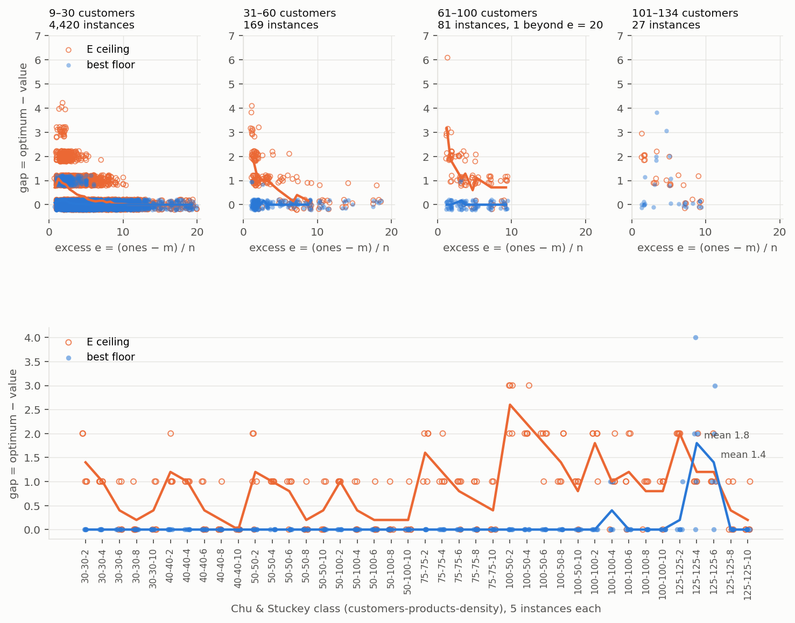

# The duality gap of each lower-bound obstruction family, found by search

*Ralph loop0013, 2026-11-02 onward. The plan is `reports/obstruction_search_plan.md`
(§0.2 is the correction everything rests on; §0.5 the design decisions; §0.9
the kill criteria per family). §0 is the two-page summary, written last (item
10); then one section per item. Nothing here changes a solver default;
nothing re-solves an instance that is already proved; nothing is written
under `solutions/`.*

## What this document is about

**The question.** Every certified optimum in this project is a sandwich: a
witness layout above, found by a tuned search over orderings, and a
refutation below, a search tree whose dominance rules are proved sound. The
*bounds* that start the descent — the trivial bound, the clique bound,
contraction degeneracy + 1, Harper's expansion bound at a cap, the greedy
contraction-minor step — have only ever been **computed**: one formula, one
greedy rule, one budget each. None was ever **searched**. This loop runs a
real search over each family of lower-bound obstructions on instances whose
optimum is already known, so that every answer is a measurement, and reports
the family's **duality gap**: `optimum − best certified bound`.

**The families, and the direction of each** (plan §0.2). Two of the five
families the brief listed are *universal* statements, not maximisations, and
that shapes what a search can give:

| family | object | search gives | exact half | certificate | Lean |
|---|---|---|---|---|---|
| **E** (expansion: Harper and the empty pair) | `f(t) = min_{|C|=t} |N[C]|`; `s* = max_t min(t − 1, n − f(t))` | a **ceiling** `max_t (f̂(t) − t) + 1`: a found set only proves `f(t) ≤ b` | branch and bound to cap 12; SAT with DRAT per `(t, b)` | the CNF's hash and the DRAT proof per level | `exists_closedNbhd_card_le`, `card_sub_two_mul_emptyPairIndex_sub_two_le_pathwidth` (`EmptyPair.lean`) |
| **M** (contraction minors) | contraction sequences | a **floor**: the minor's proved width | the C program's refutation on the minor | the sequence, the minor's edge hash, the C output | `pathwidth_gt_of_minorOf`, `lt_mospValue_of_minorOf` (`Minor.lean`) |
| **B** (separator branches) | a separator `S` and three branches | a **floor**: third-largest certified branch width + 1 | branch widths by the C program, or M recursively | `S`, `A, B, D`, the links, the leaves' certificates | `branch_lemma_separator`, `branch_lemma` (`Sandwich.lean`) |
| **C** (baseline) | cliques; min-degree minors | floors on record (`lb_best`) | — | the clique; the ops list | `card_le_pathwidth_add_one_of_isClique`; `minDegreeIn_le_degeneracy`, `degeneracy_le_pathwidth` |
| **P** (on record) | pendant cliques | floor on record (loop0010 item 13) | — | `R, Q_i` | `pathwidth_ge_of_pendant_cliques` (`PendantCliques.lean`) |

The bound of family E is `pw ≥ min_{|A|=t} |N[A]| − t` for every `t` (Harper
1966; `exists_closedNbhd_card_le`), a minimum over **all** `t`-sets; a set
found by search gives a value *above* the true bound and is not a bound at
all. The exact floor needs the inner minimum proved, and the search's value
is a **ceiling** on what the family could ever certify. Cliques, minors and
separator branches are genuine maximisations whose search gives a floor with
a certificate.

**Units.** Every corpus bound is in optimum units (`pathwidth + 1`); "gap" is
`optimum − bound` in those units. The dataset's `width` is a pathwidth and its
floors are stated in pathwidth units (`degeneracy ≤ pw`, `MMD+ ≤ tw ≤ pw`,
`ω − 1 ≤ pw`); a gap is the same number in either unit. A value that is not a
valid bound is called a ceiling or an estimate in every table, never a bound.

**The reference.** `max(lb_best, tw + 1)` is the harness's reference
(`learning/bound_harness.py`; `ml_nature.md` §38); this loop's reference is
`floor0`, the best floor **on record** per instance (§1), which adds Harper at
cap 12, Lemma P and the minor certificates on record to it.

**The targets** (frozen by item 01 in
`reports/scratch/obstruction_search/01_ledger/targets.json`; nothing else
decides membership): `gap338` (the 338 corpus instances with
`optimum − lb_best ≥ 2`), `cs200` (the 200 Chu & Stuckey instances), `open24`
(the 24 open classes of the pathwidth dataset), `rest500` (500 other corpus
instances, stratified by the harness's seven size bands,
`numpy.random.default_rng(0)`) and `small` (every corpus instance at
`n ≤ 22`, for the exact comparisons).

**What is on record and is not solved twice** (plan §0.3): 6,376 certified
optima (`solutions/`), the feature table `learning/data/instances.csv`, the
invariants table `learning/data/ensemble/conjecture_invariants.csv.gz`,
Lemma P's corpus values (`reports/scratch/pendant_cliques/harness_values.csv`),
the contraction-minor certificates (`reports/scratch/minor_certificates/`,
`reports/scratch/minor_bound/`; `reports/minor_bound_verification.md`), the
pathwidth dataset (`paper1/data/dataset/pathwidth_dataset.jsonl.gz`, 16,636
certified classes) and its 24 open classes (`reports/scratch/dataset_open/`).

**Compute and rules.** `nice -n 19`, at most 8 workers; the C program only on
minors and branches under caps; never the Python pathwidth solver; never a
whole proved graph re-solved. Every certificate is checked by
`paper1/obstruction_check.py`, which shares no code with the searches.
"We found no prior report", never "first". Harper (1966) and Ellis,
Sudborough & Turner (1994) are cited where the loop meets them.

---

## 0. Summary

*(written by item 10)*

---

## 1. The baseline ledger and the frozen targets (item 01)

*2026-11-02. Code `learning/obstruction_ledger.py`; tests
`tests/test_obstruction_ledger.py` (12); files under
`reports/scratch/obstruction_search/01_ledger/`: `ledger_corpus.csv` (6,376
rows, every bound on record and `floor0`), `harper12.csv` (the one new
computation), `ledger_dataset.csv.gz` (16,636 rows), `targets.json`,
`tables.md` (the tables below, generated), `run.log`, `harper_run.out`,
`gate_run.out`. Regenerate:
`nice -n 19 python3 -m learning.obstruction_ledger --stage corpus --workers 8`
(8 min wall; the Harper run resumes from `harper12.csv`), `--stage dataset
--workers 8` (6 s), `--stage targets`, `--stage tables`. Size range: corpus
9–134 customers, all 6,376; dataset classes to 1,024 vertices per component
(22 classes, all VSPLIB grids, have a larger component and their floors are
over the rest of the graph); Harper at cap 12 under 60 s per instance.*

### 1.1 What was done

**The record, joined.** For every certified corpus instance: `optimum`,
`lb_trivial`, `lb_contraction`, `lb_best`, `tw_min_fill`, `ub_best` from
`learning/data/instances.csv`; `omega`, `contraction`, `exp` (Harper at the
recorded cap, `exp_cap`), `tw_lo`, `tw_hi`, `tw_exact` from the invariants
table; Lemma P (`pendant`, optimum units) from loop0010 item 13's
`reports/scratch/pendant_cliques/harness_values.csv`; the excess
`e = (n_ones − m) / n`; the collection and the Chu & Stuckey class `(n, m, d)`
from the file path and the name; the provenance and value of every
`solutions/` file, read directly (`instances.csv` is a feature table of
2026-09-25 and lists four 125 × 125 instances as `solution`; the files say
`certified:refutation` on 6,374 and `certified:bound` on 2, and the values
agree on all 6,376). The contraction-minor certificates on record were read
from their files: `reports/scratch/minor_certificates/<name>_m*.json` (claim
`pw(G) ≥ K`, floor `K + 1`) and
`reports/scratch/minor_bound/<name>_*_recorded_certificate.json` (`refuted`
in MOSP units, floor `refuted + 1`; the `.out` files beside them confirm the
unit: `lower = refuted + 1`). That is **twelve** instances with a file-backed
minor floor, not the seven the survey's §5 table lists: loop0010's
`large@recorded` run left certificates for `Random-125-125-2-4_0`, `2-5_0`,
`4-2_0`, `4-4_0` and `4-5_0` as well. Two values of the survey table have no
file (`4-1_0` = 54 at 100 vertices min-d, `8-2_0` = 92 at 115–120; logged in
`reports/scratch/pw_lower_bounds/corpus_minor.out` and `corpus_minor_hi.out`);
they are carried in the column `minor_survey`, cited, and **not** inside
`floor0`.

**The one new computation: Harper at cap 12.** `expansion_bound(inst,
max_t=12, time_budget=60)` on all 6,376 instances, cheapest first, 8 workers
at `nice -n 19`: 479 s wall, **1.01 core-hours**. 6,341 instances completed
every level to cap 12; **35 were censored at the 60 s limit** (13 at 76–100
customers, 22 at 101–134; 33 of them Chu & Stuckey), having completed caps 7
to 11 — a censored value is still a valid floor, because the module discards
an abandoned level rather than using its incumbent (its docstring: an
overestimate of `f(T + 1)` would be a wrong answer, not a slow bound). The
cap-12 value is never below the recorded `exp` and improves it on **442**
instances, by up to 21 stacks (`Random-125-125-10-5_0`: 99 = optimum, from
the recorded cap). Per instance the ledger keeps `harper12`, the cap reached,
`complete`, seconds and the levels `f(1..t)`.

**`floor0`.** The best floor on record per instance,
`floor0 = max(lb_best, tw_lo + 1, harper12, lemmaP, minor)`, with the parts
attaining it in `floor0_source`. The harness's reference is
`max(lb_best, tw + 1)`; `floor0` adds Harper at cap 12, Lemma P and the minor
certificates to it.

**The guard.** Every bound column against the optimum, and the dataset's
cheap floors against the width: **zero violations** on 6,376 × 9 bound
columns and 16,636 × 4 floors. `tests/test_obstruction_ledger.py` asserts
this on the committed files.

**The dataset.** For the 16,636 certified classes of
`paper1/data/dataset/pathwidth_dataset.jsonl.gz`: degeneracy, MMD+ with both
rules (least-c, min-d) and the largest clique `networkx.find_cliques` reaches
within 2 s or 200,000 cliques, each per connected component on bit masks, the
row's value the maximum over its components of at most 1,024 vertices; 48
core-seconds in all. No row of the jsonl lacks its edge list (the "78
header-only graphs" of the item's brief are not in this file; three classes
are edgeless, width 0, and are kept); 5 of the 430 `certified:minor` rows
carry no `minor_certificate` (`pwc-05116`, `05456`, `05480`, `14181`,
`14639`); 17 clique enumerations were censored.

### 1.2 Findings

1. **On the record, 89.9% of the corpus is closed by a bound** (`floor0`
   tight on 5,732 of 6,376) against 77.0% for the solver's own `lb_best`
   (4,909); the instances at gap ≥ 2 fall from 338 to **122**, the mean gap
   from 0.43 to 0.18 stacks, the maximum from 30 to 23. Treewidth + 1 is the
   strongest single bound (tight on 5,653; attains `floor0` alone on 898 and
   is the only part above `lb_best` on 789 tight instances). Harper at cap
   12 is tight on 4,065, above `lb_best` on 145, and the sole attainer on
   88. Lemma P is the sole attainer on 5 instances (gap 0 on 2 of them). The
   minor certificates attain alone on 11 and close 7.

2. **Of the 338, the record already closes 81 (24.0%)**: 67 by exact
   treewidth alone (the "67 gap instances would become bound-certified" of
   `ml_nature.md` §24, reproduced), **7 by Harper at cap 12 alone**
   (`Random-100-100-8-2_0`, `Random-125-125-10-3_0`, `Random-125-125-10-5_0`,
   `Random-75-75-6-3_0`, two Warwick 30-customer instances, `p4040n4_0`),
   **7 by a minor certificate alone** (`2-1_0`, `2-3_0`, `2-4_0`, `2-5_0`,
   `4-5_0`, `6-1_0`, `SP4`), none by Lemma P (it beats `lb_best` on 3 by one
   stack, as `excess_phase_diagram.md` §16 says). Against the harness's
   reference `max(lb_best, tw + 1)`, which closes 67, `floor0` is strictly
   above the reference on 104 corpus instances (96 of them in the 338) and
   closes 14 more. What is left on the 338: 135 at gap 1, 122 at gap ≥ 2
   (50 at 2, 12 at 3, 9 at 4, 8 at 5, 10 at 6, 33 at 7–23). The survey's "4
   of the 125s by minors" is 7 of 12 on file once loop0010's `large` records
   are counted (`2-2_0` at 24 of 25, `4-1_0` at 53 of 57, `4-2_0` at 55 of
   57, `4-4_0` at 50 of 51, `8-2_0` at 87 of 93 are the five short ones; the
   survey's file-less 54 and 92 would raise two of them by one and five).

3. **Where the record misses is where the solver is slow.** By size band
   (table a3) the mean `floor0` gap is 0.05 at 9–20 customers, 0.96 at
   41–60, 5.48 at 76–100 and 4.89 at 101–134; by collection (a2), Chu &
   Stuckey has 72 instances at gap ≥ 2 out of 200, Faggioli–Bentivoglio 33
   of 300, and every other collection at most 7. By Chu & Stuckey class (a6):
   mean `floor0` gap 0.2, 0.2, 0.64, 2.72, 6.64 and 4.96 at 30, 40, 50, 75,
   100 and 125 customers against `lb_best`'s 0.56, 0.84, 1.40, 4.52, 10.34,
   14.0; the 125 row sits below the 100 row only because the 125s have minor
   certificates on record and the 100s have none. Harper at cap 12 is the
   part that does the work on the **dense** classes (`125-125-10`: mean gap
   0.2; `100-100-8`: 0.8; `100-50-10`: 4.0 from `lb_best`'s 11.4) and is
   worse than `lb_best` on the sparse ones (`100-100-2`: 12.2 against 7.8;
   `75-75-2`: 6.4 against 4.8; `125-125-2`: 15.8 against 9.8) — the ridge
   classes, where contraction minors are the only part that reaches the
   optimum (`125-125-2`: 4 of 5 closed, mean gap 0.2). Pathwidth provably
   exceeds treewidth (`optimum > tw_hi + 1`) on 564 corpus instances and on
   156 of the 338: on those, no treewidth-side bound can close the gap.

4. **The dataset's cheap floors are tight on 31.4%** (5,231 of 16,636;
   table b1); MMD+ least-c is the best of the three (tight on 5,059; above
   min-d on 3,786 classes, below on 552; degeneracy alone 2,130; `ω − 1`
   970), with gap ≥ 2 on 5,541 classes and a maximum gap of 86 (the
   Carvalho & Soma MOSP classes, mean gap 63.9, where the floor is a degree
   bound on a graph of width 133). By provenance: the 3,535
   `certified:bound` classes are all tight (by construction), 1,696 of the
   12,630 `certified:refutation` classes, **0 of the 430 `certified:minor`**
   (mean gap 4.6: a class gets a minor certificate exactly where the cheap
   floor failed) and 0 of the 41 grids (gap 31.7). The 425 minor
   certificates all refute `width − 1` (so each proves its class exactly);
   their minors have median `size / n` 0.505 (0.33–0.84); the rule is min-d
   on 379 and least-c on 46. Rome (11,199 classes) has mean gap 1.29 and
   maximum 6; the control-flow graphs 0.41.

5. **The targets, frozen** (`targets.json`, seed 0, ledger sha256
   `e5918a4c…`): `gap338` 338 (102 of them Chu & Stuckey, 17 at `n ≤ 22`),
   `cs200` 200, `open24` 24 — every one with a recorded floor (`lower`) from
   `reports/scratch/dataset_open/results_quick.csv` and
   `results_quick_rescued.csv`, not from `results.csv` as the plan's §0.3
   says (that file holds solved classes only): the floor is `width − 1` on
   18 of the 24, and `pwc-15933` 4 of 5, `pwc-16471` 6 of 7, `pwc-17043` 2
   of 8, `pwc-04526` 3 of 10, `pwc-04517` 2 of 10, `pwc-17317` 3 of 10 on
   the other six — `rest500` 500 drawn from the 5,940 other corpus instances in
   proportion to the seven size bands (345 / 140 / 11 / 3 / 0 / 1 / 0; the
   pool has no instance above 100 customers outside `gap338 ∪ cs200`),
   disjoint from both, and `small` 4,123 (every corpus instance at
   `n ≤ 22`). The test re-derives `rest500` from the ledger and the seed.

### 1.3 Kill verdict and what this does not claim

**Kill: none for the item; the guard passed** (no bound on record above a
certified optimum; no dataset floor above a certified width). The harness's
validity stage (`learning/bound_harness.py`, "above optimum" must be 0) was
not re-run on the new floor: the ledger's guard is that same check, applied
to every bound column on every corpus instance, and the test asserts it on
the committed file. The item does
not claim anything about what a search would find; that `floor0` is the best
bound obtainable from the record (the minor certificates on file are those
of twelve instances; Harper is at cap 12 and censored on 35); that the
dataset's floors are more than the three cheap ones (its 430 minor
certificates are a fourth, exact by construction, not folded into
`floor_cheap`); or that the 24 open classes' recorded floors are the best
the record holds (they are the `lower` of the last quick run).

### 1.4 Tables (generated; `tables.md`)


#### (a1) every bound on record, corpus, optimum units

| bound          |   instances |   tight |   gap 1 |   gap ≥ 2 |   mean gap |   max gap |   above optimum |
|:---------------|------------:|--------:|--------:|----------:|-----------:|----------:|----------------:|
| lb_trivial     |        6376 |     238 |     726 |      5412 |       6.15 |        86 |               0 |
| lb_contraction |        6376 |    4164 |    1083 |      1129 |       0.98 |        44 |               0 |
| lb_best        |        6376 |    4909 |    1129 |       338 |       0.43 |        30 |               0 |
| omega          |        6376 |    2803 |     877 |      2696 |       2.95 |        86 |               0 |
| exp_rec        |        6376 |    3996 |    1688 |       692 |       0.81 |        40 |               0 |
| harper12       |        6376 |    4065 |    1790 |       521 |       0.58 |        30 |               0 |
| tw1            |        6376 |    5653 |     531 |       192 |       0.63 |        61 |               0 |
| lemmaP         |        6376 |    2809 |     895 |      2672 |       2.84 |        86 |               0 |
| minor          |          12 |       7 |       2 |         3 |       1.17 |         6 |               0 |
| floor0         |        6376 |    5732 |     522 |       122 |       0.18 |        23 |               0 |

#### (a2) floor0 by collection

| collection           |   instances |   lb_best tight |   lb_best mean gap |   floor0 tight |   floor0 gap 1 |   floor0 gap ≥ 2 |   floor0 mean gap |   floor0 max gap |
|:---------------------|------------:|----------------:|-------------------:|---------------:|---------------:|-----------------:|------------------:|-----------------:|
| Challenge            |          46 |              31 |               0.91 |             37 |              6 |                3 |              0.52 |                9 |
| Chu & Stuckey        |         200 |              53 |               5.42 |             88 |             40 |               72 |              2.83 |               23 |
| Faggioli-Bentivoglio |         300 |             125 |               1.02 |            168 |             99 |               33 |              0.57 |                4 |
| Harvey               |        2130 |            1605 |               0.28 |           2000 |            128 |                2 |              0.06 |                2 |
| Miller               |           1 |               1 |               0.00 |              1 |              0 |                0 |              0.00 |                0 |
| SCOOP                |          24 |               6 |               1.04 |              7 |             14 |                3 |              1.00 |                6 |
| Shaw                 |          25 |              14 |               0.44 |             20 |              5 |                0 |              0.20 |                1 |
| Simonis              |        3630 |            3058 |               0.18 |           3394 |            229 |                7 |              0.07 |                2 |
| Wilson               |          20 |              16 |               1.55 |             17 |              1 |                2 |              0.50 |                6 |

#### (a3) floor0 by size band

| band    |   instances |   lb_best tight |   lb_best mean gap |   floor0 tight |   floor0 gap 1 |   floor0 gap ≥ 2 |   floor0 mean gap |   floor0 max gap |
|:--------|------------:|----------------:|-------------------:|---------------:|---------------:|-----------------:|------------------:|-----------------:|
| 9–20    |        4122 |            3617 |               0.13 |           3913 |            208 |                1 |              0.05 |                2 |
| 21–30   |        1816 |            1134 |               0.45 |           1598 |            208 |               10 |              0.13 |                2 |
| 31–40   |         197 |              99 |               0.82 |            143 |             46 |                8 |              0.31 |                2 |
| 41–60   |         121 |              45 |               1.64 |             51 |             34 |               36 |              0.96 |                4 |
| 61–75   |          30 |               5 |               4.47 |              6 |             11 |               13 |              2.77 |                9 |
| 76–100  |          63 |               9 |               8.78 |             11 |             12 |               40 |              5.48 |               17 |
| 101–134 |          27 |               0 |              13.26 |             10 |              3 |               14 |              4.89 |               23 |

#### (a4) which part attains floor0

| part     |   attains floor0 |   attains alone |   attains alone and tight |   on the 338: attains alone |   on the 338: closes alone |
|:---------|-----------------:|----------------:|--------------------------:|----------------------------:|---------------------------:|
| lb_best  |             5344 |              16 |                         0 |                          16 |                          0 |
| tw1      |             6172 |             898 |                       789 |                         176 |                         67 |
| harper12 |             4480 |              88 |                        13 |                          82 |                          7 |
| lemmaP   |             2920 |               5 |                         2 |                           3 |                          0 |
| minor    |               11 |              11 |                         7 |                          11 |                          7 |

#### (a5) the 338 against the record

| bound    |   with a value |   closes (gap 0) |   gap 1 |   gap ≥ 2 |   mean gap |   max gap |   beats lb_best |
|:---------|---------------:|-----------------:|--------:|----------:|-----------:|----------:|----------------:|
| lb_best  |            338 |                0 |       0 |       338 |       4.78 |        30 |               0 |
| tw1      |            338 |               67 |     116 |       155 |       8.88 |        61 |             199 |
| harper12 |            338 |                7 |      41 |       290 |       3.99 |        30 |             127 |
| lemmaP   |            338 |                0 |       3 |       335 |      13.80 |        83 |               3 |
| minor    |             12 |                7 |       2 |         3 |       1.17 |         6 |              12 |
| floor0   |            338 |               81 |     135 |       122 |       2.33 |        23 |             290 |

#### (a6) the 200 Chu & Stuckey by class

|   n |   m |   d |   instances |   mean opt |   lb_best gap |   harper12 gap |   tw1 gap |   lemmaP gap |   floor0 gap |   floor0 tight |   harper12 complete |   harper12 s |
|----:|----:|----:|------------:|-----------:|--------------:|---------------:|----------:|-------------:|-------------:|---------------:|--------------------:|-------------:|
|  30 |  30 |   2 |           5 |       8.60 |          1.00 |           1.40 |      0.80 |         3.20 |         0.80 |              2 |                   5 |         0.21 |
|  30 |  30 |   4 |           5 |      16.00 |          1.00 |           1.00 |      0.00 |         7.00 |         0.00 |              5 |                   5 |         0.06 |
|  30 |  30 |   6 |           5 |      21.20 |          0.40 |           0.40 |      0.20 |         8.40 |         0.20 |              4 |                   5 |         0.02 |
|  30 |  30 |   8 |           5 |      25.20 |          0.20 |           0.20 |      0.00 |         6.60 |         0.00 |              5 |                   5 |         0.01 |
|  30 |  30 |  10 |           5 |      27.00 |          0.20 |           0.40 |      0.20 |         2.60 |         0.00 |              5 |                   5 |         0.00 |
|  40 |  40 |   2 |           5 |      11.00 |          2.20 |           1.60 |      0.20 |         4.20 |         0.20 |              4 |                   5 |         0.87 |
|  40 |  40 |   4 |           5 |      20.20 |          1.40 |           1.00 |      1.60 |        11.40 |         0.80 |              1 |                   5 |         0.36 |
|  40 |  40 |   6 |           5 |      28.20 |          0.40 |           0.40 |      0.00 |        15.80 |         0.00 |              5 |                   5 |         0.13 |
|  40 |  40 |   8 |           5 |      32.60 |          0.20 |           0.20 |      0.00 |        15.00 |         0.00 |              5 |                   5 |         0.02 |
|  40 |  40 |  10 |           5 |      35.40 |          0.00 |           0.00 |      0.00 |        11.20 |         0.00 |              5 |                   5 |         0.01 |
|  50 |  50 |   2 |           5 |      13.20 |          3.20 |           2.80 |      2.20 |         6.60 |         2.00 |              0 |                   5 |         2.90 |
|  50 |  50 |   4 |           5 |      23.80 |          3.60 |           1.20 |      6.80 |        14.60 |         1.20 |              0 |                   5 |         1.76 |
|  50 |  50 |   6 |           5 |      35.20 |          0.80 |           0.80 |      3.60 |        22.00 |         0.80 |              1 |                   5 |         0.43 |
|  50 |  50 |   8 |           5 |      40.40 |          0.20 |           0.20 |      0.00 |        21.60 |         0.00 |              5 |                   5 |         0.09 |
|  50 |  50 |  10 |           5 |      44.40 |          0.40 |           0.40 |      0.00 |        19.40 |         0.00 |              5 |                   5 |         0.02 |
|  50 | 100 |   2 |           5 |      21.20 |          4.80 |           2.00 |      9.40 |        14.40 |         2.00 |              0 |                   5 |         5.10 |
|  50 | 100 |   4 |           5 |      34.60 |          0.40 |           0.40 |      5.40 |        23.60 |         0.40 |              3 |                   5 |         0.57 |
|  50 | 100 |   6 |           5 |      42.40 |          0.20 |           0.20 |      0.00 |        23.20 |         0.00 |              5 |                   5 |         0.06 |
|  50 | 100 |   8 |           5 |      46.20 |          0.20 |           0.20 |      0.00 |        16.40 |         0.00 |              5 |                   5 |         0.01 |
|  50 | 100 |  10 |           5 |      47.80 |          0.20 |           0.20 |      0.00 |         5.40 |         0.00 |              5 |                   5 |         0.00 |
|  75 |  75 |   2 |           5 |      15.80 |          4.80 |           6.40 |      9.40 |         9.20 |         4.80 |              0 |                   5 |        27.47 |
|  75 |  75 |   4 |           5 |      34.20 |         12.80 |           6.80 |     22.00 |        24.80 |         6.80 |              0 |                   5 |         9.78 |
|  75 |  75 |   6 |           5 |      50.00 |          4.00 |           1.00 |     27.80 |        37.00 |         1.00 |              1 |                   5 |        13.31 |
|  75 |  75 |   8 |           5 |      59.40 |          0.60 |           0.60 |     26.00 |        41.20 |         0.60 |              2 |                   5 |         2.39 |
|  75 |  75 |  10 |           5 |      64.80 |          0.40 |           0.40 |     20.00 |        42.00 |         0.40 |              3 |                   5 |         0.46 |
| 100 |  50 |   2 |           5 |      11.60 |          2.80 |           7.40 |      3.80 |         3.80 |         2.80 |              0 |                   5 |        15.84 |
| 100 |  50 |   4 |           5 |      26.40 |         10.40 |          12.40 |     17.00 |        16.80 |        10.40 |              0 |                   5 |        22.83 |
| 100 |  50 |   6 |           5 |      44.00 |         18.00 |          11.80 |     30.20 |        31.40 |        11.80 |              0 |                   5 |        20.15 |
| 100 |  50 |   8 |           5 |      56.20 |         15.60 |           7.60 |     35.40 |        40.00 |         7.60 |              0 |                   5 |        23.44 |
| 100 |  50 |  10 |           5 |      67.20 |         11.40 |           4.00 |     38.20 |        49.00 |         4.00 |              0 |                   5 |        13.70 |
| 100 | 100 |   2 |           5 |      20.20 |          7.80 |          12.20 |     11.80 |        11.80 |         7.80 |              0 |                   0 |        60.00 |
| 100 | 100 |   4 |           5 |      45.00 |         19.20 |          13.80 |     32.60 |        34.80 |        13.80 |              0 |                   1 |        54.13 |
| 100 | 100 |   6 |           5 |      64.60 |         14.00 |           6.60 |     42.00 |        51.40 |         6.60 |              0 |                   3 |        43.73 |
| 100 | 100 |   8 |           5 |      76.60 |          3.40 |           0.80 |     41.40 |        59.20 |         0.80 |              1 |                   5 |        42.63 |
| 100 | 100 |  10 |           5 |      84.60 |          0.80 |           0.80 |     36.20 |        63.60 |         0.80 |              1 |                   5 |         9.07 |
| 125 | 125 |   2 |           5 |      22.80 |          9.80 |          15.80 |     15.80 |        15.80 |         0.20 |              4 |                   0 |        60.00 |
| 125 | 125 |   4 |           5 |      53.00 |         27.40 |          25.00 |     41.60 |        43.00 |         6.00 |              1 |                   0 |        60.00 |
| 125 | 125 |   6 |           5 |      78.40 |         22.20 |          15.60 |     55.80 |        65.00 |        13.60 |              1 |                   0 |        60.00 |
| 125 | 125 |   8 |           5 |      93.60 |          8.80 |           4.80 |     57.40 |        77.00 |         4.80 |              0 |                   0 |        60.00 |
| 125 | 125 |  10 |           5 |     103.20 |          1.80 |           0.20 |     52.00 |        83.40 |         0.20 |              4 |                   3 |        52.67 |

#### (a7) Harper at cap 12 by band

| band    |   instances |   run |   complete to cap 12 |   censored at 60 s |   mean cap reached |   core-seconds |   harper12 > exp_rec |   harper12 > lb_best |   harper12 tight |
|:--------|------------:|------:|---------------------:|-------------------:|-------------------:|---------------:|---------------------:|---------------------:|-----------------:|
| 9–20    |        4122 |  4122 |                 4122 |                  0 |               1.47 |           3.14 |                   10 |                    0 |             2933 |
| 21–30   |        1816 |  1816 |                 1816 |                  0 |               2.88 |          35.83 |                  203 |                   32 |              989 |
| 31–40   |         197 |   197 |                  197 |                  0 |               4.56 |          38.28 |                   64 |                   26 |               92 |
| 41–60   |         121 |   121 |                  121 |                  0 |               6.93 |         122.51 |                   68 |                   26 |               31 |
| 61–75   |          30 |    30 |                   30 |                  0 |               8.67 |         317.28 |                   21 |                   12 |                6 |
| 76–100  |          63 |    63 |                   50 |                 13 |               9.08 |        1651.41 |                   49 |                   31 |               10 |
| 101–134 |          27 |    27 |                    5 |                 22 |               9.93 |        1471.06 |                   27 |                   18 |                4 |

Harper rows without a value (not reached under the wall): 0.

#### (a8) the instances with a minor certificate on record

| instance_name        |   optimum |   lb_best |   harper12 |   tw1 |   lemmaP |   minor | minor_source                                                                       |   minor_survey |   floor0 |
|:---------------------|----------:|----------:|-----------:|------:|---------:|--------:|:-----------------------------------------------------------------------------------|---------------:|---------:|
| Random-125-125-2-1_0 |        24 |        13 |          8 |     8 |        8 |      24 | reports/scratch/minor_certificates/Random-125-125-2-1_0_m87.json                   |            nan |       24 |
| Random-125-125-2-2_0 |        25 |        13 |          7 |     6 |        6 |      24 | reports/scratch/minor_bound/Random-125-125-2-2_0_large_recorded_certificate.json   |            nan |       24 |
| Random-125-125-2-3_0 |        21 |        12 |          6 |     7 |        7 |      21 | reports/scratch/minor_certificates/Random-125-125-2-3_0_m70.json                   |            nan |       21 |
| Random-125-125-2-4_0 |        24 |        15 |          8 |     8 |        8 |      24 | reports/scratch/minor_bound/Random-125-125-2-4_0_large_recorded_certificate.json   |            nan |       24 |
| Random-125-125-2-5_0 |        20 |        12 |          6 |     6 |        6 |      20 | reports/scratch/minor_bound/Random-125-125-2-5_0_large_recorded_certificate.json   |            nan |       20 |
| Random-125-125-4-1_0 |        57 |        27 |         33 |    12 |       10 |      53 | reports/scratch/minor_bound/Random-125-125-4-1_0_default_recorded_certificate.json |             54 |       53 |
| Random-125-125-4-2_0 |        57 |        27 |         32 |    12 |       11 |      55 | reports/scratch/minor_bound/Random-125-125-4-2_0_large_recorded_certificate.json   |            nan |       55 |
| Random-125-125-4-4_0 |        51 |        24 |         21 |    11 |        9 |      50 | reports/scratch/minor_bound/Random-125-125-4-4_0_large_recorded_certificate.json   |            nan |       50 |
| Random-125-125-4-5_0 |        46 |        23 |         23 |    10 |        8 |      46 | reports/scratch/minor_bound/Random-125-125-4-5_0_large_recorded_certificate.json   |            nan |       46 |
| Random-125-125-6-1_0 |        81 |        63 |         71 |    23 |       14 |      81 | reports/scratch/minor_certificates/Random-125-125-6-1_0_m120.json                  |            nan |       81 |
| Random-125-125-8-2_0 |        93 |        84 |         89 |    37 |       16 |      87 | reports/scratch/minor_bound/Random-125-125-8-2_0_default_recorded_certificate.json |             92 |       89 |
| SP4                  |        53 |        37 |         44 |    16 |       13 |      53 | reports/scratch/minor_certificates/SP4_m96.json                                    |            nan |       53 |

#### (b1) dataset: 16636 certified classes, cheap floors against the width (pathwidth units)

| floor (pw units)   |   classes |   tight |   gap 1 |   gap ≥ 2 |   mean gap |   max gap |   above width |
|:-------------------|----------:|--------:|--------:|----------:|-----------:|----------:|--------------:|
| degeneracy         |     16636 |    2130 |    3106 |     11400 |       3.63 |       109 |             0 |
| mmd_leastc         |     16636 |    5059 |    5804 |      5773 |       1.70 |        86 |             0 |
| mmd_mind           |     16636 |    4744 |    5347 |      6545 |       1.94 |        88 |             0 |
| omega1             |     16636 |     970 |    2626 |     13040 |       4.47 |       249 |             0 |
| floor_cheap        |     16636 |    5231 |    5864 |      5541 |       1.67 |        86 |             0 |

Rows with a component above 1024 vertices (floors over the rest): 22; omega censored (2 s / 200000 cliques): 17; edgeless classes: 3; seconds total: 48.

#### (b2) by collection

| collection                   |   classes |   mean n |   mean width |   floor_cheap tight |   gap ≥ 2 |   mean gap |   max gap |   skipped |
|:-----------------------------|----------:|---------:|-------------:|--------------------:|----------:|-----------:|----------:|----------:|
| Rome graphs                  |     11199 |    52.87 |         5.49 |                2896 |      3916 |       1.29 |         6 |         0 |
| MOSP: Challenge 2005         |      3169 |    21.86 |        14.37 |                1459 |       794 |       0.97 |        26 |         0 |
| freetdi control-flow graphs  |      1061 |    55.78 |         2.66 |                 662 |        35 |       0.41 |         3 |         0 |
| MOSP: Faggioli & Bentivoglio |       274 |    31.66 |         8.42 |                  74 |       125 |       1.53 |         5 |         0 |
| MOSP: Chu & Stuckey          |       200 |    71.25 |        40.16 |                   3 |       183 |      12.71 |        44 |         0 |
| PACE 2017 exact              |       129 |   254.86 |        33.81 |                   7 |       116 |       5.33 |        15 |         0 |
| freetdi named graphs         |       126 |    42.79 |        15.63 |                  23 |        84 |       6.71 |        52 |         0 |
| Small (Marti et al. 2008)    |        84 |    20.29 |         3.13 |                  52 |         0 |       0.38 |         1 |         0 |
| PACE 2017 bonus              |        78 |   197.22 |        15.29 |                   0 |        77 |       6.12 |        14 |         0 |
| PACE 2016                    |        70 |    83.66 |        20.09 |                  20 |        31 |       4.10 |        29 |         0 |
| VSPLIB grids                 |        50 |  1078.50 |        29.50 |                   0 |        49 |      26.88 |        54 |        22 |
| VSPLIB Harwell-Boeing        |        44 |   230.73 |        13.73 |                   8 |        29 |       3.64 |        14 |         0 |
| MOSP: Carvalho & Soma 2015   |        38 |   167.11 |       133.18 |                   0 |        38 |      63.89 |        86 |         0 |
| TreewidthLIB colouring       |        33 |   124.24 |        36.79 |                  13 |        15 |       9.27 |        60 |         0 |
| VSPLIB trees                 |        28 |   137.71 |         4.43 |                   0 |        28 |       3.43 |         4 |         0 |
| MOSP: SCOOP                  |        24 |    45.71 |         6.75 |                   6 |         3 |       1.08 |         6 |         0 |
| PACE 2017 heuristic          |        19 |   176.63 |        61.26 |                   3 |        15 |       6.11 |        25 |         0 |
| VLSI gate matrix circuits    |        10 |    30.10 |         7.80 |                   5 |         3 |       0.90 |         3 |         0 |

#### (b3) the certified:minor classes

|   certified:minor classes |   with certificate |   mean size/n |   median size/n |   min size/n |   max size/n |   least-c |   min-d |   refuted = width − 1 |   floor_cheap tight |
|--------------------------:|-------------------:|--------------:|----------------:|-------------:|-------------:|----------:|--------:|----------------------:|--------------------:|
|                       430 |                425 |         0.568 |           0.505 |        0.329 |        0.838 |        46 |     379 |                   425 |                   0 |

#### (c) targets

```
{
 "gap338": 338,
 "cs200": 200,
 "open24": 24,
 "rest500": 500,
 "small": 4123,
 "pool_for_rest500": 5940,
 "pool_by_band": {
  "9\u201320": 4105,
  "21\u201330": 1659,
  "31\u201340": 131,
  "41\u201360": 32,
  "61\u201375": 3,
  "76\u2013100": 10,
  "101\u2013134": 0
 },
 "rest500_by_band": {
  "9\u201320": 345,
  "21\u201330": 140,
  "31\u201340": 11,
  "41\u201360": 3,
  "76\u2013100": 1
 },
 "gap338_and_cs200": 102,
 "small_and_gap338": 17
}
```

---

## 2. Family E by search: the ceiling on every target, the exact profile at `n ≤ 22`, the floor by branch and bound (item 02)

*2026-11-03. Code `learning/obstruction_expansion.py` and its C helper
`learning/obstruction_expansion.c` (compiled on the fly, as `treewidth.c` is);
tests `tests/test_obstruction_expansion.py` (9); files under
`reports/scratch/obstruction_search/02_expansion/`: `ceiling.csv` (4,697
rows: the search's ceiling on every target), `ceiling_s2x3.csv` (a second
search pass, seed 2, triple budget, on `gap338 ∪ cs200`), `exact_small.csv`
(4,123 rows, the exact profile), `floor.csv` (35 rows, the cap-12 branch and
bound rerun where item 01 censored it), `sets/` (one JSON per target: `fhat`,
the best set per `t`, the witness profile, and on the small set the exact
`f` and its minimisers; 10.7 MB) and `sets_s2x3/`, `tables.md` (every table
below, generated), `harness_values.csv` and `harness_table.md` (the floor
through `learning/bound_harness.py`), `run_harness.py`, `run.log`,
`*_run.out`. Regenerate: `nice -n 19 python3 -m learning.obstruction_expansion
--stage ceiling --targets all --workers 8` (65 s wall), `--stage exact
--targets small --workers 4` (1 s), `--stage floor --targets gap338 --workers
8` (22 min wall), `--stage ceiling --targets gap338 --seed 2 --budget-scale 3
--tag s2x3` then the same with `--targets cs200`, `--stage tables`;
`nice -n 19 python3 reports/scratch/obstruction_search/02_expansion/run_harness.py --workers 8`.
Size range: ceiling 9–134 customers (every corpus target; `open24` is item
07's); exact `n ≤ 22`; floor the 35 instances of the 338 item 01 censored
(100–125 customers). Units: optimum units throughout; the ceiling is not a
bound.*

### 2.1 What was done

**The object and the direction.** For the MOSP graph of an instance,
`f(t) = min_{|C| = t} |N[C]|`. Harper's bound is `pw ≥ f(t) − t` at every `t`
(`exists_closedNbhd_card_le`), so family E's bound in optimum units is
`max_t (f(t) − t) + 1`; the empty-pair bound `n − 2 s* − 2 ≤ pw`
(`card_sub_two_mul_emptyPairIndex_sub_two_le_pathwidth`) is the same profile
read through `s* = max_t min(t − 1, n − f(t))`. `satisfiability/expansion_bound.py`'s
`max_i (i − M(i))` with `M(i) = max{t : f(t) ≤ i}` is the same number as
`max_t (f(t) − t)` (take `i = f(t) − 1` one way and `t = M(i) + 1` the
other), so item 01's `harper12` *is* this family's floor at cap 12. A set
`C` of size `t` found by any search proves `f(t) ≤ |N[C]|` and nothing else;
the search's value `max_t (f̂(t) − t) + 1`, `f̂ ≥ f`, is a **ceiling**: if it
is below the optimum, no computation of this family can close the instance.

**The search** (plan §0.5 (c)). Per level `t = 1 … n − 1`, tabu search on
swaps minimising `|N[C]|` over `|C| = t`, on bit masks in C: cover
multiplicities per vertex, a shortlist of six entering vertices by gain and
six leaving by loss, the best of the 36 exact swap deltas applied (tenure
7 ± 2 on both moved vertices, aspiration on the global best), at most
2,000 swaps and a stall limit per restart (40 non-improving swaps in the
sweep, 150 in the focus rounds). Restarts from: every maximal clique
(`networkx.find_cliques` under `islice(200)`), the certified witness's
prefix sets, BFS balls of radius 1 and 2 around every vertex, and the best
set at `t − 1` (ascending sweep) and `t + 1` (descending sweep); then
*focus rounds* on the levels attaining the current `max_t (f̂(t) − t)` —
the ceiling drops only when every argmax level drops — until a round
improves nothing or the wall budget (`0.005 n²` s in `[2, 90]`) runs out.
Every incumbent is re-evaluated in Python from its set before it is
recorded. **The witness's prefixes**: the pattern ordering in
`solutions/<name>.json` induces the customer layout by *opening* time
(first pattern needed); a placed vertex with a neighbour outside the prefix
is open at the next opening position, and so is the vertex opening there,
so this layout's vertex separation is at most `optimum − 1`, and on all
4,697 targets it is exactly `optimum − 1` (`witness_vs_opening` in
`ceiling.csv`; `tests/test_obstruction_expansion.py` asserts it). Its
finished sets `C_i = {v ∈ V_i : N[v] ⊆ V_i}` give `f̂(t) ≤ t + pw` at every
`t`, which is why the ceiling starts at the optimum. **A correction to the
item's text**: the layout by *closing* time (what "a customer closing order
by the instance's simulation" suggests) carries no such guarantee under the
prefix definition — the cost of a layout is not reversal-invariant — and on
`Random-125-125-2-2_0` it has vertex separation 56 against the optimum's 24.
Its finished sets are used as seeds like any other; the guarantee rests on
the opening layout.

**Exact at `n ≤ 22`.** Every subset, by the recurrence
`cover(S) = cover(S ∖ low(S)) ∪ N[low(S)]` over `2^n` masks (16 MB at
`n = 22`, 0.4 ms median): `f(t)` and one minimiser per `t`, the exact Harper
value, `s*` and `n − 2s* − 1`. Checked against a pure-Python enumeration on
150 random graphs and against `expansion_bound`'s levels on 50 corpus
instances (the tests), and on every small instance the ceiling is at least
the exact value.

**The floor.** `expansion_bound(max_t = 12)` rerun on the 35 instances of
the 338 that item 01 censored at 60 s (33 Chu & Stuckey at 100–125, SP4
twice), under 600 s where item 01's cap was at most 10 and 300 s at cap 11
(the item's 10-minute cap halved where only `f(13)` was missing, to fit the
budget; said so here). 26 of 35 completed cap 12; **2.83 core-hours**.

**Through the harness.** `harper_floor` is registered as an `--extra`
candidate (`learning.obstruction_expansion:harper_floor`: the cap-12 branch
and bound under the harness's budget, 10 s) and run through the validity
stage on the whole corpus; the table is `harness_table.md` (§2.3).

### 2.2 Numbers

**The ceiling, 4,697 targets** (`gap338 ∪ cs200 ∪ rest500 ∪ small`; 65 s
wall, **0.14 core-hours**; the search ended on a non-improving focus round
on 4,640, never on the budget). Ceiling above the optimum: **0**; below the
exact bound (small set): **0**; below `harper12`: **0**.

| target | instances | ceiling = optimum | ceiling < optimum | ceiling gap mean / max | floor gap mean / max | floor tight | bracket 0 | bracket mean |
|---|---:|---:|---:|---:|---:|---:|---:|---:|
| `gap338` | 338 | 18 | **320** | 1.66 / 5 | 3.79 / 27 | 7 | 193 | 2.13 |
| `cs200` | 200 | 64 | 136 | 0.90 / 3 | 3.90 / 27 | 57 | 116 | 3.00 |
| `rest500` | 500 | 341 | 159 | 0.37 / 4 | 0.37 / 4 | 341 | 499 | 0.01 |
| `small` | 4,123 | 2,933 | 1,190 | 0.32 / 4 | 0.32 / 4 | 2,933 | 4,122 | 0.00 |
| all | 4,697 | 3,099 | 1,598 | 0.42 / 5 | 0.58 / 27 | 3,088 | 4,547 | 0.16 |

(The floor here is `max(harper12, floor rerun)`; "bracket" is
`ceiling − floor`; "bracket 0" means the family's duality gap is exact.)
The ceiling's gap is 1 on 1,259 instances, 2 on 295, 3 on 37, 4 on 6 and 5
on 1 (`scoop-A_FA+AA-_6_0`, 79 customers, optimum 13, ceiling 8; the four
at 4 are two Harvey instances at 30, `p1550n8_0` and `p1550n1_0`); on the
338 it is 0 / 1 / 2 / 3 / 4 / 5 on 18 / 112 / 181 / 22 / 4 / 1.

**What the ceiling says about the 338.** On **320 of 338 the ceiling is
below the optimum: the expansion family cannot close them under any
computation**, however deep the cap. The 18 where it could — the ceiling
sits at the optimum — are two Harvey (`n = 30`), five Faggioli–Bentivoglio
(39–50) and eleven Chu & Stuckey (`50-50-2-1`, `75-75-6-3`, `100-100-4-2`,
`100-100-6-3`, `100-100-8-2`, `100-50-10-1`, `125-125-10-3`, `125-125-10-5`,
`125-125-8-1`, `125-125-8-3`, `125-125-8-4`); the floor already closes 7 of
them (`floor_tight` on `gap338`), and 11 are open between floor and
ceiling — item 03's list. Against the record: the ceiling is at or below
`floor0` on **249 of the 338** (family E can never beat what the other
families already proved there) and above it on 89, all Chu & Stuckey,
Faggioli–Bentivoglio at 40–50 and the SP instances. Over all 4,697 targets
the ceiling equals `floor0` on 3,352, is below it on 1,256 and above it on
the same 89.

**By size and class.** The ceiling's gap is about one stack everywhere
(band means 0.32 at 9–20, 0.9–1.5 above) and does not grow with `n`; the
*floor's* gap does (0.32, 1.16, 1.32, 1.88, 3.26, 7.39, 10.19 across the
seven bands), so the bracket opens from 0 at `n ≤ 30` to 9.1 at 101–134: on
the large instances almost all of the family's duality gap is *unknown
side*, the part item 03's exact half must settle. On the 200 Chu & Stuckey
by class (`tables.md` (d)): the ceiling is at the optimum on 0 of 5 in
every density-2 and density-4 class from 30 to 125 customers and on 3–5 of
5 at density 8–10; the gap is 2.0 on `125-125-2` and 0.2 on `125-125-10`.
The argmax level `t*` sits at a fraction of `n` that falls with density:
median `t*/n` 0.37 on `125-125-2`, 0.25 on `125-125-4`, 0.09 on
`125-125-10`; 0.10 over all targets.

**The search against the witness.** The witness's own prefixes give a
ceiling at the optimum on 4,577 of 4,697 and below it on 120; the search
lowers the witness's value at 79% of the levels at 101–134 customers (14% at
9–20) and lowers the *ceiling* below the witness's on 1,519 instances. So
the planner's third risk (§0.8: "the ceiling is the optimum almost
everywhere") did not materialise: the search finds sets the witness does
not, and the ceiling is strictly informative on a third of the targets and
on 95% of the 338.

**The second pass** (`s2x3`: seed 2, budget ×3, 436 instances of
`gap338 ∪ cs200`, 0.13 core-hours): the ceiling is equal on 432, lower on 1
(`HS problem 1195`, 13 → 12) and higher on 3 (`HS problem 1181`,
`Random-100-50-10-4_0`, `Random-100-50-6-3_0`, each by one). The ceiling is
therefore a search artefact at the ±1 level on about 1% of the instances at
30–100 customers; the minimum of the two passes is below the optimum on 365
of the 436 (pass 1 alone: 364). Both passes are valid ceilings; the tables
quote pass 1.

**Exact at `n ≤ 22`** (4,123 instances, 0.4 ms median each). The search
attains `f(t)` at every `t` on **4,090 of 4,123 (99.2%)**; the 33 misses
are one level each, by exactly one vertex, 31 of them at `n = 20` and 2 at
`n = 15`, and none at an argmax level: the ceiling equals the exact bound
on **4,123 of 4,123**. Harper exact equals the optimum on **2,933 (71.1%)**:
78% at `n = 10`, 75% at 15, 59% at 20; the empty-pair value equals the
optimum on 748 (18.1%) and is never above the Harper value (it is a
weakening of the same profile: strictly below on 3,473 of the 4,697
targets, equal on 1,224). Against the record: the exact bound exceeds
`harper12` on one instance (`scoop-B_18CR1_33_0`, `n = 19`, optimum 4,
where `expansion_bound` reports 0 for "no level improves" and the exact
value is 1 — a convention, not a bound) and exceeds `lb_best` and `floor0`
on **none**: at these sizes the full-depth expansion family adds nothing to
what is on record.

**The floor rerun** (35 instances, `tables.md` (e)). The floor rose on 32 of
35, by 1.9 stacks on average and by up to **6** (`Random-125-125-6-4_0`
63 → 69, `6-3_0` 64 → 70, `8-5_0` 83 → 88 — all still 5–11 below the
optimum); it is **above `floor0`, the best floor on record, on 17 of the
35** (every density-6 and density-8 125 × 125 instance, `4-1_0`, `4-3_0`,
`100-100-4-2_0`, …): the cap-12 branch and bound at ten minutes is a new
record floor there. The bracket closes on 2 (`125-125-10-2_0`, floor =
ceiling = 103 against 104: the family's duality gap is exactly 1 and it can
never close the instance; `125-125-10-5_0`, floor = ceiling = optimum = 99)
and the floor equals the optimum on 1. On the ridge classes it buys one
stack from a floor of 6–8 against optima of 20–25 (`125-125-2`), and there
the minor certificates on record (`floor0` 20–24) are the whole story.
Nine of the 35 did not complete cap 12 in 600 s (every `125-125-2` but
`2-1_0`, `4-3_0`, `6-1_0`, `6-4_0`, `6-5_0`, `8-5_0`); their values are
valid at the cap reached.

### 2.3 Through the harness

`python3 reports/scratch/obstruction_search/02_expansion/run_harness.py
--workers 8` (the CLI form `python -m learning.bound_harness --stage validity
--workers 8 --sources corpus --candidates "" --extra
learning.obstruction_expansion:harper_floor`, written to the item's
directory so that loop0004's values file is left alone): 6,376 corpus
instances, 10 s per instance, 144 s wall, **0.32 core-hours**, no
candidate censored, no error. `harness_table.md`:

| bound | rows | above optimum (must be 0) | tight, all | > `lb_best`, all | tight, gap | > `lb_best`, gap | > reference, gap | beats reference, gap (count) | mean shortfall, gap |
|---|---:|---:|---:|---:|---:|---:|---:|---:|---:|
| `tw + 1` (`tw_lo`) | 6,376 | 0 | 0.887 | 0.146 | 0.198 | 0.589 | 0 | 0 | 8.88 |
| `lb_best` | 6,376 | 0 | 0.770 | 0 | 0 | 0 | 0 | 0 | 4.78 |
| reference `max(lb_best, tw + 1)` | 6,376 | 0 | 0.896 | 0.146 | 0.198 | 0.589 | 0 | 0 | 3.92 |
| **`harper-floor`** (cap 12, 10 s) | 6,376 | **0** | 0.637 | 0.021 | 0.012 | 0.337 | 0.216 | **73** | 4.49 |

"Above optimum" is 0, which is the check the acceptance criteria ask for.
At 10 s the floor is tight on 63.7% of the corpus (item 01's 60 s run:
`harper12` tight on more, the dense instances needing the time) and beats
the harness's reference on 73 of the 338 gap instances — the same family
that §38 of `ml_nature.md` found no branching candidate could beat. It is a
floor of a different kind from the reference's two (degree and treewidth),
which is why it passes the treewidth ceiling the bounds section of
`CLAUDE.md` describes.

### 2.4 Kill verdict and compute

**Kill criterion (plan §0.9, E-search): not met.** The search attains
`f(t)` at every `t` on 99.2% of the instances at `n ≤ 22`, against the
criterion's 90%; the ceiling is not search-limited there and equals the
exact bound on every one. Above 22 the second pass moves it by ±1 on 1% of
the instances. Item 03 can seed its SAT calls from the search's sets and,
where they exist, from the exact minimisers (`sets/<name>.json`, keys
`sets` and `exact_sets`). The two bug conditions — a ceiling below the
floor, a floor above the optimum — occurred on **0** instances.

**Compute.** Ceiling 0.14, exact 0.00, floor 2.83, second pass 0.13,
harness 0.32: **3.4 core-hours** against the item's 3. The floor's
ten-minute cap was halved where only one level was missing; the overrun is
the second pass (a robustness check the item did not ask for) and the
harness run the acceptance criteria require.

### 2.5 What this does not claim

That the ceiling is attained by any computation (a ceiling is an upper
estimate of what the family can prove; the family's true value sits in
`[floor, ceiling]`); that the floor is the family's best (the exact half
above cap 12 is item 03); that the search's `f̂` equals `f` above 22
customers (measured only to 22; the second pass's ±1 says it does not
always); that any of this changes a solver (no candidate reaches
`_lower_bound`); that the 17 new record floors are anything but the cap-12
bound given more time. The closing-layout correction is a statement about
our construction of seeds, not about Yanasse's equivalence. "We found no
prior report" of a searched vertex-isoperimetric ceiling on benchmark
instances; the bound itself is Harper (1966).

## 3. Family E exact at full depth: the inner minimum by SAT with DRAT; the gap bracket closed where it settles (item 03)

*Size range: the 338 bound-gap instances (20–134 customers) and the 200
Chu & Stuckey instances (30–125); the encoding's self-test at `n ≤ 12`.
Regenerate: `nice -n 19 python3 -m learning.obstruction_expansion --stage sat
--targets gap338,cs200 --workers 8 --core-hours 6`, then `--stage sat-tables`;
`python3 reports/scratch/obstruction_search/03_sat/recheck_certificates.py
--workers 8` (every certificate through the checker);
`python3 reports/scratch/obstruction_search/03_sat/run_harness.py --workers 8`
(the validity stage); `python3 paper1/obstruction_check.py check-expansion
<instance.mosp> <certificate.json>` on any one certificate. Outputs under
`reports/scratch/obstruction_search/03_sat/`: `levels.csv` (344 calls),
`instances.csv` (144 instances), `boundary.csv`, `tables.md`, `joined.csv`,
`checker_verdicts.csv`, `harness_values.csv`, `harness_table.md`,
`certificates/<instance>/`, `run.log`, `../03_sat_run.out`. Tests:
`tests/test_obstruction_expansion.py` (24, of which 6 are this item's).*

### 3.1 What was done

**The question.** Item 02 left family E bracketed on 148 of the 436 targets
in `gap338 ∪ cs200` (145 of the 338, 3 more Chu & Stuckey): the ceiling
(the search's `max_t (f̂(t) − t) + 1`) above the floor (Harper's bound with
`f` proved by branch and bound to cap 12). Above cap 12 the branch and bound
does not finish, so this item asks the inner minimum of a SAT solver: for a
level `t` and a target `b`, "is there a set `C` of at least `t` customers
with `|N[C]| ≤ b`?" UNSAT proves `f(t) ≥ b + 1`, hence `pw ≥ b + 1 − t` and
`MOSP ≥ b + 2 − t` by the contrapositive of `exists_closedNbhd_card_le`
(`lean/MOSPFormalization/EmptyPair.lean`) and `mospValue_eq_pathwidth_add_one`;
SAT returns a set that lowers `f̂(t)`, so the ceiling drops. Either answer
moves one half of the bracket, and the level is settled when the two meet.

**The encoding** (`learning/obstruction_expansion.py::expansion_cnf`, the
contract `ENCODING_SPEC`, plan §0.5 (d)): `x_v` (`v ∈ C`), `y_v`
(`v ∈ N[C]`), the clauses `x_u → y_v` for every `v ∈ N[u]` including `u`, a
full totalizer over the `x` with the unit `o_t` (`Σ x ≥ t`) and one over the
`y` with the unit `¬o_{b+1}` (`Σ y ≤ b`), the auxiliaries of the two
totalizers in disjoint ranges allocated in a fixed order (the
`mosp_encoding.py` discipline). The totalizer is ours, not pysat's
`CardEnc`: the contract has to fix every variable number so that the
checker can regenerate the clause set, and a library's allocation order is
not a contract. The clause set is canonical (sorted literals, sorted
distinct clauses) and the certificate carries the SHA-256 of its DIMACS
text. `exact_sat(closed, t, b, proof_dir)` solves it with CaDiCaL 1.9.5
through pysat with proof logging, under a conflict budget (2 × 10⁶) and a
wall deadline (120 s) — pysat's CaDiCaL cannot be interrupted, so with a
deadline the call runs in a forked child that is killed at the deadline
and dies with its parent (`PR_SET_PDEATHSIG`); the proof is read after a
C-side flush, as `learning/proofs.py` learnt to; every UNSAT is checked by
`drat-trim` at once and the certificate JSON (`(t, b)`, the CNF's hash
and size, the gzipped proof and its hash, the solver, the conflicts, the
checker's binary hash and verdict) is written beside it. A SAT model's set
is re-evaluated from the masks and never read from the `y` variables; a
model with more than `t` members is cut to `t` (a subset's closed
neighbourhood is smaller).

**The driver** (`--stage sat`): for each instance of `gap338` then `cs200`,
smallest `n` first, the levels the ceiling marks relevant — `t` above the
proved cap with `f̂(t) − t + 1 > floor` (the item's `≥ floor − 1` in
pathwidth units includes equality; a level at the floor can neither raise
it nor move the bracket, so equality is left out), nearest the argmax `t*`
first, at most 8 per instance — and at each level a descent in `b` from
`f̂(t) − 1`: the first probe asks whether the incumbent is the minimum
(UNSAT settles the level in one call, which is the common case: item 02's
search attains `f` at 99.2% of levels at `n ≤ 22`); after a SAT answer
(a new incumbent, `f̂(t)` falls) or a censored call the next probe is the
midpoint of what is unresolved, so a censored boundary still leaves the
cheaper, lower `b` to try; an UNSAT at any `b` raises the floor to
`b + 2 − t` even when the level is not settled ("partial"). 240 s per
instance, a hard stop at 6 core-hours (wall × workers), 8 workers at
`nice 19`, the machine's load 2–6 during the run. The exact floor after the
run is the cap-12 floor raised by every SAT-proved level; the ceiling after
the run is `max_t (f̂(t) − t) + 1` over the incumbents with the proved levels
exact. Outputs: `levels.csv` (one row per call), `instances.csv` (one row
per instance), `certificates/<instance>/` (`instance.mosp` in the standard
format, `calls.jsonl`, `summary.json`, and per proved level
`t<t>_b<b>.json` with `t<t>_b<b>.drat.gz`), `boundary.csv`, `tables.md`.

**The checker** (`paper1/obstruction_check.py check-expansion <instance.mosp>
<certificate.json>`): its own reader of the standard format, its own MOSP
graph (a clique per pattern), its own totalizer from the contract, which it
carries verbatim in its docstring (the test pins the two texts equal; the
checker imports nothing from `learning/`, `satisfiability/`,
`pathwidth_solver/` or `mosp/`), regenerates the CNF, compares its hash and
size with the certificate's, compares the SHA-256 of the instance's rows,
decompresses the proof, runs `drat-trim` on the regenerated CNF and prints
the bound with the theorems it rests on; exit status 0 only when every
check passes. The instance file the checker reads is the one the run wrote
beside the certificate; the certificate records the benchmark file it came
from (`source_file`), and the rows' hash ties the two.

### 3.2 Numbers

**The headline.** Of the 148 targets with a bracket after item 02 (145 of
the 338, 3 more in `cs200`), 144 were reached within the budget and the
bracket closed on **72**: the family's duality gap is now exact on 264 of
the 338 (193 after item 02), the floor rose on 85 targets and the ceiling
fell on 3. **Where it closes is a question of size, not of level**: every
bracket at 30–60 customers closed (1 + 19 + 48 of 68, all argmax levels
settled, every one in a single UNSAT call at the incumbent or after one SAT
answer), 2 of 13 at 75, 1 of 41 at 76–100 (a SCOOP instance), 0 of 22 at
101–134. The run used **5.76 core-hours** of instance time and stopped at
its 6-core-hour cap with 3 instances not reached (`Random-125-125-8-5_0` of
the 338; `Random-100-50-2-2_0` and `Random-100-50-2-4_0` of `cs200` only).

| target | had bracket | reached | bracket closed | argmax settled | floor raised | ceiling lowered | floor gap before → after | bracket before → after | closed by floor | ruled out by ceiling | open with bracket | floor > reference |
|---|---:|---:|---:|---:|---:|---:|---:|---:|---:|---:|---:|---:|
| `gap338` | 145 | 143 | 71 | 70 | 84 | 3 | 3.79 → 3.41 | 2.13 → 1.74 | 7 → **12** | 320 | 11 → **6** | 87 → **98** |
| `cs200` | 84 | 81 | 15 | 15 | 27 | 0 | 3.90 → 3.68 | 3.00 → 2.79 | 57 → 58 | 136 | 7 → 6 | 70 → 74 |

(`tables.md` (a); "reference" is the harness's `max(lb_best, tw + 1)`.)
The five instances the exact floor newly closes on the 338 are `p2540n3_0`
(8 → 10 = optimum), `Random-50-50-2-1_0` (13 → 15), `p4050n10_0` (11 → 14),
`p4050n4_0` and `p4050n7_0` (12 → 14); on all five the cap-12 branch and
bound had the right argmax level in sight and the SAT call proved its
incumbent in under 6 s. The six of the 338 still open with a bracket are
all dense and large — `Random-100-100-4-2_0` (floor 40, ceiling = optimum
50), `100-100-6-3_0` (55 / 61), `100-50-10-1_0` (64 / 68), `125-125-8-1_0`
(94 / 95), `8-3_0` (92 / 95), `8-4_0` (93 / 94) — the instances where Harper
*could* be tight and the inner minimum at `t ≈ 15–25` on a 100–125-vertex
graph is what no call finishes (below).

**The floor, by band of the 338** (`tables.md` (b); mean gap `optimum −
floor`, optimum units): 9–20: 2.06 → 2.06 (no bracket to close; the family
is ruled out by its ceiling on all 17); 21–30: 1.98 → 1.98; 31–40: 1.96 →
**1.49**; 41–60: 2.78 → **1.43**; 61–75: 4.88 → 3.65; 76–100: 8.51 → 8.29;
101–134: 11.00 → 10.84. Where the floor rose, it rose by 1.15 at 31–40
(max 2), 1.52 at 41–60 (max 3), 2.33 at 61–75 (max 4), 1.67 at 76–100 and
2.0 at 101–134 (max 3): the SAT half adds one to four stacks to the cap-12
floor, and at 41–60 it removes half of the family's remaining gap. Thirteen
instances had their floor raised by a *partial* level alone (an UNSAT at a
`b` below the incumbent, the level itself unsettled) — the midpoint probe
after a censored call is what bought these.

**The ceiling fell on three instances**, all by one and all through the SAT
answers' sets: `Warwick 1299` (11 → 10 = floor: duality gap exactly 2
against an optimum of 12), `p2550n8_0` (9 → 8 = floor; optimum 11) and
**`scoop-A_FA+AA-_6_0`** (79 customers; 8 → 7 = floor; optimum **13**),
where nine SAT answers at `t = 30–52` each found a `t`-set one below the
search's incumbent (the sets' values are in `levels.csv`, column `nbhd`),
so the family's exact value on that SCOOP instance is **7, six stacks
below the optimum**, settled on both sides: the exact duality gap of the
expansion family on an industrial instance. Item 02's second pass had
already moved the ceiling by ±1 on 1% of the instances at 30–100; the 18
SAT answers (3 at `n ≤ 40`, 3 at 50, 9 on the 79-vertex SCOOP instance,
2 at 105, 1 at 134) are the exact-half view of the same ±1 artefact: on
sparse SCOOP graphs the tabu search's incumbents are off by one at several
levels at once.

**The boundary in `(n, t)`** (`tables.md` (d), (e); `boundary.csv`). Of 344
calls, 155 UNSAT (every one verified by drat-trim), 18 SAT, 79 out of
conflicts (2 × 10⁶), 92 killed at the 120 s deadline, 0 errors. Finished
share by band of `n` and `t`:

| `n` | `t` 13–15 | 16–20 | 21–25 | 26–30 | 31–40 | 41+ | median s (finished) |
|---|---:|---:|---:|---:|---:|---:|---:|
| ≤ 60 | 36/36 | 49/49 | — | — | — | — | 0.1–0.8 |
| 61–75 | 2/2 | 8/17 | 11/19 | 5/10 | 2/4 | — | 15 |
| 76–100 | 2/6 | 2/23 | 6/31 | 9/19 | 8/28 | 23/29 | 0.8–48 |
| 101–134 | 0/8 | 0/12 | 0/15 | 0/3 | 3/18 | 7/15 | 15–44 |

Every call at `n ≤ 50` finished (max `t` settled 20 at `n = 50`, in 0.58 s
at the median, 281 k conflicts at most); at `n = 75` the finished share is
28 of 52 and the deepest settled level is 15 (`Random-75-75-6-4_0`), the
shallowest censored 19; at `n = 100` 22 of 108 finished and no level at
all settled on the `Random` instances (max `t` settled: none), while the
two SCOOP instances at 79 and 105 settled levels at `t = 52` and `t = 46`
(28 of 28 and 4 of 5 calls finished: their graphs are sparse, `optimum / n
≈ 0.1–0.16`, and the CNF a third the size); at `n = 125` 3 of 62 finished,
all at `t ≥ 33` and `b ≤ 49`, levels the ceiling marks but far from the
argmax. **The boundary is `n ≈ 60–75` on the Chu & Stuckey graphs at the
levels that matter (`t* ≈ 0.2–0.35 n`), and it is a boundary in `n` at a
given density rather than in `t`**: the finished share at 76–100 *rises*
with `t` (0.09 at 16–20 to 0.79 at 41+) because the deep levels are the
sparse instances' and `b` is close to `n` there (the `Σ y ≤ b` totalizer is
nearly free), while at 101–134 nothing below `t = 31` finishes. Clause
counts are 4–6 k at `n ≤ 50`, 14 k at 75, 24–26 k at 100 and 36–41 k at 125;
the finished calls' conflicts reach 1.3 M at 75 and 1.1 M at 100, so the
2 × 10⁶ budget is binding at the boundary rather than generous: a 10× budget
would move it by one band at most, on the exponential the `t`-profile
shows, and is not what the plan's §0.8 (1) risk asked (the risk is
realised as stated). The analogue of §17's `m² · k ≈ 10⁴` is **`n ≈ 75` at
`optimum / n ≈ 0.2–0.5`**, i.e. the dense half of the Chu & Stuckey corpus
above 60 customers is out of the exact half's reach at 2 × 10⁶ conflicts
and 120 s per call; drat-trim's check costs 0.3–3× the solve (median 15–45 s
at 75–125, 1,127 s in total for the 158 certificates on disk, the largest
proof 38.7 MB gzipped, every one under the 50 MB per-file limit). **The
proofs are kept on disk and not in the repository**: 1.3 GB over 158 files
is not a committable artifact, so `.gitignore` carries
`reports/scratch/obstruction_search/**/*.drat.gz` (as `learning/data/proofs/`
is ignored for `learning.proofs`); every certificate JSON beside them records
the proof's SHA-256, size and lemma count, and the stage's command regenerates
them. A checkout without the proofs has the hashes and the CNF contract, and
the checker reports "proof present: False" rather than a verdict.

**The certificates.** 158 certificate files on disk (155 from the 144
reached instances, with their rows in `levels.csv`; 3 on the two `cs200`
instances the cap interrupted, valid but outside the tables — they prove
`f(43) ≥ 46` on `Random-100-50-2-2_0` and `f(45) ≥ 48` on `-2-4_0`, both
below those instances' floors), **158 of 158 verified** by
`paper1/obstruction_check.py` (`checker_verdicts.csv`): the regenerated CNF's
hash and size equal the certificate's on every one, the rows' hash ties the
instance, drat-trim verifies the proof on the regenerated CNF, max 45 s.
Every bound the item claims is read off a certificate in that file and
rests on `exists_closedNbhd_card_le` (contrapositive) and
`mospValue_eq_pathwidth_add_one`, both `sorry`-free in the development; the
checker trusts drat-trim and those two theorems and nothing of ours.

### 3.3 Through the harness

`run_harness.py --workers 8`: the exact floor as a lookup candidate
(`sat_floor`: the run's `floor_after` by the SHA-256 of the instance's rows,
1 where the run has no record) through `learning.bound_harness`'s validity
stage on all 6,376 corpus instances (`harness_table.md`): **above optimum
0**; beats the reference `max(lb_best, tw + 1)` on **74 of the 338** (item
02's cap-12 floor at 10 s: 73; at item 01's 60 s and item 02's 600 s, the
cap-12 floor already stood above the reference on 87 of the 338, and the
exact floor on 98, `tables.md` (a) — the harness's 74 counts the 144
instances the run reached and nothing else). The ledger's guard (item 01)
and the run's own guard (`floor_after ≤ optimum`, `floor_after ≤
ceiling_after`, asserted in `tests/test_obstruction_expansion.py::test_committed_sat_files`)
hold on every row.

### 3.4 Kill verdict and compute

**Kill criterion (plan §0.9, E-exact): met, narrowly on the sensible
reading and clearly on the literal one.** SAT settled the argmax level on
70 of the 145 instances of the 338 that had a bracket (48.3%, against the
criterion's 50%); counted over the 338, the argmax level is settled on 264
(78.1%) after the run, 70 of them by SAT (20.7%). The record therefore
says: **Harper exact is out of reach by SAT above cap 12 at 75 customers and
beyond on the Chu & Stuckey graphs** (boundary `n ≈ 60–75` at the argmax
levels, 2 × 10⁶ conflicts, 120 s per call) **and fully in reach to 60**,
where every bracket closed in seconds. The family's floor downstream is the
exact floor where a verified certificate proves it (144 instances,
`instances.csv::floor_after`) and the cap-12 floor elsewhere; nothing in
the floor rests on the search's quality or on a censored level. The second
kill condition — an UNSAT at a `(t, b)` where item 02's enumeration has a
set — occurred on **0** calls (the self-test at `n ≤ 12` agrees with the
enumeration on 3,000+ `(t, b)` pairs over 100 graphs, and the run's SAT
answers all have `|N[set]| ≤ b` re-evaluated from the masks).

**Compute.** Instance time 5.76 core-hours (solve 5.24, in-run drat-trim
0.45, the rest the forks and the writes), the checker sweep 0.31, the
harness run under 0.01 (a lookup), the smoke run and four timing probes
≈ 0.1: **≈ 6.2 core-hours** against the item's 6; the overrun is the
independent re-check the acceptance criteria require. 8 workers at
`nice 19`; the machine's one-minute load was 2–8 during the run (the
owner's `run_unlimited.py` was not running). Wall 45 min.

### 3.5 What this does not claim

That the SAT route scales beyond the boundary it measures (a call censored
by its conflict budget or its deadline says nothing about `f(t)`, and no
censored call contributes to any floor); that a larger budget would not
move the boundary (not measured; the conflict counts of the finished calls
at 75–100 say a 10× budget would at most reach one more band); that the
exact floor on the 144 reached instances is the family's best (levels the
ceiling did not mark, and the three unreached instances, were not asked;
at most 8 levels per instance and 240 s, which at `n ≥ 75` meant one or
two levels); that the ceiling after the run is the family's value (it is an
upper estimate still, exact only where it meets the floor: 72 targets); any
solver change (no candidate reaches `_lower_bound`; the family's bound as a
bound inside the search was a net loss, `reports/expansion_bound.md`, which
this item does not revisit). The certificate for an instance is a proof
about *that instance file*: the checker reads the `.mosp` file the run
wrote beside it and ties it to the benchmark source by the rows' hash
recorded in the certificate, not by re-reading the benchmark file's own
format. "We found no prior report" of DRAT-certified vertex-isoperimetric
profiles on MOSP instances; the bound is Harper (1966), the totalizer
Bailleux & Boufkhad (2003), the checker drat-trim (Wetzler, Heule & Hunt
2014).

## 4. Family M by search: the contraction-sequence search, its certificate and checker; the 338 at `n ≤ 60` against the greedy ladder (item 04)

*Size range: the 251 instances of `gap338` with at most 60 customers (in
fact 20–50: the set has nothing at 51–60); validation on 50 corpus instances
at `n ≤ 16` and on the six certificates of
`reports/minor_bound_verification.md` (58–120-vertex minors). Regenerate:
`nice -n 19 python3 -m learning.obstruction_minor --stage validate`;
`nice -n 19 python3 -m learning.obstruction_minor --stage run --targets
gap338 --max-n 60 --workers 8 --seconds 60,120`; `--stage check --workers 8`
(every certificate through the independent checker, rule-free included);
`python3 reports/scratch/obstruction_search/04_minor/run_harness.py
--workers 8` (the validity stage); `--stage tables`; `python3
paper1/obstruction_check.py check-minor <instance.mosp> <certificate.json>`
on any one certificate. Outputs under
`reports/scratch/obstruction_search/04_minor/`: `search.csv` (251 rows, the
ladder's and the search's result per instance), `ladder.csv` (2,155 ladder
points), `joined.csv`, `certificates/<instance>/{instance.mosp, search.json,
ladder.json, ladder_points.json}`, `checker_verdicts.csv`, `validation.log`,
`validation_small.csv`, `validation_recorded.csv`, `validation_recorded/`,
`harness_values.csv`, `harness_table.md`, `tables.md`, `run.log`, the three
`check_attempt*.out` of §4.1, and `../04_minor_{validate,run,check}.out`.
Tests: `tests/test_obstruction_minor.py` (11).*

### 4.1 What was done

**The question.** Family M is the one obstruction family on record that
reaches the ridge instances (item 01: minors close 4 of the 5
`Random-125-125-2` instances) and the one that is a genuine maximisation
(plan §0.2): any contraction minor `H` of the MOSP graph with a proved
pathwidth `p` certifies `MOSP ≥ p + 1`, by minor monotonicity
(`pathwidth_gt_of_minorOf`, `lean/MOSPFormalization/Minor.lean`) and
`mospValue_eq_pathwidth_add_one`. What is on record is the *greedy ladder*
(`satisfiability/relaxation.py::minor_sequence`, the C program's own minor
step): two contraction rules (`min-d`, `least-c`), fixed sizes, a refutation
attempted on each. This item asks whether a local search over contraction
*sequences* finds minors the ladder misses, at equal caps and equal total
time; what the family's duality gap is on the 338 at `n ≤ 60`; and what a
minimal certifying minor looks like.

**The search** (`learning/obstruction_minor.py`, plan §0.5 (e)). The state
is a sequence of `(v, u)` pairs in the instance's customer labels (contract
`v` into `u`; `(v, −1)` deletes an isolated `v`), replayed by `replay`, which
mirrors `relaxation.minor_groups`'s checks on masks (every pair an edge of
the current graph, a deletion only of an isolated vertex) and raises on any
violation. Moves: delete a pair (the minor grows by a vertex), insert a pair
(an edge of the current minor), retarget a pair to another current
neighbour of `v`, move a pair earlier; the result goes through `repair`
(a dead `v` drops the pair, a `u` no longer adjacent is retargeted to `v`'s
current neighbour of least degree, a `v` left with no neighbour becomes a
deletion). Tabu tenure 10 on the absorbed vertex, with aspiration; restarts
cycle through the two greedy rules at 50, 60, 70, 80, 90 and 95% and the
incumbent, 25 moves each; plateau moves are accepted (equal floor, at most
one vertex larger). **Evaluation** of a candidate minor `H`: the certified
witness's opening layout lifted to `H` (each branch set at its first
member's position; a proof that the lifted layout's vertex separation never
exceeds the original's is in `lifted_layout`'s docstring and the inequality
is asserted on 300 random graphs by a test) and a greedy layout give an
upper bound on `pw(H)`; a candidate whose upper bound cannot improve the
best floor so far is not sent to the C program (a cache by edge hash
removes repeats); otherwise one call
`printf '%s\n' "$g6" | nice -n 19 pathwidth_solver/cli/pathwidth -t 2 -l -v -m min_vertices=1000000`
(graph6 by networkx, labels `0..m−1` in increasing order of the surviving
representative; the C's own minor step disabled, so the certificate is
ours), parsed for `pathwidth <w> <status>` and stderr's `lower=`: the floor
certified is `w + 1` on `refutation` or `bound`, `lower + 1` on `upper`.
The objective is the certified floor in optimum units, ties by fewer
vertices. **The baseline** is the ladder — both rules, 50–85% in 5% steps
then 90 and 95% — through the same evaluator at the same cap; it stops
when its floor reaches the optimum (its points come in increasing size, so
the first is its smallest certifying point). Both get the same budget per
instance, 60 s at `n ≤ 40` and 120 s at 41–60; the search runs its whole
budget, minimising the vertex count once at the optimum. The C binary's
SHA-256 (`6560b809…`) is in every certificate.

**The certificate** (`certificates/<instance>/search.json`, format
`obstruction-minor-1`): instance name, `n`, the SHA-256 of the rows and of
`G`'s edge list, the sequence, `m`, the minor's labels, edges and edge hash
(the contract: SHA-256 of `"m e\n"` then one `"a b\n"` per sorted edge),
the C's width, status and `lower`, the pathwidth proved and the width
refuted, the C's stdout and stderr verbatim, its binary's SHA-256, the cap,
the seconds, and the theorems. The ladder's best point is written beside it
as `ladder.json`, with every ladder point in `ladder_points.json`.

**The checker** (`paper1/obstruction_check.py check-minor`; imports nothing
from `learning/`, `satisfiability/`, `pathwidth_solver/`, `mosp/` or
networkx — a test pins this): its own `.mosp` and edge-list readers, its own
MOSP graph, its own contraction replay (dict-of-sets, as `mc_graph.py`),
the quotient rebuilt from the branch sets and compared with the replayed
minor, the edge hash compared with the certificate's, its own graph6
encoder (equal to networkx's on 300 random graphs, by a test), the C program
re-run on the minor at the cap ×5 and accepted only if it proves at least
the claimed pathwidth, and, where `m ≤ 80`, `vsmemo.c` and `checkF.c` from
`reports/scratch/minor_certificates/` compiled into a temporary directory
and run for a rule-free refutation of `claim − 1` (`vsmemo -o -w F`, cap
300 s, 10⁸ states, an 8 GB address-space limit) with `checkF` on the family
of sets. The verdict is `verified` when replay, hash and C agree; the
rule-free outcome (`verified` / `unknown` / `skipped` / `failed` / `sat`)
is recorded beside it, and a `sat` or `failed` rejects.

**Validation before the 338** (`validation.log`). (i) 50 corpus instances
at `n ≤ 16` (seed 0 from `targets.small`): every ladder point with the skip
disabled and every minor the search proposed in 10 s — **1,485 distinct
minors, 1,485 C calls** — compared with
`learning.first_moment.vertex_separation_brute`: **0 disagreements**. (ii)
The six recorded certificates (`Random-125-125-2-3_0` m70, `2-1_0` m87,
`6-1_0` m120, `SP4` m96, `myciel6` m58, `myciel7` m110), converted from
`mc_graph.py`'s `[keep, absorbed]` convention to this item's `[absorbed,
keep]` and run through the checker with the C at 60 s: **6 of 6 replay,
6 of 6 hash-match, 6 of 6 re-proved by the C at exactly the recorded
width** (statuses all `refutation`; 0.03–28 s, the 87-vertex minor the
slowest). The rule-free check was not repeated on them (they are
rule-free certified on record).

**The run** (`run.log`). 251 instances, started at 8 workers under a
one-minute load of 2.4; after 74 instances the load rose to 48–59 from the
owner's chrome/puppeteer processes and the run was stopped and resumed at 4
workers (the stage resumes by instance name; the in-progress instances were
redone), then at 8 again when the load fell to 4 after 114. The search's
budgets are wall-clock, so the instances run under load got fewer moves per
second; nothing else changes. Wall 1,084 + 604 + 1,015 s in the three
segments.

**Three checker attempts, two bugs in the checker, none in a certificate**
(`check_attempt{1,2,3}.out`). The first sweep crashed with "branch sets do
not partition the vertex set": the checker's partition check ignored
isolated-vertex deletions. The second, counting the deleted vertex, still
rejected 5 certificates (`p1540n3_0`, `p1550n8_0`, `p2050n4_0`, `p2550n4_0`,
`p2550n5_0`): in each, a whole component (a 4-customer pattern clique, e.g.
`{9, 14, 23, 37}` of `p1540n3_0`) had been contracted to one vertex and
*then* deleted as isolated — a valid minor operation that deletes the whole
branch set, which the check now counts. The third found a sort slip in the
new check itself. The sequence of fixes is in
`tests/test_obstruction_minor.py::test_checker_accepts_deletion_of_a_contracted_component`.
The search module's own quotient code had none of these: its branch sets
are keyed by surviving representatives and the deleted ones simply leave.

### 4.2 Numbers

**The family closes every one of the 251** (`tables.md` (a), (c)). The
search's floor equals the optimum on **251 of 251**; the ladder's on 222
(88.4%), one below on the other 29. The record before this item (`floor0`,
the best of `lb_best`, `tw + 1`, Harper at cap 12, Lemma P and the file-backed
minors) was tight on 70 of the 251 and family E's exact floor after item 03
on 8; `tw + 1` alone on 67, `lb_best` and the clique bound on 0. On the 55
instances where `floor0` is 2 or more below the optimum (46 by 2, 8 by 3, 1
by 4), the ladder alone closes 53 and the search the other 2. The search's
floor is above `floor0` on 181 of the 251 and above the harness's reference
`max(lb_best, tw + 1)` on 184; through the harness's validity stage on all
6,376 corpus instances it is **above the optimum on 0** (`harness_table.md`;
the candidate is a lookup of the run's certificates, 1 elsewhere, as item
03's was).

| band | instances | ladder tight | search tight | search > ladder | `floor0` tight | family E tight |
|---|---|---|---|---|---|---|
| 9–20 | 17 | 12 | 17 | 5 | 4 | — |
| 21–30 | 133 | 115 | 133 | 18 | 47 | — |
| 31–40 | 47 | 42 | 47 | 5 | 13 | — |
| 41–60 | 54 | 53 | 54 | 1 | 6 | — |
| all | 251 | 222 | 251 | 29 | 70 | 8 |

**Where the search beats the ladder** ((b)): 29 of 251 (11.6%), always by
exactly one stack and always to the optimum; 14 Harvey, 10 Simonis, 4
Faggioli–Bentivoglio, 1 Chu & Stuckey (`Random-40-40-4-2_0`); 5 at 20
customers, 18 at 30, 5 at 40, 1 at 50. In every case the ladder's 95% point
(at 20 customers, one contraction) fails to prove `optimum − 1` on the
minor while the search's minor, of the same size or up to 9 vertices larger
(median 2), does — the greedy choice of *which* edge to contract is what
the ladder gets wrong, not the size. **Never the other way**: the search's
floor is below the ladder's on 0 instances (its restarts contain the
ladder's 50–95% points).

**The minimal certifying minor** ((d)). Over the 251 the search's smallest
minor at the optimum has `m / n` median 0.66 (IQR 0.52–0.77), against the
ladder's first certifying point at 0.80 (0.70–0.90; the ladder reaches the
optimum first at 95% on 43 instances, 85% on 37, 80% on 32, 50% on 12).
By band the median falls with `n`: 0.75, 0.70, 0.55, 0.51 at 9–20, 21–30,
31–40, 41–60; it rises with the excess (0.55, 0.62, 0.80 across excess
terciles; Pearson 0.68 with the realised excess, 0.82 with the graph
density, 0.88 with `optimum / n`, −0.53 with `n`). The minor is never
smaller than the optimum plus 2 vertices (median `m − optimum` 7,
`m / optimum` 1.48), as it cannot be: a graph on `m` vertices has pathwidth
at most `m − 1`. Every one of the 251 floors is a C `refutation` on the
minor (0 by the C's `bound`, 0 by its printed `lower`); of the 2,155 ladder
points 1,523 were refutations, 378 met the C's degeneracy bound and 254 were
skipped by the lifted-witness rule. The ladder's best point came from
`min-d` on 235 instances and `least-c` on 16.

**Checker verdicts** ((e)): **251 of 251 verified, all three checks**
(replay and hash, the C re-proof, and the rule-free `vsmemo` + `checkF`
refutation of `optimum − 2` on the minor: median 0.14 s, maximum 0.15 s;
the minors have 12–40 vertices). So every floor this item reports rests on
minor monotonicity and an 80-line checker, not on the search rules.

**Cost** ((f)): the ladder used **0.007 core-hours** on the 251 (median 5–9
C calls per instance, 0.0–0.1 s); the search used its whole budget, **5.08
core-hours**, of which 1.02 in the C program (951,248 calls, median 21.5
per second, each a process start on a 12–40-vertex graph) and the rest in
the Python moves (median 6,900 per second, 608 skipped candidates per
second). The budgets are "the same total seconds" in the sense the item
asks; the ladder needs a hundredth of them. Validation 0.3, the checker
sweeps 0.03, the harness under 0.01 (a lookup, 3 s), the two restarts'
redone instances about 0.2: **≈ 5.6 core-hours** against the item's 8.

### 4.3 Kill verdict and what this does not claim

**Kill criterion (plan §0.9 M): not met**, by a small margin. The search
beats the ladder on 29 of 251, 11.6%, against the 10% that would have
recorded "greedy is enough at `n ≤ 60`". The honest reading is narrower
than the number: the ladder closes 222 and is never more than one stack
short, and where the search wins it wins by one, at the minor sizes the
ladder already visits, by choosing a different contraction. The family's
duality gap on the 338 at `n ≤ 60` is **zero**: exact on all 251, with the
certificates on disk. The stop conditions did not fire: no minor's C-proved
width exceeded brute force (1,485 of 1,485), and no certificate was
rejected by a correct checker (the 5 rejections of the second sweep were
the checker's, §4.1). Item 05 runs the search on the 87 larger instances
of the 338 and the 200 Chu & Stuckey, where the ladder is known to miss.

**What this does not claim.** That the search is optimal among contraction
minors, or that the minimal minor it reports is the smallest certifying
minor (a search's failure to shrink further is not a proof); that a C
`refutation` on a minor is independent of the search rules (it rests on
the corrected rules proved sound in Lean; the rule-free `vsmemo` + `checkF`
check is the independent one, and here it ran on all 251 because the
minors are small — it does not scale to the 87-vertex minors of the record,
which took 255 s and 19.7 GB there); that the 11.6% would hold at larger
sizes or other budgets (the search spent its whole 60–120 s and the ladder
0.1 s, so at equal *spent* time the ladder is the better use of a second;
a search given the ladder's time would evaluate a few dozen candidates);
that the `m / n` figures describe anything but this search's minima under
this evaluator (ties by fewer vertices; cap 2 s); any solver change (the C
program's minor step and `relaxation.py` are untouched). The comparison with
family E uses item 03's `floor_after` where it exists and item 02's / item
01's cap-12 floor elsewhere; family E's ceiling is below the optimum on
most of these instances (item 02), so its 8 tight instances are a property
of the family, not of its search. "We found no prior report" of a local
search over contraction sequences for pathwidth lower bounds on MOSP
instances; the ladder is Chu & Stuckey's contraction relaxation
(2009, §3.5) as the record implements it, minor monotonicity is Fellows &
Langston (1987, Lemma 4.2), and the rule-free checker is the one of
`reports/minor_bound_verification.md`.

### 4.4 Tables (generated; `tables.md`)

## (a) Per band: the ladder's floor gap and the search's (optimum units)

| band   |   instances |   ladder gap mean |   ladder tight |   search gap mean |   search tight |   search > ladder |   tie, fewer vertices |   search < ladder |   floor0 gap mean |   search > floor0 |   best gap mean |   best tight |
|:-------|------------:|------------------:|---------------:|------------------:|---------------:|------------------:|----------------------:|------------------:|------------------:|------------------:|----------------:|-------------:|
| 9–20   |          17 |              0.29 |             12 |                 0 |             17 |                 5 |                    11 |                 0 |              0.76 |                12 |               0 |           17 |
| 21–30  |         133 |              0.14 |            115 |                 0 |            133 |                18 |                   107 |                 0 |              0.65 |                77 |               0 |          133 |
| 31–40  |          47 |              0.11 |             42 |                 0 |             47 |                 5 |                    41 |                 0 |              0.98 |                38 |               0 |           47 |
| 41–60  |          54 |              0.02 |             53 |                 0 |             54 |                 1 |                    53 |                 0 |              1.85 |                54 |               0 |           54 |
| all    |         251 |              0.12 |            222 |                 0 |            251 |                29 |                   212 |                 0 |              0.98 |               181 |               0 |          251 |
## (b) Where the search beats the ladder's floor

| instance_name                                                    |   n |   optimum |   ladder_floor |   ladder_m |   search_floor |   search_m | search_source   |   by |   search_calls |   search_seconds |
|:-----------------------------------------------------------------|----:|----------:|---------------:|-----------:|---------------:|-----------:|:----------------|-----:|---------------:|-----------------:|
| HS problem 2215 size 20 20 density  0.20                         |  20 |        13 |             12 |         14 |             13 |         18 | c_refutation    |    1 |           6101 |          60      |
| HS problem 690 size 20 10 density  0.30                          |  20 |        15 |             14 |         19 |             15 |         19 | c_refutation    |    1 |           1203 |          60      |
| HS problem 721 size 20 10 density  0.35                          |  20 |        16 |             15 |         17 |             16 |         19 | c_refutation    |    1 |            631 |          60      |
| Warwick 871: balanced orders, 4 orders per product               |  20 |         6 |              5 |         11 |              6 |         13 | c_refutation    |    1 |          11736 |          60      |
| Warwick 879: balanced orders, 4 orders per product               |  20 |         8 |              7 |         10 |              8 |         13 | c_refutation    |    1 |           9891 |          60      |
| HS problem 1159 size 30 10 density  0.25                         |  30 |        13 |             12 |         15 |             13 |         19 | c_refutation    |    1 |           7532 |          60      |
| HS problem 1168 size 30 10 density  0.25                         |  30 |        17 |             16 |         20 |             17 |         23 | c_refutation    |    1 |          10321 |          60.0001 |
| HS problem 1193 size 30 10 density  0.25                         |  30 |        20 |             19 |         24 |             20 |         28 | c_refutation    |    1 |           9999 |          60.0001 |
| HS problem 1215 size 30 10 density  0.30                         |  30 |        20 |             19 |         20 |             20 |         24 | c_refutation    |    1 |           2737 |          60.0001 |
| HS problem 1223 size 30 10 density  0.30                         |  30 |        20 |             19 |         21 |             20 |         27 | c_refutation    |    1 |           8665 |          60      |
| HS problem 2428 size 30 15 density  0.20                         |  30 |        16 |             15 |         26 |             16 |         27 | c_refutation    |    1 |          19048 |          60.0009 |
| Warwick 1309: balanced orders, 7 orders per product              |  30 |        15 |             14 |         22 |             15 |         24 | c_refutation    |    1 |            934 |          60.0001 |
| Warwick 1315: balanced orders, 8 orders per product              |  30 |        18 |             17 |         21 |             18 |         26 | c_refutation    |    1 |          13566 |          60      |
| Warwick 1356: balanced orders, 12 orders per product             |  30 |        24 |             23 |         26 |             24 |         28 | c_refutation    |    1 |           1617 |          60      |
| Warwick 1391: balanced products, 2 products per order            |  30 |        15 |             14 |         20 |             15 |         21 | c_refutation    |    1 |            769 |          60      |
| Warwick 1407: balanced products, 3 products per order            |  30 |        22 |             21 |         24 |             22 |         26 | c_refutation    |    1 |            413 |          60      |
| Warwick 1405: balanced products, 3 products per order            |  30 |        24 |             23 |         28 |             24 |         30 | c_refutation    |    1 |           3923 |          60.0003 |
| Warwick 1449: balanced orders and products, 3 products per order |  30 |        23 |             22 |         28 |             23 |         29 | c_refutation    |    1 |           4661 |          60      |
| Warwick 1488: balanced orders, 5 orders per product              |  30 |        12 |             11 |         15 |             12 |         24 | c_refutation    |    1 |          22054 |          60      |
| Warwick 1509: balanced orders, 7 orders per product              |  30 |        20 |             19 |         24 |             20 |         27 | c_refutation    |    1 |           1225 |          60      |
| Warwick 1613: balanced products, 4 products per order            |  30 |        23 |             22 |         26 |             23 |         27 | c_refutation    |    1 |            676 |          60      |
| Warwick 1676: balanced orders and products, 4 products per order |  30 |        24 |             23 |         28 |             24 |         30 | c_refutation    |    1 |           2973 |          60      |
| Warwick 1729: balanced orders, 3 orders per product              |  30 |         9 |              8 |         15 |              9 |         17 | c_refutation    |    1 |          15013 |          60.0009 |
| HS problem 3419 size 40 20 density  0.20                         |  40 |        28 |             27 |         36 |             28 |         39 | c_refutation    |    1 |            747 |          60.1304 |
| Random-40-40-4-2_0                                               |  40 |        21 |             20 |         30 |             21 |         31 | c_refutation    |    1 |            785 |          60.0002 |
| p2040n9_0                                                        |  40 |         9 |              8 |         20 |              9 |         22 | c_refutation    |    1 |           2295 |          60.0002 |
| p2540n9_0                                                        |  40 |        10 |              9 |         20 |             10 |         22 | c_refutation    |    1 |           4044 |          60.0075 |
| p3040n4_0                                                        |  40 |        12 |             11 |         20 |             12 |         27 | c_refutation    |    1 |          10679 |          60.0028 |
| p2550n10_0                                                       |  50 |        11 |             10 |         35 |             11 |         37 | c_refutation    |    1 |           1478 |         120.09   |

By how much: {1: 29}; reaching the optimum: 29 of 29.

## (c) Reaching the optimum

|   ladder reaches optimum |   search reaches optimum |   either |   search beats floor0 |   search beats max(lb_best, tw+1) |   best floor tight (floor0 or search) |   instances |
|-------------------------:|-------------------------:|---------:|----------------------:|----------------------------------:|--------------------------------------:|------------:|
|                      222 |                      251 |      251 |                   181 |                               184 |                                   251 |         251 |
## (d) The minimal certifying minor: `m / n` by band and by the ladder's rule

| band   |   instances |   search m/n median | search m/n IQR   |   ladder m/n median |   excess median |   corr(m/n, excess) |   source refutation |   source bound |   source lower |
|:-------|------------:|--------------------:|:-----------------|--------------------:|----------------:|--------------------:|--------------------:|---------------:|---------------:|
| 9–20   |          17 |                0.75 | 0.70–0.90        |               0.9   |             2   |               0.855 |                  17 |              0 |              0 |
| 21–30  |         133 |                0.7  | 0.60–0.80        |               0.867 |             2.1 |               0.631 |                 133 |              0 |              0 |
| 31–40  |          47 |                0.55 | 0.45–0.59        |               0.65  |             1.8 |               0.777 |                  47 |              0 |              0 |
| 41–60  |          54 |                0.51 | 0.45–0.61        |               0.76  |             1.7 |               0.71  |                  54 |              0 |              0 |

Ladder rule of the best ladder point: {'min-d': 235, 'least-c': 16}.

## (e) Checker verdicts

| verdict   | checks             |   certificates |
|:----------|:-------------------|---------------:|
| verified  | replay+C+rule-free |            251 |

Rule-free outcomes: {'verified': 251}; rule-free seconds median 0.14, max 0.2; checker seconds median 0.1.

## (f) C calls per instance and seconds

| band   |   instances |   budget s |   ladder calls median |   ladder skipped median |   ladder seconds median |   search calls median |   search skipped median |   search seconds median |   search moves median |   search restarts median |   ladder core-h |   search core-h |
|:-------|------------:|-----------:|----------------------:|------------------------:|------------------------:|----------------------:|------------------------:|------------------------:|----------------------:|-------------------------:|----------------:|----------------:|
| 9–20   |          17 |         60 |                     9 |                       1 |                     0   |                  4570 |                   75990 |                      60 |           1.19991e+06 |                    47997 |               0 |            0.28 |
| 21–30  |         133 |         60 |                     8 |                       0 |                     0   |                  2371 |                   55165 |                      60 |      504450           |                    20178 |               0 |            2.22 |
| 31–40  |          47 |         60 |                     5 |                       0 |                     0   |                   744 |                   16757 |                      60 |      125610           |                     5025 |               0 |            0.78 |
| 41–60  |          54 |        120 |                     6 |                       0 |                     0.1 |                  1168 |                   20425 |                     120 |      137144           |                     5486 |               0 |            1.8  |

Total: ladder 0.01 core-hours, search 5.08; C calls 1792 and 951248.

## (g) By collection

| collection           |   instances |   ladder gap mean |   search gap mean |   search > ladder |   search tight |   floor0 gap mean |   search > floor0 |
|:---------------------|------------:|------------------:|------------------:|------------------:|---------------:|------------------:|------------------:|
| Challenge            |           1 |              0    |                 0 |                 0 |              1 |              3    |                 1 |
| Chu & Stuckey        |          22 |              0.05 |                 0 |                 1 |             22 |              1.41 |                19 |
| Faggioli-Bentivoglio |          83 |              0.05 |                 0 |                 4 |             83 |              1.41 |                77 |
| Harvey               |          71 |              0.2  |                 0 |                14 |             71 |              0.48 |                32 |
| Simonis              |          73 |              0.14 |                 0 |                10 |             73 |              0.79 |                51 |
| Wilson               |           1 |              0    |                 0 |                 0 |              1 |              3    |                 1 |

## 5. Family M at scale: the 87 gap instances above 60 customers and the 200 Chu & Stuckey; `Random-125-125-2-2_0` and `2-3_0` (item 05)

*Size range: 207 distinct instances — the 87 of `gap338` above 60
customers (75–134) and the 200 of `cs200` (30–125), of which 185 were run
here (107 at 61–134, 78 at 30–50) and 22 (the Chu & Stuckey gap instances
at 30–50) are carried from item 04's run unchanged (`carried_item04.csv`,
their certificates and verdicts under `carried_item04/`); the two ridge
instances at 125. Regenerate: `nice -n 19 python3 -m learning.obstruction_minor
--stage run --out 05_minor_scale --targets cs200,gap338 --min-n 61 --max-n 134
--workers 8 --seconds 60,120,180,300 --core-hours 18 --order small-first`;
the same with `--targets cs200 --min-n 0 --max-n 60` (the 78); `--stage
ridge --out 05_minor_scale --core-hours 2 --workers 2`; `--stage check
--out 05_minor_scale --workers 8 --rulefree-cap 120`; `python3
reports/scratch/obstruction_search/05_minor_scale/run_harness.py --workers 4`;
`--stage tables --out 05_minor_scale`. Outputs under
`reports/scratch/obstruction_search/05_minor_scale/`: `search.csv` (185
rows), `ladder.csv` (every ladder point), `carried_item04.csv` (22),
`joined.csv` (207), `certificates/<instance>/{instance.mosp, search.json,
ladder.json, ladder_points.json}`, `ridge.csv` (every C call of the ridge
stage), `ridge_summary.csv`, `ridge/<instance>/{instance.mosp, search.json,
calls.csv}`, `checker_verdicts.csv`, `harness_values.csv`,
`harness_table.md`, `tables.md`, `run.log`, `gate_run.out`, and
`../05_minor_scale_{run,small_run,ridge,check}.out`. Tests:
`tests/test_obstruction_minor.py` (17, six new).*

### 5.1 What was done

**The question.** Item 04 showed the family closing every one of the 251
gap instances at 20–50 customers, with the search beating the ladder on
11.6% of them. This item takes the search to the sizes where the ladder is
known to miss: the 87 instances of the 338 above 60 customers and the 200
Chu & Stuckey instances (`targets.cs200`; 207 distinct in all, of which the
22 at 30–50 that are also in `gap338` were run by item 04 and are carried
from there), and to the two 125-customer ridge instances with the budget
the survey's unfinished sizes never had.

**The code** is item 04's `learning/obstruction_minor.py` with four
additions: `set_out` (every path under
`reports/scratch/obstruction_search/05_minor_scale/`), the C cap and the
per-instance budget by size (`cap_for`: 2 s at `n ≤ 60`, 5 s at 61–100,
10 s at 101–134, plan §0.5 (e); `budget_for`: 60, 120, 180 and 300 s per
band for the ladder and the same for the search), a scheduler in `run`
that starts an instance only while the core-hours spent plus the budgets
of the running ones stay below `--core-hours` and lists the rest in
`not_reached.txt`, and a `ridge` stage. The C's `nodes=` is now parsed
from its stderr and written into every certificate (`c_nodes`). The
search, the ladder, the evaluator (the lifted-witness skip, the cache by
edge hash), the certificate format and the checker are item 04's,
unchanged; `search` takes an optional list of start sequences, which only
the ridge stage uses.

**The ridge stage** (`--stage ridge`, 2 core-hours, one worker per
instance, 3,600 s each). First the two greedy rules at 100, 102, 105, 108
and 110 vertices with a 120 s cap per C call, every point sent to the C
program whatever its upper bound (the item asks for every size, rule,
status, node count and seconds); then, for `Random-125-125-2-2_0`, the
tabu search restarting from those ten points, best floor first, with a
60 s cap per call and 10 moves per restart; for `Random-125-125-2-3_0`,
the search restarting from the recorded 70-vertex least-c certificate
(`reports/scratch/minor_certificates/Random-125-125-2-3_0_m70.json`,
converted from `mc_graph.py`'s `[keep, absorbed]` to this module's
`(absorbed, keep)`; its replay gives the record's 70 representatives, by a
test), the objective minimising the vertex count at floor 21 — does a
smaller minor refute 20? Every C call is a row of `ridge.csv`; the
per-instance summary is `ridge_summary.csv`; the best minor's certificate
is `ridge/<instance>/search.json`.

### 5.2 Numbers

**The 87 gap instances above 60 customers** (`tables.md` (b)). Family M's
floor — the better of the ladder's and the search's certificate — equals
the optimum on **73 of the 87**: 17 of 17 at 61–75, 43 of 45 at 76–100,
13 of 25 at 101–134. The record before this loop (`floor0`) was tight on
11 of the 87 and family E's floor after item 03 on 4. The search alone is
tight on 72, the ladder alone on 58; the search beats the ladder on 16
(by one stack on 13, two on 3) and finishes below it on 3. The 14
the family leaves open, all Chu & Stuckey at 100 and 125
customers, by one to four stacks:

| instance | optimum | ladder | search | `floor0` | E floor | gap left |
|---|---|---|---|---|---|---|
| `Random-100-100-4-1_0` | 46 | 45 | 43 | 33 | 34 | 1 |
| `Random-100-100-4-3_0` | 43 | 41 | 42 | 26 | 26 | 1 |
| `Random-125-125-2-1_0` | 24 | 23 | 23 | 24 (record's 87-vertex minor) | 9 | 1 |
| `Random-125-125-2-2_0` | 25 | 24 | 24 | 24 | 8 | 1 |
| `Random-125-125-4-1_0` | 57 | 53 | 53 | 53 | 37 | 4 |
| `Random-125-125-4-2_0` | 57 | 54 | 53 | 55 | 35 | 3 |
| `Random-125-125-4-3_0` | 54 | 52 | 52 | 31 | 34 | 2 |
| `Random-125-125-4-4_0` | 51 | 49 | 49 | 50 | 24 | 2 |
| `Random-125-125-4-5_0` | 46 | 45 | 45 | 46 (loop0010's file-backed minor) | 24 | 1 |
| `Random-125-125-6-1_0` | 81 | 80 | 80 | 81 (record's 120-vertex minor) | 73 | 1 |
| `Random-125-125-6-2_0` | 77 | 76 | 76 | 60 | 61 | 1 |
| `Random-125-125-6-3_0` | 80 | 79 | 79 | 64 | 70 | 1 |
| `Random-125-125-6-4_0` | 80 | 78 | 78 | 63 | 69 | 2 |
| `Random-125-125-6-5_0` | 74 | 71 | 71 | 56 | 59 | 3 |

Three of the fourteen are closed by a floor already on record (`2-1_0`
and `6-1_0` by the survey's minors at 87 and 120 vertices, found with
40–80 s refutations where this item's cap is 10 s; `4-5_0` by loop0010's
file-backed minor certificate, item 01's `minor` column),
so **the 338 as a whole stand at 324 closed by family M (251 in item 04,
73 here), 3 more by the record, and 11 open after this item**, all `Random-100-100-4` and `Random-125-125-4/6`:
the dense shoulder of the ridge, exactly where item 03 left the six E
brackets open.

**The 200 Chu & Stuckey instances** ((a)). The family's floor is tight on
**186 of 200**: all 125 at 30–75 customers, 48 of 50 at 100, 13 of 25 at
125. `floor0` was tight on 88, family E on 58. By density at 125: density
2, 3 of 5 (the two above, each one stack short); density 4, 0 of 5 (one to
four short); density 6, 0 of 5 (one to three); densities 8 and 10, 5 of 5
each. **The expectation from the record — minors on the sparse ridge,
expansion on the dense classes — is half right**: family M is at least as
tight as family E on every one of the 200 (tighter on 142, tied on 58,
never looser), and at density 10 the two tie at the optimum (E exact there,
item 03); where E is 12–22 stacks short at 125 (densities 2–6), M is 0.4–2.6
short. What M misses is the dense shoulder, not the ridge.

**Where the search beats the ladder, and why** ((c)). On the 185 instances
this item ran, 60 (32%): by one on 44, two on 14, three on 2; on 41 of the
60 the certifying minor has **more than 95% of the vertices** (at
`Random-125-125-10` and `-8`, 116–122 of 125; at `Random-100-100-10`, 97–99
of 100), and on 49 of the 60 the ladder's best point was its last, the 95%
point. The ladder's size grid stops where the dense instances' certifying
minors start: on them the family's duality gap is zero and the ladder's
one to three stacks is a grid artefact (a 97, 98, 99% rung would close it,
a change to `relaxation.py`'s ladder proposed and not applied). On the
sparse classes the two agree, and the search's gain is a smaller minor.
The search finishes **below the ladder on 3** (`Random-100-100-4-1_0` and
`-4-4_0` by two and one, `Random-125-125-4-2_0` by one): at 5–10 s per
call its 180–300 s buy 67–146 C calls, fewer than the moves from its
50–95% restarts need to reach the ladder's 85–95% rungs, so the family's
certificate on those three is the ladder's (`ladder.json`, checked). The
item's "same total seconds" is again a cap and not a spend: the ladder
used 0.31 core-hours on the 185, the search 8.13.

**The record's seven** ((d)). `Random-125-125-8-2_0`: **93 = optimum** at
118 vertices (the survey had 92 at 115–120, item 01 carried 87 file-backed
and 92 as `minor_survey`); `SP4`: 53 = optimum at 90 (record 96);
`Random-125-125-2-3_0`: 21 = optimum at 53 in the main run and **51 in the
ridge stage** (record 70); `2-2_0`: 24 at 70 (the file-backed 24;
optimum 25); `2-1_0`: 23 at 61–62 against the record's 24 at 87; `4-1_0`:
53 at 88 against the survey's 54 at 100; `6-1_0`: 80 at 117 against the
record's 81 at 120. On the last three the record's refutations took 28–80 s
on minors of 87–120 vertices, above this item's 10 s cap; the caps are the
item's and the comparison is at unequal budgets, said so.

**The minimal certifying minor** ((f)). Where the search reaches the
optimum, `m / n` has median 0.83–0.94 by band at 61–134 against item 04's
0.51–0.75 at 20–60: at these sizes the certifying minors are large, and the
figure tracks density (Pearson 0.93 with `optimum / n`, 0.73 with the
excess, −0.16 with `n`). The sparse classes keep small certificates
(`Random-125-125-2`: 46–70 of 125; `Random-100-100-2`: 51 of 100 at the
median; the SCOOP instances 37–52 of 79–134), the dense ones need nearly
the whole graph. Every floor of the 185 is a C `refutation` on the minor,
for the ladder and for the search alike (0 by the C's `bound`, 0 by its
printed `lower`).

**The two ridge instances** ((g), `ridge.csv`, 645 C calls in all).

- *`Random-125-125-2-2_0`* (optimum 25; needs a minor refuting 23 in
  pathwidth units). The two greedy rules reach the same minor at each of 100,
  102, 105, 108 and 110 (different sequences, the same quotient, caught by
  the evaluator's cache), so five distinct 120 s calls: all `upper`, 2.1–2.3 × 10⁸ nodes each; at 100
  vertices the C finds a **layout of width 23**, so that minor cannot
  certify 25 (it is one the survey's "every minor ≤ 95 admits 24" extends
  to 100); at 102–110 it finds width 24 and decides nothing. The search
  from those points, 60 s per call, made 50 calls at 97–107 vertices, all
  `upper`: on 22 of them the C found a layout of width 23 or 22 (the
  minor is useless), on 28 width 24 (undecided), median 1.1 × 10⁸ nodes
  per call. Floor at the end: 14, the C's printed degeneracy bound. **No
  certificate for 25 was found within one core-hour** — a recorded
  negative, as the item says, and not a kill: it says nothing about
  whether one exists.
- *`Random-125-125-2-3_0`* (optimum 21). The greedy minors at 100–110 do
  **not** refute 20 in 120 s (all `upper`, 2.6–3.1 × 10⁸ nodes; the C
  finds width 20 or 21) while the recorded 70-vertex least-c minor
  refutes it in **757,009 nodes and 0.5 s** — the record's count to the
  node. From that certificate the search shrank the minor one vertex at a
  time: a refuting minor at every size from 69 down to **51** (574 calls,
  19 refutations, the rest exact widths of 19 on the candidates), the
  51-vertex one refuting 19 in **145,355 nodes and 0.12 s**; 367 candidates
  at 50 vertices all have pathwidth exactly 19. So a 51-vertex contraction
  minor certifies `Random-125-125-2-3_0 ≥ 21`, 19 vertices below the record
  and 5.2× fewer nodes; whether a 50-vertex one exists the search cannot
  say.

**Checker** ((h)): **190 of 190 verified** (`checker_verdicts.csv`: the 185 search
certificates, the 3 `ladder.json` where the ladder is the family's
certificate, the 2 ridge ones): replay and edge hash on all; the C
re-proof at the certificate's own cap × 5 on all (186 `refutation`, 3
`bound`, and 1 `upper` whose printed lower bound meets the claim — the
`2-2_0` ridge floor of 14); and the rule-free `vsmemo` + `checkF`
refutation on the **137 with at most 80 vertices** (8–80; median 0.14 s,
maximum 51.5 s), skipped on the 53 larger ones (81–122 vertices, the 87-vertex
scale the item excludes). The 51-vertex certificate of `2-3_0` is among
the rule-free verified (0.45 s), so that floor rests on minor monotonicity
and the 80-line checker alone, as the record's 70-vertex one does.

**Harness** (`harness_table.md`): the item's floor (a lookup of the 185
search certificates and the two ridge ones; 1 elsewhere) through the
validity stage on all 6,376 corpus instances: **above the optimum on 0**,
beats the reference `max(lb_best, tw + 1)` on 87 of the 338.

**Cost** ((i)): the main run 6.56 core-hours on the 107 at 61–134 (3,111 s
wall at 8 workers, load 8–10, no instance cut by the 18-core-hour cap) and
1.88 on the 78 at 30–50 (905 s wall): ladder 0.31 core-hours in all (1,783
C calls), search 8.13 (278,571 C calls, 3.35 core-hours inside the C);
the ridge stage 2.0 (645 C calls, 1.18 core-hours inside the C); the
checker 0.15 (seconds summed over the 190 checks); the harness 0.01. **≈ 10.6 core-hours** against the
item's 20 + 2.

### 5.3 Kill verdict and what this does not claim

**Kill criterion (plan §0.9 M, the 338 as a whole): not met.** The search
beats the ladder on 29 of the 251 at `n ≤ 60` (item 04) and 16 of the 87
above, **45 of 338, 13.3%**, against the 10% that would record "greedy is
enough". The reading stays the one of §4.3: the ladder is never more than
three stacks short, the search wins by one to three, and above 60
customers most of its wins are the 95% rung of the ladder's grid, which a
longer ladder would take at a hundredth of the search's time. For
`Random-125-125-2-2_0`, no certificate within the budget is a recorded
negative, not a kill. The budget was the kill on nothing: the 18-core-hour
driver stop was not reached. The stop conditions did not fire: no floor
above an optimum (harness and ledger), no certificate rejected by the
checker.

**What this does not claim.** That `Random-125-125-2-2_0` has no minor
certificate (55 C calls at 97–110 vertices under one core-hour found
none; the record's certificates for `2-1_0` and `6-1_0` needed calls this
item's caps do not allow); that the 51-vertex minor of `2-3_0` is the
smallest (367 failures at 50 are a search's failures); that the family's
floor on the 11 open instances is its best (the search spent 180–300 s
at 5–10 s per call; the three "below the ladder" show the budget binding);
that the `m / n` figures describe anything but this search's minima under
this evaluator; that a C `refutation` on a minor is independent of the
search rules where the rule-free check did not run (the 53 certificates with 81–122 vertices rest on the corrected rules proved sound in Lean, as the record's 87- and 120-vertex ones do); any
solver change (the 97–99% rungs are a proposal; `relaxation.py` and the
C's minor step are untouched); nothing about the C program's speed (plan
§0.4 (9)). The comparison with family E uses item 03's `floor_after` where
it exists, item 02's rerun floor and item 01's cap-12 floor elsewhere.
Yanasse (1997a) Proposition 2 and Fellows & Langston (1987) Lemma 4.2 are
the monotonicity behind every floor here; the ladder is Chu & Stuckey's
contraction relaxation (2009, §3.5) as the record implements it. "We found
no prior report" of the 51-vertex certificate or of a search over
contraction sequences at these sizes.

### 5.4 Tables (generated; `tables.md`)

*Generated by `python3 -m learning.obstruction_minor --stage tables --out 05_minor_scale` on 2026-11-03 06:11; 207 instances (`cs200` ∪ `gap338` at n > 60; n = 30–134).*
## (a) By Chu & Stuckey class `(n, m, d)` (the instances this item ran; item 04 covered the 22 gap instances at n ≤ 60 separately)

| class             |   instances |   ladder gap mean |   ladder tight |   search gap mean |   search tight |   search > ladder |   search < ladder |   floor0 gap mean |   search > floor0 |   E gap mean |   M tighter |   E tighter |   best gap mean |   best tight |
|:------------------|------------:|------------------:|---------------:|------------------:|---------------:|------------------:|------------------:|------------------:|------------------:|-------------:|------------:|------------:|----------------:|-------------:|
| Random-30-30-2    |           5 |              0    |              5 |              0    |              5 |                 0 |                 0 |              0.8  |                 3 |         1.4  |           5 |           0 |            0    |            5 |
| Random-30-30-4    |           5 |              0    |              5 |              0    |              5 |                 0 |                 0 |              0    |                 0 |         1    |           5 |           0 |            0    |            5 |
| Random-30-30-6    |           5 |              0    |              5 |              0    |              5 |                 0 |                 0 |              0.2  |                 1 |         0.4  |           2 |           0 |            0    |            5 |
| Random-30-30-8    |           5 |              0.4  |              3 |              0    |              5 |                 2 |                 0 |              0    |                 0 |         0.2  |           1 |           0 |            0    |            5 |
| Random-30-30-10   |           5 |              0.2  |              4 |              0    |              5 |                 1 |                 0 |              0    |                 0 |         0.4  |           2 |           0 |            0    |            5 |
| Random-40-40-2    |           5 |              0    |              5 |              0    |              5 |                 0 |                 0 |              0.2  |                 1 |         1.2  |           5 |           0 |            0    |            5 |
| Random-40-40-4    |           5 |              0.2  |              4 |              0    |              5 |                 1 |                 0 |              0.8  |                 4 |         1    |           5 |           0 |            0    |            5 |
| Random-40-40-6    |           5 |              0.2  |              4 |              0    |              5 |                 1 |                 0 |              0    |                 0 |         0.4  |           2 |           0 |            0    |            5 |
| Random-40-40-8    |           5 |              0.4  |              3 |              0    |              5 |                 2 |                 0 |              0    |                 0 |         0.2  |           1 |           0 |            0    |            5 |
| Random-40-40-10   |           5 |              1    |              0 |              0    |              5 |                 5 |                 0 |              0    |                 0 |         0    |           0 |           0 |            0    |            5 |
| Random-50-50-2    |           5 |              0    |              5 |              0    |              5 |                 0 |                 0 |              2    |                 5 |         1.2  |           4 |           0 |            0    |            5 |
| Random-50-50-4    |           5 |              0    |              5 |              0    |              5 |                 0 |                 0 |              1.2  |                 5 |         1    |           5 |           0 |            0    |            5 |
| Random-50-50-6    |           5 |              0.2  |              4 |              0    |              5 |                 1 |                 0 |              0.8  |                 4 |         0.8  |           4 |           0 |            0    |            5 |
| Random-50-50-8    |           5 |              0.2  |              4 |              0    |              5 |                 1 |                 0 |              0    |                 0 |         0.2  |           1 |           0 |            0    |            5 |
| Random-50-50-10   |           5 |              0.6  |              2 |              0    |              5 |                 3 |                 0 |              0    |                 0 |         0.4  |           2 |           0 |            0    |            5 |
| Random-50-100-2   |           5 |              0    |              5 |              0    |              5 |                 0 |                 0 |              2    |                 5 |         1    |           5 |           0 |            0    |            5 |
| Random-50-100-4   |           5 |              0    |              5 |              0    |              5 |                 0 |                 0 |              0.4  |                 2 |         0.4  |           2 |           0 |            0    |            5 |
| Random-50-100-6   |           5 |              1    |              1 |              0    |              5 |                 4 |                 0 |              0    |                 0 |         0.2  |           1 |           0 |            0    |            5 |
| Random-50-100-8   |           5 |              1.2  |              1 |              0    |              5 |                 4 |                 0 |              0    |                 0 |         0.2  |           1 |           0 |            0    |            5 |
| Random-50-100-10  |           5 |              1    |              0 |              0    |              5 |                 5 |                 0 |              0    |                 0 |         0.2  |           1 |           0 |            0    |            5 |
| Random-75-75-2    |           5 |              0    |              5 |              0    |              5 |                 0 |                 0 |              4.8  |                 5 |         4.6  |           5 |           0 |            0    |            5 |
| Random-75-75-4    |           5 |              0    |              5 |              0    |              5 |                 0 |                 0 |              6.8  |                 5 |         4.6  |           5 |           0 |            0    |            5 |
| Random-75-75-6    |           5 |              0.4  |              3 |              0    |              5 |                 2 |                 0 |              1    |                 4 |         0.8  |           4 |           0 |            0    |            5 |
| Random-75-75-8    |           5 |              0.4  |              3 |              0    |              5 |                 2 |                 0 |              0.6  |                 3 |         0.6  |           3 |           0 |            0    |            5 |
| Random-75-75-10   |           5 |              1.8  |              0 |              0    |              5 |                 5 |                 0 |              0.4  |                 2 |         0.4  |           2 |           0 |            0    |            5 |
| Random-100-50-2   |           5 |              0    |              5 |              0    |              5 |                 0 |                 0 |              2.8  |                 5 |         6.6  |           5 |           0 |            0    |            5 |
| Random-100-50-4   |           5 |              0    |              5 |              0    |              5 |                 0 |                 0 |             10.4  |                 5 |        12.4  |           5 |           0 |            0    |            5 |
| Random-100-50-6   |           5 |              0    |              5 |              0    |              5 |                 0 |                 0 |             11.8  |                 5 |        11.8  |           5 |           0 |            0    |            5 |
| Random-100-50-8   |           5 |              0    |              5 |              0    |              5 |                 0 |                 0 |              7.6  |                 5 |         7.4  |           5 |           0 |            0    |            5 |
| Random-100-50-10  |           5 |              0.2  |              4 |              0    |              5 |                 1 |                 0 |              4    |                 5 |         3.8  |           5 |           0 |            0    |            5 |
| Random-100-100-2  |           5 |              0    |              5 |              0    |              5 |                 0 |                 0 |              7.8  |                 5 |        11.2  |           5 |           0 |            0    |            5 |
| Random-100-100-4  |           5 |              0.6  |              3 |              1    |              2 |                 1 |                 2 |             13.8  |                 5 |        12.4  |           5 |           0 |            1    |            2 |
| Random-100-100-6  |           5 |              0.4  |              3 |              0    |              5 |                 2 |                 0 |              6.6  |                 5 |         6.2  |           5 |           0 |            0    |            5 |
| Random-100-100-8  |           5 |              1    |              1 |              0    |              5 |                 4 |                 0 |              0.8  |                 4 |         0.8  |           4 |           0 |            0    |            5 |
| Random-100-100-10 |           5 |              2    |              0 |              0    |              5 |                 5 |                 0 |              0.8  |                 4 |         0.8  |           4 |           0 |            0    |            5 |
| Random-125-125-2  |           5 |              0.4  |              3 |              0.4  |              3 |                 0 |                 0 |              0.2  |                 0 |        14.6  |           5 |           0 |            0.2  |            4 |
| Random-125-125-4  |           5 |              2.4  |              0 |              2.6  |              0 |                 0 |                 1 |              6    |                 1 |        22.2  |           5 |           0 |            1.8  |            1 |
| Random-125-125-6  |           5 |              1.6  |              0 |              1.6  |              0 |                 0 |                 0 |             13.6  |                 4 |        12    |           5 |           0 |            1.4  |            1 |
| Random-125-125-8  |           5 |              1    |              1 |              0    |              5 |                 4 |                 0 |              4.8  |                 5 |         2    |           5 |           0 |            0    |            5 |
| Random-125-125-10 |           5 |              1.8  |              0 |              0    |              5 |                 5 |                 0 |              0.2  |                 1 |         0.2  |           1 |           0 |            0    |            5 |
| all Chu & Stuckey |         200 |              0.52 |            126 |              0.14 |            185 |                61 |                 3 |              2.83 |               108 |         3.68 |         142 |           0 |            0.11 |          188 |
## (b) The gap instances (`gap338` at n > 60) by band

| band    |   instances |   ladder gap mean |   ladder tight |   search gap mean |   search tight |   search > ladder |   search < ladder |   floor0 gap mean |   search > floor0 |   E gap mean |   M tighter |   E tighter |   best gap mean |   best tight |
|:--------|------------:|------------------:|---------------:|------------------:|---------------:|------------------:|------------------:|------------------:|------------------:|-------------:|------------:|------------:|----------------:|-------------:|
| 21–30   |           1 |              0    |              1 |              0    |              1 |                 0 |                 0 |              2    |                 1 |         2    |           1 |           0 |            0    |            1 |
| 31–40   |           6 |              0.17 |              5 |              0    |              6 |                 1 |                 0 |              0.5  |                 3 |         1.17 |           6 |           0 |            0    |            6 |
| 41–60   |          15 |              0    |             15 |              0    |             15 |                 0 |                 0 |              1.73 |                15 |         1.07 |          14 |           0 |            0    |           15 |
| 61–75   |          17 |              0.12 |             15 |              0    |             17 |                 2 |                 0 |              4.41 |                16 |         3.65 |          16 |           0 |            0    |           17 |
| 76–100  |          45 |              0.22 |             37 |              0.11 |             42 |                 7 |                 2 |              7.47 |                43 |         8.29 |          44 |           0 |            0.11 |           42 |
| 101–134 |          25 |              1.24 |              6 |              0.92 |             13 |                 7 |                 1 |              5.28 |                13 |        10.84 |          23 |           0 |            0.68 |           16 |
| all     |         109 |              0.4  |             79 |              0.26 |             94 |                17 |                 3 |              5.27 |                91 |         6.71 |         104 |           0 |            0.2  |           97 |
## (c) Where the search beats the ladder's floor

| instance_name         |   n |   optimum |   ladder_floor |   ladder_m |   search_floor |   search_m | search_source   |   by |   search_calls |   search_seconds |
|:----------------------|----:|----------:|---------------:|-----------:|---------------:|-----------:|:----------------|-----:|---------------:|-----------------:|
| Random-100-100-10-1_0 | 100 |        87 |             84 |         95 |             87 |         99 | c_refutation    |    3 |           1238 |         180.003  |
| Random-125-125-10-1_0 | 125 |       105 |            102 |        119 |            105 |        122 | c_refutation    |    3 |            829 |         300      |
| Random-50-100-6-2_0   |  50 |        44 |             42 |         48 |             44 |         50 | c_refutation    |    2 |           2660 |         120.001  |
| Random-50-100-8-1_0   |  50 |        47 |             45 |         48 |             47 |         50 | c_refutation    |    2 |            262 |         120      |
| Random-50-100-8-2_0   |  50 |        47 |             45 |         48 |             47 |         49 | c_refutation    |    2 |            267 |         120      |
| Random-75-75-10-1_0   |  75 |        66 |             64 |         71 |             66 |         74 | c_refutation    |    2 |           2156 |         180      |
| Random-75-75-10-3_0   |  75 |        65 |             63 |         71 |             65 |         74 | c_refutation    |    2 |           3259 |         180      |
| Random-75-75-10-4_0   |  75 |        65 |             63 |         71 |             65 |         73 | c_refutation    |    2 |           2551 |         180.005  |
| Random-75-75-10-2_0   |  75 |        65 |             63 |         71 |             65 |         73 | c_refutation    |    2 |           3352 |         180.353  |
| Random-100-100-10-2_0 | 100 |        85 |             83 |         95 |             85 |         99 | c_refutation    |    2 |            536 |         180.001  |
| Random-100-100-10-3_0 | 100 |        83 |             81 |         95 |             83 |         99 | c_refutation    |    2 |            856 |         180.012  |
| Random-100-100-10-5_0 | 100 |        84 |             82 |         95 |             84 |         97 | c_refutation    |    2 |           1356 |         180.004  |
| Random-100-100-8-4_0  | 100 |        77 |             75 |         95 |             77 |         97 | c_refutation    |    2 |           1124 |         180.03   |
| Random-125-125-10-2_0 | 125 |       104 |            102 |        119 |            104 |        122 | c_refutation    |    2 |            943 |         300.015  |
| Random-125-125-10-4_0 | 125 |       105 |            103 |        119 |            105 |        121 | c_refutation    |    2 |            862 |         300      |
| Random-125-125-8-1_0  | 125 |        95 |             93 |        119 |             95 |        118 | c_refutation    |    2 |            331 |         300.018  |
| Random-30-30-10-5_0   |  30 |        28 |             27 |         27 |             28 |         30 | c_refutation    |    1 |             59 |          60      |
| Random-30-30-8-1_0    |  30 |        25 |             24 |         26 |             25 |         28 | c_refutation    |    1 |           1382 |          60.0001 |
| Random-30-30-8-5_0    |  30 |        25 |             24 |         26 |             25 |         28 | c_refutation    |    1 |           1601 |          60.0001 |
| Random-40-40-10-1_0   |  40 |        36 |             35 |         38 |             36 |         39 | c_refutation    |    1 |            351 |          60.0001 |
| Random-40-40-10-2_0   |  40 |        36 |             35 |         38 |             36 |         39 | c_refutation    |    1 |            822 |          60.0003 |
| Random-40-40-10-3_0   |  40 |        34 |             33 |         36 |             34 |         37 | c_refutation    |    1 |           1360 |          60.0001 |
| Random-40-40-10-4_0   |  40 |        36 |             35 |         38 |             36 |         39 | c_refutation    |    1 |            769 |          60.0001 |
| Random-40-40-10-5_0   |  40 |        35 |             34 |         36 |             35 |         37 | c_refutation    |    1 |            811 |          60      |
| Random-40-40-6-2_0    |  40 |        30 |             29 |         36 |             30 |         37 | c_refutation    |    1 |           4611 |          60      |
| Random-40-40-8-1_0    |  40 |        34 |             33 |         38 |             34 |         39 | c_refutation    |    1 |           2004 |          60.0003 |
| Random-40-40-8-5_0    |  40 |        34 |             33 |         36 |             34 |         38 | c_refutation    |    1 |           1155 |          60.0002 |
| Random-40-40-4-2_0    |  40 |        21 |             20 |         30 |             21 |         31 | c_refutation    |    1 |            785 |          60.0002 |
| Random-50-100-10-1_0  |  50 |        48 |             47 |         48 |             48 |         49 | c_refutation    |    1 |             93 |         120      |
| Random-50-100-10-2_0  |  50 |        48 |             47 |         48 |             48 |         49 | c_refutation    |    1 |             10 |         120      |
| Random-50-100-10-3_0  |  50 |        48 |             47 |         48 |             48 |         49 | c_refutation    |    1 |             22 |         120      |
| Random-50-100-10-4_0  |  50 |        48 |             47 |         48 |             48 |         49 | c_refutation    |    1 |             70 |         120      |
| Random-50-100-10-5_0  |  50 |        47 |             46 |         48 |             47 |         49 | c_refutation    |    1 |            148 |         120      |
| Random-50-100-6-1_0   |  50 |        44 |             43 |         48 |             44 |         49 | c_refutation    |    1 |           1969 |         120.002  |
| Random-50-100-6-3_0   |  50 |        42 |             41 |         48 |             42 |         47 | c_refutation    |    1 |            646 |         120      |
| Random-50-100-6-4_0   |  50 |        42 |             41 |         48 |             42 |         47 | c_refutation    |    1 |           4389 |         120      |
| Random-50-100-8-3_0   |  50 |        46 |             45 |         48 |             46 |         49 | c_refutation    |    1 |            428 |         120      |
| Random-50-100-8-4_0   |  50 |        46 |             45 |         48 |             46 |         49 | c_refutation    |    1 |            878 |         120      |
| Random-50-50-10-3_0   |  50 |        44 |             43 |         48 |             44 |         48 | c_refutation    |    1 |           1884 |         120      |
| Random-50-50-10-4_0   |  50 |        45 |             44 |         48 |             45 |         49 | c_refutation    |    1 |            975 |         120      |
| Random-50-50-10-5_0   |  50 |        46 |             45 |         48 |             46 |         49 | c_refutation    |    1 |            816 |         120.002  |
| Random-50-50-6-2_0    |  50 |        35 |             34 |         45 |             35 |         46 | c_refutation    |    1 |           3125 |         120      |
| Random-50-50-8-4_0    |  50 |        42 |             41 |         48 |             42 |         48 | c_refutation    |    1 |           3707 |         120      |
| Random-75-75-10-5_0   |  75 |        63 |             62 |         71 |             63 |         72 | c_refutation    |    1 |           2124 |         180      |
| Random-75-75-6-2_0    |  75 |        52 |             51 |         71 |             52 |         70 | c_refutation    |    1 |           2794 |         180.006  |
| Random-75-75-6-5_0    |  75 |        51 |             50 |         68 |             51 |         68 | c_refutation    |    1 |           3735 |         180.025  |
| Random-75-75-8-4_0    |  75 |        59 |             58 |         71 |             59 |         72 | c_refutation    |    1 |           3981 |         180.002  |
| Random-75-75-8-5_0    |  75 |        59 |             58 |         71 |             59 |         71 | c_refutation    |    1 |           2395 |         180.006  |
| Random-100-100-10-4_0 | 100 |        84 |             83 |         95 |             84 |         97 | c_refutation    |    1 |           1665 |         180.005  |
| Random-100-100-6-1_0  | 100 |        68 |             67 |         95 |             68 |         96 | c_refutation    |    1 |            242 |         180.012  |
| Random-100-100-6-4_0  | 100 |        65 |             64 |         95 |             65 |         95 | c_refutation    |    1 |            240 |         180.015  |
| Random-100-100-4-3_0  | 100 |        43 |             41 |         70 |             42 |         80 | c_refutation    |    1 |            134 |         180.016  |
| Random-100-100-8-1_0  | 100 |        79 |             78 |         95 |             79 |         96 | c_refutation    |    1 |            984 |         180.013  |
| Random-100-100-8-3_0  | 100 |        76 |             75 |         95 |             76 |         97 | c_refutation    |    1 |           1012 |         180.012  |
| Random-100-100-8-5_0  | 100 |        75 |             74 |         95 |             75 |         93 | c_refutation    |    1 |           1164 |         180.008  |
| Random-100-50-10-3_0  | 100 |        68 |             67 |         90 |             68 |         92 | c_refutation    |    1 |            995 |         180.009  |
| Random-125-125-10-3_0 | 125 |       103 |            102 |        119 |            103 |        120 | c_refutation    |    1 |           1008 |         300.009  |
| Random-125-125-10-5_0 | 125 |        99 |             98 |        119 |             99 |        118 | c_refutation    |    1 |            654 |         300.003  |
| Random-125-125-8-2_0  | 125 |        93 |             92 |        119 |             93 |        118 | c_refutation    |    1 |            327 |         300.018  |
| Random-125-125-8-3_0  | 125 |        95 |             94 |        119 |             95 |        121 | c_refutation    |    1 |            245 |         300.014  |
| Random-125-125-8-5_0  | 125 |        91 |             90 |        119 |             91 |        121 | c_refutation    |    1 |             66 |         300.018  |

By how much: {1: 45, 2: 14, 3: 2}; reaching the optimum: 60 of 61; below the ladder: 3.

## (d) Against the record's seven (survey §5) and the file-backed minors of item 01

| instance             |   optimum |   survey minor | at m (rule)                      | ridge stage   |   file-backed (item 01) |   ladder |   ladder m |   search |   search m |   E floor |
|:---------------------|----------:|---------------:|:---------------------------------|:--------------|------------------------:|---------:|-----------:|---------:|-----------:|----------:|
| Random-125-125-2-1_0 |        24 |             24 | 87 (min-d)                       |               |                      24 |       23 |         62 |       23 |         61 |         9 |
| Random-125-125-2-3_0 |        21 |             21 | 70 (least-c)                     | 21 @ 51       |                      21 |       21 |         75 |       21 |         53 |         8 |
| Random-125-125-2-2_0 |        25 |            nan | none ≤ 95; 100–105 out of budget | 14 @ 97       |                      24 |       24 |         75 |       24 |         70 |         8 |
| Random-125-125-4-1_0 |        57 |             54 | 100 (min-d)                      |               |                      53 |       53 |         88 |       53 |         88 |        37 |
| Random-125-125-6-1_0 |        81 |             81 | 120 (both)                       |               |                      81 |       80 |        119 |       80 |        117 |        73 |
| Random-125-125-8-2_0 |        93 |             92 | 115–120                          |               |                      87 |       92 |        119 |       93 |        118 |        91 |
| SP4                  |        53 |             53 | 96 (both)                        |               |                      53 |       53 |         95 |       53 |         90 |        45 |
## (e) Family M against family E, by class and band: which is tighter where

| class             |   instances |   M floor gap mean |   E floor gap mean |   M tighter |   E tighter |   tie |   excess median |
|:------------------|------------:|-------------------:|-------------------:|------------:|------------:|------:|----------------:|
| Random-30-30-2    |           5 |                0   |                1.4 |           5 |           0 |     0 |            1.7  |
| Random-30-30-4    |           5 |                0   |                1   |           5 |           0 |     0 |            3.2  |
| Random-30-30-6    |           5 |                0   |                0.4 |           2 |           0 |     3 |            4.97 |
| Random-30-30-8    |           5 |                0   |                0.2 |           1 |           0 |     4 |            6.83 |
| Random-30-30-10   |           5 |                0   |                0.4 |           2 |           0 |     3 |            8.93 |
| Random-40-40-2    |           5 |                0   |                1.2 |           5 |           0 |     0 |            1.8  |
| Random-40-40-4    |           5 |                0   |                1   |           5 |           0 |     0 |            3.25 |
| Random-40-40-6    |           5 |                0   |                0.4 |           2 |           0 |     3 |            4.92 |
| Random-40-40-8    |           5 |                0   |                0.2 |           1 |           0 |     4 |            6.97 |
| Random-40-40-10   |           5 |                0   |                0   |           0 |           0 |     5 |            8.9  |
| Random-50-50-2    |           5 |                0   |                1.2 |           4 |           0 |     1 |            1.78 |
| Random-50-50-4    |           5 |                0   |                1   |           5 |           0 |     0 |            3.28 |
| Random-50-50-6    |           5 |                0   |                0.8 |           4 |           0 |     1 |            5.34 |
| Random-50-50-8    |           5 |                0   |                0.2 |           1 |           0 |     4 |            7.2  |
| Random-50-50-10   |           5 |                0   |                0.4 |           2 |           0 |     3 |            9.08 |
| Random-50-100-2   |           5 |                0   |                1   |           5 |           0 |     0 |            3.14 |
| Random-50-100-4   |           5 |                0   |                0.4 |           2 |           0 |     3 |            6.36 |
| Random-50-100-6   |           5 |                0   |                0.2 |           1 |           0 |     4 |           10.32 |
| Random-50-100-8   |           5 |                0   |                0.2 |           1 |           0 |     4 |           13.84 |
| Random-50-100-10  |           5 |                0   |                0.2 |           1 |           0 |     4 |           18.02 |
| Random-75-75-2    |           5 |                0   |                4.6 |           5 |           0 |     0 |            1.87 |
| Random-75-75-4    |           5 |                0   |                4.6 |           5 |           0 |     0 |            3.24 |
| Random-75-75-6    |           5 |                0   |                0.8 |           4 |           0 |     1 |            5.12 |
| Random-75-75-8    |           5 |                0   |                0.6 |           3 |           0 |     2 |            7.24 |
| Random-75-75-10   |           5 |                0   |                0.4 |           2 |           0 |     3 |            9.08 |
| Random-100-50-2   |           5 |                0   |                6.6 |           5 |           0 |     0 |            1.22 |
| Random-100-50-4   |           5 |                0   |               12.4 |           5 |           0 |     0 |            1.85 |
| Random-100-50-6   |           5 |                0   |               11.8 |           5 |           0 |     0 |            2.82 |
| Random-100-50-8   |           5 |                0   |                7.4 |           5 |           0 |     0 |            3.67 |
| Random-100-50-10  |           5 |                0   |                3.8 |           5 |           0 |     0 |            4.68 |
| Random-100-100-2  |           5 |                0   |               11.2 |           5 |           0 |     0 |            1.75 |
| Random-100-100-4  |           5 |                1   |               12.4 |           5 |           0 |     0 |            3.18 |
| Random-100-100-6  |           5 |                0   |                6.2 |           5 |           0 |     0 |            5.17 |
| Random-100-100-8  |           5 |                0   |                0.8 |           4 |           0 |     1 |            7.13 |
| Random-100-100-10 |           5 |                0   |                0.8 |           4 |           0 |     1 |            9.18 |
| Random-125-125-2  |           5 |                0.4 |               14.6 |           5 |           0 |     0 |            1.73 |
| Random-125-125-4  |           5 |                2.6 |               22.2 |           5 |           0 |     0 |            3.29 |
| Random-125-125-6  |           5 |                1.6 |               12   |           5 |           0 |     0 |            5.13 |
| Random-125-125-8  |           5 |                0   |                2   |           5 |           0 |     0 |            7.18 |
| Random-125-125-10 |           5 |                0   |                0.2 |           1 |           0 |     4 |            9.18 |

| band    |   instances |   M floor gap mean |   E floor gap mean |   M tighter |   E tighter |   tie |
|:--------|------------:|-------------------:|-------------------:|------------:|------------:|------:|
| 21–30   |          25 |               0    |               0.68 |          15 |           0 |    10 |
| 31–40   |          25 |               0    |               0.56 |          13 |           0 |    12 |
| 41–60   |          50 |               0    |               0.56 |          26 |           0 |    24 |
| 61–75   |          27 |               0    |               2.48 |          21 |           0 |     6 |
| 76–100  |          53 |               0.09 |               7.34 |          51 |           0 |     2 |
| 101–134 |          27 |               0.85 |              10.04 |          23 |           0 |     4 |
## (f) The minimal certifying minor: `m / n` where the search reaches the optimum

| band    |   at optimum |   search m/n median | search m/n IQR   |   ladder m/n median |   excess median |
|:--------|-------------:|--------------------:|:-----------------|--------------------:|----------------:|
| 21–30   |           25 |               0.8   | 0.63–0.90        |               0.867 |            4.97 |
| 31–40   |           25 |               0.85  | 0.75–0.93        |               0.875 |            4.92 |
| 41–60   |           50 |               0.92  | 0.78–0.97        |               0.93  |            6.72 |
| 61–75   |           27 |               0.88  | 0.71–0.95        |               0.907 |            5.07 |
| 76–100  |           50 |               0.83  | 0.58–0.92        |               0.9   |            3.63 |
| 101–134 |           15 |               0.944 | 0.42–0.97        |               0.576 |            7.18 |

Sources of the search's floor: {'c_refutation': 204, 'c_bound': 3}; of the ladder's: {'c_refutation': 202, 'c_bound': 5}; ladder rule: {'min-d': 197, 'least-c': 10}.

## (g) The two ridge instances: every C call of the ridge stage

The ladder points and the recorded certificate (every call; the search's calls are summarised below and listed in full in `ridge.csv` and `ridge/<instance>/calls.csv`):

| instance_name        | phase    | label               |   m |   cap |   upper_pw |   floor | source       |   c_width | c_status   |   c_lower |   c_nodes |   c_seconds | cached   |
|:---------------------|:---------|:--------------------|----:|------:|-----------:|--------:|:-------------|----------:|:-----------|----------:|----------:|------------:|:---------|
| Random-125-125-2-3_0 | ladder   | min-d@100           | 100 |   120 |         20 |      13 | c_lower      |        20 | upper      |        12 | 269869056 |  120.01     | False    |
| Random-125-125-2-3_0 | ladder   | least-c@100         | 100 |   120 |         20 |      13 | c_lower      |        20 | upper      |        12 | 269869056 |  120.01     | True     |
| Random-125-125-2-3_0 | ladder   | min-d@102           | 102 |   120 |         20 |      13 | c_lower      |        20 | upper      |        12 | 312639488 |  120.011    | False    |
| Random-125-125-2-3_0 | ladder   | least-c@102         | 102 |   120 |         20 |      13 | c_lower      |        20 | upper      |        12 | 312639488 |  120.011    | True     |
| Random-125-125-2-3_0 | ladder   | min-d@105           | 105 |   120 |         20 |      13 | c_lower      |        20 | upper      |        12 | 287139266 |  120.015    | False    |
| Random-125-125-2-3_0 | ladder   | least-c@105         | 105 |   120 |         20 |      13 | c_lower      |        20 | upper      |        12 | 287139266 |  120.015    | True     |
| Random-125-125-2-3_0 | ladder   | min-d@108           | 108 |   120 |         20 |      13 | c_lower      |        21 | upper      |        12 | 259338240 |  120.011    | False    |
| Random-125-125-2-3_0 | ladder   | least-c@108         | 108 |   120 |         20 |      13 | c_lower      |        21 | upper      |        12 | 259338240 |  120.011    | True     |
| Random-125-125-2-3_0 | ladder   | min-d@110           | 110 |   120 |         20 |      13 | c_lower      |        20 | upper      |        12 | 259735552 |  120.013    | False    |
| Random-125-125-2-3_0 | ladder   | least-c@110         | 110 |   120 |         20 |      13 | c_lower      |        20 | upper      |        12 | 259735552 |  120.013    | True     |
| Random-125-125-2-3_0 | recorded | least-c@70 (record) |  70 |    60 |         20 |      21 | c_refutation |        20 | refutation |        12 |    757009 |    0.500904 | False    |
| Random-125-125-2-2_0 | ladder   | min-d@100           | 100 |   120 |         24 |      13 | c_lower      |        23 | upper      |        12 | 214891493 |  120.01     | False    |
| Random-125-125-2-2_0 | ladder   | least-c@100         | 100 |   120 |         24 |      13 | c_lower      |        23 | upper      |        12 | 214891493 |  120.01     | True     |
| Random-125-125-2-2_0 | ladder   | min-d@102           | 102 |   120 |         24 |      13 | c_lower      |        24 | upper      |        12 | 231133184 |  120.013    | False    |
| Random-125-125-2-2_0 | ladder   | least-c@102         | 102 |   120 |         24 |      13 | c_lower      |        24 | upper      |        12 | 231133184 |  120.013    | True     |
| Random-125-125-2-2_0 | ladder   | min-d@105           | 105 |   120 |         24 |      13 | c_lower      |        24 | upper      |        12 | 219222016 |  120.014    | False    |
| Random-125-125-2-2_0 | ladder   | least-c@105         | 105 |   120 |         24 |      13 | c_lower      |        24 | upper      |        12 | 219222016 |  120.014    | True     |
| Random-125-125-2-2_0 | ladder   | min-d@108           | 108 |   120 |         24 |      13 | c_lower      |        24 | upper      |        12 | 223170560 |  120.011    | False    |
| Random-125-125-2-2_0 | ladder   | least-c@108         | 108 |   120 |         24 |      13 | c_lower      |        24 | upper      |        12 | 223170560 |  120.011    | True     |
| Random-125-125-2-2_0 | ladder   | min-d@110           | 110 |   120 |         24 |      13 | c_lower      |        24 | upper      |        12 | 228847616 |  120.011    | False    |
| Random-125-125-2-2_0 | ladder   | least-c@110         | 110 |   120 |         24 |      13 | c_lower      |        24 | upper      |        12 | 228847616 |  120.011    | True     |

| instance             |   search calls | m range   |   cap s |   refutations |   upper (undecided) | widths found (status upper)   |   best floor |   smallest m at best floor |   nodes median |   C seconds |
|:---------------------|---------------:|:----------|--------:|--------------:|--------------------:|:------------------------------|-------------:|---------------------------:|---------------:|------------:|
| Random-125-125-2-2_0 |             50 | 97–107    |      60 |             0 |                  50 | {22: 1, 23: 21, 24: 28}       |           14 |                         97 |      110618624 |      2998.6 |
| Random-125-125-2-3_0 |            574 | 50–69     |      60 |           574 |                   0 | {}                            |           21 |                         51 |          74901 |        56.5 |

| instance_name        |   n |   optimum |   seconds_budget |   seconds |   ladder_floor |   ladder_m |   search_floor |   search_m | search_source   |   calls |   search_calls |   skipped |   c_seconds |   restarts |    moves | reached_optimum   | from_recorded   |
|:---------------------|----:|----------:|-----------------:|----------:|---------------:|-----------:|---------------:|-----------:|:----------------|--------:|---------------:|----------:|------------:|-----------:|---------:|:------------------|:----------------|
| Random-125-125-2-3_0 | 125 |        21 |             3600 |   3600    |             13 |        100 |             21 |         51 | c_refutation    |     580 |            574 |      2420 |     657.079 |    1406774 | 14067735 | True              | True            |
| Random-125-125-2-2_0 | 125 |        25 |             3600 |   3600.01 |             13 |        100 |             14 |         97 | c_lower         |      55 |             50 |         0 |    3598.67  |          9 |       88 | False             | False           |
## (h) Checker verdicts

| verdict   | checks             |   certificates |
|:----------|:-------------------|---------------:|
| verified  | replay+C           |             53 |
| verified  | replay+C+rule-free |            137 |

Rule-free outcomes: {'verified': 137, 'skipped': 53}; rule-free seconds median 0.14, max 51.5; checker seconds median 0.1, max 300.0; minors m = 8–122.

## (i) C calls per instance and seconds

| band    |   instances |   budget s |   C cap s |   ladder calls median |   ladder seconds median |   search calls median |   search skipped median |   search seconds median |   search moves median |   ladder core-h |   search core-h |
|:--------|------------:|-----------:|----------:|----------------------:|------------------------:|----------------------:|------------------------:|------------------------:|----------------------:|----------------:|----------------:|
| 21–30   |          25 |         60 |         2 |                     8 |                     0   |                 483   |                 47431   |                      60 |                447033 |            0    |            0.42 |
| 31–40   |          25 |         60 |         2 |                    10 |                     0   |                 822   |                 21885   |                      60 |                161873 |            0    |            0.42 |
| 41–60   |          50 |        120 |         2 |                    10 |                     0   |                2496.5 |                 28792.5 |                     120 |                208994 |            0    |            1.67 |
| 61–75   |          27 |        180 |         5 |                    10 |                     0.2 |                2551   |                 19116   |                     180 |                 82358 |            0    |            1.35 |
| 76–100  |          53 |        180 |         5 |                    10 |                     0.6 |                 846   |                  5273   |                     180 |                 15279 |            0.03 |            2.65 |
| 101–134 |          27 |        300 |        10 |                    12 |                     8   |                 245   |                   789   |                     300 |                  2021 |            0.27 |            2.25 |

Total: ladder 0.31 core-hours, search 8.75; C calls 1942 and 375526; C seconds 0.30 and 3.53 core-hours.

Not reached under the core-hour cap: none.


## 6. Family B by search: separators with certified branches on the residual gap instances; the trees-of-cliques family (item 06)

*Size range: the 338 bound-gap instances (`gap338`, 20–134 customers), all
run; the 11 of them that items 03–05 left with `floor < optimum` (the
residual, 100–125 customers) are the item's question, the other 327 a
scoring run under the same budgets; validation on 100 random instances at
`n ≤ 14` with brute-force leaves (the test) and on the seven hand instances
of `learning.bound_harness`'s tests (`hand.csv`). Regenerate: `nice -n 19
python3 -m learning.obstruction_branch --stage hand`; `--stage run --targets
residual,gap338 --workers 8 --core-hours 4 --order small-first`; `--stage
connectivity --targets residual --workers 8`; `--stage check --workers 8`;
`python3 reports/scratch/obstruction_search/06_branch/run_harness.py
--workers 8`; `--stage tables`. Outputs under
`reports/scratch/obstruction_search/06_branch/`: `search.csv` (338 rows),
`joined.csv`, `certificates/<instance>/{instance.mosp, branch.json}` (156),
`checker_verdicts.csv`, `connectivity.csv`, `hand.csv`, `harness_values.csv`,
`harness_table.md`, `tables.md`, `run.log`, `run_harness.py`, `pass1/` (a
first pass without the potential column: `search.csv`, `run.log`, the two
`.out` files), and `../06_branch_{run,check,harness,connectivity}.out`.
Tests: `tests/test_obstruction_branch.py` (16).*

### 6.1 What was done

**The object** (plan §0.2, §0.5 (f)). A B certificate is a set `S`, three
connected branches `A, B, D` disjoint from `S` and from each other, three
connectors `Q ⊆ S` (a component of `G[S]`, with one edge to each branch of
its pair), and a certificate of each branch's pathwidth `≥ k`; it proves
`pathwidth(G) ≥ k + 1` by `branch_lemma_separator`
(`lean/MOSPFormalization/Sandwich.lean`, Lemma A of `ml_nature.md` §38).
The branches' widths are **proved, not seeded**: a branch is a `c` node (the
C program on the branch's induced subgraph, cap 5 s, `-m
min_vertices=1000000`; exact on `refutation` / `bound`, its printed `lower`
otherwise), a `clique` node (by inspection), a `trivial` node (`pathwidth ≥
0`, any nonempty set), a `minor` node (family M's greedy ladder run on the
branch, an `obstruction-minor-1` certificate of the induced subgraph), or,
recursively, a `branch` node (depth 2 at the top). Values in optimum units
(`k + 2`), as everywhere in this document.

**The search** (`learning/obstruction_branch.py`). Candidate `S` from
`bound_harness.family_separators` on the whole graph (cut vertices, pairwise
intersections of maximal cliques, clique-tree adhesions of the MCS-M
completion, every edge at `n ≤ 40`; mean 185 per instance), then a tabu
local search over `S` at the top level (add / drop one vertex, `|S| ≤ 6`,
tenure 5, 24 sampled add-neighbours per move, 30 moves from each of the 12
best family separators), scored by the certified value, the *potential*
(below), the non-trivial components, the components and `−|S|`; the local
search's best `S` is re-evaluated at full depth. The evaluation at an `S`
is **lazy with bounds**: each component of `G − S` starts with the floor it
already has (0 for a set never looked at) and an upper bound (`size − 1`,
the greedy layout's vertex separation, the C's upper bound once it has
run); the best linked triple by upper bounds gives the *potential* at `S`,
and a branch is sent to the C program only while the potential could still
beat the best value so far, cheapest unproved branch first. So a separator
that isolates two single vertices costs no C call (k = 0 is decided by
the bounds), the dense residual instances cost nothing beyond the component
BFS (2.39 M separators evaluated in all, 514 k with three or more
components, **347 C calls, 168 s of C time**), and `b_potential`, the
largest potential over every `S` tried, is a **ceiling on what the rule can
give at those separators under any leaf proof** (not a bound: it can exceed
the optimum, and does on `p2050n1_0`). **No C call on the whole graph**: the
top node has no leaf oracle, so family B's value is the branch value alone
(`none` when no `S` yields a linked triple) and the tables carry ω beside
it. Components, connectivity and the link condition are on bit masks; the
mask-level triple is pinned equal to the harness's `linked_third` on 60
random graphs by the test (one deviation from the item's text, which named
the harness function: it needs a networkx graph per call, which a search
evaluating thousands of separators per second cannot afford).

**The checker** (`paper1/obstruction_check.py check-branch`, no import from
the four project packages): own instance reader, own graph, own BFS for the
connectivity of every branch and connector, disjointness, `Q ⊆ S`, the two
named edges per connector, every pair linked, each branch node recursively
for `≥ k` (`c`: own relabelling, own graph6, the C re-run at cap 25 s with
the claim compared, an exact width below the claim flagged as a
contradiction; `clique`: by inspection; `trivial`: claim 0; `minor`:
`check-minor` on the induced subgraph written as an edge list), the top
node covering every vertex, and `k + 1`. The test damages a link (`Q`
outside `S`), a branch (a vertex of one branch added to another) and the
claim (`k + 1` raised by one), and each is rejected; a trivial node
claiming 1 is rejected.

**Two deviations from the item's text.** (i) The item's "M certificate from
item 04/05 when the component is the whole graph minus little" cannot be
used as written: a contraction minor of `G` is not a minor of `G[A]` (a
vertex outside `A` contracted into one inside adds edges `G[A]` lacks), so
the `minor` leaf runs family M's ladder *on the branch* instead, for at
most 40 s, on the limiting branches of the best triple when their width is
only the C's `lower`. It fired on 8 instances (106 C calls, the five
`Random-100-100-2` / `100-50-4-4` and three `Random-125-125-2` ridge
instances) and improved no leaf: the ladder's minors of a 94–118-vertex
branch do not beat the C's own degeneracy floor in 40 s at cap 5 s. (ii)
The hand instance "the spider of spiders 3" of the item's deliverable is 4
in optimum units (pathwidth 3, `test_branch_rule_recursive_spider` of
`tests/test_bound_harness.py`); the test asserts 4.

**Validation.** The seven hand instances reproduce the seeded form's values
exactly (`hand.csv`: `K_{1,3}` 2, `K_{1,4}` 2, spider(3,2) 3, the path
none, three `K4` at a hub 4, theta 3 at `S = {0, 1}` with three `P3`
branches of width 1, the spider of spiders 4). On 100 random instances at
6–14 customers with brute-force leaves (`vertex_separation_brute`) the
value is never above the brute-force optimum and every branch's claim is at
most its true width. Two passes of the run (`pass1/search.csv` and
`search.csv`, same seed, the second with the potential column) agree on the
value on 338 of 338.

### 6.2 Numbers

**The residual: unchanged, 11 of 11** (table (a)). Family B gives no linked
triple at all on 8 of the 11 (`Random-100-100-4-1_0`, `125-125-4-{1,2,3}_0`,
`125-125-6-{2,3,4,5}_0`) and a value of **2 or 3** on the other three
(`100-100-4-3_0` 2, `125-125-4-4_0` 2, `125-125-2-2_0` 3) against optima
of 25–80 and records one to four short. The separators that exist only
peel the fringe: the certificates' branch sizes are `[94, 1, 1]`,
`[118, 1, 1]` and `[112, 3, 2]`. Vertex connectivity (table (a′), exact
by networkx) is 1–3 on seven of the 11, 6 on one and 7–12 on three: small
separators exist on nine, but every one of size ≤ 6 isolates one or two
customers of degree ≤ 3 from a core that stays connected, and the lemma's
third branch is then a single vertex. Closed by B: 0; raised above the
record: 0.

**The 338** (table (b)). A linked triple exists under the separators tried
on **156 of 338** (6 of 17 at 9–20 customers, 21 of 133 at 21–30, 42 of
47 at 31–40, 51 of 54 at 41–60, 9 of 17 at 61–75, 18 of 45 at 76–100, 9 of
25 at 101–134). **B closes none, exceeds the record on none, and exceeds
the reference `max(lb_best, tw + 1)` on exactly one**: `p2050n1_0` (50
customers, optimum 7, reference 5): `S = {8, 9, 26, 45}` with three
branches of 18, 15 and 13 vertices, each of pathwidth 4 proved by the C
program, so pathwidth ≥ 5 and the value is **6** — one short of the
optimum, which family M certifies (item 04). Where a triple exists the
value is below ω on 147 of 156, equal on 8, above on that one; its mean
gap to the optimum is 11.7 (7.5–10.0 at 21–60 customers, 21–23 above 60),
against 0.06 for the record. The **potential** — the ceiling at the
separators tried, every branch at its upper bound — has mean gap 11.6, so
the leaves are essentially exact and the family's gap is the *third-largest
branch*, not a proof deficit; the potential reaches the optimum on 2 of
338 (`p2050n1_0` and `p1550n10_0`, both by greedy upper bounds that sit one
or two above the optimum).
Depth 2 was never the certificate (0 of 156 branch nodes nested), and
`|S|` is 1 / 2 / 3 / 4 / 5 / 6 on 2 / 4 / 12 / 25 / 41 / 72 certificates —
the local search runs to its cap, and a larger `|S|` would be the next
knob (not tried: plan §0.5 (f) fixes 6).

**Against §38's seeded form** (table (f); `sep_branch` of
`learning.bound_harness`, seed `max(ω − 1, tw)`, from
`bound_harness_values.csv.gz`). The seeded candidate was **above its seed
on 0 of 338** — on these instances §38's branching never fired. With exact
branch widths the B value exceeds `sep_branch` on **1 of 338**
(`p2050n1_0`, 6 against 5), equals it on 8 and is below it on 147 of the
156 with a triple (the seeded form carries ω and tw; the branch value alone
does not); `max(B, ω)` is above `sep_branch` on 1, equal on 322 and below
on 15 (where the seeded form's tw exceeds ω − 1). So exact branch widths changed exactly one
value, by one, on an instance already closed.

**By excess and collection** (tables (c), (d)). Triples live in the sparse
third: 93 of 116 at excess ≈ 1.55 (mean gap 8.0), 47 of 115 at 2.2 (12.5),
16 of 107 at 4.2 (30.9). Faggioli–Bentivoglio has a triple on all 83 of its
gap instances (mean gap 7.3; three of the four values of 6 in the whole
run, against optima 7–8, are theirs, the fourth `HS problem 1131` of
Simonis against 9), Chu & Stuckey on 50 of 102 (20.5), Harvey
on 10 of 71, Simonis on 8 of 73.

**The trees-of-cliques family** (table (g): §6's ten smallest gap
instances, all 20 × 10 Harvey and Warwick). A triple on 5 of the 10, values
2–4 against optima 6–16 and a record that is tight on all ten; the best
is `Warwick 871` (optimum 6, reference 4): `S = {0, 7, 17}`, branches of
5, 9 and 3 vertices of widths 3, 2, 2, value 4 = the reference. The family
§6 named as bound-defeating is not branch-certifiable either: its hubs
carry one wide branch and a fringe, and the lemma wants three.

**Checker: 156 of 156 verified** (624 nodes, 187 C re-runs, 248 s in
total; `checker_verdicts.csv`). **Harness**: `branch_floor` (the lookup
candidate of `run_harness.py`) through the validity stage on all 6,376
corpus instances: above optimum **0**, beats the reference on 1 of the 338
(`harness_table.md`). Censored at the 120 s cap: 1 (`Random-125-125-2-4_0`).

### 6.3 Kill verdict and what this does not claim

**Kill criterion (plan §0.9 B): met — branching is closed.** No B
certificate exceeds `max(lb_best, tw + 1, M floor, E floor)` on any
residual instance (none exceeds the record on any of the 338), as §38
recorded for the seeded form. **Exact branch widths changed one value**:
`p2050n1_0`, +1 over `max(lb_best, tw + 1)`, still one short of an
optimum family M certifies; nothing else moved. The stop conditions did
not fire: no floor above an optimum (harness and the test's brute-force
check), no certificate rejected.

**What this does not claim.** That depth 2, or any depth, is enough (no
certificate used it, and the potential says the leaves are not what is
short); that the separator family plus a 6-vertex local search sees every
separator (2.39 M were evaluated, and `|S| = 6` binds on 72 of 156
certificates: a wider `S` is untried, by design); that no B certificate
exists on the residual (vertex connectivity 1–3 on seven of them says
small separators exist, and the search says the ones it found isolate
fringe vertices — a search's failure, recorded with its budget); that the
`minor` leaf is useless (it ran on 8 instances for 40 s each); any solver
change. The lemma is Fellows & Langston (1987) Lemma 4.3 and Kinnersley
(1992) Corollary 4.2 in its cut-vertex form and §38's Lemma A in the
separator form proved in `Sandwich.lean`; the C program's refutations on
the branches rest on the corrected search rules; the clique leaves on
`card_le_pathwidth_add_one_of_isClique`. "We found no prior report" of a
searched separator-branch bound with certified branches on these
instances.

### 6.4 Tables (generated; `tables.md`)

##### Family B by search: tables (item 06)

*Generated by `python3 -m learning.obstruction_branch --stage tables` on 2026-11-03 07:02; 338 instances run (n = 20–134).*
#### (a) The residual instances (`floor < optimum` after items 03–05): closed / raised / unchanged by B
| instance_name        |   n |   optimum |   record |   e_floor |   m_floor |   b_value |   b_potential | has_triple   |   S_size |   separators_family |   separators_evaluated |   separators_with_3_comps |   c_calls |    seconds |
|:---------------------|----:|----------:|---------:|----------:|----------:|----------:|--------------:|:-------------|---------:|--------------------:|-----------------------:|--------------------------:|----------:|-----------:|
| Random-100-100-4-1_0 | 100 |        46 |       45 |        34 |        45 |       nan |           nan | False        |      nan |                   8 |                   5520 |                         0 |         0 |   0.137027 |
| Random-100-100-4-3_0 | 100 |        43 |       42 |        26 |        42 |         2 |             2 | True         |        4 |                  12 |                   8258 |                        72 |         0 |   1.10153  |
| Random-125-125-2-2_0 | 125 |        25 |       24 |         8 |        24 |         3 |             3 | True         |        6 |                  45 |                   6078 |                      5673 |         2 | 115.303    |
| Random-125-125-4-1_0 | 125 |        57 |       53 |        37 |        53 |       nan |           nan | False        |      nan |                   6 |                   4189 |                         0 |         0 |   0.199107 |
| Random-125-125-4-2_0 | 125 |        57 |       55 |        35 |        54 |       nan |           nan | False        |      nan |                   6 |                   4148 |                         0 |         0 |   0.194081 |
| Random-125-125-4-3_0 | 125 |        54 |       52 |        34 |        52 |       nan |           nan | False        |      nan |                  11 |                   7686 |                         0 |         0 |   0.228534 |
| Random-125-125-4-4_0 | 125 |        51 |       50 |        24 |        49 |         2 |             2 | True         |        5 |                  14 |                   7327 |                      3535 |         0 |  82.1629   |
| Random-125-125-6-2_0 | 125 |        77 |       76 |        61 |        76 |       nan |           nan | False        |      nan |                   1 |                    703 |                         0 |         0 |   0.17527  |
| Random-125-125-6-3_0 | 125 |        80 |       79 |        70 |        79 |       nan |           nan | False        |      nan |                   1 |                    705 |                         0 |         0 |   0.166001 |
| Random-125-125-6-4_0 | 125 |        80 |       78 |        69 |        78 |       nan |           nan | False        |      nan |                   0 |                   8622 |                         0 |         0 |   0.273374 |
| Random-125-125-6-5_0 | 125 |        74 |       71 |        59 |        71 |       nan |           nan | False        |      nan |                   0 |                   8609 |                         0 |         0 |   0.276244 |

Closed by B: 0; raised above the record: 0; unchanged: 11 of 11.

#### (a′) Vertex connectivity of the residual instances (networkx `node_connectivity`, exact)
| instance_name        |   n |   optimum |   edges |   min_degree |   vertex_connectivity | small_separator_possible   |   seconds |
|:---------------------|----:|----------:|--------:|-------------:|----------------------:|:---------------------------|----------:|
| Random-100-100-4-1_0 | 100 |        46 |     788 |            3 |                     3 | True                       |      0.03 |
| Random-100-100-4-3_0 | 100 |        43 |     754 |            2 |                     2 | True                       |      0.03 |
| Random-125-125-2-2_0 | 125 |        25 |     364 |            1 |                     1 | True                       |      0.02 |
| Random-125-125-4-1_0 | 125 |        57 |    1063 |            2 |                     2 | True                       |      0.05 |
| Random-125-125-4-2_0 | 125 |        57 |    1059 |            2 |                     2 | True                       |      0.05 |
| Random-125-125-4-3_0 | 125 |        54 |    1050 |            3 |                     3 | True                       |      0.05 |
| Random-125-125-4-4_0 | 125 |        51 |     896 |            1 |                     1 | True                       |      0.04 |
| Random-125-125-6-2_0 | 125 |        77 |    2000 |            3 |                     3 | True                       |      0.08 |
| Random-125-125-6-3_0 | 125 |        80 |    2094 |            6 |                     6 | True                       |      0.12 |
| Random-125-125-6-4_0 | 125 |        80 |    2024 |           12 |                    12 | False                      |      0.17 |
| Random-125-125-6-5_0 | 125 |        74 |    1744 |            7 |                     7 | False                      |      0.11 |

#### (b) Every run instance by band
| band    |   instances |   with a linked triple |   B closes |   B > record |   B > reference |   B > floor0 |   B > seeded §38 |   mean gap, B value (where a triple) |   mean gap, max(B, ω) |   mean gap, record |   potential reaches optimum |   mean gap, potential (where a triple) |   censored |   C calls (mean) |   seconds (mean) |
|:--------|------------:|-----------------------:|-----------:|-------------:|----------------:|-------------:|-----------------:|-------------------------------------:|----------------------:|-------------------:|----------------------------:|---------------------------------------:|-----------:|-----------------:|-----------------:|
| 9–20    |          17 |                      6 |          0 |            0 |               0 |            0 |                0 |                                 5.83 |                  4.06 |               0    |                           0 |                                   5.83 |          0 |              0.5 |              0   |
| 21–30   |         133 |                     21 |          0 |            0 |               0 |            0 |                0 |                                 7.52 |                  6.01 |               0    |                           0 |                                   7.52 |          0 |              0.2 |              0.1 |
| 31–40   |          47 |                     42 |          0 |            0 |               0 |            0 |                0 |                                 7.5  |                  5.96 |               0    |                           0 |                                   7.43 |          0 |              2.1 |              1   |
| 41–60   |          54 |                     51 |          0 |            0 |               1 |            1 |                1 |                                10.02 |                  7.74 |               0    |                           2 |                                   9.82 |          0 |              2.9 |              2.3 |
| 61–75   |          17 |                      9 |          0 |            0 |               0 |            0 |                0 |                                21.44 |                 24.24 |               0    |                           0 |                                  21.44 |          0 |              0.4 |              6.2 |
| 76–100  |          45 |                     18 |          0 |            0 |               0 |            0 |                0 |                                22.44 |                 33.96 |               0.04 |                           0 |                                  22.44 |          0 |              0.6 |             13.2 |
| 101–134 |          25 |                      9 |          0 |            0 |               0 |            0 |                0 |                                23.44 |                 51.04 |               0.68 |                           0 |                                  23.33 |          1 |              0.9 |             33.1 |
| all     |         338 |                    156 |          0 |            0 |               1 |            1 |                1 |                                11.71 |                 14.15 |               0.06 |                           2 |                                  11.62 |          1 |              1   |              5   |

#### (c) By excess tercile (realised `(n_ones − m) / n`)
| excess   |   instances |   with a linked triple |   B closes |   B > record |   B > reference |   B > floor0 |   B > seeded §38 |   mean gap, B value (where a triple) |   mean gap, max(B, ω) |   mean gap, record |   potential reaches optimum |   mean gap, potential (where a triple) |   censored |   C calls (mean) |   seconds (mean) |
|:---------|------------:|-----------------------:|-----------:|-------------:|----------------:|-------------:|-----------------:|-------------------------------------:|----------------------:|-------------------:|----------------------------:|---------------------------------------:|-----------:|-----------------:|-----------------:|
| low      |         116 |                     93 |          0 |            0 |               1 |            1 |                1 |                                 8.01 |                  5.34 |               0.01 |                           2 |                                   7.86 |          1 |              2.8 |             11.8 |
| mid      |         115 |                     47 |          0 |            0 |               0 |            0 |                0 |                                12.49 |                  7.43 |               0    |                           0 |                                  12.49 |          0 |              0.2 |              1.7 |
| high     |         107 |                     16 |          0 |            0 |               0 |            0 |                0 |                                30.94 |                 30.93 |               0.17 |                           0 |                                  30.94 |          0 |              0   |              1.3 |

#### (d) By collection
| collection           |   instances |   with a linked triple |   B closes |   B > record |   B > reference |   B > floor0 |   B > seeded §38 |   mean gap, B value (where a triple) |   mean gap, max(B, ω) |   mean gap, record |   potential reaches optimum |   mean gap, potential (where a triple) |   censored |   C calls (mean) |   seconds (mean) |
|:---------------------|------------:|-----------------------:|-----------:|-------------:|----------------:|-------------:|-----------------:|-------------------------------------:|----------------------:|-------------------:|----------------------------:|---------------------------------------:|-----------:|-----------------:|-----------------:|
| Challenge            |           3 |                      1 |          0 |            0 |               0 |            0 |                0 |                                17    |                 25    |               0    |                           0 |                                  17    |          0 |              0   |              0.2 |
| Chu & Stuckey        |         102 |                     50 |          0 |            0 |               0 |            0 |                0 |                                20.46 |                 32.36 |               0.19 |                           0 |                                  20.46 |          1 |              0.5 |             13.9 |
| Faggioli-Bentivoglio |          83 |                     83 |          0 |            0 |               1 |            1 |                1 |                                 7.28 |                  5.45 |               0    |                           2 |                                   7.12 |          0 |              3.2 |              1.7 |
| Harvey               |          71 |                     10 |          0 |            0 |               0 |            0 |                0 |                                 6.7  |                  6.76 |               0    |                           0 |                                   6.7  |          0 |              0.2 |              0   |
| SCOOP                |           3 |                      3 |          0 |            0 |               0 |            0 |                0 |                                 9    |                  3.67 |               0    |                           0 |                                   8.67 |          0 |              5.3 |             46.6 |
| Simonis              |          73 |                      8 |          0 |            0 |               0 |            0 |                0 |                                 9    |                  5.32 |               0    |                           0 |                                   9    |          0 |              0.1 |              0   |
| Wilson               |           3 |                      1 |          0 |            0 |               0 |            0 |                0 |                                17    |                 25    |               0    |                           0 |                                  17    |          0 |              0   |              0.2 |

#### (e) The certificates: `|S|`, the branch widths (pathwidth units) and sizes, the kinds
| instance_name                                       |   n |   optimum |   omega |   reference |   record |   b_value |   b_potential |   S_size | S                           | branch_widths   | branch_sizes   | branch_kinds                      | branch_depth2   |   c_calls | censored   |
|:----------------------------------------------------|----:|----------:|--------:|------------:|---------:|----------:|--------------:|---------:|:----------------------------|:----------------|:---------------|:----------------------------------|:----------------|----------:|:-----------|
| HS problem 551 size 20 10 density  0.20             |  20 |         9 |       7 |           7 |        9 |         3 |             3 |        5 | [2, 3, 5, 9, 11]            | [4, 1, 1]       | [10, 3, 2]     | ["c", "c", "clique"]              | False           |         2 | False      |
| HS problem 575 size 20 10 density  0.20             |  20 |        10 |       8 |           9 |       10 |         2 |             2 |        6 | [2, 3, 4, 6, 14, 19]        | [0, 0, 0]       | [12, 1, 1]     | ["trivial", "trivial", "trivial"] | False           |         0 | False      |
| HS problem 640 size 20 10 density  0.25             |  20 |        11 |       8 |          10 |       11 |         2 |             2 |        6 | [2, 4, 6, 7, 9, 16]         | [0, 0, 0]       | [11, 2, 1]     | ["trivial", "trivial", "trivial"] | False           |         0 | False      |
| Warwick 871: balanced orders, 4 orders per product  |  20 |         6 |       4 |           4 |        6 |         4 |             4 |        3 | [0, 7, 17]                  | [3, 2, 2]       | [5, 9, 3]      | ["c", "c", "clique"]              | False           |         4 | False      |
| Warwick 877: balanced orders, 4 orders per product  |  20 |         8 |       4 |           7 |        8 |         3 |             3 |        2 | [4, 16]                     | [5, 2, 1]       | [13, 3, 2]     | ["c", "clique", "clique"]         | False           |         1 | False      |
| Warwick 879: balanced orders, 4 orders per product  |  20 |         8 |       4 |           7 |        8 |         3 |             3 |        6 | [1, 3, 10, 11, 15, 18]      | [3, 2, 1]       | [8, 4, 2]      | ["c", "c", "clique"]              | False           |         2 | False      |
| HS problem 1102 size 30 10 density  0.20            |  30 |        14 |      11 |          13 |       14 |         2 |             2 |        6 | [0, 3, 7, 12, 13, 26]       | [0, 0, 0]       | [22, 1, 1]     | ["trivial", "trivial", "trivial"] | False           |         0 | False      |
| HS problem 1109 size 30 10 density  0.20            |  30 |        12 |      10 |          11 |       12 |         3 |             3 |        6 | [5, 8, 11, 14, 19, 26]      | [8, 1, 1]       | [20, 2, 2]     | ["c", "clique", "clique"]         | False           |         3 | False      |
| HS problem 1127 size 30 10 density  0.20            |  30 |        14 |      11 |          14 |       14 |         3 |             3 |        5 | [9, 15, 17, 18, 19]         | [10, 1, 1]      | [21, 2, 2]     | ["c", "clique", "clique"]         | False           |         1 | False      |
| HS problem 1131 size 30 10 density  0.20            |  30 |         9 |       7 |           7 |        9 |         6 |             6 |        5 | [0, 2, 11, 16, 21]          | [5, 4, 4]       | [11, 6, 6]     | ["c", "c", "c"]                   | False           |         4 | False      |
| HS problem 1169 size 30 10 density  0.25            |  30 |        16 |      11 |          16 |       16 |         2 |             2 |        5 | [5, 7, 12, 16, 27]          | [0, 0, 0]       | [22, 2, 1]     | ["trivial", "trivial", "trivial"] | False           |         0 | False      |
| Random-30-30-2-3_0                                  |  30 |         9 |       6 |           7 |        9 |         3 |             3 |        4 | [8, 15, 16, 23]             | [5, 1, 1]       | [21, 2, 2]     | ["c", "clique", "clique"]         | False           |         1 | False      |
| Warwick 1298: balanced orders, 6 orders per product |  30 |        11 |       6 |          11 |       11 |         3 |             3 |        6 | [15, 18, 23, 24, 25, 26]    | [8, 2, 1]       | [19, 3, 2]     | ["c", "clique", "clique"]         | False           |         1 | False      |
| Warwick 1473: balanced orders, 4 orders per product |  30 |         8 |       4 |           7 |        8 |         3 |             3 |        6 | [4, 7, 8, 10, 18, 22]       | [5, 2, 1]       | [17, 4, 3]     | ["c", "c", "c"]                   | False           |         3 | False      |
| Warwick 1481: balanced orders, 5 orders per product |  30 |        12 |       6 |          12 |       12 |         2 |             2 |        5 | [6, 10, 15, 16, 23]         | [0, 0, 0]       | [22, 2, 1]     | ["trivial", "trivial", "trivial"] | False           |         0 | False      |
| Warwick 1488: balanced orders, 5 orders per product |  30 |        12 |       6 |          11 |       12 |         3 |             3 |        6 | [0, 4, 8, 24, 25, 28]       | [7, 1, 1]       | [20, 2, 2]     | ["c", "clique", "clique"]         | False           |         1 | False      |
| Warwick 1490: balanced orders, 5 orders per product |  30 |        11 |       6 |          11 |       11 |         2 |             2 |        6 | [5, 6, 8, 12, 16, 21]       | [0, 0, 0]       | [20, 3, 1]     | ["trivial", "trivial", "trivial"] | False           |         0 | False      |
| Warwick 1728: balanced orders, 3 orders per product |  30 |        10 |       5 |          10 |       10 |         2 |             2 |        4 | [5, 6, 17, 18]              | [0, 0, 0]       | [24, 1, 1]     | ["trivial", "trivial", "trivial"] | False           |         0 | False      |
| Warwick 1729: balanced orders, 3 orders per product |  30 |         9 |       4 |           8 |        9 |         3 |             3 |        6 | [2, 13, 22, 24, 25, 29]     | [4, 1, 1]       | [19, 2, 2]     | ["c", "clique", "clique"]         | False           |         1 | False      |
| p1530n1_0                                           |  30 |         8 |       6 |           7 |        8 |         4 |             4 |        5 | [7, 14, 19, 25, 27]         | [4, 3, 2]       | [14, 8, 3]     | ["c", "c", "clique"]              | False           |         3 | False      |
| p1530n4_0                                           |  30 |         8 |       5 |           6 |        8 |         4 |             4 |        5 | [6, 11, 16, 20, 21]         | [4, 2, 2]       | [17, 4, 3]     | ["c", "c", "clique"]              | False           |         3 | False      |
| p1530n8_0                                           |  30 |         8 |       6 |           7 |        8 |         4 |             4 |        5 | [10, 18, 21, 24, 26]        | [4, 2, 2]       | [12, 5, 5]     | ["c", "c", "c"]                   | False           |         4 | False      |
| p1530n9_0                                           |  30 |         8 |       5 |           7 |        8 |         3 |             3 |        6 | [0, 5, 6, 17, 26, 28]       | [4, 1, 1]       | [18, 3, 2]     | ["c", "c", "clique"]              | False           |         2 | False      |
| p2030n8_0                                           |  30 |        10 |       5 |           9 |       10 |         3 |             3 |        6 | [4, 6, 14, 16, 19, 21]      | [5, 1, 1]       | [19, 2, 2]     | ["c", "clique", "clique"]         | False           |         1 | False      |
| p2530n2_0                                           |  30 |        11 |       5 |          11 |       11 |         3 |             3 |        6 | [6, 7, 8, 15, 18, 27]       | [6, 1, 1]       | [20, 2, 2]     | ["c", "clique", "clique"]         | False           |         1 | False      |
| p2530n6_0                                           |  30 |        10 |       6 |           9 |       10 |         3 |             3 |        3 | [16, 23, 26]                | [7, 1, 1]       | [23, 2, 2]     | ["c", "clique", "clique"]         | False           |         1 | False      |
| p2530n8_0                                           |  30 |        11 |       6 |          10 |       11 |         2 |             2 |        6 | [8, 9, 11, 17, 19, 28]      | [0, 0, 0]       | [20, 3, 1]     | ["trivial", "trivial", "trivial"] | False           |         0 | False      |
| p4040n9_0                                           |  37 |        16 |       4 |          14 |       16 |         2 |             2 |        5 | [0, 4, 27, 30, 33]          | [0, 0, 0]       | [30, 1, 1]     | ["trivial", "trivial", "trivial"] | False           |         0 | False      |
| p4040n1_0                                           |  38 |        15 |       5 |          14 |       15 |         2 |             2 |        6 | [1, 22, 27, 28, 29, 36]     | [0, 0, 0]       | [28, 2, 1]     | ["trivial", "trivial", "trivial"] | False           |         0 | False      |
| p4040n7_0                                           |  38 |        14 |       5 |          12 |       14 |         2 |             2 |        6 | [1, 17, 20, 27, 29, 36]     | [0, 0, 0]       | [29, 2, 1]     | ["trivial", "trivial", "trivial"] | False           |         0 | False      |
| p4040n4_0                                           |  39 |        14 |       5 |          12 |       14 |         2 |             2 |        4 | [0, 10, 33, 38]             | [0, 0, 0]       | [33, 1, 1]     | ["trivial", "trivial", "trivial"] | False           |         0 | False      |
| p4040n5_0                                           |  39 |        15 |       5 |          14 |       15 |         3 |             3 |        6 | [13, 16, 25, 26, 33, 34]    | [10, 2, 1]      | [28, 3, 2]     | ["c", "clique", "clique"]         | False           |         1 | False      |
| Random-40-40-2-1_0                                  |  40 |        11 |       7 |          11 |       11 |         2 |             2 |        2 | [18, 32]                    | [0, 0, 0]       | [35, 1, 1]     | ["trivial", "trivial", "trivial"] | False           |         0 | False      |
| Random-40-40-2-2_0                                  |  40 |        14 |       6 |          13 |       14 |         2 |             2 |        1 | [25]                        | [0, 0, 0]       | [37, 1, 1]     | ["trivial", "trivial", "trivial"] | False           |         0 | False      |
| Random-40-40-2-3_0                                  |  40 |        10 |       5 |          10 |       10 |         3 |             3 |        3 | [1, 2, 9]                   | [7, 1, 1]       | [30, 5, 2]     | ["c", "c", "clique"]              | False           |         2 | False      |
| Random-40-40-2-5_0                                  |  40 |        13 |      10 |          13 |       13 |         2 |             2 |        2 | [16, 22]                    | [0, 0, 0]       | [36, 1, 1]     | ["trivial", "trivial", "trivial"] | False           |         0 | False      |
| p1540n10_0                                          |  40 |         8 |       6 |           6 |        8 |         5 |             5 |        6 | [4, 11, 13, 16, 19, 37]     | [4, 3, 3]       | [14, 8, 7]     | ["c", "c", "c"]                   | False           |         5 | False      |
| p1540n1_0                                           |  40 |         8 |       6 |           6 |        8 |         4 |             5 |        4 | [10, 11, 25, 29]            | [5, 3, 2]       | [27, 4, 3]     | ["c", "clique", "clique"]         | False           |         6 | False      |
| p1540n3_0                                           |  40 |         7 |       5 |           5 |        7 |         5 |             6 |        6 | [1, 11, 15, 16, 17, 25]     | [4, 3, 3]       | [9, 12, 5]     | ["c", "c", "c"]                   | False           |         8 | False      |
| p1540n5_0                                           |  40 |         8 |       6 |           6 |        8 |         5 |             6 |        5 | [0, 5, 6, 24, 36]           | [5, 3, 3]       | [20, 10, 4]    | ["c", "c", "clique"]              | False           |        10 | False      |
| p1540n9_0                                           |  40 |         7 |       5 |           5 |        7 |         5 |             5 |        3 | [20, 28, 32]                | [5, 3, 3]       | [22, 10, 5]    | ["c", "c", "c"]                   | False           |         6 | False      |
| p2040n10_0                                          |  40 |         8 |       5 |           7 |        8 |         4 |             4 |        6 | [6, 13, 16, 19, 25, 37]     | [4, 2, 2]       | [22, 7, 3]     | ["c", "c", "clique"]              | False           |         3 | False      |
| p2040n1_0                                           |  40 |         9 |       5 |           8 |        9 |         4 |             4 |        5 | [3, 6, 9, 15, 35]           | [5, 2, 2]       | [28, 4, 3]     | ["c", "c", "clique"]              | False           |         3 | False      |
| p2040n2_0                                           |  40 |         8 |       5 |           6 |        8 |         5 |             5 |        6 | [1, 5, 17, 26, 29, 30]      | [4, 3, 3]       | [21, 8, 4]     | ["c", "c", "clique"]              | False           |         5 | False      |
| p2040n3_0                                           |  40 |         9 |       6 |           8 |        9 |         3 |             3 |        3 | [19, 24, 38]                | [7, 2, 1]       | [32, 3, 2]     | ["c", "clique", "clique"]         | False           |         1 | False      |
| p2040n4_0                                           |  40 |         9 |       5 |           8 |        9 |         4 |             4 |        6 | [1, 8, 9, 14, 32, 37]       | [5, 4, 2]       | [17, 11, 4]    | ["c", "c", "c"]                   | False           |         4 | False      |
| p2040n5_0                                           |  40 |         8 |       5 |           8 |        8 |         4 |             4 |        6 | [7, 9, 13, 22, 30, 36]      | [5, 2, 2]       | [19, 6, 5]     | ["c", "c", "c"]                   | False           |         4 | False      |
| p2040n8_0                                           |  40 |         9 |       6 |           8 |        9 |         3 |             3 |        6 | [1, 19, 24, 27, 33, 37]     | [6, 1, 1]       | [28, 3, 2]     | ["c", "c", "clique"]              | False           |         2 | False      |
| p2040n9_0                                           |  40 |         9 |       6 |           8 |        9 |         5 |             5 |        6 | [1, 2, 5, 8, 14, 33]        | [4, 3, 3]       | [19, 5, 5]     | ["c", "c", "c"]                   | False           |         4 | False      |
| p2540n10_0                                          |  40 |        10 |       5 |           9 |       10 |         4 |             4 |        6 | [11, 13, 19, 27, 29, 38]    | [6, 2, 2]       | [24, 5, 3]     | ["c", "c", "clique"]              | False           |         3 | False      |
| p2540n1_0                                           |  40 |        10 |       5 |           9 |       10 |         4 |             4 |        4 | [5, 11, 17, 28]             | [7, 2, 2]       | [27, 5, 3]     | ["c", "c", "clique"]              | False           |         3 | False      |
| p2540n2_0                                           |  40 |        11 |       5 |           9 |       11 |         3 |             3 |        6 | [1, 7, 15, 16, 26, 30]      | [6, 2, 1]       | [29, 3, 2]     | ["c", "clique", "clique"]         | False           |         2 | False      |
| p2540n3_0                                           |  40 |        10 |       6 |          10 |       10 |         3 |             3 |        4 | [1, 18, 32, 37]             | [7, 1, 1]       | [32, 2, 2]     | ["c", "clique", "clique"]         | False           |         1 | False      |
| p2540n4_0                                           |  40 |        10 |       5 |           9 |       10 |         3 |             3 |        3 | [7, 9, 13]                  | [7, 1, 1]       | [31, 4, 2]     | ["c", "c", "clique"]              | False           |         2 | False      |
| p2540n5_0                                           |  40 |        10 |       6 |           8 |       10 |         4 |             4 |        5 | [17, 22, 27, 31, 32]        | [6, 2, 2]       | [27, 5, 3]     | ["c", "c", "clique"]              | False           |         4 | False      |
| p2540n6_0                                           |  40 |        11 |       5 |          10 |       11 |         3 |             3 |        3 | [0, 10, 26]                 | [8, 1, 1]       | [33, 2, 2]     | ["c", "clique", "clique"]         | False           |         1 | False      |
| p2540n7_0                                           |  40 |        10 |       6 |           9 |       10 |         4 |             4 |        6 | [3, 8, 14, 18, 26, 34]      | [5, 3, 2]       | [21, 5, 5]     | ["c", "c", "c"]                   | False           |         4 | False      |
| p2540n8_0                                           |  40 |        11 |       6 |          10 |       11 |         3 |             3 |        2 | [11, 16]                    | [9, 1, 1]       | [34, 2, 2]     | ["c", "clique", "clique"]         | False           |         1 | False      |
| p2540n9_0                                           |  40 |        10 |       5 |           9 |       10 |         3 |             3 |        6 | [2, 11, 14, 18, 26, 35]     | [6, 1, 1]       | [29, 2, 2]     | ["c", "clique", "clique"]         | False           |         1 | False      |
| p3040n10_0                                          |  40 |        12 |       5 |          11 |       12 |         3 |             3 |        6 | [1, 23, 24, 25, 34, 38]     | [8, 1, 1]       | [29, 3, 2]     | ["c", "c", "clique"]              | False           |         2 | False      |
| p3040n1_0                                           |  40 |        12 |       5 |          12 |       12 |         3 |             3 |        6 | [0, 1, 4, 11, 15, 17]       | [8, 1, 1]       | [30, 2, 2]     | ["c", "clique", "clique"]         | False           |         1 | False      |
| p3040n2_0                                           |  40 |        12 |       5 |          11 |       12 |         2 |             2 |        1 | [38]                        | [0, 0, 0]       | [37, 1, 1]     | ["trivial", "trivial", "trivial"] | False           |         0 | False      |
| p3040n3_0                                           |  40 |        11 |       5 |          10 |       11 |         4 |             4 |        5 | [4, 7, 13, 18, 38]          | [7, 2, 2]       | [27, 5, 3]     | ["c", "c", "clique"]              | False           |         3 | False      |
| p3040n4_0                                           |  40 |        12 |       5 |          10 |       12 |         2 |             2 |        5 | [12, 18, 20, 22, 34]        | [0, 0, 0]       | [33, 1, 1]     | ["trivial", "trivial", "trivial"] | False           |         0 | False      |
| p3040n5_0                                           |  40 |        13 |       5 |          11 |       13 |         3 |             3 |        6 | [0, 10, 23, 24, 26, 38]     | [8, 1, 1]       | [29, 2, 2]     | ["c", "clique", "clique"]         | False           |         1 | False      |
| p3040n6_0                                           |  40 |        12 |       5 |          11 |       12 |         3 |             3 |        5 | [1, 2, 8, 19, 33]           | [7, 1, 1]       | [30, 3, 2]     | ["c", "c", "clique"]              | False           |         2 | False      |
| p3040n7_0                                           |  40 |        13 |       5 |          12 |       13 |         3 |             3 |        6 | [5, 11, 19, 30, 33, 34]     | [7, 2, 1]       | [28, 3, 2]     | ["c", "clique", "clique"]         | False           |         1 | False      |
| p3040n8_0                                           |  40 |        12 |       5 |          11 |       12 |         3 |             3 |        6 | [8, 15, 18, 25, 30, 31]     | [8, 1, 1]       | [28, 3, 2]     | ["c", "c", "clique"]              | False           |         2 | False      |
| p3040n9_0                                           |  40 |        12 |       5 |          12 |       12 |         2 |             2 |        6 | [4, 8, 11, 15, 25, 36]      | [0, 0, 0]       | [32, 1, 1]     | ["trivial", "trivial", "trivial"] | False           |         0 | False      |
| Random-50-100-2-1_0                                 |  50 |        19 |       6 |          14 |       19 |         2 |             2 |        5 | [2, 7, 25, 31, 40]          | [0, 0, 0]       | [43, 1, 1]     | ["trivial", "trivial", "trivial"] | False           |         0 | False      |
| Random-50-100-2-2_0                                 |  50 |        21 |       6 |          16 |       21 |         2 |             2 |        4 | [22, 23, 27, 44]            | [0, 0, 0]       | [44, 1, 1]     | ["trivial", "trivial", "trivial"] | False           |         0 | False      |
| Random-50-100-2-4_0                                 |  50 |        24 |       7 |          19 |       24 |         2 |             2 |        6 | [18, 33, 40, 44, 45, 47]    | [0, 0, 0]       | [42, 1, 1]     | ["trivial", "trivial", "trivial"] | False           |         0 | False      |
| Random-50-100-2-5_0                                 |  50 |        20 |       7 |          15 |       20 |         2 |             2 |        5 | [12, 18, 38, 39, 45]        | [0, 0, 0]       | [43, 1, 1]     | ["trivial", "trivial", "trivial"] | False           |         0 | False      |
| Random-50-50-2-1_0                                  |  50 |        15 |       8 |          13 |       15 |         2 |             2 |        6 | [2, 10, 14, 22, 35, 46]     | [0, 0, 0]       | [40, 3, 1]     | ["trivial", "trivial", "trivial"] | False           |         0 | False      |
| Random-50-50-2-2_0                                  |  50 |        13 |       5 |          11 |       13 |         3 |             3 |        3 | [0, 4, 42]                  | [11, 1, 1]      | [43, 2, 2]     | ["c", "clique", "clique"]         | False           |         1 | False      |
| Random-50-50-2-3_0                                  |  50 |        11 |       6 |          10 |       11 |         3 |             3 |        6 | [20, 23, 26, 37, 40, 47]    | [8, 1, 1]       | [36, 2, 2]     | ["c", "clique", "clique"]         | False           |         2 | False      |
| Random-50-50-2-4_0                                  |  50 |        13 |       7 |          11 |       13 |         2 |             2 |        6 | [0, 2, 3, 12, 38, 48]       | [0, 0, 0]       | [42, 1, 1]     | ["trivial", "trivial", "trivial"] | False           |         0 | False      |
| Random-50-50-2-5_0                                  |  50 |        14 |       6 |          10 |       14 |         2 |             2 |        4 | [5, 12, 14, 35]             | [0, 0, 0]       | [44, 1, 1]     | ["trivial", "trivial", "trivial"] | False           |         0 | False      |
| Random-50-50-4-1_0                                  |  50 |        21 |       9 |          17 |       21 |         2 |             2 |        4 | [8, 9, 25, 35]              | [0, 0, 0]       | [44, 1, 1]     | ["trivial", "trivial", "trivial"] | False           |         0 | False      |
| Random-50-50-4-2_0                                  |  50 |        25 |      10 |          20 |       25 |         2 |             2 |        6 | [7, 8, 19, 20, 31, 36]      | [0, 0, 0]       | [42, 1, 1]     | ["trivial", "trivial", "trivial"] | False           |         0 | False      |
| Random-50-50-4-4_0                                  |  50 |        27 |       9 |          25 |       27 |         2 |             2 |        6 | [21, 25, 32, 37, 38, 46]    | [0, 0, 0]       | [42, 1, 1]     | ["trivial", "trivial", "trivial"] | False           |         0 | False      |
| SP2                                                 |  50 |        19 |       9 |          14 |       19 |         2 |             2 |        4 | [4, 6, 21, 46]              | [0, 0, 0]       | [44, 1, 1]     | ["trivial", "trivial", "trivial"] | False           |         0 | False      |
| SP2_0                                               |  50 |        19 |       9 |          14 |       19 |         2 |             2 |        4 | [4, 6, 21, 46]              | [0, 0, 0]       | [44, 1, 1]     | ["trivial", "trivial", "trivial"] | False           |         0 | False      |
| p1550n10_0                                          |  50 |         8 |       6 |           6 |        8 |         6 |             9 |        6 | [12, 13, 20, 21, 41, 43]    | [5, 4, 4]       | [21, 9, 6]     | ["c", "c", "c"]                   | False           |        31 | False      |
| p1550n8_0                                           |  50 |         8 |       6 |           6 |        8 |         6 |             6 |        5 | [9, 25, 32, 35, 43]         | [4, 4, 4]       | [15, 7, 5]     | ["c", "c", "clique"]              | False           |        11 | False      |
| p2050n10_0                                          |  50 |         9 |       6 |           8 |        9 |         4 |             4 |        6 | [16, 19, 21, 30, 31, 43]    | [6, 3, 2]       | [33, 6, 4]     | ["c", "c", "c"]                   | False           |         5 | False      |
| p2050n1_0                                           |  50 |         7 |       5 |           5 |        7 |         6 |             8 |        4 | [8, 9, 26, 45]              | [4, 4, 4]       | [18, 15, 13]   | ["c", "c", "c"]                   | False           |        14 | False      |
| p2050n3_0                                           |  50 |         8 |       6 |           6 |        8 |         5 |             7 |        4 | [6, 8, 13, 23]              | [6, 3, 3]       | [35, 4, 4]     | ["c", "clique", "clique"]         | False           |         5 | False      |
| p2050n4_0                                           |  50 |         8 |       6 |           6 |        8 |         5 |             5 |        5 | [0, 34, 37, 42, 47]         | [4, 3, 3]       | [27, 6, 6]     | ["c", "c", "c"]                   | False           |         7 | False      |
| p2050n7_0                                           |  50 |         8 |       6 |           6 |        8 |         5 |             7 |        6 | [1, 6, 10, 12, 33, 36]      | [5, 3, 3]       | [17, 13, 12]   | ["c", "c", "c"]                   | False           |        13 | False      |
| p2050n9_0                                           |  50 |        10 |       6 |           7 |       10 |         5 |             5 |        5 | [11, 20, 26, 39, 43]        | [7, 3, 3]       | [31, 9, 5]     | ["c", "c", "c"]                   | False           |         6 | False      |
| p2550n10_0                                          |  50 |        11 |       6 |           9 |       11 |         4 |             4 |        6 | [13, 16, 21, 23, 32, 45]    | [6, 2, 2]       | [36, 3, 3]     | ["c", "clique", "clique"]         | False           |         2 | False      |
| p2550n1_0                                           |  50 |         9 |       5 |           7 |        9 |         5 |             6 |        6 | [8, 11, 15, 37, 47, 48]     | [4, 4, 3]       | [31, 6, 7]     | ["c", "c", "c"]                   | False           |         9 | False      |
| p2550n2_0                                           |  50 |        11 |       6 |           9 |       11 |         5 |             5 |        5 | [0, 7, 23, 31, 47]          | [8, 3, 3]       | [34, 6, 4]     | ["c", "c", "clique"]              | False           |         3 | False      |
| p2550n3_0                                           |  50 |         9 |       6 |           8 |        9 |         4 |             4 |        5 | [13, 14, 34, 44, 47]        | [7, 2, 2]       | [36, 5, 4]     | ["c", "c", "c"]                   | False           |         5 | False      |
| p2550n4_0                                           |  50 |        10 |       5 |           9 |       10 |         3 |             3 |        5 | [0, 3, 12, 22, 42]          | [7, 1, 1]       | [36, 2, 2]     | ["c", "clique", "clique"]         | False           |         1 | False      |
| p2550n5_0                                           |  50 |        10 |       5 |           9 |       10 |         3 |             3 |        6 | [6, 7, 12, 16, 40, 47]      | [7, 2, 1]       | [36, 3, 2]     | ["c", "clique", "clique"]         | False           |         1 | False      |
| p2550n6_0                                           |  50 |         9 |       6 |           8 |        9 |         4 |             4 |        6 | [2, 16, 27, 40, 41, 48]     | [6, 2, 2]       | [33, 5, 4]     | ["c", "c", "c"]                   | False           |         4 | False      |
| p2550n7_0                                           |  50 |        10 |       6 |           8 |       10 |         4 |             4 |        6 | [5, 11, 12, 26, 39, 43]     | [6, 3, 2]       | [32, 6, 4]     | ["c", "c", "c"]                   | False           |         5 | False      |
| p2550n8_0                                           |  50 |        11 |       5 |           9 |       11 |         4 |             4 |        6 | [2, 8, 19, 31, 34, 41]      | [7, 2, 2]       | [32, 4, 3]     | ["c", "c", "clique"]              | False           |         4 | False      |
| p2550n9_0                                           |  50 |        10 |       5 |           9 |       10 |         4 |             4 |        6 | [6, 7, 16, 24, 33, 47]      | [6, 2, 2]       | [34, 7, 3]     | ["c", "c", "clique"]              | False           |         4 | False      |
| p3050n10_0                                          |  50 |        12 |       5 |          10 |       12 |         3 |             3 |        6 | [6, 14, 21, 30, 31, 48]     | [8, 1, 1]       | [39, 3, 2]     | ["c", "c", "clique"]              | False           |         2 | False      |
| p3050n1_0                                           |  50 |        11 |       5 |          10 |       11 |         4 |             4 |        6 | [8, 9, 11, 15, 31, 46]      | [7, 3, 2]       | [37, 4, 3]     | ["c", "clique", "clique"]         | False           |         2 | False      |
| p3050n2_0                                           |  50 |        11 |       6 |          10 |       11 |         3 |             3 |        5 | [8, 23, 34, 43, 47]         | [8, 1, 1]       | [39, 4, 2]     | ["c", "c", "clique"]              | False           |         2 | False      |
| p3050n4_0                                           |  50 |        11 |       5 |          10 |       11 |         5 |             5 |        6 | [1, 6, 13, 16, 31, 40]      | [8, 3, 3]       | [31, 8, 4]     | ["c", "c", "clique"]              | False           |         4 | False      |
| p3050n5_0                                           |  50 |        12 |       5 |          11 |       12 |         3 |             3 |        3 | [4, 12, 27]                 | [9, 1, 1]       | [43, 2, 2]     | ["c", "clique", "clique"]         | False           |         1 | False      |
| p3050n6_0                                           |  50 |        13 |       5 |          10 |       13 |         3 |             3 |        5 | [12, 22, 24, 26, 39]        | [9, 2, 1]       | [40, 3, 2]     | ["c", "clique", "clique"]         | False           |         1 | False      |
| p3050n7_0                                           |  50 |        12 |       6 |          11 |       12 |         4 |             4 |        6 | [8, 9, 10, 29, 37, 44]      | [9, 2, 2]       | [36, 4, 3]     | ["c", "c", "clique"]              | False           |         4 | False      |
| p3050n8_0                                           |  50 |        10 |       5 |           9 |       10 |         3 |             3 |        3 | [12, 14, 24]                | [8, 1, 1]       | [43, 2, 2]     | ["c", "clique", "clique"]         | False           |         1 | False      |
| p3050n9_0                                           |  50 |        12 |       5 |          10 |       12 |         3 |             3 |        6 | [0, 12, 39, 40, 43, 46]     | [7, 2, 1]       | [38, 3, 2]     | ["c", "clique", "clique"]         | False           |         1 | False      |
| p4050n10_0                                          |  50 |        14 |       5 |          11 |       14 |         3 |             3 |        6 | [3, 12, 14, 32, 40, 41]     | [11, 1, 1]      | [40, 2, 2]     | ["c", "clique", "clique"]         | False           |         1 | False      |
| p4050n1_0                                           |  50 |        14 |       5 |          11 |       14 |         2 |             2 |        6 | [4, 7, 10, 37, 41, 45]      | [0, 0, 0]       | [42, 1, 1]     | ["trivial", "trivial", "trivial"] | False           |         0 | False      |
| p4050n2_0                                           |  50 |        15 |       5 |          10 |       15 |         2 |             2 |        6 | [2, 9, 32, 33, 37, 42]      | [0, 0, 0]       | [41, 2, 1]     | ["trivial", "trivial", "trivial"] | False           |         0 | False      |
| p4050n3_0                                           |  50 |        15 |       5 |          12 |       15 |         2 |             2 |        4 | [6, 12, 13, 32]             | [0, 0, 0]       | [43, 2, 1]     | ["trivial", "trivial", "trivial"] | False           |         0 | False      |
| p4050n4_0                                           |  50 |        14 |       5 |          11 |       14 |         2 |             2 |        5 | [5, 11, 21, 26, 43]         | [0, 0, 0]       | [41, 2, 1]     | ["trivial", "trivial", "trivial"] | False           |         0 | False      |
| p4050n5_0                                           |  50 |        15 |       5 |          11 |       15 |         2 |             2 |        4 | [4, 12, 15, 18]             | [0, 0, 0]       | [44, 1, 1]     | ["trivial", "trivial", "trivial"] | False           |         0 | False      |
| p4050n6_0                                           |  50 |        15 |       5 |          11 |       15 |         3 |             3 |        6 | [14, 18, 28, 31, 39, 44]    | [11, 1, 1]      | [40, 2, 2]     | ["c", "clique", "clique"]         | False           |         1 | False      |
| p4050n7_0                                           |  50 |        14 |       5 |          11 |       14 |         2 |             2 |        5 | [21, 32, 34, 42, 48]        | [0, 0, 0]       | [42, 2, 1]     | ["trivial", "trivial", "trivial"] | False           |         0 | False      |
| p4050n8_0                                           |  50 |        15 |       5 |          12 |       15 |         2 |             2 |        5 | [5, 29, 36, 44, 48]         | [0, 0, 0]       | [43, 1, 1]     | ["trivial", "trivial", "trivial"] | False           |         0 | False      |
| p4050n9_0                                           |  50 |        15 |       5 |          11 |       15 |         3 |             3 |        5 | [21, 35, 36, 38, 41]        | [9, 1, 1]       | [41, 2, 2]     | ["c", "clique", "clique"]         | False           |         1 | False      |
| Random-75-75-2-1_0                                  |  75 |        16 |       7 |          11 |       16 |         3 |             3 |        6 | [22, 40, 55, 57, 61, 66]    | [12, 1, 1]      | [65, 2, 2]     | ["c", "clique", "clique"]         | False           |         1 | False      |
| Random-75-75-2-2_0                                  |  75 |        17 |       6 |          12 |       17 |         3 |             3 |        6 | [18, 23, 30, 36, 48, 59]    | [13, 2, 1]      | [62, 4, 2]     | ["c", "c", "clique"]              | False           |         2 | False      |
| Random-75-75-2-3_0                                  |  75 |        17 |       7 |          12 |       17 |         2 |             2 |        3 | [12, 42, 43]                | [0, 0, 0]       | [70, 1, 1]     | ["trivial", "trivial", "trivial"] | False           |         0 | False      |
| Random-75-75-2-4_0                                  |  75 |        13 |       6 |           9 |       13 |         3 |             3 |        6 | [0, 29, 42, 48, 57, 60]     | [8, 1, 1]       | [62, 2, 2]     | ["c", "clique", "clique"]         | False           |         1 | False      |
| Random-75-75-2-5_0                                  |  75 |        16 |       6 |          11 |       16 |         3 |             3 |        5 | [9, 23, 29, 66, 69]         | [14, 1, 1]      | [64, 3, 3]     | ["c", "c", "c"]                   | False           |         3 | False      |
| Random-75-75-4-1_0                                  |  75 |        35 |      10 |          22 |       35 |         2 |             2 |        6 | [12, 36, 38, 62, 63, 73]    | [0, 0, 0]       | [67, 1, 1]     | ["trivial", "trivial", "trivial"] | False           |         0 | False      |
| Random-75-75-4-3_0                                  |  75 |        37 |       8 |          21 |       37 |         2 |             2 |        4 | [34, 40, 44, 59]            | [0, 0, 0]       | [69, 1, 1]     | ["trivial", "trivial", "trivial"] | False           |         0 | False      |
| Random-75-75-4-4_0                                  |  75 |        32 |       9 |          19 |       32 |         2 |             2 |        4 | [5, 17, 63, 65]             | [0, 0, 0]       | [69, 1, 1]     | ["trivial", "trivial", "trivial"] | False           |         0 | False      |
| Random-75-75-4-5_0                                  |  75 |        32 |       9 |          19 |       32 |         2 |             2 |        6 | [3, 21, 30, 36, 40, 62]     | [0, 0, 0]       | [67, 1, 1]     | ["trivial", "trivial", "trivial"] | False           |         0 | False      |
| scoop-A_FA+AA-_6_0                                  |  79 |        13 |      11 |          11 |       13 |         5 |             5 |        4 | [19, 30, 34, 35]            | [10, 4, 3]      | [66, 5, 4]     | ["c", "clique", "clique"]         | False           |         2 | False      |
| Random-100-100-2-1_0                                | 100 |        24 |       9 |          15 |       24 |         3 |             3 |        5 | [13, 14, 32, 34, 70]        | [13, 1, 1]      | [90, 2, 2]     | ["c", "clique", "clique"]         | False           |         1 | False      |
| Random-100-100-2-2_0                                | 100 |        20 |      10 |          12 |       20 |         3 |             3 |        5 | [16, 42, 70, 86, 97]        | [11, 1, 1]      | [90, 2, 2]     | ["c", "clique", "clique"]         | False           |         1 | False      |
| Random-100-100-2-3_0                                | 100 |        23 |       7 |          13 |       23 |         3 |             3 |        5 | [44, 45, 53, 57, 86]        | [11, 1, 1]      | [91, 2, 2]     | ["c", "clique", "clique"]         | False           |         1 | False      |
| Random-100-100-2-4_0                                | 100 |        15 |       6 |          10 |       15 |         4 |             4 |        5 | [13, 24, 63, 73, 96]        | [12, 2, 2]      | [81, 9, 3]     | ["c", "c", "clique"]              | False           |         5 | False      |
| Random-100-100-2-5_0                                | 100 |        19 |      10 |          12 |       19 |         3 |             3 |        4 | [19, 29, 79, 90]            | [10, 1, 1]      | [91, 3, 2]     | ["c", "c", "clique"]              | False           |         2 | False      |
| Random-100-100-4-2_0                                | 100 |        50 |      10 |          30 |       50 |         2 |             2 |        4 | [46, 59, 72, 89]            | [0, 0, 0]       | [94, 1, 1]     | ["trivial", "trivial", "trivial"] | False           |         0 | False      |
| Random-100-100-4-3_0                                | 100 |        43 |      10 |          23 |       42 |         2 |             2 |        4 | [2, 5, 64, 93]              | [0, 0, 0]       | [94, 1, 1]     | ["trivial", "trivial", "trivial"] | False           |         0 | False      |
| Random-100-100-4-4_0                                | 100 |        44 |      11 |          24 |       44 |         2 |             2 |        5 | [19, 61, 63, 68, 99]        | [0, 0, 0]       | [93, 1, 1]     | ["trivial", "trivial", "trivial"] | False           |         0 | False      |
| Random-100-50-2-1_0                                 | 100 |        12 |       7 |           9 |       12 |         5 |             5 |        5 | [1, 31, 72, 95, 98]         | [8, 3, 3]       | [81, 5, 4]     | ["c", "c", "clique"]              | False           |         3 | False      |
| Random-100-50-2-3_0                                 | 100 |        15 |       8 |          10 |       15 |         5 |             5 |        4 | [4, 15, 21, 55]             | [13, 3, 3]      | [85, 5, 4]     | ["c", "c", "clique"]              | False           |         4 | False      |
| Random-100-50-2-5_0                                 | 100 |        12 |       7 |           8 |       12 |         5 |             5 |        6 | [1, 23, 35, 76, 81, 98]     | [9, 3, 3]       | [76, 6, 4]     | ["c", "c", "clique"]              | False           |         5 | False      |
| Random-100-50-4-1_0                                 | 100 |        26 |       8 |          16 |       26 |         2 |             2 |        6 | [7, 12, 31, 55, 75, 85]     | [0, 0, 0]       | [92, 1, 1]     | ["trivial", "trivial", "trivial"] | False           |         0 | False      |
| Random-100-50-4-2_0                                 | 100 |        29 |      10 |          17 |       29 |         3 |             3 |        5 | [11, 25, 43, 83, 84]        | [24, 1, 1]      | [91, 2, 2]     | ["c", "clique", "clique"]         | False           |         1 | False      |
| Random-100-50-4-3_0                                 | 100 |        29 |      10 |          17 |       29 |         2 |             2 |        4 | [53, 57, 60, 82]            | [0, 0, 0]       | [94, 1, 1]     | ["trivial", "trivial", "trivial"] | False           |         0 | False      |
| Random-100-50-4-4_0                                 | 100 |        24 |      10 |          15 |       24 |         3 |             3 |        4 | [3, 40, 70, 77]             | [14, 1, 1]      | [92, 2, 2]     | ["c", "clique", "clique"]         | False           |         1 | False      |
| Random-100-50-4-5_0                                 | 100 |        24 |       9 |          15 |       24 |         3 |             3 |        5 | [51, 71, 77, 89, 95]        | [20, 1, 1]      | [91, 2, 2]     | ["c", "clique", "clique"]         | False           |         1 | False      |
| Random-100-50-6-5_0                                 | 100 |        39 |      10 |          22 |       39 |         2 |             2 |        5 | [11, 33, 41, 55, 98]        | [0, 0, 0]       | [92, 2, 1]     | ["trivial", "trivial", "trivial"] | False           |         0 | False      |
| scoop-A_FA+AA-_1_0                                  | 105 |        12 |       9 |          10 |       12 |         5 |             6 |        4 | [40, 42, 49, 64]            | [9, 4, 3]       | [72, 22, 4]    | ["c", "c", "clique"]              | False           |         5 | False      |
| Random-125-125-2-1_0                                | 125 |        24 |       8 |          13 |       24 |         3 |             3 |        6 | [1, 57, 66, 73, 109, 120]   | [12, 2, 1]      | [113, 4, 2]    | ["c", "c", "clique"]              | False           |         2 | False      |
| Random-125-125-2-2_0                                | 125 |        25 |       6 |          13 |       24 |         3 |             3 |        6 | [0, 5, 8, 46, 64, 123]      | [12, 1, 1]      | [112, 3, 2]    | ["c", "c", "clique"]              | False           |         2 | False      |
| Random-125-125-2-3_0                                | 125 |        21 |       7 |          12 |       21 |         3 |             3 |        6 | [5, 36, 56, 68, 81, 84]     | [12, 1, 1]      | [112, 3, 2]    | ["c", "c", "clique"]              | False           |         2 | False      |
| Random-125-125-2-4_0                                | 125 |        24 |       8 |          15 |       24 |         3 |             3 |        3 | [3, 44, 62]                 | [12, 1, 1]      | [118, 2, 2]    | ["c", "clique", "clique"]         | False           |         1 | True       |
| Random-125-125-2-5_0                                | 125 |        20 |       6 |          12 |       20 |         3 |             3 |        6 | [3, 8, 34, 47, 86, 124]     | [10, 1, 1]      | [112, 2, 2]    | ["c", "clique", "clique"]         | False           |         1 | False      |
| Random-125-125-4-4_0                                | 125 |        51 |       9 |          24 |       50 |         2 |             2 |        5 | [19, 21, 27, 102, 123]      | [0, 0, 0]       | [118, 1, 1]    | ["trivial", "trivial", "trivial"] | False           |         0 | False      |
| Random-125-125-4-5_0                                | 125 |        46 |       8 |          23 |       46 |         2 |             2 |        5 | [17, 23, 62, 73, 123]       | [0, 0, 0]       | [117, 2, 1]    | ["trivial", "trivial", "trivial"] | False           |         0 | False      |
| scoop-A_FA+AA-_13_0                                 | 134 |        17 |      11 |          11 |       17 |         5 |             5 |        6 | [14, 35, 47, 100, 103, 127] | [14, 4, 3]      | [111, 8, 4]    | ["c", "c", "clique"]              | False           |         9 | False      |

#### (f) Against §38's seeded form (`sep_branch` of `learning.bound_harness`, seed `max(ω − 1, tw)`)
|   instances with §38 values |   §38 sep_branch above its seed |   B value above §38 sep_branch |   B value below §38 sep_branch (where a triple) |   B value equal to §38 (where a triple) |   max(B, ω) above §38 sep_branch |   max(B, ω) equal to §38 |   max(B, ω) below §38 |
|----------------------------:|--------------------------------:|-------------------------------:|------------------------------------------------:|----------------------------------------:|---------------------------------:|-------------------------:|----------------------:|
|                         338 |                               0 |                              1 |                                             147 |                                       8 |                                1 |                      322 |                    15 |

Where exact branch widths add over the seeded form:

| instance_name   |   n |   optimum |   sep_branch |   sep_branch_seed |   b_value | branch_widths   |   record |
|:----------------|----:|----------:|-------------:|------------------:|----------:|:----------------|---------:|
| p2050n1_0       |  50 |         7 |            5 |                 5 |         6 | [4, 4, 4]       |        7 |

#### (g) The ten smallest gap instances (§6's family) and the hand instances
| instance_name                                      |   n |   m |   optimum |   omega |   lb_best |   tw1 |   record |   b_value |   b_potential | S                    | branch_widths   | branch_sizes   |   separators_with_3_comps |
|:---------------------------------------------------|----:|----:|----------:|--------:|----------:|------:|---------:|----------:|--------------:|:---------------------|:----------------|:---------------|--------------------------:|
| HS problem 551 size 20 10 density  0.20            |  20 |  10 |         9 |       7 |         7 |     7 |        9 |         3 |             3 | [2, 3, 5, 9, 11]     | [4, 1, 1]       | [10, 3, 2]     |                       223 |
| HS problem 575 size 20 10 density  0.20            |  20 |  10 |        10 |       8 |         8 |     9 |       10 |         2 |             2 | [2, 3, 4, 6, 14, 19] | [0, 0, 0]       | [12, 1, 1]     |                         3 |
| HS problem 590 size 20 10 density  0.20            |  20 |  10 |        10 |       8 |         8 |    10 |       10 |       nan |           nan | nan                  | nan             | nan            |                         0 |
| HS problem 620 size 20 10 density  0.25            |  20 |  10 |        13 |       9 |        11 |    12 |       13 |       nan |           nan | nan                  | nan             | nan            |                         0 |
| HS problem 640 size 20 10 density  0.25            |  20 |  10 |        11 |       8 |         9 |    10 |       11 |         2 |             2 | [2, 4, 6, 7, 9, 16]  | [0, 0, 0]       | [11, 2, 1]     |                        17 |
| HS problem 678 size 20 10 density  0.30            |  20 |  10 |        12 |       7 |        10 |    11 |       12 |       nan |           nan | nan                  | nan             | nan            |                         0 |
| HS problem 690 size 20 10 density  0.30            |  20 |  10 |        15 |      11 |        13 |    15 |       15 |       nan |           nan | nan                  | nan             | nan            |                         0 |
| HS problem 721 size 20 10 density  0.35            |  20 |  10 |        16 |      12 |        14 |    15 |       16 |       nan |           nan | nan                  | nan             | nan            |                         0 |
| Warwick 871: balanced orders, 4 orders per product |  20 |  10 |         6 |       4 |         4 |     4 |        6 |         4 |             4 | [0, 7, 17]           | [3, 2, 2]       | [5, 9, 3]      |                      3333 |
| Warwick 877: balanced orders, 4 orders per product |  20 |  10 |         8 |       4 |         6 |     7 |        8 |         3 |             3 | [4, 16]              | [5, 2, 1]       | [13, 3, 2]     |                      3439 |

| instance          |   n |   value_optimum_units |   seeded_form_38 |   optimum | S      | branch_widths   | agrees   |   c_calls |   seconds |
|:------------------|----:|----------------------:|-----------------:|----------:|:-------|:----------------|:---------|----------:|----------:|
| K_{1,3}           |   4 |                     2 |                2 |         2 | [0]    | [0, 0, 0]       | True     |         0 |      0.05 |
| K_{1,4}           |   5 |                     2 |                2 |         2 | [0]    | [0, 0, 0]       | True     |         0 |      0    |
| spider(3,2)       |   7 |                     3 |                3 |         3 | [0]    | [1, 1, 1]       | True     |         0 |      0.01 |
| path(9)           |   9 |                   nan |              nan |         2 | nan    | []              | True     |         0 |      0.01 |
| three K4 at a hub |  10 |                     4 |                4 |         4 | [0]    | [2, 2, 2]       | True     |         0 |      0.03 |
| theta             |  11 |                     3 |                3 |         4 | [0, 1] | [1, 1, 1]       | True     |         3 |      0.04 |
| spider of spiders |  22 |                     4 |                4 |         4 | [0]    | [2, 2, 2]       | True     |         3 |      0.19 |

#### (h) Checker verdicts
| verdict   |   certificates |   nodes |   c_reruns |   seconds |
|:----------|---------------:|--------:|-----------:|----------:|
| verified  |            156 |     624 |        187 |    247.89 |


## 7. The 24 open classes: family E's ceiling, M and B as lower-bound searches only; `BalancedTree_3_5` by the branch lemma; the evidence rows (item 07)

*Size range: the 24 open classes of the pathwidth dataset frozen in
`01_ledger/targets.json` (`open24`): 216–712 vertices, 363–1,085 edges,
recorded widths 5–11 (every one an upper bound achieved by a stored
layout), recorded floors 2–10, each with 76–237 core-hours of the C program
and no result (`reports/scratch/dataset_open/unsolved_unlimited.csv`). Every
value in this section is in **pathwidth units** (a dataset class's width is
a pathwidth; the run files' `*_floor` columns are optimum units, `+ 1`).
Regenerate: `python3 -m learning.obstruction_branch --stage open-tree`;
`python3 paper1/obstruction_check.py check-branch
reports/scratch/obstruction_search/07_open/tree_instance.txt
reports/scratch/obstruction_search/07_open/tree_certificate.json`; `nice -n
19 python3 -m learning.obstruction_expansion --stage ceiling --targets open24
--workers 2`; `nice -n 19 python3 -m learning.obstruction_minor --stage open
--workers 4 --open-seconds 900 --core-hours 7`; `nice -n 19 python3 -m
learning.obstruction_branch --stage open --workers 2 --seconds 240`;
`python3 -m learning.obstruction_minor --stage open-check --workers 4`;
`--stage open-tables`. Outputs under `reports/scratch/obstruction_search/07_open/`:
`tree_certificate.json` and `tree_instance.txt`, `ceiling.csv` (24) with
`sets/`, `minor.csv` (23), `branch.csv` (23), `certificates/<id>/{instance.txt,
minor.json, ladder_points.json, branch.json}` (23 classes), `checker_verdicts.csv`
(47), `joined.csv`, `tables.md`, `results_obstruction.csv` (2 rows),
`lower_bounds.csv` (4 rows), `open_runs_proposal.diff`, `run.log`, and
`../07_open_{minor_run,ceiling_run,branch_run,check_branch,check_minor_a,
check_minor_b,rulefree_17632}.out`. Tests: `tests/test_obstruction_open.py`
(11). Nothing here refutes anything: the C program ran on contraction
minors of 30–85% of the vertices and on branches below 90%, under caps of
20 s, never on a whole open graph.*

### 7.1 What was done

**The tree, on paper first** (plan §0.3, §0.4 (7)). `pwc-15933`
(`BalancedTree_3_5`, 364 vertices, 363 edges, recorded width 5, recorded
floor 4) is the complete ternary tree of height 5: own code checks that the
record's edge list is a tree (connected, `m = n − 1`), that the unique vertex
of degree 3 is the root (internal vertices have degree 4, leaves 1), that
every internal vertex has three children and every leaf is at depth 5
(`learning.obstruction_branch.ternary_tree_certificate`, which refuses a
cycle, a disconnected graph and a tree with a leaf removed — the test). The
branch lemma down the tree: at an internal vertex `v`, `S = {v}`, the three
child subtrees are connected, pairwise disjoint and disjoint from `S`, and
`Q = {v}` links every pair, so `pw ≥ k + 1` where `k` is a floor on every
subtree (`branch_lemma_separator`, `lean/MOSPFormalization/Sandwich.lean`);
the induction starts at height 1 with three single-vertex `trivial` leaves
(`pw ≥ 0`), hence the claw `K_{1,3}` has `pw ≥ 1`, and height `h` has
`pw ≥ h`. Written as a nested B certificate in item 06's format
(`obstruction-branch-1`: 121 `branch` nodes, 243 `trivial` leaves, one node
per vertex), it claims `pw ≥ 5`; the independent checker verifies it (364
nodes checked, own BFS for every branch and connector, **0 C re-runs**,
0.03 s). With the stored layout of width 5, **the class is closed: `pw = 5`**.
The *value* is classical — Ellis, Sudborough & Turner (1994) compute the
pathwidth of a tree in linear time, and the `cut-branch` recursion their
algorithm rests on is exactly this lemma applied down the tree — so what is
new to the record is the certificate, not the number. The C program had
spent 236.7 core-hours on this class without a result: its search never
sees the branch structure, and a tree of pathwidth 5 has far too many
layouts of width 5 to refute width 4 by enumeration.

**Family E on the 24** (item 02's search, `--targets open24`). The graph is
the record's edge list; the "witness" is the stored layout in its *prefix*
orientation (the dataset's own convention is the reversal; `open_class_graphs`
checks that the prefix vertex separation equals the recorded width on all
24, so the layout's finished sets seed `f̂(t) ≤ t + width` and the ceiling
starts at the width); the "optimum" column of `ceiling.csv` is the recorded
**width + 1**, an upper bound in optimum units, and the file says so.
Budget `0.005 n²` s clamped to 90 s, which binds on 14 of 24 (every class
above 266 vertices; a longer run can only lower a ceiling). The C helper
`obstruction_expansion.c` was capped at 256 vertices (`MAXW 4`, a 256-entry
counter) and refused these graphs; its cap is now 768 vertices (`MAXW 12`),
checked against the exact profile on a 12-vertex graph and on the
712-vertex class before the rerun (the first launch's three completed rows,
at ≤ 256 vertices, were kept).

**Family M on the 23** (item 04's search, `--stage open`). Every minor in a
window of **30–85% of the vertices** (the item's rule; the evaluator skips
anything outside it before any C call, 9,383 candidates skipped that way,
and never a minor above 90%); the greedy ladder, both rules at 30–85% in 5%
steps (24 points), then the tabu search from the ladder's evaluator for the
rest of **one shared 900 s budget per class** (the item's "20 minutes" with
the ladder and the search sharing it, not 20 minutes each: the ladder
alone costs up to 24 × 20 s); the C program at **20 s per call** with its
minor step off; the "optimum" the search aims at is the recorded width (a
floor meeting it closes the class; the search cannot exceed it, since the
stored layout bounds the pathwidth above). The upper bound that decides
whether a candidate is sent to the C program is the recorded layout lifted
to the minor (the cubic greedy layout is off above 150 vertices). 4 workers
for 5,400 s wall, with the E and B runs beside it (8 processes in all; the
one-minute load stayed at 4–7).

**Family B on the 23** (item 06's search, `--stage open`). 240 s per class,
the C program at 20 s per branch, **no branch above 90% of the vertices**
(the leaf oracle returns a `trivial` node for one: 2,567 such skips), the
recorded layout restricted to a branch as its upper bound, the greedy
layout only to 120 vertices, no minor leaves (the item asks for branch
widths by C calls; family M runs separately above). 126,467 separators
evaluated, 113,389 with three or more components, 275 C calls, 896 s of C
time; the local search was censored by the budget on 2 classes.

**The checker** (`paper1/obstruction_check.py`, no import from the four
project packages): `check-branch` on the tree and on every B certificate
(the C re-run on `c` leaves at cap 100 s), `check-minor` on every M
certificate (replay, quotient hash, the C re-proof at cap 100 s, and the
rule-free `vsmemo` + `checkF` where the minor has at most 80 vertices).
`checker_verdicts.csv`: **47 of 47 verified** (24 branch, 23 minor), no
contradiction; the C re-proves every M minor's width *exactly* (status
`refutation`, width = claim) in 0.0–1.2 s; rule-free on 7 (the six minors
of 65–80 vertices, and the 85-vertex closing minor of `NY_13`, run
separately with the size cap raised to 90: 1,174,685 refuted prefixes,
5,252,307 admissible extensions replayed, 1.9 s, `07_open_rulefree_17632.out`).

### 7.2 The table of the 24

| class | name | n | recorded width | recorded floor | E ceiling | M floor (minor vertices) | B floor | theorem | best new floor (family) | closed? |
|---|---|---:|---:|---:|---:|---|---:|---:|---|---|
| pwc-15933 | BalancedTree_3_5 | 364 | 5 | 4 | 4 | — (not run: the theorem) | — | 5 | **5** (theorem) | **yes** |
| pwc-16471 | contiki_shell-netper… | 666 | 7 | 6 | 5 | 6 (200) | 3 |  | **6** (M) | no |
| pwc-17043 | fuzix_vfscanf_vfscanf | 587 | 8 | 2 | 6 | 7 (176) | 3 |  | **7** (M) | no |
| pwc-17257 | ex009.gr.xz | 466 | 9 | 8 | 7 | 8 (140) | 3 |  | **8** (M) | no |
| pwc-17617 | FLA_14.gr.xz | 266 | 10 | 9 | 5 | 9 (101) | 5 |  | **9** (M) | no |
| pwc-17632 | NY_13.gr.xz | 283 | 10 | 9 | 8 | 10 (85) | 2 |  | **10** (M) | **yes** |
| pwc-17286 | ex040.gr.xz | 285 | 10 | 9 | 8 | 9 (86) | 2 |  | **9** (M) | no |
| pwc-17381 | ex139.gr.xz | 334 | 10 | 9 | 7 | 9 (100) | 4 |  | **9** (M) | no |
| pwc-17342 | ex098.gr.xz | 342 | 10 | 9 | 7 | 9 (103) | 3 |  | **9** (M) | no |
| pwc-04526 | bcspwr05 | 443 | 10 | 3 | 8 | 9 (133) | 3 |  | **9** (M) | no |
| pwc-17359 | ex116.gr.xz | 453 | 10 | 9 | 8 | 9 (136) | 2 |  | **9** (M) | no |
| pwc-17337 | ex093.gr.xz | 454 | 10 | 9 | 7 | 9 (168) | 3 |  | **9** (M) | no |
| pwc-04517 | 494_bus | 494 | 10 | 2 | 7 | 8 (148) | 3 |  | **8** (M) | no |
| pwc-17343 | ex099.gr.xz | 616 | 10 | 9 | 7 | 9 (240) | 3 |  | **9** (M) | no |
| pwc-17317 | ex073.gr.xz | 712 | 10 | 3 | 8 | 9 (214) | 3 |  | **9** (M) | no |
| pwc-17436 | ex195.gr.xz | 216 | 11 | 10 | 9 | 10 (65) | 3 |  | **10** (M) | no |
| pwc-17321 | ex077.gr.xz | 237 | 11 | 10 | 8 | 10 (71) | 3 |  | **10** (M) | no |
| pwc-17300 | ex054.gr.xz | 243 | 11 | 10 | 9 | 10 (73) | 3 |  | **10** (M) | no |
| pwc-17306 | ex060.gr.xz | 249 | 11 | 10 | 8 | 10 (75) | 3 |  | **10** (M) | no |
| pwc-17398 | ex157.gr.xz | 260 | 11 | 10 | 7 | 10 (78) | 3 |  | **10** (M) | no |
| pwc-17357 | ex114.gr.xz | 268 | 11 | 10 | 9 | 10 (80) | 3 |  | **10** (M) | no |
| pwc-17288 | ex042.gr.xz | 278 | 11 | 10 | 8 | 10 (83) | 3 |  | **10** (M) | no |
| pwc-17427 | ex186.gr.xz | 316 | 11 | 10 | 9 | 10 (95) | 4 |  | **10** (M) | no |
| pwc-17264 | ex017.gr.xz | 330 | 11 | 10 | 9 | 10 (99) | 3 |  | **10** (M) | no |

Columns: the recorded width (an upper bound, the stored layout's), the
recorded floor (`results_quick*.csv` `lower`), family E's **ceiling** (what
Harper's bound could ever certify; not a bound), family M's floor (the proved
pathwidth of a contraction minor, with the minor's vertex count), family B's
floor (third-largest certified branch width + 1 at the best separator), the
theorem (the branch lemma on the tree), the best new floor and its family.
`tables.md` carries the full table with the ladder's floor, the potential
of B, and the checker column; `joined.csv` every column.

### 7.3 What the numbers say

- **Two classes are closed.** `pwc-15933` (`BalancedTree_3_5`) by the
  branch lemma, `pw = 5`. **`pwc-17632` (`NY_13`, PACE 2017 bonus, 283
  vertices, 448 edges, recorded width 10, recorded floor 9) by family M**:
  the search found an **85-vertex contraction minor** (173 edges, 198
  contractions, `minor_sha256 fd5a9a10…`) that the C program proves to have
  pathwidth 10 by refuting width 9 in **67,455 nodes and 0.07 s**, against
  the C program's 236.7 core-hours on the whole graph with no result; the
  stored layout has width 10, so **`pw(NY_13) = 10`**. The certificate is
  verified by the checker on all three checks, including the rule-free one,
  so it rests on no search rule: `pathwidth_gt_of_minorOf` (`Minor.lean`)
  and the `checkF` family. This is the one class on which the **search beat
  the greedy ladder** (the ladder's best, 9, is the record's floor): at the
  same 30% rung the ladder's two rules build minors of pathwidth 9, and the
  search's moves (1,589 C calls, 341,209 moves, 9 improvements) reached one
  of pathwidth 10. The item's kill criterion ("zero new floors on the 23 is
  a verdict") is therefore **not met**, by one class.
- **On the other 22 the three families agree with each other and stop one
  below the width.** Family M's floor is `width − 1` on **21 of 22** (and
  `width − 2` on `494_bus`), always a `refutation` on a minor at the 30%
  rung (20 of 23) or at 37–39% (3: `ex099`, `ex093`, `FLA_14`); the C
  re-proof gives each minor's pathwidth *exactly* `width − 1`, so those
  minors cannot certify more, and no minor in the window reached `width`
  within the budget. So on 21 classes **the pathwidth is `width − 1` or
  `width`**: the recorded width is at most one above the truth, and the
  duality gap of family M is at most 1 there. The gap is not zero on the
  evidence: the search found no closing minor, and a search's failure is
  not a proof of absence (the budget binds on every class: 900.0 s).
- **Five floors rise above the record, four without closing**
  (`lower_bounds.csv`): `fuzix_vfscanf` 2 → 7 (width 8), `bcspwr05` 3 → 9
  (10), `494_bus` 2 → 8 (10), `ex073` 3 → 9 (10) — the four classes whose
  recorded floor was the C program's own cheap bound on a graph with a
  low-degree fringe — and `NY_13` 9 → 10. On the other 18 the record
  already stood at `width − 1` (MMD+ on the whole graph), and M reproduces
  it on a minor a third of the size.
- **Harper cannot close any of the 24, under any computation**: the ceiling
  is **below the recorded width on all 24** (by 1 on the tree, 2 on 13, 3 on
  8, 4 on `ex157`, 5 on `FLA_14`); only on the tree does the ceiling reach
  `width − 1` (4, while `pw = 5`). On the tree this is the structural
  verdict of the bounds section in `CLAUDE.md` made exact: the expansion
  family provably misses the pathwidth of a tree with branching, and the
  branch lemma is what sees it. The empty-pair ceiling is lower still (4–9).
  The search found a set below the witness's prefix at 89.8% of the levels;
  `t*` sits at 0.12–0.57 `n`. A ceiling is valid whatever the search's
  quality (a found set only proves `f(t) ≤ b`), so this statement does not
  depend on the budget.
- **Family B sees only fringes.** Values 2–5 (3 on 17 classes; 5 on
  `FLA_14`, branches `[194, 38, 30]` of widths `[10, 4, 4]`) against widths
  7–11; above the recorded floor on 2 (`fuzix_vfscanf` and `494_bus`, both
  2 → 3), never above M; the potential (a ceiling at the separators tried)
  is 3–6, so the leaves are essentially exact and the shortfall is the
  third-largest branch: every best separator isolates one large component
  (0.86 `n` on `contiki_shell`) with two small ones, or three small
  components once the large one is barred. Item 06's verdict ("branching is
  closed") holds here, with the tree as the one structure where it is the
  whole answer.
- **Compute** ≈ **7.1 core-hours** of the item's 10: M 5.75 (23 × 900 s; of
  which 5.59 in 7,839 C calls — the ladder's 366 calls 0.59, the search's
  7,473 calls 5.0), E 0.50, B 0.39, checks 0.42 (the B leaves' re-runs at
  100 s) + 0.002 (M) + 0.001 (rule-free), smoke runs 0.06.

### 7.4 The evidence rows, and the proposal (plan §0.4 (3))

`results_obstruction.csv` has the two closing rows in
`run_unlimited.py`'s `FIELDS`, in the representative's labels (the
representative computed as `paper1.dataset.fold` does, from the values on
record before the fold; its graph matches the record edge for edge on all
24, checked by `open_class_graphs`), `order` the stored witness in the
dataset's orientation (`layout_width` = width, checked): `pwc-17632` with
`proof=minor` and the certificate JSON in `minor` (`refuted 9, size 85,
rule search`, the contractions, the C's node count; `dataset_check.py`'s
own `replay_contractions` replays it to 85 vertices), and `pwc-15933` with
`proof=theorem` and the B certificate's path, theorem and value in `minor`
— **which `fold` does not read**: `PROOF_PROV` knows `refutation`, `minor`
and `bound`, so a `theorem` row folds as a `solution` of the recorded width
and is skipped. `lower_bounds.csv` has the four non-closing floors with
their certificates and verdicts.

The exact diff is `open_runs_proposal.diff`: the `OPEN_RUNS` line adding
this file, `theorem` in `PROOF_PROV` (with the checker's item 7 extended to
the branch-lemma case), and a `lower` field on `solution` rows carried from
the run files' `lower` column, which every run writes and nothing consumes.
**The `OPEN_RUNS` line is not applied**: with the `NY_13` row in the list,
`fold` would produce a new `certified:minor` record, which is a dataset
rebuild, and the item forbids one (`paper1.dataset run`/`write` were not
run; `paper1/dataset.py` is untouched). Applying it is one line once the
owner decides to rebuild.

### 7.5 Kill verdict, and what this does not claim

**Kill verdict: not met.** One of the 23 (`NY_13`) has a new floor that
meets its recorded width; the planner's expectation that the 24 are "open
for a reason the families can see" holds on the other 22, where all three
families stop at `width − 1` or below and the expansion family's ceiling is
below the width on every one. No stop condition fired: no floor is above a
recorded width (the test asserts it), no certificate was rejected.

Harness: the open classes have no certified optimum, so
`learning/bound_harness.py`'s validity stage ("above optimum" must be 0)
cannot be run on them; its stand-ins are the stored layouts (every floor
is at most the width, checked) and the checker's 47 verdicts.

**Does not claim**: that any class other than the tree and `NY_13` is
closed; that a floor of `width − 1` makes the recorded width likely (the
width is an upper bound and nothing here refutes anything; on 21 classes
the truth is `width − 1` or `width` and this item cannot say which); that
the tree's value is new (it is not; the certificate is); that no closing
minor exists in the window on the 22 (the search ran 900 s per class and
its moves are local); that the M floor is attainable only by search (on 22
of 23 the greedy ladder reaches the same floor in a tenth of the time);
that the E ceilings are the family's exact values (they are upper bounds on
`max_t (f(t) − t)`, and the budget bound on 14 classes); that the 85-vertex
minor of `NY_13` is minimal.

---

## 8. The duality-gap map: gap by family against excess, size and density; what no family closes; the kill verdicts (item 08)

*Size range: all 6,376 certified corpus instances (9–134 customers) for
the families on record (C the clique number, D the solver's `lb_best`, T
`tw + 1`, P Lemma P, and Harper at cap 12 as family E's floor on record);
the searched families on the frozen targets of item 01 — family E's
ceiling on the 4,697 targets (`gap338 ∪ cs200 ∪ rest500 ∪ small`), its
exact floor on the 144 instances item 03 reached, family M on the 436
instances items 04–05 ran (`gap338 ∪ cs200`, 20–134 customers), family B on
the 338. Every value in optimum units; gap = optimum − value. Nothing in
this section was computed afresh: the module reads the items' CSVs and
joins them. Regenerate: `python3 -m learning.obstruction_map --stage all`
(about 20 s). Outputs under `reports/scratch/obstruction_search/08_map/`:
`map.csv` (6,376 rows, one per instance: every family's floor with its
source, E's ceiling, `best`, `best_family`, the gaps, the §6 cluster),
`uncovered.csv` (375), `dominance.csv`, `cost.csv`, `verdicts.json`,
`tables.md` (the tables in full, with the ten smallest uncovered instances
drawn), `families.png`, `run.log`, `gate_run.out`. Tests:
`tests/test_obstruction_map.py` (8). Kill verdict: none of the item's own;
the families' are in §8.6.*

### 8.1 What was done

`learning/obstruction_map.py` builds one row per corpus instance from
item 01's ledger and the items' files, with these definitions (the
module's docstring is the contract):

- **E, floor**: `max(harper12, item 02's floor rerun, item 02's exact
  enumeration at n ≤ 22, item 03's floor_after)` — every term a proved
  Harper level (branch and bound to its cap, exact enumeration, or an
  UNSAT level with a verified DRAT certificate). **E, ceiling**: item 02's
  searched ceiling, replaced by the exact value at n ≤ 22 and by item 03's
  `ceiling_after` where SAT found a better set; NaN on the 1,679 instances
  outside every target set. The ceiling is an upper bound on what the
  family can ever prove, never a bound on the optimum; `e_closed_out`
  marks the instances where it is below the optimum.
- **M**: `max(record minor, ladder, search)` over items 04, 05 and the
  ridge stage. This is the same definition item 06's `record_floors` used
  for its residual, plus the record's own minor certificates (item 01's
  `minor` column), which are family M certificates too; it differs from
  item 05's `joined.csv::best_floor`, which was `max(floor0, search_floor)`
  and so **left the ladder out** — on `Random-100-100-4-1_0` and `-4-4_0`
  item 05's column reads 43 where the ladder had certified 45 and 44. Item
  05's prose and tables counted the ladder separately and are unaffected;
  the column is the slip, recorded here. With the record's certificates
  in, M is tight on **76 of the 87** gap instances above 60 and on **189
  of the 200** Chu & Stuckey, which is item 05's "73 + 3 by the record" and
  "186 + 3".
- **B**: item 06's `b_value` (NaN where no linked triple exists; 156 of
  the 338 have one). **C, D, T, P**: the ledger's `omega`, `lb_best`,
  `tw1`, `lemmaP`; `omega ≤ lb_best` on every instance, so C never attains
  the best alone.
- `best = max` over the seven; `best_family` lists every family attaining
  it. Where no search ran, `best = floor0` on all 1,679 instances (the
  test pins it); where only the ceiling ran (`small ∪ rest500` outside
  `gap338 ∪ cs200`), the floor side is item 01's and the exact enumeration
  can add at most one.
- The §6 cluster labels (`sparse` 201, `dense` 137) are read from
  `learning/data/bound_gap.csv` (git-ignored) and stored in `map.csv`.
- The cost ledger sums the seconds columns of the items' own CSVs; the
  run logs' `core-hours` lines are quoted beside, and what the files do not
  carry (the harness runs, item 04's validation, item 06's first pass, the
  restarts' redone work) is listed, not estimated.

One quirk met on the way, not this item's and harmless: the ledger's
`harper12` is **0** on `scoop-B_18CR1_33_0` (19 customers, five
components, cap recorded 0), where the exact enumeration gives 1 and the
bound's value is at least 1 by definition; `floor0 = optimum = 4` there by
`lb_best` and `tw1`, so nothing depends on it.

### 8.2 The headline: who closes what

| set | instances | `floor0` tight | reference tight | best tight | best tight % | best gap mean | max | gap ≥ 2 | best > `floor0` | E closed out |
|---|---|---|---|---|---|---|---|---|---|---|
| all 6,376 | 6,376 | 5,732 | 5,710 | **6,001** | 94.1 | 0.06 | 4 | 5 | 276 | 1,598 |
| searched targets | 4,697 | 4,206 | 4,188 | 4,475 | 95.3 | 0.05 | 4 | 5 | 276 | 1,598 |
| `gap338` | 338 | 81 | 67 | **327** | 96.7 | 0.06 | 4 | 5 | 253 | 320 |
| `cs200` | 200 | 88 | 76 | 189 | 94.5 | 0.10 | 4 | 5 | 108 | 136 |
| `rest500` | 500 | 473 | 472 | 473 | 94.6 | 0.05 | 1 | 0 | 0 | 159 |
| `small` (n ≤ 22) | 4,123 | 3,913 | 3,912 | 3,925 | 95.2 | 0.05 | 1 | 0 | 12 | 1,190 |

The reference is the harness's `max(lb_best, tw + 1)`. The loop moved
the corpus from 5,732 to 6,001 tight (89.9% → 94.1%) and the 338 from 81
to 327; every one of the 276 instances whose floor rose owes it to family
M (alone on 272, tied with E on 4). `rest500` did not move because no
floor-producing search ran on it: only E's ceiling did, which closes
nothing by construction and closes *out* 159 of the 500 (the ceiling
below the optimum on 159: the expansion family cannot close them under
any computation).

**By size band** (all 6,376; each searched family over the instances it
ran on):

| band | instances | `floor0` tight | `floor0` gap | best tight % | best gap | E tight % (of all) | E gap | M ran | M tight | B ran | B tight | E ceiling gap | E closed out |
|---|---|---|---|---|---|---|---|---|---|---|---|---|---|
| 9–20 | 4,122 | 3,913 | 0.05 | 95.2 | 0.05 | 71.2 | 0.32 | 17 | 17 | 6 | 0 | 0.32 | 1,189 |
| 21–30 | 1,816 | 1,598 | 0.13 | 92.4 | 0.08 | 54.5 | 0.57 | 157 | 157 | 21 | 0 | 1.16 | 201 |
| 31–40 | 197 | 143 | 0.31 | 92.9 | 0.07 | 47.2 | 0.87 | 66 | 66 | 42 | 0 | 1.03 | 54 |
| 41–60 | 121 | 51 | 0.96 | 91.7 | 0.08 | 28.9 | 1.49 | 89 | 89 | 51 | 0 | 1.05 | 65 |
| 61–75 | 30 | 6 | 2.77 | 90.0 | 0.10 | 20.0 | 2.83 | 27 | 27 | 9 | 0 | 0.93 | 21 |
| 76–100 | 63 | 11 | 5.48 | 93.7 | 0.06 | 15.9 | 6.44 | 53 | 51 | 18 | 0 | 1.48 | 48 |
| 101–134 | 27 | 10 | 4.89 | 66.7 | 0.63 | 14.8 | 10.04 | 27 | 18 | 9 | 0 | 1.11 | 20 |

Family M is tight on every instance it ran on to 75 customers, on 51 of
53 at 76–100 and on 18 of 27 at 101–134. Family E's floor is tight on 71%
of the smallest band and on 15% of the largest; its *ceiling's* mean gap is
0.3 at 9–20 and about 1 everywhere above 20, so the family's exact value
would miss the optimum by one on a typical instance above 20 customers
even if the inner minimum were computed in full. Family B is tight nowhere
(0 of 156). The record families (`tables.md` (b2)): T is tight on 94% at
9–20 and on 0% at 61–75 and 101–134; D on 88% → 0%; C on 54% → 0% with a
mean gap of 53.6 at 101–134.

**By collection**: best tight on 95.4% of Harvey, 94.9% of Simonis, 94.5%
of Chu & Stuckey, 95% of Wilson, 87% of Challenge, 81.7% of
Faggioli–Bentivoglio, 80% of Shaw and **41.7% of SCOOP** (10 of 24, `floor0`
7) — but family M ran on only 3 SCOOP and 83 Faggioli–Bentivoglio
instances (those in the 338), and was tight on every one; the uncovered
SCOOP and Faggioli–Bentivoglio instances (14 and 55) are gap-1 instances
on which no floor-producing search was run.

### 8.3 The 200 Chu & Stuckey by class, and the excess

Every class at 30–75 customers and every 100-50 class is closed (5 of 5);
100-100-4 is 3 of 5, 125-125-2 4 of 5, **125-125-4 and 125-125-6 1 of 5
each** (mean gap 1.8 and 1.4, max 4 and 3), 125-125-8 and -10 5 of 5.
`floor0`'s mean gap on the classes the loop closed was as high as 13.8
(100-100-4), 13.6 (125-125-6), 11.8 (100-50-6) and 10.4 (100-50-4). Family
E's floor is tight on **no** density-2 or density-4 class at any size and
on 60–100% of the density 8–10 classes to 50 customers; at 125 it is tight
on 4 of 5 at density 10 (gap 0.2) and on none below (gaps 2.0, 12.0, 22.2,
14.6 at densities 8, 6, 4, 2). Its ceiling's mean gap is 2.0 at 125-125-2
and 1.2 at 125-125-4/6: the family is closed out on all five of each. The
figure's lower panel is this table: the blue line (best floor) sits at
zero across every class but 100-100-4 and the three 125×125 classes at
densities 2–6, while the orange (E ceiling) rises wherever the density is
2 or 4.



**By excess decile** (deciles over all 6,376):

| decile | excess | instances | `floor0` tight % | best tight % | E tight % | M ran / tight | uncovered |
|---|---|---|---|---|---|---|---|
| 1 | 0.70–2.00 | 851 | 66.5 | 82.4 | 30.0 | 170 / 169 | 150 |
| 2 | 2.02–2.60 | 437 | 68.4 | 78.3 | 31.1 | 55 / 55 | 95 |
| 3 | 2.61–3.30 | 641 | 86.4 | 91.1 | 44.6 | 58 / 54 | 57 |
| 4 | 3.32–4.00 | 714 | 91.9 | 94.7 | 52.0 | 36 / 34 | 38 |
| 5 | 4.03–4.87 | 554 | 96.6 | 97.5 | 63.7 | 10 / 9 | 14 |
| 6 | 4.88–5.60 | 632 | 95.3 | 97.5 | 66.9 | 24 / 21 | 16 |
| 7 | 5.63–6.50 | 653 | 99.1 | 99.5 | 81.5 | 7 / 7 | 3 |
| 8 | 6.52–8.05 | 620 | 97.7 | 99.7 | 81.6 | 31 / 31 | 2 |
| 9 | 8.07–10.43 | 637 | 98.9 | 100.0 | 91.7 | 34 / 34 | 0 |
| 10 | 10.45–84.73 | 637 | 100.0 | 100.0 | 98.0 | 11 / 11 | 0 |

Tightness rises with the excess for every family: E's floor from 30% to
98%, `floor0` from 66% to 100%. **302 of the 375 uncovered instances
(80.5%) lie in the three lowest deciles, `e ≤ 3.30`, which hold 30% of the
corpus.** On the 338 (`tables.md` (f2)) the picture inverts at the top:
the lowest two deciles are closed (162 of 163 at `e ≤ 2.00`, 55 of 55 at
2.02–2.60: the ridge and its sparse flank, where family M's minors are
small), and the uncovered sit at `e = 2.61–5.60` (4 of 53, 2 of 33, 1 of
6, 3 of 14): the dense shoulder of loop0010's phase diagram, where
`d = 4` (`e` 2.9–3.4) and `d = 6` (4.7–5.3) live. The exception is
`Random-125-125-2-2_0` at `e = 1.77`.

### 8.4 Dominance, and which family attains the best

On how many instances the row family is strictly above the column family,
where both ran (denominators: 6,376 among C, D, T, P, E; 436 against M;
156 against B):

| A ∖ B | C | D | T | P | E | M | B |
|---|---|---|---|---|---|---|---|
| C | — | 0 | 0 | 0 | 525 | 0 | 147 |
| D | 3,444 | — | 185 | 3,438 | 1,022 | 0 | 150 |
| T | 3,427 | 933 | — | 3,421 | 1,845 | 0 | 150 |
| P | 554 | 5 | 7 | — | 528 | 0 | 151 |
| E | 3,137 | 172 | 202 | 3,125 | — | 0 | 144 |
| M | 436 | 383 | 306 | 436 | 371 | — | 156 |
| B | 1 | 1 | 1 | 1 | 4 | 0 | — |

**Family M is above every other family on some instance and below none
on any**: above E on 371 of the 436 (85%), above T on 306, above D on
383; E, T, D are above M on 0. On the 338 (`tables.md` (g), third
matrix) M is above E on 326, above T on 271, above D on 338. Between the
record families, T is above D on 933 and D above T on 185 (the 185 are
where exact treewidth is not on record and `tw1` is the proved lower end);
T above E on 1,845 and E above T on 202 overall, but on the 338 E above T
on 116 against 169, so Harper and treewidth are complementary there. C is
above E's floor on 525 instances (14 of the 338): where cap 12 is far from
the clique number, which is why `floor0` keeps `lb_best` beside Harper.
Family B is above another family on 1 instance (`p2050n1_0`, above C, D,
T, P) and above E on 4; every other family is above it on 144–156 of 156.

Which family attains the best floor: T alone on 702 (all tight), M alone
on 283 (272 tight), E alone on 4, P alone on 2; D and C never alone. On
the 338 M attains the best on all 338 (alone and tight on 249, tied with T
on 67 and with E on 12); on `cs200` M alone and tight on 106.

### 8.5 The uncovered: what no family closes

**375 of 6,376 (5.9%)**: 370 at gap 1 and **5 at gap ≥ 2**, the five all
`Random-125-125-4/6` instances. Of the 375, 153 were never searched
(outside every target set), 211 had only E's ceiling run (the `small` and
`rest500` instances where `lb_best` is one short), and 11 — the 338's
residual, also `cs200`'s — had every family run. On every one of the 222
searched uncovered instances the ceiling is below the optimum: **the
expansion family can close none of them under any computation.** Family M
ran on 11 of the 375.

The 364 outside the 338 are gap-1 instances at 9–99 customers (Simonis
185, Harvey 98, Faggioli–Bentivoglio 55, SCOOP 14, Challenge 6, Shaw 5,
Wilson 1; mean excess 2.5). The 11 of the 338, in full:

| instance | n | e | §6 cluster | optimum | `floor0` | E floor | E ceiling | M | B | best | gap |
|---|---|---|---|---|---|---|---|---|---|---|---|
| `Random-125-125-4-1_0` | 125 | 3.38 | sparse | 57 | 53 | 37 | 55 | 53 | — | 53 | **4** |
| `Random-125-125-6-5_0` | 125 | 4.70 | sparse | 74 | 56 | 59 | 73 | 71 | — | 71 | **3** |
| `Random-125-125-4-2_0` | 125 | 3.29 | sparse | 57 | 55 | 35 | 56 | 55 | — | 55 | 2 |
| `Random-125-125-4-3_0` | 125 | 3.32 | sparse | 54 | 31 | 34 | 53 | 52 | — | 52 | 2 |
| `Random-125-125-6-4_0` | 125 | 5.13 | sparse | 80 | 63 | 69 | 79 | 78 | — | 78 | 2 |
| `Random-100-100-4-1_0` | 100 | 3.18 | sparse | 46 | 33 | 34 | 44 | 45 | — | 45 | 1 |
| `Random-100-100-4-3_0` | 100 | 3.09 | sparse | 43 | 26 | 26 | 42 | 42 | 2 | 42 | 1 |
| `Random-125-125-2-2_0` | 125 | 1.77 | sparse | 25 | 24 | 8 | 23 | 24 | 3 | 24 | 1 |
| `Random-125-125-4-4_0` | 125 | 3.09 | sparse | 51 | 50 | 24 | 50 | 50 | 2 | 50 | 1 |
| `Random-125-125-6-2_0` | 125 | 5.09 | sparse | 77 | 60 | 61 | 75 | 76 | — | 76 | 1 |
| `Random-125-125-6-3_0` | 125 | 5.26 | sparse | 80 | 64 | 70 | 79 | 79 | — | 79 | 1 |

All eleven are in §6's sparse cluster, at 100–125 customers, excess
3.1–5.3 but for `2-2_0`; family M gives the best floor on every one; E's
ceiling is below the optimum on every one (by one on nine, by two on
two), so no computation of the inner minimum can close them; B's three
values are fringe separators (branches of one to three customers). What
they have in common is what §38 and loop0010 said of the dense shoulder:
the obstruction families that certify by a *substructure* (a clique, a
minor, a branch) or by a *prefix count* (Harper) all stop one to four
stacks short of an optimum that the search proves only by exhausting
10¹¹ nodes.

**The ten smallest uncovered** (`tables.md` (j), drawn in full) are nine
and ten-customer instances of Faggioli–Bentivoglio and Simonis at matrix
density 0.20–0.40 and excess 1.0–2.8, optimum 4–7, best floor one short
(`lb_best`, `tw + 1`, Harper exact and Lemma P all tie on nine of them),
E's exact ceiling at the best floor on nine and below it on one (`HS
problem 139`, ceiling 4 against a floor of 5). Their degree sequences run
from one or two vertices of degree 8–9 down to vertices of degree 0–2:
hubs with a fringe, as the bounds section of `CLAUDE.md` describes the
bound-defeating family — an observation on ten drawn matrices, not a
claim that the 375 share a structure. Family M was not run on them (they
are not in the 338); at these sizes item 04 found M tight on 251 of 251,
so the honest statement is that they are uncovered *on record*, not that
they resist the families.

### 8.6 The kill verdicts (plan §0.9), each with the number that decides it

| family | criterion | the number | verdict |
|---|---|---|---|
| E, the search | searched `f̂(t) = f(t)` at every `t` on < 90% of instances at n ≤ 22 | 4,090 of 4,123 (99.2%) | **not met** |
| E, the exact half | SAT settles the argmax level on < 50% of the 338 within budget | 70 of 338 (20.7%); 70 of the 145 with a bracket (48.3%), 143 of them reached | **met**: Harper exact is out of reach by SAT above cap 12 at 75 customers and beyond, fully in reach to 60 (item 03's boundary) |
| M | the search beats the greedy ladder on < 10% of the 338 | 45 of 338 (13.3%); all 338 run | **not met**, by a small margin: never by more than one at n ≤ 60, never below the ladder's floor as a family |
| B | no B certificate exceeds `max(lb_best, tw + 1, M)` on any residual gap instance | 0 of 11 residual; 0 of the 338 | **met**: branching is closed |
| open classes | zero floors above the recorded ones (the tree aside) is a verdict, not a failure | 5 of 23 floors above the record; 2 of 24 classes closed (`BalancedTree_3_5` by the branch lemma, `NY_13` by an 85-vertex minor) | **not met**: floors rose and two classes closed; E's ceiling is below the recorded width on all 24 |

`verdicts.json` carries the same five rows with their source files.

### 8.7 The cost ledger, regenerated

Core-hours per item, summed from the seconds columns of the items' own
CSVs (`cost.csv`; instance time, the C program's seconds inside the
search's; the checker's where its verdict file records them):

| item | what | instance core-h | checker core-h | not counted (from the logs) |
|---|---|---|---|---|
| 01 | Harper at cap 12 on every corpus instance | 1.01 | — | the dataset's cheap floors |
| 02 | E ceiling (two passes), exact at n ≤ 22, floor rerun | 3.09 | — | the harness run (0.32) |
| 03 | E exact by SAT with DRAT | 5.76 | 0.31 | the three instances not reached |
| 04 | M search and ladder at n ≤ 60 | 5.09 | 0.01 | validation (0.3), the restarts' redone work (≈ 0.2) |
| 05 | M at scale, the ridge pair | 10.44 | 0.15 | (the 22 carried rows are under 04) |
| 06 | B separators with certified branches | 0.47 | 0.07 | pass 1 (0.48), connectivity |
| 07 | the 24 open classes (E, M, B) | 6.65 | 0.42 | the rule-free check of `NY_13` (1.9 s) |
| 08 | this map | 0 | 0 | — |
| **total** | | **32.51** | **0.96** | ≈ 1.4 more by the logs |

The loop's compute is therefore about **35 core-hours** (33.5 in the
files, about 1.4 more in the logs' uncounted runs) against the plan's 56
(E 9, M 28, B 4, open classes 10, the rest under 5): E took 9.7 (02, 03
and 07's 0.50), M 15.7 (04, 05) and 5.75 (07), B 0.54 and 0.39, the open
classes 6.65 + 0.42 in all. The
PROGRESS entries' hand-carried figures sum to 34.9; the two agree to
within the uncounted runs, which is what the regenerated ledger is for.

### 8.8 What this does not claim

Nothing in this section is a bound: every number is a reading of the
items' files, and the families' floors are theirs (E rests on
`exists_closedNbhd_card_le`, M on `pathwidth_gt_of_minorOf` and
`lt_mospValue_of_minorOf`, B on `branch_lemma_separator`, each certificate
verified by `paper1/obstruction_check.py` in its item). No solver change
is proposed. The uncovered instances are described by their numbers; the
hub-and-fringe reading of the ten drawn matrices is an observation on
ten instances. "Uncovered" means uncovered *on record*: family M was run
on 11 of the 375, and at 9–60 customers it was tight on every instance it
was run on. The dominance table compares families where both ran, so its
M column rests on 436 instances and its B column on 156. The excess
deciles are over the corpus's realised excess, not the generators'
nominal one (loop0010's warning). The cost ledger counts what the files
carry; the harness, validation and smoke runs are listed, not summed.

## 9. Lean: a checked certificate implies the bound — the contrapositive of Harper, the min-degree-minor certificate, one `decide`d instance each (item 09)

*Regenerate: `python3 reports/scratch/obstruction_search/09_lean/check.py --max-n 8 --workers 8 --seqs 20 --seed 0`
(2 s; log `09_lean/run.log`); `cd lean && lake build` (the new file builds in
8 s); `make -C paper1/latex axioms`; `python -m learning.sandwich --stage lean`,
then `--stage degree_bound`. Size range: every finite simple graph for the
theorems; the brute-force check on every graph to 8 vertices; `decide` on 7, 8
and 30 vertices. Compute: under a minute in all.*

### 9.1 The question, and what was stated

The theorems behind every certificate of §2–§7 were already in the development:
Harper's bound `exists_closedNbhd_card_le` (`EmptyPair.lean`), minor
monotonicity `pathwidth_gt_of_minorOf` (`Minor.lean`), `minDegreeIn_le_degeneracy`
and `degeneracy_le_pathwidth` and the branch lemma (`Sandwich.lean`). What the
checker's output cites (`paper1/obstruction_check.py`, the `theorems` field of
every verdict) was a *reading* of them — "`exists_closedNbhd_card_le`,
contrapositive" — not a statement. The new file
`lean/MOSPFormalization/ObstructionCertificate.lean` (imported by
`MOSPFormalization.lean`; 22 theorems, no `sorry`, no `axiom`, every one on
`propext`, `Classical.choice`, `Quot.sound` by `paper1/axiom_check.lean`, 586 →
608 lines, and by `learning/sandwich.py`'s `OBSTRUCTION_PROVED`) states those
forms:

| certificate | checker output | Lean statement | rests on |
|---|---|---|---|
| **E**, an UNSAT level `(t, b)` of `check-expansion` (§3) | "no set of `t` customers has a closed neighbourhood of at most `b`, so `pathwidth ≥ b + 1 − t` and MOSP `≥ b + 2 − t`" | `pathwidth_ge_of_unsat`: `t ≤ n → (∀ A, A.card = t → ¬ (closedNbhd G A).card ≤ b) → b + 1 ≤ t + pathwidth G`; `MOSPInstance.mospValue_ge_of_unsat`: `b + 2 ≤ t + mospValue` (with a requirement); `pathwidth_ge_of_forall_closedNbhd` is the item's form `j + k < |N[A]| → k + 1 ≤ pw` | `exists_closedNbhd_card_le`, `mospValue_eq_pathwidth_add_one` |
| **M**, the C program's `bound` status on a minor (§4–§5, 39 certificates; `paper1/dataset.py`'s `minor_certificate`) | "`lower = d`" on the minor, `pathwidth ≥ d`, MOSP `≥ d + 1` | `pathwidth_ge_of_minor_minDegree`: `IsContractionSeq G seq → d ≤ minDegreeIn (applySeq G seq) S → d ≤ pathwidth G` for any `S`; `MOSPInstance.mospValue_ge_of_minor_minDegree`: `d + 1 ≤ mospValue`; `pathwidth_ge_of_minor_forall_degree` is the item's form with the degrees of `minorOf G seq` itself (`degree_minorOf_eq` ties the two) | `minDegreeIn_le_degeneracy`, `degeneracy_le_pathwidth`, `pathwidth_applySeq_le` |
| the replay itself (`check-minor`'s "every pair is an edge of the current graph") | "replay ok" | `checkSeq : SimpleGraph V → List (V × Option V) → Bool`, `checkSeq_sound` (`= true → IsContractionSeq`), `checkSeq_complete`, `checkSeq_iff`; `pathwidth_ge_of_checkSeq`: `checkSeq G seq = true → d ≤ minDegreeOfMinor G seq → d ≤ pathwidth G` | the above |
| **B** | — | `branch_lemma_separator` as it stands (no new statement; a decidable connectivity check is not attempted) | — |

Decidability is supplied so that `decide` can run on a concrete graph:
adjacency after `contractEdge`, `isolate`, `applyStep` and, by recursion,
`applySeq` and `minorOf`; `StepValid` and `IsContractionSeq` themselves. The
`Bool` checker is the item's (iii); on a concrete `SimpleGraph (Fin n)` either
`checkSeq G seq = true` or `IsContractionSeq G seq` is decided.

### 9.2 State before you prove: the brute-force check, and two statements corrected

`09_lean/check.py` transcribes the Lean definitions on bit masks (`contractEdge`,
`isolate`, `applySeq`, `closedNbhd`, `degreeIn`, `minDegreeIn`, the `Bool`
checker) and runs them on **every graph on 1–8 vertices** (nauty-geng, 13,598
graphs) with the subset-DP vertex separation as the pathwidth oracle:

| statement | checked on | violations |
|---|---|---|
| (i) Harper's contrapositive at every level `0 ≤ j ≤ n` (`f(j) − j ≤ pw`) | 120,841 levels | **0** (tight on 8,115 graphs, 59.7%) |
| (ii) `minDegreeIn (applySeq G seq) S ≤ pw` on random legal sequences, `S` the survivors and a random `S` | 271,960 sequences | **0** |
| (iii) `checkSeq` agrees with `IsContractionSeq`, legal and illegal | 271,960 + 239,647 (one step retargeted to a non-neighbour) | **0** (no illegal sequence accepted) |
| removed vertices are isolated in `applySeq`; the minor's pathwidth `≤ pw`; its min degree `≤` its pathwidth | 271,960 | **0** |
| (v) the Lean minor equals the record's replay (`u` keeps its label, alive set, edges) | 271,960 | **0** |

Two statements the item's text gives are false without a hypothesis, and were
found so by the check before anything was stated; each is also *proved false*
in Lean on the one-vertex graph, next to the corrected theorem:

- **(i) needs `j ≤ n`.** For `j = n + 1` no set has size `j`, the premise is
  vacuous for every `k`, and `k + 1 ≤ pw` fails at `k = pw`
  (`pathwidth_ge_of_forall_closedNbhd_needs_le`). The SAT certificates of §3
  always have `1 ≤ t ≤ n` (the checker rejects anything else, line 266 of
  `obstruction_check.py`), so no certificate on record is affected.
- **(ii) in the item's degree form needs a nonempty minor.** "`∀ v ∉ removed seq,
  d ≤ degree v` in the minor `→ d ≤ pw`" is vacuous once every vertex is
  removed — 30,785 of the 271,960 random sequences do — and then claims
  `pw ≥ d` for any `d` (`pathwidth_ge_of_minor_forall_degree_needs_nonempty`).
  The stated theorem carries `∃ v, v ∉ removed seq`; the `minDegreeIn` form
  needs nothing, because `minDegreeIn` of the empty set is `0`.

### 9.3 Three certificates closed by `decide`

| instance | certificate | decided | result |
|---|---|---|---|
| `octGraph`, the 8-cycle (pathwidth 2) | contract `7, 6, 5, 4, 3` into `0`: the triangle `{0, 1, 2}` | `checkSeq … = true` and `minDegreeOfMinor … = 2` by `decide` | `two_le_pathwidth_octGraph`: `2 ≤ pathwidth`, tight |
| `k34 = K_{3,4}` (pathwidth 3) | level `j = 1`: every singleton has `|N[A]| = 4 > 1 + 2` | `∀ A : Finset (Fin 7), A.card = 1 → 1 + 2 < |N[A]|` over all 128 subsets, by `decide` | `three_le_pathwidth_k34`: `3 ≤ pathwidth`, tight |
| **`Warwick 1729: balanced orders, 3 orders per product`** (Harvey `wbo_30_30`, 30 customers, 81 edges; the one `gap338` instance whose family-M certificate on record has the `bound` status, §4: `ladder.json`, floor 8, optimum 9) | the record's 15 contractions **plus 7 least-c contractions** (below) to an 8-vertex `K₈`, min degree 7 | `checkSeq … = true` and `7 ≤ minDegreeOfMinor …` by `decide +kernel`, **directly on `warwickInstance.mospGraph`, the MOSP graph Lean builds from the instance's 90 requirements** | `seven_le_pathwidth_warwick`; `eight_le_mospValue_warwick`: **every pattern order of `Warwick 1729` opens at least 8 stacks** |

The item expected `decide` to reach toy sizes only. It reaches the record: the
kernel caches closed terms, so the nested `contractEdge`s cost nothing like the
`3^k` adjacency queries a naive count predicts. Timings
(`09_lean/warwick_timings.txt`, one core): the record's 15-step `checkSeq` on
30 vertices, 1.3 s; the 22-step certificate from the edge list, 2.9 s; the same
from the matrix through `mospGraph`, 7.8 s; the whole library file, 7.6 s in
`lake build`. The 100–125-customer certificates of §5 were not tried (outside
the item; the next size to measure).

**A finding about the record's `bound` certificates.** The C program's `bound`
status reports `lower = 7` on the 15-vertex minor, and that `lower` is the
minor's **contraction degeneracy** (MMD+, the C's floor; `cli/README.md`), not
its minimum degree: the minor's minimum degree is **5** and its degeneracy is
5 too (`decide +kernel` answers "`minDegreeOfMinor … = 7` is false" in 7.3 s,
and `check.py`'s transcription agrees). So the certificate as written does not
exhibit the object the theorem needs; the C program found a further
contraction, to a minor of minimum degree 7, and did not print it. The
extension is recomputed here by the least-c rule (contract a minimum-degree
vertex into the neighbour sharing fewest neighbours, `09_lean/warwick_extension.json`,
7 steps, reaching `K₈`), appended to the record's sequence, and the **whole
22-step sequence is what Lean checks** — the record's floor 8 is proved from
the instance's own matrix. The same holds of every `c_status = bound`
certificate of §4–§5 (39) and of `paper1/dataset.py`'s `minor_certificate`
(whose `ops` list *is* the contraction sequence to the min-degree minor, so it
is covered as it stands). **Proposed, not applied**: the C program's `-v` line,
or the certificate writer, should emit the MMD+ contractions behind a `bound`
status, so that the theorem applies to the file without recomputation; the
checker's `theorems` strings now name the new theorems and say so
(`paper1/obstruction_check.py`, `THEOREMS` and `MINOR_THEOREMS`).

### 9.4 Kill verdict, and what this does not claim

**Kill criterion — met.** "A statement false on a graph to 8 vertices is
corrected before it is stated; nothing is stated that is not checked": two
statements were corrected before being stated (§9.2), both with their
counterexample proved in Lean; every stated theorem was checked on all 13,598
graphs with zero violations; the three `decide`d instances were checked by the
same script first (`check.py`'s `concrete()`). No stop condition fired: no
bound above an optimum, no certificate rejected, no false statement committed.

**Deliverables.** `lean/MOSPFormalization/ObstructionCertificate.lean` (22
theorems); the import in `lean/MOSPFormalization.lean`; 22 `#print axioms`
lines in `paper1/axiom_check.lean`; `OBSTRUCTION_PROVED` (22 names) in
`learning/sandwich.py`'s `ALL_PROVED`, with `reports/sandwich_tables.md`
regenerated (lean stage, then `degree_bound`); `tests/test_obstruction_lean.py`
(7 tests); the paper's Lean appendix row `obstruction`
(`paper1/latex/sec9a_appendix_lean.tex`, PDF rebuilt, 77 pages); scratch
`09_lean/{check.py, run.log, warwick_extension.json, warwick_timings.txt,
warwick_{check,mindeg,full,mosp}.lean}`.

**Does not claim.** That a C-program *refutation* on a minor or a branch is
checked in Lean: it rests on `Search/`'s soundness theorems and the binary's
faithfulness, as before (so `Warwick 1729`'s optimum 9, certified by a
refutation on a 17-vertex minor, is not a Lean theorem; its floor 8 is). That
`decide` scales to the 125-customer certificates (not tried). That the
branch certificate has a decidable form (its connectivity hypotheses are
`SimpleGraph.Connected` on induced subgraphs; not attempted). That the
transcription in `check.py` is the Lean definition: it is a transcription,
checked against the record's replay and the DP, not a proof.
