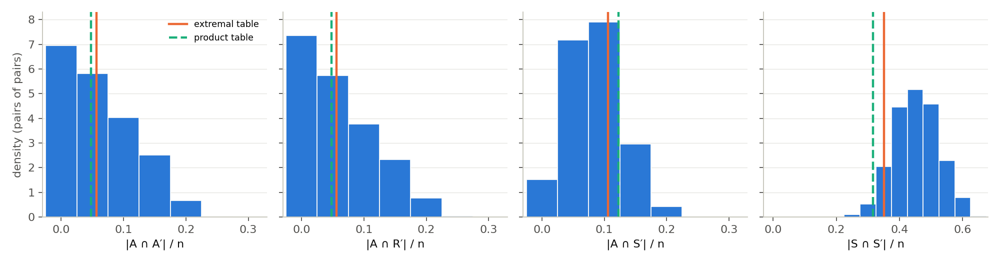
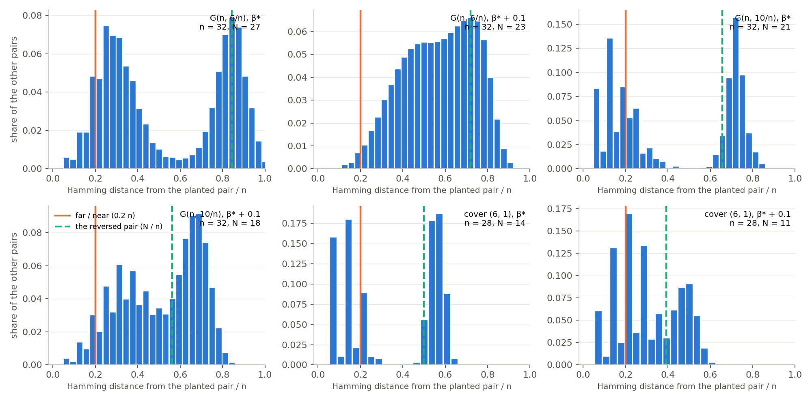

# Counting events, not witnesses: the separator first moment

*Ralph loop0011, executing `reports/separator_moment_plan.md`, started
2026-11-01. The loop asks whether the first-moment lower bound on the
pathwidth of random graphs and on the optimum of random MOSP instances
moves when the count runs over the **event** a narrow layout forces
instead of over the **witnesses** of that event. Sections are the items,
in order; each states its size range, its regenerate command, its kill
verdict and what it does not claim. §0 (the summary) is written by item
12.*

## The three events, and the notation

A layout of vertex separation `≤ k` on `n` vertices gives, at the prefix of
size `t = ⌈(n − k)/2⌉`, a prefix `A`, an inactive suffix `R` and an active
suffix `S` with no `A–R` edge (`EmptyPair.lean`,
`exists_empty_pair_of_layout`). Padding `S` to exactly `k` vertices from
`R`:

    |A| = t,   |R| = N − t,   |S| = k,   N = n − k,   A ∪ R ∪ S = V,   no A–R edge.

Three counts, three events, in this document's words:

1. **The pair count** (on record): the number `X` of ordered pairs `(A, R)`
   of the forced sizes with no `A–R` edge. `P(pw ≤ k) ≤ E[X]`
   (`FirstMoment.lean`, `weightedSum_graphsOfPathwidthLe_le`;
   `CliqueCoverMoment.lean`, `prob_coversOfMospValueLe_le`). Its constant
   is `β*(c)` on `G(n, c/n)` and `β*(d, μ)` on random clique covers.
2. **The separator count**: the number of `k`-sets `S` such that `G − S`
   has a *balanced empty bipartition*, `E_bip = {the components of G − S
   can be grouped into two sides of sizes t and N − t}`. Its relaxation is
   `E_relax = {no component of G − S has more than max(t, N − t) vertices}`,
   which `E_bip` implies and which is strictly weaker (plan §0, correction
   3). `P(pw ≤ k) ≤ C(n, k) · P_N(E_bip) ≤ C(n, k) · P_N(E_relax)`, with
   `P_N` the law of `G(N, p)`.
3. **The closed-pair count**: pairs with `S = N(A) ∩ N(R)`, the
   minimal-separator form, sides at least the forced sizes, `|S| ≤ k`.
4. **The weighted count**: `Y = Σ_P 1[P empty] / Z(P)` for any `Z ≤ X`,
   so that `Y ≥ 1[X > 0]`.

Throughout, `q(x) = 1 − e^{−cx}` is the probability that a vertex of
`G(n, c/n)` has a neighbour in a set of `xn` vertices (asymptotically);
`c′ = c(1 − β)` is the mean degree of `G − S` when `k = βn`, so that
`G − S` is `G(N, c′/N)` exactly; `H` is the entropy in nats; a "nat per
vertex" is a rate on the scale of `n` unless the scale `N` is named.
Conversion: the pair exponent's slope at `β*` is `3.3–3.4` per unit of `β`
at `c = 6–10` (3.9 at `c = 4`, 5.5 at `c = 3`; `rate_preview.log`), so a gain
of `g` nats per vertex of `n` is `g / 3.3` in `β` there.

---

## 1. Literature: who counts separators, and what the inner probability is known to be (item 01, 2026-11-01)

**Question (G of the brief).** Has anyone counted balanced *vertex*
separators (or bisections, or cuts) of sparse random graphs with an inner
probability finer than the product over edges, for pathwidth or any width
or cut parameter? What is the large-deviation rate for the giant
component's lower tail and for the cluster sizes of `G(N, c/N)`? Did a
representative or locally optimal count ever move a first-moment cut
constant, and by how much?

**Stop rule (the item's one).** *No held or fetched paper states the
separator first moment for pathwidth or vertex separation of `G(n, c/n)`
with an exact inner probability and a constant.* The nearest things are
three, and items 05–06 compare against all three rather than re-derive
them: (i) Do, Erde & Kang (2024) count separators `S` of a spanning tree's
vertex set and bound the number of balanced separations per `S` by
`2^{Δ(T)|S|}` — the separator count with a *deterministic* inner bound and
no component law, used to reach the threshold `c = 1` with a constant
`Ω(ε³/log(1/ε))`, not to sharpen a constant (§1.3, row DEK); (ii) Kolesnik
& Wormald (2014) count, in the pairing model of random `d`-regular graphs,
sets `U` *together with* their vertex boundary `sn` and edge boundary `yn`,
with the inner count exact up to `n^{O(1)}` (a coefficient extracted by a
saddle point), and say it is "best possible for a direct application of
the first moment method" — the exact inner probability for a *single*
vertex cut, no bipartition of the rest, no `G(n, c/n)` (row KW); (iii) the
inner probability of the *relaxed* event `E_relax` is known exactly at the
exponential scale, as a corollary of the large-deviation principle for the
largest component of `G(N, c′/N)` (O'Connell 1998, restated and extended by
Puhalskii 2005 and by Andreis, König & Patterson 2021), and nobody we found
has put it into a width or cut first moment (§1.4). So the brief's
one-line description — "a better estimate of the inner probability, not a
new object" — is half right: the object (count `S`, bound the bipartitions
of `G − S`) is in print once, with a crude inner bound; the inner
probability of the relaxed event is in print as a large-deviation rate,
with no width application; the inner probability of `E_bip` itself, and
the closed-pair and weighted counts for widths, we found nowhere (§1.5).

**Size range.** Not applicable (reading). The one computation is a check
of a quoted formula (§1.4, `rate_check.py`) and a preview for item 06
computed from that quotation alone (`rate_preview.py`), both asymptotic,
both superseded by items 05–06.

**Regenerate.** None. The text extracts in
`reports/scratch/separator_moment/lit/*.txt` are `pdftotext -layout` of the
PDFs in `literature/` named in §1.1; the check and the preview:

    nice -n 19 python3 -I reports/scratch/separator_moment/rate_check.py   > reports/scratch/separator_moment/rate_check.log
    nice -n 19 python3 -I reports/scratch/separator_moment/rate_preview.py > reports/scratch/separator_moment/rate_preview.log

### 1.1 What was read, what was fetched, what was not obtained

Held before this item and read in full (the `literature/` file names are
the item's): Díaz–Diner–Serna–Serra 2022 (arXiv 2211.03206; published as
*J. Comput. System Sci.* 2024, DOI 10.1016/j.jcss.2024.103550, "On minimum
vertex bisection of random d-regular graphs", Crossref), Lichev–Mitsche
2023 (*Electron. J. Combin.*, DOI 10.37236/11085; 26,000 words, read in
full for §§1–3 and the first-moment sections §§4–5, the upper-bound §6
skimmed), Coja-Oghlan–Cooley–Kang–Skubch 2017 (*Theory Comput.*, DOI
10.4086/toc.2017.v013a008), Perarnau–Serra 2014 (*Discrete Appl. Math.*,
DOI 10.1016/j.dam.2012.10.031), Lee–Lee–Oum 2012 (*J. Graph Theory*, DOI
10.1002/jgt.20620), Do–Erde–Kang 2024 (*J. Graph Theory*, DOI
10.1002/jgt.23081), Bezrukov–Elsässer–Monien–Preis–Tillich 2004 (*Theoret.
Comput. Sci.*, DOI 10.1016/j.tcs.2004.03.059), Feige–Hajiaghayi–Lee 2008
(*SIAM J. Comput.*, DOI 10.1137/05064299X; introduction and definitions,
for the vocabulary), Behrisch 2007 (*Electron. J. Combin.*, DOI
10.37236/935), Lagerås–Lindholm 2008 (*Electron. J. Combin.*, DOI
10.37236/885), Díaz–Petit–Serna–Trevisan 2001 (*Discrete Math.*, DOI
10.1016/S0012-365X(00)00278-8), Kolesnik–Wormald 2014 (*SIAM J. Discrete
Math.*, DOI 10.1137/120891265; **arXiv 1311.6555**, not 1109.0689 as the
item says — that number is a paper on online payment systems), Gao 2012
(*Discrete Appl. Math.*, DOI 10.1016/j.dam.2011.10.013; §§1–3), the
two-page previews of Gao 2006 (COCOON, DOI 10.1007/11809678_25) and of
Kloks 1994 (LNCS 842, DOI 10.1007/BFb0045375 — **the held preview is
chapter 12, on cocomparability graphs of bounded dimension, and contains
nothing about random graphs**; his first moment is cited here only as
restated by Do–Erde–Kang p. 1, Gao 2006 p. 226, Gao 2012 §3 and
Perarnau–Serra p. 4 and 9), and `reports/scratch/first_moment/lit/turner1986.txt`
(Turner 1986, *SIAM J. Comput.* 15, read by the checker of
`reports/random_graph_first_moment.md` §4; its Lemmas 2.1–2.2 re-read here).

Fetched into `literature/` this item (open copies; nothing executed from
a download; text extracted with `pdftotext`):

| file | what it is | DOI of the published version (Crossref) |
|---|---|---|
| `2017-Dembo-Montanari-Sen-Extremal-Cuts-Sparse-Random-Graphs-AOP-arXiv.pdf` | arXiv 1503.03923v2 | *Ann. Probab.* 45(2), 10.1214/15-AOP1084 |
| `2021-Andreis-Konig-Patterson-LDP-All-Cluster-Sizes-Sparse-Erdos-Renyi-Graph-RSA-preprint.pdf` | the authors' revision of 19 August 2020, from W. König's WIAS page | *Random Structures Algorithms* 59(4) 522–553, 10.1002/rsa.21007 |
| `2005-Puhalskii-Stochastic-Processes-Random-Graphs-AOP-arXiv.pdf` | arXiv math/0402183v1 (59 pp.) | *Ann. Probab.* 33(1) 337–412, 10.1214/009117904000000784 — **the item's venue "Stochastic Processes and their Applications" is wrong** |
| `2003-Diaz-Serna-Wormald-Computation-Bisection-Width-Random-d-Regular-Graphs-ALCOMFT-TR-03-44.pdf` | the ALCOM-FT technical report (Aarhus mirror, PostScript converted), the preprint of the 2007 paper; its analysis is explicitly "not rigorous" and sketches how to make it so | *Theoret. Comput. Sci.* 382(2) 120–130 (2007), 10.1016/j.tcs.2007.03.003 — the journal version is **not held** (Elsevier, blocked) |
| `2012-Lampis-Local-Improvement-Gives-Better-Expanders-arXiv.pdf` | arXiv 1211.0524v1; not in the brief, fetched because Kolesnik–Wormald cite it as the locally-optimal count that improves Bollobás, which is what the brief attributes to Díaz–Serna–Wormald (§1.6) | no journal version found in Crossref |

Not obtained, recorded in `literature/MISSING.md`: **O'Connell 1998**
(*Probab. Theory Related Fields* 110, 277–285, DOI 10.1007/s004400050149;
Springer paywall — Semantic Scholar lists a "bronze" PDF at the publisher
that the publisher does not serve without a login; cited here only through
Puhalskii's and Andreis–König–Patterson's restatements), **Luczak &
McDiarmid 2001** (*Random Structures Algorithms* 18(1) 31–38, DOI
10.1002/1098-2418(200101)18:1<31::AID-RSA3>3.0.CO;2-1; Wiley paywall; the
LSE repository record 17554 says "full text not available"; cited through
Lichev–Mitsche p. 2, Coja-Oghlan et al. p. 4, Dembo–Montanari–Sen p. 1 and
Do–Erde–Kang §1.3), **Bollobás 1988** (*European J. Combin.* 9(3) 241–244,
DOI 10.1016/S0195-6698(88)80014-3; Elsevier, blocked; its content is
restated in detail by Kolesnik–Wormald §§1, 2, 7 and Lampis §§1, 3, which
re-derive its bound), **Díaz–Serna–Wormald 2007** (journal version; the
2003 report is held), and **the random-graph chapter of Kloks 1994**.

### 1.2 Table A — who counts what

"Inner probability" is the probability, for one fixed object, that it is
what is counted; "count" is what the union bound runs over. Page numbers
are of the held file.

| source | parameter; random model | object counted | count | inner probability | constant obtained | where |
|---|---|---|---|---|---|---|
| Turner 1986 | bandwidth; `G(n, p)`, `p` fixed | empty pair `(V₁, V₂)`, `|V₁| = |V₂| = k` (Lemma 2.1: `bw ≤ n − 2k` forces one) | `(en/k)^{2k}` | product over edges, `(1 − p)^{k²}` exact | `bw > n − 4 log_b n` a.s. (Thm 2.1); nothing at `p = c/n` | lines 109–142 of the extract |
| Díaz–Petit–Serna–Trevisan 2001 | vertex separation, vertex bisection; `G(n, c_n/n)` | pairs `(A, B)`, `|A|, |B| ≥ εn`, with `e(A, B)` far from its mean ("mixing", Def. 2) | `3^n` | two-sided Chernoff on `e(A, B)` (Lemma 2, pp. 249–250) | `MINVS ≥ (½ − ε)n − 1` for `c ≥ 3(1 + ln 3)(εγ)^{-2}` (Lemma 3 (g5), p. 252); vacuous below `c ≈ 227` as stated | pp. 248–252 |
| Kloks 1994 (as restated) | treewidth; `G(n, d/n)` | balanced `k`-partition `(A, S, B)`, `|S| = k + 1`, `⅓ ≤ |A|, |B| ≤ ⅔` of the rest | over triples | product over edges `(1 − p)^{|A||B|}` (as restated) | linear tw for `d ≥ 2.36` (`m/n > 1.18`), `r(d) → 1` | DEK p. 1; Gao 2006 p. 226; PS p. 4, 9; chapter not held |
| Gao 2006 (preview) | treewidth; `G(n, m)` | "a new combinatorial construct to make better use of the first moment" and a model with replacement | — | — | `m/n > 1.081` (`c > 2.162`) | p. 227; the construct is not in the two held pages |
| Gao 2012 | treewidth; `G(n, m)` with replacement | **`d`-rigid** balanced partitions: no connected set of `≤ d` vertices of the larger side `B` is a component of `G[B]` (Def. 3.2; Lemma 3.1: tw `≤ l` forces a balanced partition that is rigid or nearly equal-sided) | over triples, split into `J₁` (near-equal) and `J₂` (rigid) | product over edges `φ₁(t) = (1 − 2t + 2t² + 2tβ)^{cn}` **times** `P(d-rigid | partition) ≤ e^{−r(1 + g)n/c}` by Hoeffding–Azuma on a weighted count of small tree components of `G[B]` (Thm 4, §3.1) | `m/n ≥ 1.073` (`c ≥ 2.146`); the plain count "more refined" gives 1.083 | pp. 3, 7–8, 13–15 |
| Gao 2012, Thm 2 | treewidth; random intersection graph `G_I(n, m, p)` | balanced partitions | over triples | product over the `m` items, `[(1−p)^{|A|} + (1−p)^{|B|} − (1−p)^{|A|+|B|}]^m` (his (4.22)), the clique-cover count; a factor dropped in the next line (`REPORT_generator.md` §3.2) | linear tw for `p ≥ 2/m` | §4 |
| Perarnau–Serra 2014 | treewidth; `G(n, c/n)` | balanced `k`-partitions (Kloks's Lemma 2.1) | `3^n` | product over edges, `(1 − p)^{|A||B|} ≤ (1 − p)^{2f²n²/9}` | `tw ≥ (1 − f(c))n` for `f > √(9 ln 3/(2c))`, `c > 4.94` (pp. 5–6); and, by a different argument, linear tw for every `c > 1` with `(αδ)²/(9e³c²)` (§4.3) | pp. 4–6, 9–11 |
| Lee–Lee–Oum 2012 | rank-width, hence treewidth; `G(n, c/n)`, `c > 1` | **not a first moment**: the `α`-edge-expander `H` of linear order `δn` inside the giant (Benjamini–Kozma–Wormald, Thm 4.1), a balanced partition of `H` (Lemma 2.1), `rank ≥ (#ones)/M²` (Lemma 4.3) | — | — | `rw ≥ αδ n/(6M²)`, constants implicit | §4, pp. 6–9 |
| **Do–Erde–Kang 2024** | treewidth, rank-width; `p = (1 + ε)/n` | **separators `S` of `G[V(T)]`** for a spanning tree `T` of a linear-size tree component, with the balanced separations per `S` bounded deterministically: "any subset `S ⊆ V(T)` splits `T` into at most `Δ(T)|S|` components, and hence there are at most `2^{Δ(T)|S|}` separations whose separator is `S`" (§1.3, p. 4; §3) — the technique of Luczak–McDiarmid 2001 | over `S` | a fixed partition of `V(T)` is a balanced separation with exponentially small probability, by sprinkling | `tw = Ω(ε³n/log(1/ε))` (Thm 1.5), `rw = Ω(ε³n/log³(1/ε))` (Thm 1.4); every `c > 1`; `tw, rw = Θ(ε³n)` in the weakly supercritical window (Thm 1.6, by a 3-regular kernel) | pp. 3–4, §3 |
| **this repository** | pathwidth; `G(n, c/n)` | empty pairs at exact sizes `t`, `t − 1` | trinomial `C(n, t)C(n − t, t − 1)` | product over edges `(1 − p)^{t(t−1)}` exact | `β*(c)`: 0.0087, 0.061, 0.171, 0.263, 0.337 at `c = 3, 4, 6, 8, 10`; threshold `4 ln 2`; Lean | `random_graph_first_moment.md`; `FirstMoment.lean`, `FirstMomentAsymptotics.lean` |
| this repository | MOSP; random clique covers of given sizes | empty pairs | trinomial | product over patterns of `avoidCount(s)/C(n, s)` exact | `β*(d, μ)`; threshold excess 1 | `CliqueCoverMoment.lean`; `clique_cover_moment/` |
| Bollobás 1988 (as restated by KW §§1, 2, 7 and Lampis §3) | edge isoperimetric number `i_E(d)`; random `d`-regular, pairing model | sets `U`, `|U| = un`, with `|∂_E U| = yn` | `C(n, un)` | **configuration-model exact**: `C(dun, yn)C(dn − dun, yn)(yn)! M(dun − yn)M(dn − dun − yn)/M(dn)` (KW (23), "essentially contained in [5]") | `i_E(d) ≥ d/2 − √(d ln 2)` for large `d`; `i_E(3) > 2/11`, `i_E(4) > 11/25`, `i_E(5) > 18/25` | KW pp. 3–4, 18–19 |
| **Kolesnik–Wormald 2014** | vertex isoperimetric number `i_V(d)` and, at `u = ½`, vertex bisection; random `d`-regular, pairing model | sets `U`, `|U| = un`, **with** `|∂_V U| = sn` and `|∂_E U| = yn` | `C(n, un)C(n − un, sn)` | **configuration-model exact up to `n^{O(1)}`**: the number `C_{n,s,y}` of ways to pick `yn` points in `sn` groups of `d` with each group hit, estimated by `x^{−yn}((x+1)^d − 1)^{sn}` at the saddle point `x₀` of (7), which "leads to just as good final results as using the precise formula" ((5)–(8), pp. 7–8); the union bound over `O(n²)` values of `(s, y)` | Thm 1: `i_V(d) ≥ A_d(½) = 2s_d`, `s_d` the least positive root of `(2^d − 1)s = 2^{d/2+s−1}(1 − 2s)^{½−s}s^s`; `A_d(½) = 0.144, 0.290, 0.409, 0.502, 0.575, 0.632, 0.677, 0.714` at `d = 3, …, 10` (Table 2); Cor. 2: `i_V(d) ≥ 1 − 2/d + O(log d/d²)`; "best possible for a direct application of the first moment method" (after Lemma 6, p. 10) | pp. 7–17 |
| Lampis 2012 | edge expansion of random `Δ`-regular | **locally optimal** sets (swapping one vertex across cannot lower the expansion, so every vertex has at most `Δ/2` neighbours across) with their out-degree profiles `(s, s′)` | `C(n, u)` times the profiles | configuration-model exact per profile (§3, `P(s, s′)`), maximised over profiles (Lemma 2: the maximiser is binomial) | improved `i_E(Δ)` for `Δ ≥ 4`, Table 1 (§1.4 here); Thm 2: Bollobás's `√(ln 2)` is not the right coefficient | pp. 3–8 |
| Lichev–Mitsche 2023 | bisection width of random 3-regular; configuration model | minimum bisections with a structural characterisation (2-cores, forbidden winning sets, two types), then **graphs** containing such a bisection, divided by an overcounting factor (Lemma 5.6; "we may divide by the corresponding overcounting factor", p. 4) | over skeletons and labellings | configuration-model exact | `0.103295n ≤ bw ≤ 0.139822n` (Thm 1.1); type-one bisections `≤ 0.1069n` excluded by the plain structural count (§4), the overcount division is what the binding type-two case needs (§5) | pp. 1–4, 24–38 |
| Díaz–Serna–Wormald 2003/2007; Díaz–Diner–Serna–Serra 2022/2024 | bisection width; vertex bisection width; random `d`-regular | **not first moments**: priority-greedy and ball-growing algorithms analysed by the differential-equation method | — | — | upper bounds; bisection `b/n = 0.5028, 0.6674, 0.8502, 1.0386, 1.2317, 1.4278` at `d = 5, …, 10` (DSW Table 1); vertex bisection `α` (fraction of the red half with a neighbour across) `0.581, 0.610, 0.657, 0.656, 0.720, 0.881, 0.838` by the DEM and `0.466, 0.559, 0.626, 0.679, 0.721, 0.754, 0.778` experimentally at `d = 4, …, 10`, against KW's `0.290, 0.409, 0.502, 0.575, 0.632, 0.677, 0.714` (DDSS Table 2, p. 16) | DSW pp. 7–9; DDSS pp. 15–17 |
| Coja-Oghlan–Cooley–Kang–Skubch 2017 | bisection width; planted bisection `G(n, p₊, p₋)`, `d₊ − d₋ ≥ c√(d₊ ln d₊)` | **not a first moment**: `n^{−1} bis(G) → φ(p*)`, the skewed fixed point of Warning Propagation on a two-type Galton–Watson tree (Thm 1.1) | — | — | the exact constant, as a fixed point | pp. 3–5 |
| Dembo–Montanari–Sen 2017 | min/max bisection, max-cut; `G(n, [γn])` and `γ`-regular, `γ → ∞` | **not a first moment**: interpolation to the Sherrington–Kirkpatrick model | — | — | `mcut/n = γ/2 − P*√(γ/2) + o_γ(√γ)` (Thm 1.2; `γ/4 − P*√(γ/4)` regular, Thm 1.5), `P* = 0.76321 ± 0.00003` by Parisi's formula | pp. 1–4 |
| Bezrukov et al. 2004 | bisection width; deterministic (level structure of a bisection, Laplacian `λ₂`) | — | — | — | `bw ≥ 0.082n` for 3-regular and `0.176n` for 4-regular Ramanujan graphs; no random-graph statement (it misquotes Kostochka–Melnikov's `i_E(3) ≥ 1/4.95` as a bisection width `0.202n`, p. 158; Lichev–Mitsche give the bisection form `0.10101n`) | pp. 156–158 |
| Feige–Hajiaghayi–Lee 2008 | vocabulary only | a vertex separator is a triple `(A, B, S)`, balanced if `|A|, |B| ≤ 2|V|/3`; its sparsity `π(S)/(min(π(A), π(B)) + π(S))` | — | — | `O(√log n)` approximation; treewidth `O(k√log k)` | pp. 1–3 |

Two counts that *are* over separators, for the record: Do–Erde–Kang's,
above, and the deterministic reduction every treewidth count rests on —
Robertson & Seymour's `tw ≥ sep_{½}(G) − 1`, where a `(k, ½)`-separator is
a `k`-set `S` with **every component of `G − S` of size at most half of
`|V ∖ S|`** (DEK Lemma 2.1, with Lemma 2.2 turning it into a `⅓–⅔`
balanced partition). That is exactly this loop's relaxed event `E_relax`,
in the treewidth literature since 1986 as the thing a separator must
satisfy; what is counted there is still the partition.

### 1.3 Table B — the rates

| statement | rate function, hypotheses | where | the corollary this loop needs |
|---|---|---|---|
| **The largest component of `G(n, c_n/n)`, `c_n → c > 0`, satisfies an LDP at scale `n`** on `[0, 1]`: `P(β^n/n ≈ u) = e^{−n I_c^β(u)(1+o(1))}`, with `I_c^β` a good rate function. In the form O'Connell gives it (Puhalskii's remark after Cor. 2.5): `I_c^β(u) = k K_c(u) + L_c(ku)` for `u ∈ [x_k, x_{k−1}]`, `x₀ = 1`, `x_k` the root of `x/(1 − e^{−cx}) = 1 − kx`, `K_ρ(u) = u log(ρu/(1 − e^{−ρu})) − ρu²/2`, `L_c(u) = (1 − u) log(1 − u) + (c − log c)u − cu²/2` (his (2.13)–(2.14)); `I_c^β(0) = L_c((1 − 1/c)⁺)`. Not convex. The most probable configuration with largest component `nu`: one giant if `u ≥ 1 − 1/c`, otherwise `⌊(1 − 1/c)/u⌋` components of size `≈ nu` plus one more. | Puhalskii 2005, Cor. 2.4(3) (p. 8 of the arXiv version), attributed to O'Connell 1998 Thm 3.1 "which has a misprint"; Thm 2.1 is the joint LDP for the number of components, all giant sizes and their excess edges; Cor. 2.2 the LDP for the sequence of giant sizes `U^n/n` in `S₁` with `I_c^U(u) = Σ K_c(u_i) + L_c(1 − (1/c) ∨ Σ u_i)` | **Yes, with the exact statement**: `[0, ½]` is closed, so `lim sup (1/N) log P(largest component of G(N, c′/N) ≤ N/2) ≤ −inf_{u ≤ ½} I_{c′}^β(u)`. Checked numerically on the quoted formula (`rate_check.log`): `I` vanishes at the law-of-large-numbers point `u* = 1 − ρ` to `10⁻¹⁶` at every `c` tried, and `inf_{u ≤ ½} I = I(½) > 0` **iff `c′ > 2 ln 2`** (`u* = ½` exactly at `c′ = 2 ln 2 = 1.3863`). Values of `I_{c′}^β(½)`: `0.036, 0.144, 0.183, 0.380, 0.595, 0.832, 1.316, 1.810` at `c′ = 2, 2.772, 3, 4, 4.98, 6, 8, 10`. So **the relaxed separator count has threshold `2 ln 2`**, as the plan predicted conditionally on this result — now a cited one, not a conjecture, up to the LDP being asymptotic |
| **All cluster sizes**: the pair (microscopic empirical measure `Mi^{(N)}`, macroscopic point measure `Ma^{(N)}`) of `G(N, t_N/N)`, `t_N → t`, satisfies an LDP at speed `N` with rate `I(Λ, α; t) = I_Mi(Λ; t) + I_Ma(α; t) + (1 − c_Λ − c_α)(t/2 − log t)`, `I_Mi(Λ; t) = Σ_k λ_k log(k! t λ_k/(e k^{k−2})) + c_Λ(1 + t/2 − log t)`, `I_Ma(α; t) = ∫ [x log(x/(1 − e^{−tx})) + (t/2)x(1 − x)] α(dx)` (Thm 1.1); contractions: the microscopic part (Cor. 1.2; always optimal to put the rest in one giant), the macroscopic part (Cor. 1.3), the mesoscopic total mass `J_Me(c; t) = (1 − c) log((1 − c)t) − (1 − c)t/2 + t/2 − log t` (Cor. 1.4), the total-mass phase transition with `J_Mi(c; t)` explicit and `J_Ma(c; t) = J_Mi(1 − c; t)` (Thm 1.5) | Andreis–König–Patterson 2021, §1.2–1.3 (pp. 4–8 of the preprint); §1.4 says O'Connell's two LDPs are contractions of theirs and that Puhalskii covers the macroscopic part by a different route, "it would require some work to analytically check that it is identical to ours" | The event `E_bip` is a variational problem over `(Λ, α)` under the constraint that the atoms of `α` plus the microscopic mass can be grouped into sides of sizes `t` and `N − t`; with microscopic components of sizes 1 and 2 at positive density under the tilt (the minimiser's `Λ*` is Borel, (1.13)) the exact-size grouping should cost nothing at the exponential scale once no atom exceeds `½` — **a plausible reading, not a theorem, and item 06's job**. If it holds, the rate of `E_bip` equals that of `E_relax` |
| Random intersection graphs: with `m = βn` auxiliary vertices and incidence probability `γ/n` (`α = 1`), mean degree `μ = βγ²`; `μ > 1` gives a unique giant of size `(1 − ρ + o_p(1))n`, `ρ` the least root of `ρ = g(ρ)`, `g(s) = exp(βγ(e^{γ(s−1)} − 1))` (compound Poisson offspring), second largest `O(log n)` (Thm 2); with `m = n^α`, `α ≠ 1`, `c = p²mn`: giant `(1 − ρ)n` for `α > 1`, `(1 − ρ)√(cmn)` for `α < 1`, `ρ = e^{c(ρ−1)}` (Behrisch Thm 1) | Lagerås–Lindholm 2008 pp. 2–3; Behrisch 2007 pp. 2–3 | **Laws of large numbers only; no LDP for the giant of a random intersection graph or of a random clique cover was found.** Item 07 has the giant's typical size (the onset line) from these, and must derive or compute the lower tail itself |
| Bisection width of `G(n, c/n)` is `0` whp for `c < ln 4` and `Ω(n)` for `c > ln 4`: the giant exceeds `n/2` iff `c > 2 ln 2` | Luczak–McDiarmid 2001 (not held), as restated by Lichev–Mitsche p. 2, Coja-Oghlan et al. p. 4, Dembo–Montanari–Sen p. 1 | the same threshold as the relaxed separator count's, for the same reason; their technique (a spanning tree bounds the cuts per separator) is the one Do–Erde–Kang reuse |

### 1.4 Table C — representative and locally optimal counts, and what they bought

| source | what is merged / restricted | parameter, model | constant before → after | in the units of the gap to the truth or to the best upper bound |
|---|---|---|---|---|
| Gao 2012 | `d`-rigid balanced partitions: partitions from which no small component of the larger side can be moved (Def. 3.2, Lemma 3.1); the rigidity probability by Hoeffding–Azuma on a weighted tree-component count (Thm 4) | treewidth threshold, `G(n, m)` | `m/n`: 1.18 (Kloks) → 1.083 (the same count, refined analysis) → **1.073**; in `c = 2m/n`: 2.166 → 2.146 | the truth is `c = 1` (Lee–Lee–Oum): the rigidity restriction moved the threshold by 0.020 of a gap of 1.166, **1.7%** |
| Lampis 2012 | locally optimal sets: every vertex has at most `Δ/2` neighbours across, so the out-degree profiles are truncated (§4) | edge expansion `i_E(Δ)`, random `Δ`-regular | Bollobás → Lampis (Table 1): `Δ = 4`: 0.440 → 0.444; 5: 0.730 → 0.7475; 6: 1.041 → 1.056; 7: 1.372 → 1.4035; 8: 1.716 → 1.740; 9: 2.0655 → 2.1105; 10: 2.430 → 2.465; 20: 6.320 → 6.4; 30: 10.47 → 10.59; 40: 14.74 → 14.9 — "modest (of the order of 10⁻² for Δ ≤ 10 and 10⁻¹ for somewhat larger Δ)" and growing with `Δ` (p. 8); Thm 2: the asymptotic coefficient of `√Δ` is strictly below Bollobás's `√(ln 2) = 0.833`, not computed | against the best upper bounds `i_E ≤ 2b(G)` from DDSW 2003 / DSW 2007 (`2/3, 1.0056, 1.3348, 1.7004` at `Δ = 4, 5, 6, 7`, KW p. 5): **1.8%, 6.3%, 5.1%, 9.6%** of the gap; asymptotically the truth is `Δ/2 − P*√Δ` with `P* = 0.7632` (Dembo–Montanari–Sen) against Bollobás's 0.833, and how much of that 0.07 Lampis's `α < 2 ln 2` recovers is not stated |
| Lichev–Mitsche 2023 | structure of a minimum bisection (2-cores, no winning sets, two types) and, for the binding type, counting *graphs* rather than bisections by dividing by the number of bisections of the same size one auxiliary graph yields (Lemma 5.6) | bisection width of random 3-regular | plain first moment (Bollobás) `n/11 = 0.0909n` → Kostochka–Melnikov `0.10101n` (edge weighting, not a first moment) → **`0.103295n`**; the type-one structural count alone reaches `0.1069n` on its own case, the type-two case with the division is what sets the constant | against their upper bound `0.139822n`: **25%** of the gap over the plain first moment, **6%** over Kostochka–Melnikov; the truth is unknown (the Zdeborová–Boettcher conjecture would put it at the max-cut complement, which "our paper does not shed light on", p. 2) |
| Do–Erde–Kang 2024 | separators `S` of a spanning tree's vertex set, `≤ 2^{Δ(T)|S|}` balanced separations each | treewidth threshold, `G(n, c/n)` | 2.146 (Gao) → **every `c > 1`**, i.e. the whole of the threshold gap, with the constant `Ω(ε³/log(1/ε))` | the only count in this table that reached the true threshold; it buys the threshold and not a constant |
| Kolesnik–Wormald 2014 | nothing merged: the direct first moment with the exact inner count; they note it is best possible for a direct application (p. 10) | vertex isoperimetric number, random `d`-regular | — | the gap it leaves at `d = 4`: lower 0.290 against upper 0.466 (experimental) / 0.581 (DEM); DDSS p. 17: "the union bound involved in the computation is likely to weaken the strength of the lower bounds, which we believe have room for improvement" |
| Gao 2006 | "a new combinatorial construct" | treewidth threshold | 2.36 → 2.162 | the construct is not in the held two pages; not read |

Summary of the column that matters: where a representative or restricted
count was applied to a first-moment cut constant, it moved the constant by
**1.7% of the gap** (rigidity, treewidth threshold), **2–10%** (local
optimality, edge expansion at `Δ = 4–7`, growing with `Δ`), and **6–25%**
(a full structural characterisation plus an overcount division, cubic
bisection, against a loosely known truth). The one count that closed a gap
entirely — Do–Erde–Kang's separator count — closed a *threshold*, by a
deterministic bound on the bipartitions per separator, and gave up the
constant to do it.

### 1.5 The brief's question, in the brief's terms

*"The new idea is a better estimate of the inner probability, not a new
object" — is that so, or does someone already have the exact inner
probability for a cut-type first moment?* Both halves need qualifying.
The **object** — sum over separators `S`, with the bipartitions of
`G − S` counted inside — is in Do, Erde & Kang (2024), following Luczak &
McDiarmid, with the inner count bounded by `2^{Δ(T)|S|}` and the inner
probability by sprinkling; it is not new, and it is in print as a device
for thresholds. The **exact inner probability** for a cut-type first
moment is in Kolesnik & Wormald (2014) for a single vertex cut in the
configuration model (the set, its vertex boundary and its edge boundary
counted exactly up to polynomial factors), and in Bollobás (1988) for
edge cuts; neither is a probability about the *rest* of the graph, and
neither is on `G(n, c/n)`. The inner probability of this loop's *relaxed*
event, `P(G(N, c′/N) has no component above N/2)`, is known exactly at the
exponential scale as a corollary of the LDP for the largest component
(O'Connell 1998; Puhalskii 2005 Cor. 2.4(3); Andreis–König–Patterson 2021
Cor. 1.3), and we found no width or cut first moment that uses it. The
inner probability of the bipartition event `E_bip`, the closed-pair count
and the weighted count, for pathwidth or any width, we found no statement
of. So: the object is known with a crude inner bound; the relaxed inner
rate is known in a different literature; their combination, and the finer
events, are what the loop computes. "We found no prior statement" is the
wording, and it is the strongest allowed.

### 1.6 What items 05–08 take from this

1. **Compare, do not re-derive, the relaxed count's rate.** Item 05's
   `O(N²)` DP for `E_relax` to `N = 400` has an exact asymptotic answer to
   check against: `I_{c′}^β(½)` from the quoted formula, zero iff
   `c′ ≤ 2 ln 2`. If the DP's fitted rate disagrees with the LDP's by more
   than the finite-size correction the DP itself shows, one of the two is
   wrong, and the quoted formula carries a known misprint risk
   (Puhalskii says O'Connell's Theorem 3.1 has one; the form used here is
   Puhalskii's restatement, checked only by its zero at the
   law-of-large-numbers point, `rate_check.log`).
2. **The planner's two routes were both the wrong route** (plan §0,
   correction 3). At `c = 6`, `c′ = 4.98`, the plan bracketed the rate of
   `E_relax` by the fixed-bipartition route `c′/4 = 1.245` and the global
   thinning route `1.19`; the LDP says the rate is **0.595**, half of
   either, and above the pair count's own `c′/4 − ln 2 = 0.552` as it must
   be. The cheapest way for `G(N, 4.98/N)` to have no component above
   `N/2` is neither a planted bipartition nor uniform thinning but the
   large-deviation tilt the rate function describes (Puhalskii: for
   `u < 1 − 1/c` the most probable configuration has several giants of
   size `≈ nu`). Items 05–06 should not fit a rate to those two routes.
3. **A preview of `β_relax(c)`, from the quotation alone, to be replaced
   by item 06** (`rate_preview.log`; the relaxed separator count
   `P(pw ≤ βn) ≤ C(n, βn) e^{−(1−β) I_{c(1−β)}^β(½) n + o(n)}`, root of
   `H(β) − (1 − β) I_{c(1−β)}^β(½)`): `β_relax = 0.0056, 0.0185, 0.0279,
   0.0368, 0.0827, 0.1328, 0.1817, 0.2690, 0.3409, 0.3998, 0.5542` at
   `c = 2, 2.5, 2.772, 3, 4, 5, 6, 8, 10, 12, 20`, against
   `β* = 0, 0, 0, 0.0087, 0.0613, 0.1175, 0.1706, 0.2628, 0.3371, 0.3973,
   0.5535`: gains of **+0.028 at `c = 3`, +0.021 at 4, +0.011 at 6, +0.004
   at 10, +0.0007 at 20**, and a positive constant for every `c > 2 ln 2`.
   This is an asymptotic statement resting on a cited LDP's upper bound
   and on the relaxed event; it is below the brief's kill of 0.02 at
   `c = 6` and `10` and above it at `c ≤ 4`; it sits inside the planner's
   bracket `[0.009, 0.056]` at `c = 3` and at the top of the planner's
   `+0.004–0.010` at `c = 6–10`. `E_bip` can only be rarer than `E_relax`,
   so `β_sep ≥ β_relax` if the LDP is used as an upper bound on the inner
   probability; whether it is strictly larger is item 06's question.
4. **For covers (item 07) there is no LDP to quote.** Behrisch and
   Lagerås–Lindholm give the giant's typical size for Bernoulli-incidence
   random intersection graphs (the onset line, in their coordinates); the
   lower tail of the giant of a random clique cover with fixed pattern
   sizes has to be computed (the isolated-customer generating function the
   plan proposes) or derived from the AKP machinery, which is for `G(N,p)`.
5. **What representative counts have bought elsewhere** is 2–25% of a
   gap (§1.4). The brief's kill of `0.02` in `β` is, at `c = 6`, 0.02 of a
   gap of `0.268 − 0.171 = 0.097` to the fitted slope, i.e. 21%; at
   `c = 10`, 26% of `0.078`. By the literature's track record that is at
   the top of what a representative count has ever delivered, and item 09
   (the weighted count) should know it is aiming above the record.
6. **The exact inner count of Kolesnik–Wormald is the model for item 07's
   inclusion–exclusion**: the vertex boundary and the edge boundary of the
   counted set enter the first moment as separate variables with an exact
   count per profile, and the union bound runs over `O(n²)` profiles at no
   exponential cost. The closed-pair count (`S = N(A) ∩ N(R)`) is a
   vertex-boundary condition of the same kind on `G(n, c/n)`.

### 1.7 Where the record corrects the item

- Kolesnik & Wormald's arXiv number is **1311.6555** (the held file says
  so); the item's 1109.0689 is a different paper. The item's Puhalskii
  venue is wrong (*Ann. Probab.*, not *Stochastic Processes and their
  Applications*).
- "**Díaz–Serna–Wormald's locally optimal bisections**" do not exist: the
  2003/2007 paper is a priority-greedy *upper* bound by the
  differential-equation method, with no first moment and no local
  optimality. The locally optimal count the item has in mind is
  **Lampis 2012**, cited by Kolesnik–Wormald as the improvement on
  Bollobás "by investigating subsets which are, in a certain sense,
  locally optimal" (p. 5); fetched and tabulated above.
- The held **Kloks 1994 preview is chapter 12** (cocomparability graphs)
  and contains no random-graph statement; the item's instruction "do not
  assert his inner probability from memory" is followed, and the chapter
  is now on the missing list by name.
- Díaz–Diner–Serna–Serra 2022 is published (JCSS 2024, DOI above); cite
  the journal version.
- Bezrukov et al. 2004 is deterministic and spectral; it belongs in no
  column of Table A but the vocabulary one, and its one random-graph
  sentence misquotes Kostochka–Melnikov by a factor of two (§1.2).

### 1.8 Kill verdict, and what this does not claim

**Kill verdict: none** (the item has no kill criterion); the stop rule
did not fire (no prior separator first moment with an exact inner
probability for pathwidth or vertex separation of `G(n, c/n)`), so items
05–06 derive, and compare against the three nearest results named at the
top of this section.

Nothing here is a theorem of ours, and no number here is a result of the
loop:

- The threshold `2 ln 2` for the relaxed separator count, and the values
  of `β_relax(c)`, rest on a quoted rate function that has a documented
  misprint history, checked only by its zero at the typical point and
  by its sign; they are asymptotic (an LDP upper bound for a closed set),
  not finite-`n` inequalities, and they concern `E_relax`, not `E_bip`.
  Item 06 owns them.
- That the rate of `E_bip` equals that of `E_relax` is a reading of the
  AKP minimiser, not a proof.
- Priority is claimed for nothing. The strongest statement made is that
  (a) and (b) of the item were done and the combination was not found.
- Bollobás 1988, O'Connell 1998, Luczak–McDiarmid 2001 and the journal
  Díaz–Serna–Wormald 2007 were not read; every statement attributed to
  them is from the restatements named beside it.
- Lichev–Mitsche's §6 (the upper bound) and the middle of their §§3–5
  were skimmed, not read line by line; the numbers quoted are from their
  Theorem 1.1, §1.2 and the ends of §§4–5.
- The fractions of a gap in §1.4 use the best *upper bounds* where the
  truth is unknown (edge expansion at small `Δ`, cubic bisection), so they
  are lower bounds on the fraction of the true gap.

---

## 2. The deterministic lemmas: balanced separator, its relaxation, the closed pair (item 02, 2026-11-01)

**Question (A of the brief).** Exactly which structures does
`pw(G) ≤ k < n` force, in a form a first moment can count once per
separator? Three, each one line from `exists_empty_pair_of_layout`
(`EmptyPair.lean`), and each checked by brute force before being called a
lemma: on every graph on 1–9 vertices from `nauty-geng` (288,266 graphs),
on 20,000 random `G(n, p)` graphs at `n = 10, 11, 12` and on 2,000 random
clique covers at 4–10 customers (§2.4). **Zero counterexamples.** The
kill criterion (a counterexample to L1, L1′ or L2) is **not met**.

Notation, for the whole section: `G` is a graph on the vertex set `V`,
`|V| = n`; `N[X] = X ∪ N(X)` is the closed neighbourhood and
`N(X) = N[X] ∖ X` the *outer* boundary of `X`; a pair `(A, R)` of disjoint
sets is **empty** when no edge joins `A` to `R`, equivalently
`R ∩ N[A] = ∅`; `k` is an integer with `pw(G) ≤ k < n`,
`N = n − k`, `t = ⌈N/2⌉`, so that `t ≥ N − t ≥ 0` and `t ≥ 1`. Nothing in
this section is probabilistic.

### 2.1 L1 — the balanced separator at exact sizes

**Lemma L1.** If `pw(G) ≤ k < n`, there are pairwise disjoint `A, R, S`
with `A ∪ R ∪ S = V`, `|A| = t`, `|R| = N − t`, `|S| = k` and no `A–R`
edge.

*Proof.* (Layout step) By `vertexSeparation_eq_pathwidth` there is a
layout `σ` with `vs(σ) = pw(G) ≤ k`. (Prefix step) Apply
`exists_empty_pair_of_layout` at position `i = t − 1`, which is `< n`
because `t ≤ N ≤ n`: the prefix `A` of size `t` and the inactive suffix
`R₀` are disjoint, no edge joins them, and
`n ≤ |A| + |R₀| + vs(σ) ≤ t + |R₀| + k`, i.e. `|R₀| ≥ N − t`
(`card_inactiveSuffix`). (Shrink step) Take `R ⊆ R₀` with `|R| = N − t`;
the edge condition is universally quantified over `R₀`, so it holds on
`R`, and `R ⊆ R₀` is disjoint from `A`. (Complement step)
`S = V ∖ (A ∪ R)` has `n − t − (N − t) = k` vertices and is disjoint from
both. ∎

*Remarks.* (i) The sizes are exact: `|R| = N − t = ⌊N/2⌋`, which is the
item's `n − t − k`. The Lean corollary `exists_empty_pair` rounds it to
`|R| ≥ t − 1`, which coincides with `N − t` for `N` odd and is one less
for `N` even; the count on record (`FirstMoment.lean`,
`card_emptyPairIndices`) uses `|R| = t − 1`, and plan §0 correction 2 is
about this rounding. L1 is the sharper form and is what §2.4 checks.
(ii) `S` is the active suffix at position `t − 1` padded to exactly `k`
vertices with vertices of `R₀`; which vertices are moved is immaterial,
and the lemma says nothing about `S` beyond its size — that is what L2
adds.

### 2.2 L1′ — the separator events `E_bip` and `E_relax`

For a `k`-set `S ⊆ V` write `G − S` for the subgraph induced on
`V ∖ S` (which has `N` vertices) and define two events:

    E_bip(S):   the components of G − S can be grouped into two classes
                whose vertex counts are t and N − t;
    E_relax(S): no component of G − S has more than t vertices.

**Lemma L1′.** (a) If `pw(G) ≤ k < n`, some `k`-set `S` satisfies
`E_bip(S)`. (b) For every `k`-set `S`, `E_bip(S)` implies `E_relax(S)`.
(c) For every `k`-set `S`, `E_bip(S)` holds iff `G` has an exact-size
empty pair `(A, R)` (`|A| = t`, `|R| = N − t`, no `A–R` edge) with
`V ∖ (A ∪ R) = S`. Hence *"some `k`-set is in `E_bip`"* and *"an
exact-size empty pair exists"* are the same event; the two counts `X₂`
(separators) and `X₁` (pairs) count it differently. (d) The inclusion in
(b) is strict: on the graph `3K₂` (six vertices, edges `03, 14, 25`) with
`k = 0`, `S = ∅` satisfies `E_relax` (components of sizes `2, 2, 2 ≤ t = 3`)
and not `E_bip` (no sub-family of `{2, 2, 2}` sums to `3`). This is the
first graph on six vertices in `nauty-geng` order with a `k`-set in
`E_relax ∖ E_bip` (`check.log`, first line); its pathwidth is `1`, so at
`k = pw` the two events agree on it.

*Proof.* (a) Take `A, R, S` from L1. (Connectivity step) A component `C`
of `G − S` is connected and lies in `A ∪ R`; if it met both `A` and `R`,
some edge of `C` — a path inside `C` from a vertex of `A` to a vertex of
`R` has a first `A–R` edge — would join `A` to `R`, contradicting
emptiness. So `C ⊆ A` or `C ⊆ R`. (Grouping step) The components inside
`A` partition `A` and sum to `t`; those inside `R` sum to `N − t`.
(b) Each component lies in a class of size `t` or `N − t ≤ t`.
(c, ⇒) Let `A` be the union of the class of size `t` and `R` the union
of the other; they partition `V ∖ S`, have the right sizes, and an edge
of `G − S` joins two vertices of one component, hence of one class, so
no edge joins `A` to `R` (an `A–R` edge of `G` would have both ends
outside `S`, so it would be an edge of `G − S`). (c, ⇐) is (a)'s
argument applied to the given pair. (d) is checked directly. ∎

*Remark.* `E_relax` is the Lean-cheap and LDP-shaped form (plan §0,
correction 3; §1.6): it is a statement about component sizes only, and
`P_N(E_relax)` on `G(N, p)` is the lower tail of the largest component.
`E_bip` is the event the pair count actually witnesses, and items 05–06
compute `P_N(E_bip)` from the full component-size partition, not from
the largest component alone. On the graphs checked the two differ at
`k = pw` on `0.3%` of graphs at 7 vertices and `2.2%` at 9 (§2.4,
column "`E_relax ⊋ E_bip`"), so at these sizes the relaxation is nearly
free; nothing here says what it costs at the scale of the rate.

### 2.3 L2 — the closed pair, by the alternating closure

**Lemma L2.** Let `(A, R)` be an empty pair with `|A| ≥ t`,
`|R| ≥ N − t` and `|V ∖ (A ∪ R)| ≤ k`. Put

    R* = V ∖ N[A],      A* = V ∖ N[R*],      S* = V ∖ (A* ∪ R*).

Then: (i) `A ⊆ A*` and `R ⊆ R*` (monotone); (ii) `(A*, R*)` is an empty
pair; (iii) `R* = V ∖ N[A*]` and `A* = V ∖ N[R*]` (a **closed pair**), so
the alternating closure `R₁ = V ∖ N[A]`, `A₁ = V ∖ N[R₁]`, `R₂ = V ∖ N[A₁]`,
`A₂ = V ∖ N[R₂]`, … is constant from `(A₁, R₁) = (A*, R*)` on — it stops
after **one round**, not after an unbounded iteration; (iv)
`S* = N(A*) ∩ N(R*)`; (v) `|A*| ≥ t`, `|R*| ≥ N − t`, `|S*| ≤ k`.
Conversely, every closed pair `(A, R)` (one with `A = V ∖ N[R]` and
`R = V ∖ N[A]`) is empty with `V ∖ (A ∪ R) = N(A) ∩ N(R)`, and is
determined by either side.

*Proof.* (Galois step) For any `X, Y ⊆ V`: `Y ⊆ V ∖ N[X]` iff `Y ∩ X = ∅`
and no edge joins `X` to `Y`, iff `X ⊆ V ∖ N[Y]`, by the symmetry of
adjacency; and `X ⊆ X′` implies `N[X] ⊆ N[X′]` (monotone step).
(i) `(A, R)` is empty, so `R ⊆ V ∖ N[A] = R*` by the Galois step.
`R* ∩ N[A] = ∅` by definition, so `(A, R*)` is empty and the Galois step
gives `A ⊆ V ∖ N[R*] = A*`. (ii) `A* ∩ N[R*] = ∅` by definition.
(iii) From (ii) and the Galois step, `R* ⊆ V ∖ N[A*]`; from `A ⊆ A*` and
the monotone step, `V ∖ N[A*] ⊆ V ∖ N[A] = R*`. So `R* = V ∖ N[A*]`, and
`A* = V ∖ N[R*]` is the definition. Hence `R₂ = V ∖ N[A₁] = R₁` and
`A₂ = V ∖ N[R₂] = A₁`, and by induction every later term equals these.
(iv) `v ∈ S*` iff `v ∉ A*` and `v ∉ R*`; `v ∉ A* = V ∖ N[R*]` means
`v ∈ N[R*]`, which with `v ∉ R*` is `v ∈ N(R*)`; symmetrically
`v ∈ N(A*)`. Conversely a vertex of `N(A*) ∩ N(R*)` is outside `A*` and
outside `R*` by the definition of the outer boundary. (v) From (i),
`|A*| ≥ |A| ≥ t` and `|R*| ≥ |R| ≥ N − t`; then
`|S*| = n − |A*| − |R*| ≤ n − t − (N − t) = k`. The converse is (ii)–(iv)
read with `A* = A`, `R* = R`; "determined by either side" is
`R = V ∖ N[A]`. ∎

*Remarks.* (i) **The fixpoint is a representative, not the
representative.** Closing `R` first gives `(V ∖ N[R], V ∖ N[V ∖ N[R]])`,
which can differ from `(A*, R*)`: on the graphs checked the two maps
disagree on `7–10%` of exact-size pairs at 7–9 vertices (§2.4, column
"closures differ"). A union bound over closed pairs needs only *a*
map from exact-size pairs to closed pairs of the forced sizes, and L2
gives one (`A` first; the mirror is another); it does not need the map
to be canonical, and this document never says it is. (ii) The item
expected an iteration `A ⊆ A₁ ⊆ A₂ ⊆ …`; (iii) says the chain is
`A ⊆ A₁ = A₂ = …`, `R ⊆ R₁ = R₂ = …`. Monotonicity holds as asserted
(with equality from the second step), which is what the check verifies
at every step — the item's expectation is corrected, not contradicted.
(iii) Because every closed pair is determined by `A`, the closed pairs
of the forced sizes (`X₃` below) are enumerated exactly by running over
all `A ⊆ V`, setting `R = V ∖ N[A]` and testing `A = V ∖ N[R]` and the
sizes; no pair is reached twice. (iv) The image of the exact-size pairs
under the `A`-first closure (`X₃′`) can be a proper subset of `X₃`: a
closed pair of the forced sizes contains exact-size sub-pairs, but
closing a sub-pair may land on a *larger* closed pair (its `V ∖ N[A′]`
contains `V ∖ N[A]`). Both counts are valid first moments; item 03
measures both.

### 2.4 The check, before any of the above was called a lemma

`reports/scratch/separator_moment/02_lemmas/check.py` (log beside it),
on the functions of `learning/separator_moment.py` (tested in
`tests/test_separator_moment.py`, which also re-enumerates every
labelled graph to 6 vertices and pins the subset DP to
`learning.first_moment.vertex_separation_brute` and
`fixed_parameter_algorithm.pathwidth.compute_pathwidth`). For each graph,
`k = pw(G)` by the subset DP; then

* **L1**: `X₁ > 0`, where `X₁` is the number of ordered exact-size empty
  pairs (`|A| = t`, `|R| = N − t`; for `N` even `(A, R)` and `(R, A)` are
  both counted);
* **L1′**: `X₂ > 0`, `X₂ ≤ X₂′`, and `X₁ > 0 ⟺ X₂ > 0`, where `X₂`, `X₂′`
  are the numbers of `k`-sets `S` in `E_bip` and `E_relax`, computed from
  the components of `G − S` and a subset-sum over their sizes;
* **L2**: from every exact-size pair (all of them when `X₁ ≤ 200`, the
  first 200 otherwise), the closure sequence is monotone at every step,
  the second round repeats the first, the fixpoint is closed, empty, of
  the forced sizes, with `S* = N(A*) ∩ N(R*)`, and lies in `X₃` (all
  closed pairs of the forced sizes, by the enumeration of remark (iii));
  the share of pairs whose `A`-first and `R`-first fixpoints differ;
* **L3** (covers only): a pair is empty iff no pattern meets both sides
  (on every exact-size pair and on 20 random disjoint pairs per
  instance), and every customer of `S*` shares a pattern with `A*` and
  with `R*`;
* at `k = pw − 1`: whether an exact-size pair (equivalently a `k`-set in
  `E_bip`) and whether a `k`-set in `E_relax` still exist — the necessary
  condition's slack at these sizes.

**Results** (`check.log`, `summary.csv`; 2026-11-01, 4 workers at nice 19, 113 s wall; the
rows for 1–3 vertices — 7 graphs, zero violations — are omitted). Medians and
maxima are over the graphs of the row at `k = pw`; `X₃′` is computed only on
graphs with `X₁ ≤ 200`, so its maximum at `n ≥ 10` is over that subset;
"`E_relax ⊋ E_bip`" is the share of graphs with `X₂′ > X₂`; "closures differ"
is the share of closed pairs whose `A`-first and `R`-first fixpoints differ,
over the pairs closed; the last two columns are the shares of graphs with
`pw ≥ 1` on which the structure still exists at `k = pw − 1`.

| graphs | count | viol. | `X₁` med / max | `X₂` med / max | `X₂′` med / max | `X₃` med / max | `X₃′` med / max | `E_relax ⊋ E_bip` | pairs closed | closures differ | L1 at `pw − 1` | `E_relax` at `pw − 1` |
|---|---|---|---|---|---|---|---|---|---|---|---|---|
| geng n=4 | 11 | 0 | 4 / 8 | 2 / 4 | 2 / 4 | 2 / 6 | 2 / 6 | 0.0% | 48 | 4.2% | 40.0% | 40.0% |
| geng n=5 | 34 | 0 | 6 / 18 | 3 / 9 | 3 / 9 | 3 / 10 | 3 / 10 | 0.0% | 218 | 8.7% | 42.4% | 42.4% |
| geng n=6 | 156 | 0 | 6.5 / 36 | 4 / 16 | 4 / 16 | 4 / 20 | 4 / 20 | 0.0% | 1,318 | 10.1% | 43.9% | 44.5% |
| geng n=7 | 1,044 | 0 | 8 / 84 | 4 / 25 | 4 / 25 | 4 / 35 | 4 / 35 | 0.3% | 10,530 | 9.9% | 45.6% | 46.1% |
| geng n=8 | 12,346 | 0 | 8 / 200 | 5 / 52 | 5 / 52 | 5 / 70 | 5 / 70 | 1.0% | 137,152 | 8.4% | 43.1% | 43.6% |
| geng n=9 | 274,668 | 0 | 9 / 450 | 6 / 105 | 6 / 105 | 6 / 126 | 6 / 126 | 2.2% | 3,243,462 | 6.7% | 38.5% | 39.0% |
| random n=10 | 6,667 | 0 | 13 / 1050 | 7 / 92 | 7 / 92 | 8 / 252 | 8 / 127 | 4.4% | 187,528 | 14.4% | 44.1% | 44.6% |
| random n=11 | 6,667 | 0 | 14 / 2310 | 8 / 145 | 8 / 145 | 9 / 420 | 8 / 122 | 5.9% | 209,294 | 11.6% | 43.2% | 43.7% |
| random n=12 | 6,666 | 0 | 16 / 3192 | 9 / 161 | 9 / 161 | 10 / 582 | 10 / 141 | 7.9% | 224,689 | 9.9% | 42.8% | 43.2% |
| covers n<=10 | 2,000 | 0 | 5 / 74 | 4 / 30 | 4 / 30 | 2 / 30 | 2 / 30 | 2.2% | 13,042 | 3.1% | 27.0% | 27.2% |

**Total: 310,266 graphs, 4,027,298 closures checked, zero violations of any
kind** (the script's fourteen violation flags all stayed at zero; `grep -c
VIOLATION check.log` is `0`). Read across: `X₁ ≥ X₂` always (several pairs per
separator), `X₂ = X₂′` in every maximum and median at these sizes (the
relaxation adds separators on 0.3–8% of graphs, growing with `n` and with
the random graphs' density), `X₃′ < X₃` on 2.8% of graphs at 7 vertices, 1.8% at 8
and 0.9% of the random graphs at 10–12 where computed (closed pairs that
the closure of no exact-size pair reaches, remark (iv) of §2.3;
`x3_vs_x3prime.log`), and the covers behave like sparse graphs (fewer closed pairs than
separators, the closure orders rarely differing).

### 2.5 L3 — the MOSP forms

Let the instance have customers `C` (`|C| = n`) and patterns
`S_1, …, S_m ⊆ C`; its MOSP graph `mospGraph` (`MOSPGraph.lean`;
`coverGraph` in `CliqueCoverMoment.lean`) joins two distinct customers
iff some pattern contains both, and `mospValue = pw(mospGraph) + 1`
(`MOSPGraph.lean`, both directions). With `k = mospValue − 1 < n`:

**Lemma L3.** (a) For disjoint `A, R ⊆ C`, `(A, R)` is an empty pair of
`mospGraph` iff no pattern meets both `A` and `R`
(`isEmptyPair_coverGraph_iff`). (b) L1, L1′ and L2 hold for `mospGraph`
with `S` a set of `k` customers; in particular every instance with
`mospValue ≤ k + 1` has `k` customers whose removal leaves customer
classes of sizes `t` and `N − t` such that no pattern meets both classes.
(c) In a closed pair `(A*, R*)` of `mospGraph`, a customer `c` lies in
`S* = N(A*) ∩ N(R*)` iff `c ∉ A* ∪ R*`, some pattern contains `c` and a
customer of `A*`, and some pattern contains `c` and a customer of `R*`.

*Proof.* (a) is the cited lemma. (b) is L1, L1′, L2 applied to the graph
`mospGraph`, with `k ≥ pw` given by the equality theorem. (c) `c ∈ N(X)`
for `mospGraph` means `c ∉ X` and `c` is adjacent to some `x ∈ X`, i.e.
some pattern contains both `c` and `x`; apply L2 (iv). ∎

The check of §2.4 runs L1, L1′, L2 on the MOSP graphs of 2,000 random
covers and tests (a) and (c) directly against the matrix.

### 2.6 Lean-ready statements for item 10

All over `{V : Type*} [Fintype V] [DecidableEq V] (G : SimpleGraph V)
[DecidableRel G.Adj]`, in the vocabulary of `EmptyPair.lean`
(`closedNbhd`, `IsEmptyPair` from `FirstMoment.lean`), with `n = Fintype.card V`,
`t = (n − k + 1) / 2`, `N − t = (n − k) / 2` in `ℕ` arithmetic.

| name | hypotheses | conclusion | rests on |
|---|---|---|---|
| `exists_balanced_separator` (L1) | `pathwidth G ≤ k`, `k < n` | `∃ A R S : Finset V`, pairwise disjoint, `A ∪ R ∪ S = univ`, `A.card = t`, `R.card = N − t`, `S.card = k`, `∀ u ∈ A, ∀ v ∈ R, ¬ G.Adj u v` | `vertexSeparation_eq_pathwidth`, `exists_empty_pair_of_layout` at `i = t − 1`, `Finset.exists_subset_card_eq`, `Finset.card_sdiff` |
| `IsBalancedBip G S k` (def) | — | `∃ A R, Disjoint A R ∧ A ∪ R = univ \ S ∧ A.card = t ∧ R.card = N − t ∧ IsEmptyPair G A R` — the pair form of `E_bip`, which L1′ (c) shows equivalent to the component form | — |
| `exists_isBalancedBip` (L1′ a) | `pathwidth G ≤ k`, `k < n` | `∃ S, S.card = k ∧ IsBalancedBip G S k` | `exists_balanced_separator` |
| `connectedComponent_subset_side` (connectivity step) | `IsEmptyPair G A R`, `C` a connected component of `G.induce (A ∪ R)` | `C ⊆ A ∨ C ⊆ R` | induction on `SimpleGraph.Walk` in the induced graph |
| `isBalancedBip_iff_components` (L1′ c) | `S.card = k` | `IsBalancedBip G S k ↔` the components of `G.induce (univ \ S)` admit a grouping into sizes `t`, `N − t` | the previous row; the converse by taking unions |
| `IsRelax G S k` (def) and `isRelax_of_isBalancedBip` (L1′ b) | `IsBalancedBip G S k` | every component of `G.induce (univ \ S)` has `card ≤ t` | `connectedComponent_subset_side`, `Finset.card_le_card` |
| `not_isBalancedBip_threeEdges` (L1′ d) | the graph `3K₂` on `Fin 6`, `k = 0`, `S = ∅` | `IsRelax ∧ ¬ IsBalancedBip` | `decide` |
| `subset_compl_closedNbhd_iff` (Galois step) | — | `R ⊆ univ \ closedNbhd G A ↔ Disjoint A R ∧ ∀ u ∈ A, ∀ v ∈ R, ¬ G.Adj u v` | `mem_closedNbhd_iff`, `G.adj_symm` |
| `closedNbhd_mono` | `A ⊆ A'` | `closedNbhd G A ⊆ closedNbhd G A'` | `Finset.biUnion_subset_biUnion_of_subset_left` |
| `IsClosedPair G A R` (def) | — | `A = univ \ closedNbhd G R ∧ R = univ \ closedNbhd G A` | — |
| `closure_subset` (L2 i) | `IsEmptyPair G A R` | `A ⊆ univ \ closedNbhd G (univ \ closedNbhd G A)` and `R ⊆ univ \ closedNbhd G A` | `subset_compl_closedNbhd_iff` twice |
| `closure_isClosedPair` (L2 ii–iii) | `IsEmptyPair G A R` | `IsClosedPair G (univ \ closedNbhd G (univ \ closedNbhd G A)) (univ \ closedNbhd G A)` | `closure_subset`, `closedNbhd_mono`, `subset_compl_closedNbhd_iff` |
| `sdiff_isClosedPair_eq_inter_boundary` (L2 iv) | `IsClosedPair G A R` | `univ \ (A ∪ R) = (closedNbhd G A \ A) ∩ (closedNbhd G R \ R)` | `mem_closedNbhd_iff` |
| `closure_card` (L2 v) | `IsEmptyPair G A R`, `t ≤ A.card`, `N − t ≤ R.card`, `(univ \ (A ∪ R)).card ≤ k` | the same three bounds for the closed pair | `closure_subset`, `Finset.card_le_card`, `Finset.card_sdiff` |
| `exists_closedPair_of_pathwidth_le` (L1 + L2) | `pathwidth G ≤ k`, `k < n` | `∃ A R, IsClosedPair G A R ∧ IsEmptyPair G A R ∧ t ≤ A.card ∧ N − t ≤ R.card ∧ (univ \ (A ∪ R)).card ≤ k` | the two rows above and `exists_balanced_separator` |
| `mem_boundary_coverGraph_iff` (L3 c) | `S : Fin m → Finset C` | `c ∈ closedNbhd (coverGraph S) A \ A ↔ c ∉ A ∧ ∃ j, c ∈ S j ∧ ∃ a ∈ A, a ≠ c ∧ a ∈ S j` | `coverGraph`'s adjacency, `mem_closedNbhd_iff` |
| `exists_balanced_separator_cover` (L3 b) | an instance with `mospValue ≤ k + 1`, `k < n` | `exists_balanced_separator` for `mospGraph`, with the empty pair stated as "no pattern meets both" | `MOSPGraph.lean`'s equality, `isEmptyPair_coverGraph_iff` |

Obstacle noted for item 10, not for this item: `isBalancedBip_iff_components`
needs connected components of an induced subgraph as `Finset`s with their
cardinalities, which the development has not used so far (Mathlib's
`SimpleGraph.ConnectedComponent` is a quotient type; `Fintype` instances
exist, the union-of-supports bookkeeping does not). The pair form
`IsBalancedBip` is what the probabilistic statement of item 08 needs, and
it is cheap; the component form is for the LDP comparison and can be
left as a named `Prop` with this obstacle if it does not fit.

### 2.7 Regenerate, size range, kill verdict, what this does not claim

* **Regenerate.** `nice -n 19 python3 reports/scratch/separator_moment/02_lemmas/check.py --max-n 9 --workers 8`
  (run with 4 workers on 2026-11-01 because the one-minute load was
  above 24; the log says the wall time); `python3 -m pytest tests/test_separator_moment.py`.
* **Size range.** Every graph on 1–9 vertices; 20,000 random `G(n, p)`
  graphs at `n = 10, 11, 12` with `p ∈ {0.15, 0.3, 0.45, 0.6}` (seed = job
  index); 2,000 random covers with 4–10 customers, `m ∈ {n, 2n}`, 2–4
  customers per pattern (`generate_structured_instance(n, m, cpp, seed = index)`).
  The lemmas are for every graph; the counts in the table are for these
  sizes only.
* **Kill verdict: not met.** Zero counterexamples to L1, L1′, L2 or L3 on
  310,266 graphs. The item's premise — that a narrow layout forces a
  balanced separator, a balanced empty bipartition and a closed pair at the
  forced sizes — stands; the three structures exist on every graph checked
  at `k = pw`, and at `k = pw − 1` they exist on 39–46% of graphs at
  7–9 vertices (27% of the covers), so at these sizes the *necessary* condition is far from
  sufficient — the slack the loop is about is already visible on nine
  vertices, and it is the condition's, not only the union bound's.
* **Does not claim.** Anything probabilistic: no rate, no constant, no
  statement about `P_N(E_bip)`. That the closed pair is canonical (the
  `A`-first and `R`-first fixpoints differ on 3–14% of the pairs
  checked). That `E_relax` is a cheap relaxation at scale (it differs from
  `E_bip` on 2.2% of graphs at 9 vertices and 8% of the random graphs at
  12; the rate question is item 05's). That the share of graphs with a structure at `k = pw − 1` says
  anything beyond nine vertices. The Lean rows of §2.6 are statements,
  not proofs; item 10 proves them or names the obstacle.

---

## 3. The clumping decomposed: pairs, separators, closed pairs and move-classes on instances with exact pathwidth (item 03, 2026-11-01)

**Question (B of the brief).** On a graph of pathwidth `k`, how many
exact-size empty pairs are there (`X₁`), how many distinct separators
among them (`X₂`), how many closed pairs of the forced sizes (`X₃`; and
`X₃′`, the image of the exact-size pairs under the `A`-first closure of
L2), and how many move-classes (`X₄`)? How fast do the ratios `X₁/X₂`,
`X₁/X₃`, `X₁/X₄` grow with `n`, in nats per vertex, against the `0.066`
that a `0.02` gain in `β` needs at `c = 10` (the pair exponent's slope at
`β*` is `3.3` per unit of `β` there; `3.4, 3.9` at `c = 6, 4`;
`rate_preview.log`)? Each ratio is what one representative count merges:
`X₂` merges every pair with the same separator (the component flips of
plan §0, and the reversal), `X₃` merges every pair with the same closure,
`X₄` merges every pair reachable by single swaps.

**The events counted, exactly.** `X₁` is the number of ordered pairs
`(A, R)` with `|A| = t`, `|R| = N − t`, no `A–R` edge (the count of
`FirstMoment.lean`). `X₂` is the number of distinct `S = V ∖ (A ∪ R)` over
those pairs, which by L1′ (c) is the number of `k`-sets in `E_bip`. `X₃` is
the number of ordered closed pairs with `|A| ≥ t`, `|R| ≥ N − t`,
`|S| ≤ k` (§2.3; enumerated by the pruned search of
`closed_pairs_pruned`, which agrees with the `2ⁿ` enumeration of
`closed_pairs` on all 2,200 rows at `n ≤ 16`, `k = pw`). `X₄` is the
number of connected components of the graph on exact-size pairs in which
two pairs are adjacent when their labellings `V → {A, R, S}` differ on at
most two vertices; at exact sizes a single vertex cannot change class, so
an edge is exactly one swap of two vertices between two classes
(`A ↔ S`, `R ↔ S` or `A ↔ R`). When `N` is even, `(R, A)` is an exact-size
pair whenever `(A, R)` is, with the same `S`: the reversal is in `X₁` and
not in `X₂`, and the parity split below separates it from everything else.

### 3.1 Instances

| source | cells | per cell | instances | exact value from |
|---|---|---|---|---|
| fresh `G(n, c/n)` | `n ∈ {14, 16, 18, 20, 22, 24}` × `c ∈ {4, 6, 8, 10}` | 200 | 4,800 | the C program `pathwidth_solver/cli/pathwidth -l -t 60` (every graph proved, `refutation` or `bound`; the layout kept in `instances.csv`); at `n ≤ 16` the subset DP `vertex_separation` agrees on all 1,600 |
| pilot `G(20, c/20)` | `c ∈ {4, 6, 8, 10}` | 137 | 548 | on record (`gnp_pilot/results.csv`); the overlap check at one size |
| certified covers, fixed generator | `n ∈ {10, 15, 20, 25}` × `d ∈ {4, 6}`, `m = n` | 150 | 1,200 | on record (`learning/data/ensemble/results.csv`, `pw = optimum − 1`); regenerated from seed; the DP agrees at `n ≤ 16` |

Seeds of the fresh graphs: `crc32("sep03:{n}:{c}:{i}")`, `i < 200`;
generator `networkx.gnp_random_graph(n, c/n, seed)` as in the pilot.
Nothing on record was re-solved. The counts are taken at
`k = pw − 1, pw, pw + 1, pw + 2` on every instance (caps on the
enumeration were never reached: no row is marked skipped). The whole run
is **7 s** for the solves and **66 s** for the counts on 8 workers at nice 19
(516 s of enumeration in total, about 0.15 core-hours against the 3
budgeted; the one-minute load was below 2).

### 3.2 The counts at `k = pw`

Geometric means over the cell (every instance has `X₁ > 0` at `k = pw`, as
L1 says). `X₁/X₂` and the others are geometric means of the per-instance
ratios. (`cells.csv`; the medians and maxima are there too.)

**Fresh `G(n, c/n)`:**

| `c` | `n` | mean `pw/n` | `X₁` | `X₁/X₂` | `X₁/X₃` | `X₁/X₃′` | `X₁/X₄` | max `X₁/X₂` | max `X₁/X₃` | max `X₁/X₄` |
|---|---|---|---|---|---|---|---|---|---|---|
| 4 | 14 | 0.310 | 18.8 | 1.82 | 1.55 | 1.55 | 2.15 | 8.4 | 7.4 | 200 |
| 4 | 16 | 0.291 | 27.8 | 1.94 | 1.59 | 1.59 | 2.29 | 5.6 | 9.9 | 120 |
| 4 | 18 | 0.280 | 32.1 | 1.81 | 1.54 | 1.54 | 2.02 | 6.3 | 10.2 | 44.5 |
| 4 | 20 | 0.269 | 54.1 | 2.05 | 1.64 | 1.64 | 2.53 | 6.7 | 11.9 | 97.5 |
| 4 | 22 | 0.266 | 61.2 | 2.04 | 1.57 | 1.57 | 2.27 | 11.5 | 15.5 | 41.7 |
| 4 | 24 | 0.259 | 62.4 | 1.99 | 1.48 | 1.48 | 2.03 | 6.4 | 5.4 | 37.3 |
| 6 | 14 | 0.449 | 12.5 | 1.63 | 1.39 | 1.39 | 1.57 | 7.3 | 7.6 | 18.4 |
| 6 | 24 | 0.370 | 33.1 | 1.63 | 1.41 | 1.41 | 1.62 | 4.5 | 9.5 | 19.0 |
| 8 | 14 | 0.562 | 9.4 | 1.58 | 1.37 | 1.37 | 1.48 | 4.0 | 6.1 | 15.3 |
| 8 | 24 | 0.468 | 26.0 | 1.58 | 1.40 | 1.40 | 1.52 | 4.0 | 17.0 | 34.0 |
| 10 | 14 | 0.654 | 8.0 | 1.38 | 1.39 | 1.39 | 1.44 | 3.0 | 4.7 | 6.6 |
| 10 | 16 | 0.621 | 9.5 | 1.62 | 1.29 | 1.29 | 1.36 | 3.7 | 4.5 | 10.0 |
| 10 | 18 | 0.594 | 12.4 | 1.41 | 1.35 | 1.35 | 1.42 | 2.8 | 5.0 | 9.0 |
| 10 | 20 | 0.573 | 14.7 | 1.44 | 1.32 | 1.32 | 1.37 | 2.5 | 5.2 | 6.7 |
| 10 | 22 | 0.556 | 17.4 | 1.53 | 1.33 | 1.33 | 1.39 | 2.9 | 5.6 | 9.8 |
| 10 | 24 | 0.545 | 19.6 | 1.43 | 1.31 | 1.31 | 1.39 | 2.4 | 7.0 | 10.3 |
| pilot 10 | 20 | 0.571 | 13.7 | 1.50 | 1.30 | 1.30 | 1.36 | 2.6 | 4.9 | 7.5 |
| pilot 4 | 20 | 0.272 | 44.4 | 1.90 | 1.58 | 1.58 | 2.21 | 5.5 | 7.5 | 82.6 |

**Certified covers (`m = n`):**

| `d` | `n` | mean `pw/n` | `X₁` | `X₁/X₂` | `X₁/X₃` | `X₁/X₄` |
|---|---|---|---|---|---|---|
| 4 | 10 | 0.612 | 5.6 | 1.64 | 1.75 | 2.07 |
| 4 | 15 | 0.540 | 12.3 | 1.44 | 1.95 | 2.22 |
| 4 | 20 | 0.496 | 16.9 | 1.49 | 1.71 | 1.88 |
| 4 | 25 | 0.468 | 28.3 | 1.47 | 2.03 | 2.26 |
| 6 | 10 | 0.846 | 4.8 | 1.43 | 3.30 | 4.71 |
| 6 | 15 | 0.764 | 6.6 | 1.45 | 2.02 | 2.32 |
| 6 | 20 | 0.729 | 11.5 | 1.40 | 1.91 | 2.03 |
| 6 | 25 | 0.695 | 11.0 | 1.44 | 1.69 | 1.80 |

What the table says, at these sizes:

- **A typical instance at its own pathwidth has few witnesses.** `X₁` is
  8–62 (geometric mean) on `G(n, c/n)` at `n = 14–24`, 5–28 on the covers,
  falling with density and rising with `n` at `0.09–0.13` nats per vertex
  (fitted, §3.3). The pilot's `n = 20` cells agree with the fresh ones
  (`pw` means within 0.1, `X₁` and the ratios within 10–20%).
- **One separator carries, at the median, one pair — and its reverse.**
  `X₁/X₂` is 1.4–2.0 on the graphs and 1.4–1.6 on the covers, and the
  parity split shows what it is (`checks.log`): when `N` is odd (no
  reversal) the ratio is **1.08, 1.14, 1.23, 1.57** at `c = 10, 8, 6, 4`
  and **1.03–1.09** on the covers; when `N` is even it is **2.04, 2.05,
  2.14, 2.43** and `2.0–2.04`. So beyond the reversal a separator merges
  a factor of `1.03–1.6` of pairs, more on sparse graphs; `X₂ = X₁` outright
  on 13–14% of the graphs and 29% of the covers. The maximum over 200
  instances is 2.4–11.5.
- **The closure merges a factor 1.3–1.6 on the graphs, 1.7–3.3 on the
  covers**, and **`X₃′ = X₃` on every fresh and pilot graph at `k = pw`**
  (99.8% of the covers): at the pathwidth, every closed pair of the forced
  sizes is the closure of some exact-size pair, so the two counts of §2.3
  remark (iv) are one count here. They separate at `pw + 2` (`X₃′ < X₃`
  on 27–40% of instances), where the closed pairs that no exact-size
  pair reaches appear.
- **The move-classes merge a factor 1.4–2.5 on the graphs**, `X₄ = X₁` on
  39% of the graphs (every pair alone in its class), and the maximum over
  a cell is 7–200: the clusters a typical instance carries at `k = pw`
  are small, and the large ones are rare instances.

### 3.3 The rates

OLS slope of the per-instance `log` against `n` at fixed `c` (fresh graphs,
`n = 14–24`, 1,200 instances per `c`) and against `n` on the covers
(`n = 10–25`, 600 per `d`), with its standard error; nats per vertex of
`n`. (`slopes.csv`.)

| source | `c` or `d` | `k` | slope `log X₁` | slope `log X₁/X₂` | slope `log X₁/X₃` | slope `log X₁/X₃′` | slope `log X₁/X₄` |
|---|---|---|---|---|---|---|---|
| fresh | 4 | `pw` | 0.127 ± 0.011 | 0.010 ± 0.003 | −0.003 ± 0.004 | −0.003 ± 0.004 | −0.001 ± 0.007 |
| fresh | 6 | `pw` | 0.100 ± 0.010 | 0.004 ± 0.003 | 0.002 ± 0.004 | 0.002 ± 0.004 | 0.003 ± 0.005 |
| fresh | 8 | `pw` | 0.100 ± 0.009 | 0.002 ± 0.003 | 0.002 ± 0.003 | 0.002 ± 0.003 | 0.003 ± 0.004 |
| **fresh** | **10** | **`pw`** | 0.092 ± 0.008 | **0.000 ± 0.003** | **−0.003 ± 0.003** | −0.003 ± 0.003 | **−0.003 ± 0.004** |
| cover | 4 | `pw` | 0.104 ± 0.007 | −0.006 ± 0.002 | 0.006 ± 0.005 | 0.006 ± 0.005 | 0.002 ± 0.006 |
| cover | 6 | `pw` | 0.060 ± 0.007 | −0.000 ± 0.003 | −0.041 ± 0.005 | −0.041 ± 0.005 | −0.061 ± 0.005 |
| fresh | 10 | `pw + 1` | 0.193 ± 0.006 | 0.001 ± 0.003 | 0.007 ± 0.002 | 0.005 ± 0.002 | −0.070 ± 0.006 |
| fresh | 10 | `pw + 2` | 0.328 ± 0.004 | 0.005 ± 0.002 | 0.060 ± 0.002 | 0.038 ± 0.002 | −0.152 ± 0.007 |
| fresh | 4 | `pw + 2` | 0.280 ± 0.007 | 0.015 ± 0.003 | 0.015 ± 0.003 | 0.014 ± 0.003 | −0.126 ± 0.010 |

At `k = pw` **no ratio grows**: every slope of `log X₁/X₂`, `log X₁/X₃`,
`log X₁/X₄` is within `0.01` of zero at every `c` and both `d`, and at
`c = 10` the two the kill names are `0.000 ± 0.003` and `−0.003 ± 0.003`
— more than twenty standard errors below `0.066`. In the conversion of the
header, the separator and the closure merge **at most `0.01` nats per
vertex, i.e. at most `0.003` in `β`** at these sizes, against the `0.02`
the brief's kill asks for. The covers at `d = 6` show the closure and
move-class ratios *falling* with `n` (the `n = 10` cell, `pw/n = 0.85`, is
nearly complete and its forced sizes are 1–2, where everything closes to
everything). At `k = pw + 2`, with 100× more pairs, the closure merges
more as `n` grows (`0.06` per vertex at `c = 10`, `0.04` for the image
`X₃′`) while the move-classes multiply *faster* than the pairs (`−0.15`):
abundant pairs fragment into many small classes rather than one fat one.
These `pw + 2` rows are at a fixed offset, not a fixed `β`, and are not
comparable across `n` as rates.

At `k = pw − 1` the share of instances with no exact-size pair at all
(the necessary condition alone refutes `pw − 1`) is 43–57% at `c = 4`,
60–68% at `c = 6`, 62–72% at `c = 8` and 65–74% at `c = 10` on the graphs,
47–87% on the covers, with no trend in `n` at these sizes; where a pair
exists the median count is 1–4 (two is a pair and its reverse).

**Beside them, the second moment on `G(n, c/n)`** (`second_moment_rate_gnp`,
the `3 × 3` overlap table of `second_moment_rate` with Bernoulli edges:
two pairs are empty together iff no edge lies in `A × R ∪ A′ × R′`, of size
`2 t r − |A ∩ A′||R ∩ R′| − |A ∩ R′||R ∩ A′|`; exact finite form checked
against the enumeration of every pair of pairs at `n = 8, 10`; the
asymptotic sup checked against a `61⁴` grid at five `(a, c)`, agreeing to
four decimals; `second_moment_gnp.csv`, `checks.log`):

| `c` | at the cells' mean `β` (`n = 14 → 24`): `g(a)` | ratio exponent `sup − 2g` | maximiser | at `β*`: ratio exponent | maximiser |
|---|---|---|---|---|---|
| 4 | 0.62 → 0.54 | 0.12 → 0.16 | symmetric (`AA′ = AR′ = RA′ = RR′`) | 0.390 | same pair (`AA′ = RR′ = 0.221`) |
| 6 | 0.61 → 0.50 | 0.08 → 0.13 | symmetric | 0.370 | same pair (`0.259`) |
| 8 | 0.61 → 0.49 | 0.04 → 0.09 | symmetric | 0.335 | reversed pair (`AR′ = RA′ = 0.252`) |
| 10 | 0.59 → 0.49 | 0.02 → 0.06 | symmetric | 0.300 | reversed pair (`0.233`) |

At `β*` the Bernoulli second moment reproduces §8.5 (a)'s picture
exactly: `E[X²]/E[X]² = e^{0.30–0.39 n}`, carried by the pair itself or
its reverse perturbed through `S` (the two are mirror images of one
cluster). At the `β` where typical instances sit (`g(a) ≈ 0.5–0.6 > 0`,
`E[X] = e^{0.5 n}`) the maximiser is the *symmetric* table — the second
pair overlaps `A` and `R` equally — and the ratio exponent is `0.02–0.16`.
So the `e^{0.23 n}` is a statement about the large-deviation regime, where
`E[X]` is carried by rare instances; this item measures the typical
regime, and the two are different questions (the kill criterion says so).

### 3.4 The overlap distribution at `n = 20`, `c = 10`

Twenty fresh graphs (`pw` mean `11.25`, `β = 0.5625`, `a = 0.219`), every
ordered pair of *distinct* exact-size empty pairs at `k = pw` (23,412 of
them), the `3 × 3` table in units of `n` (`overlap_summary.csv`,
`overlap_hist.csv`, `overlap_per_graph.csv`):

| cell | measured mean | median | p90 | extremal table at this `a` | product table |
|---|---|---|---|---|---|
| `A ∩ A′` | 0.061 | 0.05 | 0.15 | 0.056 | 0.048 |
| `A ∩ R′` | 0.059 | 0.05 | 0.15 | 0.056 | 0.048 |
| `A ∩ S′` | 0.084 | 0.10 | 0.15 | 0.106 | 0.123 |
| `S ∩ S′` | **0.453** | 0.45 | 0.55 | 0.350 | 0.316 |



*The overlap of two empty pairs on the same instance, `n = 20`, `c = 10`,
`k = pw`, over 23,412 ordered pairs of distinct pairs on 20 graphs: the
shares of `n` in `A ∩ A′`, `A ∩ R′`, `A ∩ S′` and `S ∩ S′`, with the
maximising table of the Bernoulli second moment at this `a` (solid) and
the product of the margins (dashed).*

**Is §8.5 (a)'s extremal table what instances show?** Not at `k = pw`. On
the instances, two pairs share **`0.45 n` of their separators** (`|S| =
0.56 n`, so 80% of `S`; median one vertex of `A` in `A′` and one in `R′`),
against `0.35 n` for the extremal table at this `a` and `0.32 n` for
the product: pairs on an instance are *closer* to each other through `S`
than the extremal table says, and `A′` meets `A` and `R` equally (the
symmetric picture of §3.3, not the reversed pair of the large-deviation
regime). `A ∩ S′` sits *below* both reference tables: fewer vertices of
`A` move into `S′` than independence would give, i.e. the second pair is a
small perturbation of the first that keeps most of the separator and
swaps one or two vertices — the move-class picture, with the small
classes §3.2 counts.

### 3.5 Kill verdict

**Pre-registered criterion 1: met.** At `c = 10`, `k = pw`, the slope of
`log(X₁/X₂)` is `0.000 ± 0.003` and of `log(X₁/X₃)` is `−0.003 ± 0.003`
nats per vertex, below `0.066` by more than twice the standard error (by
twenty times). **Prediction recorded: the separator count and the
closed-pair count fail item 06's kill** (`β_sep − β* < 0.02` and
`β_closed − β* < 0.02` at `c = 6` and `10`); by this instrument each
merges at most `0.01` nats per vertex, `0.003` in `β`. The prediction is at
`k = pw` on typical instances at `n ≤ 24`, not in the large-deviation
regime at `β*`, where the maximising overlap is a different table (§3.3);
**items 05–06 are kept and only item 06 decides.** Item 09, the weighted
count, is the route this item points to.

**Pre-registered criterion 2: not met.** `X₁/X₄` does not grow at
`≥ 0.15` nats per vertex (`−0.003 ± 0.004` at `c = 10`; within `0.01` of
zero everywhere at `k = pw`). The clusters on typical instances are not
fat: the move-classes merge a factor 1.4–2.5, flat in `n`. §8.5's
`e^{0.23 n}` is therefore **not the typical cluster** at these sizes — it
is the second moment's statement about the rare instances that carry
`E[X]` at `β*`, and item 04 (the planted model, which *is* that regime)
is where its cluster is measured; this item's finding is that the planted
measurement cannot be replaced by typical instances.

### 3.6 Regenerate, size range, what this does not claim

* **Regenerate.** `nice -n 19 python3 reports/scratch/separator_moment/03_clumping/run.py --workers 8`
  (stages `solve`, `count`, `rates`, `overlap`; 7 + 66 + 1 + 1 s on 8
  workers); `python3 reports/scratch/separator_moment/03_clumping/checks.py`
  (the grid check of the maximiser, the parity split, the `X₃` cross-check,
  the pilot against the fresh cells); `python3 -m pytest tests/test_separator_moment.py`
  (37 tests, 16 new: the enumeration against `exact_pairs`,
  `count_exact_pairs`, `empty_pair_count_brute` and `count_separators`;
  the pruned closed pairs against the direct enumeration and
  `X₃′ ⊆ X₃`; the down-closed family against brute force; move-classes on
  the path `P₆` and on two triangles with a pendant, against a BFS over the
  relation; the Bernoulli second moment against the enumeration of pairs
  of pairs at `n = 8, 10` and the rate against the finite form at
  `n = 30–120`; the overlap tables' margins).
* **Size range.** `n = 14–24` for the fresh graphs (`c = 4, 6, 8, 10`,
  200 per cell), `n = 20` for the pilot (137 per `c`), `n = 10–25` for the
  covers (`d = 4, 6`, `m = n`, 150 per cell); `k = pw − 1 … pw + 2`.
* **Does not claim.** Anything asymptotic: the slopes are fitted over
  six sizes at the small-size end (`n ≤ 24`, where §14 of
  `reports/ml_nature.md` found `n ≤ 40` constants failing at 125) and are
  reported with their standard errors and no extrapolation; "flat in `n`"
  means within `0.01` nats per vertex over `14–24`. Anything about the
  large-deviation regime at `β*`: the counts here are at `k = pw` on
  typical instances, and the second-moment table says the two regimes
  have different maximisers. That `β_sep` or `β_closed` will fail item
  06's kill — that is a *prediction* from this instrument, recorded as
  the kill asks, and item 06 decides it. That the overlap histogram at one
  cell (`n = 20`, `c = 10`, 20 graphs) is the picture at other `c` or
  sizes. The `pw + 2` rows are at a fixed offset from the pathwidth, not
  at a fixed `β`, and their slopes are not rates of anything.


---

## 4. The planted cluster: typical, or a rare-instance artefact of `E[X²]`? (item 04, 2026-11-01)

**Question.** Given one exact-size empty pair, how many *other* exact-size
empty pairs does the instance typically have, how far away are they, and
by what mechanism? §8.5 (a) of `reports/excess_phase_diagram.md` found
`E[X²]/E[X]² = e^{0.23 n}` at `(6, 1)`, `β*`, and §3 of this report found
that typical instances at their own pathwidth carry no such cluster. The
planted model is the large-deviation regime itself: `E[X²]/E[X]²` is the
mean of `X` under the law `P(· | P₀ empty)`, over the unconditional mean.
If the *median* of `X′ = X − 1` under that law grows at the mean's rate,
the cluster is typical and a representative that merges it gains the
whole exponent; if the median grows far slower, the second moment is
carried by rare planted instances.

**What the planted measure is, and is not.** `P(· | P₀ empty)` weights an
instance by the number of its empty pairs: an instance with `X` pairs is
drawn with probability proportional to `X`. Nothing here is a value of
`P(X > 0)` or of `P(pw ≤ k)`; the planted measure is the *right* measure
for the cluster question precisely because it is tilted by `X`. No
pathwidth is computed: the planted pair makes `X ≥ 1` by construction and
the pathwidth of a planted instance is irrelevant to the question.

**Two identities, used throughout** (both from exchangeability of the
vertex labels, which `G(n, p)` and the uniform-pattern cover model have;
both checked exactly against enumeration in `tests/test_separator_moment.py`):

1. `E[X² ] = Σ_P P(P empty) · E[X | P empty] = E[X] · E[X | P₀ empty]`, so
   **`E[X′ | P₀ empty] = E[X²]/E[X] − 1`** — the planted mean is the
   second-moment ratio times the unconditional mean, computed exactly at
   the cell's `(n, t, r)` by the `3 × 3` overlap sum (`planted_mean_gnp`,
   `planted_mean_cover`; `second_moment_exact_cover` is the general-`r`
   form of `second_moment_exact`, pinned to it at `r = t − 1`). Checked
   against a simulation of the planted law at `n = 9`
   (`test_planted_mean_is_the_mean_of_the_other_pairs_on_gnp`).
2. `Σ_P 1[P empty] / X = 1[X > 0]`, so **`P(X > 0) / E[X] = E[1/X | P₀
   empty]`** — the whole slack of the union bound at a cell is the mean of
   `1/X` under the planted law, a bounded statistic that 200 planted
   instances estimate with a standard error of `0.01–0.03`, where the mean
   of `X` itself is dominated by the tail. Checked on every labelled graph
   at `n = 6` (`test_planted_inverse_mean_is_the_union_bound_slack`).

**The events counted.** On `G(n, c/n)`: delete every `A–R` edge of a
fresh graph for a fixed `A` (`|A| = t`) and `R` (`|R| = r = N − t`), which
is exactly the conditional law. On covers at `(6, 1)`: `m = n` patterns,
each a uniform 6-set conditioned to meet at most one side (rejection
sampling; acceptance 0.28–0.43), which is exactly the conditional law
of the i.i.d.-pattern model of `CliqueCoverMoment.lean` (not the
ensemble's `fixed` generator, which repairs empty rows). `X` is the number
of ordered exact-size empty pairs (item 03's enumerator); `X′ = X − 1`;
for every other pair its `3 × 3` overlap table with `P₀` (`overlap_table`),
its Hamming distance `d = n − |A ∩ A′| − |R ∩ R′| − |S ∩ S′|` from `P₀`,
and the same distance from the *reversed* planted pair `(R, A)`, which is
itself an exact-size empty pair whenever `N` is even (`has_reverse`) and
sits at distance `N`; "far" means `d > 0.2 n`. `X₂`, `X₃`, `X₃′`, `X₄` and
the move-class of `P₀` as in §3.

### 4.1 Instances

| model | cells | per cell | instances | `k` |
|---|---|---|---|---|
| planted `G(n, c/n)` | `n ∈ {16, 20, 24, 28, 32}` × `c ∈ {6, 10}` × `β ∈ {β*(c), β*(c) + 0.1}` | 200 | 4,000 | `round(β n)`; `β*(6) = 0.1706`, `β*(10) = 0.3371` (`beta_star_gnp`, the root of `H(a, a, 1 − 2a) − c a²`) |
| planted covers `(6, 1)` | `n ∈ {16, 20, 24, 28}` × `β ∈ {β*, β* + 0.1}` | 200 | 1,600 | `β*(6, 1) = 0.5132` (`beta_star`) |

Seeds `crc32("sep04:{source}:{n}:{c}:{β label}:{i}")`; the planted sides are
the first `t` and the next `r` vertices. The realised `β = k/n` is in the
table below (rounding moves it by up to `0.03`); every prediction uses the
realised `(n, t, r)`. The whole run is **305 s on 8 workers at nice 19**
(0.6 core-hours against 3 budgeted); 7 instances of the 5,600 are censored
(more than 2 million pairs, `G(32, 6/32)` at `β* + 0.1`) and enter the
medians as "above the cap", the means without them (which biases those two
means down), and `E[1/X]` as zero.

### 4.2 The table: median against mean against prediction

Per cell; `gm` is the geometric mean over `X′ > 0`; `E[X′ | planted]` is
identity 1 at the realised sizes; the last column is the asymptotic
exponent `sup − g(a)` of `second_moment_rate_gnp` / `second_moment_rate`
at `a = (1 − β)/2`, for reference only. (`cells.csv`.)

| model | `β` | `n` | `k` | `N`, `t`, `r` | `X′ = 0` | median `X′` | p90 | max | gm (`X′ > 0`) | mean ± se | `E[X′ ∣ planted]` | top 10% share of `ΣX′` | `log med / n` | `log mean / n` | `log E / n` | asymptotic `sup − g` |
|---|---|---|---|---|---|---|---|---|---|---|---|---|---|---|---|---|
| `G(n, 6/n)` | `β*` | 16 | 3 | 13, 7, 6 | 30% | 2 | 29.1 | 486 | 5.72 | 12.37 ± 2.79 | 16.49 | 0.64 | 0.043 | 0.157 | 0.175 | 0.396 |
| `G(n, 6/n)` | `β*` | 20 | 3 | 17, 9, 8 | 18% | 3 | 62.1 | 1493 | 8.99 | 42.32 ± 10.84 | 29.7 | 0.79 | 0.055 | 0.187 | 0.170 | 0.338 |
| `G(n, 6/n)` | `β*` | 24 | 4 | 20, 10, 10 | 0% | 19 | 316.2 | 3173 | 15.96 | 126.69 ± 24.48 | 168 | 0.75 | 0.123 | 0.202 | 0.213 | 0.364 |
| `G(n, 6/n)` | `β*` | 28 | 5 | 23, 12, 11 | 4% | 39 | 988.9 | 17712 | 54.93 | 639.75 ± 152.57 | 928.54 | 0.84 | 0.131 | 0.231 | 0.244 | 0.382 |
| `G(n, 6/n)` | `β*` | 32 | 5 | 27, 14, 13 | 7% | 64 | 737.4 | 120314 | 70.02 | 1478.51 ± 655.35 | 1538 | 0.94 | 0.130 | 0.228 | 0.229 | 0.348 |
| `G(n, 6/n)` | `β* + 0.1` | 16 | 4 | 12, 6, 6 | 0% | 13 | 87 | 3813 | 10.26 | 64.35 ± 20.48 | 50.5 | 0.76 | 0.160 | 0.260 | 0.245 | 0.490 |
| `G(n, 6/n)` | `β* + 0.1` | 20 | 5 | 15, 8, 7 | 3% | 35 | 371.9 | 6800 | 38.86 | 179.81 ± 39.34 | 291.83 | 0.67 | 0.178 | 0.260 | 0.284 | 0.490 |
| `G(n, 6/n)` | `β* + 0.1` | 24 | 6 | 18, 9, 9 | 0% | 146 | 3561.8 | 25899 | 161.14 | 1442.13 ± 268.8 | 1791.02 | 0.74 | 0.208 | 0.303 | 0.312 | 0.490 |
| `G(n, 6/n)` | `β* + 0.1` | 28 | 8 | 20, 10, 10 | 0% | 3219 | 38406.6 | 739273 | 2518.27 | 21400 ± 4951.56 | 35937.9 | 0.72 | 0.288 | 0.356 | 0.375 | 0.537 |
| `G(n, 6/n)` | `β* + 0.1` | 32 | 9 | 23, 12, 11 | 0% | 11067 | 161619 | 1.65489e+06 | 10440.4 | 78278.7 ± 14632.4 (7 censored) | 230946 | 0.67 | 0.291 | 0.352 | 0.386 | 0.531 |
| `G(n, 10/n)` | `β*` | 16 | 5 | 11, 6, 5 | 74% | 0 | 2 | 11 | 2.11 | 0.83 ± 0.15 | 0.7 | 0.78 | −∞ | -0.012 | -0.022 | 0.273 |
| `G(n, 10/n)` | `β*` | 20 | 7 | 13, 7, 6 | 53% | 0 | 10 | 38 | 3.22 | 3.02 ± 0.46 | 4.23 | 0.66 | −∞ | 0.055 | 0.072 | 0.315 |
| `G(n, 10/n)` | `β*` | 24 | 8 | 16, 8, 8 | 0% | 1 | 33 | 251 | 2.83 | 11.58 ± 1.99 | 11.56 | 0.64 | 0.000 | 0.102 | 0.102 | 0.296 |
| `G(n, 10/n)` | `β*` | 28 | 9 | 19, 10, 9 | 36% | 1 | 43.2 | 6724 | 7.31 | 58.92 ± 34.32 | 22.61 | 0.92 | 0.000 | 0.146 | 0.111 | 0.283 |
| `G(n, 10/n)` | `β*` | 32 | 11 | 21, 11, 10 | 14% | 5.5 | 127.4 | 1104 | 11.29 | 47.09 ± 8.47 | 112.05 | 0.68 | 0.053 | 0.120 | 0.147 | 0.308 |
| `G(n, 10/n)` | `β* + 0.1` | 16 | 7 | 9, 5, 4 | 45% | 1 | 9.1 | 113 | 3.13 | 4.12 ± 0.86 | 3.54 | 0.69 | 0.000 | 0.089 | 0.079 | 0.431 |
| `G(n, 10/n)` | `β* + 0.1` | 20 | 9 | 11, 6, 5 | 14% | 8 | 62 | 367 | 10.85 | 23.34 ± 3.09 | 25.37 | 0.52 | 0.104 | 0.158 | 0.162 | 0.448 |
| `G(n, 10/n)` | `β* + 0.1` | 24 | 10 | 14, 7, 7 | 0% | 14 | 125.6 | 2813 | 11.28 | 78.05 ± 19.98 | 59.84 | 0.79 | 0.110 | 0.182 | 0.171 | 0.403 |
| `G(n, 10/n)` | `β* + 0.1` | 28 | 12 | 16, 8, 8 | 0% | 58 | 707.8 | 11727 | 52.12 | 396.66 ± 91.84 | 377.72 | 0.76 | 0.145 | 0.214 | 0.212 | 0.419 |
| `G(n, 10/n)` | `β* + 0.1` | 32 | 14 | 18, 9, 9 | 0% | 227 | 3220.4 | 69365 | 190.47 | 1792.35 ± 462.26 | 2534.07 | 0.78 | 0.170 | 0.234 | 0.245 | 0.431 |
| cover `(6, 1)` | `β*` | 16 | 8 | 8, 4, 4 | 0% | 1 | 9 | 29 | 1.4 | 2.39 ± 0.28 | 3.03 | 0.48 | 0.000 | 0.054 | 0.069 | 0.223 |
| cover `(6, 1)` | `β*` | 20 | 10 | 10, 5, 5 | 0% | 1 | 11 | 111 | 1.68 | 4.41 ± 0.79 | 5.61 | 0.59 | 0.000 | 0.074 | 0.086 | 0.223 |
| cover `(6, 1)` | `β*` | 24 | 12 | 12, 6, 6 | 0% | 1 | 15 | 167 | 2.75 | 10.66 ± 1.87 | 10.79 | 0.65 | 0.000 | 0.099 | 0.099 | 0.223 |
| cover `(6, 1)` | `β*` | 28 | 14 | 14, 7, 7 | 0% | 1 | 44.4 | 911 | 4.15 | 22.92 ± 5.76 | 21.4 | 0.73 | 0.000 | 0.112 | 0.109 | 0.223 |
| cover `(6, 1)` | `β* + 0.1` | 16 | 10 | 6, 3, 3 | 0% | 1 | 19 | 39 | 2.75 | 5.69 ± 0.53 | 6.26 | 0.41 | 0.000 | 0.109 | 0.115 | 0.322 |
| cover `(6, 1)` | `β* + 0.1` | 20 | 12 | 8, 4, 4 | 0% | 3 | 29 | 251 | 4.11 | 12.4 ± 2.04 | 12.72 | 0.55 | 0.055 | 0.126 | 0.127 | 0.298 |
| cover `(6, 1)` | `β* + 0.1` | 24 | 15 | 9, 5, 4 | 8% | 20 | 154.2 | 1538 | 21.84 | 63.45 ± 11.47 | 62.97 | 0.61 | 0.125 | 0.173 | 0.173 | 0.322 |
| cover `(6, 1)` | `β* + 0.1` | 28 | 17 | 11, 6, 5 | 4% | 28.5 | 206.9 | 3498 | 28.42 | 110.01 ± 22.61 | 124.86 | 0.65 | 0.120 | 0.168 | 0.172 | 0.304 |

What the table says:

- **The formula and the enumerator agree where the tail is sampled.** In
  20 of the 26 uncensored cells the sample mean of `X′` is within two
  standard errors of `E[X²]/E[X] − 1`; the six exceptions are *all below*
  the prediction (`z = −2.3` to `−7.7`), the largest at `G(32, 10/32)`,
  `β*` (47 ± 8 against 112), and the censored cell is below it by its
  censoring. A sample mean under a heavy tail is biased down when the
  instances that carry the mean are rarer than one in 200, and these
  cells are where the top 10% carry 68–94% of the sum. The identity is
  checked exactly at small `n` in the tests; here the agreement in 20
  cells and the sign of every disagreement are what the enumerator and
  the formula could show.
- **The mean is carried by the tail.** The top 10% of instances carry
  48–94% of `ΣX′` at `β*` (42–79% at `β* + 0.1`); at `G(32, 6/32)`, `β*`,
  the median is 64 against a mean of 1,479 and a maximum of 120,314. The
  planted mean is not what a planted instance looks like.
- **At `β*` the median planted instance has a small cluster.** `G(n, 6/n)`:
  median `X′` = 2, 3, 19, 39, 64 at `n = 16 … 32`; `G(n, 10/n)`: 0, 0, 1, 1,
  5.5 (the "1" is the reversed pair where `N` is even); covers `(6, 1)`:
  **`X′ = 1` at every size, the reversed pair and nothing else** (`N` is
  even in all four cells), with `X′ ≥ 2` on 16, 21, 36 and 47% of the
  instances at `n = 16, 20, 24, 28` — growing with `n`, but not yet the
  median — and `X′ = 1` on the rest. At `β* + 0.1` the counts are large everywhere (median
  11,067 at `G(32, 6/32)`), but there `E[X] = e^{g n}` with `g > 0` and the
  other pairs are the instance's own population, not a cluster of `P₀`
  (§4.4).
- **Finite sizes.** The exact planted mean's exponent at `n = 32` is
  `0.23` (`c = 6`), `0.15` (`c = 10`), `0.11` (covers, `n = 28`) against
  asymptotic `0.35, 0.31, 0.22`: at these `n` nothing is near its limit,
  and the asymptotic `0.23` of §8.5 (a) is at `n = ∞`; the finite exact
  value is what the medians are compared with.

### 4.3 Growth in `n`, and the fork

OLS slopes in `n` (nats per vertex, fitted over five sizes for the cell
statistics and over 645–987 instances for the per-instance one; `slopes.csv`):

| model | `β` | sizes | slope `log(median X′)` | slope `log E[X′]` | slope `log(mean X′)` | per-instance slope `log X′` (`X′ > 0`) | at the largest `n`: `log med / n` | `log E / n` | ratio |
|---|---|---|---|---|---|---|---|---|---|
| cover `(6, 1)` | `β*` | 16–28 | 0.000 ± 0.000 | 0.163 ± 0.003 | 0.192 ± 0.009 | 0.094 ± 0.010 | 0.000 | 0.109 | **0.00** |
| cover `(6, 1)` | `β* + 0.1` | 16–28 | 0.299 ± 0.051 | 0.265 ± 0.032 | 0.263 ± 0.035 | 0.216 ± 0.012 | 0.120 | 0.172 | **0.69** |
| `G(n, 6/n)` | `β*` | 16–32 | 0.237 ± 0.033 | 0.313 ± 0.034 | 0.307 ± 0.015 | 0.172 ± 0.012 | 0.130 | 0.229 | **0.57** |
| `G(n, 6/n)` | `β* + 0.1` | 16–32 | 0.450 ± 0.050 | 0.542 ± 0.031 | 0.475 ± 0.039 | 0.450 ± 0.012 | 0.291 | 0.386 | **0.75** |
| `G(n, 10/n)` | `β*` | 16–32 | 0.213 ± 0.123 | 0.296 ± 0.027 | 0.276 ± 0.045 | 0.116 ± 0.013 | 0.053 | 0.147 | **0.36** |
| `G(n, 10/n)` | `β* + 0.1` | 16–32 | 0.321 ± 0.029 | 0.396 ± 0.026 | 0.375 ± 0.010 | 0.249 ± 0.012 | 0.170 | 0.245 | **0.69** |

**The fork, by the item's letter** (`log(median X′)/n` against `log
E[X′ | planted]/n` at the largest `n`): ratio **0.57** at `G(32, 6/32)`,
`β*` (within a factor 2 — "typical"); **0.36** at `G(32, 10/32)`, `β*`
(between a quarter and a half — "both"); **0 on covers at `β*`** (the
median has no pair beyond the reverse at any size — "artefact"); 0.69–0.75
at `β* + 0.1` ("typical", but see §4.4: there the pairs are not a cluster
of `P₀`). The growth rates say the same with less noise: at `β*` the
median grows at `0.24 ± 0.03` (`c = 6`) against the mean's `0.31 ± 0.03`,
and the per-instance geometric mean at `0.17 ± 0.01` (`c = 6`) and `0.12 ±
0.01` (`c = 10`) against `0.31` and `0.30`; on covers the median does not
grow at all (`0.00`) against `0.16`. So at `β*`: **the cluster exists on
the typical planted instance and grows exponentially on `G(n, c/n)` at
roughly half the mean's rate, and does not grow at all on the `(6, 1)`
covers, where §8.5's `e^{0.23 n}` lives.** The second moment at `(6, 1)`
is a rare-instance artefact; on `G(n, c/n)` it is half typical and half
tail, and the "in between" branch of the fork applies.

### 4.4 Where the other pairs are: two lobes, and an empty middle



*Distance from the planted pair in units of `n`, pooled over the 200
planted instances of each cell at the largest `n` (`distance_hist.csv`);
the solid line is the far/near cut at `0.2 n`, the dashed line the
position of the reversed pair, `N/n`.*

At `β*` the histogram is **bimodal with an empty middle**: one lobe at
`d ≈ 0.1–0.4 n` (perturbations of `P₀`), one at `d ≈ N/n ± 0.15` (perturbations
of the reversed pair), and almost nothing at `d ≈ 0.5–0.6 n` on `G(32, 6/32)`
(5,000 of 295,701 pairs at `d = 17–19`, 1.7%) and nothing at all on covers
(none at `d = 10–11`, four of 4,584 at `d = 9–12`). At `β* + 0.1` on `G(n, c/n)` the middle
fills and the distribution is broad and unimodal around `0.55–0.6 n`:
the other pairs are then the instance's whole pair population. The shares
(pooled over pairs; `cells.csv`):

| model | `β` | `n` | share far (`d > 0.2 n`) | within `0.05 n` of `P₀` / of `P₀` or its reverse | `0.1 n` | `0.2 n` | `0.3 n` | per-instance median share within `0.2 n` of `P₀` or reverse | far pairs with `∣A′ ∩ R∣ ≥ ∣A′ ∩ A∣` | median move-class of `P₀` (max) | `X/X₄` |
|---|---|---|---|---|---|---|---|---|---|---|---|
| `G(n, 6/n)` | `β*` | 16 | 0.77 | 0.000 / 0.000 | 0.000 / 0.033 | 0.234 / 0.434 | 0.390 / 0.675 | 0.79 | 0.53 | 1 (356) | 1.81 |
| `G(n, 6/n)` | `β*` | 24 | 0.87 | 0.000 / 0.008 | 0.039 / 0.086 | 0.134 / 0.276 | 0.295 / 0.598 | 0.86 | 0.59 | 2 (1423) | 3.50 |
| `G(n, 6/n)` | `β*` | 28 | 0.90 | 0.000 / 0.001 | 0.012 / 0.020 | 0.102 / 0.183 | 0.296 / 0.548 | 0.63 | 0.54 | 9 (10680) | 4.79 |
| `G(n, 6/n)` | `β*` | 32 | 0.90 | 0.000 / 0.001 | 0.011 / 0.019 | 0.098 / 0.176 | 0.289 / 0.507 | 0.88 | 0.50 | 8 (71548) | 5.17 |
| `G(n, 6/n)` | `β* + 0.1` | 16 | 0.93 | 0.000 / 0.015 | 0.000 / 0.015 | 0.073 / 0.162 | 0.137 / 0.290 | 0.55 | 0.60 | 1 (3810) | 2.76 |
| `G(n, 6/n)` | `β* + 0.1` | 24 | 0.97 | 0.000 / 0.001 | 0.006 / 0.013 | 0.034 / 0.068 | 0.160 / 0.322 | 0.24 | 0.54 | 37.5 (25712) | 7.38 |
| `G(n, 6/n)` | `β* + 0.1` | 28 | 0.99 | 0.000 / 0.000 | 0.001 / 0.002 | 0.012 / 0.024 | 0.082 / 0.163 | 0.07 | 0.54 | 1151 (243332) | 16.44 |
| `G(n, 6/n)` | `β* + 0.1` | 32 | 0.99 | 0.000 / 0.000 | 0.001 / 0.001 | 0.012 / 0.023 | 0.062 / 0.122 | 0.08 | 0.51 | 4196 (267543) | 20.38 |
| `G(n, 10/n)` | `β*` | 16 | 0.43 | 0.000 / 0.000 | 0.000 / 0.066 | 0.572 / 0.958 | 0.602 / 1.000 | 1.00 | 0.93 | 1 (7) | 1.15 |
| `G(n, 10/n)` | `β*` | 24 | 0.68 | 0.000 / 0.086 | 0.160 / 0.406 | 0.320 / 0.726 | 0.421 / 0.929 | 1.00 | 0.80 | 1 (125) | 1.66 |
| `G(n, 10/n)` | `β*` | 28 | 0.84 | 0.000 / 0.004 | 0.046 / 0.074 | 0.156 / 0.289 | 0.357 / 0.711 | 1.00 | 0.60 | 1 (2759) | 1.87 |
| `G(n, 10/n)` | `β*` | 32 | 0.64 | 0.000 / 0.004 | 0.102 / 0.175 | 0.361 / 0.672 | 0.493 / 0.903 | 1.00 | 0.72 | 1 (654) | 2.19 |
| `G(n, 10/n)` | `β* + 0.1` | 16 | 0.73 | 0.000 / 0.000 | 0.000 / 0.028 | 0.267 / 0.481 | 0.445 / 0.766 | 1.00 | 0.55 | 1 (96) | 1.36 |
| `G(n, 10/n)` | `β* + 0.1` | 24 | 0.89 | 0.000 / 0.013 | 0.039 / 0.091 | 0.112 / 0.237 | 0.262 / 0.537 | 0.78 | 0.57 | 1 (1407) | 2.37 |
| `G(n, 10/n)` | `β* + 0.1` | 28 | 0.90 | 0.000 / 0.003 | 0.016 / 0.034 | 0.095 / 0.193 | 0.278 / 0.558 | 0.46 | 0.57 | 9 (5652) | 3.54 |
| `G(n, 10/n)` | `β* + 0.1` | 32 | 0.94 | 0.000 / 0.001 | 0.006 / 0.013 | 0.059 / 0.119 | 0.159 / 0.319 | 0.34 | 0.55 | 19 (67758) | 4.05 |
| cover `(6, 1)` | `β*` | 16 | 0.74 | 0.000 / 0.418 | 0.000 / 0.418 | 0.264 / 0.946 | 0.291 / 1.000 | 1.00 | 0.96 | 1 (15) | 1.28 |
| cover `(6, 1)` | `β*` | 28 | 0.63 | 0.000 / 0.044 | 0.158 / 0.359 | 0.370 / 0.784 | 0.478 / 1.000 | 1.00 | 0.83 | 1 (456) | 2.92 |
| cover `(6, 1)` | `β* + 0.1` | 16 | 0.71 | 0.000 / 0.176 | 0.000 / 0.176 | 0.292 / 0.759 | 0.390 / 0.951 | 1.00 | 0.84 | 1 (20) | 1.98 |
| cover `(6, 1)` | `β* + 0.1` | 28 | 0.77 | 0.000 / 0.002 | 0.060 / 0.082 | 0.227 / 0.328 | 0.567 / 0.810 | 0.70 | 0.42 | 7.5 (2898) | 5.90 |

Three readings. (i) **Few other pairs are small perturbations of `P₀`
alone**: within `0.05 n` of `P₀` or its reverse sit 0–4% of the other
pairs at the largest `n` (the single-swap neighbours are a negligible
share); within `0.1 n` of `P₀` itself, 1% (`c = 6`), 10% (`c = 10`) and 16%
(covers); within `0.1 n` of `P₀` *or its reverse*, 2%, 18% and 36%. Within
`0.3 n` of either, 51% (`c = 6`), 90% (`c = 10`) and 99.96% (covers). (ii) **The per-instance
median is tighter than the pool**: on the median planted instance at
`β*`, 88% (`c = 6`), 100% (`c = 10`, covers) of the other pairs sit within
`0.2 n` of `P₀` or its reverse, against 18%, 67%, 78% pooled — the far pairs
belong to the rare instances with large `X′`, which is the tail of §4.2
again. (iii) **The reversed pair is half the cluster.** At `c = 6` the far
pairs split evenly between the two orientations (50–59% have `|A′ ∩ R| ≥
|A′ ∩ A|` over the five sizes); at `c = 10` and on covers the reversed
lobe dominates (72%, 83% at the largest `n`). The move-class of `P₀`
(single swaps) holds 8–9 pairs at the median on `G(n, 6/n)`, `β*`, at
`n = 28–32` (1–2 below; max 71,548), and 1 — `P₀` alone — at `c = 10` and
on covers; `X/X₄` is 1.2–5.2 at `β*` and up to 20 at `β* + 0.1`.

The far and near pairs have different mean overlap tables
(`overlap_far_near.csv`, `n = 32`, `c = 6`, `β*`, in units of `n`): near
pairs keep `A ∩ A′ = 0.39`, `R ∩ R′ = 0.36`, `S ∩ S′ = 0.095` with
`A ∩ R′ = R ∩ A′ = 0.02` (`P₀` with a few swaps); far pairs average `A ∩ A′
= A ∩ R′ = R ∩ A′ = 0.19` — the average of the two lobes, not a table any
pair has. At `c = 10` the far table is the reversed pair's (`A ∩ R′ = R ∩
A′ = 0.21`, `A ∩ A′ = 0.08`), which is §8.5 (a)'s extremal table with
`S ∩ S′ = 0.25` of `|S| = 0.34 n`.

### 4.5 The mechanism

For every far pair, the vertices of `S` that joined a side (`S ∩ (A′ ∪
R′)`), their degree into the planted sides `A ∪ R`, and how many of those
neighbours were *evicted* into `S′` (a side neighbour of a vertex now in
`A′` must be in `A′` or in `S′`); against the degree law of all `S`
vertices (`mechanism.csv`, `mechanism_summary.csv`; the mechanism is
sampled at 200,000 far pairs per instance where there are more):

| model | `β` | `n` | moved `S` vertices (far pairs) | their planted-side degree: mean | share `≤ 1` | all `S` vertices: mean | share `≤ 1` | evicted neighbours: mean | share 0 | share `≤ 1` |
|---|---|---|---|---|---|---|---|---|---|---|
| `G(n, 6/n)` | `β*` | 16 | 3,141 | 2.87 | 0.23 | 4.95 | 0.017 | 0.80 | 0.42 | 0.80 |
| `G(n, 6/n)` | `β*` | 32 | 864,223 | 2.67 | 0.24 | 5.11 | 0.028 | 0.64 | 0.51 | 0.87 |
| `G(n, 6/n)` | `β* + 0.1` | 16 | 24,378 | 2.21 | 0.35 | 4.53 | 0.028 | 0.83 | 0.38 | 0.82 |
| `G(n, 6/n)` | `β* + 0.1` | 32 | 38,802,029 | 3.07 | 0.14 | 4.29 | 0.056 | 1.11 | 0.30 | 0.69 |
| `G(n, 10/n)` | `β*` | 16 | 65 | 3.79 | 0.00 | 6.83 | 0.000 | 0.69 | 0.42 | 0.89 |
| `G(n, 10/n)` | `β*` | 32 | 17,567 | 4.45 | 0.02 | 6.59 | 0.004 | 1.35 | 0.18 | 0.60 |
| `G(n, 10/n)` | `β* + 0.1` | 16 | 1,136 | 3.18 | 0.09 | 5.58 | 0.003 | 1.29 | 0.17 | 0.64 |
| `G(n, 10/n)` | `β* + 0.1` | 32 | 1,697,525 | 3.80 | 0.03 | 5.68 | 0.009 | 1.91 | 0.10 | 0.38 |
| cover `(6, 1)` | `β*` | 28 | 5,636 | 5.10 | 0.00 | 9.09 | 0.000 | 1.27 | 0.21 | 0.64 |
| cover `(6, 1)` | `β* + 0.1` | 28 | 58,721 | 4.25 | 0.04 | 6.72 | 0.004 | 2.08 | 0.07 | 0.33 |

**The hypothesis holds in direction and not in its strong form.** The
separator vertices that recombine into a side have about half the
planted-side degree of a typical `S` vertex (2.7 against 5.1 at `c = 6`,
4.4 against 6.6 at `c = 10`, 5.1 against 9.1 on covers at `β*`), but they
are not degree-zero vertices: at the largest sizes 0–1% have no side
neighbour (14% at `G(16, 6/16)`) and 0.1–24% at most one. What is small is the number they *evict*: at `β*` the
moved vertex evicts no neighbour in 18–51% of cases and at most one in
60–87%, with a mean of 0.6–1.4 — the rest of its side neighbours are on
its own new side. So the recombination is "a low-degree separator vertex
whose side neighbours mostly lie on one side joins that side, pushing
one or two of its other-side neighbours into the separator", and on the
reversed lobe the same with the sides exchanged.

### 4.6 The union bound's slack, measured directly

By identity 2, `P(X > 0)/E[X] = E[1/X | P₀ empty]`, and the planted sample
gives it with a standard error of `0.01–0.03` (`cells.csv`,
`inv_X_mean`). The conversion to `β` uses the pair exponent's slope at
`β*`: `3.38` per unit of `β` at `c = 6`, `3.30` at `c = 10`, `2.82` on
`(6, 1)` covers (computed here by central differences of
`gnp_pair_rate` / `rate`; the header's `3.3–3.4` for `c = 6–10`).

| model | `β` | `n` | `E_planted[1/X]` ± se | `−log E_planted[1/X]` (nats) | per vertex | in `β` | `log E[X′ ∣ planted] / n` |
|---|---|---|---|---|---|---|---|
| `G(n, 6/n)` | `β*` | 16 | 0.453 ± 0.027 | 0.79 | 0.050 | 0.015 | 0.175 |
| `G(n, 6/n)` | `β*` | 20 | 0.337 ± 0.025 | 1.09 | 0.054 | 0.016 | 0.170 |
| `G(n, 6/n)` | `β*` | 24 | 0.155 ± 0.013 | 1.86 | 0.078 | 0.023 | 0.213 |
| `G(n, 6/n)` | `β*` | 28 | 0.116 ± 0.016 | 2.15 | 0.077 | 0.023 | 0.244 |
| `G(n, 6/n)` | `β*` | 32 | 0.124 ± 0.018 | 2.08 | 0.065 | 0.019 | 0.229 |
| `G(n, 6/n)` | `β* + 0.1` | 16 | 0.183 ± 0.014 | 1.70 | 0.106 | 0.031 | 0.245 |
| `G(n, 6/n)` | `β* + 0.1` | 20 | 0.105 ± 0.014 | 2.25 | 0.113 | 0.033 | 0.284 |
| `G(n, 6/n)` | `β* + 0.1` | 24 | 0.043 ± 0.007 | 3.14 | 0.131 | 0.039 | 0.312 |
| `G(n, 6/n)` | `β* + 0.1` | 28 | 0.004 ± 0.001 | 5.41 | 0.193 | 0.057 | 0.375 |
| `G(n, 6/n)` | `β* + 0.1` | 32 | 0.003 ± 0.001 | 5.95 | 0.186 | 0.055 | 0.386 |
| `G(n, 10/n)` | `β*` | 16 | 0.835 ± 0.021 | 0.18 | 0.011 | 0.003 | -0.022 |
| `G(n, 10/n)` | `β*` | 20 | 0.667 ± 0.027 | 0.41 | 0.020 | 0.006 | 0.072 |
| `G(n, 10/n)` | `β*` | 24 | 0.344 ± 0.014 | 1.07 | 0.044 | 0.013 | 0.102 |
| `G(n, 10/n)` | `β*` | 28 | 0.499 ± 0.029 | 0.70 | 0.025 | 0.008 | 0.111 |
| `G(n, 10/n)` | `β*` | 32 | 0.291 ± 0.024 | 1.23 | 0.039 | 0.012 | 0.147 |
| `G(n, 10/n)` | `β* + 0.1` | 16 | 0.613 ± 0.027 | 0.49 | 0.031 | 0.009 | 0.079 |
| `G(n, 10/n)` | `β* + 0.1` | 20 | 0.260 ± 0.023 | 1.35 | 0.067 | 0.020 | 0.162 |
| `G(n, 10/n)` | `β* + 0.1` | 24 | 0.176 ± 0.014 | 1.74 | 0.072 | 0.022 | 0.171 |
| `G(n, 10/n)` | `β* + 0.1` | 28 | 0.081 ± 0.010 | 2.51 | 0.090 | 0.027 | 0.212 |
| `G(n, 10/n)` | `β* + 0.1` | 32 | 0.039 ± 0.007 | 3.25 | 0.102 | 0.031 | 0.245 |
| cover `(6, 1)` | `β*` | 16 | 0.439 ± 0.010 | 0.82 | 0.051 | 0.018 | 0.069 |
| cover `(6, 1)` | `β*` | 20 | 0.416 ± 0.012 | 0.88 | 0.044 | 0.016 | 0.086 |
| cover `(6, 1)` | `β*` | 24 | 0.348 ± 0.015 | 1.06 | 0.044 | 0.016 | 0.099 |
| cover `(6, 1)` | `β*` | 28 | 0.298 ± 0.016 | 1.21 | 0.043 | 0.015 | 0.109 |
| cover `(6, 1)` | `β* + 0.1` | 16 | 0.323 ± 0.014 | 1.13 | 0.071 | 0.025 | 0.115 |
| cover `(6, 1)` | `β* + 0.1` | 20 | 0.274 ± 0.015 | 1.29 | 0.065 | 0.023 | 0.127 |
| cover `(6, 1)` | `β* + 0.1` | 24 | 0.172 ± 0.020 | 1.76 | 0.073 | 0.026 | 0.173 |
| cover `(6, 1)` | `β* + 0.1` | 28 | 0.117 ± 0.015 | 2.15 | 0.077 | 0.027 | 0.172 |

At `β*` and the largest sizes the union bound is loose by **0.065 nats
per vertex at `c = 6`, 0.039 at `c = 10`, 0.043 on `(6, 1)` covers** —
**0.019, 0.012 and 0.015 in `β`** — against planted-mean exponents of
0.23, 0.15 and 0.11 that the second-moment ratio would suggest. The
total slack in nats (`−log E[1/X]`) is 0.8, 1.1, 1.9, 2.2, 2.1 at `n = 16
… 32` on `G(n, 6/n)` and 0.8, 0.9, 1.1, 1.2 on covers at `n = 16 … 28`:
growing slowly and sub-linearly at these sizes, so the per-vertex figures
above are upper estimates of the rate and the limit is not determined by
this instrument. The rows at `β* + 0.1` are not a gain in the constant:
there `E[X] = e^{g n}` with `g > 0` and `E[X]/P(X > 0) ≥ E[X]`.

This is the number items 09, 11 and 12 need, and it is small: the *entire*
union-bound slack at these cells, if the per-vertex figure held
asymptotically, is `0.012–0.019` in `β`, below the brief's kill of `0.02`
for any single representative count and consistent with §3's prediction
(`≤ 0.003` for the separator and closure) plus the reversed lobe (a factor
2 where `N` is even) plus the component flips. The ideal weighted count
`Y = Σ_P 1[P empty]/X` is exactly `1[X > 0]`, so no choice of `Z ≤ X` in
item 09 can gain more than this at the same `(n, k)`.

### 4.7 Kill verdict (the fork), and what it sends on

**Stated as a fork, decided per model.** On `G(n, c/n)` at `β*` the
ratio is 0.57 (`c = 6`) and 0.36 (`c = 10`): the letter says "typical" at
`c = 6` and "in between" at `c = 10`; the growth rates (median at about
half the mean's rate; per-instance geometric mean at 0.4–0.55 of it) put
both in the item's middle branch, and **both are written up with the
numbers**. On `(6, 1)` covers at `β*` the median `X′` is 1 — the reversed
pair — at every size and the ratio is 0: **the `e^{0.23 n}` of §8.5 (a)
is a rare-instance artefact of `E[X²]` on the cell it was computed for**,
and the closed-pair count is near-tight for `P(X > 0)` there in the sense
of identity 2: the union bound's measured slack is `0.04` nats per vertex
(`0.015` in `β`).

For **item 09**: the weighted count's gain is bounded by §4.6 at these
sizes (`0.012–0.019` in `β` at `β*`), and the planted lower tail is
dominated by instances with `X ≤ 2` (the pair and its reverse) on covers
(53–84% of planted instances at `n = 28 … 16`) and by `X ≤ 65` on
`G(32, 6/32)`: item 09 is
reduced to the paragraph the fork prescribes, with the Laplace-transform
computation optional. For **item 12**: say that `P(X > 0)` is within
`e^{0.04–0.07 n}` of `E[X]` at `n ≤ 32` (measured, by identity 2), that the
remaining gap to the fitted slopes (`0.08–0.10` in `β` on `G(n, c/n)`,
`0.06` on `(6, 1)`) is therefore mostly the **necessary condition** — empty
pairs exist on instances whose pathwidth is larger — and not the union
bound; and that the cluster around a planted pair is two lobes (the pair
and its reverse, each with its single-swap perturbations) with an empty
middle at `β*`.

### 4.8 Regenerate, size range, what this does not claim

* **Regenerate.** `nice -n 19 python3 reports/scratch/separator_moment/04_planted/run.py --workers 8`
  (stages `run`, `stats`, `draw`; 305 + 1 + 1 s; `--probe` times the
  largest cells on three instances each); `python3 -m pytest
  tests/test_separator_moment.py` (50 tests, 14 new: planting deletes
  exactly the forbidden edges and is symmetric and idempotent; the planted
  cover meets at most one side per pattern; the overlap table sums to `n`,
  agrees with `overlap_tables` and with the Hamming distance; `lq_sides`
  against `lq` and against counting; `second_moment_exact_cover` against
  `second_moment_exact` at `r = t − 1`; identity 1 against simulation and
  against the finite forms; identity 2 on every labelled graph at `n = 6`;
  `beta_star_gnp` against the record).
* **Size range.** `n = 16–32` planted `G(n, c/n)` at `c = 6, 10`; `n =
  16–28` planted `(6, 1)` covers; `β ∈ {β*, β* + 0.1}` rounded to integer
  `k`; 200 instances per cell.
* **Does not claim.** A value of `P(X > 0)` or `P(pw ≤ k)`: the planted
  law weights instances by `X`. Anything asymptotic: the fork is decided
  at `n ≤ 32` with the growth in `n` beside it, the per-vertex slack of
  §4.6 is sub-linear in `n` over the range and is an upper estimate of its
  rate, and the exact planted mean at `n = 32` is itself a third below its
  limit. That the mechanism of §4.5 is the only one: it is the dominant
  one on far pairs at these sizes. That `β_sep` or `β_closed` fail item
  06's kill — §4.6 makes that likelier than §3 did, and item 06 decides
  it. That the `0.23` of §8.5 (a) is wrong: it is the planted mean's
  asymptotic exponent and this item measured its finite form exactly
  (identity 1) and found it correct; what is withdrawn is the reading that
  it is the typical cluster.

---

## 5. The inner probability, exactly: `P(G(N, p)` has a balanced empty bipartition`)` (item 05, 2026-11-01)

**Question (C of the brief).** For a fixed `k`-set `S`, `G − S` is
`G(N, p)` with `N = n − k`. What is `P_N(E_bip)` exactly at small `N`, what
is its exponential rate in `N`, and how much smaller is it than the
product bound `C(N, t)(1 − p)^{t(N − t)}` that the pair count uses for the
same event?

**Events counted.** `E_bip` = the components of `G(N, p)` can be grouped
into two sides of sizes `t = ⌈N/2⌉` and `N − t`; `E_relax` = no component
has more than `t` vertices (`E_bip ⊆ E_relax`, §2.2). The product bound is
the union bound over the `C(N, t)` bipartitions, each empty with
probability `(1 − p)^{t(N − t)}`; when `N` is even it counts every
bipartition twice. The finite bounds at a pilot cell are
`B_pair = C(n, t) C(n − t, t − 1)(1 − p)^{t(t − 1)}` (the Lean convention of
`FirstMoment.lean`, `finite_bound.py`, with `|R| = t − 1`),
`B_xpair = C(n, k) · C(N, t)(1 − p)^{t(N − t)}` (the exact-size pair count,
sides `t` and `N − t`), `B_sep = C(n, k) · P_N(E_bip)` and
`B_rel = C(n, k) · P_N(E_relax)`; each is an upper bound on `P(pw ≤ k)`
(L1′, §2.2; the separator form is item 08's theorem on paper).

**Size range.** `P_N(E_bip)` exact for `N ≤ 120` (the item asked for 60,
80 if cheap); `P_N(E_relax)` exact to `N = 400`; the finite table at
`n = 60, 120`, `c = 3, 4, 6, 8, 10`, every `k`; the rate at
`c′ ∈ {2, 3, 4, 5, 6.6, 8, 10}`. Checks: Gilbert's recursion against the
enumeration of every labelled graph at `j ≤ 6` and Monte Carlo at `j = 20`;
the partition law sums to one at `N ≤ 20`; `P_N(E_bip)` against the
enumeration of every labelled graph at `N ≤ 6` (every `t`) and at `N = 7`
(2,097,152 graphs) and Monte Carlo at `N = 20`, `p = 0.1`;
`P(E_bip) ≤ P(E_relax) ≤ 1` and `P(E_bip) ≤` product bound on a grid
(`run.log`).

**Regenerate.** `nice -n 19 python3 reports/scratch/separator_moment/05_inner/run.py --max-N 120`
(stages `check`, `inner`, `rates`, `draw`; 9 + 193 + 24 + 2 s on 8 workers
at nice 19, about 0.5 core-hours against 1 budgeted; `--max-N 60` is the
item's command and takes 40 s less). Outputs beside it: `inner.csv` (every
`(n, c, k)`: the four finite bounds and the three inner quantities),
`floors.csv`, `rates.csv` (every `(N, c′)`), `rate_fits.csv`, `rates.png`,
`run.log`. Tests: `python3 -m pytest tests/test_separator_moment.py`
(60 tests, 10 new).

### 5.1 Method

Four functions in `learning/separator_moment.py`:

* `connected_probs(N, p)` / `log_connected`: Gilbert's recursion
  `C_1 = 1`, `C_j = 1 − Σ_{i<j} C(j−1, i−1) C_i (1−p)^{i(j−i)}` in `mpmath`;
  the subtraction cancels to `C_j ≈ e^{−j(1−p)^j}` at small `p`, so the
  working precision is `60 + 0.6 · N(1−p)^{N−1}` digits (94 at `N = 400`,
  `c′ = 2`). The item's 60 digits would have failed at `N = 400`, `c′ = 2`
  (`C_400 ≈ e^{−54}`, 24 digits of cancellation, and the terms carry the
  rounding of 400 further subtractions).
* `log_prob_partition(λ, N, p)`: `N!/(Π λ_i! Π_s m_s!) · Π C_{λ_i} · (1−p)^{(N² − Σ λ_i²)/2}`.
  With `a(s) = log C_s − log s! − (s²/2) log(1−p)` this is
  `N! (1−p)^{N²/2} Π_s e^{m_s a(s)}/m_s!`, i.e. the exponential formula:
  the sum over all partitions is `[x^N] exp(Σ_s e^{a(s)} x^s)`.
* `log_prob_rel(N, p, M)`: that coefficient with the sum cut at `s ≤ M`,
  the `O(N · M)` recursion the item asked for (over the multiplicity of the
  largest part rather than the component of the first vertex; the two are
  the same table). `N = 400` in under a second once `C_j` is known.
* `log_prob_bip(N, p, t)`: the sum over the partitions with a sub-multiset
  summing to `t`, by a **memoised recursion over the part sizes** (largest
  first) carrying the set of achievable sub-sums as a bitset, with two
  closures: a branch whose bitset already contains `t` is closed by the
  coefficient table (every completion qualifies; this is what makes it
  fast), and a part larger than `t` closes a branch at zero. The bitset is
  reduced to the bits in `[t − r, t]` before memoisation (`r` the vertices
  left to place), which is what keeps the state count polynomial-looking in
  practice: 20,863 states at `N = 60` (0.1 s), 115,065 at 80 (0.5 s),
  514,206 at 100 (2.5 s), 1,980,380 at 120 (18 s). The item's plain
  enumeration of the 966,467 partitions of 60 was never needed; `N = 160`
  would be about 8 M states and was not run.

All sums are of positive terms and are done in floating-point logs; only
the connectedness recursion needs multiple precision.

### 5.2 The finite table at the pilot cells

Largest `k` with each bound below `1` and below `0.01`; `β*(c)·n` the
asymptotic threshold of the pair count; the pilot's observed minimum
pathwidth where the cell is proved (`n = 60`) and the solver's smallest
lower bound where it is not (`n = 120`, 13 graphs per cell, none proved
at `c ≥ 4`, 3 of 13 at `c = 3`; `reports/scratch/gnp_pilot/results.csv`).

| `n` | `c` | pair `< 1` | pair `< .01` | xpair `< 1` | xpair `< .01` | **sep `< 1`** | **sep `< .01`** | relax `< 1` | relax `< .01` | `β*n` | graphs | exact | min pw | min LB |
|---|---|---|---|---|---|---|---|---|---|---|---|---|---|---|
| 60 | 3 | 1 | — | 1 | 0 | **3** | **1** | 3 | 1 | 0.5 | 136 | 136 | 5 | — |
| 60 | 4 | 5 | 3 | 5 | 3 | **6** | **4** | 6 | 4 | 3.7 | 136 | 136 | 8 | — |
| 60 | 6 | 11 | 11 | 12 | 11 | **12** | **11** | 12 | 11 | 10.2 | 134 | 134 | 16 | — |
| 60 | 8 | 17 | 17 | 18 | 17 | **18** | **17** | 18 | 17 | 15.8 | 132 | 132 | 20 | — |
| 60 | 10 | 23 | 21 | 23 | 21 | **23** | **22** | 23 | 22 | 20.2 | 133 | 133 | 25 | — |
| 120 | 3 | 1 | 1 | 2 | 1 | **5** | **4** | 5 | 4 | 1.0 | 13 | 3 | 11 | 12 |
| 120 | 4 | 9 | 7 | 9 | 7 | **11** | **10** | 11 | 10 | 7.4 | 13 | 0 | — | 17 |
| 120 | 6 | 21 | 21 | 22 | 21 | **24** | **22** | 24 | 22 | 20.5 | 13 | 0 | — | 25 |
| 120 | 8 | 33 | 33 | 34 | 33 | **34** | **33** | 34 | 33 | 31.5 | 13 | 0 | — | 34 |
| 120 | 10 | 43 | 41 | 43 | 42 | **44** | **42** | 44 | 42 | 40.5 | 13 | 0 | — | 41 |

(`inner.csv`, `floors.csv`.) Read it by the 0.01 column, where the pair
count's parity rounding (`B_pair` depends on `k` only through `t`) does
not confuse the count:

* **At `c ≥ 6` the separator floor is the pair floor or one stack above
  it** in all six cells (`+0, +0, +1` at `n = 60`; `+1, +0, +1` at 120),
  and never above the exact-size pair floor by more than one. That is the
  kill criterion, met (§5.5).
* **At `c = 3–4` it is two to three stacks above**: `−1 → 1` and `3 → 4`
  at `n = 60`; `1 → 4` and `7 → 10` at `n = 120`. Against the data these
  are still far below the truth (observed minimum 5 at `(60, 3)`, 8 at
  `(60, 4)`; lower bounds 12 and 17 at `n = 120`): the separator count
  moves the floor from "excludes nothing" to "excludes a few stacks" on
  the sparse flank and no further.
* **The relaxed and the bipartition floors coincide in every cell** at
  both thresholds. The number-partitioning condition costs nothing at
  these sizes (§5.4).
* The gain per vertex `(log B_pair − log B_sep)/n` at the pair's 0.01
  floor: `0.058, 0.023, 0.011, 0.006` at `c = 4, 6, 8, 10` (`n = 60`);
  `0.113, 0.065, 0.026, 0.013, 0.007` at `c = 3 … 10` (`n = 120`). Against
  the exact-size pair at the separator's own floor:
  `0.106, 0.062, 0.023, 0.011, 0.014` and `0.116, 0.068, 0.028, 0.013,
  0.010`. In `β` (÷ 3.3 at `c ≥ 6`): `0.003–0.008` at `c = 6–10`,
  `0.015–0.020` at `c = 4`, `0.02–0.035` at `c = 3` (÷ 5.5).

At `(120, 10)` around the floors, in decades: `k = 43`: pair `−0.99`,
xpair `−0.99`, sep `−1.38`; `k = 44`: pair `+1.76`, xpair `+0.40`,
**sep `−0.17`**, relax `−0.16`; `k = 45`: sep `+1.33`. So at `n = 120` the
separator count says `P(pw ≤ 44) ≤ 0.68` where the pair count says
nothing, and the solver's lower bounds there are 41–42 with the truth
`≥ 44` almost surely by either count. The inner numbers behind that row:
`log` product bound `−75.36`, `log P(E_bip)` `−76.65`, `log P(E_relax)`
`−76.64` — the separator count is 1.3 nats below the product bound at
`N = 76`, `c′ = 6.3`, of which `ln 2 = 0.69` is the double count of each
bipartition at even `N`.

### 5.3 The rate

`−log P_N(E_bip)/N` at `N = 20 … 120` and `−log P_N(E_relax)/N` to
`N = 400`, with linear fits in `N` (intercept free; "fitted"), fits with a
`log N` term (`−log P = I N + b log N + a`, the form a polynomial
prefactor gives), the plan's analytic routes — the pair count's rate
`c′/4 − ln 2` (a lower bound on the rate, from `P(E_bip) ≤` product
bound), `c′/4` (an upper bound, from one fixed bipartition) and the
thinning route `c′/2 − ln 2 + ln 2 · ln(2 ln 2/c′)` — and the LDP rate
`I_{c′}(½)` for `E_relax` quoted in §1.4 (`rate_check.py`).

| `c′` | `−log P_bip/N` at `N = 20` | at 60 | at 120 | linear fit, bip, `N ≥ 60` | log-fit, bip, `N ≥ 40` | `−log P_rel/N` at 400 | linear fit, rel, `N ≥ 200` | log-fit, rel, `N ≥ 100` | `c′/4 − ln 2` | `c′/4` | thinning | **LDP `I(½)`** |
|---|---|---|---|---|---|---|---|---|---|---|---|---|
| 2 | 0.107 | 0.060 | 0.049 | 0.0383 | 0.0392 | 0.0414 | 0.0380 | 0.0375 | 0 | 0.500 | 0.053 | **0.0362** |
| 3 | 0.308 | 0.221 | 0.202 | 0.1825 | 0.1864 | 0.1896 | 0.1846 | 0.1853 | 0.057 | 0.750 | 0.272 | **0.1831** |
| 4 | 0.571 | 0.436 | 0.407 | 0.3767 | 0.3818 | 0.3877 | 0.3799 | 0.3812 | 0.307 | 1.000 | 0.572 | **0.3796** |
| 5 | 0.877 | 0.682 | 0.639 | 0.5955 | 0.6013 | 0.6107 | 0.5991 | 0.6005 | 0.557 | 1.250 | 0.918 | **0.5997** |
| 6.6 | 1.432 | 1.110 | 1.040 | 0.9704 | 0.9793 | 0.9938 | 0.9744 | 0.9759 | 0.957 | 1.650 | 1.525 | **0.9756** |
| 8 | 1.983 | 1.504 | 1.407 | 1.3097 | 1.3256 | 1.3421 | 1.3148 | 1.3163 | 1.307 | 2.000 | 2.092 | **1.3161** |
| 10 | 2.894 | 2.091 | 1.945 | 1.7995 | 1.8358 | 1.8496 | 1.8091 | 1.8115 | 1.807 | 2.500 | 2.937 | **1.8102** |

(`rates.csv`, `rate_fits.csv`; standard errors of the linear slopes
`0.0001–0.0025`, meaningless as uncertainty since the residual is the
`log N` term, not noise.) Figure: `rates.png`, `−log P/N` against `N` per
`c′` with the bracket shaded, the LDP rate dashed.

**What the table says.**

1. **The exact computation reproduces the quoted large-deviation rate.**
   The log-corrected fit of `E_relax` over `N = 100–400` agrees with
   `I_{c′}(½)` to `0.0003–0.002` at every `c′`, and the linear fit over
   `N ≥ 200` to `0.001–0.002`. Item 01 could check the quoted formula only
   at its zero and its sign (§1.8); this is an independent check of its
   *value* at `u = ½` for seven `c′`, by an exact finite computation that
   shares nothing with the formula. The misprint risk recorded in §1.6 is
   retired for the form used in `rate_check.py`.
2. **`E_bip` has the rate of `E_relax`.** `log P(E_bip) − log P(E_relax)`
   at `N = 120` is `−0.0001` to `−0.008` nats in total (not per vertex),
   and the bip fits sit on the relax fits. The reading of the AKP
   minimiser in §1.8 ("the rate of `E_bip` equals that of `E_relax`") is
   confirmed to `N = 120` by exact computation and remains unproved as a
   limit; the finite inequality `P(E_bip) ≤ P(E_relax)` is exact.
3. **The bracket holds, in the form the finite computation can test.**
   The fitted rate lies in `[c′/4 − ln 2, min(c′/4, thinning)]` at every
   `c′` for the log-corrected fit, and for the linear fit at every `c′`
   but 10, where the linear slope over `N = 60–120` (`1.7995`) falls
   `0.007` below the asymptotic lower end (`1.8069`). That is the `log N`
   term, not an error: the lower route is the product bound, and the same
   linear fit of `−log` product bound over the same `N` gives `1.7927`,
   below the bip fit as it must be (`rate_fits.csv`,
   `above_finite_lower = True` at every `c′`); the log-corrected fit
   gives `1.836`, inside. The item's "the fitted rate must lie in the
   bracket, or the computation is wrong" is satisfied once the bracket is
   read at finite `N`; the asymptotic ends are limits and a linear fit
   on `N ≤ 120` is biased by `b/N` with `b ≈ −½` to `−3`.
4. **The thinning route is never the binding end** and at `c′ ≥ 5` lies
   above `c′/4`. Both of the planner's routes sit far above the truth at
   every `c′` (at `c′ = 5`: 0.918 and 1.25 against 0.600), as §1.6
   predicted from the quotation. The plan's bracket at `c = 6` was
   `[0.552, 1.245]`; the rate is `0.600` at `c′ = 5`.

### 5.4 How much smaller than the product bound

`log[C(N, t)(1−p)^{t(N−t)}] − log P_N(E_bip)`, total nats and per vertex of
`N` (`N` even throughout, so `ln 2 = 0.693` of it is the double count):

| `c′` | `N = 20` | 40 | 60 | 80 | 100 | 120 | per vertex at 120 | growth per vertex, 60 → 120 |
|---|---|---|---|---|---|---|---|---|
| 2 | 3.74 | 7.99 | 12.41 | 16.89 | 21.41 | 25.96 | 0.216 | 0.226 |
| 3 | 2.03 | 4.11 | 6.39 | 8.75 | 11.15 | 13.60 | 0.113 | 0.120 |
| 4 | 1.23 | 2.23 | 3.40 | 4.65 | 5.96 | 7.29 | 0.061 | 0.065 |
| 5 | 0.89 | 1.35 | 1.93 | 2.58 | 3.28 | 4.00 | 0.033 | 0.035 |
| 6.6 | 0.72 | 0.84 | 1.01 | 1.22 | 1.45 | 1.70 | 0.014 | 0.012 |
| 8 | 0.70 | 0.73 | 0.78 | 0.84 | 0.92 | 1.01 | 0.008 | 0.004 |
| 10 | 0.69 | 0.70 | 0.70 | 0.71 | 0.73 | 0.74 | 0.006 | 0.0007 |

**At `c′ ≥ 8` the whole gain is the factor 2**: the gap is `ln 2` plus
`0.01–0.3` nats at `N = 120` and grows at under `0.004` nats per vertex.
What the separator count merges there is the two orientations of one
bipartition and nothing else, as item 03 measured on typical instances
(`X₁/X₂ = 2.0–2.4` with `N` even, §3.2) and as the LDP says in the limit
(`I(½) − (c′/4 − ln 2) = 0.009` at `c′ = 8`, `0.003` at 10). **Below
`c′ ≈ 5` the gap is linear in `N`** at `0.035, 0.065, 0.120, 0.226` nats
per vertex of `N` for `c′ = 5, 4, 3, 2`, the limit values being
`I(½) − max(0, c′/4 − ln 2) = 0.043, 0.073, 0.126, 0.036`
(at `c′ = 2` the pair count's rate is negative, so the pair bound is
vacuous and the gap per vertex is `ln 2 − c′/4` plus the rate: the
finite table's `0.226` has the product bound still *growing*). This is
the component structure doing real work: the bipartitions of `G(N, c′/N)`
that are empty cluster onto the same component partition, and the
smaller `c′` the more of them per partition.

In the loop's units (nats per vertex of `n`, then `β`): at a pilot cell
`N = (1 − β) n`, so the gain per vertex of `n` is `(1 − β)` times the
column above at `c′ = c(1 − β)`. Linearising the pair exponent at `β*`
with the LDP value of the gain gives `+0.023, +0.020, +0.011, +0.006,
+0.004` in `β` at `c = 3, 4, 6, 8, 10` — the same numbers as §1.6's
preview from the quotation (`+0.028, +0.021, +0.011, +0.004` at
`c = 3, 4, 6, 10`, by the exact root rather than the linearisation), now
resting on the exact finite computation at `N ≤ 120` and the fitted
rate beyond. Item 06 computes `β_sep(c)` properly; this is the preview
it inherits.

### 5.5 Kill verdict

**Met for the headline cells.** At every pilot cell with `c ≥ 6` the
separator floor at `< 0.01` exceeds the pair floor by at most one stack
(`+0, +0, +1, +1, +0, +1`), so **the separator count is recorded as a
rounding at these sizes**, as the exact-size pair was in
`excess_phase_diagram.md` §8.6 (4), and item 06 is told so. The rate
comparison ran as the item requires, and is where the item's value is:
§5.3 (1)–(2) settle the two open readings of item 01, and §5.4 locates
the gain on the sparse flank (`c′ ≤ 5`, i.e. `c ≤ 6` at `β*`), two to
three stacks at `n = 120`, `c = 3–4`.

**Prediction for item 06**: `β_sep(c) = β_relax(c)` of §1.6 to the
accuracy of the fit (the two events have the same rate to `N = 120` and
to three decimals in the fit); gains of `+0.011` at `c = 6` and `+0.004`
at 10 against the kill of `0.02`, so **item 06's kill is predicted met
at `c = 6` and `10`**, and not met at `c ≤ 4`. The prediction of §3.5
(the separator count merges at most `0.003` in `β` at `c = 10`, measured
at `k = pw` on typical instances) is consistent with the `0.004` at `β*`.

### 5.6 What this does not claim

* **A limit.** The rate of `E_bip` is computed exactly to `N = 120` and
  fitted beyond; the rate of `E_relax` is exact to `N = 400` and fitted
  beyond. That either equals `I_{c′}(½)` is a fit agreeing to three
  decimals, not a theorem; the LDP itself is cited (O'Connell 1998 via
  Puhalskii 2005), not proved here, and the upper-bound half of it is
  what a separator first moment would use. That `E_bip` and `E_relax`
  have the same rate is exact to `N = 120` and conjectural beyond.
* **The finite inequalities are the only things proved**, and the
  separator one on paper only after item 08 (the deterministic lemma is
  §2's L1′; the union bound over `S` with the inner probability is the
  statement item 08 writes and item 10 formalises). `B_pair` is the
  Lean theorem; `B_xpair`, `B_sep`, `B_rel` are valid by L1′ and the
  union bound and are not yet in Lean.
* The floors at `n = 120` are against the solver's *lower bounds* on
  unproved graphs (3 of 13 proved at `c = 3`, none at `c ≥ 4`), not
  against pathwidths; the comparison with the truth is at `n = 60` only.
* The `β` conversions in §5.4 are linearisations at `β*` for a preview;
  item 06 owns the constants.
* The thinning route's formula is the plan's, evaluated as written; the
  plan's value `1.19` at `c′ = 4.98` does not reproduce from it (`0.91`),
  and nothing rests on it since it is never the binding end.
* Nothing about covers (item 07): there is no LDP to quote there and the
  inner probability of a random clique cover minus a customer set is not
  `G(N, p)`.

---

## 6. `β_sep(c)`, `β_closed(c)` and `β_comb(c)`: the constants, against `β*(c)` and the slopes (item 06, 2026-11-01)

**Question (D of the brief).** What constant does the separator first
moment give on `G(n, c/n)` — the root `β_sep(c)` of
`H(β) − (1 − β) I(c(1 − β)) = 0`, `I(c′)` the rate in `N` of the inner event —
what does the closed-pair count give (`β_closed`), what does a combination
give (`β_comb`), how do the three compare with `β*(c)` and with the fitted
slopes at `c = 2–20`, and does the method's threshold move from `4 ln 2`?

**Events counted.** Three first moments, each a valid upper bound on
`P(pw(G(n, c/n)) ≤ βn)` by L1′ and L2 of §2 and the union bound:

1. the **separator count** `C(n, k) · P_N(E_bip)`, `N = n − k`, and its
   relaxation with `P_N(E_relax)`; item 05 found the two inner
   probabilities equal in rate to `N = 120`, and the rate used here is the
   relaxed one (exact to `N = 400`, fitted beyond; the cited LDP rate is for
   `E_relax`);
2. the **closed-pair count** `E[X₃]`: ordered triples `(A, R, S)` partitioning
   `V`, `|A| ≥ t`, `|R| ≥ N − t`, `|S| ≤ k`, no `A–R` edge, every vertex of `S`
   adjacent to `A` and to `R` (`S = N(A) ∩ N(R)`, §2.3);
3. the **combined count**: closed pairs grouped by their separator `S*`,
   `|S*| = s′ ≤ k`. Given `G − S`, the empty bipartitions `(A, R)` with
   `|A| ∈ [t, t + k − s′]` (so that `|R| ≥ N − t`) are 2-colourings of the
   components of `G − S`, at most `2^κ` of them (`κ` the number of
   components), and each is closed with probability
   `Π_{v∈S} q_{|A|} q_{|R|} ≤ Qmax(s′)^{s′}` (`q_x = 1 − (1 − p)^x`; the edges
   from `S` to `G − S` are independent of `G − S`, and for distinct `v ∈ S`
   they are disjoint edge sets). Hence

       P(pw ≤ k) ≤ Σ_{s′ ≤ k} C(n, s′) · Qmax(s′)^{s′} · E_{N′ = n − s′}[ 1[E_win] · 2^κ ],

   with `E_win` the window bipartition event (one side between `t` and
   `t + k − s′` vertices; `E_bip` at `s′ = k`) or its relaxation (no
   component larger than `t + k − s′`). The inner factor is a *tilted*
   partition sum, computed exactly by the recursions of §5.1 with every
   part weighted by 2 (`tilt = ln 2` in `log_prob_bip` / `log_prob_rel`).

**Size range.** Asymptotic constants (roots of exponents per vertex);
fitted rates from exact inner sums at `N = 100–400`; the threshold check at
`N ≤ 400`; the finite form at `n = 60, 120`, `c = 3, 4, 6, 8, 10`, every `k`
around the floors. Checks on record (`check.log`): the window and tilted
recursions against the enumeration of every labelled graph at `N ≤ 6`
(every window, both tilts; max difference `3 × 10⁻¹³`); the fast relaxed
recursion against the table one at `N ≤ 6` and `N = 60, 120, 200`
(`6 × 10⁻¹⁴`); the finite closed count against the enumeration of closed
pairs over every labelled graph at `n ≤ 6` (`3 × 10⁻¹³`) and Monte Carlo
at `n = 7, 8` (20,000 graphs each: `2.1, 0.8, 0.2` standard errors);
`β_sep` with the bracket's lower end equals `β*` at six `c` (to `2 × 10⁻⁶`);
Edwards & McDermid's Corollary 5.2 reproduces `0.183, 0.458, 0.656`.

**Regenerate.** `nice -n 19 python3 reports/scratch/separator_moment/06_constants/run.py`
(stages `check`, `grid`, `constants`, `threshold`, `finite`, `draw`; 18 + 8 +
30 + 4 + 5 + 2 s, the grid and the finite stage on 8 workers at nice 19;
about 0.05 core-hours against 0.2 budgeted). Outputs beside it:
`rate_grid.csv` (every `(c′, N, u)`), `rate_fits.csv` (the fitted rates per
`c′`), `constants.csv` (the table), `threshold.csv`, `finite.csv` and
`finite_floors.csv`, `check.log`, `run.log`, `beta_vs_c.png`. Tests:
`python3 -m pytest tests/test_separator_moment.py` (70 tests, 10 new).

### 6.1 Method

**(a) `β_sep(c)` from three rates.** `sep_exponent(c, β, I) = H(β) − (1 − β) I(c(1 − β))`
and `beta_sep(c, I)` its root, for three rate functions `I(c′)`:

* **fitted**: the log-corrected fit `−log P_N(E_relax) = I N + b log N + a`
  over `N = 100, 150, …, 400` (item 05's `logfit`, the form a polynomial
  prefactor gives), on a grid of 77 values `c′ = 1.00, 1.25, …, 20.00`,
  linearly interpolated between them (`rate_fits.csv`, column
  `fit_rel_half`; `load_fitted` in `run.py`);
* **bracket**: the plan's two analytic ends, `c′/4 − ln 2` (the product
  bound, i.e. the pair count's own rate) and `min(c′/4, thinning)`, each
  giving a root; the lower end gives `β*(c)` *exactly*, because
  `H(a, a, 1 − 2a) − c a² = H(β) − (1 − β)(c′/4 − ln 2)` at `a = (1 − β)/2`
  (`pair_exponent_beta`; tested);
* **cited**: `I_{c′}(½)`, the large-deviation rate of the largest component
  of `G(N, c′/N)` at `u = ½` in O'Connell's form as restated by Puhalskii
  (2005, *Ann. Probab.* 33, Cor. 2.4(3) and (2.13)–(2.14); §1.3 Table B),
  ported from item 01's `rate_check.py` into `ldp_rate`, whose value item 05
  checked against the exact computation to `0.0003–0.002` at seven `c′`.

**(b) `β_closed(c)`.** The closed-pair exponent per vertex at side
fractions `(a, r, s)`, `a + r + s = 1`, is

    g_closed(a, r, s) = H(a, r, s) − c a r + s ln q(a) + s ln q(r),   q(x) = 1 − e^{−cx}:

the multinomial counts the ordered triples; `(1 − p)^{|A||R|} → e^{−c a r n}`
is the empty-pair probability; and given `(A, R)` the events "`v` sees `A`
and `v` sees `R`" for the `s n` vertices of `S` are independent (disjoint
edge sets) with probability `(1 − (1 − p)^{an})(1 − (1 − p)^{rn}) → q(a) q(r)`.
`closed_rate(β, c)` is its supremum over the admissible region of L2
(`a, r ≥ (1 − β)/2`, `s = 1 − a − r ∈ [0, β]`; a grid over the triangle then
Nelder–Mead), and `β_closed(c)` the root of the supremum. Checks: without
the `q` terms the exponent at the corner `a = r = (1 − β)/2`, `s = β` is
the pair exponent (tested); the finite count
`Σ n!/(a! r! s!) (1 − p)^{ar} q_a^s q_r^s` over the admissible integer sizes
(`log_closed_count`) equals the enumeration of `closed_pairs` over every
labelled graph at `n ≤ 6` for every `k` (§6's check). **At every `c` of the
table the supremum sits at the corner** (`a = r = (1 − β)/2`, `s = β`;
`constants` stage), so the closed count's gain over the pair count is the
`q` terms alone: `2β ln q((1 − β)/2)` nats per vertex at `β*`
(`−0.027` at `c = 10`, `−0.033` at `c = 6`, `−0.005` at `c = 3`), the
probability that every separator vertex of the planted pair sees both
sides.

**(c) `β_comb(c)`.** The combined count's `s′`-term exponent per vertex is

    g_comb(s′; β) = H(s′) + 2 s′ ln q((1 − s′)/2) − (1 − s′) J(c(1 − s′), u),   u = ((1 + β)/2 − s′)/(1 − s′),

where `J(c′, u)` is the rate in `N′` of `E[1[no component > uN′] 2^κ]`
(`u` is the largest allowed component as a fraction of `N′`; at `s′ = β`,
`u = ½`). `J` is **fitted only**: there is no LDP to cite for the tilted
event, and the fit is the same log-corrected fit over `N = 100–400` on the
grid `c′ × u ∈ {0.5, 0.55, …, 0.8}` (`rate_fits.csv`, columns
`fit_tilted_u*`), bilinearly interpolated. `combined_rate(c, β)` is the
supremum over `s′ ∈ [0, β]` on 42 points and `β_comb` its root; at every
`c` in the table the supremum is at `s′ = β` (`run.log`, the profiles at
`c = 3, 6, 10`: the exponent rises monotonically in `s′` to `0` at `s′ = β`).

### 6.2 The rates on the grid, against item 05 and the LDP

(`rate_fits.csv`; `fit_rel(½)` is the fitted rate used for the "fitted"
column; `item05` is item 05's `logfit_rel_slope_N100` at its seven `c′`.)

| `c′` | fitted `I(½)` | LDP `I(½)` | fitted − LDP | item 05 | tilted fit `u = 0.5` | `0.6` | `0.7` | `0.8` |
|---|---|---|---|---|---|---|---|---|
| 1.0 | 0.0001 | 0 | +0.0001 | — | −0.4431 | −0.4431 | −0.4431 | −0.4431 |
| 1.5 | 0.0021 | 0.0015 | +0.0006 | — | −0.3181 | −0.3181 | −0.3181 | −0.3181 |
| 2.0 | 0.0375 | 0.0362 | +0.0013 | 0.0375 | −0.1928 | −0.1930 | −0.1932 | −0.1932 |
| 2.5 | 0.1025 | 0.1006 | +0.0019 | — | −0.0894 | −0.0987 | −0.1041 | −0.1038 |
| 3.0 | 0.1852 | 0.1831 | +0.0022 | 0.1853 | 0.0238 | −0.0019 | −0.0297 | −0.0526 |
| 4.0 | 0.3812 | 0.3796 | +0.0017 | 0.3812 | 0.2829 | 0.2269 | 0.1553 | 0.0744 |
| 5.0 | 0.6005 | 0.5997 | +0.0009 | 0.6005 | 0.5499 | 0.4804 | 0.3654 | 0.2260 |
| 6.0 | 0.8328 | 0.8324 | +0.0004 | — | 0.8052 | 0.7375 | 0.5873 | 0.3879 |
| 8.0 | 1.3164 | 1.3161 | +0.0003 | 1.3163 | 1.3072 | 1.2343 | 1.0382 | 0.7232 |
| 10.0 | 1.8115 | 1.8102 | +0.0013 | 1.8115 | 1.8081 | 1.7229 | 1.4743 | 1.0627 |
| 12.0 | 2.3116 | 2.3081 | +0.0035 | — | 2.3101 | 2.2081 | 1.9039 | 1.3996 |
| 16.0 | 3.3178 | 3.3070 | +0.0108 | — | 3.3175 | 3.1769 | 2.7558 | 2.0573 |
| 20.0 | 4.3298 | 4.3069 | +0.0230 | — | 4.3298 | 4.1489 | 3.6077 | 2.7104 |

The fitted rate reproduces item 05's at all seven of its `c′` (to
`10⁻⁴`) and the LDP to `0.0004–0.002` for `c′ ≤ 10`; above `c′ = 12` the
fit drifts above the LDP (`+0.004` to `+0.023`), the `log N` term growing
with `c′` — the fit is a fit, and the LDP is what the "cited" column uses.
The constants only ever need `c′ = c(1 − β) ≤ 8.9` (at `c = 20`), where the
two agree to `0.0005`. **The tilted rate is negative for `c′ ≤ 2.5`** at
every `u` (the `2^κ` factor grows faster than the probability decays: the
number of components of `G(N, c′/N)` is a positive fraction of `N` there)
and costs, at `u = ½`, `0.161, 0.098, 0.051, 0.028, 0.009, 0.003` nats per
vertex of `N` relative to the untilted rate at `c′ = 3, 4, 5, 6, 8, 10`,
**more than the separator count gained over the product bound at the same
`c′`** (§5.4: `0.126, 0.073, 0.043, 0.026, 0.009, 0.003`; the
`E[2^κ 1[E]]` is dominated by partitions with more components than those
dominating `P(E)`, Jensen's inequality in the exponent).

### 6.3 The table

(`constants.csv`. `β_sep` three ways: fitted rate / bracket `[β*, root of
the optimistic end]` / cited LDP rate; `β_comb` fitted only; the slope is
the pilot's fitted `β_∞` where the cell has one, survey §7(d); E–M is
Edwards & McDermid 2015 Cor. 5.2 on Poisson(`c`) degrees, the published
upper line (owner's note of 2026-11-01); `dg/dβ` is the pair exponent's slope
at `β*` in nats per unit of `β`, the conversion of the gains.)

| `c` | `β*` | `β_closed` | `β_sep` fitted | bracket | `β_sep` cited | `β_comb` fitted | slope | E–M | `dg/dβ` | gain sep (fitted) | gain closed | gain comb |
|---|---|---|---|---|---|---|---|---|---|---|---|---|
| 2 | 0 | 0 | 0.0059 | [0, 0.0087] | 0.0056 | 0 | 0.040 | 0.085 | 7.21 | +0.0059 (0.043 nats) | 0 | 0 |
| 2.5 | 0 | 0 | 0.0190 | [0, 0.0283] | 0.0185 | 0 | — | 0.132 | 7.46 | +0.0190 (0.142) | 0 | 0 |
| 3 | 0.0087 | 0.0096 | 0.0374 | [0.0087, 0.0558] | 0.0368 | 0.0035 | 0.099 | 0.183 | 5.53 | **+0.0287** (0.159) | +0.0009 (0.005) | −0.0052 |
| 4 | 0.0613 | 0.0671 | 0.0833 | [0.0613, 0.1210] | 0.0827 | 0.0594 | 0.158 | 0.285 | 3.91 | **+0.0220** (0.086) | +0.0058 (0.023) | −0.0019 |
| 6 | 0.1706 | 0.1803 | 0.1820 | [0.1706, 0.2480] | 0.1817 | 0.1782 | 0.268 | 0.458 | 3.38 | +0.0113 (0.038) | +0.0097 (0.033) | +0.0076 |
| 8 | 0.2628 | 0.2722 | 0.2691 | [0.2628, 0.3490] | 0.2690 | 0.2716 | 0.360 | 0.576 | 3.29 | +0.0063 (0.021) | +0.0094 (0.031) | +0.0088 |
| 10 | 0.3371 | 0.3453 | 0.3410 | [0.3371, 0.4266] | 0.3409 | 0.3451 | 0.415 | 0.656 | 3.30 | +0.0038 (0.013) | +0.0082 (0.027) | +0.0080 |
| 12 | 0.3973 | 0.4043 | 0.3999 | [0.3973, 0.4871] | 0.3998 | 0.4043 | — | 0.711 | 3.34 | +0.0025 (0.009) | +0.0069 (0.023) | +0.0069 |
| 16 | 0.4882 | 0.4933 | 0.4895 | [0.4882, 0.5750] | 0.4895 | 0.4934 | — | 0.782 | 3.45 | +0.0013 (0.005) | +0.0050 (0.017) | +0.0051 |
| 20 | 0.5535 | 0.5573 | 0.5543 | [0.5535, 0.6356] | 0.5542 | 0.5574 | — | 0.826 | 3.56 | +0.0008 (0.003) | +0.0038 (0.014) | +0.0038 |

What the table says:

1. **The separator count's gain is a near-threshold gain.** `+0.029` at
   `c = 3` (32% of the gap of 0.090 to the fitted slope), `+0.022` at `c = 4`
   (23%), `+0.011` at `c = 6` (12%), `+0.004` at `c = 10` (5%), `+0.0008` at
   `c = 20`; and a positive constant at `c = 2` and `2.5`, where `β* = 0`
   (`+0.006` and `+0.019`; 15% of the gap at `c = 2`). The fitted and the
   cited columns agree to `0.0006` everywhere; the bracket's optimistic end
   is far above both (`0.248` against `0.182` at `c = 6`) and is not the
   truth, as §5.3 said. §1.6's preview from the quotation alone is
   reproduced to `0.0005` at every `c`.
2. **The closed-pair count's gain is a dense-side gain**: `+0.001` at
   `c = 3`, `+0.006` at 4, `+0.010` at 6, `+0.009` at 8, `+0.008` at 10,
   `+0.004` at 20 — 1%, 6%, 10%, 10%, 11% of the gap where a slope exists.
   The planner's `0.1803 / 0.3453` at `c = 6 / 10` (plan §0) are reproduced
   exactly. The separator count wins at `c ≤ 6` (by a hair at 6: `0.1820`
   against `0.1803`), the closed count at `c ≥ 8`.
3. **The combined count, as constructed, is not the best on the ladder.**
   Its constant lies below the closed count's at every `c` and *below `β*`*
   at `c ≤ 4` (`0.0035` against `0.0087` at `c = 3`): the `2^κ` bound on the
   number of balanced 2-colourings of the components costs more than the
   separator count gained (§6.2), so grouping the closed pairs by `S` with
   that bound gives the separator's gain back and keeps only the `q` terms,
   less a little. At `c ≥ 8` it is within `0.0006` of the closed count. The
   best *valid* first moment at each `c` is the larger of `β_sep` and
   `β_closed`, both valid separately; a combination that beats both needs
   the closedness condition inside the component law (the probability that
   *some* balanced colouring of the components of `G − S` has every vertex
   of `S` adjacent to both colours), which is not a tilt of the partition
   sum and is not computed here.
4. **Against the data**: the best of the three constants sits at `0.037,
   0.083, 0.182, 0.272, 0.345` against fitted slopes `0.099, 0.158, 0.268,
   0.360, 0.415` at `c = 3, 4, 6, 8, 10`, closing 32%, 23%, 12%, 10%, 11%
   of the gap. The provable sandwich with the published upper line is
   `[0.037, 0.183]`, `[0.182, 0.458]`, `[0.345, 0.656]` at `c = 3, 6, 10`
   (was `[0.009, 0.183]`, `[0.171, 0.458]`, `[0.337, 0.656]` with `β*`);
   the ratio upper/lower at `c = 3` falls from 21 to 4.9.
5. **In nats**: the separator gain at `β*` is `0.159, 0.086, 0.038, 0.021,
   0.013` nats per vertex of `n` at `c = 3, 4, 6, 8, 10` (the slopes `dg/dβ`
   are `5.53, 3.91, 3.38, 3.29, 3.30`, so `g/3.3` is the conversion at
   `c ≥ 6` and `g/5.5` at `c = 3`); the closed gain `0.005, 0.023, 0.033,
   0.031, 0.027`. Item 04's measured union-bound slack on `G(n, c/n)` at `β*`
   and `n ≤ 32` was `0.065` and `0.039` nats at `c = 6` and `10` (§4.6):
   the separator count recovers 59% and 33% of it, the closed count 51%
   and 69%, and neither both.

### 6.4 The threshold

**Proposition (conditional).** *Suppose that for every `c′ > 2 ln 2` there
is `I(c′) > 0` with `P(no component of G(N, c′/N) has more than N/2
vertices) ≤ e^{−(I(c′) − o(1)) N}`, with `I` continuous in `c′`. Then
`β_sep(c) > 0` for every `c > 2 ln 2`: there is `β₀ = β₀(c) > 0` with
`P(pw(G(n, c/n)) ≤ β₀ n) → 0`.* Proof: by L1′ (§2.2) and the union bound,
`P(pw ≤ βn) ≤ C(n, βn) P_{N}(E_relax) ≤ e^{n[H(β) − (1 − β) I(c(1 − β)) + o(1)]}`;
as `β → 0`, `H(β) → 0` and `(1 − β) I(c(1 − β)) → I(c) > 0`, so the exponent
is negative for all small `β > 0`. ∎ (The pair count's exponent at `β → 0`
is `ln 2 − c/4`, negative only for `c > 4 ln 2`; the true threshold of linear
pathwidth is `c = 1`, Lee–Lee–Oum 2012 via `tw ≤ pw`, survey §1.1.)

**Status of the hypothesis: cited, not verified by us as a theorem.** It is
the upper-bound half of the large-deviation principle for the largest
component of `G(N, c′/N)` at scale `N`, applied to the closed set
`[0, ½]`: O'Connell 1998 (*not held*; Theorem 3.1 as restated), Puhalskii
2005 (*Ann. Probab.* 33(2), held; Cor. 2.4(3), p. 8 of the arXiv version,
with the rate function (2.13)–(2.14) and the remark that O'Connell's
statement has a misprint), Andreis–König–Patterson 2021 (held; Cor. 1.3
gives the macroscopic contraction). `I_{c′}(½) > 0` iff `c′ > 2 ln 2`
(§1.4, `rate_check.log`), and continuity in `c′` is read off the formula.
What *is* verified here is the value of the quoted formula at finite `N`
(§5.3; §6.2), not the principle.

**Numerical check at `N ≤ 400`** (`threshold.csv`; `−log P_N(E_relax)/N` by
the exact recursion; the log-corrected fit over `N ≥ 100`):

| `c` | `I_c(½)` | `N = 50` | 100 | 200 | 300 | 400 | log-fit `I` (`b`) |
|---|---|---|---|---|---|---|---|
| 1.2 (control, below) | 0 | 0.0042 | 0.0013 | 0.0003 | 0.0001 | 0.00005 | +0.0002 (−0.12) |
| 2 ln 2 (threshold) | 0 | 0.0111 | 0.0055 | 0.0029 | 0.0020 | 0.0015 | +0.0001 (+0.02) |
| 1.5 | 0.0015 | 0.0175 | 0.0102 | 0.0066 | 0.0053 | 0.0046 | +0.0021 (+0.12) |
| 2 | 0.0362 | 0.0646 | 0.0514 | 0.0449 | 0.0427 | 0.0414 | +0.0375 (+0.16) |
| 2.5 | 0.1006 | 0.1372 | 0.1191 | 0.1107 | 0.1080 | 0.1066 | +0.1025 (−0.01) |

At `c = 2` and `2.5` the finite rate is bounded away from zero at every
`N` and the fit lands `0.001–0.002` above the cited value; at `c = 1.5` the
finite values are still falling at `N = 400` (`0.0046` against a cited
limit of `0.0015`) and the fit gives `0.0021`, of the limit's order but
not a confirmation; the controls at and below `2 ln 2` fall like `1/N`
(`b ≈ 0`, `I ≈ 0`). So the check is consistent with the proposition at
`c = 2, 2.5`, undecided by itself at `c = 1.5`, and no finite computation
can establish a limit. `P_N(E_bip)` at `N = 100` equals `P_N(E_relax)` to
four decimals at every `c` in the table (column `rate_bip`).

### 6.5 The finite form at `n = 60` and `120`, in stacks

Largest `k` with each bound below `1` and below `0.01` (`finite_floors.csv`;
pair, exact-size pair and separator from item 05's `inner.csv`; the closed
and combined counts new; `comb` is the relaxed-window form, `comb_bip` the
bipartition-window form at `n = 60` only; the pilot's observed minimum
pathwidth at 60 and the solver's lower bound at 120, §5.2):

| `n` | `c` | pair `<1` / `<.01` | xpair | **sep** | **closed** | comb | comb_bip | `β*n` | min pw / LB |
|---|---|---|---|---|---|---|---|---|---|
| 60 | 3 | 1 / −1 | 1 / 0 | **3 / 1** | 1 / 0 | 0 / −1 | 0 / −1 | 0.5 | 5 |
| 60 | 4 | 5 / 3 | 5 / 3 | **6 / 4** | 5 / 4 | 4 / 3 | 4 / 3 | 3.7 | 8 |
| 60 | 6 | 11 / 11 | 12 / 11 | 12 / 11 | **13 / 11** | 12 / 10 | 12 / 10 | 10.2 | 16 |
| 60 | 8 | 17 / 17 | 18 / 17 | 18 / 17 | **19 / 17** | 18 / 16 | 18 / 16 | 15.8 | 20 |
| 60 | 10 | 23 / 21 | 23 / 21 | 23 / 22 | 23 / 22 | 23 / 21 | 23 / 21 | 20.2 | 25 |
| 120 | 3 | 1 / 1 | 2 / 1 | **5 / 4** | 2 / 1 | 0 / −1 | — | 1.0 | 11 / 12 |
| 120 | 4 | 9 / 7 | 9 / 7 | **11 / 10** | 9 / 8 | 8 / 6 | — | 7.4 | — / 17 |
| 120 | 6 | 21 / 21 | 22 / 21 | 24 / 22 | 24 / 22 | 22 / 21 | — | 20.5 | — / 25 |
| 120 | 8 | 33 / 33 | 34 / 33 | 34 / 33 | **35 / 34** | 34 / 33 | — | 31.5 | — / 34 |
| 120 | 10 | 43 / 41 | 43 / 42 | 44 / 42 | **44 / 43** | 43 / 42 | — | 40.5 | — / 41 |

In stacks the picture is the asymptotic one: at `c = 3–4` the separator
count is the best by 2–3 stacks over everything else; at `c ≥ 6` the
closed count ties or beats the separator count by one stack (`+1` at
`(60, 6)`, `(60, 8)` at `< 1`; `+1` at `(120, 8)`, `(120, 10)` at `< 0.01`),
and both are one to two stacks above the pair count; the combined count
is one stack below the closed count or worse. At `(120, 10)` the closed
count says `P(pw ≤ 44) ≤ 0.10` where the separator count said `0.68` and
the pair count nothing, against solver lower bounds of 41–42; the decades
around the floor (`run.log`): `k = 43`: closed `−2.28`, sep `−1.38`, pair
`−0.99`; `k = 44`: closed `−0.98`, sep `−0.17`, pair `+1.76`; `k = 45`:
closed `+0.28`. The bipartition-window and the relaxed-window forms of
the combined count agree to `0.01` decades at every `(60, c, k)`: the
number-partitioning condition is free here too (§5.4).

### 6.6 The figure

`beta_vs_c.png`: left, `β` against `c` — `β*`, `β_sep` (cited rate) with
the bracket shaded, `β_closed`, the pilot's fitted slopes, and Edwards &
McDermid's published upper line, with the two thresholds `2 ln 2` and
`4 ln 2` marked; right, the gains over `β*` — the separator count (cited
and fitted), the closed count, the combined count, the bracket, and the
gap to the fitted slope, with the brief's kill line at `0.02`. The four
lower curves on the left are indistinguishable at the scale of the
sandwich, which is the finding; the right panel is where they separate.
(Categorical palette validated: six slots, all checks pass with the
contrast warning on three, relieved by the legend and direct labels.)

### 6.7 Kill verdict

**The brief's kill: met.** `β_sep(fitted) − β* = +0.0113` at `c = 6` and
`+0.0038` at `c = 10`, both below `0.02`; **the separator route is closed
for the headline constants**, as items 03 and 05 predicted (§3.5: at most
`0.003` at `c = 10`; §5.5: `+0.011` and `+0.004`). Beside it, as the item
asks: the closed-pair gain is `+0.0097 / +0.0082`, the combined count's
`+0.0076 / +0.0080`; none of the three, nor their maximum, reaches `0.02`
at either `c`.

**The pre-registered separate findings, and what they are worth.**

* *Near the threshold* the separator count is not a rounding: `+0.029` at
  `c = 3` and `+0.022` at `c = 4` in `β`, 32% and 23% of the gap to the
  fitted slopes — above the brief's kill and at the top of what §1.4's
  record of representative counts ever bought (1.7–25% of a gap) — and a
  positive constant at `c = 2, 2.5` where the pair count is vacuous. The
  plan's bracket at `c = 3` was `[0.009, 0.056]`; the answer is `0.037`,
  against a slope of `0.099`. These rest on the relaxed event's rate,
  cited (the LDP) and reproduced by exact computation to `N = 400`.
* *The threshold* moves from `4 ln 2 = 2.77` to `2 ln 2 = 1.39`,
  conditional on the cited LDP upper bound (§6.4, hypothesis explicit);
  the truth is `1`. In the logarithm this is half of the way.
* *The closed-pair count* is the better of the two at `c ≥ 8`, by the `q`
  terms alone (the supremum sits at the corner at every `c`); its gain is
  `+0.008–0.010` at `c = 6–12`, exactly the planner's estimate.

**Where this corrects the loop's own predictions.** §3.5 predicted from
typical instances at `k = pw` that the closed count merges at most `0.003`
in `β` at `c = 10`; the asymptotic constant gains `0.008`. The instrument
of §3 (ratios of counts on typical instances) sees the typical regime;
the first moment is decided in the rare-instance regime, where the
maximisers differ (§3.3's two regimes). The separator prediction
(`0.003` measured, `0.004` asymptotic) held.

### 6.8 Where the record corrects the item

* The item's "combined count … stated as the best valid first moment on
  the ladder" is not what the construction gives: with the `2^κ` bound on
  the colourings it is weaker than the closed count at every `c` and weaker
  than the pair count at `c ≤ 4` (§6.3 (3)). It is stated, valid, and
  not the best; the best valid bound at each `c` is `max(β_sep, β_closed)`.
* The item's test "`β_closed ≥ β*` at every `c`" holds numerically at every
  `c` tested (the supremum is at least the corner value, and at the corner
  the `q` terms lower the exponent — so the inequality is not automatic
  from the formula, and is tested, not proved).
* The bracket's lower end reproduces `β*` *exactly*, not approximately
  (an identity, §6.1 (a)), so "the bracket on `β_sep`" is `[β*, β_opt]`.
* The item's threshold check at `c = 1.5` is undecidable at `N ≤ 400`
  (§6.4): the limit is `0.0015`, the finite rate `0.0046` and still
  falling.
* The fitted rate's drift above the LDP at `c′ ≥ 12` (§6.2) is outside the
  range the constants use, and the "cited" column is the one quoted.

### 6.9 What this does not claim

* **A limit, or a theorem.** `β_sep` (fitted) rests on a fit of exact
  values at `N ≤ 400`; `β_sep` (cited) on an LDP we cite and did not prove;
  `β_comb` on a fit alone. The finite inequalities of §6.5 are exact and
  valid (L1′, L2, the union bound, the recursions checked by enumeration),
  and the separator and closed-pair ones are item 08's to write on paper
  and item 10's to formalise; `B_pair` is the only one in Lean.
* **The constant.** Every `β` here is a lower bound on `lim inf pw/n`
  whatever the rate, and none is claimed to be the limit; the fitted
  slopes are fits from `n ≤ 70–120` (survey §7(d)) and the gaps "closed"
  are fractions of a fitted number.
* **That `E_bip` and `E_relax` have the same rate** beyond `N = 120`
  (§5.6); the "fitted" and "cited" columns use `E_relax`, which is the
  valid relaxation either way.
* **That the closed count's supremum is at the corner for every `c`**: it
  is, at the ten `c` of the table, by numerical search; no proof.
* **Priority** for the separator count, the closed-pair count or the
  threshold statement: §1 found no prior separator first moment with an
  exact inner probability for pathwidth, and the threshold `2 ln 2` is the
  bisection threshold of Luczak–McDiarmid for the same reason (§1.3); "we
  found no prior statement" is the strongest wording.
* Nothing about covers (item 07), and nothing about the weighted count
  (item 09) beyond the §4.6 ceiling the gains here are measured against.

---

## 7. The MOSP version: random clique covers (item 07, 2026-11-01)

**Question (E of the brief).** On random clique covers — `m = μ n` patterns,
each a uniform subset of the `n` customers of size `d` (or of the class's
empirical size law), the MOSP graph their union of cliques
(`CliqueCoverMoment.lean`, `coverGraph`) — what do the closed-pair count, the
component flips and the half-giant line give against `β*(d, μ)` and the
certified slopes `b` of `excess_phase_diagram.md` §2.5, and where does the
floor turn on in excess coordinates?

**Events counted.** Three, each a valid upper bound on
`P(mospValue ≤ k + 1)` by L3 of §2 (L1, L1′, L2 hold for `mospGraph`) and the
union bound:

1. the **pair count** on record, at the exact forced sizes (`|A| = t`,
   `|R| = N − t`, the Lean statement) and at the record's `|R| = t − 1`;
2. the **closed-pair count** `E[X₃]`: ordered triples `(A, R, S)` partitioning
   the customers, `|A| ≥ t`, `|R| ≥ N − t`, `|S| ≤ k`, no pattern meeting
   both `A` and `R`, and every customer of `S` sharing a pattern with `A` and
   one with `R` (L3 c);
3. the **weighted count** `Y = Σ_P 1[P empty] / C(I_A + I_R, I_A)` over the
   exact-size pairs, with `I_A` the customers of `A` isolated in the `A`-side
   graph (in no pattern with another customer of `A`): swapping any `i`
   isolated customers of `A` with any `i` of `R` gives another exact-size
   empty pair (an isolated customer's patterns lie in itself and `S`), the
   `Σ_i C(I_A, i) C(I_R, i) = C(I_A + I_R, I_A)` swapped pairs are distinct
   empty pairs of the same sizes, so `Z(P) = C(I_A + I_R, I_A) ≤ X` and
   `Y ≥ 1[X > 0]` — the first instance of item 08's L4, on covers.

The **separator count** is not computed on covers: item 01 found no
large-deviation principle for the giant of the random intersection graph,
and §6.3 (3) showed that bounding the colourings of the components costs
more than the separator gains; what the item does with the separator event
is the threshold proposition of §7.4, stated conditionally.

**Size range.** Asymptotic constants (roots of exponents per customer,
`n → ∞` at fixed `(d, μ)` or the pooled 125 × 125 size law); the
cancellation-free bound checked against the exact alternating sum at
`n = 8–26`; the floors on the 200 Chu & Stuckey instances at 30–125
customers; the half-giant check against the measured largest-component
fractions at `n = 50–75` (the `fixed` ensemble frames in
`learning/data/excess.csv`).

**Regenerate.** `nice -n 19 python3 reports/scratch/separator_moment/07_cover/run.py --workers 4`
(stages `check`, `slack`, `grid`, `giant`, `floors`; outputs beside it:
`check.log`, `slack.csv`, `grid.csv`, `giant.csv`, `half_giant.csv`,
`floors_cs.csv`, `run.log`). Tests: `python3 -m pytest tests/test_separator_moment.py`
(74 tests, 4 new). Nothing was solved; `solutions/` was not read (the
optima come from `learning/data/excess.csv`, provenance
`certified:refutation` on all 200).

### 7.1 Method

**(a) The closed pair, exactly.** For fixed `(A, R, S)` of sizes
`(a, r, s)`, inclusion–exclusion over the set `T_A ⊆ S` of customers sharing
no pattern with `A` and `T_R ⊆ S` of those sharing none with `R`:

    P(closed) = Σ_{T_A, T_R ⊆ S} (−1)^{|T_A| + |T_R|} P(no pattern meets A and R, and T_A, T_R are bad).

Given `(T_A, T_R)` the event is a product over the independent patterns, and
a pattern of size `s_j` is allowed iff it lies inside `S`, or meets `R`
inside `R ∪ (S ∖ T_R)`, or meets `A` inside `A ∪ (S ∖ T_A)` (a pattern meeting
`A` cannot contain a customer of `T_A`; one meeting `R` cannot contain one of
`T_R`; the three cases are disjoint). The count depends on `T_A, T_R` only
through `u = |S ∖ T_R|` and `w = |S ∖ T_A|`:

    allowed(u, w; s_j) = C(s, s_j) + [C(r + u, s_j) − C(u, s_j)] + [C(a + w, s_j) − C(w, s_j)],

so the `4^s` terms collapse to `(s + 1)²`:

    P(closed) = Σ_{u, w = 0}^{s} (−1)^{u + w} C(s, u) C(s, w) Π_j allowed(u, w; s_j) / C(n, s_j),

summed in exact integers (`closed_cover_log_prob_exact`; at `u = w = s`,
`T_A = T_R = ∅`, the summand is the empty-pair probability
`avoidCount` of `CliqueCoverMoment.lean`). This is the item's 4-cell
structure `(A, R, T, F)` with `T` split by side; the `NestedStructure`
machinery is not needed because the Möbius coefficients are explicit. The
alternation cancels catastrophically in floating point (terms up to `4^s`
against a sum of order `e^{−Θ(n)}`), which is why the sum is in integers;
it is affordable to about `n = 30` for the whole count (every admissible
triple) and at any `n` for one triple with `s ≲ 100`.

**(a′) The closed pair, without cancellation.** Condition on each pattern's
*type* (`A`-type: meets `A` and avoids `R`; `R`-type; inside `S`) and on
`i_j = |P_j ∩ A|` (resp. `|P_j ∩ R|`). Given this vector `τ`, the `S`-parts
of the patterns are independent uniform subsets of `S` of sizes `s_j − i_j`,
whose membership indicators are negatively associated (sampling without
replacement: Joag-Dev & Proschan 1983, *Ann. Statist.* 11, Theorem 2.11 and
property P7 for independent unions), so the coverage indicators
`C_v^A = max_{j A-type} Y_{jv}`, `C_v^R` — nondecreasing functions of
disjoint index sets (property P6) — are negatively associated, and

    P(every v ∈ S covered on both sides | τ) ≤ Π_v P(C_v^A | τ) P(C_v^R | τ) = (1 − e^{−L̃_A})^s (1 − e^{−L̃_R})^s,
    L̃_A = −Σ_{j A-type} ln(1 − (s_j − i_j)/s).

`ln(1 − e^{−L})` is concave, so for any `ℓ* > 0`, with
`θ = s e^{−ℓ*}/(1 − e^{−ℓ*})` and the cap `M = ℓ* − ln F(ℓ*)/θ` (for a
pattern covering all of `S`), `F(L̃) ≤ F(ℓ*) e^{θ (min(L̃, M) − ℓ*)}`, and the
expectation over `τ` factorises over the patterns:

    P(closed) ≤ F(ℓ*_A) F(ℓ*_R) e^{−θ_A ℓ*_A − θ_R ℓ*_R} Π_j M_j(θ_A, θ_R),
    M_j = [C(s, s_j) + Σ_{i ≥ 1} C(a, i) C(s, s_j − i) e^{θ_A min(ℓ̃_i, M_A)} + Σ_{i ≥ 1} C(r, i) C(s, s_j − i) e^{θ_R min(ℓ̃_i, M_R)}] / C(n, s_j),

valid for every `(ℓ*_A, ℓ*_R)`, minimised over them, and never above the
empty-pair probability (`closed_cover_log_prob_na`). Its limit per customer
at fractions `(α, ρ, σ)` is

    g_NA(α, ρ, σ) = H(α, ρ, σ) + inf_{ℓ_A, ℓ_R > 0} [σ ln(1 − e^{−ℓ_A}) + σ ln(1 − e^{−ℓ_R}) − σ (ϑ_A ℓ_A + ϑ_R ℓ_R) + μ E_s ln M_s(ϑ_A, ϑ_R)],
    ϑ = e^{−ℓ}/(1 − e^{−ℓ}),   M_s = σ^s + (α + σ e^{ϑ_A})^s − (σ e^{ϑ_A})^s + (ρ + σ e^{ϑ_R})^s − (σ e^{ϑ_R})^s

(`closed_cover_exponent_na`; `M_s(0, 0)` is the avoid probability
`(1 − α)^s + (1 − ρ)^s − σ^s`, so at `ϑ = 0` the exponent is the pair
exponent plus the `ln F` terms). Beside it, the **independent-sites form**
`g_ind = pair exponent + σ [ln(1 − e^{−λ_A}) + ln(1 − e^{−λ_R})]`,
`λ_A = μ E_s s [(1 − ρ)^{s−1} − σ^{s−1}] / Q_s` the mean number of `A`-type
patterns containing a given separator customer — the `G(n, c/n)` form of
§6 (b), **an approximation and not a bound** here (coverage events are
positively associated through shared patterns), reported for comparison.
`g_NA ≥ g_ind` always (the Chernoff optimum includes the tilting cost);
`β_closed` is the root of `sup` of `g_NA` over L2's admissible region.

**(b) The flips.** The binomial moments of the number `I` of isolated
customers of a random cover of `a` customers are
`B_i = C(a, i) Π_j C(a − i, s_j)/C(a, s_j)` (patterns of size 1 isolate
nobody and are dropped), the item's generating function
`E[z^I] = Σ_i (z − 1)^i B_i` (`isolated_pgf`), and the pmf follows by Möbius
inversion (`isolated_pmf`). Jointly with the empty event, for `u` given
customers of `A` and `u′` of `R` to be isolated on their sides a pattern of
size `s_j` must lie in `S`, or in `A ∪ S` with at most one customer of `A`
or none of the `u`, or likewise in `R ∪ S`:

    B(u, u′) = C(a, u) C(r, u′) Π_j [C(a − u + s, s_j) + u C(s, s_j − 1) + C(r − u′ + s, s_j) + u′ C(s, s_j − 1) − C(s, s_j)] / C(n, s_j)

(`flip_joint_moments`), the joint pmf `P(I_A = i, I_R = i′, empty)` by a
two-dimensional inversion (`flip_joint_pmf`; in integers over the common
denominator and separated into two one-dimensional sums,
`flip_log_bound_fast`, which does `n = 125` in under a second), and
`E[Y] = C(n, t) C(N, N − t) Σ_{i, i′} P(i, i′, empty) / C(i + i′, i)` exactly.
Asymptotically the same negative-association argument applies to the
indicators `D_v = 1[v lies in a pattern with ≥ 2 customers of A]` (given
`τ`, nondecreasing in the memberships of disjoint patterns' `A`-parts), so
for `θ_A, θ_R ≥ 0`

    P(I_A ≤ x n, I_R ≤ y n, empty) ≤ e^{θ_A x n + θ_R y n} e^{−θ_A a − θ_R r} E_τ[1[empty] (1 + c_A (1 − e^{−K_A}))^a (1 + c_R (1 − e^{−K_R}))^r],
    c = e^θ − 1,   K_A = −Σ_{j: |P_j ∩ A| ≥ 2} ln(1 − |P_j ∩ A| / a),

and `a ln(1 + c (1 − e^{−K}))` is concave increasing in `K`, so a tangent
at `K*` factorises the expectation over the patterns. Summing
`e^{−ln C(i + i′, i)} P(I = (i, i′), empty)` over cells (polynomially
many) gives the exponent

    E[Y] ≈ exp n · { H(α, ρ, σ) + sup_{x ≤ α, y ≤ ρ} [ −(x + y) H₂(x/(x + y)) + Φ(x, y) ] },

`Φ` the tail exponent above minimised over `(θ_A, θ_R, K*_A, K*_R)`
(`flip_cover_tail_exponent`, `flip_cover_exponent_na`); the **flip gain** is
the pair exponent minus this, `≥ 0`, and `β_flip` the root.

**(c) The half-giant line.** The customer → patterns → customers branching
process of the random intersection graph with `m = μ n` patterns and size
law `p`: a customer lies in `Poisson(μ p_s s)` patterns of size `s`, each
bringing `s − 1` new customers, so the survival probability `θ(d, μ)` — the
limiting fraction of customers in the giant component of the MOSP graph
(Behrisch 2007, *Electron. J. Combin.* 14, R17, Theorem 1; Lagerås & Lindholm
2008, *Electron. J. Combin.* 15, R10) — is the largest root of

    1 − θ = exp(−μ Σ_s p_s s (1 − (1 − θ)^{s−1})),

zero iff the branching factor `μ E_s[s (s − 1)] ≤ 1` (`rig_giant`, checked at
the critical cells exactly). At fixed size `d` the branching factor is
`μ d (d − 1)`, which is one exactly on loop0010's `e_g(r)` line (with
`e = μ(d − 1)`: `e (1 + e/μ) = 1`), so `e_g` is the giant's onset and the
half-giant line `θ = ½` lies above it (`half_giant_line`, bisection in a
real `d`, the device of `threshold_d`).

**(d), (e)** are the tables of §7.2–§7.3 and §7.5; the floors use the
exact-size and old pair bounds (`cover_log_pair_bound`,
`learning.first_moment.floors`), the closed count with the candidate tangent
points only (valid at every `k`; optimising the tangent point per triple
lowers the bound by up to 7.8 decades at the top of the window on the
densest 30 × 30 instance and changes a floor on 1 of 46 `(instance, k)`
cases checked at 30–50, so the closed floors below are valid and not
the largest this count can give) and the exact flip count over the `k` window
`[xpair₀.₀₁ − 4, xpair₁ + 6]` (floors in `k + 2`); a floor is the largest `k` *in the window*
with bound below the threshold, plus 2, so every reported floor is a valid
statement and possibly not the largest.

### 7.2 The constants on the grid

(`grid.csv`; `b` is the certified slope of `excess_phase_diagram.md` §2.5 —
for the `(d, μ)` cells the `fixed` generator's, whose repairs lift the
realised mean size above `d` at `d ≤ 3`, and for the five Chu & Stuckey
rows the classes' own; E&M is Edwards & McDermid's Corollary 5.2 on the
compound-Poisson degree law of the cover graph, `edwards_mcdermid_cover`;
the gains in nats are at `β*`; the "additive estimate" is the root of
`pair exponent − closed gain − flip gain` with both gains held at their
`β*` values, an *estimate* and not a count — no single count realises both
mechanisms; `θ` is §7.1 (c)'s giant fraction; the slope is
`d/dβ` of the pair exponent at `β*`, the conversion from nats to `β`.)

| cell | `β*` | `b` | E&M upper | `β_closed` (NA) | gain | `β_closed` (ind.) | `β_flip` | gain | additive estimate | slope at `β*` | closed gain (nats, ind.) | flip gain (nats) | `θ` | kill `< 0.02` |
|---|---|---|---|---|---|---|---|---|---|---|---|---|---|---|
| d=2 μ=½ | 0 | 0.005 | 0.017 | 0 | — | 0 | 0 | — | 0 | — | — | — | 0.000 | — |
| d=3 μ=½ | 0 | 0.048 | 0.190 | 0 | — | 0 | 0 | — | 0 | — | — | — | 0.756 | — |
| d=4 μ=½ | 0.0717 | 0.151 | 0.409 | 0.0780 | +0.0064 | 0.0790 | 0.0891 | +0.0174 | 0.0950 (+0.0233) | 3.73 | 0.0212 (0.0242) | 0.0616 | 0.864 | met |
| d=6 μ=½ | 0.2437 | 0.323 | 0.696 | 0.2613 | +0.0176 | 0.2627 | 0.2543 | +0.0106 | 0.2704 (+0.0267) | 2.83 | 0.0436 (0.0466) | 0.0293 | 0.950 | met |
| d=8 μ=½ | 0.3977 | 0.463 | 0.831 | 0.4188 | **+0.0211** | 0.4197 | 0.4039 | +0.0062 | 0.4231 (+0.0254) | 2.54 | 0.0470 (0.0488) | 0.0155 | 0.982 | **not met** |
| d=10 μ=½ | 0.5225 | 0.585 | 0.898 | 0.5421 | +0.0196 | 0.5427 | 0.5261 | +0.0036 | 0.5441 (+0.0215) | 2.43 | 0.0420 (0.0430) | 0.0086 | 0.993 | met |
| d=2 μ=1 | 0 | 0.038 | 0.085 | 0 | — | 0 | 0 | — | 0 | — | — | — | 0.797 | — |
| d=3 μ=1 | 0.1399 | 0.200 | 0.425 | 0.1467 | +0.0068 | 0.1472 | 0.1491 | +0.0092 | 0.1554 (+0.0155) | 3.61 | 0.0225 (0.0242) | 0.0321 | 0.950 | met |
| **d=4 μ=1** | 0.2859 | 0.348 | 0.660 | 0.2969 | **+0.0110** | 0.2975 | 0.2917 | +0.0059 | 0.3020 (+0.0161) | 3.12 | 0.0312 (0.0326) | 0.0179 | 0.982 | **met** |
| **d=6 μ=1** | 0.5132 | 0.577 | 0.861 | 0.5244 | **+0.0111** | 0.5247 | 0.5155 | +0.0023 | 0.5259 (+0.0126) | 2.82 | 0.0287 (0.0293) | 0.0063 | 0.998 | **met** |
| d=8 μ=1 | 0.6614 | 0.706 | 0.928 | 0.6691 | +0.0077 | 0.6693 | 0.6623 | +0.0009 | 0.6696 (+0.0081) | 2.81 | 0.0201 (0.0205) | 0.0025 | 1.000 | met |
| d=10 μ=1 | 0.7567 | 0.795 | 0.957 | 0.7614 | +0.0048 | 0.7616 | 0.7570 | +0.0004 | 0.7616 (+0.0049) | 2.91 | 0.0130 (0.0133) | 0.0010 | 1.000 | met |
| d=2 μ=2 | 0.1206 | 0.167 | 0.285 | 0.1240 | +0.0034 | 0.1242 | 0.1264 | +0.0058 | 0.1295 (+0.0089) | 4.16 | 0.0134 (0.0141) | 0.0232 | 0.980 | met |
| d=3 μ=2 | 0.3555 | 0.409 | 0.686 | 0.3626 | +0.0071 | 0.3628 | 0.3583 | +0.0029 | 0.3650 (+0.0096) | 3.36 | 0.0222 (0.0227) | 0.0094 | 0.998 | met |
| d=4 μ=2 | 0.5251 | 0.568 | 0.839 | 0.5316 | +0.0065 | 0.5317 | 0.5264 | +0.0013 | 0.5326 (+0.0075) | 3.19 | 0.0194 (0.0198) | 0.0042 | 1.000 | met |
| d=6 μ=2 | 0.7244 | 0.755 | 0.937 | 0.7278 | +0.0034 | 0.7279 | 0.7247 | +0.0003 | 0.7280 (+0.0036) | 3.25 | 0.0105 (0.0107) | 0.0010 | 1.000 | met |
| d=8 μ=2 | 0.8247 | 0.847 | 0.967 | 0.8263 | +0.0016 | 0.8263 | 0.8248 | +0.0001 | 0.8263 (+0.0016) | 3.48 | 0.0053 (0.0054) | 0.0003 | 1.000 | met |
| d=10 μ=2 | 0.8798 | 0.894 | 0.980 | 0.8806 | +0.0008 | 0.8806 | 0.8799 | +0.0000 | 0.8806 (+0.0008) | 3.74 | 0.0028 (0.0028) | 0.0001 | 1.000 | met |
| CS 125×125 d=2, pooled sizes | 0.0983 | 0.146 | 0.392 | 0.1039 | +0.0056 | 0.1045 | 0.1096 | +0.0113 | 0.1147 (+0.0164) | 3.80 | 0.0194 (0.0213) | 0.0409 | 0.928 | met |
| CS 125×125 d=4 | 0.3208 | 0.396 | 0.729 | 0.3345 | +0.0137 | 0.3352 | 0.3268 | +0.0059 | 0.3394 (+0.0186) | 2.93 | 0.0359 (0.0374) | 0.0171 | 0.985 | met |
| CS 125×125 d=6 | 0.5300 | 0.599 | 0.880 | 0.5426 | +0.0126 | 0.5430 | 0.5324 | +0.0024 | 0.5441 (+0.0141) | 2.71 | 0.0310 (0.0317) | 0.0063 | 0.998 | met |
| CS 125×125 d=8 | 0.6700 | 0.722 | 0.936 | 0.6784 | +0.0084 | 0.6786 | 0.6709 | +0.0009 | 0.6788 (+0.0088) | 2.73 | 0.0212 (0.0217) | 0.0025 | 1.000 | met |
| CS 125×125 d=10 | 0.7626 | 0.804 | 0.960 | 0.7677 | +0.0051 | 0.7678 | 0.7629 | +0.0004 | 0.7678 (+0.0052) | 2.85 | 0.0136 (0.0139) | 0.0010 | 1.000 | met |

What the table says:

1. **The closed-pair count gains `+0.0111` at `(6, 1)` and `+0.0110` at
   `(4, 1)`: the brief's kill is met** at both named cells, as it was on
   `G(n, c/n)` (§6.7, `+0.0097 / +0.0082` at `c = 6 / 10`). The supremum of
   the exponent sits at the corner (`α = ρ = (1 − β)/2`, `σ = β`) in every
   cell (`closed_cover_rate` returns the corner to `10⁻⁷`), so the gain is
   the coverage term alone: on covers `σ · 2 ln(1 − e^{−λ})` with
   `λ = 3.57` at `(6, 1)` (`cover_lambda`), the probability that every
   separator customer shares a pattern with both sides. It is 17–18% of
   the gap to the certified slope at `μ = 1`, `d = 4–8`, 12% at `d = 10`,
   5–15% at `μ = 2`.
2. **The gain is a sparse-side one, largest at few, large patterns.** At
   `μ = ½` it is `+0.018, +0.021, +0.020` at `d = 6, 8, 10` — **above the
   `0.02` line at `(8, ½)`** and within `0.0004` of it at `(10, ½)`, 22–32% of
   the gap to `b` — because `λ_A` is small there (`2.4–3.2` against
   `3.6–4.7` at `μ = 1`): fewer patterns per customer make "every separator
   customer sees both sides" a rarer event. The brief's kill names `(6, 1)`
   and `(4, 1)`, and at those it is met; the `μ = ½` cells are recorded as
   the place where this count is worth most, not as a reversal of the
   verdict (the gain is `0.02` of `β` where `b − β* ≈ 0.07`).
3. **The negative-association bound costs nothing at the exponential
   scale**: `β_closed` from the valid NA/tangent exponent and from the
   independent-sites approximation differ by `0.0001–0.0010` in `β`
   (`0.0003–0.003` nats), and §7.3's finite check puts the NA bound's slack
   at a *constant* `0.2` nats, not a rate. So the exact closed-pair rate on
   covers is the independent-sites one to the fit's accuracy, and the
   `G(n, c/n)` form of §6 (b) carries over with `q(a) → 1 − e^{−λ}`.
4. **The flips are worth `0.001–0.006` in `β` at `μ ≥ 1` and `d ≥ 4`**, and
   the mechanism is the one item 09 was told to expect: the supremum over
   the isolated fractions `(x, y)` sits at **one side with no isolated
   customer** (`x* = 0` or `y* = 0` in 21 of 21 cells with `β* > 0`), where
   the swap entropy vanishes and the cost is the one-sided lower tail
   `α ln(1 − e^{−λ′})` (`−0.0069` nats at `(6, 1)`, tilted to `−0.0063`).
   The flip count is a *sparse*-side gain too: `+0.017` at `(4, ½)`,
   `+0.011` at the Chu & Stuckey `d = 2` sizes, `+0.009` at `(3, 1)` —
   where it beats the closed count — and `< 0.001` at `d ≥ 8`.
5. **Edwards & McDermid's line is far above the truth on covers**:
   `0.66, 0.86, 0.96` at `(4, 1), (6, 1), (10, 1)` against certified slopes
   `0.35, 0.58, 0.80` — a degree-sequence bound sees the clique-dense
   degrees (`Poisson(μ d) × (d − 1)`) and not the cliques. The published
   sandwich on covers is therefore `[β_closed, E&M]` = `[0.297, 0.660]`,
   `[0.524, 0.861]`, `[0.761, 0.957]` at `μ = 1`, `d = 4, 6, 10`, wide on
   the upper side; the project's own `β⁺` (`excess_phase_diagram.md` §7)
   is the tighter upper end and is not a published line.
6. **The additive estimate** reaches `+0.023–0.027` at `μ = ½`, `d = 4–10`
   and `+0.016` at `(4, 1)` and `(3, 1)`: if a single count realised both
   mechanisms it would pass the `0.02` line on the sparse side at `μ ≤ 1`.
   No such count is constructed here (a closed pair's isolated customers
   need not swap into another *closed* pair), and the number is an
   estimate.

### 7.3 The checks: the exact alternating sum against the cancellation-free bound, and the half-giant line against the ensembles

**The NA/tangent bound's slack is a constant, not a rate** (`slack.csv`;
`log E[X₃]` exactly by the `(u, w)` sum over every admissible triple
against `closed_cover_log_bound` with the per-triple optimisation, at
`k = round(β* n)`, `n = 8–26` in steps of 2; fitted slopes of
`NA − exact` in nats per customer): `−0.002` at `(6, 1)` (intercept 0.22),
`+0.002` at `(4, 1)` (0.17), `−0.040` at `(10, 1)` (1.07, on eight finite
points with `k` close to `n`, where the bound's candidate tangent points
are poor; the `n ≤ 10` points have no admissible triple). The exact closed
count sits `0.05–0.3` nats below the NA bound at every size; the pair
count sits above the exact closed count by a growing margin
(`+0.017, +0.026` nats per customer fitted at `(6, 1), (4, 1)`, noisy
because `k` is rounded). The check of §7.1 (a) is on record in `check.log`:
66 `(n, sizes, A, R, S)` cases at `n = 3–8`, `m ≤ 3`, against the
enumeration of every cover, maximum `|log diff| = 9 × 10⁻¹⁶`; the NA bound
above the exact probability on all of them and on 60 random cases at
`n = 8–16` (gap `0.3–4.9` nats on single triples, which is where the
constant comes from); 36 isolated-customer and 30 joint `(I_A, I_R, empty)`
pmf cases in exact agreement with enumeration; `pgf(1) = 1`; `θ = 0` at
branching factor exactly one.

**The half-giant line** (`half_giant.csv`; `θ = ½` at a real size `d`, in
excess `e = μ(d − 1)`; `e_g` is loop0010's giant-onset line, `e = 1` the
pair count's threshold):

| `μ` | `d` at `θ = ½` | `e` at `θ = ½` | `e_g(μ)` | `e = 1` at `d` |
|---|---|---|---|---|
| ⅛ | 5.758 | 0.595 | 0.297 | 9 |
| ¼ | 3.413 | 0.603 | 0.390 | 5 |
| ½ | 2.316 | 0.658 | 0.500 | 3 |
| 1 | 1.736 | 0.736 | 0.618 | 2 |
| 2 | 1.408 | 0.816 | 0.732 | 1.5 |

The line lies between `e_g` and `1` at every `μ`, as the plan predicted
(§0: "between `e_g(r)` and 1, inside regime II"), at `e = 0.60–0.82`, i.e.
`0.26–0.30` above `e_g` on the sparse side and `0.18–0.40` below the pair
threshold. For integer sizes it says: at `μ = 1` and `μ = 2` *every*
integer `d ≥ 2` is above it (`θ(2, 1) = 0.80`, `θ(2, 2) = 0.98`), so for
`m ≥ n` the separator count's floor would be positive on every class,
including the `d = 2` classes where `β* = 0` at fixed size (`0.098` at the
realised sizes); at `μ = ½` it separates `d = 2` (`θ = 0`, the branching
factor is exactly one) from `d = 3` (`0.75`); at `μ = ¼` it passes between
`d = 3` (`0.33`) and `d = 4` (`0.60`); at `μ = ⅛` between `d = 5` and `6`.

**Against the measured largest-component fractions** (`giant.csv`, the
`fixed` ensemble frames at `n = 50–75`, 150 instances per cell; the
Chu & Stuckey classes from the files): the uniform model's `θ` is **below
the measured fraction in every cell**, by `0.1–0.4` where `θ < 0.95` — the
`fixed` generator repairs (every customer in a pattern, every pattern with
two customers), which lifts the realised mean size to `4.95` at nominal
`(3, ¼)` and `9.07` at `(4, ⅛)` and with it the giant (`0.65` and `0.62`
measured against `θ(d) = 0.33, 0.23` and `θ(mean size) = 0.70, 0.66`); and
the Chu & Stuckey generator rejects disconnected instances, so all 200
files have `lcc = 1` against `θ = 0.81–0.94` for their `d = 2` size laws.
So the check the item asked for cannot confirm the line on the ensembles
on record: the measured fractions are those of repaired and
connectivity-conditioned models, and the line is a statement about the
i.i.d. model of `CliqueCoverMoment.lean`. What the measurements do show is
the ordering: the one cell on record near the line, `(d, μ) = (2, ½)`
(`e = 0.86` realised, branching factor exactly 1 at the nominal size), has
measured fraction `0.39`, the only cell below one half, and `(3, ¼)`
(`e = 0.96`) has `0.65` — consistent with a half-point near `e ≈ 0.6–0.9`
on the realised scale and with nothing finer.

### 7.4 The half-giant line, and the threshold proposition

**Proposition 7.1 (conditional).** Fix a bounded size law `p` and `μ > 0`,
and let `θ = θ(p, μ)` be the survival probability of §7.1 (c). *Hypothesis
(not verified by us):* the largest component `L₁` of the MOSP graph of the
random cover has an exponentially small lower tail — for every `u < θ`
there is `I(u) > 0` with `P(L₁ ≤ u n) ≤ e^{−I(u) n + o(n)}`. Then, if
`θ(p, μ) > ½`, the separator count's constant is positive:
`lim inf P(mospValue ≥ β n) → 1` for some `β > 0`, i.e. the first-moment
floor turns on strictly below the pair count's threshold `e = 1`.

*Proof.* By L3 (b) every instance with `mospValue ≤ k + 1`, `k = βn`, has a
set `S` of `k` customers whose removal leaves no component larger than
`t = ⌈(n − k)/2⌉` (`E_relax`). For a fixed `S`, the patterns restricted to
`V ∖ S` are independent and, given their restricted sizes, uniform subsets
of the `N = n − k` remaining customers (a uniform `s`-subset of `V` meets
`V ∖ S` in a uniform subset of its size), so `G − S` is the MOSP graph of a
random cover on `N` customers with `μ_β = μ/(1 − β)` patterns per customer
and the sizes thinned by `1 − β`; its survival probability `θ_β → θ` as
`β → 0`. So `P(mospValue ≤ βn + 1) ≤ C(n, βn) · P(L₁(G − S) ≤ N/2)
≤ exp(n [H(β) − (1 − β) I_β(½)])` by the hypothesis applied to the thinned
cover, and for `θ > ½` the bracket is negative for all small `β > 0`
(`H(β) → 0`, `I_β(½) → I(½) > 0`). ∎

The citation status is the same as §6.4's: for `G(n, c/n)` the hypothesis is
O'Connell's theorem; for random intersection graphs item 01 found the giant's
*law of large numbers* (Behrisch 2007; Lagerås & Lindholm 2008) and no large
deviation principle in any held paper, so the proposition is stated with its
hypothesis and the line is a prediction of where the floor would turn on,
not a theorem that it does. What is unconditional is the deterministic part
(L3 b and the thinning), and the location of the line (§7.3).

### 7.5 The finite floors on the 200 Chu & Stuckey instances

(`floors_cs.csv`; per instance with its empirical pattern sizes and its
`m`; the optima from `learning/data/excess.csv`, all 200
`certified:refutation`; "old" is the record's single pair with
`|R| = t − 1` (`learning.first_moment.floors`), "exact-size" the pair at
`|R| = N − t`, "closed" the closed-pair count with the NA/tangent bound of
§7.1 (a′), "flip" the exact weighted count of §7.1 (b); a floor is the
largest `k` with bound below the threshold, plus 2; `< 1` is a statement
with up to 99% failure probability and is not a floor the paper quotes.
0.60 core-hours on 4 workers at nice 19, against 1 budgeted.)

| floor | violations (`< 1`) | violations (`< 0.01`) | mean floor `< 1` / `< 0.01` | mean gap to optimum `< 1` / `< 0.01` |
|---|---|---|---|---|
| old single pair | 1 | 0 | 36.76 / 35.13 | 4.39 / 6.03 |
| exact-size pair | 2 | 0 | 37.28 / 35.72 | 3.87 / 5.44 |
| closed pair (NA) | 3 | 0 | 37.99 / 36.28 | 3.17 / 4.87 |
| flip (weighted count) | 2 | 0 | 37.52 / 35.90 | 3.64 / 5.25 |

**Zero violations at the 0.01 floor for every count, as required**; the
stop condition of `TASK.md` did not fire. (The old and exact-size rows
reproduce §8.4 of `excess_phase_diagram.md` to the instance.) At `< 1`
the closed count exceeds the optimum on three instances (`Random-30-30-10-3`, `Random-40-40-8-3`, `Random-50-50-4-5`), the
two of §8.4 and one more, which is what a 99%-failure statement is allowed
to do and says nothing about the 0.01 floor.

Against the exact-size pair floor at `< 0.01`, the **closed floor is
higher on 97 instances, equal on 103 and lower on none** (it is never
lower by construction: the per-triple bound is capped by the pair
probability and the pair is one of the triples); the **flip floor is
higher on 35, equal on 165, lower on none** (`Y ≤ X` always). Class means:

| `(n, m, d)` | opt | old | exact | closed | flip | old `< 0.01` | exact `< 0.01` | closed `< 0.01` | flip `< 0.01` | log10 at the exact floor's `k`: exact / closed / flip |
|---|---|---|---|---|---|---|---|---|---|---|
| (30, 30, 2) | 8.6 | 5.4 | 6.2 | 6.2 | 6.2 | 4.6 | 4.8 | 4.8 | 4.8 | −2.72 / −2.79 / −2.88 |
| (30, 30, 4) | 16.0 | 13.4 | 14.0 | 14.6 | 14.2 | 11.8 | 12.4 | 12.6 | 12.4 | −2.71 / −2.96 / −2.73 |
| (30, 30, 6) | 21.2 | 19.0 | 19.8 | 20.2 | 19.8 | 17.8 | 18.2 | 18.6 | 18.2 | −2.77 / −2.96 / −2.77 |
| (30, 30, 8) | 25.2 | 23.8 | 24.4 | 24.4 | 24.4 | 21.8 | 22.6 | 22.8 | 22.6 | −2.97 / −3.05 / −2.97 |
| (30, 30, 10) | 27.0 | 26.6 | 27.0 | 26.4 | 27.0 | 24.6 | 25.6 | 25.6 | 25.6 | −2.83 / −2.85 / −2.83 |
| (40, 40, 2) | 11.0 | 7.4 | 7.6 | 7.8 | 8.0 | 5.4 | 6.2 | 6.6 | 6.6 | −3.01 / −3.17 / −3.27 |
| (40, 40, 4) | 20.2 | 17.0 | 17.4 | 17.8 | 17.4 | 15.0 | 15.6 | 15.8 | 15.6 | −2.66 / −3.07 / −2.71 |
| (40, 40, 6) | 28.2 | 24.6 | 25.4 | 26.0 | 25.4 | 23.4 | 23.8 | 24.2 | 23.8 | −2.56 / −2.88 / −2.57 |
| (40, 40, 8) | 32.6 | 30.6 | 31.2 | 31.6 | 31.2 | 29.0 | 29.6 | 29.6 | 29.6 | −2.76 / −2.93 / −2.76 |
| (40, 40, 10) | 35.4 | 34.6 | 34.8 | 34.6 | 34.8 | 32.6 | 33.0 | 33.2 | 33.0 | −2.90 / −2.99 / −2.90 |
| (50, 50, 2) | 13.2 | 9.4 | 9.6 | 9.6 | 9.6 | 7.4 | 7.6 | 8.2 | 8.4 | −3.36 / −3.63 / −3.71 |
| (50, 50, 4) | 23.8 | 21.0 | 21.6 | 22.4 | 21.6 | 19.0 | 19.8 | 20.4 | 19.8 | −2.80 / −3.35 / −2.87 |
| (50, 50, 6) | 35.2 | 31.8 | 32.2 | 32.6 | 32.2 | 30.2 | 30.4 | 30.6 | 30.4 | −2.55 / −2.99 / −2.56 |
| (50, 50, 8) | 40.4 | 38.6 | 39.0 | 39.2 | 39.0 | 36.6 | 37.2 | 37.6 | 37.2 | −2.76 / −3.00 / −2.77 |
| (50, 50, 10) | 44.4 | 42.6 | 43.0 | 43.0 | 43.0 | 41.4 | 41.6 | 41.6 | 41.6 | −2.49 / −2.62 / −2.49 |
| (50, 100, 2) | 21.2 | 16.6 | 17.2 | 18.2 | 17.2 | 15.8 | 16.2 | 16.2 | 16.2 | −2.40 / −2.80 / −2.49 |
| (50, 100, 4) | 34.6 | 31.8 | 32.2 | 33.0 | 32.2 | 30.2 | 31.0 | 31.2 | 31.0 | −2.51 / −2.82 / −2.51 |
| (50, 100, 6) | 42.4 | 40.6 | 41.0 | 41.2 | 41.0 | 38.6 | 39.6 | 39.6 | 39.6 | −2.71 / −2.82 / −2.71 |
| (50, 100, 8) | 46.2 | 45.0 | 45.2 | 45.4 | 45.2 | 43.0 | 43.8 | 43.8 | 43.8 | −3.12 / −3.16 / −3.12 |
| (50, 100, 10) | 47.8 | 47.0 | 47.6 | 47.6 | 47.6 | 45.0 | 46.0 | 46.0 | 46.0 | −3.83 / −3.83 / −3.83 |
| (75, 75, 2) | 15.8 | 10.8 | 11.8 | 12.2 | 12.2 | 9.6 | 10.2 | 10.8 | 10.8 | −3.07 / −3.56 / −3.80 |
| (75, 75, 4) | 34.2 | 28.4 | 29.2 | 30.2 | 29.2 | 26.4 | 27.2 | 28.2 | 27.2 | −2.89 / −3.83 / −3.08 |
| (75, 75, 6) | 50.0 | 44.4 | 45.4 | 46.4 | 45.4 | 43.2 | 43.8 | 44.4 | 43.8 | −2.45 / −3.22 / −2.48 |
| (75, 75, 8) | 59.4 | 55.6 | 56.0 | 57.0 | 56.0 | 54.4 | 54.6 | 55.0 | 54.6 | −2.49 / −2.95 / −2.49 |
| (75, 75, 10) | 64.8 | 61.6 | 62.0 | 62.2 | 62.0 | 59.6 | 60.4 | 61.0 | 60.4 | −2.85 / −3.11 / −2.85 |
| (100, 50, 2) | 11.6 | 5.8 | 6.2 | 6.6 | 8.2 | 4.6 | 5.2 | 5.6 | 6.6 | −2.77 / −3.04 / −5.68 |
| (100, 50, 4) | 26.4 | 17.0 | 17.6 | 18.8 | 19.0 | 15.4 | 16.2 | 17.2 | 17.2 | −2.54 / −3.77 / −4.01 |
| (100, 50, 6) | 44.0 | 33.4 | 34.0 | 36.2 | 34.6 | 31.8 | 32.4 | 34.0 | 32.8 | −2.46 / −4.27 / −3.05 |
| (100, 50, 8) | 56.2 | 47.4 | 48.2 | 50.2 | 48.2 | 45.4 | 46.2 | 48.0 | 46.4 | −2.34 / −4.14 / −2.58 |
| (100, 50, 10) | 67.2 | 59.4 | 59.8 | 62.0 | 60.2 | 57.4 | 58.0 | 59.8 | 58.2 | −2.58 / −4.08 / −2.67 |
| (100, 100, 2) | 20.2 | 13.0 | 13.6 | 14.2 | 14.6 | 11.8 | 12.2 | 13.0 | 13.0 | −3.13 / −3.80 / −4.31 |
| (100, 100, 4) | 45.0 | 37.0 | 37.6 | 39.0 | 37.8 | 35.4 | 36.0 | 37.2 | 36.2 | −2.48 / −3.87 / −2.80 |
| (100, 100, 6) | 64.6 | 58.2 | 58.8 | 60.2 | 59.0 | 57.0 | 57.2 | 58.2 | 57.2 | −2.55 / −3.66 / −2.60 |
| (100, 100, 8) | 76.6 | 72.2 | 72.6 | 73.6 | 72.8 | 70.2 | 70.8 | 71.6 | 70.8 | −2.85 / −3.54 / −2.86 |
| (100, 100, 10) | 84.6 | 81.0 | 81.4 | 82.0 | 81.4 | 79.4 | 79.8 | 80.2 | 79.8 | −2.74 / −3.14 / −2.74 |
| (125, 125, 2) | 22.8 | 15.2 | 15.6 | 16.6 | 17.0 | 13.6 | 14.4 | 15.2 | 15.4 | −2.90 / −3.77 / −4.54 |
| (125, 125, 4) | 53.0 | 44.4 | 44.8 | 46.6 | 45.2 | 42.4 | 43.2 | 44.8 | 43.6 | −2.54 / −4.30 / −3.01 |
| (125, 125, 6) | 78.4 | 70.8 | 71.4 | 73.2 | 71.6 | 69.6 | 69.8 | 71.2 | 69.8 | −2.52 / −3.99 / −2.61 |
| (125, 125, 8) | 93.6 | 88.4 | 88.8 | 89.8 | 89.0 | 86.8 | 87.4 | 88.0 | 87.4 | −2.38 / −3.34 / −2.40 |
| (125, 125, 10) | 103.2 | 99.6 | 100.2 | 100.8 | 100.2 | 98.0 | 98.6 | 99.0 | 98.6 | −2.74 / −3.30 / −2.74 |

In stacks: at 125 × 125 the closed floor is **1.6 stacks above the
exact-size pair floor at `d = 4`, 1.4 at `d = 6`, 0.8 at `d = 2`, 0.6 at
`d = 8`, 0.4 at `d = 10`** (`< 0.01`), and 1.6–1.8 on the `(100, 50)`
classes at `d = 6–10`, where the closed count sits 1.5–1.8 decades below
the pair count at the pair floor's `k`. The flip floor is the sparse classes' count:
**0.8–1.4 stacks above the pair floor on the `d = 2` classes at 100–125**
(1.2–2.9 decades below the pair count there, where a third of the
customers are isolated on their side), and equal to it at `d ≥ 6`. The
asymptotic picture of §7.2 is the finite one: the closed count is a
dense-side gain of a stack or two, the flips a sparse-side one, both small
beside the 5–8 stacks the pair floor misses at `d = 2–6`.

### 7.6 Kill verdict

**The brief's kill criterion is met**: the closed-pair count gains
`+0.0111` over `β*` at `(6, 1)` and `+0.0110` at `(4, 1)`, both below
`0.02`; with the flips added (an additive estimate, not a count) `+0.0126`
and `+0.0161`. **The route is closed for the headline constants on covers
as it was on `G(n, c/n)` (§6.7).** The pre-registered separate findings
stand on their own: the half-giant line (`e = 0.60–0.82` for
`μ = ⅛ … 2`, between `e_g` and `1`, with Proposition 7.1 conditional on an
unverified lower-tail hypothesis), the floors (zero violations; the closed
count is the best valid first moment on 97 of 200 instances, by 0.4–2.0
stacks at 100–125 customers), and one cell outside the kill's scope where
the closed count alone passes the line, `(8, ½)` at `+0.021`.

### 7.7 Where the record corrects the item

1. The item's inclusion–exclusion over `T ⊆ S` with the `NestedStructure`
   machinery is not needed: the bad set splits by side into `(T_A, T_R)`,
   the allowed-pattern count depends only on `|S ∖ T_R|` and `|S ∖ T_A|`,
   and the sum is `(s + 1)²` explicit terms; it is done in integers, not in
   `mpmath` — exact, and faster.
2. The item's flip formula `E[z^I] = Σ_i (z − 1)^i C(a, i) Π_j C(a − i, s_j)/C(a, s_j)`
   is the law of an unconditioned cover of `a` customers; given the pair is
   empty the two sides are *not* that model (a pattern's `A`-part has the
   size the empty event leaves it), and `I_A`, `I_R` are not independent
   (a pattern is of one type). The joint binomial moments of §7.1 (b) are
   what the weighted count needs, and are exact.
3. The exact alternating sum over every admissible triple is affordable to
   about `n = 30`, not `n = 125`; the floors use the cancellation-free
   negative-association bound, which §7.3 shows loses a constant and not
   a rate. The inequality it rests on (negative association of sampling
   without replacement, closed under independent unions and nondecreasing
   functions of disjoint coordinates) is cited, checked against the exact
   probability on 126 cases with no violation, and is a theorem of
   Joag-Dev & Proschan, not of this project.
4. "The half-giant check at `n = 50–75` against the ensemble's
   largest-component fractions" cannot confirm the line (§7.3): the
   ensembles are repaired and the benchmark files connectivity-conditioned,
   and `θ` describes the i.i.d. model.
5. Two root-finding defects in the first run of the grid: a bisection on
   `(0, 1)` returned `1.0` for the independent-sites root at `(10, 2)` and
   for every additive estimate, because those exponents fall back to zero
   as `β → 1`; the roots are now the first above `β*` (`_root_above`),
   recomputed by the `grid_fix` stage from the stored expensive columns
   (`run.log` holds both tables).

### 7.8 What this does not claim

* That the closed-pair or flip count moves the constant: at the named
  cells neither does, and the one cell above `0.02` is at `μ = ½`.
* The exact inner probability for covers: no partition sum is attempted on
  covers, and the separator count's constant on covers is not computed;
  Proposition 7.1 is conditional on a large-deviation hypothesis that no
  held paper states for random intersection graphs.
* Validity under the padded generator beyond what §10 of
  `excess_phase_diagram.md` proved: the floors are statements in the
  i.i.d.-pattern model with the files' sizes, as §8.4 of that report and
  `finite_bound_cs.py` are; the certified optima were checked against
  them, not derived from them.
* That the additive estimate is attainable by any count.
* That Edwards & McDermid's bound is the best published upper line on
  covers; it is the one the owner's note names, applied to the cover
  degree law, and it is loose there.
* Rates fitted from `n ≤ 26` (§7.3) are fitted; the asymptotic constants
  of §7.2 are roots of exponents computed in closed form and are not
  fits.

---

## 8. The theorems on paper: the separator first moment in finite form, the closed-pair count, the weighted-count identity (item 08, 2026-11-01)

**Question (F of the brief, first half).** What exactly is proved — in a
form item 10 can formalise and item 12 can quote — once the counting of
§§2–7 is written down as theorems? Six finite statements and two
conditional propositions, in the style of
`reports/random_graph_first_moment.md` §1–§2: every one deterministic or a
finite weighted count, with no rate, no limit and no fit in any of them.
**Every statement below was checked by brute force before it was written
down** (`reports/scratch/separator_moment/08_theorems/check.py`, log beside
it): every labelled graph on 1–7 vertices (2,097,152 at `n = 7`) in exact
rationals at `p = 1/2` and `p = 1/3` for Theorems S, Cl and Lemmas G, F, P,
with the factorisation step verified set by set at `n ≤ 6`; the flip lemma on
every exact-size empty pair of every labelled graph to 6 vertices (1,422,005
pairs); Lemma W on 1,000 random instances at `n = 10`; Lemma J against every
cover at tiny sizes and its evaluation against 1,000 Monte Carlo covers.
**Zero violations.** The kill criterion (a counterexample) is **not met**.

**Notation.** `V` has `n` vertices, `k < n`, `N = n − k`, `t = ⌈N/2⌉`,
`r = N − t`. For `0 ≤ p ≤ 1` the weight of a graph `G` on a vertex set `U`
is `w_p(G) = p^{|E(G)|} (1 − p)^{C(|U|, 2) − |E(G)|}`, so that
`P_U(𝓔) = Σ_{G on U, G ∈ 𝓔} w_p(G)` is the probability of `𝓔` under
`G(|U|, p)`; `P_n`, `P_N` are the laws on `n` and on `N` labelled vertices.
`E_bip(t)` on `N` vertices is "the components can be grouped into two
classes of sizes `t` and `N − t`", equivalently (L1′ c) "an exact-size
empty pair exists"; `E_relax(M)` is "no component has more than `M`
vertices"; `C_j = C_j(p)` is the probability that `G(j, p)` is connected.
`X = X₁` is the number of ordered exact-size empty pairs `(A, R)`
(`|A| = t`, `|R| = r`, no `A–R` edge), `X₃` the number of closed pairs with
`|A| ≥ t`, `|R| ≥ r`, `|S| ≤ k` (§2.3). For a pair `(A, R)`, `I_A` is the
set of vertices of `A` with no neighbour in `A` (isolated in `G[A]`),
`I_R` likewise.

### 8.1 Statements

**Theorem S (the separator first moment, finite form).** For `k < n` and
`0 ≤ p ≤ 1`,

    P( pw(G(n, p)) ≤ k ) ≤ C(n, k) · P_N(E_bip(t)),      P_N(E_bip(t)) = Σ_{H on N labelled vertices, H ∈ E_bip(t)} p^{|E(H)|} (1 − p)^{C(N, 2) − |E(H)|}.

Moreover, for every `k`-set `S ⊆ V`, `P_n(E_bip(S)) = P_N(E_bip(t))`
exactly, where `E_bip(S)` is the event that `G − S` is in `E_bip(t)`: the
inner probability does not depend on `S`, and the inequality is the union
bound over the `C(n, k)` sets `S` and nothing else.

**Lemma P (the partition formula).** `P_N(E_bip(t))` equals

    Σ_{λ ⊢ N, λ has a sub-multiset summing to t}  N! / (Π_i λ_i! · Π_s m_s(λ)!) · Π_i C_{λ_i} · (1 − p)^{(N² − Σ_i λ_i²)/2},

the sum over the integer partitions `λ = (λ_1 ≥ λ_2 ≥ …)` of `N` with
`m_s(λ)` parts equal to `s`. This is the sum `log_prob_bip` of §5.1
computes.

**Lemma G (Gilbert's recursion).** `C_1 = 1` and, for `j ≥ 2`,
`C_j = 1 − Σ_{i=1}^{j−1} C(j − 1, i − 1) · C_i · (1 − p)^{i(j − i)}`.

**Lemma F (the first-vertex-component recursion).** Let
`R_j(M) = P_j(E_relax(M))`. Then `R_0(M) = 1` and, for `j ≥ 1`,

    R_j(M) = Σ_{i=1}^{min(M, j)} C(j − 1, i − 1) · C_i · (1 − p)^{i(j − i)} · R_{j−i}(M),

so `P_N(E_relax(M))` is computed in `O(N · M)` arithmetic operations once
`C_1, …, C_M` are known.

**Corollary S′ (the relaxed form).** `P( pw(G(n, p)) ≤ k ) ≤ C(n, k) · P_N(E_relax(t))`,
with `P_N(E_relax(t)) = R_N(t)` from Lemma F. It is weaker than Theorem S
(`E_bip(t) ⊆ E_relax(t)`, strictly from `N = 6` on: §2.2 (d)) and is the
form the large-deviation rate of §1.6 and §6 applies to.

**Theorem Cl (the closed-pair count).** For `k < n` and `0 ≤ p ≤ 1`,

    P( pw(G(n, p)) ≤ k ) ≤ E[X₃] = Σ_{a ≥ t, r′ ≥ r, a + r′ + s = n}  n! / (a! r′! s!) · (1 − p)^{a r′} · (1 − (1 − p)^a)^s · (1 − (1 − p)^{r′})^s,

the sum over the ordered size triples `(a, r′, s)` (so `s ≤ k`
automatically). The right-hand side is exactly the expected number of
closed pairs with the sizes of L2, not only a bound on it.

**Lemma W (the weighted-count identity).** Let `𝓟` be a finite index set
of pairs, `X = Σ_{P ∈ 𝓟} 1[P empty]`, and `Z : 𝓟 → ℕ` a function (which may
depend on the graph) with `1 ≤ Z(P) ≤ X` whenever `P` is empty. Then

    Y := Σ_{P ∈ 𝓟} 1[P empty] / Z(P)  ≥  1[X > 0],

pointwise on every graph, with equality when `Z = X`. Hence, for any
probability law on graphs, `P(X > 0) ≤ E[Y] = Σ_P P(P empty) · E[1/Z(P) | P empty]`.
In particular `P(pw ≤ k) ≤ E[Y]` whenever `𝓟` is the set of ordered pairs
of the forced sizes (L1).

**Lemma Fl (the flip lemma, deterministic).** Let `(A, R)` be an empty pair
and `I_A`, `I_R` the vertices of `A`, `R` isolated in `G[A]`, `G[R]`. For
`J ⊆ I_A`, `J′ ⊆ I_R` with `|J| = |J′|`, the pair
`((A ∖ J) ∪ J′, (R ∖ J′) ∪ J)` is an empty pair with `|A|`, `|R|` vertices;
the map `(J, J′) ↦ ((A ∖ J) ∪ J′, (R ∖ J′) ∪ J)` is injective; and the number
of such pairs is `C(|I_A| + |I_R|, |I_A|)`. Consequently
`Z(A, R) := C(|I_A| + |I_R|, |I_A|)` satisfies `1 ≤ Z ≤ X` on `{(A, R) empty}`
and is admissible in Lemma W.

**Lemma J (the joint binomial moments of the flips on random covers).** Let
the patterns `P_1, …, P_m` be independent uniform subsets of the `n`
customers of sizes `s_1, …, s_m`, and `(A, R, S)` a fixed ordered partition
with sizes `(a, r′, s)`. In the MOSP graph, a customer of `A` is isolated in
`G[A]` iff no pattern contains it together with another customer of `A`.
For `u ≤ a`, `u′ ≤ r′`,

    B(u, u′) := Σ_{U ⊆ A, |U| = u} Σ_{U′ ⊆ R, |U′| = u′} P( (A, R) empty, U ⊆ I_A, U′ ⊆ I_R )
             = C(a, u) C(r′, u′) · Π_j allowed(u, u′; s_j) / C(n, s_j),
    allowed(u, u′; s_j) = C(a − u + s, s_j) + u C(s, s_j − 1) + C(r′ − u′ + s, s_j) + u′ C(s, s_j − 1) − C(s, s_j),

and the joint law is recovered by two-variable inversion,

    P( I_A = i, I_R = i′, (A, R) empty ) = Σ_{u ≥ i} Σ_{u′ ≥ i′} (−1)^{u − i + u′ − i′} C(u, i) C(u′, i′) B(u, u′).

**Corollary W-flip (the first instance, exactly).** For a random cover as in
Lemma J and `k < n`,

    P( mospValue ≤ k + 1 ) = P( pw(mospGraph) ≤ k ) ≤ C(n, t) C(n − t, r) · Σ_{i ≤ t, i′ ≤ r} P( I_A = i, I_R = i′, empty ) / C(i + i′, i),

with the joint law of Lemma J at `(a, r′) = (t, r)`. This is `flip_log_bound`
of §7.1 (b); the sum has `(t + 1)(r + 1)` terms.

**Theorem Cl-cover (the closed pair on random covers, finite form).** With
the patterns as in Lemma J, `P(mospValue ≤ k + 1)` is at most the sum over
the ordered triples `(a, r′, s)` of `n!/(a! r′! s!)` times

    P(closed) = Σ_{u, w = 0}^{s} (−1)^{u + w} C(s, u) C(s, w) · Π_j allowed′(u, w; s_j) / C(n, s_j),
    allowed′(u, w; s_j) = C(s, s_j) + [C(r′ + u, s_j) − C(u, s_j)] + [C(a + w, s_j) − C(w, s_j)],

the `(u, w)` sum of §7.1 (a). The cancellation-free upper bound of §7.1 (a′)
(negative association of sampling without replacement, Joag-Dev & Proschan
1983, *Ann. Statist.* 11, Theorem 2.11 and properties P6–P7, with a tangent
of the concave `ln(1 − e^{−L})`) is a corollary, valid at every `(n, k)`;
it is not re-proved here, and its check is item 07's (`07_cover/check.log`:
the exact sum against the enumeration of every cover at `n = 3–8`, 66
cases, and the bound above it on all).

**Proposition T (the threshold on `G(n, c/n)`; conditional).** *Hypothesis
(H_G), cited and not verified by us:* for every `c′ > 2 ln 2` there is
`I(c′) > 0`, continuous in `c′`, with
`P( G(N, c′/N) ∈ E_relax(⌈N/2⌉) ) ≤ exp(−(I(c′) − o(1)) N)` as `N → ∞`. Then
for every `c > 2 ln 2` there is `β₀(c) > 0` with
`P( pw(G(n, c/n)) ≤ β₀ n ) → 0`. (H_G) is the upper-bound half of the
large-deviation principle for the largest component of `G(N, c′/N)`
applied to the closed set `[0, ½]`: O'Connell 1998 (not held) as restated
by Puhalskii 2005 (*Ann. Probab.* 33(2), Cor. 2.4(3), p. 8 of the arXiv
version, with (2.13)–(2.14)) and Andreis–König–Patterson 2021 (Cor. 1.3);
`I_{c′}(½) > 0` iff `c′ > 2 ln 2` on the quoted formula (§1.4, §6.4).

**Proposition T-cover (the threshold on random covers; conditional).** Fix a
bounded size law and `μ > 0` patterns per customer, and let `θ` be the
survival probability of §7.1 (c). *Hypothesis (H_C), stated in no held
paper:* for every `u < θ` there is `I(u) > 0` with
`P( L₁(mospGraph) ≤ u n ) ≤ exp(−I(u) n + o(n))`, and the same for the
thinned covers of §7.4 with rates converging as the thinning vanishes. Then
`θ > ½` implies `P( mospValue ≤ β₀ n ) → 0` for some `β₀ > 0`. This is §7.4's
Proposition 7.1 verbatim; it is repeated here so that §8 is the complete
list.

### 8.2 Proofs

*Proof of Theorem S.* (Inclusion step) By L1′ (a) (§2.2), every graph with
`pw ≤ k` has a `k`-set `S` with `E_bip(S)`: `{pw ≤ k} ⊆ ⋃_{|S| = k} E_bip(S)`.
(Union step) `P_n(pw ≤ k) ≤ Σ_{|S| = k} P_n(E_bip(S))`, the weights being
non-negative. (Factorisation step) Fix `S` and write `U = V ∖ S` (`|U| = N`)
and `E_S` for the set of the `C(n, 2) − C(N, 2)` vertex pairs that meet `S`.
The map

    Φ_S : {graphs on V} → {graphs on U} × 𝒫(E_S),      G ↦ ( G[U], E(G) ∩ E_S )

is a bijection, with inverse `(H, F) ↦` the graph on `V` with edge set
`E(H) ∪ F` (the two edge sets live on the disjoint pair sets `C(U, 2)` and
`E_S`, so `|E(G)| = |E(H)| + |F|`). Hence

    w_p(G) = p^{|E(H)| + |F|} (1 − p)^{C(N, 2) − |E(H)| + |E_S| − |F|} = w_p(H) · p^{|F|} (1 − p)^{|E_S| − |F|}.

`E_bip(S)` depends on `G` only through `G[U] = H` (its components are the
components of `H`). Summing over the fibre of `H`,

    P_n(E_bip(S)) = Σ_{H ∈ E_bip(t)} w_p(H) · Σ_{F ⊆ E_S} p^{|F|} (1 − p)^{|E_S| − |F|} = Σ_{H ∈ E_bip(t)} w_p(H) · (p + 1 − p)^{|E_S|} = P_N(E_bip(t)),

the inner sum being the binomial theorem (the same step as
`sum_gnpWeight_emptyPairGraphs` in `FirstMoment.lean`). (Counting step)
There are `C(n, k)` sets `S`. ∎

*Proof of Lemma P.* (Component partition) For a set partition
`π = {B_1, …, B_κ}` of the `N` vertices, the event "the components of `G`
are exactly the blocks of `π`" is the intersection of "`G[B_i]` is
connected" for each `i` and "no edge joins `B_i` to `B_j`" for `i ≠ j`.
These events are determined by pairwise disjoint sets of vertex pairs (the
pairs inside `B_i`; the pairs between `B_i` and `B_j`), so under `G(N, p)`
they are independent, and the event has probability
`Π_i C_{|B_i|} · (1 − p)^{#cross pairs}` with
`#cross pairs = C(N, 2) − Σ_i C(|B_i|, 2) = (N² − Σ_i |B_i|²)/2`. (Disjoint
and exhaustive) Every graph has exactly one component partition, so these
events partition the space. (Grouping by type) `E_bip(t)` depends on `π`
only through the multiset `λ` of block sizes (the subset-sum condition),
and the number of set partitions with block-size multiset `λ` is
`N!/(Π_i λ_i! · Π_s m_s!)`. Sum. ∎

*Proof of Lemma G.* (Conditioning on the component of vertex `1`) For
`i < j` and an `i`-set `B ∋ 1` (there are `C(j − 1, i − 1)`), the event
"the component of `1` is exactly `B`" is "`G[B]` connected" ∩ "no `B`–`B^c`
edge", independent events on disjoint pair sets, of probability
`C_i (1 − p)^{i(j − i)}`. (Disjoint and exhaustive) These events over all
`B ∌ V` are disjoint, and their union is the complement of "`G` is
connected" (`B = V`). ∎

*Proof of Lemma F.* Same conditioning. Given that the component of `1` is
`B` with `|B| = i`, the event `E_relax(M)` holds iff `i ≤ M` and
`G[B^c] ∈ E_relax(M)`; `G[B^c]` is determined by the pairs inside `B^c`,
disjoint from the pairs that fix "the component of `1` is `B`", so it is an
independent `G(j − i, p)`. Sum over `B` with `i ≤ M`. ∎

*Proof of Corollary S′.* L1′ (b): `E_bip(S) ⊆ E_relax(S)` for every `S`, so
`P_N(E_bip(t)) ≤ P_N(E_relax(t))`, and Theorem S gives the rest. Lemma F
evaluates the right-hand side. ∎

*Proof of Theorem Cl.* (Inclusion step) By L1 and L2 (§2.1, §2.3), every
graph with `pw ≤ k` has a closed pair `(A, R)` with `|A| ≥ t`, `|R| ≥ r`,
`|S| ≤ k` where `S = V ∖ (A ∪ R)`; so `{pw ≤ k} ⊆ {X₃ > 0} ⊆ {X₃ ≥ 1}` and
`P(pw ≤ k) ≤ E[X₃]`. (Characterisation step) For a fixed ordered partition
`(A, R, S)` of `V`, `(A, R)` is a closed pair iff `R = V ∖ N[A]` and
`A = V ∖ N[R]`, iff (no `A–R` edge) ∧ (every `v ∈ S` has a neighbour in
`A`) ∧ (every `v ∈ S` has a neighbour in `R`): `R = V ∖ N[A]` says `R` is
disjoint from `N[A]` (no `A–R` edge) and everything outside `A ∪ R` is in
`N[A]`; symmetrically for `A`. (Independence step) The `1 + 2|S|` events
are determined by pairwise disjoint pair sets — the `a r′` pairs `A × R`,
and for each `v ∈ S` the `a` pairs `{v} × A` and the `r′` pairs `{v} × R` —
so they are independent under `G(n, p)`, with probabilities `(1 − p)^{a r′}`,
`1 − (1 − p)^a` and `1 − (1 − p)^{r′}`. (Counting step) There are
`n!/(a! r′! s!)` ordered partitions with the given sizes; by linearity
`E[X₃]` is the stated sum. The case `r′ = 0 < s` contributes `0`
(`1 − (1 − p)^0 = 0`: a separator vertex cannot see an empty side), and
`a ≥ t ≥ 1` always. ∎

*Proof of Lemma W.* If `X = 0` both sides are `0`. If `X > 0`, every empty
`P` has `Z(P) ≤ X`, so `1/Z(P) ≥ 1/X` and
`Y ≥ Σ_P 1[P empty]/X = X/X = 1 = 1[X > 0]`. With `Z = X` the first
inequality is an equality. Taking expectations, `P(X > 0) = E[1[X > 0]] ≤ E[Y]`,
and `E[1[P empty]/Z(P)] = P(P empty) · E[1/Z(P) | P empty]` by the
definition of conditional expectation on the event `{P empty}` (for
`P(P empty) > 0`; otherwise the term is `0`). ∎

*Proof of Lemma Fl.* Write `A′ = (A ∖ J) ∪ J′`, `R′ = (R ∖ J′) ∪ J`.
(Sizes) `J ⊆ A`, `J′ ⊆ R` are disjoint from each other and from the sets
they are added to, and `|J| = |J′|`, so `|A′| = |A|`, `|R′| = |R|`, and
`A′ ∩ R′ = ∅`. (Emptiness) An `A′–R′` edge has one of four forms: between
`A ∖ J` and `R ∖ J′` (none: `(A, R)` is empty); between `J′ ⊆ R` and
`J ⊆ A` (none, likewise); between `A ∖ J` and `J` (none: a vertex of
`J ⊆ I_A` has no neighbour in `A`); between `J′` and `R ∖ J′` (none:
`J′ ⊆ I_R`). (Injectivity) `A′` determines `J′ = A′ ∖ A` and `J = A ∖ A′`.
(Count) `Σ_{j} C(|I_A|, j) C(|I_R|, j) = C(|I_A| + |I_R|, |I_A|)` by
Vandermonde's identity (`Nat.add_choose_eq` in Mathlib). The image lies in
the exact-size empty pairs, so its cardinality is at most `X`, and it
contains `(A, R)` itself (`J = J′ = ∅`), so `Z ≥ 1`. ∎

*Proof of Lemma J.* (Product step) Fix `U ⊆ A`, `U′ ⊆ R`. The event
"`(A, R)` empty, `U ⊆ I_A`, `U′ ⊆ I_R`" is the intersection over the
patterns `j` of the event that `P_j` (i) does not meet both `A` and `R`,
(ii) does not contain a customer of `U` together with another customer of
`A`, and (iii) likewise for `U′` and `R`; the patterns are independent and
uniform, so the probability is `Π_j allowed_j / C(n, s_j)` with `allowed_j`
the number of `s_j`-subsets satisfying (i)–(iii). (Counting step) Such a
subset either lies inside `S` (`C(s, s_j)` sets), or meets `A` — then by
(i) it lies in `A ∪ S`, and by (ii) either it avoids `U` entirely
(`C(a − u + s, s_j) − C(s, s_j)` sets, subtracting those inside `S`) or
its only customer of `A` is one of the `u` customers of `U`
(`u · C(s, s_j − 1)` sets) — or symmetrically meets `R`. The three cases
are disjoint, and the sum is `allowed(u, u′; s_j)`. The number of choices
of `(U, U′)` is `C(a, u) C(r′, u′)`, and every choice has the same
probability by symmetry. (Inversion step) `B(u, u′) = E[C(I_A, u) C(I_R, u′) 1[empty]]`
(count the `(U, U′)` inside `(I_A, I_R)`), and for every integer `I`,
`Σ_{u ≥ i} (−1)^{u − i} C(u, i) C(I, u) = C(I, i) Σ_{u ≥ i} (−1)^{u − i} C(I − i, u − i) = C(I, i) (1 − 1)^{I − i} = 1[I = i]`;
apply it in `u` and in `u′`. ∎

*Proof of Corollary W-flip.* Lemma W with `𝓟` the ordered pairs of the
forced sizes and `Z` the flip count (admissible by Lemma Fl applied to the
MOSP graph, in which `I_A` is as described in Lemma J), then
`E[Y] = Σ_P E[1[P empty]/Z(P)]`; every `P` has the same law by the symmetry
of the model under permutations of the customers, there are
`C(n, t) C(n − t, r)` of them, and for one of them
`E[1[empty]/C(I_A + I_R, I_A)] = Σ_{i, i′} P(I_A = i, I_R = i′, empty)/C(i + i′, i)`
by Lemma J. The first equality is `mospValue = pw(mospGraph) + 1`
(`MOSPGraph.lean`). ∎

*Proof of Theorem Cl-cover.* The inclusion and counting steps are those of
Theorem Cl on `mospGraph` (L3 b); for a fixed ordered partition the closed
event is "no pattern meets both `A` and `R`" ∧ "every `v ∈ S` shares a
pattern with `A`" ∧ "every `v ∈ S` shares a pattern with `R`" (L3 c), and
inclusion–exclusion over the sets `T_A ⊆ S` of separator customers sharing
no pattern with `A` and `T_R ⊆ S` of those sharing none with `R` gives the
alternating sum of §7.1 (a), whose summand depends on `(T_A, T_R)` only
through `u = |S ∖ T_R|`, `w = |S ∖ T_A|` and is a product over the
independent patterns of `allowed′(u, w; s_j)/C(n, s_j)` (the three cases of
§7.1 (a), disjoint). ∎

*Proof of Proposition T.* By Corollary S′ with `k = ⌊βn⌋`,
`P(pw ≤ βn) ≤ C(n, k) · P_N(E_relax(t))`. (Thinning step) `G(n, c/n) − S`
is `G(N, c/n) = G(N, c′/N)` with `c′ = cN/n = c(1 − k/n) → c(1 − β)`.
(Entropy step) `C(n, k) ≤ e^{n H(k/n)}` (Lemma 1 of
`random_graph_first_moment.md` §2.1, the two-symbol case). (Hypothesis)
`P_N(E_relax(t)) ≤ e^{−(I(c′) − o(1)) N}`. So
`P(pw ≤ βn) ≤ exp(n [H(β) − (1 − β) I(c(1 − β)) + o(1)])`, and as `β → 0`,
`H(β) → 0` and `(1 − β) I(c(1 − β)) → I(c) > 0` by continuity, so the
bracket is negative for every sufficiently small `β > 0`. ∎ (The pair
count's bracket at `β → 0` is `ln 2 − c/4`, negative only for `c > 4 ln 2`;
the true threshold of linear pathwidth is `c = 1`.)

*Proof of Proposition T-cover.* §7.4. ∎

### 8.3 The check

`check.py` (`check.log`, `lemma_w_n10.csv`; 29 s on 8 workers at nice 19
under a one-minute load below 2). Stage 1 enumerates every labelled graph
on `n = 1, …, 7` vertices (`2^{C(n,2)}`: 1, 2, 8, 64, 1,024, 32,768,
2,097,152), computes each pathwidth by the subset DP and, in exact
rationals at `p = 1/2` and `p = 1/3`, for every `k < n`:

* the weighted count of `{pw ≤ k}` against `C(n, k) · P_N(E_bip)` (Theorem S),
  against `C(n, k) · P_N(E_relax(t))` (Corollary S′), against `E[X₃]`
  (Theorem Cl) and against `E[X₁]` (the count on record at exact sizes);
* the enumerated `E[X₃]` against Theorem Cl's formula, and `E[X₁]` against
  `C(n, t) C(n − t, r) (1 − p)^{t r}` — equalities;
* on `N` vertices, `P_N(connected)` against Lemma G, `P_N(E_bip)` against
  Lemma P and `P_N(E_relax(M))` for every `M` against Lemma F — equalities
  (and at `p = 1/2` Gilbert's recursion returns the labelled connected
  counts 1, 1, 4, 38, 728, 26,704, 1,866,256, OEIS A001187);
* at `n ≤ 6`, for **every** `k`-set `S`, the weighted count of `{E_bip(S)}`
  against `P_N(E_bip)` — the factorisation identity, equality on all 120
  `(n, k, S)` triples at each `p`;
* at `n ≤ 6`, the flip lemma on every exact-size empty pair at every `k`
  (1,422,005 pairs): every swap is an exact-size empty pair, the swaps are
  distinct, their number is `C(|I_A| + |I_R|, |I_A|) ≤ X`;
* the floating-point `log_prob_bip`, `log_prob_rel` (§5) and
  `log_closed_count` (§6) pinned to the exact values to `10⁻⁹`.

The `n = 7` rows (`n ≤ 6` in the log; `P` is the weighted count, i.e. the
probability under `G(7, p)`):

| `k` | `N` | `t` | `p` | `P(pw ≤ k)` | `C(n,k) P_N(E_bip)` | `C(n,k) P_N(E_relax)` | `E[X₃]` (Cl) | `E[X₁]` (pairs) |
|---|---|---|---|---|---|---|---|---|
| 0 | 7 | 4 | 1/2 | 0.0000005 | 0.00639 | 0.00639 | 0.00854 | 0.00854 |
| 1 | 6 | 3 | 1/2 | 0.0172 | 0.1156 | 0.1188 | 0.2264 | 0.2734 |
| 2 | 5 | 3 | 1/2 | 0.3389 | 2.174 | 2.174 | 1.948 | 3.281 |
| 3 | 4 | 2 | 1/2 | 0.8852 | 5.469 | 5.469 | 6.006 | 13.125 |
| 4 | 3 | 2 | 1/2 | 0.9985 | 17.50 | 17.50 | 10.18 | 26.25 |
| 5 | 2 | 1 | 1/2 | 1.0000 | 10.50 | 10.50 | 14.37 | 21.00 |
| 6 | 1 | 1 | 1/2 | 1.0000 | 7.000 | 7.000 | 15.37 | 7.000 |
| 0 | 7 | 4 | 1/3 | 0.0002 | 0.1245 | 0.1245 | 0.2698 | 0.2698 |
| 1 | 6 | 3 | 1/3 | 0.2449 | 1.137 | 1.167 | 2.343 | 3.642 |
| 2 | 5 | 3 | 1/3 | 0.8467 | 8.330 | 8.330 | 7.351 | 18.44 |
| 3 | 4 | 2 | 1/3 | 0.9959 | 14.60 | 14.60 | 13.58 | 41.48 |
| 4 | 3 | 2 | 1/3 | 1.0000 | 25.93 | 25.93 | 17.87 | 46.67 |
| 5 | 2 | 1 | 1/3 | 1.0000 | 14.00 | 14.00 | 22.16 | 28.00 |
| 6 | 1 | 1 | 1/3 | 1.0000 | 7.000 | 7.000 | 23.16 | 7.000 |

Read across at seven vertices only: every bound is above the probability
(as it must be; most are above `1` and say nothing); `E_bip` and `E_relax`
differ in measure for the first time at `N = 6` (`0.1156` against
`0.1188` at `p = 1/2`; at `N ≤ 5` the two events coincide on every graph,
`3K₂` being the first separation, §2.2 d); the separator count is the
smaller of the two new counts at `k = 0–1`, the closed count at
`k = 2–4` — a seven-vertex echo of §6.3's "separator on the sparse side,
closed pair on the dense side", and nothing more at this size; at `k = n − 1`
the closed count exceeds the pair count (it admits sides larger than the
forced ones, `s < k`). None of these numbers is quoted anywhere as a
bound.

Stage 2, Lemma W at `n = 10` on 1,000 random instances (600 `G(10, p)`,
`p ∈ {0.2, …, 0.7}`, seed = index; 400 covers from
`generate_structured_instance(10, m ∈ {10, 20}, 2–4 customers per pattern,
seed = index)`, the MOSP graph), at `k = pw` and `k = pw − 1`, with
`Z_move(P)` = the size of `P`'s move-class (§3) and `Z_flip` = the flip
count: `1 ≤ Z ≤ X` on every pair, `Y_move = X₄` exactly, `1 ≤ Y_flip ≤ X`
whenever `X > 0`, `Y = 0 = 1[X > 0]` whenever `X = 0`, every swap an
exact-size empty pair. Medians at `k = pw`: `X = 12`, `X₄ = 5`,
`Y_flip = 10` on the random graphs; `8`, `4`, `6` on the covers; at
`k = pw − 1`, `X = 0` on 351 of 600 and 225 of 400 (so `Y = 0` there,
and the identity is exact on both sides). The flips merge a factor
`1.2–1.3` at the median at these sizes; the move-classes `2.4`.

Stage 3, the first instance: Lemma J's inverted moments equal the
enumerated joint law `P(I_A = i, I_R = i′, empty)` on 24 random
`(n, sizes, a, r′)` cases at `n = 3–6`, `m ≤ 3`, sizes 2–3 (every cover
enumerated; item 07's test does 66 more); and `E[Y]`, `E[X]` from
`flip_log_bound` against 1,000 Monte Carlo covers at `n = 10`, `m = 10`,
`d = 3` (i.i.d. uniform patterns, the model of `CliqueCoverMoment.lean`):

| `k` | `N`, `t` | exact `E[Y]` | sample `± s.e.` | exact `E[X]` | sample `± s.e.` | sample `P(X > 0)` |
|---|---|---|---|---|---|---|
| 3 | 7, 4 | 1.350 | 1.207 ± 0.084 | 1.430 | 1.291 ± 0.092 | 0.418 |
| 4 | 6, 3 | 9.419 | 9.403 ± 0.332 | 10.638 | 10.602 ± 0.406 | 0.872 |
| 5 | 5, 3 | 41.23 | 41.31 ± 0.75 | 49.48 | 49.06 ± 1.04 | 1.000 |
| 6 | 4, 2 | 70.19 | 71.22 ± 0.72 | 88.40 | 89.50 ± 1.14 | 1.000 |

All within 1.7 standard errors; `P(X > 0) ≤ E[Y] ≤ E[X]` in every row, as
Lemma W says. At `k = 3` the weighted count sits at `1.35` against a true
`P(X > 0)` of about `0.42`: the gap between `E[Y]` and the truth at this
size is the lower tail of `Z` (instances with `I_A = I_R = 0` have
`Z = 1`), the mechanism §7.2 (ii) and item 09 name.

### 8.4 Lean targets for item 10

Each row: the statement, the existing lemma it rests on, and the one new
ingredient. The vocabulary is §2.6's (`IsEmptyPair`, `closedNbhd`,
`gnpWeight`, `graphsOfPathwidthLe`, `sum_biUnion_le_sum_of_nonneg`,
`sum_gnpWeight_emptyPairGraphs` from `FirstMoment.lean`;
`exists_empty_pair_of_layout` from `EmptyPair.lean`; `coverGraph`,
`emptyPairCovers`, `card_filter_avoid` from `CliqueCoverMoment.lean`).

| target | statement | rests on | the new ingredient |
|---|---|---|---|
| `exists_isBalancedBip` (L1′ a) | `pathwidth G ≤ k → k < n → ∃ S, S.card = k ∧ IsBalancedBip G S k` (pair form) | `exists_balanced_separator` (§2.6, from `exists_empty_pair_of_layout`) | none beyond §2.6 |
| `isBalancedBip_induce` | `IsBalancedBip G S k` depends on `G` only through the edges inside `univ \ S`: for `G, G′` agreeing on pairs disjoint from `S`, `IsBalancedBip G S k ↔ IsBalancedBip G′ S k` | `IsEmptyPair` mentions only `A × R` pairs, `A, R ⊆ univ \ S` | the "agree off `S`" relation on graphs |
| `sum_gnpWeight_fiber` (**the factorisation step**) | for `S : Finset V` and `𝓗` a predicate on graphs invariant under "agree off `S`": `Σ_{G : 𝓗 G} gnpWeight p G = Σ_{H on univ \ S, 𝓗 H} gnpWeight′ p H`, i.e. the fibre sum over `F ⊆ E_S` is `(p + (1 − p))^{|E_S|} = 1` | `edges_fromEdgeSet`, `Finset.sum_pow_mul_eq_add_pow` (as in `sum_gnpWeight_emptyPairGraphs`) | the bijection `Φ_S` between graphs on `V` and pairs (graph on `univ \ S`, subset of `E_S`); the cleanest form keeps `H` as a graph on `V` with no edge meeting `S` (`H.edgeSet ⊆ pairs off S`), which avoids a subtype vertex set |
| `weightedSum_graphsOfPathwidthLe_le_separator` (**Theorem S**) | `Σ_{G : pw ≤ k} gnpWeight p G ≤ C(n, k) · innerBip p N` with `innerBip` the weighted count of the pair-form event on `N` vertices | `sum_biUnion_le_sum_of_nonneg`, `Finset.card_powersetCard`, the two rows above | none once the two rows exist |
| `innerBip_eq_partition_sum` (Lemma P) | the partition formula | — | components of a graph as `Finset`s with their sizes (`ConnectedComponent.supp` is a `Set`; `Set.toFinset` under `Fintype`), the multinomial count of set partitions of a given type — **the obstacle named in §2.6; not needed for Theorem S**, whose inner probability is defined as the weighted count |
| `gilbert_recursion`, `relax_recursion` (Lemmas G, F) | as stated | — | the fibre "component of `v` is exactly `B`" as `G[B]` connected ∧ no `B`–`Bᶜ` edge, and the independence (product of weighted sums over disjoint pair sets); shares the obstacle above; Corollary S′ needs `E_relax` in component form, so it is in the same bucket |
| `exists_closedPair_of_pathwidth_le` (L1 + L2) | §2.6 | `closure_isClosedPair`, `closure_card` | **no termination argument is needed**: L2 (iii) says the closure is a fixpoint after one round, so item 10's "iterate until the fixpoint" (method (c)) is replaced by two applications of `V \ closedNbhd` — a correction to the item 10 brief, not an obstacle |
| `isClosedPair_iff_sees_both` (characterisation step of Cl) | `IsClosedPair G A R ↔ IsEmptyPair G A R ∧ ∀ v ∉ A ∪ R, (∃ a ∈ A, G.Adj v a) ∧ (∃ r ∈ R, G.Adj v r)` | `mem_closedNbhd_iff` | none |
| `sum_gnpWeight_closedPairGraphs` (independence step of Cl) | `Σ_{G : IsClosedPair G A R} gnpWeight p G = (1 − p)^{a r} ((1 − (1 − p)^a)(1 − (1 − p)^r))^s` | `sum_gnpWeight_emptyPairGraphs`'s binomial step | a product-form lemma: if the pairs off the diagonal are partitioned into blocks and the event is a conjunction of one event per block, the weighted count is the product of the per-block weighted counts; then `1 − (1 − p)^a` for "some edge into `A`" |
| `weightedSum_graphsOfPathwidthLe_le_closed` (**Theorem Cl**) | `Σ_{G : pw ≤ k} gnpWeight p G ≤ Σ_{(a, r′, s)} n!/(a! r′! s!) · (…)` | the three rows above, `Finset.card_powersetCard` twice for the ordered partitions | none |
| `weightedCount_ge_indicator` (**Lemma W**) | `(∀ P ∈ 𝓟, empty P → 1 ≤ Z P ∧ Z P ≤ (𝓟.filter empty).card) → Σ_{P ∈ 𝓟} (if empty P then 1 / Z P else 0) ≥ (if ∃ P ∈ 𝓟, empty P then 1 else 0)` in `ℝ` or `ℚ` | `Finset.sum_le_sum`, `one_div_le_one_div_of_le`, `Finset.sum_const` | nothing beyond finite sums (as the item says) |
| `flip_isEmptyPair`, `flip_injective`, `card_flips` (Lemma Fl) | as stated, with `isolatedIn G A := A.filter (fun v => ∀ a ∈ A, ¬ G.Adj v a)` | `Nat.add_choose_eq` (Vandermonde) | the four-case emptiness argument; `Finset.card_powersetCard` and a sigma over `j` for the count |
| `prob_le_weighted_flip` (Corollary W-flip) | `P(mospValue ≤ k + 1) ≤ C(n, t) C(n − t, r) Σ_{i, i′} P(I_A = i, I_R = i′, empty)/C(i + i′, i)` | Lemma W, Lemma Fl, `MOSPGraph.lean`'s equality, `card_emptyPairIndices` | Lemma J's allowed-count (the analogue of `card_filter_avoid` with the three cases) and the two-variable inversion; **moderately long, and can be left on paper**: the Lean statement can stop at `P ≤ E[Y]` with `E[Y]` the weighted count over covers, which is the sound part |
| Theorem Cl-cover | the `(u, w)` sum | `card_filter_avoid`'s pattern | inclusion–exclusion over `(T_A, T_R)` in Lean: not within a session; leave as the paper statement |
| Propositions T, T-cover | — | — | not Lean targets: asymptotic and conditional on a cited LDP |

Recommended order for item 10 (stop at the first that fills the session,
as its brief says): Lemma W (an hour at most), L1′ a and the closed-pair
existence (already listed in §2.6), the characterisation and independence
steps of Cl, then the factorisation step and Theorem S; Lemmas P, G, F
and Corollary S′ only if components-as-`Finset`s turns out cheap.

### 8.5 Regenerate, size range, kill verdict, what this does not claim

* **Regenerate.** `nice -n 19 python3 reports/scratch/separator_moment/08_theorems/check.py --max-n 7 --workers 8`
  (29 s; `--stages 1,2,3` selects; `lemma_w_n10.csv` is written by stage 2);
  `python3 -m pytest tests/test_separator_moment.py -k "gilbert or theorems_S or flip_lemma"`
  (the same checks at `n ≤ 5` and on 40 random graphs at 8–10 vertices).
  Code: `learning/separator_moment.py` (`connected_probs_exact`,
  `prob_relax_exact`, `prob_bip_exact`, `pair_count_exact`,
  `closed_count_exact`, `weighted_graph_count`, `isolated_in`,
  `flip_swaps`, `flip_count`, `weighted_count`).
* **Size range.** The theorems and lemmas are for every `n`, `k < n`,
  `0 ≤ p ≤ 1` (Lemma J and Corollary W-flip for every `n`, `m` and size
  vector; Theorem Cl-cover likewise). The checks: every labelled graph at
  `n ≤ 7` (the factorisation per `S` and the flip lemma at `n ≤ 6`), 1,000
  random instances at `n = 10`, 24 enumerated cover cases at `n ≤ 6`, 1,000
  Monte Carlo covers at `n = 10`.
* **Kill verdict: not met.** Zero violations; no statement is withdrawn.
* **Does not claim.** Any rate or constant: Theorem S's inner probability
  is a finite weighted count, and what it does as `N → ∞` is §5–§6's,
  fitted or bracketed, not proved. That `E_bip` and `E_relax` have the
  same rate (measured in §5.3 to `N = 120`, not proved). That the
  closed-pair count or the separator count is the better bound at any
  size beyond the seven-vertex table (§6.3 and §7.2 say where each wins,
  at the constants). That the flips are the best `Z` (they are the first
  instance; item 09's recombinations are a larger admissible `Z`, and §4.6
  measured the ceiling any `Z` can reach). Propositions T and T-cover rest
  on hypotheses (H_G), cited and unverified by us, and (H_C), stated in no
  held paper; neither is a theorem of this document. Nothing in Lean yet:
  §8.4 is a list of statements, and item 10 proves them or names the
  obstacle. The one correction to a later item's brief: item 10's
  "termination by `|V ∖ (A ∪ R)|` strictly decreasing" is unnecessary, by
  L2 (iii).

## 9. The branch: the weighted count's lower tail — can any computable `Z` merge the far pairs? (item 09, 2026-11-01)

**Question.** Lemma W (§8.1) turns any `Z(P)` with `1 ≤ Z ≤ X` on `{P
empty}` into a valid first moment, `P(pw ≤ k) ≤ E[X] · E[1/Z | P₀ empty]`,
whose gain over the pair count is `−log E[1/Z | P₀ empty]`: a **lower-tail**
statistic of `Z` under the planted law. Item 04 measured the ceiling,
`−log E[1/X | P₀ empty] = 0.065, 0.039, 0.043` nats per vertex at `n ≤ 32`
(`G(n, 6/n)`, `G(n, 10/n)`, `(6, 1)` covers at `β*`; §4.6), and found the
cluster around a planted pair to be two lobes of recombinations through the
separator (§4.4–§4.5), typical on `G(n, c/n)` at about half the mean's
rate and absent on covers (§4.7, the fork's middle branch and its artefact
branch). This item writes the recombination count down as a `Z`, checks it,
measures its lower tail on the same planted instances, writes the cleanest
*computable* lower bound `Ẑ₀` whose transform is a finite sum of binomial
probabilities, and gives the constant `β_W(c)` it yields. Per the item's
(d), the rest of the session went to the near-threshold numbers at finer
`c` (§9.6).

**The events counted.** Three `Z` on the ordered exact-size empty pairs
(`|A| = t`, `|R| = r = N − t`, `S = V ∖ (A ∪ R)`, `|S| = k`):

* `Z_j(P) = 1 + #{recombinations of P with |U_A|, |U_R| ≤ j}` (§9.1; `j = 4`
  measured, `Z_4`); `Z_all = Z_{j′} + Z_fl − 1` adds the flips of Lemma Fl
  with `j′ = max(4, |L_A|, |L_R|)` so that `Ẑ₀ ≤ Z_all`;
* `Ẑ₀(P) = C(|L_R| + t, t) + C(|L_A| + r, r) − 1`, with `L_A`, `L_R` the
  separator vertices with no neighbour in `A`, in `R` (§9.3);
* `X` itself (the ideal `Z`, `Y = 1[X > 0]`; §4.6).

The item's `Z = 1 + max_j Z_j` is below the `1 + Σ_j` used here, which is
admissible because the levels are distinguished by `|U_A|` (§9.1 (iii)).

### 9.1 The recombination lemma (deterministic), and its check

**Definition.** For an exact-size empty pair `P = (A, R)` with separator
`S`, `d = t − r ∈ {0, 1}`, and `W_A, W_R ⊆ S` disjoint with no `W_A–W_R`
edge, `U_A ⊆ A`, `U_R ⊆ R`:

    same lobe:      A′ = (A ∖ U_A) ∪ W_A,  R′ = (R ∖ U_R) ∪ W_R,
                    |U_A| = |W_A|, |U_R| = |W_R|, N_R(W_A) ⊆ U_R, N_A(W_R) ⊆ U_A;
    reversed lobe:  A′ = (R ∖ U_R) ∪ W_A,  R′ = (A ∖ U_A) ∪ W_R,
                    |W_A| = |U_R| + d, |W_R| = |U_A| − d, N_A(W_A) ⊆ U_A, N_R(W_R) ⊆ U_R.

The separator vertices `W_A` join the `A′` side and `W_R` the `R′` side;
their neighbours on the side they are joining against are *evicted* into
the new separator (`U_A`, `U_R` must contain them), and the rest of `U_A`,
`U_R` is drawn freely to keep the sizes. This is §4.5's mechanism, with
§4.4's two lobes.

**Lemma Rc.** (i) Every image `(A′, R′)` is an exact-size empty pair of
`G`: `|A′| = t`, `|R′| = r` by the size conditions, and each of the four
edge classes of `A′ × R′` is excluded — `(A ∖ U_A) × (R ∖ U_R)` by `P`
empty, `W_A × (R ∖ U_R)` by `N_R(W_A) ⊆ U_R`, `(A ∖ U_A) × W_R` by
`N_A(W_R) ⊆ U_A`, `W_A × W_R` by hypothesis (same lobe; the reversed lobe
is the same four lines with the sides exchanged). (ii) On each lobe the
map `(W_A, W_R, U_A, U_R) ↦ (A′, R′)` is injective: on the same lobe
`U_A = A ∖ A′`, `W_A = A′ ∩ S`, `U_R = R ∖ R′`, `W_R = R′ ∩ S`; on the
reversed lobe `U_R = R ∖ A′`, `W_A = A′ ∩ S`, `U_A = A ∖ R′`, `W_R = R′ ∩ S`.
(iii) For `|U_A| < t`, the two lobes are disjoint (`A′ ∩ A = A ∖ U_A ≠ ∅`
on the same lobe, `A′ ∩ A = ∅` on the reversed), the levels are
distinguished by `|U_A|` and `|U_R|`, and the only image equal to `P` is
the identity (same lobe, `W_A = W_R = ∅`). Hence
`Z_j := 1 + #{images with |U_A|, |U_R| ≤ j < min(t, r)}` satisfies
`1 ≤ Z_j ≤ X` on `{P empty}` and is admissible in Lemma W. ∎

**Counting without enumerating `U`.** Given `(W_A, W_R)`, the admissible
`(U_A, U_R)` are the supersets of the evicted neighbourhoods at the forced
sizes, so on the same lobe the number of images is
`C(t − |N_A(W_R)|, |U_A| − |N_A(W_R)|) · C(r − |N_R(W_A)|, |U_R| − |N_R(W_A)|)`
(and with `N_A(W_A)`, `N_R(W_R)` on the reversed lobe); the families of
`W` with a small evicted neighbourhood are closed under subsets, so a
pruned depth-first search lists them exactly (`recombinations`;
`recombination_pairs` lists the images themselves).

**The check** (`09_lower_tail/check.log`; before the above was called a
lemma): on **every labelled graph on 4, 5 and 6 vertices** (64 + 1,024 +
32,768), at every width `k` with `min(t, r) ≥ 2`, for **every exact-size
empty pair** (24 + 2,080 + 216,320 pairs), every image (24 + 5,760 +
**1,345,280** recombined pairs) is in the enumerated set of exact-size
empty pairs, has the forced sizes, is not `P`, the images are distinct, and
the closed-form count equals the explicit enumeration; `Ẑ₀ ≤ Z ≤ X` on
every pair; and Lemma W holds pointwise with `Z = Z_4` and `Z = Ẑ₀` on 300
random `G(10, p)` at every width (2,100 `(graph, k)` pairs, `Y ≥ 1[X > 0]`
and `Y(Ẑ₀) ≥ Y(Z_4)`). **Zero violations**, 3 s on 8 workers. The same
check on 200 planted `G(16, 6/16)` instances is a test
(`test_recombined_pairs_are_empty_on_planted_instances`).

### 9.2 The measured lower tail on the planted instances

Item 04's planted instances at `β*` (14 cells, 200 each, regenerated from
their seeds by item 04's `planted_instance`; `X` read from `planted.csv`;
`tail.csv`): `Z_4` with both lobes and its split, `Z_1 … Z_3`, the flip
count `Z_fl`, `Ẑ₀`, `|L_A|`, `|L_R|`, and the order `Ẑ₀ ≤ Z_all ≤ X` on
every instance (2,800 of 2,800; under a second of wall time on 8
workers). The `β* + 0.1` cells are not a gain in the constant (§4.6) and
were not run.

| cell | `n` | `k` | `Z_4`: median | p10 | gm | share `Z_4 = 1` | same / rev lobe (median) | `Ẑ₀` median | share `Ẑ₀ = 1` (= `P₀` closed) | `Z_fl` median | `X` median | median `log Z_4 / log X` |
|---|---|---|---|---|---|---|---|---|---|---|---|---|
| `G(n, 6/n)` | 16 | 3 | 2 | 1 | 2.55 | 0.46 | 0 / 0 | 1 | 0.76 | 1 | 3 | 0.50 |
| | 20 | 3 | 2 | 1 | 3.03 | 0.42 | 0 / 1 | 1 | 0.75 | 1 | 4 | 0.44 |
| | 24 | 4 | 4 | 2 | 7.22 | 0.00 | 1 / 2 | 1 | 0.62 | 1 | 20 | 0.46 |
| | 28 | 5 | 7.5 | 1 | 10.90 | 0.16 | 3.5 / 2 | 1 | 0.54 | 1 | 40 | 0.52 |
| | 32 | 5 | 5.5 | 1 | 9.82 | 0.19 | 2 / 2 | 1 | 0.55 | 1 | 65 | 0.43 |
| `G(n, 10/n)` | 16 | 5 | 1 | 1 | 1.30 | 0.80 | 0 / 0 | 1 | 0.92 | 1 | 1 | — |
| | 20 | 7 | 1 | 1 | 1.82 | 0.59 | 0 / 0 | 1 | 0.85 | 1 | 1 | — |
| | 24 | 8 | 2 | 2 | 3.90 | 0.00 | 0 / 1 | 1 | 0.79 | 1 | 2 | 1.00 |
| | 28 | 9 | 2 | 1 | 3.21 | 0.44 | 0 / 1 | 1 | 0.77 | 1 | 2 | 1.00 |
| | 32 | 11 | 4 | 1 | 6.26 | 0.21 | 1 / 1 | 1 | 0.69 | 1 | 6.5 | 0.67 |
| cover `(6, 1)` | 16 | 8 | 2 | 2 | 2.55 | 0.00 | 0 / 1 | 1 | 0.86 | 1 | 2 | 1.00 |
| | 20 | 10 | 2 | 2 | 2.93 | 0.00 | 0 / 1 | 1 | 0.81 | 1 | 2 | 1.00 |
| | 24 | 12 | 2 | 2 | 4.30 | 0.00 | 0 / 1 | 1 | 0.67 | 1 | 2 | 1.00 |
| | 28 | 14 | 2 | 2 | 5.83 | 0.00 | 0 / 1 | 1 | 0.59 | 1 | 2 | 1.00 |

(The medians of the lobe splits are of the counts without the identity;
`N` is even at `n = 24` on `G(n, c/n)` and in every cover cell, where the
reversed pair itself is a level-0 recombination, which is why `Z_4 ≥ 2`
there. `cells.csv`.)

**The three slacks**, `−log E[1/Z | P₀ empty]` per vertex (nats) and in `β`
(divided by the pair exponent's slope at the cell's realised `β`: `3.2–3.6`
at `c = 6`, `3.2–3.5` at `c = 10`, `2.9` on covers; `cells.csv`), with the closed share
beside them:

| cell | `n` | `−log E[1/X]` / n | `Z_4` | `Z_all` | `Ẑ₀` | `Z_fl` | in `β`: `X` | `Z_4` | `Z_all` | `Ẑ₀` | share `Z_4 = 1` | share `Ẑ₀ = 1` | `Z_4 = 1` among closed | `E[1/Z_4] − P(Z_4 = 1)` |
|---|---|---|---|---|---|---|---|---|---|---|---|---|---|---|
| `G(n, 6/n)` | 16 | 0.049 | 0.032 | 0.034 | 0.015 | 0.004 | 0.015 | 0.010 | 0.011 | 0.005 | 0.46 | 0.76 | 0.61 | 0.14 |
| | 20 | 0.054 | 0.029 | 0.035 | 0.013 | 0.007 | 0.015 | 0.008 | 0.010 | 0.004 | 0.42 | 0.75 | 0.57 | 0.14 |
| | 24 | 0.078 | 0.053 | 0.058 | 0.018 | 0.007 | 0.023 | 0.015 | 0.017 | 0.005 | 0.00 | 0.62 | 0.00 | 0.28 |
| | 28 | 0.077 | 0.044 | 0.050 | 0.020 | 0.008 | 0.023 | 0.013 | 0.015 | 0.006 | 0.16 | 0.54 | 0.30 | 0.13 |
| | 32 | **0.065** | **0.035** | **0.042** | **0.017** | 0.010 | **0.018** | **0.010** | **0.012** | **0.005** | 0.19 | 0.55 | 0.35 | 0.14 |
| `G(n, 10/n)` | 16 | 0.011 | 0.009 | 0.009 | 0.004 | 0.000 | 0.003 | 0.003 | 0.003 | 0.001 | 0.80 | 0.92 | 0.86 | 0.07 |
| | 20 | 0.020 | 0.017 | 0.017 | 0.007 | 0.000 | 0.006 | 0.005 | 0.005 | 0.002 | 0.59 | 0.85 | 0.70 | 0.12 |
| | 24 | 0.044 | 0.041 | 0.041 | 0.009 | 0.000 | 0.013 | 0.012 | 0.012 | 0.003 | 0.00 | 0.79 | 0.00 | 0.38 |
| | 28 | 0.025 | 0.020 | 0.020 | 0.008 | 0.001 | 0.007 | 0.006 | 0.006 | 0.002 | 0.44 | 0.77 | 0.57 | 0.14 |
| | 32 | **0.039** | **0.031** | **0.031** | **0.011** | 0.001 | **0.012** | **0.010** | **0.010** | **0.003** | 0.21 | 0.69 | 0.31 | 0.16 |
| cover `(6, 1)` | 16 | 0.051 | 0.051 | 0.051 | 0.008 | 0.000 | 0.017 | 0.017 | 0.017 | 0.003 | 0.00 | 0.86 | 0.00 | 0.44 |
| | 20 | 0.044 | 0.043 | 0.044 | 0.009 | 0.000 | 0.015 | 0.015 | 0.015 | 0.003 | 0.00 | 0.81 | 0.00 | 0.42 |
| | 24 | 0.044 | 0.044 | 0.044 | 0.014 | 0.000 | 0.015 | 0.015 | 0.015 | 0.005 | 0.00 | 0.67 | 0.00 | 0.35 |
| | 28 | **0.043** | **0.042** | **0.042** | **0.016** | 0.000 | **0.015** | **0.014** | **0.014** | **0.006** | 0.00 | 0.59 | 0.00 | 0.31 |

Growth in `n` of the total slack `−log E[1/·]` (OLS over the sizes, nats
per vertex): `G(n, 6/n)`: `X` `0.091 ± 0.020`, `Z_4` `0.047 ± 0.020`,
`Z_all` `0.058 ± 0.019`, `Ẑ₀` `0.024 ± 0.004`; `G(n, 10/n)`: `0.060`,
`0.048`, `0.048`, `0.016 ± 0.002`; covers: `0.034`, `0.031`, `0.031`,
`0.029 ± 0.004`.

What the tables say:

1. **The recombinations are most of the measured union-bound slack at
   these sizes, and the computable bound is a third of it.** At the largest
   `n`, `Z_4` recovers 54% (`c = 6`), 79% (`c = 10`) and 98% (covers) of
   `−log E[1/X]`; `Ẑ₀` recovers 26%, 28% and 37%. The flips (Lemma Fl)
   are worth 0.000–0.010 nats per vertex and are inside `Z_all`. On
   covers `Z_4` *is* the whole slack to two decimals: the cluster there is
   the reversed pair and nothing else (§4.3), and `Z_4` contains it.
2. **The lower tail of `Z_4` is `Z_4 = 1`, and `Z_4 = 1` lives inside the
   closed pairs.** `Z_4 = 1` on 16–21% of the planted instances at `n =
   28–32` where `N` is odd (0% where `N` is even, by the reversed pair), on
   30–35% of the *closed* planted pairs, and never on an open one (every
   `S` vertex avoiding a side is a level-0 move); `P(Z_4 = 1)` is 58%
   (`c = 6`) and 56% (`c = 10`) of `E[1/Z_4]` at `n = 32`. So the
   recombination count's transform is carried by the instances whose
   planted pair is closed *and* has no two-sided move at `j ≤ 4`.
3. **What `Z_4` has and `Ẑ₀` has not** is the two-sided moves (an `S`
   vertex with one or two neighbours on the far side, evicted by a vertex
   of `S` joining the other side) and the reversed lobe: on the median
   planted instance at `n = 32`, `c = 6`, the same lobe holds 2 and the
   reversed 2 recombinations beyond the identity, `Ẑ₀ = 1`. The price of
   computability at `n = 32` is `0.018, 0.020, 0.026` nats per vertex
   (`c = 6, 10`, covers) — `0.005, 0.007, 0.008` in `β`.
4. **`log Z_4 / log X` is about a half on `G(n, c/n)` and one on
   covers** (medians 0.43–0.52 at `c = 6`, 0.67–1.00 at `c = 10`): the
   recombinations at `j ≤ 4` account for half the cluster's logarithm on
   `G(n, 6/n)`, and the half they miss is at distance beyond four
   evictions.

### 9.3 The computable bound `Ẑ₀`, its transform, and `β_W(c)`

**`Ẑ₀`.** Keep the same-lobe moves with one side's `W` empty: `W_R = ∅`
forces `U_R = ∅`, hence `N_R(W_A) = ∅`, so `W_A` is any subset of
`L_R = {w ∈ S : N_R(w) = ∅}` and `U_A` any `|W_A|`-subset of `A`;
`Σ_i C(|L_R|, i) C(t, i) = C(|L_R| + t, t)` images with the identity, and
symmetrically `C(|L_A| + r, r)`; the two families share the identity, so

    Ẑ₀ = C(|L_R| + t, t) + C(|L_A| + r, r) − 1  ≤  Z_{max(|L_A|, |L_R|)}  ≤  X.

Given `(A, R)`, the degrees `|N_A(w)|`, `|N_R(w)|` for `w ∈ S` are
independent across `w` and across the two sides (disjoint edge sets, none
of them an `A–R` edge), so `|L_A| ~ Bin(k, (1 − p)^t)` and `|L_R| ~ Bin(k,
(1 − p)^r)` are independent under the planted law and

    E[1/Ẑ₀ | P₀ empty] = Σ_{ℓ_A, ℓ_R = 0}^{k} Bin(k, (1−p)^t)(ℓ_A) · Bin(k, (1−p)^r)(ℓ_R) / (C(ℓ_R + t, t) + C(ℓ_A + r, r) − 1)

(`z_hat_log_laplace`; checked against the average of `1/Ẑ₀` over every
planted graph at `n = 6`, `test_z_hat_laplace_against_the_planted_enumeration`;
the resulting bound `E[X] · E[1/Ẑ₀]` is above `P(pw ≤ k)` on every labelled
graph at `n = 5` and below the pair count,
`test_weighted_bound_is_valid_on_every_labelled_graph_at_five`).

**`Ẑ₀ = 1` iff `P₀` is closed.** `|L_A| = |L_R| = 0` says every separator
vertex sees both sides, i.e. `S = N(A) ∩ N(R)` (L2). So
`E[1/Ẑ₀ | P₀ empty] ≥ P(P₀ closed | P₀ empty) = (q_t q_r)^k`, and the
weighted count with `Ẑ₀` is at least the closed-pair count at the forced
sizes (the corner term of Theorem Cl): **`β_W ≤ β_closed` for this `Ẑ₀`**,
exactly. The question is how much below.

**The exponent.** With `a = (1 − β)/2`, `π = e^{−ca}` and `λ_A, λ_R` the
fractions of `n` in `L_A`, `L_R`,

    (1/n) log E[1/Ẑ₀]  →  − inf_{λ_A, λ_R ∈ [0, β]} [ β KL(λ_A/β ‖ π) + β KL(λ_R/β ‖ π) + max( (λ_R + a) H(λ_R/(λ_R + a)), (λ_A + a) H(λ_A/(λ_A + a)) ) ]

(`z_hat_exponent`; the entropy terms are `(1/n) log C(λ n + a n, a n)`).
At `λ = 0` the bracket is `2β(−ln q(a))`, the closed count's gain (§6.1
(b)); the derivative along `λ_A = λ_R = λ → 0` is `2 ln(λ/(βπ)) − ln(λ/a) +
O(1) → −∞`, so the minimiser is interior but at `λ = 0.0006`, and the value
is `0.0006` nats below the corner (`laplace.csv`, `beta_w.csv`):

| `c` | `β*` | `β_closed` | **`β_W`** | `β_W − β_closed` | `β_sep` (fitted) | gain of `β_W` over `β*` | in nats at `β*` | `2β ln q(a)` | minimiser `λ` |
|---|---|---|---|---|---|---|---|---|---|
| 3 | 0.0087 | 0.0096 | 0.0096 | +0.0000 | 0.0374 | +0.0009 | 0.0044 | −0.0044 | 0.00001 |
| 4 | 0.0613 | 0.0671 | 0.0671 | −0.0001 | 0.0833 | +0.0058 | 0.0201 | −0.0204 | 0.0003 |
| 6 | 0.1706 | 0.1803 | **0.1801** | **−0.0002** | 0.1820 | +0.0095 | 0.0290 | −0.0296 | 0.0006 |
| 8 | 0.2628 | 0.2722 | 0.2720 | −0.0002 | 0.2691 | +0.0092 | 0.0277 | −0.0283 | 0.0006 |
| 10 | 0.3371 | 0.3453 | **0.3451** | **−0.0002** | 0.3410 | +0.0080 | 0.0245 | −0.0250 | 0.0005 |
| 12 | 0.3973 | 0.4043 | 0.4041 | −0.0001 | 0.3999 | +0.0068 | 0.0213 | −0.0217 | 0.0004 |
| 16 | 0.4882 | 0.4933 | 0.4932 | −0.0001 | 0.4895 | +0.0050 | 0.0161 | −0.0164 | 0.0003 |
| 20 | 0.5535 | 0.5573 | 0.5572 | −0.0001 | 0.5543 | +0.0037 | 0.0126 | −0.0128 | 0.0002 |

The finite transform converges to the exponent from above
(`laplace.csv`, `G(n, 6/n)` at `β*`): `(1/n) log E[1/Ẑ₀] = −0.018, −0.025,
−0.027, −0.028, −0.029, −0.029, −0.029, −0.0291` at `n = 32, 64, 128, 256,
512, 1024, 2048, 3200` against the asymptotic `−0.0290`, and `log P(P₀
closed)` beside it within `0.001` per vertex at every `n`; at `c = 10`:
`−0.013 → −0.0245` against `−0.0245`. At `n = 32` the transform
(`−0.0182`, `−0.0126` per vertex) reproduces the planted measurement of
§9.2 (`0.017`, `0.011`) to the sampling error. **The typical `Ẑ₀` is
exponentially large** — `|L| ≈ β e^{−ca} n = 0.014 n` vertices avoid a
side, giving `log Ẑ₀ ≈ 0.06 n` at `c = 6` and `0.05 n` at `c = 10` — and
none of it reaches the constant: the transform is the lower tail.

**Why no level-`j` `Ẑ` with a clean transform does better.** A one-sided
level-1 family (reversed lobe, `N` odd, `W_R = ∅`, so `|N_A(W_A)| ≤ 1`)
has the vertices with exactly one `A`-neighbour entering *linearly* — only
the degree-zero vertices combine freely — so its transform is the
one-sided level-0 tail `β(−ln q)`, worse than `Ẑ₀`'s two-sided one. A
two-sided level-1 family (an `S` vertex with one far-side neighbour,
evicted by an `S` vertex joining the other side) needs *no edge* between
`W_A` and `W_R` inside `G[S]`: linearly many such pairs have a linear
number of cross pairs, the edge-free count is a function of `G[S]` and
not of the side degrees, and its transform is not a sum of binomial
probabilities. That count is inside `Z_4`, which is why `Z_4`'s measured
slack is twice `Ẑ₀`'s at `n = 32` (§9.2 (3)); its transform is what
`tail.csv` measures and what no closed form here evaluates.

### 9.4 Kill verdict

**Met.** `β_W(6) − β_closed(6) = −0.0002` and `β_W(10) − β_closed(10) =
−0.0002`, against the kill at `0.02`: **the weighted count is closed on
this record** for every `Z` written down here with a Laplace transform in
closed form. The mechanism: the lower tail of `Ẑ₀` is the event *every
separator vertex sees both sides* — `P₀` is a closed pair — at cost
`2β(−ln q(a))` nats per vertex (`0.030` at `c = 6`, `0.025` at `c = 10`),
and the exponential size of the typical `Ẑ₀` (`0.05–0.06` nats per
vertex) does not enter because the cost of emptying `L_A` and `L_R`
(`2 ln(λ/(βπ))` per vertex of `λ`) falls faster than the entropy of the
moves (`ln(a/λ)`) grows. The pre-registered expectation of the plan
(`β_W` near `β_closed`, the lower tail "no movable vertex" at `qβ` per
side) is confirmed to `0.0002` in `β` and `0.0006` nats. The price of
computability, measured at `n = 32`: `Z_4` gains `0.035 / 0.031 / 0.042`
nats per vertex against `Ẑ₀`'s `0.017 / 0.011 / 0.016` (`c = 6`, `c = 10`,
covers), i.e. `0.005–0.008` in `β` more at these sizes, from the
two-sided and reversed-lobe moves whose transform has no closed form.

### 9.5 Where the record corrects the item

* The item's recombination is the reversed lobe at `N` odd (`|W_A| = |U_R|
  + 1`, `|W_R| = |U_A| − 1`); the general form has `d = t − r ∈ {0, 1}`
  and both lobes, and the same lobe is where the computable bound lives.
* `Z = 1 + max_j Z_j` is weaker than `1 + Σ_j Z_j`, which is admissible
  because `|U_A|` recovers the level (Lemma Rc (iii)); the sum is what was
  measured.
* The planner's "`q β` per side" is `β(−ln q(a))` per side in nats, with
  `q(a) = 1 − e^{−ca}` the probability that a separator vertex sees a side;
  the mechanism is as stated.
* `Ẑ₀`'s exponent is not exactly the corner value: the minimiser is
  interior at `λ ≈ 0.0006` and the exponent `0.0006` nats *above* the
  corner, so `β_W` is `0.0002` *below* `β_closed`, consistent with the
  exact inequality `E[1/Ẑ₀] ≥ P(closed)`.
* The item's (d) applies to the cover branch (§4.7: the `e^{0.23 n}` is a
  rare-instance artefact there) and not to `G(n, c/n)` (the middle
  branch); (a)–(c) were done in full for both models and the
  near-threshold numbers follow.

### 9.6 The (d) branch: the separator count at finer `c` near the threshold

`β_sep(c)` at `c = 2.0, 2.2, …, 4.0` from the cited LDP rate and from a
fitted rate on a finer `c′` grid (`1.50, 1.55, …, 4.00`, the log-corrected
fit of `−log P_N(E_relax)` over `N = 100 … 400` by `log_prob_rel_fast`;
fitted and cited within `0.0022` at every `c′`), `β_closed(c)`, the pair
exponent's slope, Edwards & McDermid's Poisson(`c`) upper line, and the
share of the gap to the pilot's fitted slope where it exists
(`threshold_fine.csv`, `rate_fits_fine.csv`):

| `c` | `β*` | `β_sep` cited | `β_sep` fitted | `β_closed` | gain sep (`β`) | gain sep (nats at `β*`) | `dg/dβ` | slope | share of gap | E–M | sandwich |
|---|---|---|---|---|---|---|---|---|---|---|---|
| 2.0 | 0 | 0.0056 | 0.0059 | 0 | +0.0059 | — | 7.21 | 0.040 | 0.15 | 0.085 | [0.006, 0.085] |
| 2.2 | 0 | 0.0100 | 0.0103 | 0 | +0.0103 | — | 7.31 | — | — | 0.103 | [0.010, 0.103] |
| 2.4 | 0 | 0.0154 | 0.0158 | 0 | +0.0158 | — | 7.41 | — | — | 0.122 | [0.016, 0.122] |
| 2.6 | 0 | 0.0218 | 0.0222 | 0 | +0.0222 | — | 7.51 | — | — | 0.142 | [0.022, 0.142] |
| 2.8 | 0.0008 | 0.0290 | 0.0294 | 0.0008 | **+0.0287** | 0.142 | 7.61 | — | — | 0.162 | [0.029, 0.162] |
| 3.0 | 0.0087 | 0.0368 | 0.0373 | 0.0096 | +0.0286 | 0.127 | 5.53 | 0.099 | 0.32 | 0.183 | [0.037, 0.183] |
| 3.2 | 0.0181 | 0.0452 | 0.0458 | 0.0201 | +0.0277 | 0.114 | 4.87 | — | — | 0.203 | [0.046, 0.203] |
| 3.4 | 0.0284 | 0.0541 | 0.0547 | 0.0314 | +0.0263 | 0.103 | 4.49 | — | — | 0.224 | [0.055, 0.224] |
| 3.6 | 0.0391 | 0.0634 | 0.0640 | 0.0431 | +0.0249 | 0.094 | 4.24 | — | — | 0.245 | [0.064, 0.245] |
| 3.8 | 0.0501 | 0.0730 | 0.0735 | 0.0551 | +0.0234 | 0.085 | 4.05 | — | — | 0.265 | [0.074, 0.265] |
| 4.0 | 0.0613 | 0.0827 | 0.0832 | 0.0671 | +0.0219 | 0.078 | 3.91 | 0.158 | 0.23 | 0.285 | [0.083, 0.285] |

**The separator count's gain over `β*` peaks at the pair count's own
threshold**: `+0.029` in `β` at `c = 2.8 ≈ 4 ln 2 = 2.77`, where `β*`
vanishes and `β_sep = 0.029`, and falls on both sides — to `+0.006` at
`c = 2` (where `β_sep` is `0.0059` against `β* = 0`) and `+0.022` at
`c = 4`. In nats at `β*` it is monotone (`0.142 → 0.078` from `c = 2.8` to
`4.0`), the peak in `β` being the slope `dg/dβ` falling from 7.6 to 3.9.
The closed count is worth `≤ 0.006` on this range and the separator count
is the best valid first moment at every `c ≤ 6` (§6.3). The provable
sandwich with the published upper line is `[0.006, 0.085]` at `c = 2`,
`[0.029, 0.162]` at `2.8`, `[0.037, 0.183]` at `3.0`: the ratio upper /
lower is 14 at `c = 2`, 5.6 at `2.8`, 4.9 at `3.0`, 3.4 at `4.0`.

**In stacks at `n = 60`** (the exact `P_N(E_bip)` of §5.1 at `N = 60 − k`,
`k ≤ 15`; `floors_60.csv`; the floor is the largest `k` whose bound is
below the threshold, `−1` if none; the pilot column is the minimum exact
pathwidth over the pilot's 136–137 proved graphs at that `c`, survey §7):

| `c` | pair `< 0.01` | pair `< 1` | sep `< 0.01` | sep `< 1` | relaxed `< 0.01` | closed `< 0.01` | `β* n` | `β_sep n` | pilot min pw |
|---|---|---|---|---|---|---|---|---|---|
| 2.0 | −1 | −1 | −1 | 0 | −1 | −1 | 0.0 | 0.3 | 2 |
| 2.2 | −1 | −1 | 0 | 1 | 0 | −1 | 0.0 | 0.6 | — |
| 2.4 | −1 | −1 | 0 | 1 | 0 | −1 | 0.0 | 0.9 | — |
| 2.6 | −1 | 0 | 0 | 2 | 0 | −1 | 0.0 | 1.3 | — |
| 2.8 | −1 | 0 | 1 | 2 | 1 | −1 | 0.0 | 1.7 | — |
| 3.0 | 0 | 1 | 1 | 3 | 1 | 0 | 0.5 | 2.2 | 5 |
| 3.2 | 1 | 2 | 2 | 3 | 2 | 1 | 1.1 | 2.7 | — |
| 3.4 | 1 | 2 | 3 | 4 | 3 | 1 | 1.7 | 3.2 | — |
| 3.6 | 2 | 3 | 3 | 5 | 3 | 2 | 2.3 | 3.8 | — |
| 3.8 | 3 | 4 | 4 | 5 | 4 | 3 | 3.0 | 4.4 | — |
| 4.0 | 3 | 5 | 4 | 6 | 4 | 4 | 3.7 | 5.0 | 8 |

At `n = 60` the separator count's floor (`< 0.01`) is one to two stacks
above the exact-size pair count's from `c = 2.2` on, one above the closed
count's through `c = 3.8`, and equal to the relaxed form's everywhere
(§5.2's finding again); at `c = 2.0–2.6` it is the only one of the four
that excludes anything at the 1% level (`pw ≥ 1`), and against the truth
it stands at `1 / 5` at `c = 3` and `4 / 8` at `c = 4`: the near-threshold
gain is real in the constant and small in stacks at sixty vertices, where
`β_sep n` is itself `0.3–5`.

### 9.7 Regenerate, size range, what this does not claim

* **Regenerate.** `nice -n 19 python3 reports/scratch/separator_moment/09_lower_tail/run.py --workers 8`
  (stages `check` 3 s, `tail` < 1 s, `stats` 1 s, `laplace` 90 s, `threshold`
  7 s; about 0.03 core-hours in all against 0.5 budgeted); `python3 -m
  pytest tests/test_separator_moment.py` (82 tests, 5 new: Lemma Rc on every
  labelled graph to five vertices; the images on 200 planted instances;
  the transform against the planted enumeration at `n = 6`; the weighted
  bound valid on every labelled graph at `n = 5`; the exponent at the
  corner and `β_W` against `β_closed`). Code: `recombinations`,
  `recombination_pairs`, `z_recomb`, `side_avoiders`, `z_hat0`,
  `z_hat_log_laplace`, `log_pair_count`, `log_weighted_bound`,
  `z_hat_exponent`, `weighted_exponent`, `beta_weighted` in
  `learning/separator_moment.py`.
* **Size range.** The lemma: every labelled graph on 4–6 vertices (and the
  tests to 5); the tail: item 04's planted instances at `β*`, `n = 16–32`
  (`G(n, c/n)`, `c = 6, 10`) and `16–28` (`(6, 1)` covers), 200 per cell,
  `j ≤ 4`; the transform: exact at `n ≤ 3,200`, the exponent asymptotic;
  the near-threshold constants asymptotic (fitted over `N = 100–400`;
  cited through the LDP of §6.4 with its hypothesis), the floors exact at
  `n = 60`.
* **Does not claim.** That no `Z` exists that moves the constant: only
  that none of the ones written down here with a Laplace transform in
  closed form does, and that the measured recombination count `Z_4` —
  whose transform has no closed form here — is worth at most the measured
  slack of §4.6 at `n ≤ 32`, which is itself below the kill. That `Z_4`'s
  per-vertex slack is a rate: the totals grow sub-linearly over the range
  (§4.6). That the cover transform of `Ẑ₀` is a binomial sum: on covers
  `|L_A|`, `|L_R|` are not binomial and were only measured. That the
  near-threshold `β_sep` values are more than the cited LDP rate and a fit
  make them (§6.4); the `n = 60` floors are exact and are the finite
  statement. Nothing re-solved; `solutions/` untouched.

## 10. Lean: the deterministic lemmas and the union bound over separators (item 10, 2026-11-01)

**Question (F of the brief, second half).** Which of item 08's statements
are within a session in Lean, and prove them. **Answer: all of (a)–(d) of
the item, and more than (d) asked.** The new file
`lean/MOSPFormalization/SeparatorMoment.lean` (1,229 lines, 78 `theorem`
declarations, 21 definitions, imported by `lean/MOSPFormalization.lean`,
importing `EmptyPair`, `FirstMoment`, `CliqueCoverMoment`) proves L1 and its
cover form, L1′ (a), (b) and (d), L2 in full, the characterisation step of
Theorem Cl, Lemma W and its `G(n, p)` reading, the union bound over
separators, the factorisation step, the relabelling that makes the inner
count independent of `S` — so **Theorem S exactly as §8.1 states it**, with
its `n.choose k` factor — the union bound of Theorem Cl, Lemma Fl and the
sound part of Corollary W-flip. **No `sorry`, no `axiom`; every theorem
depends on `propext`, `Classical.choice`, `Quot.sound` only** (`lake build`
passes; `make -C paper1/latex axioms`: 296 theorems checked, 0 failures, 30
new lines in `paper1/axiom_check.lean`). What is *not* in Lean, with the
obstacle named: Lemmas P, G, F and Corollary S′ in component form (components
of `G − S` as finsets with their sizes, §10.3), Theorem Cl's independence
step (a product-over-blocks lemma for weighted sums over edge subsets), Lemma
J and Theorem Cl-cover (inclusion–exclusion over pattern sets), the converse
of L1′ (c). The paper may cite Theorem S as **proved in Lean** (finite form,
inner probability as a weighted count), Theorem Cl as "union bound and
characterisation in Lean, independence step on paper", Corollary W-flip as
"sound part in Lean, evaluation on paper". Kill criterion: none ("blocked
with the obstacle" was a deliverable; nothing is blocked that the item
expected to be proved).

### 10.1 What is proved, statement by statement

All over `{V : Type*} [Fintype V] [DecidableEq V]`, `n = Fintype.card V`,
`t = (n − k + 1) / 2`, `r = (n − k) / 2` in `ℕ` arithmetic (so `t + r = n − k`
and `r = n − k − t`, the item's form); `IsEmptyPair`, `gnpWeight`,
`graphsOfPathwidthLe`, `edges` from `FirstMoment.lean`, `closedNbhd` from
`EmptyPair.lean`, `coverGraph`, `coverInstance` from `CliqueCoverMoment.lean`.

| §8.4 / §2.6 target | Lean name | status | rests on |
|---|---|---|---|
| L1 | `exists_balanced_separator`: `pathwidth G ≤ k → k < n → ∃ A R S, Disjoint A R ∧ Disjoint A S ∧ Disjoint R S ∧ A ∪ R ∪ S = univ ∧ A.card = t ∧ R.card = r ∧ S.card = k ∧ IsEmptyPair G A R` | **proved** | `exists_layout_vertexSep_eq_pathwidth` (new: the infimum is attained), `exists_empty_pair_of_layout` at `i = t − 1`, `Finset.exists_subset_card_eq` |
| L3 (b), the cover form | `exists_balanced_separator_cover`: a cover with `mospValue ≤ k + 1` and some requirement, `k < n`, has the same `A, R, T` with `∀ j, Disjoint (S j) A ∨ Disjoint (S j) R` | **proved** | `mospValue_eq_pathwidth_add_one`, `isEmptyPair_coverGraph_iff` |
| `IsBalancedBip G S k` (pair form of `E_bip(S)`) | `∃ A R, Disjoint A R ∧ A ∪ R = univ \ S ∧ A.card = t ∧ R.card = r ∧ IsEmptyPair G A R` | defined | — |
| L1′ (a) | `exists_isBalancedBip`: `∃ S, S.card = k ∧ IsBalancedBip G S k` | **proved** | L1 |
| the connectivity step | `mem_side_of_walk`, `componentOff_subset_side`: with `A ∪ R = univ \ S` and `(A, R)` empty, every walk of `G` avoiding `S` that starts in `A` ends in `A`; `componentOff G S v ⊆ A` for `v ∈ A` | **proved** | induction on `SimpleGraph.Walk` |
| L1′ (b) | `card_componentOff_le_of_isBalancedBip`: `IsBalancedBip G S k → v ∉ S → (componentOff G S v).card ≤ t` | **proved** | the row above; `componentOff G S v` is `univ.filter (ReachableOff G S v ·)`, `ReachableOff` = a walk whose support avoids `S` |
| L1′ (d) | `not_isBalancedBip_threeK2` (`¬ IsBalancedBip threeK2 ∅ 0`) and `card_componentOff_threeK2_le` (every component of `3K₂ − ∅` has `≤ 3` vertices) | **proved** | `threeK2_no_balanced` by `decide +kernel` over the 64 subsets; `threeK2_walk_support` (a walk stays in `{u, partner u}`) |
| L1′ (c), converse (component form ⇒ pair form) | — | **not formalised** | components as finsets, §10.3 |
| the Galois step | `subset_compl_closedNbhd_iff`: `R ⊆ univ \ closedNbhd G A ↔ Disjoint A R ∧ IsEmptyPair G A R` | **proved** | `mem_closedNbhd_iff`, `G.adj_symm` |
| the monotone step | `closedNbhd_mono` | **proved** | — |
| `IsClosedPair G A R` | `A = univ \ closedNbhd G R ∧ R = univ \ closedNbhd G A` | defined | — |
| `closeStep G (A, R)` | `(univ \ N[univ \ N[A]], univ \ N[A])`, one round, `A` first | defined | — |
| L2 (i) | `subset_closeStep`: for an empty pair, `A ⊆ A*`, `R ⊆ R*` | **proved** | the Galois step twice (`subset_compl_closedNbhd_compl_closedNbhd`: `A ⊆ V ∖ N[V ∖ N[A]]` for *every* `A`) |
| L2 (ii)–(iii) | `closeStep_isClosedPair`: `IsClosedPair G (closeStep G P).1 (closeStep G P).2` for **every** `P` | **proved** | Galois and monotone steps |
| L2 (iii), the fixpoint | `closeStep_closeStep`: `closeStep G (closeStep G P) = closeStep G P` | **proved** | the row above; no iteration, no termination argument |
| L2 (iv) | `sdiff_eq_inter_boundary_of_isClosedPair`: `univ \ (A ∪ R) = (N[A] \ A) ∩ (N[R] \ R)` | **proved** | `mem_closedNbhd_iff` |
| L2 (v) | `card_closeStep`: `t ≤ \|A\|`, `r ≤ \|R\|`, `\|V ∖ (A ∪ R)\| ≤ k` carry to the closure | **proved** | (i), `card_le_card` |
| L1 + L2 | `exists_closedPair_of_pathwidth_le`: `pathwidth G ≤ k → k < n → ∃ A R, IsClosedPair G A R ∧ IsEmptyPair G A R ∧ t ≤ A.card ∧ r ≤ R.card ∧ (univ \ (A ∪ R)).card ≤ k` | **proved** | L1, (ii), (v) |
| characterisation step of Cl | `isClosedPair_iff_sees_both`: `IsClosedPair G A R ↔ Disjoint A R ∧ IsEmptyPair G A R ∧ ∀ v ∉ A, v ∉ R → (∃ a ∈ A, G.Adj a v) ∧ (∃ r ∈ R, G.Adj r v)` | **proved** | — |
| Lemma W | `weightedCount_ge_indicator`: `(∀ P ∈ 𝓟, empty P → 1 ≤ Z P ∧ Z P ≤ (𝓟.filter empty).card) → (if ∃ P ∈ 𝓟, empty P then 1 else 0) ≤ ∑ P ∈ 𝓟, if empty P then 1 / Z P else 0` in `ℝ`; `one_le_weightedCount` | **proved** | `sum_le_sum`, `one_div_le_one_div_of_le`, `sum_filter` |
| Lemma W, `G(n, p)` reading | `weightedSum_graphsOfPathwidthLe_le_weighted`: for any `Z : SimpleGraph V → pairs → ℕ` admissible on every graph's empty pairs of `pairIndices t r`, `∑_{pw G ≤ k} gnpWeight p G ≤ ∑_G gnpWeight p G · ∑_{q ∈ pairIndices t r} (if IsEmptyPair G q.1 q.2 then 1 / Z G q else 0)` | **proved** | Lemma W, L1 (`exists_mem_pairIndices_isEmptyPair`); `pairIndices t r` generalises `emptyPairIndices` to exact sizes `(t, r)`, `card_pairIndices = n.choose t · (n − t).choose r` |
| the union bound over separators | `weightedSum_graphsOfPathwidthLe_le_sum_separators`: `∑_{pw G ≤ k} gnpWeight p G ≤ ∑_{S ∈ univ.powersetCard k} ∑_{G ∈ bipGraphs S k} gnpWeight p G` | **proved** | L1′ (a), `sum_biUnion_le_sum_of_nonneg` |
| `isBalancedBip_induce` | `isBalancedBip_restrictOff`: `IsBalancedBip (restrictOff G S) S k ↔ IsBalancedBip G S k`, with `restrictOff G S` the graph of the edges of `G` off `S` (`Adj u v := G.Adj u v ∧ u ∉ S ∧ v ∉ S`) | **proved** | — |
| `sum_gnpWeight_fiber` (the factorisation step) | for `H` with `restrictOff H S = H`: `∑_{G : restrictOff G S = H} gnpWeight p G = p^{\|E(H)\|} (1 − p)^{\|pairsOff S\| − \|E(H)\|}` | **proved** | the bijection `F ↦ fromEdgeSet (E(H) ∪ F)` from the subsets of `pairsMeeting S` onto the fibre (`sum_nbij'`), `edges_fromEdgeSet`, `sum_pow_mul_eq_add_pow` |
| `card_pairsOff` | `\|pairsOff S\| = (n − \|S\|).choose 2` | **proved** | `pairsOff S` is the image of the edges of `⊤` on the subtype `↥(univ \ S)` under `Sym2.map Subtype.val` (`pairsOff_eq_image`), `Sym2.map.injective`, `card_edges_top` |
| the inner probability as a count on `V ∖ S` | `sum_gnpWeight_bipGraphs`: `∑_{G ∈ bipGraphs S k} gnpWeight p G = ∑_{H ∈ offGraphs S, IsBalancedBip H S k} p^{\|E(H)\|} (1 − p)^{\|pairsOff S\| − \|E(H)\|}`; `innerBip p S k` is that sum with `(n − \|S\|).choose 2` written out; `sum_gnpWeight_bipGraphs_eq_innerBip` | **proved** | `sum_fiberwise_of_maps_to` over `restrictOff · S`, the two rows above |
| Theorem S, separator-summed | `weightedSum_graphsOfPathwidthLe_le_separator`: `∑_{pw G ≤ k} gnpWeight p G ≤ ∑_{S ∈ univ.powersetCard k} innerBip p S k` | **proved** | — |
| the relabelling (the "moreover" of Theorem S) | `innerBip_eq_of_card_eq`: `S₀.card = S.card → innerBip p S₀ k = innerBip p S k` | **proved** | `exists_equiv_mem_iff` (a permutation of `V` carrying `S₀` onto `S`, from `Fintype.card_eq` on the subtypes and their complements and `Equiv.Set.sumCompl`); `relabel e G := G.comap e.symm`; `edges_relabel`, `card_edges_relabel`, `restrictOff_relabel`, `isBalancedBip_relabel_iff`; `sum_nbij'` |
| **Theorem S** | `weightedSum_graphsOfPathwidthLe_le_choose_mul_innerBip`: for `0 ≤ p ≤ 1`, `k < n`, any `S₀` with `S₀.card = k`: `∑_{pw G ≤ k} gnpWeight p G ≤ (n.choose k : ℝ) · innerBip p S₀ k` | **proved** | the two rows above, `card_powersetCard` |
| Theorem Cl, union bound | `weightedSum_graphsOfPathwidthLe_le_sum_closedPairs`: `∑_{pw G ≤ k} gnpWeight p G ≤ ∑_{q ∈ closedIndices t r} ∑_{G ∈ closedPairGraphs q.1 q.2} gnpWeight p G`, `closedIndices t r` the disjoint ordered pairs with `t ≤ \|A\|`, `r ≤ \|R\|` | **proved** | L1 + L2 |
| Theorem Cl, independence step | `∑_{G : IsClosedPair G A R} gnpWeight p G = (1 − p)^{ar} ((1 − (1 − p)^a)(1 − (1 − p)^r))^s` | **not formalised** | the product-over-blocks lemma, §10.3 |
| Lemma Fl | `isolatedIn G A`; `flipPair_isEmptyPair` (the four cases), `flipPair_disjoint`, `card_flipPair` (sizes preserved when `\|J\| = \|J′\|`), `flipPair_injOn` (`(J, J′) = (R* ∩ A, A* ∩ R)`), `flips G A R` (the image), `one_le_card_flips`, `card_flips_le` (the flips of an empty pair of `pairIndices t r` are distinct empty pairs of `pairIndices t r`, so `#flips ≤ X`) | **proved** | — |
| Lemma Fl, the count `C(\|I_A\| + \|I_R\|, \|I_A\|)` | — | **not formalised** (not needed for admissibility; Vandermonde `Nat.add_choose_eq` would do it) | — |
| Corollary W-flip, sound part | `weightedSum_graphsOfPathwidthLe_le_flipWeighted`: `∑_{pw G ≤ k} gnpWeight p G ≤ ∑_G gnpWeight p G · ∑_{q ∈ pairIndices t r} (if IsEmptyPair G q.1 q.2 then 1 / #flips G q.1 q.2 else 0)` | **proved** | Lemma W's reading, Lemma Fl |
| Lemma J, Theorem Cl-cover, the evaluation of W-flip | — | **not formalised** | inclusion–exclusion over pattern sets, §10.3 |
| Lemmas P, G, F; Corollary S′ | — | **not formalised** | components as finsets, §10.3 |
| Propositions T, T-cover | — | not Lean targets | asymptotic and conditional on a cited LDP |

The headline statement, verbatim from the file:

```lean
theorem weightedSum_graphsOfPathwidthLe_le_choose_mul_innerBip (p : ℝ) (hp0 : 0 ≤ p)
    (hp1 : p ≤ 1) (k : ℕ) (hk : k < Fintype.card V) (S₀ : Finset V) (hS₀ : S₀.card = k) :
    ∑ G ∈ graphsOfPathwidthLe (V := V) k, gnpWeight p G ≤
      ((Fintype.card V).choose k : ℝ) * innerBip p S₀ k
```

with

```lean
noncomputable def innerBip (p : ℝ) (S : Finset V) (k : ℕ) : ℝ :=
  ∑ H ∈ (offGraphs S).filter (fun H => IsBalancedBip H S k),
    p ^ (edges H).card * (1 - p) ^ ((Fintype.card V - S.card).choose 2 - (edges H).card)
```

`offGraphs S` being the graphs on `V` with no edge meeting `S` — the graphs
on `V ∖ S` kept on the vertex set `V`, as §8.4 recommended, which avoids a
subtype vertex set everywhere except in the one count `card_pairsOff`. So
`innerBip p S k` is literally `P_N(E_bip(t))` of Theorem S: the sum over
the labelled graphs on `N = n − k` vertices in the pair-form event of
`p^{|E|} (1 − p)^{C(N, 2) − |E|}`. Its value is what §5 computes by the
partition formula (Lemma P), on paper; the Lean statement does not evaluate
it, as the item's "does not claim" says.

### 10.2 Beyond the brief

The brief expected (a)–(c) and allowed (d) to be left as a named `Prop`.
Everything in (d) was proved, and five further statements:

1. **The relabelling.** §8.2 proves "the inner probability does not depend
   on `S`" by the bijection graphs(V) ≅ graphs(V ∖ S) × 𝒫(pairs meeting S)
   and a relabelling of `V`; the brief left it on paper. In Lean the
   relabelling is `relabel e G := G.comap e.symm` for a permutation `e`
   carrying `S₀` onto `S`, which exists whenever `|S₀| = |S|`
   (`exists_equiv_mem_iff`, from `Fintype.card_eq` on `↥S₀ ≃ ↥S` and on the
   complements, glued by `Equiv.Set.sumCompl`). Four invariances carry it:
   `edges_relabel` (the edge set is mapped by `Sym2.map e`, so its size is
   kept), `restrictOff_relabel` (restriction commutes with relabelling),
   `isBalancedBip_relabel_iff` (the pair form is invariant, sides mapped by
   `Finset.map`), and `sum_nbij'` with `relabel e.symm` as the inverse. This
   turns the separator-summed form into Theorem S's `n.choose k · P_N(E_bip)`.
2. **Theorem Cl's union bound** over `closedIndices t r`, from
   `exists_closedPair_of_pathwidth_le`.
3. **Lemma Fl** and the sound part of **Corollary W-flip**, so that the
   weighted count with the flip weight is a theorem in Lean; what is on
   paper is the *evaluation* of `E[Y]` by Lemma J.
4. **L1′ (b)** as a theorem rather than a `Prop`, by defining the component
   of `v` in `G − S` as the vertices reachable by a walk avoiding `S`
   (`ReachableOff`, `componentOff`) instead of through Mathlib's
   `ConnectedComponent` quotient; the connectivity step is an induction on
   `SimpleGraph.Walk`.
5. **L1′ (d)**, the `3K₂` example, both halves: `decide +kernel` over the
   64 subsets for "no `3`-set is an empty pair with its complement"
   (`threeK2_no_balanced`), and a walk lemma for the relaxed half.

### 10.3 The obstacles, named

* **Components as finsets** (Lemmas P, G, F; Corollary S′ in component
  form; the converse of L1′ (c)). Lemma P sums over the integer partitions of
  `N` and needs "the components of `H` have sizes `λ`" as a predicate on
  graphs, with the count of set partitions of a given type and the
  independence of the induced graphs on the blocks; Lemma G needs the fibre
  "the component of `v` is exactly `B`" as `H[B]` connected ∧ no `B`–`Bᶜ`
  edge; Lemma F needs both. None of this is in the development (Mathlib's
  `ConnectedComponent.supp` is a `Set`, and connectedness of an induced
  subgraph as a finset predicate is not there), and §8.4 priced it at more
  than a session. **Not on Theorem S's path**, as §8.4 predicted: Theorem S
  is proved with the inner probability defined as the weighted count of the
  pair-form event. The converse of L1′ (c) (grouping components into two
  sides of sizes `t`, `r`) is the same obstacle; the direction Theorem S
  needs (pair form ⇒ every component inside one side) is proved.
* **The product-over-blocks lemma** (Theorem Cl's independence step). The
  closed-pair event is a conjunction of `1 + 2|S|` events on pairwise
  disjoint blocks of pairs (no `A`–`R` edge; for each `v ∈ S`, some `A`–`v`
  edge and some `R`–`v` edge), and its weighted count is the product of the
  per-block counts times `1` for the free pairs. The general lemma — for a
  family of disjoint blocks `B_i ⊆ edges ⊤` and predicates `P_i`,
  `∑_{F ⊆ T, ∀ i, P_i (F ∩ B_i)} p^{|F|} (1 − p)^{|T| − |F|} = ∏_i ∑_{F_i ⊆ B_i, P_i F_i} p^{|F_i|} (1 − p)^{|B_i| − |F_i|}`
  — is the fibre argument of `sum_gnpWeight_fiber` iterated over an index
  type, with `Finset.prod_univ_sum` and a bijection `𝒫(T) ≅ piFinset (𝒫 ∘ B) × 𝒫(T ∖ ⋃ B)`;
  estimated at a session on its own, and the only thing between Theorem Cl
  and Lean. The characterisation step and the union bound are proved.
* **Inclusion–exclusion over pattern sets** (Lemma J, Theorem Cl-cover):
  `card_filter_avoid`'s pattern extended to the three cases of `allowed`
  and the two-variable Möbius inversion; §8.4 said "not within a session",
  and it was not attempted.

### 10.4 The checks

* **State before you prove.** Every statement above was checked before it
  was written: L1, L1′, L2 on every graph to 9 vertices (§2.4), the
  factorisation per `S`, Lemma W, Fl on every labelled graph to 6–7 vertices
  in exact rationals (§8.3). Two statements are *stronger* than the checked
  ones and were re-checked here: `closeStep_isClosedPair` and
  `closeStep_closeStep` hold for **every** `A` (not only an empty pair), and
  `isClosedPair_iff_sees_both` — both on every labelled graph to 5 vertices
  and every `A` (and every disjoint `R`), `tests/test_separator_moment.py`
  (`test_close_step_transcription_equals_close_pair`,
  `test_sees_both_is_the_closed_pair_characterisation`).
* **The numerical pin** (`python -m learning.sandwich --stage separator`,
  1 s; `reports/scratch/separator_moment/10_lean/sandwich_separator.{md,log}`):
  `learning/sandwich.py` transcribes `closeStep` (`close_step`) and the
  right-hand side of `isClosedPair_iff_sees_both` (`sees_both`) literally,
  and `separator_check` runs L1, L1′ (a)–(b), L2 (i)–(v), the
  characterisation and the index-set memberships on **500 random
  `G(n, p)` graphs at `n = 5–11` with exact pathwidth, at `k = pw` and
  `k = pw + 1`: 1,000 rows, zero violations**, with `close_step` equal to
  item 03's `close_pair(…, "A")` on every exact-size pair. `SEPARATOR_PROVED`
  (30 names) joins `ALL_PROVED`, so `--stage lean` audits the new theorems
  with the rest (`test_lean_theorems_are_sorry_free`).
* **Axioms**: `make -C paper1/latex axioms` — 296 theorems checked, 0
  failures (`10_lean/axiom_check.log`); the 30 new `#print axioms` lines are
  under "loop0011 item 10" in `paper1/axiom_check.lean`. `lake build`:
  `10_lean/lake_build.log`.
* **Tests**: 5 new in `tests/test_separator_moment.py` (87 in the module):
  the audited names are theorems of the file and the file has no `sorry`
  and no `axiom`; the two transcriptions on every labelled graph to 5
  vertices; `separator_check` on 60 graphs; the `3K₂` example.

### 10.5 Where the record corrects the item

* **No termination argument.** The item asked for the closure "iterated;
  termination by `|V ∖ (A ∪ R)|` strictly decreasing until the fixpoint".
  L2 (iii) says the closure is a fixpoint after one round, and the Lean
  statement is stronger still: `closeStep` is idempotent on **every** pair,
  empty or not (`closeStep_closeStep`), because `A ⊆ V ∖ N[V ∖ N[A]]` holds
  for every `A` (`subset_compl_closedNbhd_compl_closedNbhd`). Emptiness is
  needed only for monotonicity in `R` (`subset_closeStep`).
* **The pair form suffices for Theorem S**, as §8.4 said; `IsBalancedBip` is
  the pair form, and the component form appears only in L1′ (b).
* **`|R| = n − k − t` is written `(n − k) / 2`**, equal in `ℕ` arithmetic
  (`omega`); the item's expression is the same number.
* **(d) fitted**, against the item's expectation, and so did the
  relabelling the item did not ask for; the named `Prop`
  `SeparatorFactorisation` was not needed.
* **`decide` cannot do `IsBalancedBip` directly**: over `64 × 64` pairs of
  subsets it hits the recursion limit; reducing to the 64 subsets `A`
  (`R = univ \ A` is forced) and `decide +kernel` settles it in under a
  second. `native_decide` was not used (it would add an axiom).
* **`componentOff` is not Mathlib's `ConnectedComponent`**: it is the
  reachable set through walks avoiding `S`, as a `Finset` under classical
  decidability. The two agree (a walk in `G.induce (V ∖ S)` is a walk of `G`
  avoiding `S`), but the equivalence is not proved here and nothing rests
  on it.

### 10.6 Appendix A rows, drafted for item 12 (not in the paper)

```latex
\leanentry{separator}{Appendix~\ref{app:random}, counting events: a layout of width $k<n$ forces pairwise disjoint $A,R,S$ covering $V$ with $|A|=\lceil(n-k)/2\rceil$, $|R|=\lfloor(n-k)/2\rfloor$, $|S|=k$ and no $A$--$R$ edge (on the MOSP graph: no pattern meets both $A$ and $R$); a walk avoiding $S$ that starts in $A$ stays in $A$, so every component of $G-S$ has at most $\lceil(n-k)/2\rceil$ vertices; $3K_2$ at $k=0$ satisfies the component condition and not the bipartition one} \leannames{exists_balanced_separator, exists_balanced_separator_cover, exists_isBalancedBip, card_componentOff_le_of_isBalancedBip, not_isBalancedBip_threeK2, card_componentOff_threeK2_le} \\
\leanentry{closedpair}{The closed pair: $R\subseteq V\setminus N[A]$ iff $(A,R)$ is disjoint and empty (the Galois step); one round of the alternating closure $R^{*}=V\setminus N[A]$, $A^{*}=V\setminus N[R^{*}]$ is monotone on empty pairs, lands on a closed pair ($A^{*}=V\setminus N[R^{*}]$, $R^{*}=V\setminus N[A^{*}]$) from every $A$, is idempotent, has separator $N(A^{*})\cap N(R^{*})$ and keeps the sizes; a pair is closed iff it is empty and every outside vertex sees both sides; a layout of width $k<n$ forces a closed empty pair with sides of at least the forced sizes} \leannames{subset_compl_closedNbhd_iff, subset_closeStep, closeStep_isClosedPair, closeStep_closeStep, sdiff_eq_inter_boundary_of_isClosedPair, card_closeStep, isClosedPair_iff_sees_both, exists_closedPair_of_pathwidth_le} \\
\leanentry{weightedcount}{Lemma~W: for any weight $1\le Z(P)\le\#\{\text{empty pairs}\}$ on the empty pairs, $\sum_P \mathbf 1[P\ \text{empty}]/Z(P)\ge\mathbf 1[\text{some pair is empty}]$, so $\Pr[\pw\le k]\le E[\sum_P \mathbf 1[P\ \text{empty}]/Z(G,P)]$ over the exact-size pairs; with $Z$ the number of flips of $P$ (exchanging equally many vertices isolated in $G[A]$ and $G[R]$ gives distinct empty pairs of the same sizes), the weighted count of Corollary~W-flip} \leannames{weightedCount_ge_indicator, weightedSum_graphsOfPathwidthLe_le_weighted, flipPair_isEmptyPair, flipPair_injOn, card_flipPair, card_flips_le, weightedSum_graphsOfPathwidthLe_le_flipWeighted} \\
\leanentry{theoremS}{Theorem~S, the separator first moment in finite form: for $0\le p\le1$ and $k<n$, $\Pr[\pw(G(n,p))\le k]\le\binom nk\,P_N(E_{\mathrm{bip}})$, where $P_N(E_{\mathrm{bip}})$ is the $G(N,p)$-weighted count, $N=n-k$, of the graphs on $V\setminus S$ whose vertices split into an empty pair of sizes $\lceil N/2\rceil$, $\lfloor N/2\rfloor$; the union bound over the $\binom nk$ separators is the only inequality: the graphs on $V$ with a given restriction to $V\setminus S$ have total weight equal to the restriction's $G(N,p)$ weight (the pairs meeting $S$ carry weight $(p+(1-p))^{|\text{pairs meeting }S|}=1$), and the inner count is the same for every $S$ by a relabelling of $V$} \leannames{weightedSum_graphsOfPathwidthLe_le_choose_mul_innerBip, weightedSum_graphsOfPathwidthLe_le_separator, weightedSum_graphsOfPathwidthLe_le_sum_separators, sum_gnpWeight_fiber, sum_gnpWeight_bipGraphs, card_pairsOff, innerBip_eq_of_card_eq} \\
\leanentry{theoremCl}{Theorem~Cl, the union bound: $\Pr[\pw\le k]\le\sum_{(A,R)}\Pr[(A,R)\ \text{is closed}]$ over the ordered disjoint pairs with $|A|\ge\lceil(n-k)/2\rceil$, $|R|\ge\lfloor(n-k)/2\rfloor$; the evaluation of each term as $(1-p)^{|A||R|}\bigl((1-(1-p)^{|A|})(1-(1-p)^{|R|})\bigr)^{|S|}$ is on paper} \leannames{weightedSum_graphsOfPathwidthLe_le_sum_closedPairs} \\
```

Item 12 should also add `SeparatorMoment.lean` to the file list in the
comment at the head of `sec9e_appendix_random.tex`, and say in Appendix E
that Theorem S is a Lean theorem and Theorem Cl's independence step is not.

### 10.7 Regenerate, size range, kill verdict, what this does not claim

* **Regenerate.** `cd lean && lake build` (the file builds in about 1.5 s
  on a built library); `make -C paper1/latex axioms`;
  `python -m learning.sandwich --stage separator` (1 s; add
  `--out <path>` to keep `reports/sandwich_tables.md` as the full run
  writes it) and `--stage lean` (the axiom audit through the sandwich
  path); `python3 -m pytest tests/test_separator_moment.py -k "proved_names or close_step or sees_both or separator_check or three_k2"`.
  Logs: `reports/scratch/separator_moment/10_lean/` (`lake_build.log`,
  `axiom_check.log`, `sandwich_separator.{md,log}`, `gate.log`).
* **Size range.** The theorems are for every finite `V`, every `k < n`,
  every `0 ≤ p ≤ 1` (Lean, no size). The numerical pin: 500 random graphs at
  `n = 5–11`; the transcription tests: every labelled graph to 5 vertices.
* **Kill verdict: none** (the item had none). Nothing left as a `Prop`;
  three groups of statements left on paper with their obstacles named in
  §10.3.
* **Does not claim.** Any value or rate of `P_N(E_bip)`: `innerBip` is a
  finite weighted sum, evaluated on paper by Lemma P (§5) and never in Lean.
  That Theorem Cl is in Lean: its union bound and characterisation step are,
  its independence step is not. That Corollary W-flip's right-hand side is
  evaluated: only `P ≤ E[Y]` with the flip weight is proved. That
  `componentOff` equals Mathlib's connected component (not proved, not
  used). That Lemma Fl's count is `C(|I_A| + |I_R|, |I_A|)`: only `1 ≤ #flips ≤ X`
  is proved, which is all admissibility needs. Nothing probabilistic beyond
  finite weighted counts; Propositions T and T-cover stay on paper with
  their hypotheses. Nothing re-solved; `solutions/` untouched.

---

## 11. The slack ledger: in stacks, what each count buys and what is left (item 11, 2026-11-01)

*Item 11 of `Ralph_Loops/loop0011/iterations.md`. Deliverable:
`reports/scratch/separator_moment/11_ledger/` (`run.py` with stages
`covers`, `gnp`, `stats`, `draw`; `ledger_6_1.csv` and `ledger_gnp.csv`
with every instance's ladder; `cells_gnp.csv` with every `(n, k)` bound on
the pilot cells; `summary.csv`; `ladder.png`; `run.log`);
`learning/separator_moment.py` extended (`harper_bound_graph`, the graph
form of Harper's bound on the `vs` scale; `floor_pw`; `layout_vertex_separation`);
`tests/test_separator_moment.py` (4 new tests, 91 in the module).
Regenerate: `nice -n 19 python3 reports/scratch/separator_moment/11_ledger/run.py --workers 6`.*

**The question.** For a reader of the paper: on certified instances, how
far is each count's floor from the pathwidth, and where does the remaining
slack sit — in the union bound (floor to Harper) or in the necessary
condition (Harper to pathwidth)? §8.5 (b) of `excess_phase_diagram.md`
answered it for the single pair on the `(6, 1)` covers; this section puts
every count of this loop on the same ladder and adds the `G(n, c/n)` side.

### 11.1 The ladder, and the conventions

Everything here is on the **pathwidth scale**: `pw = optimum − 1` on
covers (Yanasse's equality, `MOSPGraph.lean`), the proved width on the
pilot graphs. A **floor at threshold `θ`** is the largest `k` with the
count's bound on `P(pw ≤ k)` below `θ`, plus one — "`pw ≥ k + 1` unless
an event of probability below `θ` occurred" (`floor_pw`; the record's
`learning.first_moment.floors` is this plus one more, for the optimum).
`< 0.01` is the floor the paper quotes; `< 1` is a statement with up to
99% failure probability and is carried for the record only. Per instance
the ladder is

    old pair → exact-size pair → best count → Harper → pw,

with the *best count* `max(closed, flip, exact-size)` on covers and
`max(separator, closed, exact-size)` on `G(n, c/n)`. Each rung is the
floor of the named count on *that instance's own sizes* (covers: the
empirical pattern sizes and `m`; graphs: the cell's `n` and `p`, so the
four count rungs are the same for every graph of a cell and only Harper
and `pw` vary).

**Harper** is the vertex-isoperimetric bound `vs ≥ max_i (i − M(i))`,
`M(i) = max{t : f(t) ≤ i}`, `f(t) = min_{|C| = t} |N[C]|`
(`satisfiability/expansion_bound.py`; `EmptyPair.lean`,
`exists_closedNbhd_card_le` is its layout form), computed exactly by
branch and bound up to a level cap and a time budget. Under a cap it is a
**lower bound on the true Harper value**, which is itself `≤ pw`. So, as
§8.5 (b) states it, `pw − Harper` as measured is an **upper** bound on
the necessary condition's slack (the instance has empty pairs at `k`
although `pw > k`) and `Harper − floor` a **lower** bound on the union
bound's. Where the forced prefix `t = ⌈(n − pw)/2⌉` exceeds the cap, the
instrument does not reach the forced pair and both statements hold with
room (§11.4).

Two reads of the same ledger: the floors of the *counts* are model
statements (a bound on `P(pw ≤ k)` over the generator, evaluated at the
instance's sizes) and the two *deterministic* rungs (Harper, `pw`) are
instance statements; a count's floor above an instance's `pw` is a
model event of probability at most `θ`, not a contradiction, and at
`< 0.01` on certified instances it is the stop condition of `TASK.md`.

### 11.2 Covers: the 600 certified `(6, 1)` instances at `n = m = 30–75`

The fixed generator's `(6, 1)` instances of `learning/data/ensemble/
results.csv` and `results_upward.csv` (`generator = fixed`, `param = 6`,
`m = n`, `n ≥ 30`; every one `certified`), whose Harper values are on
record in `reports/scratch/structured_count/slack_6_1.csv` (`max_t = 12`,
60 s, §8.5 (b) of `excess_phase_diagram.md`; read here, never re-run) —
**600 instances, not the 650 the item and the plan say** (150 at each of
30, 35, 40 and 50 at each of 50, 60, 75; the record's own table sums to
600). Pattern sizes regenerated from the seeds (`learning.ensemble.generate`;
the regenerated old and exact-size floors equal the record's `floor_old*`,
`floor_1*` on all 600, asserted); the closed-pair floor is the NA/tangent
bound of §7.1 (a′), the flip floor the exact weighted count of §7.1 (b),
both scanned over `k` from five below the exact-size floor to past `pw`.
Floors at `< 0.01` on the `pw` scale; means per `n`, then the consecutive
differences as quantiles 10 / 50 / 90 with the mean in brackets
(`ledger_6_1.csv`, `summary.csv`, `run.log`):

| `n` | `N` | old | exact-size | closed | flip | best | Harper | `pw` | exact − old | best − exact | Harper − best | `pw` − Harper | `pw` − best | union-bound share |
|---|---|---|---|---|---|---|---|---|---|---|---|---|---|---|
| 30 | 150 | 16.00 | 17.00 | 17.00 | 17.00 | 17.00 | 20.03 | 20.46 | 1.00 | 0.00 | 2 / 3 / 4 (3.03) | 0 / 0 / 1 (0.43) | 2 / 3 / 4 (3.46) | 0.88 |
| 35 | 150 | 19.00 | 20.00 | 20.00 | 20.00 | 20.00 | 22.87 | 23.27 | 1.00 | 0.00 | 2 / 3 / 4 (2.87) | 0 / 0 / 1 (0.40) | 2 / 3 / 4 (3.27) | 0.88 |
| 40 | 150 | 22.00 | 22.00 | 23.00 | 22.00 | 23.00 | 25.78 | 26.21 | 0.00 | 1.00 | 2 / 3 / 4 (2.78) | 0 / 0 / 1 (0.43) | 2 / 3 / 4 (3.21) | 0.87 |
| 50 | 50 | 26.12 | 27.06 | 28.00 | 28.00 | 28.00 | 31.26 | 31.92 | 0.94 | 0.94 | 2 / 3 / 5 (3.26) | 0 / 1 / 1 (0.66) | 3 / 4 / 5 (3.92) | 0.83 |
| 60 | 50 | 32.00 | 33.00 | 33.00 | 33.00 | 33.00 | 37.20 | 37.80 | 1.00 | 0.00 | 2 / 4 / 6 (4.20) | 0 / 1 / 1 (0.60) | 3 / 5 / 6 (4.80) | 0.88 |
| 75 | 50 | 39.36 | 40.18 | 41.00 | 40.18 | 41.00 | 45.16 | 46.40 | 0.82 | 0.82 | 2 / 4 / 6 (4.16) | 0 / 1 / 2 (1.24) | 4 / 6 / 7 (5.40) | 0.77 |

("union-bound share" is `Σ(Harper − best) / Σ(pw − best)` over the
instances of the row: the part of the leftover that is *at least* the
union bound's. The `< 1` table is in `run.log`.)

* **The exact-size pair buys one stack over the old pair** (`|R| = N − t`
  against `t − 1`) at every size but 40, where the two round to the same
  floor; in decades at `k = pw` the exact-size count is 0.4–0.5 below the
  old one (mean `log₁₀` at `pw`: old `+2.38 … +5.35`, exact-size
  `+1.99 … +4.83` from `n = 30` to 75; `run.log`).
* **The closed count buys one more stack on half the sizes and nothing on
  the other half**: higher than the exact-size floor on 150 / 150 at
  `n = 40`, 47 / 50 at 50, 41 / 50 at 75, on none at 30, 35, 60, lower on
  none. In decades it is uniformly 0.5–1.4 below the exact-size count at
  `k = pw` (`+1.53 … +3.47`), which is §7.2's `+0.011` in `β` — `0.3–0.8`
  stacks at these `n`, rounding to one stack or to none by the parity of
  the floor.
* **The flips buy nothing on `(6, 1)`**: equal to the exact-size floor on
  every instance except the 47 at `n = 50` where both it and the closed
  count cross the same threshold; `0.03` decades below the exact-size
  count at `k = pw`; never above the closed count. Item 07 priced the
  flips at `0.001–0.006` in `β` at `μ = 1`, `d ≥ 4` (§7.2): `0.1–0.4`
  stacks here, invisible.
* **Harper is 2–6 stacks above the best count and 0–2 below `pw`.**
  `Harper − best`: median 3 at `n = 30–50`, 4 at 60–75, mean `2.8 → 4.2`;
  `pw − Harper`: median 0 at 30–40, 1 at 50–75, mean `0.40 → 1.24`
  (`Harper = pw` on 87–91 of 150 at 30–40, on 19–22 of 50 at 50–60, on 6
  of 50 at 75, where the cap binds, §11.4). Harper is at or above the best
  count on all 600.
* **Where the leftover sits**: of the `3.5 → 5.4` stacks between the best
  count's floor and `pw`, **at least 77–88% is the union bound** (Harper
  above the floor) and **at most 12–23% the necessary condition** (`pw`
  above Harper), and the second figure is inflated by the cap from
  `n = 50` on. The leftover grows with `n` in stacks (`3.5, 3.3, 3.2,
  3.9, 4.8, 5.4`) and shrinks as a fraction of `n` (`0.115 → 0.072`).
* **Violations.** At `< 0.01`: **zero, for every count, on all 600**; the
  stop condition of `TASK.md` did not fire. At `< 1` (a 99%-failure
  statement): exact-size 1, closed 4, flip 1, old 0 — what such a
  statement is allowed to do (§7.5 saw the same on the Chu & Stuckey
  files).

### 11.3 `G(n, 10/n)`: the pilot's four cells at `n = 30, 40, 50, 60`

The pilot's `c = 10` graphs with a proof (`status ≠ upper`; 137, 137, 136,
133 — all of them, 38 by a minor certificate), regenerated from their
seeds by the pilot's own generator (`networkx.gnp_random_graph(n, 10/n,
seed)`; edge counts asserted against the record) with the recorded layout
re-checked: **543 of 543 layouts have the proved width in one of the two
orientations** (`layout_vertex_separation`). The four count rungs are
cell quantities (`cells_gnp.csv`: the old pair, the exact-size pair, the
separator count `C(n, k) P_N(E_bip)` with `P_N(E_bip)` exact by item 05's
partition recursion, and item 06's closed count, for every `k`); Harper
is per graph, `harper_bound_graph` with 16 levels requested under 60 s
(§11.4 for what that bought). Floors at `< 0.01`, `pw` scale
(`ledger_gnp.csv`, `summary.csv`):

| `n` | `N` | old | exact-size | separator | closed | best | Harper | `pw` (min / mean / max) | exact − old | best − exact | Harper − best | `pw` − Harper | `pw` − best | union-bound share | Harper = `pw` |
|---|---|---|---|---|---|---|---|---|---|---|---|---|---|---|---|
| 30 | 137 | 12 | 12 | 12 | 12 | 12 | 15.13 | 13 / 15.47 / 18 | 0 | 0 | 2 / 3 / 4 (3.13) | 0 / 0 / 1 (0.34) | 2 / 3 / 5 (3.47) | 0.90 | 91 |
| 40 | 137 | 16 | 16 | 16 | 16 | 16 | 19.40 | 17 / 19.72 / 23 | 0 | 0 | 2 / 3 / 5 (3.40) | 0 / 0 / 1 (0.31) | 2 / 4 / 5 (3.72) | 0.92 | 95 |
| 50 | 136 | 18 | 19 | 19 | 19 | 19 | 23.42 | 21 / 23.74 / 27 | 1 | 0 | 3 / 4 / 6 (4.42) | 0 / 0 / 1 (0.32) | 3 / 5 / 6 (4.74) | 0.93 | 92 |
| 60 | 133 | 22 | 22 | 23 | 23 | 23 | 26.26 | 25 / 27.80 / 32 | 0 | 1 | 2 / 3 / 5 (3.26) | 1 / 2 / 2 (1.55) | 3 / 5 / 6 (4.80) | 0.68 | 4 |

The `n = 60` row is §6.5's `(60, 10)` row shifted to the `pw` scale
(`k = 21 / 21 / 22 / 22` there, floors `22 / 22 / 23 / 23` here), as it
must be. The decades at the cell's minimum pathwidth (`run.log`): at
`n = 60`, `k = 25`: old `+2.14`, exact-size `+2.14`, separator `+1.93`,
closed `+1.29`; at `k = 22`: `−0.46 / −1.89 / −2.26 / −2.46`; at
`k = 23`: `−0.46 / −0.46 / −0.65 / −1.12` — the closed count is 0.4–0.9
decades below the exact-size count around the floor, the separator count
0.2–0.4, and the floors move by one stack at `n = 60` and not at all at
`n ≤ 50` (where `k = 19` at `n = 50` reads `−1.30 / −1.30 / −1.44 /
−1.79`: all four below `0.01`, so all four floors are 19).

* **The counts buy at most one stack at `c = 10`**: the exact-size pair
  one at `n = 50`; the separator and closed counts one at `n = 60`, and
  always the same one (their floors coincide in all four cells at both
  thresholds). §6.7's `+0.004` (separator) and `+0.008` (closed) in `β` at
  `c = 10` are `0.2–0.5` stacks at `n = 60`.
* **Harper is 2–6 stacks above the best count and, where the cap does
  not bind, equal to `pw` on two thirds of the graphs** (91 / 137, 95 /
  137, 92 / 136 at `n = 30–50`, `pw − Harper` mean `0.31–0.34`); at
  `n = 60` the budget stops the branch and bound at cap 10–13 against a
  forced `t = 14–18` and `pw − Harper` rises to `1.55` (median 2, `Harper
  = pw` on 4 of 133) — an artefact of the instrument, not of the
  instances (§11.4). Harper is at or above the best count on 542 of 543
  (one graph at `n = 60` sits one below, under the cap).
* **Where the leftover sits**: of the `3.5 → 4.8` stacks from the best
  count to `pw`, **at least 90–93% is the union bound at `n ≤ 50`**, and
  the necessary condition's slack is at most `0.3` stacks there; at
  `n = 60` the measured split (68 / 32) is the cap's.
* **Violations.** At `< 0.01`: **zero, for every count, on all 543**. At
  `< 1`: 2 for every count — the two graphs of minimum pathwidth 13 at
  `n = 30`, where every count's `< 1` floor is 14 (bounds `10^{−0.21}` to
  `10^{−0.54}` at `k = 13`: a 60%-failure statement that failed twice in
  137).

### 11.4 What the separator and closed counts buy, and what is left (the paragraph per model)

**Random clique covers `(6, 1)` at `n = 75`** (50 certified instances).
The old pair's floor sits **7.0 stacks** below the pathwidth (`39.4`
against `46.4`, mean). Exact sizes recover `0.8` of them, the closed
count `0.8` more, the flips nothing: the counts of this loop together
move the floor to `41.0`, **1.6 stacks of the seven**, in line with the
constants (§7.2: `+0.011` in `β` for the closed count, `+0.002` for the
flips, at `n = 75` `0.8` and `0.2` stacks). Of the **5.4 stacks** left,
**at least 4.2 (77%) are the union bound** — Harper's deterministic
necessary condition holds on the instance 4.2 stacks above the best
count's floor — and **at most 1.2 the necessary condition**, this upper
bound being loose because Harper's branch and bound stops at level 9–12
where the forced prefix has 14–16 vertices. The leftover grows with `n`:
`Harper − best` runs `3.0, 2.9, 2.8, 3.3, 4.2, 4.2` from `n = 30` to 75
(median 3 → 4), `pw − best` `3.5 → 5.4`; as a fraction of `n` both fall
(`0.10 → 0.056`, `0.115 → 0.072`). **On covers the slack of the first
moment is the union bound, and the counts of this loop reach a fifth of
it.** This is §4.6 and §9.2 again in stacks: the measured union-bound
slack at `β*` was `0.015` in `β` on `(6, 1)` at `n ≤ 28` (about one
stack at `n = 75`) against a *total* `Harper − best` of four; the
remainder is the necessary condition's rounding at `θ = 0.01` (two
decades, 1–2 stacks at these slopes) plus whatever the planted instrument
at `n ≤ 32` did not see.

**`G(n, 10/n)` at `n = 60`** (133 proved graphs). The old pair's floor is
**5.8 stacks** below the mean pathwidth (`22` against `27.8`; `3` below
the minimum). The separator and closed counts recover **one stack**
(`23`), the exact-size pair none at this `n`; §6.7's `+0.004–0.008` in
`β` is `0.2–0.5` stacks, rounded up here and down at `n ≤ 50`. Of the
**4.8 stacks** left, Harper under the cap sits `3.3` above the best count
(68%) and `1.6` below `pw`; at `n = 50`, where the cap reaches the forced
prefix on most graphs, the split is `4.4` to `0.3` (93% union bound) and
Harper equals the pathwidth on two thirds of the graphs. **On `G(n, 10/n)`
the necessary condition is tight to within a stack wherever the
instrument reaches, and what the first moment loses is the counting of
witnesses**, of which the separator and closed counts remove one stack in
five. The leftover grows with `n` in stacks (`pw − best`: `3.5, 3.7, 4.7,
4.8`) and falls as a fraction of `n` (`0.116 → 0.080`); `Harper − best`
grows `3.1, 3.4, 4.4` to `n = 50` and the `3.3` at 60 is the cap.

### 11.5 Harper under the cap: censoring

| model | `n` | levels completed (cap min / median / max) | forced `t` at `pw` | runs complete | seconds (mean / max) |
|---|---|---|---|---|---|
| covers (record, `max_t = 12`, 60 s) | 30 | 2 / 4 / 5 | 4–6 | 150 / 150 | 0.0 / 0 |
| | 35 | 3 / 5 / 6 | 5–7 | 150 / 150 | 0.1 / 0 |
| | 40 | 4 / 6 / 7 | 6–8 | 150 / 150 | 0.2 / 0 |
| | 50 | 6 / 8 / 9 | 8–10 | 50 / 50 | 0.9 / 1 |
| | 60 | 7 / 10 / 11 | 10–13 | 50 / 50 | 3.9 / 6 |
| | 75 | 9 / 12 / 12 | 14–16 | 50 / 50 | 20.9 / 48 |
| `G(n, 10/n)` (this item, 16 levels, 60 s) | 30 | 4 / 6 / 8 | 6–9 | 137 / 137 | 0.4 / 1 |
| | 40 | 5 / 8 / 11 | 9–12 | 137 / 137 | 9.9 / 22 |
| | 50 | 8 / 11 / 13 | 12–15 | 3 / 136 | 59.9 / 60 |
| | 60 | 10 / 11 / 13 | 14–18 | 0 / 133 | 60.0 / 60 |

"Cap" is the deepest level whose successor is exact; "complete" whether
every requested level finished. On covers the record's runs all
completed but were clipped at the module's `MAX_LEVEL = 12`, below the
forced `t` from `n = 60` on; on the pilot graphs the 60 s budget ran out
inside level 12–14 on every graph at `n ≥ 50` (the load was the six
workers' own). In both cases Harper is read as what it is: a lower bound
on the true Harper value, so every `pw − Harper` above is an upper bound
and every `Harper − floor` a lower bound, and the rows at `n ≥ 50` (covers
`≥ 60`) carry the cap. The 60 s budget with 16 levels cost **4.87
core-hours** against the item's 0.5 (`run.log`); the probe at 12 levels
ran 18–50 s per graph at `n = 60` and would have reached the same caps.

### 11.6 The figure

`reports/scratch/separator_moment/11_ledger/ladder.png` (PNG for the
report; `run.py --stage draw`): per model, for each `n`, the five rungs
as the median gap to the pathwidth (pathwidth at 0 on top, floors below;
rungs dodged within each `n` so tied medians stay visible, a grey ladder
through each `n`, direct labels at the largest `n`, legend on the left
panel). Palette: reference categorical slots 1, 2, 3, 4, 7, validated by
`validate_palette.js` (all checks pass; the contrast warning on slots 3
and 4 is relieved by the direct labels and the tables above). Nothing
is drawn that the tables do not state.

### 11.7 Regenerate, size range, kill verdict, corrections, what this does not claim

**Regenerate.** `nice -n 19 python3 reports/scratch/separator_moment/11_ledger/run.py --workers 6`
(stages `covers` 1 min, `gnp` 49 min on 6 workers — 4.87 core-hours of
Harper, `--max-t 12` would be about 2 — `stats`, `draw`); the covers'
Harper values are read from `reports/scratch/structured_count/slack_6_1.csv`
and the pilot's widths and layouts from `reports/scratch/gnp_pilot/results.csv`;
nothing is re-solved and `solutions/` is not read. Tests: `python3 -m
pytest tests/test_separator_moment.py -k "harper or floor_pw or layout_vertex"`.

**Size range.** `n = m = 30–75`, `(d, μ) = (6, 1)`, the fixed generator,
600 certified instances; `G(n, 10/n)` at `n = 30, 40, 50, 60`, 543 proved
graphs. Harper to level 12 (covers) and 10–13 (graphs at `n ≥ 50`).

**Kill verdict.** None (descriptive). The stop condition — a count's
floor at `< 0.01` above a certified pathwidth — **did not fire** on any of
the 1,143 instances for any of the counts.

**Where the record corrects the item.** (i) 600 instances, not 650 (the
record's own §8.5 (b) table sums to 600; the heading there and the plan
carry the miscount). (ii) `nested_floors(1, …)` *is* the exact-size pair
floor and equals `cover_log_pair_bound`'s floor on every instance
(asserted), so the item's "exact-size pair floor (`nested_floors(1, …)`)"
is one rung, not two. (iii) The record's `harper` column is on the MOSP
scale; the ledger subtracts one. (iv) The pilot's `lower` column is the
solver's starting bound, not a proof; the proof type is `status`
(`bound`, `refutation`, `minor`; `upper` is unproved), as item 05 read
it. (v) Harper on the pilot graphs with 16 levels under 60 s is
budget-bound at `n ≥ 50` and cost ten times the item's estimate; the cap
it reached is the probe's at 12 levels.

**What this does not claim.** Nothing above 75 customers or 60 vertices,
and nothing at other `(d, μ)` or `c` (the 200 Chu & Stuckey floors of
§7.5 are the other cover sizes, without Harper). Harper under a cap is a
lower bound on the true Harper value and the differences are stated in
the direction that survives that (§8.5 (b)): `pw − Harper` is an upper
bound on the necessary condition's slack, `Harper − floor` a lower bound
on the union bound's; at `n ≥ 50` on graphs and `≥ 60` on covers the cap
is binding and the split is not the instances'. The counts' floors are
model statements evaluated at the instance's sizes, not instance
statements; a `< 1` floor above `pw` is not a violation. No rate is
fitted here; "grows with `n`" is read off six (four) sizes. The medians
are of 50–150 instances per size.
